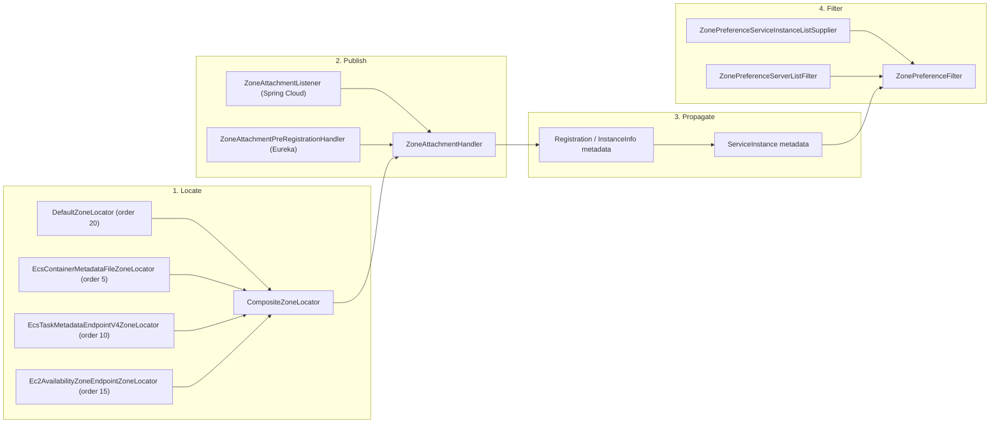
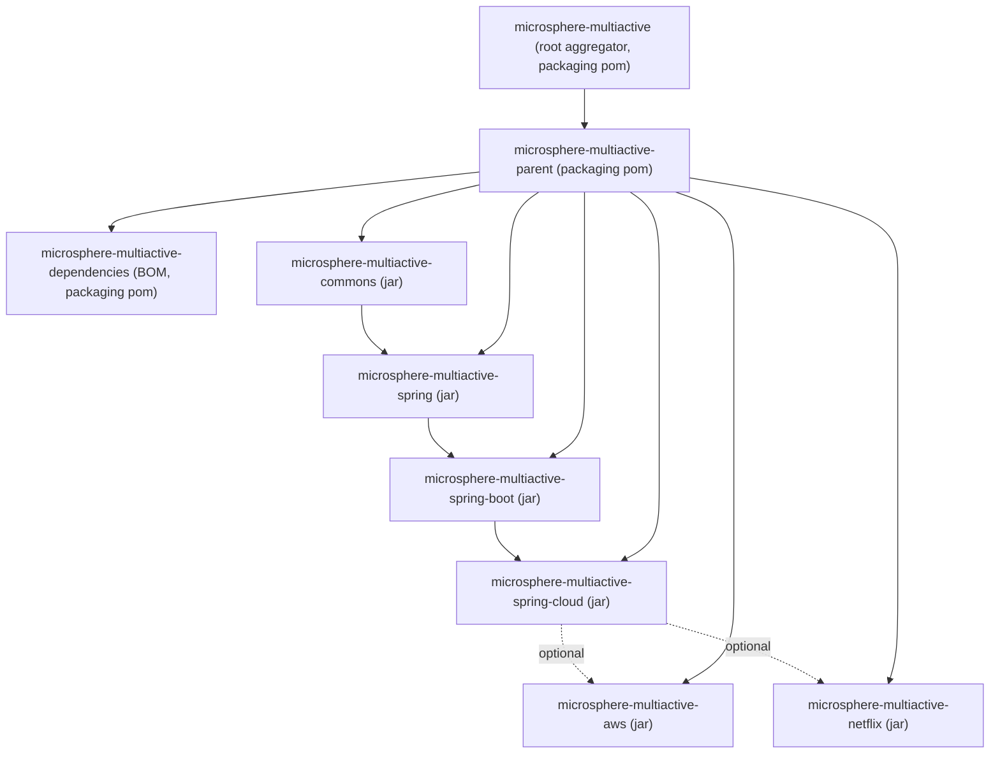
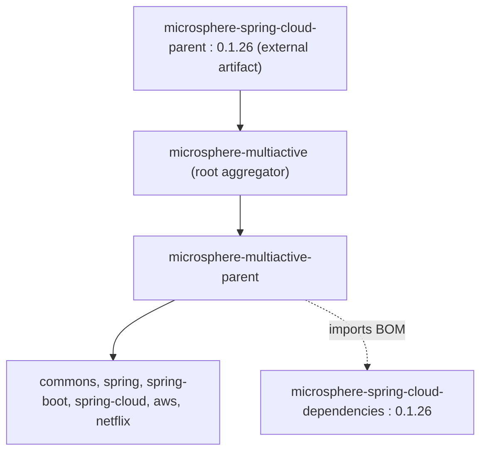

中文版本：[简体中文](zh/README.md)

# Microsphere Multiactive — Developer Guide (documentation line `1.x`)

This is the developer guide for the **`1.x`** documentation line, i.e. the sources of the **`release-1.x`** branch of
`microsphere-multiactive`. It documents how the library is built internally: module layout, class responsibilities,
zone-context propagation, `ZoneLocator` composition, filter chains and Spring Boot / Spring Cloud auto-configuration.

Every statement in these documents was read from this snapshot only — POM files, `src/main/java`,
`src/main/resources/META-INF` and `src/test/java`. Nothing that does not exist in this snapshot is documented.

---

## Table of contents

| Document | Maven module | Main content |
|----------|--------------|--------------|
| [microsphere-multiactive-parent](microsphere-multiactive-parent.md) | `microsphere-multiactive-parent` | Inheritance POM, external BOM import |
| [microsphere-multiactive-dependencies](microsphere-multiactive-dependencies.md) | `microsphere-multiactive-dependencies` | Project BOM, managed artifact ids |
| [microsphere-multiactive-commons](microsphere-multiactive-commons.md) | `microsphere-multiactive-commons` | `ZoneContext`, `ZoneConstants`, `ZonePreferenceFilter`, `ZoneResolver`, `ZoneAttachmentHandler`, `HttpUtils` |
| [microsphere-multiactive-spring](microsphere-multiactive-spring.md) | `microsphere-multiactive-spring` | `ZoneLocator` SPI, `CompositeZoneLocator`, `DefaultZoneLocator`, `ZoneContextChangedListener` |
| [microsphere-multiactive-spring-boot](microsphere-multiactive-spring-boot.md) | `microsphere-multiactive-spring-boot` | `ZoneAutoConfiguration`, custom `@Conditional*` annotations, `spring.factories` |
| [microsphere-multiactive-spring-cloud](microsphere-multiactive-spring-cloud.md) | `microsphere-multiactive-spring-cloud` | `ZoneCloudAutoConfiguration`, zone attachment listener, LoadBalancer suppliers |
| [microsphere-multiactive-aws](microsphere-multiactive-aws.md) | `microsphere-multiactive-aws` | ECS metadata-file / ECS task-endpoint V4 / EC2 availability-zone locators |
| [microsphere-multiactive-netflix](microsphere-multiactive-netflix.md) | `microsphere-multiactive-netflix` | Eureka resolvers and pre-registration handler, Ribbon server-list filter, `DiscoveryClientServerList` |

Companion documents:

- [User Guide index](../user-guide/README.md) — how to use the library (configuration reference, wiring recipes).
- [Repository README](../../../README.md) — the snapshot's own top-level README.
- [Release notes](../../../release-notes.md) — the per-version history maintained on this branch.

---

## Version at a glance

| Item | Value | Where it is defined |
|------|-------|---------------------|
| Git branch | `release-1.x` (HEAD commit `4fa6946`) | documentation line `1.x` |
| Artifact version | `0.1.14-SNAPSHOT` | `<revision>` property of the root [`pom.xml`](../../../pom.xml) |
| Last published release of this line | `0.1.13` | [`README.md`](../../../README.md), [`release-notes.md`](../../../release-notes.md) |
| groupId of all modules | `io.github.microsphere-projects` | every module POM |
| Java versions under test | 8, 11, 17, 21, 25 | `.github/workflows/maven-build.yml` (matrix `java`) |
| Maven | Apache Maven 3.9.15 (wrapper `only-script`, wrapperVersion 3.3.4) | `.mvn/wrapper/maven-wrapper.properties` |
| Spring Cloud compatibility | Hoxton, 2020, 2021 (CI profiles `spring-cloud-hoxton`, `spring-cloud-2020`, `spring-cloud-2021`) | `.github/workflows/maven-build.yml`, [`README.md`](../../../README.md) |
| External parent / BOM | `microsphere-spring-cloud-parent:0.1.26`, `microsphere-spring-cloud-dependencies:0.1.26` | root [`pom.xml`](../../../pom.xml), `microsphere-multiactive-parent/pom.xml` |
| Modules built here | 8 (2 `pom` + 6 `jar`) | root [`pom.xml`](../../../pom.xml) `<modules>` |

> The documentation line is named `1.x` after the **branch** (`release-1.x`), not after the Maven version, which is
> `0.1.x`. Every Java source file in this snapshot is nevertheless tagged `@since 1.0.0`.

---

## Architecture summary

The library answers one question in four stages. Each stage lives in a distinct module:

1. **Locate** — "which availability zone am I running in?"
   `ZoneLocator` implementations (Spring module SPI: `DefaultZoneLocator`, plus the AWS locators) are consulted in
   order by `CompositeZoneLocator`, which picks the first non-`null` result, caches it and writes it to the
   `microsphere.current.availability.zone` **system property**. The chain is **lazy**: the only production call site of
   `locate(...)` in this snapshot is `ZoneContextChangedListener.revertOriginalZone()`, reached when
   `microsphere.availability.zone` is set to the `originalZone` sentinel.
2. **Publish** — "tell everyone my zone."
   `ZoneAttachmentHandler` writes the located zone into registration metadata under the key
   `microsphere.availability.zone`. On Spring Cloud this happens in `ZoneAttachmentListener`, on Netflix Eureka in
   `ZoneAttachmentPreRegistrationHandler`.
3. **Propagate** — "keep the zone on the wire."
   The zone travels as ordinary instance metadata: the discovery client returns it inside `ServiceInstance.getMetadata()`
   or `InstanceInfo.getMetadata()`. There is **no per-request / thread-local zone carrier** in this line; see
   [Zone context model](#zone-context-model).
4. **Filter** — "prefer same-zone peers, but never go empty."
   `ZonePreferenceFilter` (commons) applies the shared decision algorithm to any `List<E>` using a `ZoneResolver<E>`.
   Adapters: `ZonePreferenceServiceInstanceListSupplier` (Spring Cloud LoadBalancer) and
   `ZonePreferenceServerListFilter` (Netflix Ribbon).



### Zone context model

`ZoneContext` (commons) is a **process-wide mutable singleton** — `private static final ZoneContext instance` exposed
through `ZoneContext.get()` — holding seven `volatile` fields (`enabled`, `zone`, `preferenceEnabled`,
`preferenceFilterOrder`, `preferenceUpstreamZoneReadyPercentage`, `preferenceUpstreamSameZoneMinAvailable`,
`preferenceUpstreamDisabledZone`) plus a `java.beans.PropertyChangeSupport`. `ZoneAutoConfiguration` registers that
same instance as the Spring bean named `zoneContext`.

Consequences that matter for maintainers of this line:

- The zone is one value per JVM; it cannot vary per request or per tenant in the 1.x code.
- `ZoneContext.getCurrentZone()` reads the **system property** `microsphere.current.availability.zone`, written by
  `CompositeZoneLocator.locate(...)`; it is not derived from the singleton's `zone` field.
- Spring Boot actuator/env or Spring Cloud config changes flow into the singleton through
  `ZoneContextChangedListener`, which then republishes a `ZoneContextChangedEvent`.

---

## Module dependency diagram

Derived from the `<dependencies>` sections of the eight module POMs of this snapshot. Solid arrows are mandatory
compile dependencies; dashed arrows are `<optional>true</optional>` dependencies.



Notes that are visible only when reading the POMs:

- `aws` and `netflix` depend on `microsphere-multiactive-spring-cloud` **optionally**, so they compile against the whole
  chain (transitively `spring` and `commons`) but do not leak it to consumers.
- `commons`, `spring`, `spring-boot` and `spring-cloud` chain strictly (`<version>${revision}</version>`, not optional).
- `microsphere-multiactive-dependencies` manages artifact ids that this snapshot **does not build**:
  `microsphere-multiactive-spring-boot-starter`, `microsphere-multiactive-spring-cloud-starter`,
  `microsphere-multiactive-spring-cloud-loadbalancer`, `microsphere-multiactive-dubbo`. See
  [microsphere-multiactive-dependencies](microsphere-multiactive-dependencies.md).
- `microsphere-multiactive-dependencies` is a leaf: no other module imports it in this snapshot.

### Maven inheritance



The root aggregator's own parent is the external `microsphere-spring-cloud-parent:0.1.26`; every leaf module's parent is
`microsphere-multiactive-parent`, whose parent is the root aggregator (`<relativePath>../pom.xml</relativePath>`).
`microsphere-multiactive-parent` additionally imports the `microsphere-spring-cloud-dependencies:0.1.26` BOM into its
`dependencyManagement`.

---

## Build and test

Commands are taken from the root POM, the Maven Wrapper configuration and `.github/workflows/maven-build.yml`.

Build from source (as documented in the snapshot's [`README.md`](../../../README.md)):

```bash
# Linux / MacOS
./mvnw package

# Windows
mvnw.cmd package
```

The CI test run activates three profiles — `test`, `coverage` and one Spring Cloud profile — and overrides the version:

```bash
mvn --batch-mode --update-snapshots --file pom.xml \
    -Drevision=0.0.1-SNAPSHOT \
    test \
    --activate-profiles test,coverage,spring-cloud-hoxton
```

| Profile | Purpose | Where declared |
|---------|---------|----------------|
| `test` | test-phase wiring (inherited) | external `microsphere-spring-cloud-parent:0.1.26` |
| `coverage` | JaCoCo/coverage reporting (inherited) | external `microsphere-spring-cloud-parent:0.1.26` |
| `spring-cloud-hoxton` / `-2020` / `-2021` | selects the Spring Cloud release train | external `microsphere-spring-cloud-parent:0.1.26` |
| `publish`, `ci` | used by `maven-publish.yml` (`-Dgpg.skip=true deploy`) | external `microsphere-spring-cloud-parent:0.1.26` |

> The `test`, `coverage`, `publish`, `ci` and `spring-cloud-*` profiles are **not** declared in any POM of this
> snapshot; they are inherited from `microsphere-spring-cloud-parent:0.1.26`. Their exact contents are outside this
> repository and are therefore not asserted here.

Run a single module (build its dependencies from the reactor first):

```bash
./mvnw -pl microsphere-multiactive-commons -am test
./mvnw -pl microsphere-multiactive-spring -am test
```

Publishing (from `.github/workflows/maven-publish.yml`, triggered on pushes to `release-1.x` or `workflow_dispatch`,
requires `<major>.<minor>.<patch>` input, runs on Java 11):

```bash
./mvnw --batch-mode --update-snapshots --file pom.xml \
    -Drevision=<major>.<minor>.<patch> -Dgpg.skip=true \
    deploy \
    --activate-profiles publish,ci
```

### Test inventory of this snapshot

| Module | `src/main/java` classes | `src/test/java` classes | `src/main/resources` files |
|--------|-----------------------:|-----------------------:|--------------------------:|
| `microsphere-multiactive-commons` | 6 | 6 | 0 |
| `microsphere-multiactive-spring` | 7 | 5 | 0 |
| `microsphere-multiactive-spring-boot` | 3 | 1 | 2 |
| `microsphere-multiactive-spring-cloud` | 6 | 2 | 3 |
| `microsphere-multiactive-aws` | 3 | 0 | 1 |
| `microsphere-multiactive-netflix` | 6 | 0 | 1 |
| `microsphere-multiactive-parent` | 0 | 0 | 0 |
| `microsphere-multiactive-dependencies` | 0 | 0 | 0 |

`aws` and `netflix` have **no tests at all** in this branch; their behaviour is only exercised indirectly through the
`ZoneLocator`/`ZoneResolver` contracts tested in `commons` and `spring`.

---

## Differences from the `0.2.x` / current line

Only differences that this snapshot itself makes visible:

| Aspect | `1.x` line (this snapshot) | Evidence in this snapshot |
|--------|----------------------------|---------------------------|
| Version series | `0.1.x` (`revision` = `0.1.14-SNAPSHOT`) | root `pom.xml` |
| Spring Cloud range | Hoxton → 2021.0.x | root `README.md` branch table; `maven-build.yml` profiles |
| Java floor | Java 8 is in the CI matrix | `maven-build.yml` |
| External parent | `microsphere-spring-cloud-parent:0.1.26` | root `pom.xml`, `microsphere-multiactive-parent/pom.xml` |
| Starters | No `*-starter` module is built, yet the BOM manages `microsphere-multiactive-spring-boot-starter` and `microsphere-multiactive-spring-cloud-starter` | `microsphere-multiactive-dependencies/pom.xml` vs root `<modules>` |
| LoadBalancer module | LoadBalancer classes live inside `microsphere-multiactive-spring-cloud`, although the BOM advertises a separate `microsphere-multiactive-spring-cloud-loadbalancer` | `.../spring/cloud/loadbalancer/` package vs BOM |
| Dubbo module | No `microsphere-multiactive-dubbo` module exists here, although the BOM manages it | root `<modules>` vs `microsphere-multiactive-dependencies/pom.xml` |
| Auto-configuration registration | Both `META-INF/spring.factories` (`EnableAutoConfiguration`) **and** `META-INF/spring/org.springframework.boot.autoconfigure.AutoConfiguration.imports` are shipped | `spring-boot` and `spring-cloud` resources |
| Zone context scope | One JVM-wide `ZoneContext` singleton + a system property for the current zone | `ZoneContext`, `CompositeZoneLocator` |

---

## Document conventions

- English is the primary language; `zh/` holds a full Chinese mirror with identical file names and paths.
- Code blocks and Mermaid diagrams are byte-identical between the English and Chinese documents, so diagram labels stay
  in English in both.
- Identifiers (`ZoneContext`, `microsphere.availability.zone`, `zoneLocator`, …) are reproduced verbatim in the Chinese
  documents.
- File paths in the documents are relative to the repository root of this branch, e.g.
  `microsphere-multiactive-commons/src/main/java/io/microsphere/multiple/active/zone/ZoneContext.java`.

## Related

- [User Guide index](../user-guide/README.md)
- [Repository README](../../../README.md)
- [Release notes](../../../release-notes.md)

## 中文

中文版本：[简体中文](zh/README.md)
