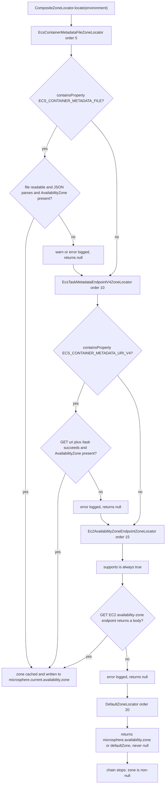
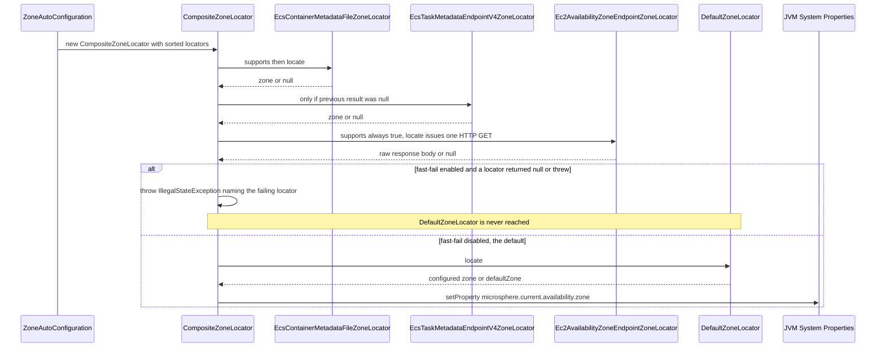

# `microsphere-multiactive-aws` — Developer Guide

中文版本：[简体中文](zh/microsphere-multiactive-aws.md)

Maven coordinates: `io.github.microsphere-projects:microsphere-multiactive-aws:${revision}` — `0.1.14-SNAPSHOT` on this
branch.

---

## Overview

`microsphere-multiactive-aws` contributes three `ZoneLocator` implementations that read the availability zone from the AWS
platform instead of from configuration. All three are ordered **before** `DefaultZoneLocator` (order `20`), so they are
consulted first and the configured/default zone acts as the last-resort fallback.

| Class | Order | Source of the zone | `supports(Environment)` |
|-------|------:|--------------------|-------------------------|
| `EcsContainerMetadataFileZoneLocator` | `5` | local JSON file named by the `ECS_CONTAINER_METADATA_FILE` environment variable, field `AvailabilityZone` | `environment.containsProperty("ECS_CONTAINER_METADATA_FILE")` |
| `EcsTaskMetadataEndpointV4ZoneLocator` | `10` | HTTP GET `${ECS_CONTAINER_METADATA_URI_V4}/task`, field `AvailabilityZone` | `environment.containsProperty("ECS_CONTAINER_METADATA_URI_V4")` |
| `Ec2AvailabilityZoneEndpointZoneLocator` | `15` | HTTP GET of the EC2 instance-metadata availability-zone endpoint | **always `true`** |

Files:

- `microsphere-multiactive-aws/src/main/java/io/microsphere/multiple/active/zone/spring/aws/EcsContainerMetadataFileZoneLocator.java`
- `microsphere-multiactive-aws/src/main/java/io/microsphere/multiple/active/zone/spring/aws/EcsTaskMetadataEndpointV4ZoneLocator.java`
- `microsphere-multiactive-aws/src/main/java/io/microsphere/multiple/active/zone/spring/aws/Ec2AvailabilityZoneEndpointZoneLocator.java`
- `microsphere-multiactive-aws/src/main/resources/META-INF/spring.factories`

The package is `io.microsphere.multiple.active.zone.spring.aws` — note it sits **under `.spring.`**, i.e. the AWS locators
are modelled as Spring-layer locators, not as a sibling stack. There is no `spring/zone/aws` root package and no test
source tree in this module.

---

## Architecture design

### Registration, not auto-configuration

This module contains **no `@Configuration` class** and no `EnableAutoConfiguration` entry. Its single resource file uses
the library's own SPI key:

```properties
io.microsphere.multiple.active.zone.spring.ZoneLocator=\
io.microsphere.multiple.active.zone.spring.aws.EcsContainerMetadataFileZoneLocator,\
io.microsphere.multiple.active.zone.spring.aws.EcsTaskMetadataEndpointV4ZoneLocator,\
io.microsphere.multiple.active.zone.spring.aws.Ec2AvailabilityZoneEndpointZoneLocator
```

`ZoneAutoConfiguration` (Spring Boot module) calls
`loadFactories(context, ZoneLocator.class)`, which reads exactly this key, merges the results with the `ZoneLocator` beans
already in the context, sorts everything with `AnnotationAwareOrderComparator` and puts the merged list into
`CompositeZoneLocator`. Consequences:

- The **declaration order in the file is not the evaluation order**; the numeric `DEFAULT_ORDER` values (5 → 10 → 15 → 20)
  decide.
- Adding a fourth AWS locator requires only a new line in this file plus a constructor order below `20`.
- Because these classes are loaded from `spring.factories` rather than declared as beans, whether `EnvironmentAware`
  callbacks are actually invoked depends on the external `SpringFactoriesLoaderUtils` implementation, which is not part of
  this snapshot. The code is defensive about this: `Ec2AvailabilityZoneEndpointZoneLocator` and
  `EcsTaskMetadataEndpointV4ZoneLocator` both initialise `private int timeout = DEFAULT_TIMEOUT;` as a field default, so
  `microsphere.availability.zone.locator.timeout` is applied if `setEnvironment` runs and `3000` ms is used if it does not.

### Locator decision flow



### The first `locate()` call, with and without fast-fail

`ZoneAutoConfiguration` only assembles the composite; on this branch nothing invokes `locate()` eagerly. The chain below
runs when `microsphere.availability.zone` is set to `originalZone` (which makes `ZoneContextChangedListener.revertOriginalZone()`
call the locator) or when application code calls the locator itself.



---

## Source analysis

### `EcsContainerMetadataFileZoneLocator`

`microsphere-multiactive-aws/src/main/java/io/microsphere/multiple/active/zone/spring/aws/EcsContainerMetadataFileZoneLocator.java`

```java
public static final String METADATA_FILE_ENV_NAME = "ECS_CONTAINER_METADATA_FILE";
public static final int DEFAULT_ORDER = 5;
private static final String ZONE_FIELD_NAME = "AvailabilityZone";

@Override
public boolean supports(Environment environment) {
    return environment.containsProperty(METADATA_FILE_ENV_NAME);
}
```

- Lowest order of the four locators: when the ECS agent writes a container metadata file, that is the cheapest and most
  authoritative answer, so it wins without any network call.
- `containsProperty` (rather than `hasText`) is the guard, so a set-but-empty variable still enters `locate`, where
  `StringUtils.hasText(metadataFilePath)` sends it to the `logger.trace("… can't be found")` branch returning `null`.
- `locate` path: `new File(path)` → `canRead()` → `new FileInputStream` in try-with-resources →
  `IOUtils.copyToString(inputStream, UTF_8)` → `new ObjectMapper().readValue(json, Map.class)` → `metadata.get("AvailabilityZone")`
  → `String.valueOf(zoneValue)` when non-`null`. Every failure mode (`canRead` false, parse error, cast) is caught by
  `catch (Throwable e)` and logged, returning `null` so the chain continues.
- Raw `Map` (unchecked) and a per-call `new ObjectMapper()` — deliberate here because `locate` runs at most a handful of
  times per JVM, and the class stays free of a shared mapper.
- It does **not** implement `EnvironmentAware`; it is a pure local-file read, so it has no timeout.

### `EcsTaskMetadataEndpointV4ZoneLocator`

`microsphere-multiactive-aws/src/main/java/io/microsphere/multiple/active/zone/spring/aws/EcsTaskMetadataEndpointV4ZoneLocator.java`

```java
public static final String METADATA_URI_V4_ENV_NAME = "ECS_CONTAINER_METADATA_URI_V4";
public static final int DEFAULT_ORDER = 10;

@Override
public String locate(Environment environment) {
    String uri = environment.getProperty(METADATA_URI_V4_ENV_NAME);
    String zone = null;
    if (StringUtils.hasText(uri)) {
        String taskURL = uri + "/task";
        try {
            String json = HttpUtils.doGet(taskURL, timeout);
            ObjectMapper objectMapper = new ObjectMapper();
            Map metadata = objectMapper.readValue(json, Map.class);
            Object zoneValue = metadata.get(ZONE_FIELD_NAME);
            zone = zoneValue == null ? null : String.valueOf(zoneValue);
            ...
        } catch (Throwable e) {
            logger.error("Request Amazon ECS Task metadata endpoint version 4 [URL : '{}'] failed", taskURL, e);
        }
    }
    return zone;
}

@Override
public void setEnvironment(Environment environment) {
    this.timeout = environment.getProperty(LOCATOR_TIMEOUT_PROPERTY_NAME, int.class, DEFAULT_TIMEOUT);
}
```

- Order `10` sits between the container metadata file and the EC2 endpoint, matching AWS's documented precedence for ECS
  task metadata (V4 endpoint) over instance metadata.
- The URL is built by naive concatenation (`uri + "/task"`), so a trailing slash in the environment variable yields a
  double slash. `HttpUtils` will still attempt the request; nothing in this module normalises it.
- `zone` stays `null` when the JSON has no `AvailabilityZone` key, and a JSON parse failure is logged as an error but is
  indistinguishable from an HTTP failure in the return value.
- `timeout` is used for **both** connect and read timeout (see `HttpUtils.doGet`).

### `Ec2AvailabilityZoneEndpointZoneLocator`

`microsphere-multiactive-aws/src/main/java/io/microsphere/multiple/active/zone/spring/aws/Ec2AvailabilityZoneEndpointZoneLocator.java`

```java
public static final String AVAILABILITY_ZONE_ENDPOINT_URI_PROPERTY_NAME = "EC2_AVAILABILITY_ZONE_ENDPOINT_URI";

public static final String DEFAULT_AVAILABILITY_ZONE_ENDPOINT_URI =
        "http://169.254.169.254/latest/meta-data/placement/availability-zone";

public static final int DEFAULT_ORDER = 15;

@Override
public boolean supports(Environment environment) {
    return true;
}

private String getAvailabilityZoneEndpointURI(Environment environment) {
    return environment.getProperty(AVAILABILITY_ZONE_ENDPOINT_URI_PROPERTY_NAME, DEFAULT_AVAILABILITY_ZONE_ENDPOINT_URI);
}
```

This is the class with the biggest operational consequences, and each one is visible directly in the source:

- **`supports` returns `true` unconditionally**, so unlike the two ECS locators this locator is *always attempted* during a
  `locate()` run. On a developer laptop or on a non-AWS data centre, `http://169.254.169.254` is a link-local address that
  does not answer, and the request burns the full `timeout` (default `3000` ms) before `catch (Throwable)` logs an error and
  returns `null`. Because `DefaultZoneLocator` has the *higher* order (`20`), the EC2 attempt happens **before** the cheap
  configuration lookup, so every `locate()` costs roughly `3` seconds in non-EC2 environments. Since `locate()` is only
  reached lazily on this branch (the `originalZone` sentinel or an explicit call), that cost is per call rather than a fixed
  startup tax — but it is paid again on every call until a non-`null` zone gets cached.
- **Combining `fast-fail` with this module is effectively a "must be EC2/ECS" assertion.** `CompositeZoneLocator` breaks the
  chain and throws `IllegalStateException("The zone can't be located by " + failedZoneLocator)` as soon as a *supporting*
  locator returns `null`. Since `supports` here is `true`, `microsphere.availability.zone.locator.fast-fail=true` means the
  application fails to locate a zone whenever the metadata endpoint is unreachable — `DefaultZoneLocator` never gets a
  chance to apply the configured zone.
- **When every AWS source is silent, `DefaultZoneLocator` echoes the sentinel back.** `DefaultZoneLocator.locate(...)` reads
  `microsphere.availability.zone`, and in the revert scenario that property literally contains `"originalZone"`. If no AWS
  locator answered, the composite therefore returns `"originalZone"` as the *located* zone, caches it, and writes it to the
  `microsphere.current.availability.zone` system property.
  `ZoneContextChangedListenerTest#testRevertOriginalZoneWhenZoneIsOriginal` documents the same reading in its comments and
  asserts only non-nullness. Treat "revert to the discovered zone" as an AWS-capable-only operation on this branch.
- The endpoint URI is **overridable** through the environment/system property `EC2_AVAILABILITY_ZONE_ENDPOINT_URI`, which is
  also the knob that makes the locator usable off the default metadata path (e.g. IMDSv2-aware proxies or a local stub). The
  locator performs no token acquisition; it issues a plain GET, so an IMDS endpoint configured to require a session token
  will not return a zone.
- The returned value is the **raw response body** — `HttpUtils.doGet` result, with no `trim`, no suffix handling and no case
  normalisation before it is compared against the zone strings that other services publish.

### Shared traits of the three locators

- All three extend `AbstractZoneLocator` and pass a `DEFAULT_ORDER` through the constructor, so `getOrder()`/`setOrder()`
  behave as described in [microsphere-multiactive-spring](microsphere-multiactive-spring.md).
- All three catch `Throwable` and return `null` on failure — the "never throw unless fast-fail is on" contract that
  `CompositeZoneLocator` relies on.
- All three log the successful zone through the inherited `protected Logger logger` created from `getClass()`, and the
  messages embed the source (`"… located from the EC2 Availability Zone Endpoint[URI : '…' , property name: '…']"`), which
  makes it possible to tell *which* AWS mechanism answered.
- None of them validates the shape of the zone, and none of them caches: caching is `CompositeZoneLocator`'s job.

---

## Design patterns actually present

| Pattern | Evidence in this snapshot |
|---------|---------------------------|
| **Strategy with priority** | three interchangeable `ZoneLocator` beans ordered `5`/`10`/`15`, selected by `AnnotationAwareOrderComparator` inside the composite |
| **Template method** | each locator extends `AbstractZoneLocator`, inheriting `getOrder`/`setBeanName`/logging and implementing only `supports` + `locate` |
| **ServiceLoader-style SPI via `spring.factories`** | `META-INF/spring.factories` keyed by the `ZoneLocator` interface class name, loaded by `SpringFactoriesLoaderUtils.loadFactories` |
| **Capability probe (`supports`) + fallback ladder** | two locators probe environment variables, one always answers, and the configured default is the final rung |
| **Fail-soft error handling** | `catch (Throwable …)` + `logger.error` + `return null` in every `locate` |
| **Configuration-aware timeout injection** | `implements EnvironmentAware` and reading `LOCATOR_TIMEOUT_PROPERTY_NAME`, with a field-level default as a safety net |

Not present: no auto-configuration class, no conditional annotation, no AWS SDK dependency (everything is plain
`java.net` + Jackson), no caching, no IMDSv2 session token handling.

---

## Configuration properties used by this module

| Property / environment variable | Read by | Default | Effect |
|---------------------------------|---------|---------|--------|
| `ECS_CONTAINER_METADATA_FILE` | `EcsContainerMetadataFileZoneLocator.supports/locate` | none (absence disables the locator) | path of the ECS container metadata JSON file |
| `ECS_CONTAINER_METADATA_URI_V4` | `EcsTaskMetadataEndpointV4ZoneLocator.supports/locate` | none (absence disables the locator) | base URI; `/task` is appended |
| `EC2_AVAILABILITY_ZONE_ENDPOINT_URI` | `Ec2AvailabilityZoneEndpointZoneLocator.locate` | `http://169.254.169.254/latest/meta-data/placement/availability-zone` | metadata endpoint URI |
| `microsphere.availability.zone.locator.timeout` | both HTTP locators via `setEnvironment` | `3000` | connect **and** read timeout in ms |
| `microsphere.availability.zone.locator.fast-fail` | `CompositeZoneLocator` (not this module) | `false` | abort the chain on the first `null`/exception |
| `microsphere.availability.zone` | `DefaultZoneLocator` (not this module) | `defaultZone` | the configured fallback zone |

The three constants `AVAILABILITY_ZONE_ENDPOINT_URI_PROPERTY_NAME`, `METADATA_FILE_ENV_NAME` and
`METADATA_URI_V4_ENV_NAME` are `public static final`, so the names are part of the module's API for callers that want to
validate their platform assumptions.

---

## Build and test

`microsphere-multiactive-aws/pom.xml` — parent `microsphere-multiactive-parent`, packaging `jar`, no plugins, no profiles,
**no `src/test/java` sources at all**.

The dependency block is worth reading twice, because every single entry is optional or test-scoped:

| Dependency | Scope | Notes |
|------------|-------|-------|
| `microsphere-multiactive-spring-cloud` (`${revision}`) | **optional** | the only project dependency — and it is optional, so `commons`/`spring`/`spring-boot` arrive transitively at compile time but are **not** published to consumers |
| `microsphere-annotation-processor` | optional | annotation processing |
| `spring-boot-starter`, `spring-boot-starter-actuator` | optional | Boot types; note there is no `spring-boot-starter-web` here, unlike the `spring-boot`, `spring-cloud` and `netflix` POMs |
| `spring-boot-configuration-processor`, `spring-boot-autoconfigure-processor` | optional | compile-time processing |
| `spring-cloud-commons`, `spring-cloud-context` | optional | declared but **not referenced** by the three locators, which use only `org.springframework.core.env.Environment` |
| `com.fasterxml.jackson.core:jackson-databind` | optional | `ObjectMapper` in the two ECS locators |
| `junit-jupiter`, `spring-boot-starter-test`, `microsphere-spring-boot-test`, `logback-classic` | test | declared, unused (no tests exist) |

**Practical packaging consequence**: `microsphere-multiactive-aws` declares **zero mandatory dependencies**. A consumer that
adds only this artifact gets a jar whose classes reference `AbstractZoneLocator`, `HttpUtils` and `ZoneConstants` without
Maven pulling them in — so `microsphere-multiactive-spring` (or `…-spring-cloud`) and `microsphere-java-core` must be added
explicitly. `jackson-databind` must likewise be supplied for the two ECS locators to work.

```bash
# Compiles and installs the module; there are no tests to run
./mvnw -pl microsphere-multiactive-aws -am install
```

Release notes for `v0.1.10` record the addition of the optional `jackson-databind` dependency to this module
("AWS Module Enhancement"), which is consistent with the two ECS locators being the newest additions on this branch.

---

## Differences from the `0.2.x` / current line

Visible from this snapshot:

- The AWS zone sources are delivered purely through the Microsphere `ZoneLocator` `spring.factories` key, with **no
  auto-configuration class and no `@Conditional*` annotation of its own** — all gating lives in
  `ZoneAutoConfiguration`/`CompositeZoneLocator`.
- `Ec2AvailabilityZoneEndpointZoneLocator.supports(...)` returning `true` makes the EC2 metadata call unconditional;
  combined with `@Primary`-composite caching and `fast-fail`, that is the main behavioural difference operators will feel on
  this branch.
- Only `@since 1.0.0` is tagged here, while the artifact version of the branch is `0.1.x`.
- No test sources exist for this module on this branch.

---

## Related

- [Developer Guide index](README.md)
- [microsphere-multiactive-spring](microsphere-multiactive-spring.md) — `AbstractZoneLocator`, `CompositeZoneLocator`, ordering contract
- [microsphere-multiactive-spring-boot](microsphere-multiactive-spring-boot.md) — `loadFactories` that discovers these locators
- [microsphere-multiactive-commons](microsphere-multiactive-commons.md) — `HttpUtils.doGet` and `ZoneConstants.LOCATOR_TIMEOUT_PROPERTY_NAME`
- [microsphere-multiactive-aws User Guide](../user-guide/microsphere-multiactive-aws.md)
- [User Guide index](../user-guide/README.md)
- [Repository README](../../../README.md)

## 中文

中文版本：[简体中文](zh/microsphere-multiactive-aws.md)
