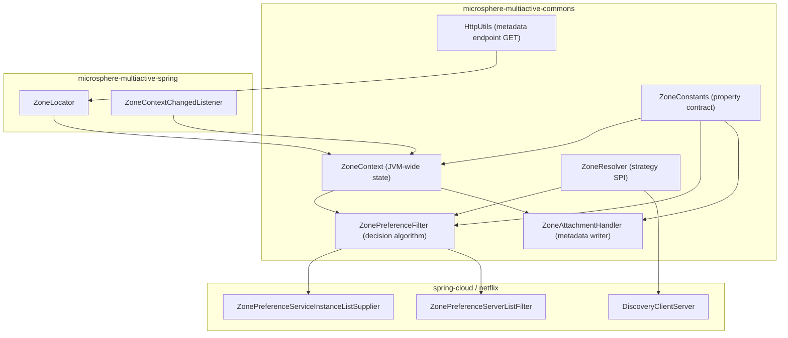
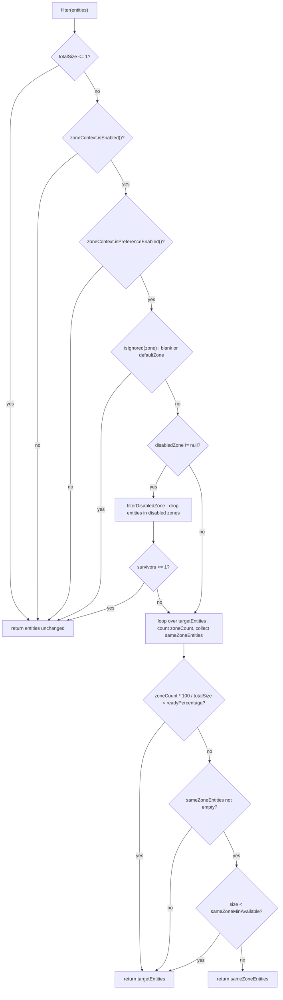

# `microsphere-multiactive-commons` — Developer Guide

中文版本：[简体中文](zh/microsphere-multiactive-commons.md)

Maven coordinates: `io.github.microsphere-projects:microsphere-multiactive-commons:${revision}` — `0.1.14-SNAPSHOT` on
this branch.

---

## Overview

`microsphere-multiactive-commons` is the framework-free kernel of the 1.x line. It contains the whole zone state model
(`ZoneContext`), the complete configuration-property contract (`ZoneConstants`), the two portable algorithms
(`ZonePreferenceFilter` + `ZoneResolver`), the registration-metadata writer (`ZoneAttachmentHandler`) and one HTTP
helper (`HttpUtils`). It declares **no Spring types at all**.

Its POM makes the layering explicit — every non-test dependency is `optional`:

```xml
<dependency>
    <groupId>io.github.microsphere-projects</groupId>
    <artifactId>microsphere-annotation-processor</artifactId>
    <optional>true</optional>
</dependency>

<dependency>
    <groupId>io.github.microsphere-projects</groupId>
    <artifactId>microsphere-java-core</artifactId>
    <optional>true</optional>
</dependency>
```

Consequences for maintainers:

- `io.microsphere.util.StringUtils`, `io.microsphere.io.IOUtils`, `io.microsphere.logging.Logger`,
  `io.microsphere.constants.SymbolConstants` and `io.microsphere.annotation.ConfigurationProperty` come from
  **`microsphere-java-core`**, which is optional — a consumer that uses this module alone must provide it explicitly.
- Because nothing is Spring-based, the zone decision algorithm can be reused verbatim from any RPC/HTTP stack; the
  Spring, Spring Cloud and Netflix adapters in the higher modules are thin shells around it.

Package: `io.microsphere.multiple.active.zone` — one flat package, six types, no sub-packages, no
`src/main/resources`.

| Type | Kind | File |
|------|------|------|
| `ZoneConstants` | interface (constant contract) | `microsphere-multiactive-commons/src/main/java/io/microsphere/multiple/active/zone/ZoneConstants.java` |
| `ZoneContext` | class (mutable singleton) | `microsphere-multiactive-commons/src/main/java/io/microsphere/multiple/active/zone/ZoneContext.java` |
| `ZoneResolver<E>` | functional interface | `microsphere-multiactive-commons/src/main/java/io/microsphere/multiple/active/zone/ZoneResolver.java` |
| `ZonePreferenceFilter<E>` | class (algorithm) | `microsphere-multiactive-commons/src/main/java/io/microsphere/multiple/active/zone/ZonePreferenceFilter.java` |
| `ZoneAttachmentHandler` | class | `microsphere-multiactive-commons/src/main/java/io/microsphere/multiple/active/zone/ZoneAttachmentHandler.java` |
| `HttpUtils` | abstract utility class | `microsphere-multiactive-commons/src/main/java/io/microsphere/multiple/active/zone/HttpUtils.java` |

---

## Architecture design

### Layering



Responsibilities are strictly split: `ZoneContext` **holds** state, `ZonePreferenceFilter` **decides** with it,
`ZoneAttachmentHandler` **exports** it, `ZoneResolver` **reads** foreign models into the algorithm.

### Zone state is process-wide, not request-scoped

There is **no `ThreadLocal`** anywhere in this snapshot (verified by searching every `src/main/java` file). The zone is
held in one `ZoneContext` instance created eagerly by its own static field:

```java
private static final ZoneContext instance = new ZoneContext();
...
public static ZoneContext get() {
    return instance;
}
```

All seven mutable fields are `volatile`; mutation is funnelled through `isPropertyChanged(...)`, which fires JavaBeans
`PropertyChangeSupport` events and logs. `ZoneContext` is therefore simultaneously a singleton, an observable bean, and
the runtime configuration source for filters.

The only "ambient" zone value visible outside the JVM bean graph is the system property written by
`CompositeZoneLocator` and read by the static helper:

```java
public static String getCurrentZone() {
    return System.getProperty(CURRENT_ZONE_PROPERTY_NAME, DEFAULT_ZONE);
}
```

`CURRENT_ZONE_PROPERTY_NAME` is `microsphere.current.availability.zone`. Note that it is a **different** value from
`ZoneContext.getZone()`: the former is the physically discovered zone, the latter is the *effective* zone that filters
compare against (and can be overridden at runtime to `"originalZone"`, `"  "` → trimmed, etc.).

---

## Source analysis

### `ZoneConstants`

`microsphere-multiactive-commons/src/main/java/io/microsphere/multiple/active/zone/ZoneConstants.java`

An `interface` used as a constant holder. Every property name is *composed* from prefixes, so the naming tree is
structurally guaranteed:

```java
String ZONE_PROPERTY_NAME = "microsphere.availability.zone";
String PREFERENCE_PROPERTY_NAME_PREFIX = ZONE_PROPERTY_NAME + DOT + "preference" + DOT;
String PREFERENCE_FILER_PROPERTY_NAME_PREFIX = PREFERENCE_PROPERTY_NAME_PREFIX + "filter" + DOT;
String PREFERENCE_UPSTREAM_PROPERTY_NAME_PREFIX = PREFERENCE_PROPERTY_NAME_PREFIX + "upstream" + DOT;
String LOCATOR_PROPERTY_NAME_PREFIX = ZONE_PROPERTY_NAME + DOT + "locator" + DOT;
String ZONE_ENABLED_PROPERTY_NAME = ZONE_PROPERTY_NAME + ENABLED_PROPERTY_NAME_SUFFIX;
```

Key design points:

- Defaults exist in **two forms**: a `String` `..._PROPERTY_VALUE` constant (used by the `@ConfigurationProperty`
  annotation, which needs compile-time strings) and a parsed typed constant
  (`boolean DEFAULT_ZONE_ENABLED = parseBoolean(...)`, `int DEFAULT_TIMEOUT = parseInt(...)`). Both are asserted equal in
  `ZoneConstantsTest`, which is the guard against them drifting.
- `ENABLED_PROPERTY_NAME_SUFFIX`, `DOT`, `DEFAULT_ZONE_ENABLED_PROPERTY_VALUE`,
  `DEFAULT_PREFERENCE_ENABLED_PROPERTY_VALUE` … are public because the annotation members require them; they are not
  meant as user-facing API.
- `DEFAULT_ZONE = "defaultZone"` is documented as "compatible with Eureka zone" and references
  `EurekaClientConfigBean#DEFAULT_ZONE`; `ORIGINAL_ZONE = "originalZone"` is a *sentinel value* of the
  `microsphere.availability.zone` property, not a property name — it instructs
  `ZoneContextChangedListener` to revert to the discovered zone.
- The constant name `PREFERENCE_FILER_PROPERTY_NAME_PREFIX` contains a typo (`FILER`); the *property value* it produces,
  `microsphere.availability.zone.preference.filter.`, is correct. Renaming the constant would be a source-incompatible
  change for anyone static-importing it.
- `DEFAULT_PREFERENCE_UPSTREAM_DISABLED_ZONE = null` is a `null` `String` constant; the code relies on
  `disabledZone != null` as the "feature off" switch, which is why an explicitly configured empty value behaves
  differently from an absent one (see the note under `ZonePreferenceFilter`).

Full property contract asserted by `ZoneConstantsTest`:

| Constant | Value | Parsed default | Declared type |
|----------|-------|----------------|---------------|
| `ZONE_PROPERTY_NAME` | `microsphere.availability.zone` | `"defaultZone"` | `String` |
| `CURRENT_ZONE_PROPERTY_NAME` | `microsphere.current.availability.zone` | `defaultZone` (via `System.getProperty` fallback) | `String` |
| `ZONE_ENABLED_PROPERTY_NAME` | `microsphere.availability.zone.enabled` | `true` | `boolean` |
| `PREFERENCE_ENABLED_PROPERTY_NAME` | `microsphere.availability.zone.preference.enabled` | `false` | `boolean` |
| `PREFERENCE_FILTER_ORDER_PROPERTY_NAME` | `microsphere.availability.zone.preference.filter.order` | `10` | `int` |
| `PREFERENCE_UPSTREAM_ZONE_READY_PERCENTAGE_PROPERTY_NAME` | `microsphere.availability.zone.preference.upstream.zone-ready-percentage` | `100` | `int` |
| `PREFERENCE_UPSTREAM_SAME_ZONE_MIN_AVAILABLE_PROPERTY_NAME` | `microsphere.availability.zone.preference.upstream.same-zone-min-available` | `5` | `int` |
| `PREFERENCE_UPSTREAM_DISABLED_ZONE_PROPERTY_NAME` | `microsphere.availability.zone.preference.upstream.disabled-zone` | `null` | `String` |
| `LOCATOR_FAST_FAIL_PROPERTY_NAME` | `microsphere.availability.zone.locator.fast-fail` | `false` | `boolean` |
| `LOCATOR_TIMEOUT_PROPERTY_NAME` | `microsphere.availability.zone.locator.timeout` | `3000` | `int` |
| `DEFAULT_ZONE` | `defaultZone` | — | sentinel value |
| `ORIGINAL_ZONE` | `originalZone` | — | sentinel value |

### `ZoneContext`

`microsphere-multiactive-commons/src/main/java/io/microsphere/multiple/active/zone/ZoneContext.java`

Fields (all `volatile`, all initialised from `ZoneConstants` defaults):

| Field | Getter | Setter | Default |
|-------|--------|--------|---------|
| `enabled` | `isEnabled()` | `setEnabled(boolean)` | `true` |
| `zone` | `getZone()` | `setZone(String)` | `defaultZone` |
| `preferenceEnabled` | `isPreferenceEnabled()` | `setPreferenceEnabled(boolean)` | `false` |
| `preferenceFilterOrder` | `getPreferenceFilterOrder()` | `setPreferenceFilterOrder(int)` | `10` |
| `preferenceUpstreamZoneReadyPercentage` | `getPreferenceUpstreamZoneReadyPercentage()` | `setPreferenceUpstreamZoneReadyPercentage(int)` | `100` |
| `preferenceUpstreamSameZoneMinAvailable` | `getPreferenceUpstreamSameZoneMinAvailable()` | `setPreferenceUpstreamSameZoneMinAvailable(int)` | `5` |
| `preferenceUpstreamDisabledZone` | `getPreferenceUpstreamDisabledZone()` | `setPreferenceUpstreamDisabledZone(String)` | `null` |

The single interesting method is the write path, which couples normalisation, notification and logging:

```java
private boolean isPropertyChanged(String propertyName, Object previousPropertyValue, Object newPropertyValue) {
    boolean changed = !Objects.equals(previousPropertyValue, newPropertyValue);
    if (changed) {
        propertyChangeSupport.firePropertyChange(propertyName, previousPropertyValue, newPropertyValue);
        logger.info("The property value [name : '{}'] is changed from '{}' to '{}'", propertyName, previousPropertyValue, newPropertyValue);
    } else {
        logger.trace("The property value [name : '{}'] is not changed : '{}'", propertyName, previousPropertyValue);
    }
    return changed;
}
```

Behaviour that downstream code depends on:

- **Write only on change.** The assignment happens *inside* the `if`, so a no-op call does not touch the field — which
  also means the value that was logged as "previous" is always the value actually held.
- **`setZone` trims**: `this.zone = trimAllWhitespace(zone)`. `ZoneContextTest#testSetZoneTrimsWhitespace` pins
  `"  zone-b  "` → `"zone-b"`, and `testFilterIgnoredWhenZoneIsBlank` pins `"  "` → blank → the filter ignores the zone.
  Because it is the *change* that is compared first, setting the already-held value silently does nothing.
- **`setPreferenceUpstreamDisabledZone` normalises comma lists** through `resolveCommaDelimited(...)`, which
  `split(value, COMMA)` + `StringJoiner(COMMA)` + `trimAllWhitespace` per element (`" zone-a , zone-b "` →
  `"zone-a,zone-b"`). A blank input is returned untouched, which is why `setPreferenceUpstreamDisabledZone("")` stores
  `""` (and therefore keeps `disabledZone != null` *true* in the filter), while `null` stores `null`.
  `ZoneContextTest#testSetPreferenceUpstreamDisabledZoneEmptyString` pins exactly this.
- `enable()` returns the *previous* status and only writes when it was `false`.
- `reset()` restores all seven defaults; the test suite calls it in `@BeforeEach`/`@AfterEach` because the instance is
  shared JVM-wide — a pattern every new test in this module must follow.
- `addPropertyChangeListener` / `removePropertyChangeListener` are public and are used by
  `ZoneContextChangedListener` for the temporary-listener trick (see the Spring module doc).
- `toString()` is hand-written (`"ZoneContext{enabled=..., zone='...'}"`), not `StringJoiner`-based.

Extension points: none — the class is neither `final` nor abstract-friendly; higher modules inject it as a bean rather
than subclass it. The realistic extension mechanism is observing its property changes.

### `ZoneResolver<E>`

`microsphere-multiactive-commons/src/main/java/io/microsphere/multiple/active/zone/ZoneResolver.java`

```java
public interface ZoneResolver<E> extends Function<E, String> {

    default String apply(E entity) {
        return resolve(entity);
    }

    String resolve(E entity);
}
```

The only strategy seam in the kernel. `@FunctionalInterface` is *not* declared, but the single abstract method makes all
implementations lambda-compatible — `ZoneResolverTest` uses `entity -> entity + "-zone"`. Extending `Function` is
deliberate: a resolver can be passed to any JDK/Stream API expecting a mapping function; `apply` is redirected to
`resolve` so overriding `resolve` cannot be bypassed. Contract: return `null` when the zone is unknown — never throw.

### `ZonePreferenceFilter<E>`

`microsphere-multiactive-commons/src/main/java/io/microsphere/multiple/active/zone/ZonePreferenceFilter.java`

The core decision procedure. Constructor takes the context and the strategy:

```java
public ZonePreferenceFilter(ZoneContext zoneContext, ZoneResolver<E> zoneResolver)
```

`filter(List<E>)` executes a strict sequence of **pass-through guards** followed by **three outcome branches**. Reading
the order matters, because each early return returns the *caller's original list instance*:

1. `totalSize = entities == null ? 0 : entities.size()`; if `totalSize <= 1` return `entities` unchanged — this single
   guard also covers `null` and empty lists (pinned by `testFilterNullList`, `testFilterEmptyList`,
   `testFilterSingleElementList`).
2. `!zoneContext.isEnabled()` → return `entities` (trace log names `microsphere.availability.zone.enabled`).
3. `!zoneContext.isPreferenceEnabled()` → return `entities` (trace log names
   `microsphere.availability.zone.preference.enabled`; this is why zone preference is **off by default**).
4. `isIgnored(zone)` → return `entities`. `isIgnored` is `protected` and returns `isBlank(zone) ||
   DEFAULT_ZONE.equalsIgnoreCase(zone)` — so a JVM that discovered nothing (`defaultZone`) does no filtering at all, and
   the comparison is case-insensitive here (`DEFAULTZONE` is ignored, pinned by
   `testFilterIgnoredWhenZoneIsDEFAULTZONECaseInsensitive`).
5. **Disabled-zone pre-pass**: if `getPreferenceUpstreamDisabledZone() != null`, `filterDisabledZone(...)` builds a new
   `LinkedList` of entities whose resolved zone is not in the comma-split disabled set
   (`isDisabledZone` uses `Objects.equals`, i.e. case-sensitive), and `totalSize` is **re-assigned** to the surviving
   size. If ≤ 1 survives, the *original* list is returned instead (safety valve,
   `testFilterWithDisabledZoneResultingInNotEnoughEntities`).
6. **Single-pass classification**: for `i` in `[0, totalSize)` resolve the zone; non-`null` resolutions increment
   `zoneCount`, and `matches(zone, resolvedZone)` (`Objects.equals`, case-**sensitive**) collects
   `sameZoneEntities`. `resolveZone(entity)` null-guards the entity itself, so a `null` element is tolerated.
7. **Ready-percentage gate**: `isUpstreamZoneNotReady` computes `zoneCount * 100 / entitiesSize` with **integer
   division** and compares `<` the threshold. With the default threshold of `100`, filtering only happens if *every*
   entity carries a zone; `testFilterUpstreamZoneNotReady` and `testFilterWithNullEntity*` pin both sides of that gate.
8. **Min-available gate**: if some same-zone entities exist but `sameZoneEntitiesSize < sameZoneMinAvailable`
   (default `5`), the wider `targetEntities` list is returned rather than the thin same-zone subset.
9. Otherwise return `sameZoneEntities`; if none matched, return `targetEntities`.



Observations that only a careful read reveals, and that a maintainer must preserve or fix deliberately:

- **Three different return values** exist: the caller's list (`RT`), the disabled-zone-filtered list (`RT2`), the
  same-zone subset (`RS`). Callers may rely on identity, which is why tests assert with `assertSame`.
- `getOrder()` returns `zoneContext.getPreferenceFilterOrder()` but **no production code in this snapshot calls it**:
  `ZonePreferenceServerListFilter` does not forward it and `ZonePreferenceServiceInstanceListSupplier` does not need it.
  It is exercised only by `ZonePreferenceFilterTest#testGetOrder`. Consequently
  `microsphere.availability.zone.preference.filter.order` currently has **no runtime effect** on this branch.
- The disabled-zone pre-pass splits on `COMMA_CHAR` directly, while `ZoneContext` already normalised the string; the two
  are consistent because the joiner also uses `","`.
- Setting `microsphere.availability.zone.preference.upstream.disabled-zone=""` keeps `disabledZone != null` and feeds
  `split("", COMMA_CHAR)` into `isDisabledZone`. The precise outcome depends on `io.microsphere.util.StringUtils.split`
  (external); the code path is *reached*, unlike the `null` case. Treat as an edge case, not a documented feature.

### `ZoneAttachmentHandler`

`microsphere-multiactive-commons/src/main/java/io/microsphere/multiple/active/zone/ZoneAttachmentHandler.java`

The export side of the kernel — 15 meaningful lines:

```java
public void attachZone(Map<String, String> metadata) {
    String zone = zoneContext.getZone();
    if (isNotBlank(zone)) {
        String propertyName = ZONE_PROPERTY_NAME;
        // If metadata is unmodifiable, UnsupportedOperationException will be thrown.
        try {
            metadata.put(propertyName, zone);
            logger.info(...);
        } catch (Throwable e) {
            logger.warn("The zone ['{}'] can't be attached into meta-data [name : '{}']", zone, propertyName);
        }
    } else {
        logger.warn("No zone info can't be found in the context!");
    }
}
```

- The key written is `microsphere.availability.zone` — the same constant that `DefaultZoneLocator` *reads* from the
  `Environment` and that `CloudServerZoneResolver` / `EurekaInstanceInfoZoneResolver` read back from metadata. One name
  closes the whole loop.
- `isNotBlank(zone)` is used, **not** `isIgnored(zone)`: `"defaultZone"` *is* published (asserted by
  `ZoneAttachmentHandlerTest#testAttachZoneWithDefaultZone`), even though the filter ignores it. A blank (post-trim) zone
  is not published at all.
- `catch (Throwable …)` plus a warning: registration must never fail because metadata is immutable —
  `testAttachZoneWithUnmodifiableMap` pins the no-throw contract. The cost is silent failure: on registries whose
  metadata map is unmodifiable, the zone simply never appears.
- Constructed with an explicit `ZoneContext`; in the Spring Cloud module it is created by `@Import` and constructor-
  injected with the `zoneContext` bean.

### `HttpUtils`

`microsphere-multiactive-commons/src/main/java/io/microsphere/multiple/active/zone/HttpUtils.java`

```java
public static String doGet(String url, int timeout) throws IOException
```

A single raw `java.net.HttpURLConnection` GET used by the AWS locators: `isNotBlank(url)` guard, `openConnection()`,
`instanceof HttpURLConnection` check (so `file:` URLs return `null` — pinned by `testDoGetWithNonHttpUrl`),
connect **and** read timeout both set to `timeout`, body read with `IOUtils.copyToString(inputStream, UTF_8)` inside a
try-with-resources, `disconnect()` in `finally`. Response body is returned as a `String`; a non-2xx response is not
inspected — `getInputStream()` throws `IOException` and the caller logs it. Note `logger.info` prints the whole
response body, which on this branch means the metadata payload is logged at info level.

The class is `public abstract` with an implicit private constructor never declared — i.e. subclassable but not
instantiable, the same convention `ZoneUtils` follows in the Spring module.

---

## Design patterns actually present

| Pattern | Evidence in this snapshot |
|---------|---------------------------|
| Singleton (eager, static holder) | `private static final ZoneContext instance = new ZoneContext();` + `public static ZoneContext get()`; `ZoneContextTest#testGetSingletonInstance` asserts identity across calls |
| Observer (JavaBeans variant) | `PropertyChangeSupport` field, `addPropertyChangeListener` / `removePropertyChangeListener`, `firePropertyChange` inside `isPropertyChanged`; consumed by `ZoneContextChangedListener` |
| Strategy | `ZonePreferenceFilter` receives a `ZoneResolver<E>` in its constructor and never inspects the entity type |
| Adapter (to a JDK functional type) | `ZoneResolver<E> extends Function<E, String>` with `default apply(E)` delegating to `resolve(E)` |
| Guard clauses / chain of pass-through filters | the four ordered early returns in `filter(...)` before any work is done |
| Fail-safe degradation ("never return an empty server list") | `totalSize <= 1` guard, `currentSize <= 1` guard, ready-percentage gate, min-available gate |
| Constant interface (as a shared vocabulary) | `ZoneConstants` is an `interface` containing only constants and annotations |
| Utility class (abstract, non-instantiable-by-convention) | `HttpUtils` |

Patterns deliberately **not** present in this module: no `ThreadLocal`/context-holder (verified by search), no
`Composite` (that appears in `CompositeZoneLocator` in the Spring module), no auto-configuration (Spring Boot module),
no template-method hierarchy (the filter is a plain class with composition).

---

## Configuration properties

This module *defines* the property contract; it does not read the Spring `Environment` (the Spring module does). The
runtime defaults live in `ZoneContext`'s field initialisers, which is why they apply even in a non-Spring usage:

```java
zoneContext.setEnabled(true);
zoneContext.setPreferenceEnabled(true);
zoneContext.setZone("cn-hangzhou-a");
zoneContext.setPreferenceUpstreamZoneReadyPercentage(80);
zoneContext.setPreferenceUpstreamSameZoneMinAvailable(2);
zoneContext.setPreferenceUpstreamDisabledZone("cn-hangzhou-b");

ZonePreferenceFilter<Server> filter = new ZonePreferenceFilter<>(zoneContext, Server::getZone);
List<Server> sameZone = filter.filter(servers);
```

`enabled` and `preferenceEnabled` must **both** be true for any filtering — the second is `false` by default, which makes
zone preference an explicit opt-in.

---

## Build and test

`microsphere-multiactive-commons/pom.xml` — parent `microsphere-multiactive-parent`, packaging `jar`, no build plugins,
no profiles and no resource directory of its own.

| Dependency | Scope | Used for |
|------------|-------|----------|
| `io.github.microsphere-projects:microsphere-annotation-processor` | optional (compile) | `@ConfigurationProperty` processing |
| `io.github.microsphere-projects:microsphere-java-core` | optional (compile) | `StringUtils`, `IOUtils`, `Logger`/`LoggerFactory`, `SymbolConstants`, `PropertyConstants` |
| `org.junit.jupiter:junit-jupiter` | test | test framework |
| `io.github.microsphere-projects:microsphere-java-test` | test | test support (not referenced by the six tests below) |
| `ch.qos.logback:logback-classic` | test | logging backend during tests |

Versions are all inherited from `microsphere-multiactive-parent`, which imports
`microsphere-spring-cloud-dependencies:0.1.26`.

Tests (6 classes, all in `io.microsphere.multiple.active.zone`, no Spring context is started):

| Test class | Focus |
|------------|-------|
| `ZoneConstantsTest` | single method asserting every property name and parsed default |
| `ZoneContextTest` | defaults, trimming, comma normalisation, `PropertyChangeEvent` firing/counting, `enable()`, `reset()`, `getCurrentZone()` system-property semantics, `toString()` |
| `ZonePreferenceFilterTest` | all guards and gates with a local `ZoneEntity` + lambda resolver |
| `ZoneResolverTest` | `apply` delegates to `resolve`, `null` entity |
| `ZoneAttachmentHandlerTest` | valid/blank/default/unmodifiable metadata cases |
| `HttpUtilsTest` | `null`/empty/blank/non-HTTP URLs, plus a real `com.sun.net.httpserver.HttpServer` round trip |

```bash
./mvnw -pl microsphere-multiactive-commons -am test
```

Tests mutate the shared `ZoneContext` singleton and call `reset()` in `@BeforeEach`/`@AfterEach`;
`ZoneContextTest` additionally clears `CURRENT_ZONE_PROPERTY_NAME`. New tests in this module must keep that discipline or
they will leak state into other test classes in the same JVM.

---

## Differences from the `0.2.x` / current line

Visible from this snapshot:

- `ZoneContext` here is a mutable global singleton with seven fields; the `1.x` kernel has **no request/thread-scoped
  zone holder at all**, so cross-zone routing per call is not expressible in this line.
- `ZonePreferenceFilter` exposes `getOrder()` that nothing consumes here;
  `microsphere.availability.zone.preference.filter.order` is therefore inert on this branch.
- All six types are tagged `@since 1.0.0` even though the Maven version of this branch is `0.1.x` — the Javadoc `@since`
  line and the artifact line do not agree on this branch.
- `HttpUtils` logs the full HTTP metadata response at `info`, and `ZoneContext` logs every change at `info`; release
  notes for `v0.1.10` record a deliberate "debug → trace" noise reduction, and the remaining `info` calls are the ones
  still visible in the file.

---

## Related

- [Developer Guide index](README.md)
- [microsphere-multiactive-spring](microsphere-multiactive-spring.md) — `ZoneLocator` chain and the listener that feeds this module's `ZoneContext`
- [microsphere-multiactive-spring-cloud](microsphere-multiactive-spring-cloud.md) — the LoadBalancer adapter around `ZonePreferenceFilter`
- [microsphere-multiactive-commons User Guide](../user-guide/microsphere-multiactive-commons.md)
- [User Guide index](../user-guide/README.md)
- [Repository README](../../../README.md)

## 中文

中文版本：[简体中文](zh/microsphere-multiactive-commons.md)
