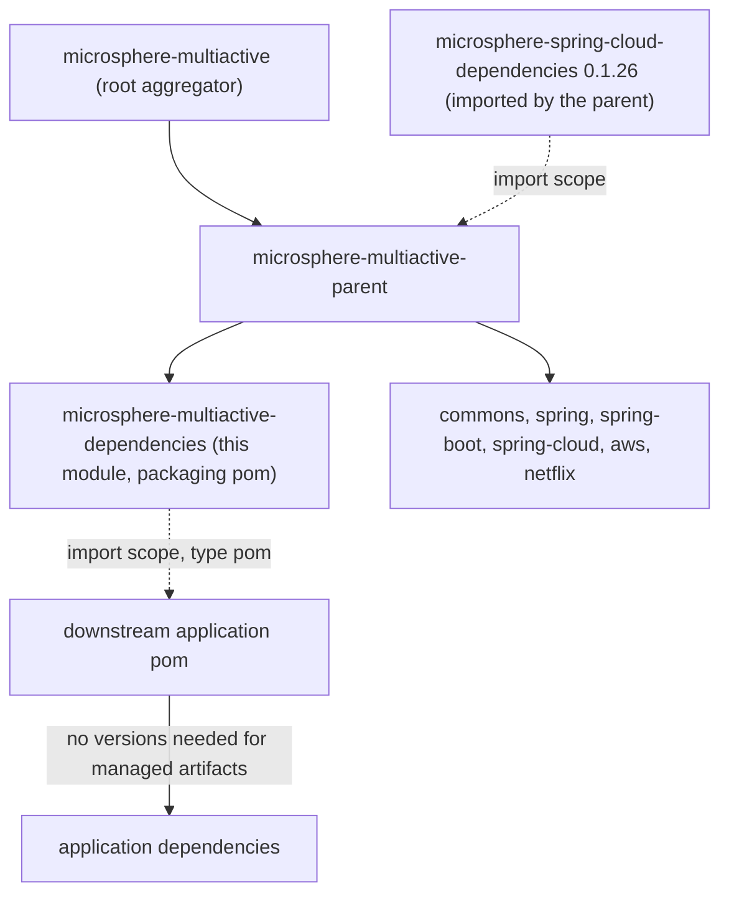
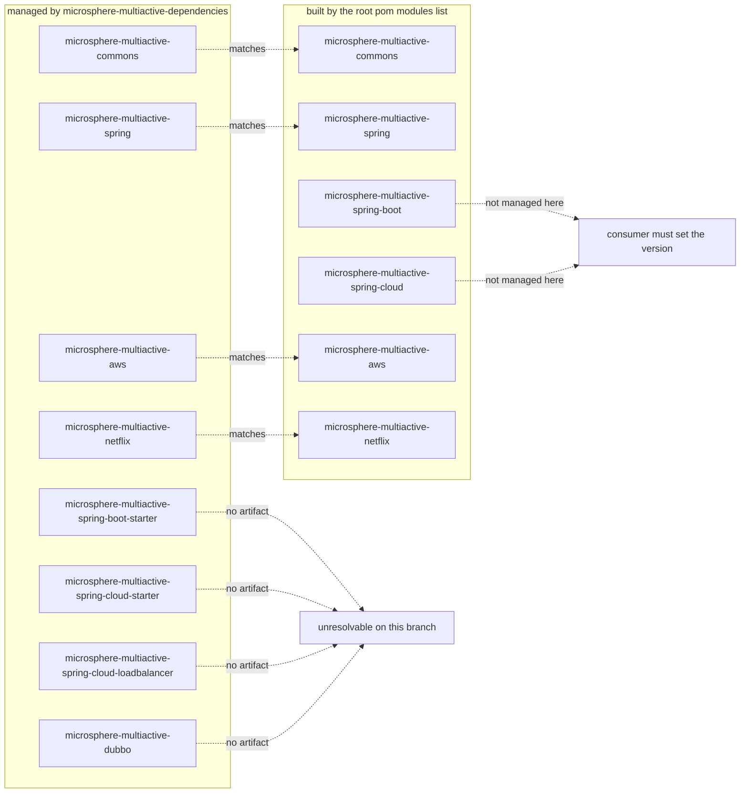

# `microsphere-multiactive-dependencies` — Developer Guide

中文版本：[简体中文](zh/microsphere-multiactive-dependencies.md)

Maven coordinates: `io.github.microsphere-projects:microsphere-multiactive-dependencies:${revision}` —
`0.1.14-SNAPSHOT` on this branch; packaging `pom`.

---

## Overview

`microsphere-multiactive-dependencies` is the **consumer-facing BOM** of this project: the artifact the snapshot's
`README.md` tells users to import so that they can write `microsphere-multiactive-*` dependencies without versions. It
declares no dependencies of its own, no build configuration and no sources — only a `<dependencyManagement>` block listing
project coordinates at `${revision}`.

It is a leaf of the reactor: nothing in this build imports or depends on it (verified by searching every POM for
`microsphere-multiactive-dependencies`; the only hits are its own POM, the root POM's `<modules>` list, the root `README.md`
import snippet, and the seven POMs that instead point at `microsphere-multiactive-parent`).

---

## Architecture design

### Position in the build



Because this POM inherits `microsphere-multiactive-parent`, whose `dependencyManagement` imports
`microsphere-spring-cloud-dependencies:0.1.26`, the effective managed set of this BOM is expected — through normal Maven
inheritance — to include those external pins as well as its own eight project entries. A consumer that imports only this BOM
therefore also gets Microsphere Spring Cloud managed versions; that expectation follows from the POM structure, and the exact
resulting set depends on the external BOM's contents, which are not part of this snapshot.

### The whole POM

```xml
<parent>
    <groupId>io.github.microsphere-projects</groupId>
    <artifactId>microsphere-multiactive-parent</artifactId>
    <version>${revision}</version>
    <relativePath>../microsphere-multiactive-parent/pom.xml</relativePath>
</parent>

<artifactId>microsphere-multiactive-dependencies</artifactId>
<version>${revision}</version>
<packaging>pom</packaging>

<dependencyManagement>
    <dependencies>
        <!-- eight entries, all groupId io.github.microsphere-projects and version ${revision} -->
    </dependencies>
</dependencyManagement>
```

---

## Source analysis (POM analysis)

The managed list, in file order, with the status of each coordinate **in this snapshot**:

| Managed artifactId | Built by this reactor? | Notes |
|---------------------|------------------------|-------|
| `microsphere-multiactive-commons` | yes | the kernel |
| `microsphere-multiactive-spring` | yes | `ZoneLocator` SPI + listener |
| `microsphere-multiactive-spring-boot-starter` | **no** | no such module exists; on this branch the auto-configuration artifact is `microsphere-multiactive-spring-boot` |
| `microsphere-multiactive-spring-cloud-starter` | **no** | no such module exists; the Spring Cloud artifact is `microsphere-multiactive-spring-cloud` |
| `microsphere-multiactive-spring-cloud-loadbalancer` | **no** | the LoadBalancer classes are packaged inside `microsphere-multiactive-spring-cloud` |
| `microsphere-multiactive-aws` | yes | three platform locators |
| `microsphere-multiactive-dubbo` | **no** | there is no Dubbo module in this branch at all |
| `microsphere-multiactive-netflix` | yes | Eureka + Ribbon adapters |

Consequences that a maintainer has to keep in mind:

- **Not every managed coordinate resolves.** An application that imports this BOM and then declares
  `microsphere-multiactive-spring-boot-starter`, `microsphere-multiactive-spring-cloud-starter`,
  `microsphere-multiactive-spring-cloud-loadbalancer` or `microsphere-multiactive-dubbo` will fail dependency resolution
  against the `0.1.x` releases published from this branch. The usable coordinates are `commons`, `spring`, `spring-boot`,
  `spring-cloud`, `aws` and `netflix`.
- **Conversely, the two artifacts that *are* built and are the actual integration points —
  `microsphere-multiactive-spring-boot` and `microsphere-multiactive-spring-cloud` — are not managed here**, so consumers must
  give them an explicit version. The README's "import the BOM and drop the versions" recipe therefore does not fully work on
  this branch.
- `microsphere-multiactive-parent` is not managed (correct: it is an inheritance parent, not a dependency), and there is no
  entry for the root aggregator.
- All eight entries are `<version>${revision}</version>` with no `<type>`/`<scope>` — i.e. plain jar coordinates, with the
  version tied to the reactor. Nothing in this file pins a *third-party* version; that is delegated to the parent's BOM import.
- The `groupId` is repeated verbatim in all eight entries and matches the parent chain — there is no `<groupId>` property
  indirection, which keeps the file grep-friendly but means a group rename touches eight lines.

### How the pieces line up (or do not)



---

## Design patterns actually present

| Pattern | Evidence in this snapshot |
|---------|---------------------------|
| **Bill of Materials (BOM)** | packaging `pom` + a `<dependencyManagement>`-only body, consumed via `<type>pom</type><scope>import</scope>` as shown in the root `README.md` |
| **Version alignment via `${revision}`** | every managed entry resolves to the reactor version, so a release publishes a self-consistent set |
| **Inheritance of third-party management** | no external versions here; they arrive from `microsphere-multiactive-parent`, which imports `microsphere-spring-cloud-dependencies:0.1.26` |

Absent: no `<properties>`, no `<modules>`, no `<build>`, no `<profiles>`, no `<dependencies>` section — the file is a pure
coordinate list.

---

## Extension points and maintenance notes

1. **Align the BOM with the reactor.** Before a release, either add the missing `spring-boot` / `spring-cloud` entries or
   remove the four coordinates that this branch does not build. Today the file advertises a module layout (starters, a
   separate LoadBalancer artifact, a Dubbo artifact) that matches a *different* branch structure.
2. **Add a new module to the BOM** — one `<dependency>` block with `groupId`
   `io.github.microsphere-projects`, `artifactId` of the new module and `<version>${revision}</version>`.
3. **Do not pin third-party versions here** — that belongs in `microsphere-multiactive-parent`'s BOM import or, for
   module-local needs, in the module POM (as `microsphere-multiactive-netflix` does for Ribbon `2.7.18`).
4. **Consumers still need the `<type>`/`<scope>` pair** — the managed entries are jar coordinates, so an application importing
   this BOM uses:

   ```xml
   <dependencyManagement>
       <dependencies>
           <!-- Microsphere Multiactive Dependencies -->
           <dependency>
               <groupId>io.github.microsphere-projects</groupId>
               <artifactId>microsphere-multiactive-dependencies</artifactId>
               <version>${microsphere-multiactive.version}</version>
               <type>pom</type>
               <scope>import</scope>
           </dependency>
       </dependencies>
   </dependencyManagement>
   ```

   which is exactly the snippet from the snapshot's `README.md`.

---

## Build and test

Nothing to compile and nothing to test; the module only produces a POM artifact during `install`/`deploy`.

```bash
./mvnw -pl microsphere-multiactive-dependencies validate
./mvnw -pl microsphere-multiactive-dependencies install   # publishes the BOM pom locally
```

The reactor order places it second (`parent`, `dependencies`, `commons`, `aws`, `netflix`, `spring`, `spring-boot`,
`spring-cloud`); Maven reorders the jar modules by their dependency graph, so the declared order only guarantees that the
parent and the BOM are installed first.

---

## Differences from the `0.2.x` / current line

Visible from this snapshot:

- The managed coordinate set describes a starter-based module layout (`spring-boot-starter`, `spring-cloud-starter`,
  `spring-cloud-loadbalancer`, `dubbo`) that this branch does not implement; on `1.x` the artifacts are
  `microsphere-multiactive-spring-boot` and `microsphere-multiactive-spring-cloud`, and there is no Dubbo integration module.
- Consequently, on this branch the BOM is documentation of an intended layout more than a working version pin for all six
  built modules — treat the four rows marked **no** in the table above as the authoritative gap list.

---

## Related

- [Developer Guide index](README.md)
- [microsphere-multiactive-parent](microsphere-multiactive-parent.md) — the inheritance parent this BOM derives from
- [microsphere-multiactive-spring-boot](microsphere-multiactive-spring-boot.md) — built here but not managed here
- [microsphere-multiactive-spring-cloud](microsphere-multiactive-spring-cloud.md) — built here but not managed here
- [microsphere-multiactive-dependencies User Guide](../user-guide/microsphere-multiactive-dependencies.md)
- [User Guide index](../user-guide/README.md)
- [Repository README](../../../README.md)

## 中文

中文版本：[简体中文](zh/microsphere-multiactive-dependencies.md)
