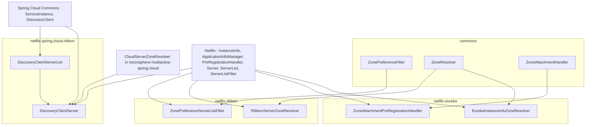
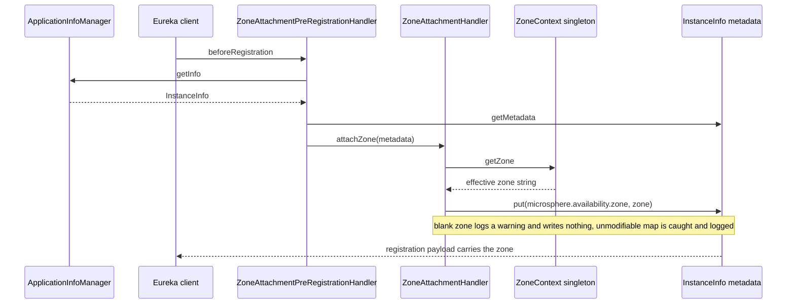
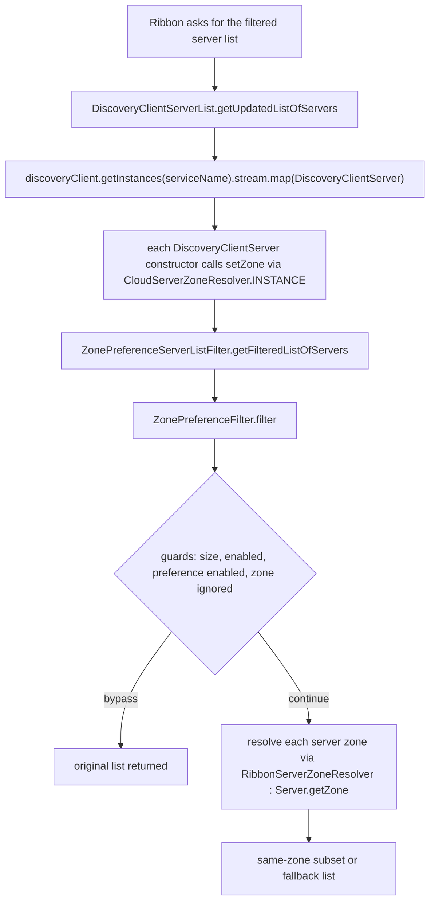

# `microsphere-multiactive-netflix` — Developer Guide

中文版本：[简体中文](zh/microsphere-multiactive-netflix.md)

Maven coordinates: `io.github.microsphere-projects:microsphere-multiactive-netflix:${revision}` — `0.1.14-SNAPSHOT` on
this branch.

---

## Overview

`microsphere-multiactive-netflix` is the Netflix OSS adapter set: Eureka on the registration/discovery side, Ribbon on
the client-side load-balancing side. Unlike the Spring Cloud module it ships **no auto-configuration** — its
`META-INF/spring.factories` does not exist, and the only resource is feature metadata. Every class here is a plain,
manually wired collaborator.

| Type | Package | Implements / extends | Purpose |
|------|---------|----------------------|---------|
| `EurekaInstanceInfoZoneResolver` | `…zone.netflix.eureka` | `ZoneResolver<InstanceInfo>` | reads the zone from Eureka `InstanceInfo` metadata |
| `ZoneAttachmentPreRegistrationHandler` | `…zone.netflix.eureka` | `PreRegistrationHandler` (Eureka client SPI) | attaches the zone into `InstanceInfo` metadata before registration |
| `RibbonServerZoneResolver<T extends Server>` | `…zone.netflix.ribbon` | `ZoneResolver<T>` | reads the zone from a Ribbon `Server` |
| `ZonePreferenceServerListFilter<T extends Server>` | `…zone.netflix.ribbon` | `ServerListFilter<T>` (Ribbon SPI) | delegates the server list to `ZonePreferenceFilter` |
| `DiscoveryClientServer` | `…zone.netflix.spring.cloud.ribbon` | `extends Server` | adapts a Spring Cloud `ServiceInstance` to a Ribbon `Server`, zone included |
| `DiscoveryClientServerList` | `…zone.netflix.spring.cloud.ribbon` | `ServerList<DiscoveryClientServer>` | feeds Ribbon from a Spring Cloud `DiscoveryClient` |

Files:

- `microsphere-multiactive-netflix/src/main/java/io/microsphere/multiple/active/zone/netflix/eureka/EurekaInstanceInfoZoneResolver.java`
- `microsphere-multiactive-netflix/src/main/java/io/microsphere/multiple/active/zone/netflix/eureka/ZoneAttachmentPreRegistrationHandler.java`
- `microsphere-multiactive-netflix/src/main/java/io/microsphere/multiple/active/zone/netflix/ribbon/RibbonServerZoneResolver.java`
- `microsphere-multiactive-netflix/src/main/java/io/microsphere/multiple/active/zone/netflix/ribbon/ZonePreferenceServerListFilter.java`
- `microsphere-multiactive-netflix/src/main/java/io/microsphere/multiple/active/zone/netflix/spring/cloud/ribbon/DiscoveryClientServer.java`
- `microsphere-multiactive-netflix/src/main/java/io/microsphere/multiple/active/zone/netflix/spring/cloud/ribbon/DiscoveryClientServerList.java`
- `microsphere-multiactive-netflix/src/main/resources/META-INF/config/default/features.yaml`

---

## Architecture design

### Layering: three seams, one algorithm



The module never re-implements zone logic. `ZonePreferenceServerListFilter` is three lines of delegation; all decisions
stay in commons. The one genuine piece of new logic is `DiscoveryClientServer`, which bridges two object models.

### Eureka registration flow



### Ribbon filtering flow



---

## Source analysis

### `EurekaInstanceInfoZoneResolver`

```java
public class EurekaInstanceInfoZoneResolver implements ZoneResolver<InstanceInfo> {

    @Override
    public String resolve(InstanceInfo instanceInfo) {
        Map<String, String> metadata = instanceInfo.getMetadata();
        String instanceZone = metadata == null ? null : metadata.get(ZONE_PROPERTY_NAME);
        return instanceZone;
    }
}
```

- Reads the **same** key that `ZoneAttachmentHandler` writes (`ZoneConstants.ZONE_PROPERTY_NAME`), so a Eureka-based
  provider/consumer pair is self-consistent without any extra configuration.
- Null-guards the *metadata map* but not the `InstanceInfo` argument. `ZonePreferenceFilter.resolveZone(entity)` protects
  against `null` entities before calling here, so the filter path is safe; a direct caller is not.
- Unlike `CloudServerZoneResolver`, this class has **no** `INSTANCE` constant, so every use site constructs one.

### `ZoneAttachmentPreRegistrationHandler`

```java
public class ZoneAttachmentPreRegistrationHandler implements PreRegistrationHandler {

    private final ApplicationInfoManager applicationInfoManager;
    private final ZoneAttachmentHandler zoneAttachmentHandler;

    public ZoneAttachmentPreRegistrationHandler(ApplicationInfoManager applicationInfoManager,
                                                ZoneAttachmentHandler zoneAttachmentHandler) { ... }

    @Override
    public void beforeRegistration() {
        InstanceInfo instanceInfo = applicationInfoManager.getInfo();
        Map<String, String> metadata = instanceInfo.getMetadata();
        zoneAttachmentHandler.attachZone(metadata);
    }
}
```

- It is Eureka's own `com.netflix.discovery.PreRegistrationHandler` SPI, i.e. the hook invoked just before the instance is
  registered — the Netflix-native counterpart of the Spring Cloud `ZoneAttachmentListener`. The class Javadoc references
  `AbstractDiscoveryClientOptionalArgs`, which is where Eureka expects such a handler to be supplied; **no code in this
  snapshot performs that wiring**, so registration is left to the application.
- Both dependencies are `final` and constructor-injected — unlike the Spring Cloud listener, which resolves its handler from
  the `ApplicationContext` at event time. Consequently a missing `ZoneAttachmentHandler` bean fails at *construction* time.
  That bean is only contributed by `ZoneCloudAutoConfiguration` in the Spring Cloud module, so the Eureka path on this branch
  transitively relies on that module being present and its conditions matching.
- No `instanceInfo == null` guard; `applicationInfoManager.getInfo()` is assumed non-null.

### `RibbonServerZoneResolver<T extends Server>`

```java
public class RibbonServerZoneResolver<T extends Server> implements ZoneResolver<T> {

    @Override
    public String resolve(T server) {
        return server.getZone();
    }
}
```

- The **only** zone source for the Ribbon path: Ribbon's `Server.getZone()`, populated by the Ribbon/Eureka integration itself
  or by `DiscoveryClientServer`'s constructor. No metadata lookup happens here.
- Generic on `T extends Server` even though it never uses `T` beyond the parameter — this exists so the resolver can be plugged
  into `ZonePreferenceFilter<SomeServerSubtype>`.
- Its class Javadoc uses a malformed tag (`@since ZoneResolver`), which is why it renders oddly in Javadoc output.

### `ZonePreferenceServerListFilter<T extends Server>`

```java
public class ZonePreferenceServerListFilter<T extends Server> implements ServerListFilter<T> {

    private ZonePreferenceFilter<T> filter;

    public ZonePreferenceServerListFilter(ZonePreferenceFilter<T> filter) {
        this.filter = filter;
    }

    @Override
    public List<T> getFilteredListOfServers(List<T> servers) {
        return filter.filter(servers);
    }
}
```

- A pure **Adapter** over the commons filter: one interface method, one delegating call. No extra guards, no logging, no
  ordering — the safety valves (size ≤ 1, disabled feature, ignored zone, ready-percentage, min-available) all live inside
  `ZonePreferenceFilter.filter(...)`.
- The `filter` field is **not** `final` and has no setter, so it is effectively immutable in practice but mutable by
  reflection/subclass-free tampering within the package — a small inconsistency compared with
  `ZoneAttachmentPreRegistrationHandler`.
- **Ordering is dropped on this path.** `ZonePreferenceFilter.getOrder()` is not forwarded, so
  `microsphere.availability.zone.preference.filter.order` has no effect on the Ribbon chain either (consistent with the
  finding that nothing consumes `getOrder()` in this snapshot).
- The type parameter `T` is threaded straight from `ServerListFilter<T>` into `ZonePreferenceFilter<T>`, which is what lets the
  same commons algorithm serve `Server`, `com.netflix.loadbalancer.InstanceInfo`-derived servers, or any custom subtype.

### `DiscoveryClientServer`

```java
public class DiscoveryClientServer extends Server {

    private final ServiceInstance serviceInstance;
    private final ServiceInstanceMetaInfo metaInfo;

    public DiscoveryClientServer(ServiceInstance serviceInstance) {
        super(serviceInstance.getScheme(), serviceInstance.getHost(), serviceInstance.getPort());
        this.serviceInstance = serviceInstance;
        this.metaInfo = new ServiceInstanceMetaInfo(serviceInstance);
        this.setZone(resolveZone(serviceInstance));
    }

    private String resolveZone(ServiceInstance serviceInstance) {
        return INSTANCE.resolve(serviceInstance);
    }

    @Override public String getId() { return serviceInstance.getInstanceId(); }
    @Override public MetaInfo getMetaInfo() { return metaInfo; }

    final static class ServiceInstanceMetaInfo implements MetaInfo { … }
}
```

- This is the **bridge** that makes Spring Cloud discovery usable from Ribbon. The zone is resolved once, in the
  constructor, from `CloudServerZoneResolver.INSTANCE` — i.e. from the Spring Cloud module's metadata reader, using the
  `microsphere.availability.zone` key. That is why this module depends on `microsphere-multiactive-spring-cloud`: the bridge
  deliberately reuses that resolver rather than duplicating the metadata read.
- Because `setZone(...)` is called with whatever the metadata holds (possibly `null`), a `RibbonServerZoneResolver`-based
  filter sees `null` for un-zoned instances, and `ZonePreferenceFilter` counts those against the
  "upstream zone ready percentage" gate instead of mismatching them.
- Identity mapping is delegated, not copied: `getId()` returns `serviceInstance.getInstanceId()` and the nested
  `ServiceInstanceMetaInfo` maps `getAppName()`/`getServiceIdForDiscovery()` to `serviceId` and `getInstanceId()` to
  `instanceId`. `getServerGroup()` returns `null` — no equivalent concept exists on `ServiceInstance`.
- The nested class is declared `final static` (unusual modifier order) and package-private, constructed once per server
  eagerly even if Ribbon never asks for `MetaInfo`.
- `serviceInstance` is never null-checked: `super(serviceInstance.getScheme(), …)` throws immediately for a `null` instance.
- Two malformed Javadoc `@since` lines (`@since ServiceInstance`, `@since Server`) — the `@see` targets were typed into the
  wrong tag.

### `DiscoveryClientServerList`

```java
public class DiscoveryClientServerList implements ServerList<DiscoveryClientServer> {

    private final DiscoveryClient discoveryClient;
    private final String serviceName;

    @Override
    public List<DiscoveryClientServer> getInitialListOfServers() {
        return getUpdatedListOfServers();
    }

    @Override
    public List<DiscoveryClientServer> getUpdatedListOfServers() {
        return discoveryClient.getInstances(serviceName)
                .stream()
                .map(DiscoveryClientServer::new)
                .collect(Collectors.toList());
    }
}
```

- Both Ribbon callbacks share one implementation, so initial and periodic polls behave identically — no warm-up special case.
- One `DiscoveryClientServer` object is **rebuilt for every poll**: no caching, no identity reuse. With a Ribbon poller running
  every 30 s this re-reads metadata and re-allocates `MetaInfo` objects continuously; that is a consequence of the design, not a
  bug in the code.
- `discoveryClient.getInstances(serviceName)` may return an empty list; the stream then yields an empty list and
  `ZonePreferenceFilter`'s `totalSize <= 1` guard returns it untouched.
- `serviceName` is fixed at construction, so one instance of this class serves one Ribbon client — matching how
  `ServerList` is normally instantiated per `ILoadBalancer`.
- No `initialize(shutdown)`/`getFastIndexOfServers`-style overrides appear, and `ServerList` is implemented
  (`implements`, not extended), so no `AbstractServerList` timer/polling behaviour is inherited.

### Feature metadata: `META-INF/config/default/features.yaml`

```yaml
microsphere:
  spring:
    cloud:
      features:
        named:
          microsphere-multiactive-netflix:
            - io.microsphere.multiple.active.zone.netflix.eureka.EurekaInstanceInfoZoneResolver
            - io.microsphere.multiple.active.zone.netflix.eureka.ZoneAttachmentPreRegistrationHandler
            - io.microsphere.multiple.active.zone.netflix.ribbon.RibbonServerZoneResolver
            - io.microsphere.multiple.active.zone.netflix.ribbon.ZonePreferenceServerListFilter
            - io.microsphere.multiple.active.zone.netflix.spring.cloud.ribbon.DiscoveryClientServerList
```

All five of the module's adapter classes except `DiscoveryClientServer` are listed as one named feature group. The consumer of
this descriptor lives in `microsphere-spring-cloud-commons`, outside this repository, so the runtime effect is **not verifiable
from this snapshot**.

---

## Design patterns actually present

| Pattern | Evidence in this snapshot |
|---------|---------------------------|
| **Adapter** | `ZonePreferenceServerListFilter` adapts `ZonePreferenceFilter` to Ribbon's `ServerListFilter`; `DiscoveryClientServer` adapts `ServiceInstance` to `Server` |
| **Bridge (object-model to object-model)** | `DiscoveryClientServer` + `DiscoveryClientServerList` connect the Spring Cloud discovery model to the Ribbon server model without either knowing about zone preferences |
| **Delegation / no duplicated policy** | every filtering or attachment call is forwarded to commons; the module contains no `if (zone…)` logic of its own |
| **Strategy** | `RibbonServerZoneResolver` and `EurekaInstanceInfoZoneResolver` are interchangeable `ZoneResolver` implementations bound to different entity graphs |
| **Template callback (SPI hook)** | `ZoneAttachmentPreRegistrationHandler implements PreRegistrationHandler`, invoked by the Eureka client |
| **Generic-bound polymorphism** | `<T extends Server>` on both the resolver and the filter keeps one algorithm usable across server subtypes |

Absent: no auto-configuration, no `@Conditional*`, no `@Component`/`@Bean`, no `spring.factories`, no `@Order`/`Ordered`
implementation, and no `ThreadLocal`/request-scoped zone.

---

## Wiring this module (what the code requires)

Because nothing is auto-configured, a maintainer integrating this module supplies the wiring. The classes dictate exactly
which collaborators are needed:

```java
// commons -> Spring Cloud bean, contributed by ZoneCloudAutoConfiguration
ZoneAttachmentHandler zoneAttachmentHandler = ...;
ApplicationInfoManager applicationInfoManager = ...;

// Registration side (Eureka-native)
PreRegistrationHandler preRegistrationHandler =
        new ZoneAttachmentPreRegistrationHandler(applicationInfoManager, zoneAttachmentHandler);

// Consumer side (Ribbon)
ZoneContext zoneContext = ZoneContext.get();
ZonePreferenceFilter<Server> zonePreferenceFilter =
        new ZonePreferenceFilter<>(zoneContext, new RibbonServerZoneResolver<>());
ServerListFilter<Server> serverListFilter = new ZonePreferenceServerListFilter<>(zonePreferenceFilter);

// Spring-Cloud-discovery-backed Ribbon server list
ServerList<DiscoveryClientServer> serverList = new DiscoveryClientServerList(discoveryClient, "provider-service");
```

Two constraints follow directly from the constructors: `ZoneAttachmentHandler` must already be a bean (it is only declared in
the Spring Cloud module's auto-configuration), and `ZonePreferenceFilter` must be built with the *right* `ZoneResolver`
(`RibbonServerZoneResolver` for Ribbon `Server`s, `EurekaInstanceInfoZoneResolver` for `InstanceInfo`s,
`CloudServerZoneResolver` for `ServiceInstance`s).

---

## Build and test

`microsphere-multiactive-netflix/pom.xml` — parent `microsphere-multiactive-parent`, packaging `jar`, no plugins, no
profiles, **no `src/test/java` sources**, and one module-local property:

```xml
<properties>
    <netflix.ribbon.version>2.7.18</netflix.ribbon.version>
</properties>
```

This is the only POM in the build that introduces a **module-local version property**. Elsewhere there are exactly two
version knobs: the root `pom.xml` writes its external parent version as the literal `0.1.26`, and
`microsphere-multiactive-parent` declares `microsphere-spring-cloud.version=0.1.26`. Here
`<netflix.ribbon.version>2.7.18</netflix.ribbon.version>` is a third one, and the three Ribbon artifacts (`ribbon`,
`ribbon-loadbalancer`, `ribbon-eureka`) are versioned through that property rather than inherited from any BOM.

| Dependency | Scope | Used by |
|------------|-------|---------|
| `microsphere-multiactive-spring-cloud` (`${revision}`) | **optional** | `DiscoveryClientServer` (`CloudServerZoneResolver`), transitively `spring`/`commons`; `ZoneAttachmentHandler` type for the Eureka handler |
| `spring-cloud-commons`, `spring-cloud-context` | optional | `ServiceInstance`, `DiscoveryClient` |
| `spring-cloud-netflix-eureka-client` | optional | Eureka-on-Spring-Cloud context; no class in this module imports from it |
| `com.netflix.eureka:eureka-client` | optional | `InstanceInfo`, `ApplicationInfoManager`, `PreRegistrationHandler`, `AbstractDiscoveryClientOptionalArgs` (Javadoc only) |
| `com.netflix.ribbon:ribbon`, `ribbon-loadbalancer`, `ribbon-eureka` at `${netflix.ribbon.version}` = `2.7.18` | optional | `Server`, `ServerList`, `ServerListFilter`, `MetaInfo` |
| `spring-boot-starter`, `-actuator`, `-web` | optional | not referenced by any source file in this module |
| `microsphere-annotation-processor`, `spring-boot-configuration-processor`, `spring-boot-autoconfigure-processor` | optional | compile-time processing |
| `junit-jupiter`, `spring-boot-starter-test`, `microsphere-spring-boot-test`, `logback-classic` | test | declared, unused (no tests exist) |

As in the AWS module, **every non-test dependency is optional**, so consumers must bring `microsphere-multiactive-commons`
(and `…-spring-cloud`, and Eureka/Ribbon themselves) explicitly; the jar alone has no mandatory transitive dependencies.

A minor structural inconsistency worth noting for POM housekeeping: this POM places `<modelVersion>` **before** `<parent>`,
whereas the other module POMs place `<parent>` first. Maven accepts both, so it is cosmetic.

```bash
# Compiles the module; there are no tests to run
./mvnw -pl microsphere-multiactive-netflix -am install
```

According to the snapshot's `release-notes.md`, this module was **added in `v0.1.0`** together with `DiscoveryClientServerList`
and `DiscoveryClientServer`, while the older `microsphere-multiactive-spring-cloud-netflix` module was removed in the same
release — which explains why these classes live under a `…netflix.spring.cloud.ribbon` package inside the Netflix module rather
than in a Spring Cloud module.

---

## Differences from the `0.2.x` / current line

Visible from this snapshot:

- The Netflix integration is **not auto-configured at all**: no `spring.factories`, no conditional annotations, no bean
  declarations. Everything is instantiated by the application.
- Ribbon is supported with an explicitly pinned `2.7.18` version, one of the reasons this line targets Hoxton (where Ribbon was
  still the default Spring Cloud client-side load balancer) rather than 2022+.
- Zone filtering for Ribbon drops the `microsphere.availability.zone.preference.filter.order` value: `ZonePreferenceServerListFilter`
  exposes no ordering.
- The Spring-Cloud-to-Ribbon bridge reuses `CloudServerZoneResolver` from the Spring Cloud module, so this Netflix artifact is
  coupled to Spring Cloud rather than being purely Netflix-specific.
- No test sources exist for this module on this branch.

---

## Related

- [Developer Guide index](README.md)
- [microsphere-multiactive-commons](microsphere-multiactive-commons.md) — `ZonePreferenceFilter`, `ZoneResolver`, `ZoneAttachmentHandler`
- [microsphere-multiactive-spring-cloud](microsphere-multiactive-spring-cloud.md) — `CloudServerZoneResolver` and the `ZoneAttachmentHandler` bean
- [microsphere-multiactive-netflix User Guide](../user-guide/microsphere-multiactive-netflix.md)
- [User Guide index](../user-guide/README.md)
- [Repository README](../../../README.md)

## 中文

中文版本：[简体中文](zh/microsphere-multiactive-netflix.md)
