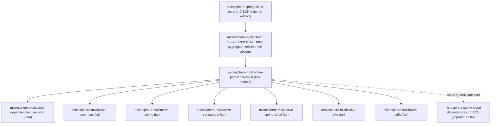
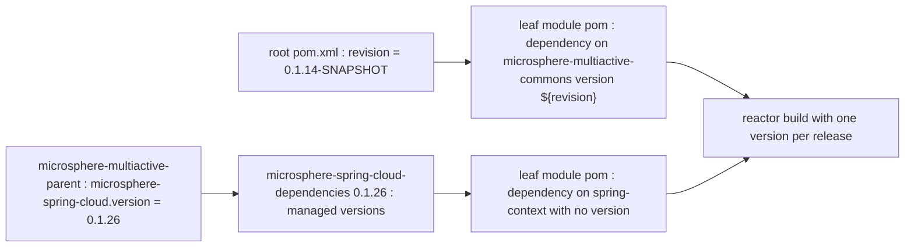

# `microsphere-multiactive-parent` — Developer Guide

中文版本：[简体中文](zh/microsphere-multiactive-parent.md)

Maven coordinates: `io.github.microsphere-projects:microsphere-multiactive-parent:${revision}` — `0.1.14-SNAPSHOT` on
this branch; packaging `pom`.

---

## Overview

`microsphere-multiactive-parent` is the **inheritance parent** of the other seven modules of this build — the six jar
modules and the `microsphere-multiactive-dependencies` BOM. It is a POM-only module: it contains no `src/` directory at all,
only `microsphere-multiactive-parent/pom.xml`, and it contributes nothing to any classpath.

Its job on this branch is deliberately narrow:

1. sit between the external Microsphere parent and the leaf modules, so leaf POMs stay minimal;
2. import the external `microsphere-spring-cloud-dependencies` BOM, which is what pins Spring Boot, Spring Cloud,
   Jackson, JUnit, Logback and every `microsphere-*` artifact used in this repository.

---

## Architecture design

### Where it sits in the inheritance chain



Note the two-step: the **root aggregator** `microsphere-multiactive` inherits the external parent
`microsphere-spring-cloud-parent:0.1.26` directly, and `microsphere-multiactive-parent` inherits the *root aggregator*
(`<relativePath>../pom.xml</relativePath>`). So the external parent's plugin management, compiler settings and profiles are
reached through two hops of inheritance rather than one.

### The whole POM

```xml
<parent>
    <groupId>io.github.microsphere-projects</groupId>
    <artifactId>microsphere-multiactive</artifactId>
    <version>${revision}</version>
    <relativePath>../pom.xml</relativePath>
</parent>

<artifactId>microsphere-multiactive-parent</artifactId>
<version>${revision}</version>
<packaging>pom</packaging>

<properties>
    <!-- BOM versions -->
    <microsphere-spring-cloud.version>0.1.26</microsphere-spring-cloud.version>
</properties>

<dependencyManagement>
    <dependencies>
        <dependency>
            <groupId>io.github.microsphere-projects</groupId>
            <artifactId>microsphere-spring-cloud-dependencies</artifactId>
            <version>${microsphere-spring-cloud.version}</version>
            <type>pom</type>
            <scope>import</scope>
        </dependency>
    </dependencies>
</dependencyManagement>
```

---

## Source analysis (POM analysis)

| Element | Value | Effect |
|---------|-------|--------|
| `<parent>` | `microsphere-multiactive:${revision}` with `<relativePath>../pom.xml</relativePath>` | resolves inside the reactor; the external parent chain is inherited transitively |
| `<version>` | `${revision}` | CI-friendly version; the single source of truth is the root POM's `<revision>0.1.14-SNAPSHOT</revision>` |
| `<packaging>` | `pom` | no artifact is produced; nothing to compile, no `target/classes` |
| `<properties>` | `microsphere-spring-cloud.version=0.1.26` | the **only** version this POM declares locally, and the one number to change when bumping the Microsphere Spring Cloud line |
| `<dependencyManagement>` | one `import` of `microsphere-spring-cloud-dependencies:0.1.26` | supplies every version the leaf modules consume without a `<version>` element |
| `<name>` / `<description>` | `Microsphere :: Multi-Active :: Parent` / `Microsphere Multi-Active Parent` | site/POM metadata only |

What this POM does **not** contain, and where those things therefore come from:

- **No `<pluginManagement>`, no `<build>`, no compiler/source-target settings.** They are inherited from
  `microsphere-spring-cloud-parent:0.1.26` via the root aggregator. This is why the same artifact can be compiled on Java 8
  through Java 25 in CI without a single `<source>` declaration here.
- **No profiles.** The `test`, `coverage`, `publish`, `ci` and `spring-cloud-hoxton` / `-2020` / `-2021` profiles activated
  by `.github/workflows/maven-build.yml` and `.github/workflows/maven-publish.yml` all come from the external parent.
- **No `dependencyManagement` entry for this repository's own modules.** Managing them is
  `microsphere-multiactive-dependencies`' job — and since no module imports that BOM, the leaf POMs each spell out
  `<version>${revision}</version>` for their sibling dependency, e.g.:

  ```xml
  <dependency>
      <groupId>io.github.microsphere-projects</groupId>
      <artifactId>microsphere-multiactive-commons</artifactId>
      <version>${revision}</version>
  </dependency>
  ```

  This is a direct consequence of the POM above: `microsphere-multiactive-parent` manages **no** project-internal
  coordinates, so Maven cannot supply a version for a sibling module and every inter-module dependency in this build must
  state `<version>${revision}</version>` itself. It also means that `${revision}` has to be defined for those coordinates to
  resolve, which is exactly why the modules set an explicit `<relativePath>` back into the reactor.
- **No `<modules>`** — aggregation lives in the root POM. `microsphere-multiactive-parent` is a parent only; building it does
  not build the jars.
- **No `<dependency>` section at all** — the parent contributes managed versions, never actual dependencies, so leaf modules
  are not polluted with inherited artifacts.

### Property resolution across the reactor



---

## Design patterns actually present

| Pattern | Evidence in this snapshot |
|---------|---------------------------|
| **Inheritance parent (Maven)** | declared as `<parent>` with `<relativePath>../microsphere-multiactive-parent/pom.xml</relativePath>` by the other seven module POMs |
| **BOM import for third-party pinning** | `<type>pom</type><scope>import</scope>` on `microsphere-spring-cloud-dependencies` |
| **CI-friendly `${revision}` versioning** | `${revision}` used for `<version>` of this module, for the `<parent>` version and for sibling module dependencies |
| **Single-point version knob** | `0.1.26` is the only literal version in this POM; the root aggregator independently declares `microsphere-spring-cloud-parent:0.1.26` as its own parent, and `microsphere-multiactive-netflix` pins Ribbon `2.7.18` |

Not present: no aggregation (`<modules>`), no `dependencyManagement` of the project's own artifacts, no plugin
configuration, no profiles, no distribution management, no source folders.

---

## Extension points and maintenance notes

1. **Bump the Microsphere Spring Cloud line** — change `microsphere-spring-cloud.version` here; every managed third-party
   version follows. The release notes show this being done repeatedly (`0.1.11` → `0.1.24`, `0.1.25`, `0.1.26` at HEAD),
   which is exactly this file's intended role.
2. **Add a project-wide managed dependency** — add a `<dependencyManagement>` entry here if it should apply to *this
   build*; add it to `microsphere-multiactive-dependencies` if it should apply to *consumers*. Keeping the two in mind is
   the main judgement call when maintaining these two POMs.
3. **Add a new module** — declare `microsphere-multiactive-parent` as its parent with
   `<relativePath>../microsphere-multiactive-parent/pom.xml</relativePath>`, add the module to the root POM's `<modules>`,
   and give sibling dependencies `<version>${revision}</version>`.
4. **Watch the `${revision}` + `<parent>` interaction** — the parent's own `<version>` is `${revision}`, and the leaf modules
   repeat it; a publish command must pass `-Drevision=…` (as `maven-publish.yml` does) or the reactor will build
   `0.1.14-SNAPSHOT`.

---

## Build and test

There is nothing to compile and nothing to test in this module.

```bash
# validate the effective POM and the inherited management
./mvnw -pl microsphere-multiactive-parent validate

# show what the external BOM actually pins, e.g. for spring-context
./mvnw -pl microsphere-multiactive-commons dependency:tree
```

`microsphere-multiactive-parent/pom.xml` declares no plugins, so the build lifecycle is entirely the one inherited from
`microsphere-spring-cloud-parent:0.1.26`. Whether a `flatten-maven-plugin` (the usual way to publish `${revision}` POMs) is
configured there is **not verifiable from this snapshot**, since the external parent is not vendored.

---

## Differences from the `0.2.x` / current line

Visible from this snapshot:

- This POM pins `microsphere-spring-cloud.version` to `0.1.26`, and the same-named POM on the `0.2.x` line tracks the newer
  Microsphere Spring Cloud series; the compatibility window that follows from it is Hoxton → 2021 (documented in the
  snapshot's own `README.md` branch table).
- The parent does **not** manage this repository's own module coordinates; consumers are expected to import
  `microsphere-multiactive-dependencies`, whose entries on this branch point at artifacts that do not all exist here (see
  [microsphere-multiactive-dependencies](microsphere-multiactive-dependencies.md)).

---

## Related

- [Developer Guide index](README.md)
- [microsphere-multiactive-dependencies](microsphere-multiactive-dependencies.md) — the consumer-facing BOM
- [microsphere-multiactive-commons](microsphere-multiactive-commons.md) — the first module that inherits from this parent
- [microsphere-multiactive-parent User Guide](../user-guide/microsphere-multiactive-parent.md)
- [User Guide index](../user-guide/README.md)
- [Repository README](../../../README.md)

## 中文

中文版本：[简体中文](zh/microsphere-multiactive-parent.md)
