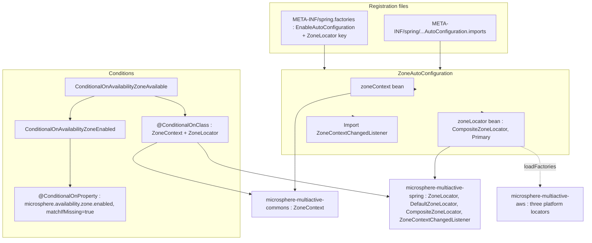
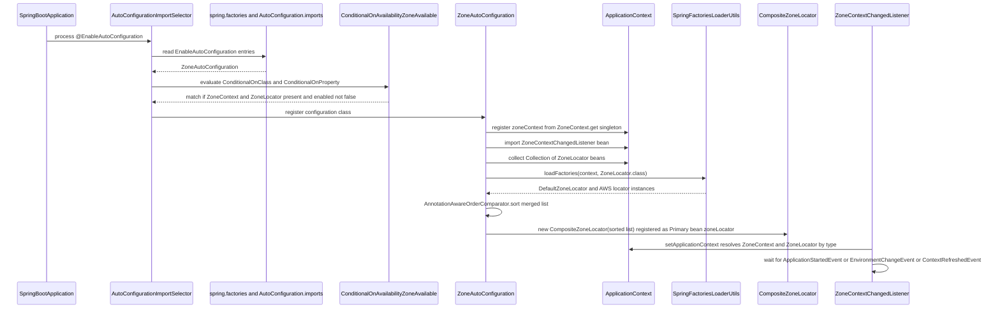
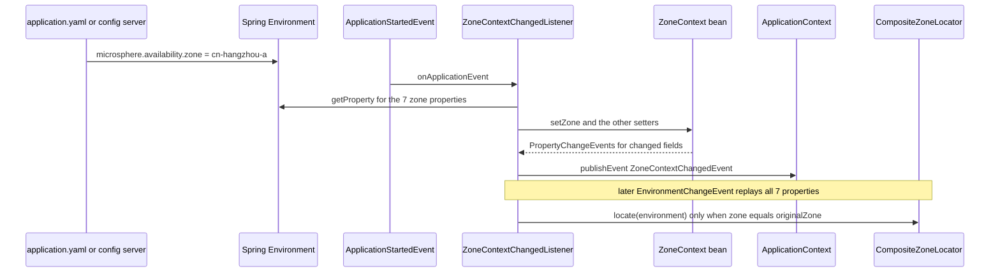

# `microsphere-multiactive-spring-boot` — Developer Guide

中文版本：[简体中文](zh/microsphere-multiactive-spring-boot.md)

Maven coordinates: `io.github.microsphere-projects:microsphere-multiactive-spring-boot:${revision}` — `0.1.14-SNAPSHOT`
on this branch.

---

## Overview

`microsphere-multiactive-spring-boot` is the smallest module by code (three classes) and the hinge of the whole build: it
turns the `1.x` kernel plus the `ZoneLocator` SPI into a working Spring Boot starter-less auto-configuration. It does
exactly three jobs:

1. register the `ZoneContext` **singleton** as the Spring bean named `zoneContext`;
2. assemble **all** `ZoneLocator`s — Spring beans and `spring.factories` entries — into the `@Primary`
   `CompositeZoneLocator` bean named `zoneLocator`;
3. import `ZoneContextChangedListener` so property changes flow into the context.

Packages and files:

| Type | File |
|------|------|
| `ZoneAutoConfiguration` | `microsphere-multiactive-spring-boot/src/main/java/io/microsphere/multiple/active/zone/spring/boot/autoconfigure/ZoneAutoConfiguration.java` |
| `ConditionalOnAvailabilityZoneAvailable` | `microsphere-multiactive-spring-boot/src/main/java/io/microsphere/multiple/active/zone/spring/boot/condition/ConditionalOnAvailabilityZoneAvailable.java` |
| `ConditionalOnAvailabilityZoneEnabled` | `microsphere-multiactive-spring-boot/src/main/java/io/microsphere/multiple/active/zone/spring/boot/condition/ConditionalOnAvailabilityZoneEnabled.java` |

Resources — this module is where registration happens:

- `microsphere-multiactive-spring-boot/src/main/resources/META-INF/spring.factories`
- `microsphere-multiactive-spring-boot/src/main/resources/META-INF/spring/org.springframework.boot.autoconfigure.AutoConfiguration.imports`

---

## Architecture design

### Layering



There is no third layer: this module contributes no beans beyond the two above and no `@ConfigurationProperties` class,
even though `spring-boot-configuration-processor` is on the optional classpath.

### The `spring.factories` file is dual-purpose

```properties
org.springframework.boot.autoconfigure.EnableAutoConfiguration=\
io.microsphere.multiple.active.zone.spring.boot.autoconfigure.ZoneAutoConfiguration

io.microsphere.multiple.active.zone.spring.ZoneLocator=\
io.microsphere.multiple.active.zone.spring.DefaultZoneLocator
```

- The first key is the classic Spring Boot 2.x auto-configuration entry point.
- The second key is **not** a Spring Boot key: it is the Microsphere `ZoneLocator` SPI key, read by
  `io.microsphere.spring.core.io.support.SpringFactoriesLoaderUtils.loadFactories(context, ZoneLocator.class)`. The same
  file therefore feeds both Boot and this library's own loader, and `DefaultZoneLocator` is registered here rather than in
  the `microsphere-multiactive-spring` module (which ships no resources).
- The `AutoConfiguration.imports` file lists the same `ZoneAutoConfiguration` for Spring Boot 2.7+/3.x. Both files are
  shipped so one artifact works with Boot versions that only read `spring.factories` and with those that only read
  `imports`. `ZoneAutoConfiguration` is the only entry in `imports`; the Spring Cloud module ships its own pair of files.

---

## Source analysis

### `ZoneAutoConfiguration`

```java
@Configuration(proxyBeanMethods = false)
@ConditionalOnAvailabilityZoneAvailable
@Import(value = {ZoneContextChangedListener.class})
public class ZoneAutoConfiguration {

    @Bean(name = ZONE_CONTEXT_BEAN_NAME)
    @ConditionalOnMissingBean
    public ZoneContext zoneContext() {
        return get();
    }

    @Primary
    @Bean(name = ZONE_LOCATOR_BEAN_NAME)
    @ConditionalOnMissingBean
    public CompositeZoneLocator zoneLocator(Collection<ZoneLocator> zoneLocatorBeans, ConfigurableApplicationContext context) {
        // Load from Spring Factories
        List<ZoneLocator> zoneLocators = loadFactories(context, ZoneLocator.class);
        List<ZoneLocator> allZoneLocators = new ArrayList<>(zoneLocatorBeans.size() + zoneLocators.size());
        // Add ZoneLocator Spring Beans
        allZoneLocators.addAll(zoneLocatorBeans);
        // Add ZoneLocator Spring Factories
        allZoneLocators.addAll(zoneLocators);
        // Sort by the order
        sort(allZoneLocators);
        return new CompositeZoneLocator(allZoneLocators);
    }
}
```

Line-by-line reasoning:

- `@Configuration(proxyBeanMethods = false)` — lite mode; nothing here calls a `@Bean` method from another, so the
  inter-method-proxy cost is skipped.
- Bean names come from `ZoneUtils.ZONE_CONTEXT_BEAN_NAME` (`"zoneContext"`) and
  `ZoneUtils.ZONE_LOCATOR_BEAN_NAME` (`"zoneLocator"`), so the constants that `ZoneUtils.getZoneContext(...)` /
  `getZoneLocator(...)` use by name and the actual bean definitions cannot diverge silently.
- `zoneContext()` returns `ZoneContext.get()`, **not** `new ZoneContext()`. The bean is an *alias for the JVM singleton*,
  which is what makes non-Spring code paths (a manually constructed `ZonePreferenceFilter`, the commons tests) and the
  Spring-managed paths observe the same state.
- `@ConditionalOnMissingBean` with no attributes evaluates against the **method return type**:
  - `zoneContext()` is skipped if any `ZoneContext` bean already exists;
  - `zoneLocator()` is skipped only if a **`CompositeZoneLocator`** bean already exists. A user-provided custom
    `ZoneLocator` bean does *not* disable this bean — the composite is still created, still gets `@Primary`, and the
    custom locator is picked up through the `Collection<ZoneLocator>` parameter. That is the intended override path for
    custom discovery on this branch.
- `Collection<ZoneLocator>` injection excludes the bean currently under creation, so the composite does not wrap itself.
- `loadFactories(context, ZoneLocator.class)` adds the `spring.factories`-registered locators, which is how
  `DefaultZoneLocator` and the three AWS locators join the chain **without being Spring beans**.
- Bean-registered locators are added **before** factories-registered ones, then
  `AnnotationAwareOrderComparator.sort(...)` re-orders the merged list, so insertion order only matters for equal-order
  elements. `sort` is the static import of `org.springframework.core.annotation.AnnotationAwareOrderComparator.sort`,
  i.e. it honours `Ordered`, `@Order` and `int`-valued `getOrder()`.
- `CompositeZoneLocator` sorts again in its own constructor; the pre-sort here is redundant but harmless.
- `@Primary` is load-bearing, not cosmetic: `ZoneContextChangedListener.setApplicationContext(...)` performs
  `context.getBean(ZoneLocator.class)` by **type**, and both the composite and every individual locator bean are
  `ZoneLocator`s. Without `@Primary` that lookup would throw `NoUniqueBeanDefinitionException`.
- **The configuration builds the chain but never runs it.** No bean method calls `locate(...)`, and there is no
  `ApplicationRunner`/`SmartInitializingSingleton` here. The only production call site of `ZoneLocator.locate(...)` in the
  whole snapshot is `ZoneContextChangedListener.revertOriginalZone()`, so AWS/ECS/EC2 metadata lookups are lazy — they happen
  when `microsphere.availability.zone` is set to `originalZone` or when application code calls the locator directly. See
  [microsphere-multiactive-spring](microsphere-multiactive-spring.md).

### `ConditionalOnAvailabilityZoneAvailable`

```java
@Retention(RUNTIME)
@Target({TYPE, METHOD})
@Documented
@ConditionalOnClass(value = {
        ZoneContext.class,                  // Microsphere Multi-Active Commons
        ZoneLocator.class                   // Microsphere Multi-Active Spring
})
@ConditionalOnAvailabilityZoneEnabled
public @interface ConditionalOnAvailabilityZoneAvailable {
}
```

"Available" = classpath **and** switch. Using the `Class[]` overload of `@ConditionalOnClass` (rather than `name = {…}`)
is safe here precisely because `microsphere-multiactive-spring-boot` has mandatory compile-time dependencies on both
`commons` and `spring`; the types are always loadable at configuration-class parse time.

### `ConditionalOnAvailabilityZoneEnabled`

```java
@Retention(RUNTIME)
@Target({TYPE, METHOD})
@Documented
@ConditionalOnProperty(name = ZONE_ENABLED_PROPERTY_NAME, matchIfMissing = true)
public @interface ConditionalOnAvailabilityZoneEnabled {
}
```

- `ZONE_ENABLED_PROPERTY_NAME` is `microsphere.availability.zone.enabled`, and `matchIfMissing = true` means the feature
  is **on unless explicitly disabled** — consistent with `DEFAULT_ZONE_ENABLED = true` in `ZoneContext`.
- There is no `havingValue`, so any value that is not coercible to `false` matches. Setting the property to `false`
  switches off `zoneContext`, `zoneLocator` **and** the imported listener in one step, because the meta-annotation is on
  the configuration class.
- The two annotations are also reused by `ZoneCloudAutoConfiguration`, which is why they are named generically
  (`ConditionalOn…`) instead of being inline conditions; both carry the Apache licence header, unlike the rest of the
  module's files.

### Auto-configuration sequence



### Runtime property-to-context flow in a Boot application



---

## Design patterns actually present

| Pattern | Evidence in this snapshot |
|---------|---------------------------|
| **Auto-Configuration (Spring Boot)** | `@Configuration(proxyBeanMethods = false)` + `META-INF/spring.factories` key `EnableAutoConfiguration` + `AutoConfiguration.imports`, both listing `ZoneAutoConfiguration` |
| **Meta-annotation / composed Conditional** | `ConditionalOnAvailabilityZoneAvailable` composes `@ConditionalOnClass` and `@ConditionalOnAvailabilityZoneEnabled`, which itself composes `@ConditionalOnProperty` |
| **Primary-bean disambiguation** | `@Primary` on `zoneLocator` so `getBean(ZoneLocator.class)` in the listener resolves deterministically |
| **Bean-overlap guard** | `@ConditionalOnMissingBean` on both bean methods, evaluated against the return types `ZoneContext` and `CompositeZoneLocator` |
| **ServiceLoader SPI via configuration file** | `loadFactories(context, ZoneLocator.class)` reading the `io.microsphere.multiple.active.zone.spring.ZoneLocator` key |
| **Facade over a singleton** | `zoneContext()` exposing `ZoneContext.get()` as a managed bean instead of a new object |
| **Importing a non-configuration component** | `@Import(ZoneContextChangedListener.class)` rather than a `@Bean` method |

Absent on this branch (do not assume them): no `@ConfigurationProperties` binding class, no actuator endpoint, no
`EnvironmentPostProcessor`, no `ApplicationContextInitializer`, and — despite the `spring-boot-starter-actuator` and
`spring-boot-starter-web` optional dependencies in the POM — **no code in this module references actuator, web or
servlet types**. Those two dependencies are currently unused.

---

## Extension points

1. **Replace the whole discovery strategy** — define your own `CompositeZoneLocator` bean; `@ConditionalOnMissingBean`
   then backs this module's bean off entirely.
2. **Add one discovery source** — declare a `ZoneLocator` `@Bean` (extend `AbstractZoneLocator` and pick an order `< 20`),
   or add a class name to the `ZoneLocator` key in your own `META-INF/spring.factories`. Both routes merge into the
   composite.
3. **Own the context** — declare any `ZoneContext` bean to take over the `zoneContext` slot (e.g. to pre-seed values
   before the listener runs).
4. **Kill switch** — `microsphere.availability.zone.enabled=false` removes all three contributions. `ZoneAutoConfigurationTest`
   uses exactly this property as its "globally disabled" scenario.
5. **Consume changes** — publish/subscribe `ZoneContextChangedEvent`; it is emitted only when at least one property
   actually changed.

---

## Build and test

`microsphere-multiactive-spring-boot/pom.xml` — parent `microsphere-multiactive-parent`, packaging `jar`, no plugins, no
profiles.

| Dependency | Scope | Notes |
|------------|-------|-------|
| `microsphere-multiactive-spring` (`${revision}`) | compile (mandatory) | brings `commons` transitively; this is the only mandatory project dependency |
| `microsphere-spring-boot-core` | optional | Boot helpers from the Microsphere line |
| `spring-boot-starter`, `spring-boot-starter-actuator`, `spring-boot-starter-web` | optional | only `starter` types are actually used by the sources; actuator/web are unreferenced |
| `spring-boot-configuration-processor`, `spring-boot-autoconfigure-processor` | optional | compile-time metadata/annotation processing |
| `microsphere-annotation-processor` | optional | `@ConfigurationProperty` support |
| `spring-boot-starter-test` | test | test support |
| `microsphere-spring-boot-test` | test | provides `AutoConfigurationTest`, the base class used below |
| `org.junit.jupiter:junit-jupiter`, `ch.qos.logback:logback-classic` | test | framework and logging |

The single test class is instructive:

```java
@SpringBootTest(classes = {ZoneAutoConfigurationTest.class}, webEnvironment = NONE)
class ZoneAutoConfigurationTest extends AutoConfigurationTest<ZoneAutoConfiguration> {

    @Override
    protected void configureAutoConfiguredClasses(Set<Class<?>> autoConfiguredClasses) {
        autoConfiguredClasses.add(ZoneContext.class);
        autoConfiguredClasses.add(CompositeZoneLocator.class);
    }

    @Override
    protected void configureGlobalDisabledPropertyValues(Set<String> globalDisabledPropertyValues) {
        globalDisabledPropertyValues.add("microsphere.availability.zone.enabled=false");
    }

    @Override
    protected void configureGlobalMissingClasses(Set<Class<?>> globalMissingClasses) {
        globalMissingClasses.add(ZoneContext.class);
        globalMissingClasses.add(ZoneLocator.class);
    }
}
```

It is a *contract test against the external `io.microsphere.spring.boot.test.AutoConfigurationTest` base class* from
`microsphere-spring-boot-test`. The three overrides declare, respectively, the classes the configuration must contribute,
the property value that must disable it, and the classes whose absence must disable it. The base class implementation
lives in another repository, so the exact assertions it derives are **not verifiable from this snapshot**; what is
verifiable is that this module expects `ZoneContext` + `CompositeZoneLocator` as its auto-configured footprint and
`microsphere.availability.zone.enabled=false` as its switch.

```bash
./mvnw -pl microsphere-multiactive-spring-boot -am test
```

---

## Differences from the `0.2.x` / current line

Visible from this snapshot:

- Auto-configuration is registered in **two** files (`spring.factories` **and** `AutoConfiguration.imports`) to span the
  Hoxton → 2021 Boot generation gap.
- This module registers the `DefaultZoneLocator` through the library's own `ZoneLocator` `spring.factories` key, and the
  AWS module does the same for its three locators; the SPI is Microsphere-specific rather than a Boot mechanism.
- The locator bean is guarded by `@ConditionalOnMissingBean` against `CompositeZoneLocator` (the concrete return type), so
  custom `ZoneLocator` beans coexist with the composite rather than replacing it; `@Primary` then keeps the
  by-type lookup in `ZoneContextChangedListener` unambiguous.
- `ZoneAutoConfiguration` creates only `zoneContext` and `zoneLocator` — `ZonePreferenceFilter` is *not* a bean here, it is
  contributed by the Spring Cloud module's per-client LoadBalancer configuration.
- No `microsphere-multiactive-spring-boot-starter` artifact exists in this snapshot even though the project BOM manages
  that artifact id; on this branch `microsphere-multiactive-spring-boot` **is** the starter.

---

## Related

- [Developer Guide index](README.md)
- [microsphere-multiactive-spring](microsphere-multiactive-spring.md) — the SPI and listener this configuration wires
- [microsphere-multiactive-commons](microsphere-multiactive-commons.md) — the `ZoneContext` singleton exposed as a bean
- [microsphere-multiactive-spring-cloud](microsphere-multiactive-spring-cloud.md) — `@AutoConfigureAfter` this configuration
- [microsphere-multiactive-aws](microsphere-multiactive-aws.md) — locators discovered through `loadFactories`
- [microsphere-multiactive-spring-boot User Guide](../user-guide/microsphere-multiactive-spring-boot.md)
- [User Guide index](../user-guide/README.md)
- [Repository README](../../../README.md)

## 中文

中文版本：[简体中文](zh/microsphere-multiactive-spring-boot.md)
