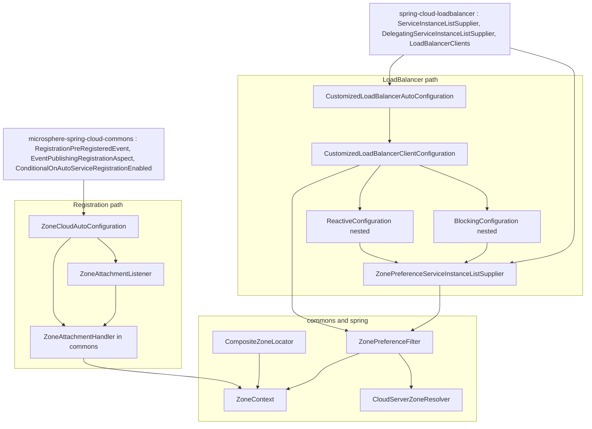
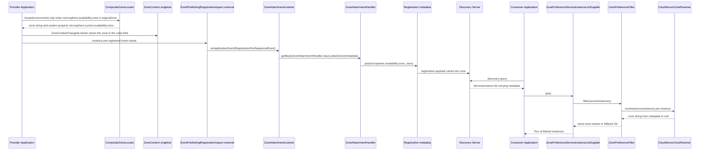
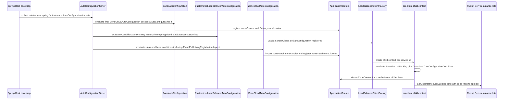

# `microsphere-multiactive-spring-cloud` — Developer Guide

中文版本：[简体中文](zh/microsphere-multiactive-spring-cloud.md)

Maven coordinates: `io.github.microsphere-projects:microsphere-multiactive-spring-cloud:${revision}` —
`0.1.14-SNAPSHOT` on this branch.

---

## Overview

`microsphere-multiactive-spring-cloud` is where the kernel meets a live microservice topology. It contributes two
independent, separately-switched features:

1. **Registration-side zone attachment** — `ZoneCloudAutoConfiguration` + `ZoneAttachmentListener` write the zone into
   `Registration.getMetadata()` just before the instance registers, so that every peer can read it later.
2. **Load-Balancer-side zone filtering** — `CustomizedLoadBalancerAutoConfiguration` + `CustomizedLoadBalancerClientConfiguration`
   + `ZonePreferenceServiceInstanceListSupplier` install a `ServiceInstanceListSupplier` decorator that applies
   `ZonePreferenceFilter` to the discovered instance list.

Plus one shared helper: `CloudServerZoneResolver`, the `ZoneResolver<ServiceInstance>` used by both the filtering path and
the Netflix `DiscoveryClientServer` adapter.

| Type | File |
|------|------|
| `CloudServerZoneResolver` | `microsphere-multiactive-spring-cloud/src/main/java/io/microsphere/multiple/active/zone/spring/cloud/CloudServerZoneResolver.java` |
| `ZoneCloudAutoConfiguration` | `microsphere-multiactive-spring-cloud/src/main/java/io/microsphere/multiple/active/zone/spring/cloud/autoconfigure/ZoneCloudAutoConfiguration.java` |
| `ZoneAttachmentListener` | `microsphere-multiactive-spring-cloud/src/main/java/io/microsphere/multiple/active/zone/spring/cloud/event/ZoneAttachmentListener.java` |
| `CustomizedLoadBalancerAutoConfiguration` | `microsphere-multiactive-spring-cloud/src/main/java/io/microsphere/multiple/active/zone/spring/cloud/loadbalancer/CustomizedLoadBalancerAutoConfiguration.java` |
| `CustomizedLoadBalancerClientConfiguration` | `microsphere-multiactive-spring-cloud/src/main/java/io/microsphere/multiple/active/zone/spring/cloud/loadbalancer/CustomizedLoadBalancerClientConfiguration.java` |
| `ZonePreferenceServiceInstanceListSupplier` | `microsphere-multiactive-spring-cloud/src/main/java/io/microsphere/multiple/active/zone/spring/cloud/loadbalancer/ZonePreferenceServiceInstanceListSupplier.java` |

Resources:

- `microsphere-multiactive-spring-cloud/src/main/resources/META-INF/spring.factories` — **two** auto-configuration entries,
  `ZoneCloudAutoConfiguration` and `CustomizedLoadBalancerAutoConfiguration`.
- `microsphere-multiactive-spring-cloud/src/main/resources/META-INF/spring/org.springframework.boot.autoconfigure.AutoConfiguration.imports`
  — the same two classes for Spring Boot 2.7+/3.x.
- `microsphere-multiactive-spring-cloud/src/main/resources/META-INF/config/default/features.yaml` — feature metadata for the
  Microsphere Spring Cloud feature registry (see below).

Note that the `1.x` layout has **no separate `microsphere-multiactive-spring-cloud-loadbalancer` module**: the LoadBalancer
classes live inside this module, even though the project BOM advertises that artifact id.

---

## Architecture design

### Layering



The two paths deliberately do not reference each other: nothing in the registration path needs LoadBalancer, and the
LoadBalancer path works even when the application never registers itself.

### Zone propagation across HTTP/RPC in this line

The zone crosses the network **only as instance metadata**. There is no header, no `ThreadLocal` and no per-call zone in
this branch; a consumer sees the zone that the provider published at registration time.



Two clarifications that only the code can give:

- The zone that gets attached is `ZoneContext.getZone()` — the **effective** value. It is populated either directly from the
  `microsphere.availability.zone` property or, when that property holds the `originalZone` sentinel, from the lazy
  `ZoneLocator` chain. Nothing on this branch reads the discovered value out of the
  `microsphere.current.availability.zone` system property during attachment.
- The write key (`ZoneAttachmentHandler` → `ZoneConstants.ZONE_PROPERTY_NAME`) and the read key
  (`CloudServerZoneResolver` → the same constant) are one and the same, so the metadata contract between provider and
  consumer is a single constant in commons.

---

## Source analysis

### `CloudServerZoneResolver`

```java
public class CloudServerZoneResolver implements ZoneResolver<ServiceInstance> {

    public static final CloudServerZoneResolver INSTANCE = new CloudServerZoneResolver();

    @Override
    public String resolve(ServiceInstance serviceInstance) {
        Map<String, String> instanceMetadata = serviceInstance.getMetadata();
        if (instanceMetadata != null) {
            return instanceMetadata.get(ZONE_PROPERTY_NAME);
        }
        return null;
    }
}
```

- It is the **reader that closes the loop** started by `ZoneAttachmentHandler`: the same
  `ZoneConstants.ZONE_PROPERTY_NAME` (`microsphere.availability.zone`) is written into, and read back from, instance
  metadata.
- Contract: `null` when metadata is missing or the key is absent — which `ZonePreferenceFilter` counts against the
  "upstream zone ready percentage" instead of treating it as a mismatch.
- A public static `INSTANCE` field is provided for stateless reuse, but it has a public constructor too, so
  `CustomizedLoadBalancerClientConfiguration` calling `new CloudServerZoneResolver()` is legal (and what the code does).
  Note `serviceInstance` itself is **not** null-guarded — passing `null` throws, unlike the more defensive
  `EurekaInstanceInfoZoneResolver` in the Netflix module.

### `ZoneCloudAutoConfiguration`

```java
@Configuration(proxyBeanMethods = false)
@ConditionalOnAvailabilityZoneAvailable
@ConditionalOnAutoServiceRegistrationEnabled
@ConditionalOnClass(name = {
        "org.aspectj.lang.annotation.Aspect",
        "io.microsphere.spring.cloud.client.service.registry.event.RegistrationPreRegisteredEvent",
        REGISTRATION_CLASS_NAME
})
@ConditionalOnBean(ZoneContext.class)
@AutoConfigureAfter(
        value = {ZoneAutoConfiguration.class},
        name = {
                "org.springframework.cloud.netflix.eureka.EurekaClientAutoConfiguration",
                "io.microsphere.spring.cloud.client.service.registry.autoconfigure.ServiceRegistryAutoConfiguration"
        })
@Import(value = {ZoneAttachmentHandler.class})
public class ZoneCloudAutoConfiguration {

    @Bean
    @ConditionalOnBean(type = "io.microsphere.spring.cloud.client.service.registry.aspect.EventPublishingRegistrationAspect")
    @ConditionalOnMissingBean
    public ZoneAttachmentListener zoneAttachmentListener() {
        return new ZoneAttachmentListener();
    }
}
```

Each condition narrows the feature further, and the ordering of the narrowing matters for troubleshooting:

| Condition | Effect |
|-----------|--------|
| `@ConditionalOnAvailabilityZoneAvailable` | inherited from the Spring Boot module: needs `ZoneContext` + `ZoneLocator` classes **and** `microsphere.availability.zone.enabled` not `false` |
| `@ConditionalOnAutoServiceRegistrationEnabled` | external annotation from `microsphere-spring-cloud-commons`; ties the feature to service-registry auto-registration being on |
| `@ConditionalOnClass(name = {…})` | string form, so the class loads even without AspectJ or the Microsphere registry API; needs AspectJ API, `RegistrationPreRegisteredEvent` and the `REGISTRATION_CLASS_NAME` constant (value defined in the external `ServiceRegistryConstants`, not in this snapshot) |
| `@ConditionalOnBean(ZoneContext.class)` | requires the `zoneContext` bean contributed by `ZoneAutoConfiguration`, i.e. it cannot work standalone |
| `@AutoConfigureAfter(value = …, name = …)` | after `ZoneAutoConfiguration` (type-safe) and after the Eureka client / Microsphere service-registry configurations (string-based so they may be absent) |
| `@ConditionalOnBean(type = "…EventPublishingRegistrationAspect")` on the bean method | the listener only exists when something actually publishes `RegistrationPreRegisteredEvent` |

The `@Import(ZoneAttachmentHandler.class)` deserves attention: `ZoneAttachmentHandler` is a plain commons class with a
single constructor taking `ZoneContext`. Spring's `@Import` of a non-`@Configuration` class registers a bean definition
that autowires by that single constructor, so the imported handler receives the `zoneContext` bean. `@ConditionalOnBean(ZoneContext.class)`
on the class is what makes that injection safe. This is also the only place in the whole build where a `ZoneAttachmentHandler`
bean is declared — the Netflix module expects one to be injected, so the Eureka path implicitly depends on this module's
auto-configuration being active.

`@ConditionalOnClass` / `@ConditionalOnBean(type = …)` in **string form** throughout is a deliberate portability choice:
one artifact covers Hoxton (Netflix stack present) through 2021 (LoadBalancer only).

### `ZoneAttachmentListener`

```java
public class ZoneAttachmentListener implements ApplicationListener<RegistrationPreRegisteredEvent>, ApplicationContextAware {

    @Override
    public void onApplicationEvent(RegistrationPreRegisteredEvent event) {
        Registration registration = event.getRegistration();
        Map<String, String> metadata = registration.getMetadata();
        ZoneAttachmentHandler zoneAttachmentHandler = applicationContext.getBean(ZoneAttachmentHandler.class);
        zoneAttachmentHandler.attachZone(metadata);
    }
}
```

- The generic event type means Spring's `ResolvableType`-based filtering decides whether the method is even invoked —
  non-matching events never reach `onApplicationEvent`.
- The handler is looked up **per event** from the `ApplicationContext` instead of being constructor-injected. That keeps the
  listener trivially constructible (`new ZoneAttachmentListener()`) but costs a bean lookup on every registration, and it
  means a missing `ZoneAttachmentHandler` bean surfaces as `NoSuchBeanDefinitionException` at *event time*, not at startup.
- The implemented parameter type is `RegistrationPreRegisteredEvent` from `microsphere-spring-cloud-commons`; the class
  Javadoc, however, links to Spring Cloud's own `InstancePreRegisteredEvent` ("A listener for the
  `InstancePreRegisteredEvent` instance pre-registered event"). That reference is stale — the Spring Cloud event is only
  imported, never handled. The Eureka-native registration route is covered by the Netflix module instead.

### `CustomizedLoadBalancerAutoConfiguration`

```java
@Configuration(proxyBeanMethods = false)
@ConditionalOnProperty(value = "microsphere.spring.cloud.loadbalancer.customized", havingValue = "true")
@ConditionalOnClass(name = {
        "org.springframework.cloud.loadbalancer.annotation.LoadBalancerClient"
})
@LoadBalancerClients(defaultConfiguration = CustomizedLoadBalancerClientConfiguration.class)
public class CustomizedLoadBalancerAutoConfiguration {
}
```

- **Empty body by design** — the only work is the `@LoadBalancerClients` annotation, which registers
  `CustomizedLoadBalancerClientConfiguration` as the *default* configuration for every LoadBalancer client, thereby
  installing it into each client's child context.
- `@ConditionalOnProperty` has `havingValue = "true"` **without** `matchIfMissing`, so this feature is **off by default**
  and must be opted in with `microsphere.spring.cloud.loadbalancer.customized=true`. Note that the property is *not* under
  the `microsphere.availability.zone.` prefix used everywhere else, and its name is hard-coded as a literal rather than taken
  from `ZoneConstants`.
- Unlike `ZoneCloudAutoConfiguration`, this configuration is **not** gated by `@ConditionalOnAvailabilityZoneAvailable`:
  disabling `microsphere.availability.zone.enabled` does not remove the customized supplier. What stops the filtering then
  is `ZoneContext.isEnabled()` inside the filter, not bean registration.
- Class-level Javadoc credits `Walklown` while the rest of the module credits `Mercy Ma` — this file and `HttpUtils` in
  commons are the two contributions by a different author.

### `CustomizedLoadBalancerClientConfiguration`

```java
@Configuration(proxyBeanMethods = false)
public class CustomizedLoadBalancerClientConfiguration {

    @ConditionalOnReactiveDiscoveryEnabled
    @Order(193827465)
    static class ReactiveConfiguration {

        @Bean
        @ConditionalOnBean(DiscoveryClient.class)
        @ConditionalOnMissingBean
        @Conditional(OptimizedZoneConfigurationCondition.class)
        public ServiceInstanceListSupplier optimizedZonePreferenceDiscoveryClientServiceInstanceListSupplier(
                ConfigurableApplicationContext context, ZonePreferenceFilter<ServiceInstance> zonePreferenceFilter) {
            return ServiceInstanceListSupplier.builder().withDiscoveryClient().withCaching()
                    .with((ctx, delegate) ->
                            new ZonePreferenceServiceInstanceListSupplier(delegate, zonePreferenceFilter))
                    .build(context);
        }
    }

    @ConditionalOnBlockingDiscoveryEnabled
    @Order(193827466)
    static class BlockingConfiguration { /* same shape, withBlockingDiscoveryClient() */ }

    @Bean
    public ZonePreferenceFilter<ServiceInstance> zonePreferenceFilter(ZoneContext zoneContext) {
        return new ZonePreferenceFilter<ServiceInstance>(zoneContext, new CloudServerZoneResolver());
    }

    static class OptimizedZoneConfigurationCondition implements Condition {

        @Override
        public boolean matches(ConditionContext context, AnnotatedTypeMetadata metadata) {
            return LoadBalancerEnvironmentPropertyUtils.equalToForClientOrDefault(context.getEnvironment(),
                    "configurations", "optimized-zone-preference");
        }
    }
}
```

Points a maintainer needs:

- **The class itself carries no conditions.** `zonePreferenceFilter(...)` is therefore registered whenever this
  configuration is used at all — including when a user references it directly from `@LoadBalancerClient(...)` instead of
  through the `microsphere.spring.cloud.loadbalancer.customized` switch. Because it is a *LoadBalancer child-context*
  configuration, one `ZonePreferenceFilter` instance exists **per client**, while every one of them shares the single
  JVM-wide `ZoneContext`.
- **The supplier chain is built with the Spring Cloud builder**: discovery-client-backed instances → caching decorator →
  `ZonePreferenceServiceInstanceListSupplier` decorator appended through the generic `.with((ctx, delegate) -> …)` hook.
  Caching is deliberately placed **below** the zone filter, i.e. the cached list is the raw list and zone filtering is
  re-applied on every `get()` — a design decision that keeps re-configuration effective without invalidating the cache.
- **Two mutually exclusive variants** (`ReactiveConfiguration` / `BlockingConfiguration`) selected by
  `@ConditionalOnReactiveDiscoveryEnabled` / `@ConditionalOnBlockingDiscoveryEnabled`, with consecutive `@Order` values
  `193827465` and `193827466`. Their absolute magnitude is a local fact of this file; how they interleave with Spring
  Cloud's own `LoadBalancerClientConfiguration` nested orders cannot be verified from this snapshot.
- **Per-client opt-in on top of the global opt-in**: `OptimizedZoneConfigurationCondition` delegates to the external
  `LoadBalancerEnvironmentPropertyUtils.equalToForClientOrDefault(environment, "configurations", "optimized-zone-preference")`,
  i.e. the supplier only appears for clients whose `configurations` value equals `optimized-zone-preference` (client-specific
  or `default`). The exact composed property key is produced by that external utility.
- Both variants additionally require a `DiscoveryClient` bean and yield to any existing `ServiceInstanceListSupplier`
  (`@ConditionalOnMissingBean` against the `ServiceInstanceListSupplier` return type).
- `new CloudServerZoneResolver()` is used although the `INSTANCE` constant exists — behaviourally identical (stateless), but
  worth knowing if you ever make the resolver stateful.
- The bean method names differ between variants (`optimizedZonePreferenceDiscoveryClientServiceInstanceListSupplier` vs
  `optimizedZonePreferenceServiceInstanceListSupplier`), so both could theoretically coexist if the reactive/blocking
  conditions were simultaneously satisfied.

### `ZonePreferenceServiceInstanceListSupplier`

```java
public class ZonePreferenceServiceInstanceListSupplier extends DelegatingServiceInstanceListSupplier {

    private final ZonePreferenceFilter<ServiceInstance> zonePreferenceFilter;

    public ZonePreferenceServiceInstanceListSupplier(ServiceInstanceListSupplier delegate,
                                                     ZonePreferenceFilter<ServiceInstance> zonePreferenceFilter) {
        super(delegate);
        this.zonePreferenceFilter = zonePreferenceFilter;
    }

    @Override
    public Flux<List<ServiceInstance>> get() {
        return getDelegate().get().map(this::filteredByZone);
    }

    private List<ServiceInstance> filteredByZone(List<ServiceInstance> serviceInstances) {
        return zonePreferenceFilter.filter(serviceInstances);
    }
}
```

- A **thin reactive decorator**: `Flux.map` applies the synchronous commons filter to each emitted list. No extra
  subscription, no scheduler change, no error handling — any exception thrown by the filter would propagate as a Flux
  error, which is why the commons filter is written to never throw and to prefer the fallback list.
- Only `get()` is overridden. The class does **not** implement the `ServiceInstanceListSupplier#getServiceInstances()`
  style "hint"-aware methods or a `zone`-aware variant; whatever the delegate reports as the zone stays the delegate's
  business. This class also does not extend Spring Cloud's own
  `org.springframework.cloud.loadbalancer.core.ZonePreferenceServiceInstanceListSupplier` — it is an independent
  re-implementation delegating to the shared algorithm, referenced only in the Javadoc.
- The Javadoc `@since` tag is malformed (`@since org.springframework.cloud.loadbalancer.core.ZonePreferenceServiceInstanceListSupplier`);
  the intended `@see` target was written into the wrong tag. Same class of defect appears in the Netflix module
  (`@since ZoneResolver`, `@since DiscoveryClient`).

### Feature metadata: `META-INF/config/default/features.yaml`

```yaml
microsphere:
  spring:
    cloud:
      features:
        named:
          microsphere-multiactive-commons:
            - io.microsphere.multiple.active.zone.ZoneAttachmentHandler
            - io.microsphere.multiple.active.zone.ZoneContext
            - io.microsphere.multiple.active.zone.ZonePreferenceFilter
            - io.microsphere.multiple.active.zone.ZoneResolver
          microsphere-multiactive-spring:
            - io.microsphere.multiple.active.zone.spring.ZoneLocator
            - io.microsphere.multiple.active.zone.spring.event.ZoneContextChangedListener
          microsphere-multiactive-spring-cloud:
            - WebEndpointApplicationContextInitializer=io.microsphere.spring.cloud.gateway.server.webmvc.context.WebEndpointApplicationContextInitializer
```

- The file registers *named feature → class* groupings for the Microsphere Spring Cloud feature mechanism (four of the six
  commons types are listed; `ZoneConstants` and `HttpUtils` are not). Its consumption is external to this repository and
  therefore **not verifiable here**.
- The third group does not list any class of this module. Instead it carries a `key=value` entry pointing at
  `…gateway.server.webmvc.context.WebEndpointApplicationContextInitializer`, which belongs to neither this module nor to any
  zone-related code — an artefact of copying a gateway feature descriptor. The Netflix module ships a file of the same shape
  whose listings do match its own classes, so the anomaly is local to this entry. Treat it as suspect rather than as
  documented behaviour.

### Spring Cloud integration lifecycle



---

## Design patterns actually present

| Pattern | Evidence in this snapshot |
|---------|---------------------------|
| **Decorator** | `ZonePreferenceServiceInstanceListSupplier extends DelegatingServiceInstanceListSupplier`, wrapping `getDelegate().get()` with `Flux.map` |
| **Chain of decorators built by a builder** | `ServiceInstanceListSupplier.builder().withDiscoveryClient().withCaching().with(...).build(context)` |
| **Composite + Strategy** | `ZonePreferenceFilter` (algorithm) parameterised by `CloudServerZoneResolver` (strategy) and `ZoneContext` (policy) |
| **Event-driven listener** | `ApplicationListener<RegistrationPreRegisteredEvent>` publishing metadata mutation |
| **Auto-configuration with layered conditions** | `ZoneCloudAutoConfiguration`: class conditions + bean conditions + `@AutoConfigureAfter` + feature-switch annotation |
| **Static singleton holder** | `CloudServerZoneResolver.INSTANCE` |
| **Service locator** | `ZoneAttachmentListener` calls `applicationContext.getBean(ZoneAttachmentHandler.class)` at event time instead of injecting |
| **Custom `Condition`** | `OptimizedZoneConfigurationCondition implements Condition` evaluated per LoadBalancer client environment |
| **Nested conditional configuration variants** | `ReactiveConfiguration` / `BlockingConfiguration` static nested `@Configuration` classes with `@Order` |
| **Default child-context installation** | `@LoadBalancerClients(defaultConfiguration = CustomizedLoadBalancerClientConfiguration.class)` with an otherwise empty auto-configuration body |

Not present: no `spring.factories` SPI for `ZoneResolver`, no `@ConfigurationProperties` binding class, no actuator
endpoint, no `ThreadLocal`-based request zone propagation, and no filter chain of the Servlet kind.

---

## Extension points

1. **Filter a non-Spring-Cloud list** — construct `new ZonePreferenceFilter<>(zoneContext, yourResolver)` yourself; this
   module's only contribution to the algorithm is the `ServiceInstance` resolver and the LoadBalancer adapter.
2. **Add another supplier variant** — extend `CustomizedLoadBalancerClientConfiguration` usage through
   `@LoadBalancerClient(name = "…", configuration = …)`; the filter bean is created unconditionally inside that child
   configuration, so your supplier can inject `ZonePreferenceFilter<ServiceInstance>` directly.
3. **Publish the zone for a different registration API** — implement another listener on the registry's own pre-registration
   event and delegate to the shared `ZoneAttachmentHandler` bean, exactly as the Netflix module does with
   `ZoneAttachmentPreRegistrationHandler`.
4. **Make the metadata key different** — the write (`ZoneAttachmentHandler`) and the read (`CloudServerZoneResolver`) both
   use `ZoneConstants.ZONE_PROPERTY_NAME`; changing it means changing the constant in commons, since no key literal appears
   in this module.

---

## Build and test

`microsphere-multiactive-spring-cloud/pom.xml` — parent `microsphere-multiactive-parent`, packaging `jar`, no plugins, no
profiles.

| Dependency | Scope | Notes |
|------------|-------|-------|
| `microsphere-multiactive-spring-boot` (`${revision}`) | compile (mandatory) | transitively brings `spring` and `commons` |
| `microsphere-spring-cloud-commons` | optional | `RegistrationPreRegisteredEvent`, `EventPublishingRegistrationAspect`, `ConditionalOnAutoServiceRegistrationEnabled`, `ServiceRegistryConstants`, `InMemoryServiceRegistry` (test) |
| `spring-boot-starter`, `-actuator`, `-web` | optional | `spring-boot-starter-web` is what brings servlet/Reactor-facing Boot web types |
| `spring-boot-configuration-processor`, `spring-boot-autoconfigure-processor`, `microsphere-annotation-processor` | optional | compile-time processing |
| `spring-cloud-commons`, `spring-cloud-context` | optional | `ServiceInstance`, `DiscoveryClient`, `Registration`, `EnvironmentChangeEvent` |
| `spring-cloud-loadbalancer` | optional | `ServiceInstanceListSupplier`, `DelegatingServiceInstanceListSupplier`, `LoadBalancerClients`, `LoadBalancerEnvironmentPropertyUtils` (Reactor `Flux` arrives transitively through it) |
| `spring-boot-starter-test`, `microsphere-spring-boot-test`, `junit-jupiter`, `logback-classic` | test | test support |

Everything Spring-Cloud-facing is optional, so this one jar spans Hoxton → 2021; the price is that the build cannot
guarantee compile compatibility with any single Spring Cloud release without an external profile.

Tests (2 classes):

- `ZoneCloudAutoConfigurationTest extends AutoConfigurationTest<ZoneCloudAutoConfiguration>` declares the auto-configured
  footprint `{ZoneAttachmentHandler, ZoneAttachmentListener}`, two global disabled values
  (`microsphere.availability.zone.enabled=false`, `spring.cloud.service-registry.auto-registration.enabled=false`) and four
  global missing classes (`ZoneLocator`, `Aspect`, `RegistrationPreRegisteredEvent`, `Registration`). It boots a
  `@SpringBootTest` context seeded with `ZoneContext` and `EventPublishingRegistrationAspect` classes.
- `ZoneCloudAutoConfigurationIntegrationTest` is a real `@SpringBootTest` with
  `properties = {"server.port=8080", "spring.application.name=test-service", "microsphere.spring.cloud.service-registry.auto-registration.simple.enabled=true"}`
  and `@EnableAutoConfiguration`; it `@Autowired`s `Registration`, `ServiceRegistry<Registration>`, `ZoneContext`,
  `CompositeZoneLocator`, `ZoneAttachmentHandler` and `ZoneAttachmentListener` and asserts `zoneContext` is non-null. It is
  the only test in the build that proves the whole registration chain assembles. **Nothing asserts that metadata actually
  received the zone**, and **no test exercises the LoadBalancer side at all**.

```bash
./mvnw -pl microsphere-multiactive-spring-cloud -am test
```

---

## Differences from the `0.2.x` / current line

Visible from this snapshot:

- LoadBalancer support is packaged inside `microsphere-multiactive-spring-cloud`; the project BOM nevertheless manages a
  separate `microsphere-multiactive-spring-cloud-loadbalancer` artifact id that this branch does not build.
- The LoadBalancer feature is guarded by `microsphere.spring.cloud.loadbalancer.customized=true` (no `matchIfMissing`), a
  property outside the `microsphere.availability.zone.*` namespace, and it is **not** gated by
  `@ConditionalOnAvailabilityZoneAvailable`.
- Zone attachment listens to the Microsphere `RegistrationPreRegisteredEvent` (Eureka-native attachment is delegated to the
  separate Netflix module via `PreRegistrationHandler`).
- `ZonePreferenceFilter` beans are created inside Spring Cloud **per-client child contexts**, one per client, all sharing the
  JVM-wide `ZoneContext`.
- Both `spring.factories` and `AutoConfiguration.imports` are shipped for the two auto-configuration classes.

---

## Related

- [Developer Guide index](README.md)
- [microsphere-multiactive-commons](microsphere-multiactive-commons.md) — `ZonePreferenceFilter`, `ZoneAttachmentHandler`, `ZoneResolver`
- [microsphere-multiactive-spring-boot](microsphere-multiactive-spring-boot.md) — `ZoneAutoConfiguration` this module runs after
- [microsphere-multiactive-netflix](microsphere-multiactive-netflix.md) — the Eureka/Ribbon counterparts of these adapters
- [microsphere-multiactive-spring-cloud User Guide](../user-guide/microsphere-multiactive-spring-cloud.md)
- [User Guide index](../user-guide/README.md)
- [Repository README](../../../README.md)

## 中文

中文版本：[简体中文](zh/microsphere-multiactive-spring-cloud.md)
