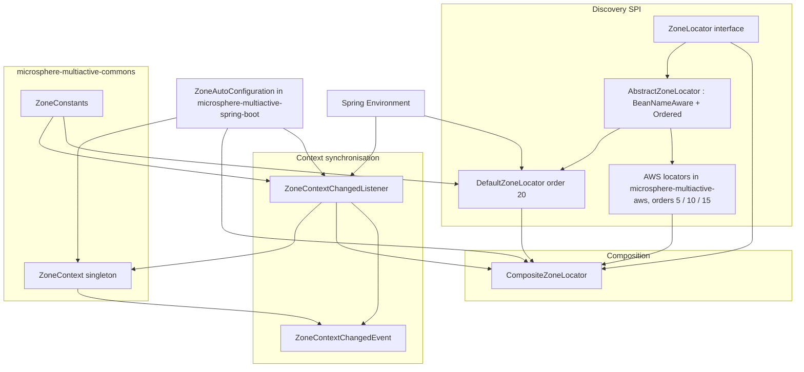
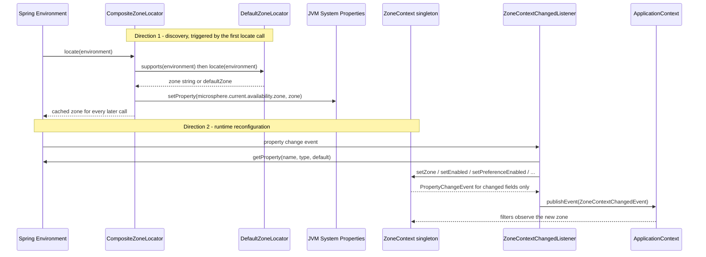
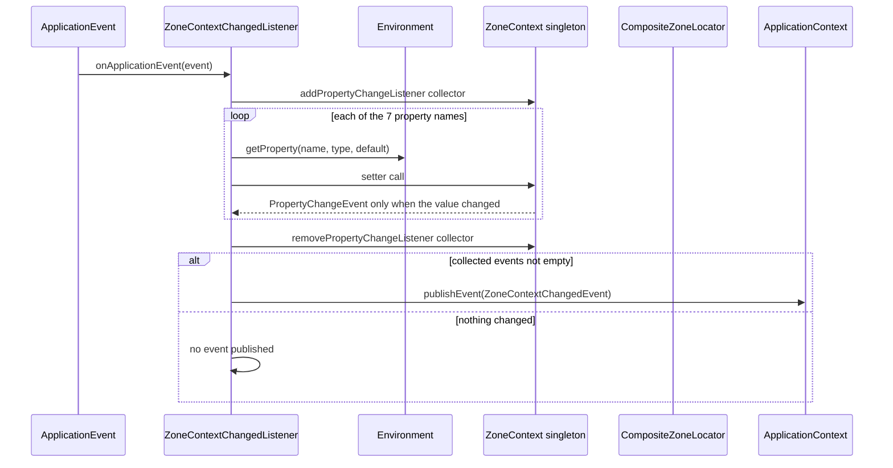
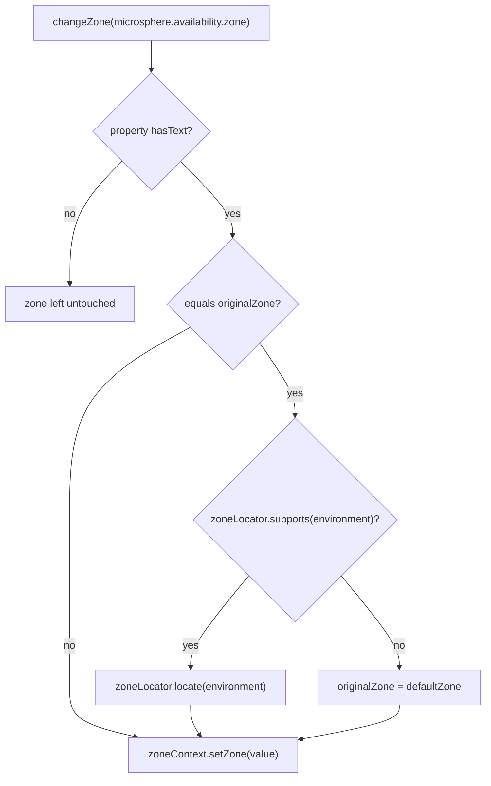

# `microsphere-multiactive-spring` — Developer Guide

中文版本：[简体中文](zh/microsphere-multiactive-spring.md)

Maven coordinates: `io.github.microsphere-projects:microsphere-multiactive-spring:${revision}` — `0.1.14-SNAPSHOT` on
this branch.

---

## Overview

`microsphere-multiactive-spring` is the Spring Framework layer. It owns two things:

1. the **`ZoneLocator` SPI** and its composition logic — how a process discovers its own availability zone;
2. the **`ZoneContextChangedListener`** — how Spring `Environment` properties are pushed into the
   `microsphere-multiactive-commons` singleton and how a `ZoneContextChangedEvent` is emitted afterwards.

It adds no auto-configuration and ships **no `src/main/resources` at all** — verified: the module contains seven Java
files and nothing else. Everything it contributes must be registered explicitly (by the Spring Boot module, or by hand
in a plain Spring application).

Packages:

| Package | Types | Responsibility |
|---------|-------|----------------|
| `io.microsphere.multiple.active.zone.spring` | `ZoneLocator`, `AbstractZoneLocator`, `DefaultZoneLocator`, `CompositeZoneLocator`, `ZoneUtils` | zone discovery |
| `io.microsphere.multiple.active.zone.spring.event` | `ZoneContextChangedEvent`, `ZoneContextChangedListener` | property → context synchronisation, event publication |

---

## Architecture design

### Layering



Responsibilities are cleanly separated: `CompositeZoneLocator` only *reads* (discovery), `ZoneContextChangedListener`
only *writes* (into `ZoneContext`), and the two meet only through the `ZoneLocator` bean reference held by the
listener.

### Zone context propagation: two directions

In this line the zone moves in two distinct directions, and the two modules own one each:



The **discovered** zone lives in the system property (`microsphere.current.availability.zone`, readable through
`ZoneContext.getCurrentZone()`); the **effective** zone used by filters lives in `ZoneContext.getZone()`. Keeping them
apart is what makes the `"originalZone"` revert feature possible.

**Nothing calls `locate()` eagerly in this line.** A search across every `src/main/java` file of the snapshot finds exactly
two production call sites of `ZoneLocator.locate(...)`: inside `CompositeZoneLocator` itself (the delegate loop) and inside
`ZoneContextChangedListener.revertOriginalZone()`. `ZoneAutoConfiguration` only *builds* the composite; it never invokes it.
Therefore the locator chain — including the AWS HTTP calls — runs **only** when either

- `microsphere.availability.zone` is set to the sentinel value `originalZone` (then `changeZone` reverts through the
  locator), or
- application code obtains the locator (e.g. via `ZoneUtils.getZoneLocator(beanFactory)`) and calls `locate(environment)`
  itself.

If the property is left unset, `ZoneContext.zone` simply keeps its default `"defaultZone"`, the system property is never
written, and `ZonePreferenceFilter.isIgnored(...)` short-circuits all filtering.

---

## Source analysis

### `ZoneLocator`

`microsphere-multiactive-spring/src/main/java/io/microsphere/multiple/active/zone/spring/ZoneLocator.java`

```java
public interface ZoneLocator {
    boolean supports(Environment environment);
    String locate(Environment environment);
}
```

Two things a maintainer should notice:

- `supports` is the "does this source apply to me?" predicate; `CompositeZoneLocator` calls it before every `locate`.
- The interface does **not** extend `Ordered` and has no `getOrder()`. Ordering is supplied by the abstract class, so a
  bare lambda-style implementation (as used in `CompositeZoneLocatorTest` and `ZoneContextChangedListenerTest`) is
  order-less and sorts last under `AnnotationAwareOrderComparator`.
- It doubles as a service-loader key: `META-INF/spring.factories` in the AWS and Spring Boot modules registers
  implementations under the *interface class name*, consumed by
  `io.microsphere.spring.core.io.support.SpringFactoriesLoaderUtils.loadFactories`.

### `AbstractZoneLocator`

`microsphere-multiactive-spring/src/main/java/io/microsphere/multiple/active/zone/spring/AbstractZoneLocator.java`

```java
public abstract class AbstractZoneLocator implements ZoneLocator, BeanNameAware, Ordered {
    protected final Logger logger = getLogger(getClass());
    protected String beanName;
    protected int order;

    public AbstractZoneLocator(int order) { setOrder(order); }

    @Override public final void setBeanName(String beanName) { this.beanName = beanName; }
    @Override public final int getOrder() { return order; }
    public final void setOrder(int order) { this.order = order; }
}
```

- `logger` is `protected final` and created from `getClass()`, so each concrete locator logs under its own name.
- `setBeanName`, `getOrder` and `setOrder` are `final`: subclasses cannot change the ordering contract; they must pass
  the order through the constructor. `setOrder` exists so an XML/Java-config bean definition can re-order a locator, and
  `DefaultZoneLocatorTest#testSetOrder` pins that mutability.
- `toString()` is `"ZoneLocator{beanName='...', order=...}"` — this string is what appears in the
  `CompositeZoneLocator` logs, which makes log triage by locator straightforward.
- The constructor is **not** no-arg, so every subclass must declare its own default constructor and call
  `super(DEFAULT_ORDER)`; that is the template contract of this hierarchy.

### `DefaultZoneLocator`

`microsphere-multiactive-spring/src/main/java/io/microsphere/multiple/active/zone/spring/DefaultZoneLocator.java`

```java
public static final int DEFAULT_ORDER = 20;

@Override public boolean supports(Environment environment) { return true; }

@Override public String locate(Environment environment) {
    String zone = environment.getProperty(ZONE_PROPERTY_NAME);
    if (StringUtils.hasText(zone)) { ... return zone; }
    else { ... zone = DEFAULT_ZONE; }
    return zone;
}
```

- `supports` is unconditionally `true` and `locate` never returns `null` — it returns the `"defaultZone"` sentinel.
  Because the composite stops at the **first non-null** result, `DefaultZoneLocator` (order 20, the highest default)
  always wins if no platform locator produced a zone first.
- Two consequences, both verified in tests: `testLocateWithoutZonePropertyFallsBackToDefault` asserts `"defaultZone"`,
  and `CompositeZoneLocator` then writes `defaultZone` into the system property; `ZonePreferenceFilter.isIgnored(...)`
  treats `"defaultZone"` as "ignore", so **an application that only configures the enabled flags and no zone does no
  same-zone filtering** — which is exactly the intended "off unless you know your zone" behaviour.
- This locator is registered through `META-INF/spring.factories` **in the Spring Boot module**, not here.

### `CompositeZoneLocator`

`microsphere-multiactive-spring/src/main/java/io/microsphere/multiple/active/zone/spring/CompositeZoneLocator.java`

The constructor normalises its input once:

```java
public CompositeZoneLocator(List<ZoneLocator> zoneLocators) {
    Assert.notNull(zoneLocators, "The argument 'zoneLocators' must not be null!");
    this.zoneLocators = new ArrayList<>(zoneLocators);
    AnnotationAwareOrderComparator.sort(this.zoneLocators);
}
```

- `Assert.notNull` → `IllegalArgumentException` (pinned by `testConstructorWithNullThrows`).
- Defensive copy: the caller's list can be mutated later without affecting the composite, and the sort happens on the
  copy. `AnnotationAwareOrderComparator` honours both `Ordered` (from `AbstractZoneLocator`) and `@Order` /
  `Ordered`-style annotations, so annotation-only locators are ordered correctly too.

`locate(Environment)` is the most consequential method in this module:

```java
@Override
public String locate(Environment environment) {
    // return the located zone at the first time
    if (StringUtils.hasText(zone)) {
        return zone;
    }

    String zone = null;
    boolean fastFailEnabled = isFastFailEnabled(environment);
    ZoneLocator failedZoneLocator = null;

    for (ZoneLocator zoneLocator : zoneLocators) {
        try {
            if (zoneLocator.supports(environment)) {
                zone = zoneLocator.locate(environment);
                if (zone != null) {
                    logger.info("{} locates the zone : {}", zoneLocator, zone);
                    break;
                } else {
                    logger.warn("{} can't locate the zone", zoneLocator);
                    if (fastFailEnabled) {
                        failedZoneLocator = zoneLocator;
                        break;
                    }
                }
            } else {
                logger.trace("{} does not support to locate the zone", zoneLocator);
            }
        } catch (Throwable e) {
            logger.error("{} failed to locate the zone", zoneLocator, e);
            if (fastFailEnabled) {
                failedZoneLocator = zoneLocator;
                break;
            }
        }
    }

    if (failedZoneLocator != null) {
        throw new IllegalStateException("The zone can't be located by " + failedZoneLocator);
    }

    if (zone == null) {
        logger.warn("The zone can't be located by anyone of zoneLocators : {}", zoneLocators);
    }

    this.zone = zone;

    if (this.zone != null) {
        System.setProperty(CURRENT_ZONE_PROPERTY_NAME, this.zone);
    }

    return zone;
}
```

Point-by-point semantics, each pinned by a test in `CompositeZoneLocatorTest`:

| Behaviour | Test |
|-----------|------|
| first non-`null` locator wins, later ones are skipped | `testLocateWithFirstMatchingLocator` |
| result is cached: second call never re-runs the chain | `testLocateCachesResult` |
| unsupported locators are skipped silently (trace log) | `testLocateSkipsUnsupportedLocators` |
| all-`null` chain returns `null` and only warns | `testLocateReturnsNullWhenNoneLocates` |
| a locator exception is swallowed and the chain continues (default) | `testLocateWithExceptionNoFastFail` |
| `fast-fail=true` converts `null` into a hard failure | `testLocateWithFastFailOnNullZone` |
| `fast-fail=true` converts an exception into a hard failure | `testLocateWithFastFailOnException` |
| empty locator list → `supports` false, `locate` `null` | `testLocateWithEmptyLocatorList` |

Details a maintainer must not lose:

- **The cache is the *hasText* check, not a boolean flag.** `if (StringUtils.hasText(zone)) return zone;` means a first
  run that produced `null` is retried on the next call — the chain is re-executed until it yields a non-blank value.
  That is intentional (platform metadata may not be ready at the first call) but means `locate` is not a pure read.
- **Fast-fail is read from the `Environment` on every uncached call** through
  `isFastFailEnabled(environment)` → `getProperty(LOCATOR_FAST_FAIL_PROPERTY_NAME, boolean.class, DEFAULT_LOCATOR_FAST_FAIL)`.
- **`System.setProperty(CURRENT_ZONE_PROPERTY_NAME, …)` is a global side effect** performed whenever a non-`null` zone is
  resolved — including `"defaultZone"`. It is what `ZoneContext.getCurrentZone()` later reads, and it is never cleared by
  this class. Tests that assert on it must clear it (as `ZoneContextTest#tearDown` does).
- `IllegalStateException` thrown from `locate` carries only the locator's `toString()`; the cause of a *failed* locator
  is not chained — it is only present in the error log.
- `CompositeZoneLocator` implements `ZoneLocator` itself but does **not** extend `AbstractZoneLocator`, hence it has no
  order and no bean name; `supports` returns `true` if any delegate supports, and its own `toString()` prints the whole
  delegate list.

### `ZoneUtils`

`microsphere-multiactive-spring/src/main/java/io/microsphere/multiple/active/zone/spring/ZoneUtils.java`

```java
public static final String ZONE_CONTEXT_BEAN_NAME = "zoneContext";
public static final String ZONE_LOCATOR_BEAN_NAME = "zoneLocator";

private ZoneUtils() {}

public static ZoneContext getZoneContext(ConfigurableListableBeanFactory beanFactory) {
    return beanFactory.getBean(ZONE_CONTEXT_BEAN_NAME, ZoneContext.class);
}

public static ZoneLocator getZoneLocator(ConfigurableListableBeanFactory beanFactory) {
    return beanFactory.getBean(ZONE_LOCATOR_BEAN_NAME, ZoneLocator.class);
}
```

- These bean names are the canonical ones: `ZoneAutoConfiguration` declares its beans with
  `@Bean(name = ZONE_CONTEXT_BEAN_NAME)` / `@Bean(name = ZONE_LOCATOR_BEAN_NAME)`, and the tests register beans under the
  same constants.
- The abstract class with a private constructor makes it non-instantiable; it also keeps an **unused `logger` field**
  (`getLogger(ZoneUtils.class)`) that no method references — dead code on this branch.
- Interesting asymmetry: `ZoneContextChangedListener` looks the beans up **by type** (`context.getBean(ZoneContext.class)`,
  `context.getBean(ZoneLocator.class)`) instead of using these by-name helpers. The name constants and the by-type lookup
  are kept in sync only by convention, so renaming the bean without keeping `@Primary` on the locator breaks the listener
  rather than the helper.

### `ZoneContextChangedEvent`

`microsphere-multiactive-spring/src/main/java/io/microsphere/multiple/active/zone/spring/event/ZoneContextChangedEvent.java`

```java
public class ZoneContextChangedEvent extends ApplicationContextEvent {
    private final ZoneContext zoneContext;
    private final List<PropertyChangeEvent> propertyChangeEvents;

    public ZoneContextChangedEvent(ApplicationContext context, ZoneContext zoneContext, List<PropertyChangeEvent> propertyChangeEvents) {
        super(context);
        this.zoneContext = zoneContext;
        this.propertyChangeEvents = unmodifiableList(propertyChangeEvents);
    }
}
```

- Extending `ApplicationContextEvent` makes `getSource()` / `getApplicationContext()` the context (asserted by
  `testGetSource`).
- `unmodifiableList(...)` is applied in the constructor, so the batch of `PropertyChangeEvent`s cannot be mutated by
  listeners. Note it does **not** copy — it wraps the list the listener is still holding, which is fine because the
  listener never touches it after publication.

### `ZoneContextChangedListener`

`microsphere-multiactive-spring/src/main/java/io/microsphere/multiple/active/zone/spring/event/ZoneContextChangedListener.java`

```java
public class ZoneContextChangedListener implements SmartApplicationListener, ApplicationContextAware, EnvironmentAware
```

**Classpath-mode detection.** Three `static final` booleans are computed at class-initialisation from
`ClassLoaderUtils.resolveClass(...)` results, which return `null` when a class is absent:

```java
private static final boolean IS_SPRING_CLOUD_APPLICATION = ENVIRONMENT_CHANGE_EVENT_CLASS != null && APPLICATION_STARTED_EVENT_CLASS != null;
private static final boolean IS_SPRING_BOOT_APPLICATION  = ENVIRONMENT_CHANGE_EVENT_CLASS == null && APPLICATION_STARTED_EVENT_CLASS != null;
```

`supportsEventType` therefore has three branches:

| Detected classes | Supported event type |
|------------------|----------------------|
| `EnvironmentChangeEvent` + `ApplicationStartedEvent` present | `EnvironmentChangeEvent` **or** `ApplicationStartedEvent` |
| only `ApplicationStartedEvent` present | `ApplicationStartedEvent` |
| neither | `ContextRefreshedEvent` |

Both names are hard-coded strings (`org.springframework.cloud.context.environment.EnvironmentChangeEvent`,
`org.springframework.boot.context.event.ApplicationStartedEvent`) so the module compiles against `spring-context` only.
Caveats to keep in mind: the flags are frozen at first class load (they never re-evaluate), a Spring Boot application
*without* `spring-cloud-context` on the classpath ignores `EnvironmentChangeEvent` by design, and the third case
`IS_SPRING_CLOUD_APPLICATION == false && IS_SPRING_BOOT_APPLICATION == false` (i.e. `EnvironmentChangeEvent` present but
`ApplicationStartedEvent` missing) falls through to `ContextRefreshedEvent`. The module is a `SmartApplicationListener`
that does not override `getOrder()`, so it runs at `Ordered.LOWEST_PRECEDENCE`.

**The handler table.** `ZONE_CONTEXT_PROPERTY_NAMES` (7 entries, asserted by `testZonePropertyChangeListenerNames`) and
`propertyChangedHandlers` (a `HashMap<String, Consumer<String>>` of 7 entries, asserted by
`testPropertyChangedHandlersInitialized`) are populated in the constructor via `initPropertyChangedHandlers()`. Each
handler maps a property name onto a `set…` call:

| Property name | Handler | `ZoneContext` setter |
|---------------|---------|----------------------|
| `microsphere.availability.zone` | `changeZone` | `setZone` |
| `microsphere.availability.zone.enabled` | `changeEnabled` | `setEnabled` |
| `microsphere.availability.zone.preference.enabled` | `changeZonePreferenceEnabled` | `setPreferenceEnabled` |
| `microsphere.availability.zone.preference.filter.order` | `changePreferenceFilterOrder` | `setPreferenceFilterOrder` |
| `microsphere.availability.zone.preference.upstream.zone-ready-percentage` | `changePreferenceUpstreamZoneReadyPercentage` | `setPreferenceUpstreamZoneReadyPercentage` |
| `microsphere.availability.zone.preference.upstream.same-zone-min-available` | `changePreferenceUpstreamSameZoneMinAvailable` | `setPreferenceUpstreamSameZoneMinAvailable` |
| `microsphere.availability.zone.preference.upstream.disabled-zone` | `changePreferenceUpstreamDisabledZone` | `setPreferenceUpstreamDisabledZone` |

Both collections are `protected`, and `propertyChangedHandlers` is a mutable instance field:
`testChangeZoneContextWithUnknownPropertyNameSkipsNull` removes an entry at runtime to exercise the `null`-handler
branch. That is the documented extension seam — subclassing (or configuring) the listener can add or drop property
handlers.

**The batch-with-observer idiom.** `changeZoneContext(...)` collects what actually changed by temporarily attaching a
`PropertyChangeListener`:

```java
List<PropertyChangeEvent> propertyChangeEvents = new LinkedList<>();
PropertyChangeListener listener = propertyChangeEvents::add;
try {
    zoneContext.addPropertyChangeListener(listener);
    for (String propertyName : propertyNames) {
        Consumer<String> propertyChangedHandler = propertyChangedHandlers.get(propertyName);
        if (propertyChangedHandler != null) {
            propertyChangedHandler.accept(propertyName);
        }
    }
} finally {
    zoneContext.removePropertyChangeListener(listener);
}
boolean changed = !propertyChangeEvents.isEmpty();
if (changed) {
    publishZoneContextChangedEvent(propertyChangeEvents);
}
```

`onApplicationEvent(...)` ignores its argument entirely and always runs `tryChangeZoneContext()` over the full 7-property
list. So the listener does **not** use `EnvironmentChangeEvent`'s changed-key set — every event re-applies every
property. Removal of a property is therefore also handled: `getProperty(...)` falls back to the documented default and
logs "is not found or deleted, the default value … will be set".

**`"originalZone"` revert.** The only branch with real logic:

```java
private void changeZone(String propertyName) {
    String zone = getProperty(propertyName, ORIGINAL_ZONE);
    if (StringUtils.hasText(zone)) {
        if (ORIGINAL_ZONE.equalsIgnoreCase(zone)) {
            zone = revertOriginalZone();
        }
        zoneContext.setZone(zone);
    }
}

private String revertOriginalZone() {
    String originalZone = ZoneConstants.DEFAULT_ZONE;
    if (zoneLocator.supports(environment)) {
        originalZone = zoneLocator.locate(environment);
    } else {
        logger.warn("The zone can't be discovered by {}", zoneLocator);
    }
    ...
    return originalZone;
}
```

- Setting `microsphere.availability.zone=originalZone` (case-insensitive) re-runs discovery through the injected
  `ZoneLocator`. `testRevertOriginalZoneWhenLocatorDoesNotSupport` pins the fallback to `"defaultZone"` when the locator
  reports `supports == false`.
- Setting `microsphere.availability.zone=""` does **nothing** — `StringUtils.hasText("")` is `false` and the current zone
  survives (`testChangeZoneWithEmptyStringPropertyDoesNotChangeZone`). Clearing a zone is not supported on this branch;
  you can only overwrite or revert it.
- Beware two interactions with the cache and with `DefaultZoneLocator`:
  - `revertOriginalZone()` calls `zoneLocator.locate(environment)`, and if that locator is `CompositeZoneLocator` whose
    cached field is already populated it returns the cached value and **cannot re-discover**. A blank cached value would be
    required for re-discovery to occur.
  - `DefaultZoneLocator.locate(...)` reads `microsphere.availability.zone` — the very property that currently holds
    `"originalZone"`. `StringUtils.hasText("originalZone")` is `true`, so if no platform locator returned a zone first, the
    composite returns the **literal string `"originalZone"`**, caches it, writes it to the system property, and
    `zoneContext.setZone("originalZone")` makes it the effective zone. `"originalZone"` is not `blank` and not
    `defaultZone`, so `ZonePreferenceFilter.isIgnored(...)` does **not** bypass filtering: the filter then compares entities
    against `"originalZone"`. The only test covering this, `ZoneContextChangedListenerTest#testRevertOriginalZoneWhenZoneIsOriginal`,
    acknowledges the ambiguity in its comments and asserts `assertNotNull(zoneContext.getZone())` only.

**Bean wiring.** `setApplicationContext` resolves collaborators by type, which relies on the `@Primary` composite locator
installed by `ZoneAutoConfiguration`:

```java
this.zoneContext = context.getBean(ZoneContext.class);
this.zoneLocator = context.getBean(ZoneLocator.class);
```

If more than one non-`@Primary` `ZoneLocator` bean exists, `getBean(ZoneLocator.class)` raises
`NoUniqueBeanDefinitionException` — a practical constraint when adding a custom locator bean in this line.





---

## Design patterns actually present

| Pattern | Evidence in this snapshot |
|---------|---------------------------|
| **Composite** | `CompositeZoneLocator implements ZoneLocator` and delegates to a sorted `List<ZoneLocator>`, with `supports` as "any delegate supports" |
| **Chain of Responsibility with short-circuit** | `locate` iterates locators and `break`s on the first non-`null` zone |
| **Strategy + template method** | `AbstractZoneLocator` fixes `getOrder`/`setBeanName`/logging and requires `super(order)`; subclasses supply `supports`/`locate` |
| **Observer** | `SmartApplicationListener` implementation plus temporary `PropertyChangeListener` registration around a batch of writes |
| **Event object with immutable payload** | `ZoneContextChangedEvent` wraps `unmodifiableList(propertyChangeEvents)` |
| **Command table (map of handlers)** | `Map<String, Consumer<String>> propertyChangedHandlers`, method references like `this::changeZone` |
| **Null-object sentinel value** | `"defaultZone"` (ignore) and `"originalZone"` (revert) as magic string values of the same property |
| **ServiceLoader-style SPI** | `META-INF/spring.factories` keyed by `io.microsphere.multiple.active.zone.spring.ZoneLocator` in the AWS and Spring Boot modules |
| **Memoisation** | `private volatile String zone` cache in `CompositeZoneLocator`, guarded by `StringUtils.hasText` |

Not present: no `ThreadLocal`, no filter-chain abstraction of the Servlet kind (the "chain" is the locator loop; the
runtime filtering chain is the commons `ZonePreferenceFilter`), and no `@Configuration` class in this module — auto-
configuration lives in the Spring Boot module.

---

## Extension points

1. **Add a locator.** Extend `AbstractZoneLocator`, pick an order below `20` so it runs before
   `DefaultZoneLocator`, and either register it as a Spring bean (the Boot module collects `Collection<ZoneLocator>`) or
   add its class name to `META-INF/spring.factories` under the `ZoneLocator` interface key. Remember: return `null` for
   "not my platform", never throw, unless you rely on `fast-fail`.
2. **Re-order an existing locator.** `setOrder(int)` is `final` but public — a bean definition can override the
   constructor-supplied order.
3. **React to zone changes.** Listen for `ZoneContextChangedEvent` (it carries the `PropertyChangeEvent` batch and the
   `ZoneContext` snapshot). This is the sanctioned hook for custom components that cache zone-derived state.
4. **Extend or trim the property surface.** `ZONE_CONTEXT_PROPERTY_NAMES` and `propertyChangedHandlers` are `protected`;
   a subclass can register additional handlers for its own properties.
5. **Switch to plain Spring.** Nothing in this module needs Boot; a non-Boot application registers a `ZoneContext` bean
   (`ZoneContext.get()`), a `CompositeZoneLocator` bean named `zoneLocator`, and a `ZoneContextChangedListener` bean, and
   the `ContextRefreshedEvent` branch drives the first synchronisation.

---

## Build and test

`microsphere-multiactive-spring/pom.xml` — parent `microsphere-multiactive-parent`, packaging `jar`, no plugins, no
profiles, **no `src/main/resources`**.

| Dependency | Scope | Used for |
|------------|-------|----------|
| `microsphere-multiactive-commons` (`${revision}`) | compile (mandatory) | `ZoneContext`, `ZoneConstants` |
| `microsphere-spring-context` | optional | `SpringFactoriesLoaderUtils` (used by the Boot module, not by this module's code) |
| `org.springframework:spring-context` | optional | `Environment`, `ApplicationContext`, `SmartApplicationListener` |
| `microsphere-annotation-processor` | optional | annotation processing |
| `org.junit.jupiter:junit-jupiter` | test | tests |
| `org.springframework:spring-test` | test | test support |
| `microsphere-spring-test` | test | test support |
| `ch.qos.logback:logback-classic` | test | logging backend |

Note that `spring-context` is optional, so consumers bring their own Spring version — which is what lets one artifact
serve Hoxton through 2021.

Tests (5 classes) and what they establish:

| Test class | Notable assertions |
|------------|------------------|
| `CompositeZoneLocatorTest` | anonymous `ZoneLocator` fixtures (`fixedLocator`, `unsupportedLocator`, `nullLocator`, `throwingLocator`), caching, fast-fail, `IllegalArgumentException` on `null` list, empty-list behaviour |
| `DefaultZoneLocatorTest` | `DEFAULT_ORDER == 20`, `setOrder`, `supports` always true, property read and `"defaultZone"` fallback, `beanName`/`toString`, protected `logger` non-null |
| `ZoneUtilsTest` | by-name lookup of `zoneContext` and `zoneLocator` against a `StaticApplicationContext` |
| `event/ZoneContextChangedEventTest` | `getZoneContext`, `getPropertyChangeEvents` identity/order, `getSource`/`getApplicationContext` |
| `event/ZoneContextChangedListenerTest` | one test per property in the handler table, event publication, no-publication case, `"originalZone"` revert including the unsupported-locator fallback, empty-string no-op, `ZONE_CONTEXT_PROPERTY_NAMES` size 7, handler-map size 7, handler removal to reach the `null` branch, `supportsEventType` |

```bash
./mvnw -pl microsphere-multiactive-spring -am test
```

`ZoneContextChangedListenerTest` cannot rely on auto-registration: it calls `listener.setEnvironment(...)` and
`listener.setApplicationContext(...)` manually and then fires `ContextRefreshedEvent` itself, because the listener is
registered after `ctx.refresh()` — a detail worth copying when adding tests here.

---

## Differences from the `0.2.x` / current line

Visible from this snapshot:

- Ordering is **not** part of the `ZoneLocator` interface; only `AbstractZoneLocator` implements `Ordered`. Anything that
  implements `ZoneLocator` directly is un-ordered and sorts last.
- `CompositeZoneLocator` publishes the discovered zone into a **JVM system property** and memoises it behind
  `StringUtils.hasText`; the memoisation also pins the `"defaultZone"` sentinel, so `originalZone` revert replays a
  cached value rather than re-discovering.
- `ZoneContextChangedListener` picks its event type from **static classpath detection** at class-init time and always
  re-applies all seven properties, ignoring the changed-key set that `EnvironmentChangeEvent` provides.
- The listener resolves `ZoneContext` and `ZoneLocator` **by type**, while `ZoneUtils` provides by-name accessors that
  the production code of this snapshot does not use.
- This module owns **no** `META-INF/spring.factories` entry: `DefaultZoneLocator` is registered from the Spring Boot
  module instead.

---

## Related

- [Developer Guide index](README.md)
- [microsphere-multiactive-commons](microsphere-multiactive-commons.md) — the `ZoneContext` and `ZoneConstants` this module writes into
- [microsphere-multiactive-spring-boot](microsphere-multiactive-spring-boot.md) — `ZoneAutoConfiguration` that composes the locators
- [microsphere-multiactive-aws](microsphere-multiactive-aws.md) — the platform locators ordered before `DefaultZoneLocator`
- [microsphere-multiactive-spring User Guide](../user-guide/microsphere-multiactive-spring.md)
- [User Guide index](../user-guide/README.md)
- [Repository README](../../../README.md)

## 中文

中文版本：[简体中文](zh/microsphere-multiactive-spring.md)
