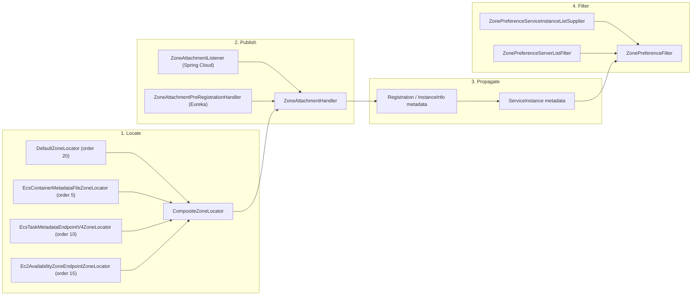
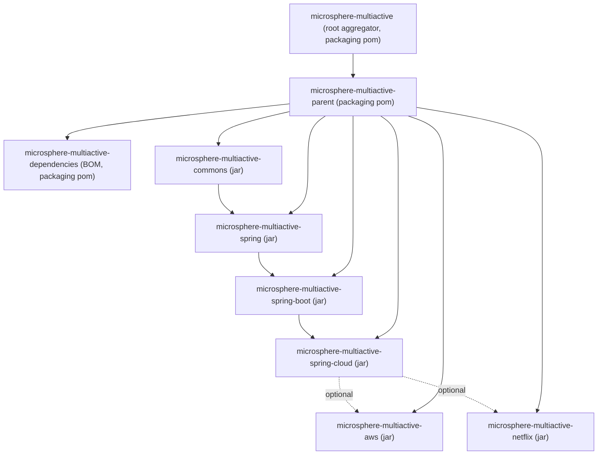
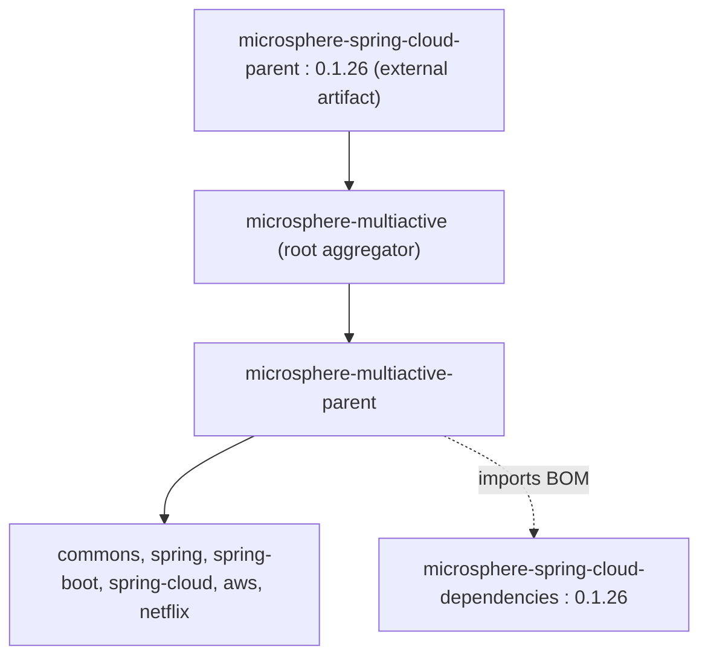

English version: [English](../README.md)

# Microsphere Multiactive — 开发者指南（文档线 `1.x`）

这是 **`1.x`** 文档线的开发者指南，即 `microsphere-multiactive` 的 **`release-1.x`** 分支源码。它记录该库内部如何构建：
模块布局、类职责、区域上下文传播、`ZoneLocator` 组合、过滤链以及 Spring Boot / Spring Cloud 自动配置。

这些文档中的每一条陈述都只读自本快照 —— POM 文件、`src/main/java`、`src/main/resources/META-INF` 与
`src/test/java`。本快照中不存在的内容一律不予记录。

---

## 目录

| 文档 | Maven 模块 | 主要内容 |
|----------|--------------|--------------|
| [microsphere-multiactive-parent](microsphere-multiactive-parent.md) | `microsphere-multiactive-parent` | 继承 POM、外部 BOM 导入 |
| [microsphere-multiactive-dependencies](microsphere-multiactive-dependencies.md) | `microsphere-multiactive-dependencies` | 项目 BOM、被管理的 artifact id |
| [microsphere-multiactive-commons](microsphere-multiactive-commons.md) | `microsphere-multiactive-commons` | `ZoneContext`、`ZoneConstants`、`ZonePreferenceFilter`、`ZoneResolver`、`ZoneAttachmentHandler`、`HttpUtils` |
| [microsphere-multiactive-spring](microsphere-multiactive-spring.md) | `microsphere-multiactive-spring` | `ZoneLocator` SPI、`CompositeZoneLocator`、`DefaultZoneLocator`、`ZoneContextChangedListener` |
| [microsphere-multiactive-spring-boot](microsphere-multiactive-spring-boot.md) | `microsphere-multiactive-spring-boot` | `ZoneAutoConfiguration`、自定义 `@Conditional*` 注解、`spring.factories` |
| [microsphere-multiactive-spring-cloud](microsphere-multiactive-spring-cloud.md) | `microsphere-multiactive-spring-cloud` | `ZoneCloudAutoConfiguration`、区域附着监听器、LoadBalancer supplier |
| [microsphere-multiactive-aws](microsphere-multiactive-aws.md) | `microsphere-multiactive-aws` | ECS 元数据文件 / ECS 任务端点 V4 / EC2 可用区 locator |
| [microsphere-multiactive-netflix](microsphere-multiactive-netflix.md) | `microsphere-multiactive-netflix` | Eureka resolver 与预注册 handler、Ribbon server-list filter、`DiscoveryClientServerList` |

配套文档：

- [用户指南索引](../../user-guide/zh/README.md) —— 如何使用该库（配置参考、装配配方）。
- [仓库 README](../../../../README.md) —— 本快照自身的顶层 README。
- [发版说明](../../../../release-notes.md) —— 在本分支上维护的逐版本历史。

---

## 版本速览

| 项目 | 值 | 定义位置 |
|------|-------|---------------------|
| Git 分支 | `release-1.x`（HEAD 提交 `4fa6946`） | 文档线 `1.x` |
| Artifact 版本 | `0.1.14-SNAPSHOT` | 根 [`pom.xml`](../../../../pom.xml) 的 `<revision>` 属性 |
| 本线最后发布的版本 | `0.1.13` | [`README.md`](../../../../README.md)、[`release-notes.md`](../../../../release-notes.md) |
| 所有模块的 groupId | `io.github.microsphere-projects` | 每个模块 POM |
| 受测的 Java 版本 | 8、11、17、21、25 | `.github/workflows/maven-build.yml`（matrix `java`） |
| Maven | Apache Maven 3.9.15（wrapper `only-script`，wrapperVersion 3.3.4） | `.mvn/wrapper/maven-wrapper.properties` |
| Spring Cloud 兼容范围 | Hoxton、2020、2021（CI profile `spring-cloud-hoxton`、`spring-cloud-2020`、`spring-cloud-2021`） | `.github/workflows/maven-build.yml`、[`README.md`](../../../../README.md) |
| 外部 parent / BOM | `microsphere-spring-cloud-parent:0.1.26`、`microsphere-spring-cloud-dependencies:0.1.26` | 根 [`pom.xml`](../../../../pom.xml)、`microsphere-multiactive-parent/pom.xml` |
| 在此构建的模块 | 8 个（2 个 `pom` + 6 个 `jar`） | 根 [`pom.xml`](../../../../pom.xml) `<modules>` |

> 文档线命名为 `1.x` 是相对于 **分支**（`release-1.x`）而言，而非相对于 Maven 版本，后者是 `0.1.x`。
> 不过本快照中每一个 Java 源文件都标注了 `@since 1.0.0`。

---

## 架构总览

该库分四个阶段回答一个问题。每个阶段位于一个独立的模块：

1. **定位（Locate）** —— “我运行在哪个可用区？”
   `ZoneLocator` 实现（Spring 模块 SPI：`DefaultZoneLocator`，外加 AWS 的各 locator）按顺序被
   `CompositeZoneLocator` 咨询，它选取第一个非 `null` 结果，缓存它并写入
   `microsphere.current.availability.zone` **系统属性**。这条链是**惰性**的：本快照中 `locate(...)` 唯一的生产调用点是
   `ZoneContextChangedListener.revertOriginalZone()`，仅当 `microsphere.availability.zone` 被设为
   `originalZone` 哨兵值时才会到达。
2. **发布（Publish）** —— “把我的区域告诉所有人。”
   `ZoneAttachmentHandler` 把定位到的区域写入注册元数据，键为 `microsphere.availability.zone`。
   在 Spring Cloud 上由 `ZoneAttachmentListener` 完成，在 Netflix Eureka 上由
   `ZoneAttachmentPreRegistrationHandler` 完成。
3. **传播（Propagate）** —— “让区域留在网络上传。”
   区域作为普通实例元数据传输：发现客户端把它放在 `ServiceInstance.getMetadata()` 或 `InstanceInfo.getMetadata()`
   中返回。本线**没有按请求 / 线程局部（thread-local）的区域载体**；见「区域上下文模型」小节。
4. **过滤（Filter）** —— “优先同区域节点，但绝不排空。”
   `ZonePreferenceFilter`（commons）用 `ZoneResolver<E>` 把共享的决策算法应用到任意 `List<E>`。
   适配器：`ZonePreferenceServiceInstanceListSupplier`（Spring Cloud LoadBalancer）与
   `ZonePreferenceServerListFilter`（Netflix Ribbon）。



### 区域上下文模型

`ZoneContext`（commons）是一个**进程级的可变单例** —— `private static final ZoneContext instance`，
通过 `ZoneContext.get()` 暴露 —— 持有七个 `volatile` 字段（`enabled`、`zone`、`preferenceEnabled`、
`preferenceFilterOrder`、`preferenceUpstreamZoneReadyPercentage`、`preferenceUpstreamSameZoneMinAvailable`、
`preferenceUpstreamDisabledZone`）外加一个 `java.beans.PropertyChangeSupport`。`ZoneAutoConfiguration`
把同一个实例注册为名为 `zoneContext` 的 Spring bean。

对本线维护者而言重要的推论：

- 一个 JVM 只有一个区域值；在 1.x 代码中它无法按请求或按租户变化。
- `ZoneContext.getCurrentZone()` 读取 **系统属性** `microsphere.current.availability.zone`，
  由 `CompositeZoneLocator.locate(...)` 写入；它并非从单例的 `zone` 字段派生。
- Spring Boot actuator/env 或 Spring Cloud 配置的变化通过 `ZoneContextChangedListener` 流入单例，
  随后单例重新发布一个 `ZoneContextChangedEvent`。

---

## 模块依赖图

派生自本快照八个模块 POM 的 `<dependencies>` 段。实线箭头是必需的编译依赖；虚线箭头是
`<optional>true</optional>` 依赖。



只有阅读 POM 才能看到的要点：

- `aws` 和 `netflix` **可选地**依赖 `microsphere-multiactive-spring-cloud`，因此它们编译时针对整条链
  （传递地包括 `spring` 和 `commons`），但不会把它泄漏给消费者。
- `commons`、`spring`、`spring-boot` 和 `spring-cloud` 严格成链（`<version>${revision}</version>`，非 optional）。
- `microsphere-multiactive-dependencies` 管理了一些本快照**并不构建**的 artifact id：
  `microsphere-multiactive-spring-boot-starter`、`microsphere-multiactive-spring-cloud-starter`、
  `microsphere-multiactive-spring-cloud-loadbalancer`、`microsphere-multiactive-dubbo`。见
  [microsphere-multiactive-dependencies](microsphere-multiactive-dependencies.md)。
- `microsphere-multiactive-dependencies` 是一片叶子：本快照中没有其他模块导入它。

### Maven 继承



根聚合器自身的 parent 是外部的 `microsphere-spring-cloud-parent:0.1.26`；每个叶子模块的 parent 是
`microsphere-multiactive-parent`，其 parent 是根聚合器（`<relativePath>../pom.xml</relativePath>`）。
`microsphere-multiactive-parent` 另外把 `microsphere-spring-cloud-dependencies:0.1.26` BOM 导入其
`dependencyManagement`。

---

## 构建与测试

命令取自根 POM、Maven Wrapper 配置以及 `.github/workflows/maven-build.yml`。

从源码构建（如本快照 [`README.md`](../../../../README.md) 所记录）：

```bash
# Linux / MacOS
./mvnw package

# Windows
mvnw.cmd package
```

CI 测试运行会激活三个 profile —— `test`、`coverage` 和一个 Spring Cloud profile —— 并覆盖版本号：

```bash
mvn --batch-mode --update-snapshots --file pom.xml \
    -Drevision=0.0.1-SNAPSHOT \
    test \
    --activate-profiles test,coverage,spring-cloud-hoxton
```

| Profile | 用途 | 声明位置 |
|---------|---------|----------------|
| `test` | 测试阶段装配（继承而来） | 外部 `microsphere-spring-cloud-parent:0.1.26` |
| `coverage` | JaCoCo/覆盖率报告（继承而来） | 外部 `microsphere-spring-cloud-parent:0.1.26` |
| `spring-cloud-hoxton` / `-2020` / `-2021` | 选择 Spring Cloud 发布列车 | 外部 `microsphere-spring-cloud-parent:0.1.26` |
| `publish`、`ci` | 被 `maven-publish.yml` 使用（`-Dgpg.skip=true deploy`） | 外部 `microsphere-spring-cloud-parent:0.1.26` |

> `test`、`coverage`、`publish`、`ci` 和 `spring-cloud-*` 这些 profile **并不**声明在本快照的任何 POM 中；
> 它们继承自 `microsphere-spring-cloud-parent:0.1.26`。它们的确切内容不在本仓库内，因此此处不作断言。

运行单个模块（先从 reactor 构建其依赖）：

```bash
./mvnw -pl microsphere-multiactive-commons -am test
./mvnw -pl microsphere-multiactive-spring -am test
```

发布（来自 `.github/workflows/maven-publish.yml`，在推送到 `release-1.x` 或 `workflow_dispatch` 时触发，
需要 `<major>.<minor>.<patch>` 输入，运行于 Java 11）：

```bash
./mvnw --batch-mode --update-snapshots --file pom.xml \
    -Drevision=<major>.<minor>.<patch> -Dgpg.skip=true \
    deploy \
    --activate-profiles publish,ci
```

### 本快照的测试清单

| 模块 | `src/main/java` 类数 | `src/test/java` 类数 | `src/main/resources` 文件数 |
|--------|-----------------------:|-----------------------:|--------------------------:|
| `microsphere-multiactive-commons` | 6 | 6 | 0 |
| `microsphere-multiactive-spring` | 7 | 5 | 0 |
| `microsphere-multiactive-spring-boot` | 3 | 1 | 2 |
| `microsphere-multiactive-spring-cloud` | 6 | 2 | 3 |
| `microsphere-multiactive-aws` | 3 | 0 | 1 |
| `microsphere-multiactive-netflix` | 6 | 0 | 1 |
| `microsphere-multiactive-parent` | 0 | 0 | 0 |
| `microsphere-multiactive-dependencies` | 0 | 0 | 0 |

`aws` 和 `netflix` 在本分支上**完全没有测试**；它们的行为只是通过在 `commons` 和 `spring` 中被测试的
`ZoneLocator`/`ZoneResolver` 契约被间接地验证。

---

## 与 `0.2.x` / 当前线的差异

仅列出本快照自身能够显现的差异：

| 方面 | `1.x` 线（本快照） | 本快照中的证据 |
|--------|----------------------------|---------------------------|
| 版本系列 | `0.1.x`（`revision` = `0.1.14-SNAPSHOT`） | 根 `pom.xml` |
| Spring Cloud 范围 | Hoxton → 2021.0.x | 根 `README.md` 分支表；`maven-build.yml` profile |
| Java 下限 | Java 8 在 CI matrix 中 | `maven-build.yml` |
| 外部 parent | `microsphere-spring-cloud-parent:0.1.26` | 根 `pom.xml`、`microsphere-multiactive-parent/pom.xml` |
| Starter | 不构建任何 `*-starter` 模块，但 BOM 管理 `microsphere-multiactive-spring-boot-starter` 和 `microsphere-multiactive-spring-cloud-starter` | `microsphere-multiactive-dependencies/pom.xml` 对比根 `<modules>` |
| LoadBalancer 模块 | LoadBalancer 类位于 `microsphere-multiactive-spring-cloud` 内部，尽管 BOM 宣称有独立的 `microsphere-multiactive-spring-cloud-loadbalancer` | `.../spring/cloud/loadbalancer/` 包 对比 BOM |
| Dubbo 模块 | 此处不存在 `microsphere-multiactive-dubbo` 模块，尽管 BOM 管理它 | 根 `<modules>` 对比 `microsphere-multiactive-dependencies/pom.xml` |
| 自动配置注册 | 同时提供 `META-INF/spring.factories`（`EnableAutoConfiguration`）**和** `META-INF/spring/org.springframework.boot.autoconfigure.AutoConfiguration.imports` | `spring-boot` 和 `spring-cloud` 资源 |
| 区域上下文作用域 | 一个 JVM 级 `ZoneContext` 单例 + 一个用于当前区域的系统属性 | `ZoneContext`、`CompositeZoneLocator` |

---

## 文档约定

- 英语为主语言；`zh/` 保存一份完整的中文镜像，文件名与路径完全一致。
- 代码块与 Mermaid 图在英文文档与中文文档之间逐字节一致，因此图示标签在两种语言中都保持英文。
- 标识符（`ZoneContext`、`microsphere.availability.zone`、`zoneLocator`……）在中文文档中原样保留。
- 文档中的文件路径相对于本分支的仓库根，例如
  `microsphere-multiactive-commons/src/main/java/io/microsphere/multiple/active/zone/ZoneContext.java`。

## 相关

- [用户指南索引](../../user-guide/zh/README.md)
- [仓库 README](../../../../README.md)
- [发版说明](../../../../release-notes.md)

## English

English version: [English](../README.md)
