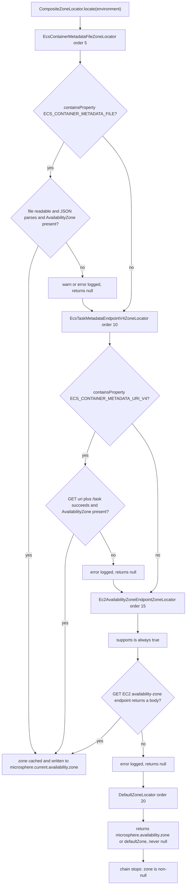
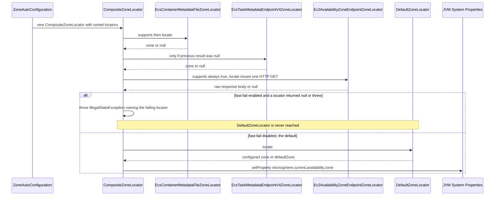

English version: [English](../microsphere-multiactive-aws.md)

# `microsphere-multiactive-aws` — 开发者指南

Maven 坐标：`io.github.microsphere-projects:microsphere-multiactive-aws:${revision}` —— 在本分支上是
`0.1.14-SNAPSHOT`。

---

## 概览

`microsphere-multiactive-aws` 贡献三个 `ZoneLocator` 实现，它们从 AWS 平台而非从配置读取可用区。
三者都排在 `DefaultZoneLocator`（order `20`）**之前**，因此它们先被咨询，而配置值/默认区域充当最后兜底。

| 类 | Order | 区域来源 | `supports(Environment)` |
|-------|------:|--------------------|-------------------------|
| `EcsContainerMetadataFileZoneLocator` | `5` | 由 `ECS_CONTAINER_METADATA_FILE` 环境变量命名的本地 JSON 文件，字段 `AvailabilityZone` | `environment.containsProperty("ECS_CONTAINER_METADATA_FILE")` |
| `EcsTaskMetadataEndpointV4ZoneLocator` | `10` | HTTP GET `${ECS_CONTAINER_METADATA_URI_V4}/task`，字段 `AvailabilityZone` | `environment.containsProperty("ECS_CONTAINER_METADATA_URI_V4")` |
| `Ec2AvailabilityZoneEndpointZoneLocator` | `15` | HTTP GET EC2 实例元数据可用区端点 | **恒为 `true`** |

文件：

- `microsphere-multiactive-aws/src/main/java/io/microsphere/multiple/active/zone/spring/aws/EcsContainerMetadataFileZoneLocator.java`
- `microsphere-multiactive-aws/src/main/java/io/microsphere/multiple/active/zone/spring/aws/EcsTaskMetadataEndpointV4ZoneLocator.java`
- `microsphere-multiactive-aws/src/main/java/io/microsphere/multiple/active/zone/spring/aws/Ec2AvailabilityZoneEndpointZoneLocator.java`
- `microsphere-multiactive-aws/src/main/resources/META-INF/spring.factories`

包是 `io.microsphere.multiple.active.zone.spring.aws` —— 注意它位于 **`.spring.` 之下**，
即 AWS 各 locator 被建模为 Spring 层的 locator，而不是一个平行的技术栈。本模块没有 `spring/zone/aws` 根包，
也没有测试源码树。

---

## 架构设计

### 是注册，而不是自动配置

本模块**没有 `@Configuration` 类**，也没有 `EnableAutoConfiguration` 条目。它唯一的资源文件使用库自己的 SPI 键：

```properties
io.microsphere.multiple.active.zone.spring.ZoneLocator=\
io.microsphere.multiple.active.zone.spring.aws.EcsContainerMetadataFileZoneLocator,\
io.microsphere.multiple.active.zone.spring.aws.EcsTaskMetadataEndpointV4ZoneLocator,\
io.microsphere.multiple.active.zone.spring.aws.Ec2AvailabilityZoneEndpointZoneLocator
```

`ZoneAutoConfiguration`（Spring Boot 模块）调用 `loadFactories(context, ZoneLocator.class)`，
它读取的正是这个键，把结果与上下文中已有的 `ZoneLocator` bean 合并，用 `AnnotationAwareOrderComparator`
全部排序，并把合并后的列表交给 `CompositeZoneLocator`。推论：

- **文件中的声明顺序不是求值顺序**；由数值 `DEFAULT_ORDER`（5 → 10 → 15 → 20）决定。
- 添加第四个 AWS locator 只需要在该文件加一行，并在构造函数中给出一个低于 `20` 的 order。
- 由于这些类是从 `spring.factories` 加载而非声明为 bean，`EnvironmentAware` 回调是否真的被调用取决于外部的
  `SpringFactoriesLoaderUtils` 实现，而它不属于本快照。代码对此是防御性的：
  `Ec2AvailabilityZoneEndpointZoneLocator` 与 `EcsTaskMetadataEndpointV4ZoneLocator`
  都以字段默认值形式初始化 `private int timeout = DEFAULT_TIMEOUT;`，因此若 `setEnvironment` 运行，
  `microsphere.availability.zone.locator.timeout` 会生效；若未运行，则使用 `3000` ms。

### locator 决策流程



### 第一次 `locate()` 调用：带与不带 fast-fail

`ZoneAutoConfiguration` 只组装 composite；在本分支上没有任何东西急切地调用 `locate()`。下面这条链在
`microsphere.availability.zone` 被设为 `originalZone`（使 `ZoneContextChangedListener.revertOriginalZone()`
调用 locator）时，或应用代码自己调用 locator 时才会运行。



---

## 源码分析

### `EcsContainerMetadataFileZoneLocator`

`microsphere-multiactive-aws/src/main/java/io/microsphere/multiple/active/zone/spring/aws/EcsContainerMetadataFileZoneLocator.java`

```java
public static final String METADATA_FILE_ENV_NAME = "ECS_CONTAINER_METADATA_FILE";
public static final int DEFAULT_ORDER = 5;
private static final String ZONE_FIELD_NAME = "AvailabilityZone";

@Override
public boolean supports(Environment environment) {
    return environment.containsProperty(METADATA_FILE_ENV_NAME);
}
```

- 四个 locator 中 order 最低：当 ECS agent 写入了容器元数据文件时，那是最廉价也最权威的答案，
  因此它无需任何网络调用就胜出。
- 护栏是 `containsProperty`（而不是 `hasText`），所以一个已设但为空串的变量仍会进入 `locate`，
  在那里 `StringUtils.hasText(metadataFilePath)` 把它送进 `logger.trace("… can't be found")` 分支并返回 `null`。
- `locate` 路径：`new File(path)` → `canRead()` → try-with-resources 中的 `new FileInputStream` →
  `IOUtils.copyToString(inputStream, UTF_8)` → `new ObjectMapper().readValue(json, Map.class)` →
  `metadata.get("AvailabilityZone")` → 非 `null` 时 `String.valueOf(zoneValue)`。每种失败模式
  （`canRead` 为 false、解析错误、类型转换）都被 `catch (Throwable e)` 捕获并记录，返回 `null` 让链继续。
- 使用裸 `Map`（未检查）以及每次调用 `new ObjectMapper()` —— 在此是刻意的，因为 `locate` 每个 JVM 最多运行几次，
  而该类因此不必持有一个共享 mapper。
- 它**不**实现 `EnvironmentAware`；它是一个纯本地文件读取，所以没有超时。

### `EcsTaskMetadataEndpointV4ZoneLocator`

`microsphere-multiactive-aws/src/main/java/io/microsphere/multiple/active/zone/spring/aws/EcsTaskMetadataEndpointV4ZoneLocator.java`

```java
public static final String METADATA_URI_V4_ENV_NAME = "ECS_CONTAINER_METADATA_URI_V4";
public static final int DEFAULT_ORDER = 10;

@Override
public String locate(Environment environment) {
    String uri = environment.getProperty(METADATA_URI_V4_ENV_NAME);
    String zone = null;
    if (StringUtils.hasText(uri)) {
        String taskURL = uri + "/task";
        try {
            String json = HttpUtils.doGet(taskURL, timeout);
            ObjectMapper objectMapper = new ObjectMapper();
            Map metadata = objectMapper.readValue(json, Map.class);
            Object zoneValue = metadata.get(ZONE_FIELD_NAME);
            zone = zoneValue == null ? null : String.valueOf(zoneValue);
            ...
        } catch (Throwable e) {
            logger.error("Request Amazon ECS Task metadata endpoint version 4 [URL : '{}'] failed", taskURL, e);
        }
    }
    return zone;
}

@Override
public void setEnvironment(Environment environment) {
    this.timeout = environment.getProperty(LOCATOR_TIMEOUT_PROPERTY_NAME, int.class, DEFAULT_TIMEOUT);
}
```

- order `10` 位于容器元数据文件与 EC2 端点之间，与 AWS 文档中 ECS 任务元数据（V4 端点）优先于实例元数据的次序一致。
- URL 是用朴素的字符串拼接构造的（`uri + "/task"`），因此环境变量末尾带斜杠会产生双斜杠。
  `HttpUtils` 仍会尝试发起请求；本模块不做任何规范化。
- 当 JSON 中没有 `AvailabilityZone` 键时 `zone` 保持 `null`，而 JSON 解析失败虽然记为 error，
  但在返回值上与 HTTP 失败无法区分。
- `timeout` **同时**用于连接与读取超时（见 `HttpUtils.doGet`）。

### `Ec2AvailabilityZoneEndpointZoneLocator`

`microsphere-multiactive-aws/src/main/java/io/microsphere/multiple/active/zone/spring/aws/Ec2AvailabilityZoneEndpointZoneLocator.java`

```java
public static final String AVAILABILITY_ZONE_ENDPOINT_URI_PROPERTY_NAME = "EC2_AVAILABILITY_ZONE_ENDPOINT_URI";

public static final String DEFAULT_AVAILABILITY_ZONE_ENDPOINT_URI =
        "http://169.254.169.254/latest/meta-data/placement/availability-zone";

public static final int DEFAULT_ORDER = 15;

@Override
public boolean supports(Environment environment) {
    return true;
}

private String getAvailabilityZoneEndpointURI(Environment environment) {
    return environment.getProperty(AVAILABILITY_ZONE_ENDPOINT_URI_PROPERTY_NAME, DEFAULT_AVAILABILITY_ZONE_ENDPOINT_URI);
}
```

这是运维后果最大的一个类，而每一条都能直接在源码中看到：

- **`supports` 无条件返回 `true`**，因此与两个 ECS locator 不同，这个 locator 在一次 `locate()` 运行中
  *总是会被尝试*。在开发者的笔记本上或在非 AWS 机房里，`http://169.254.169.254` 是一个不会应答的 link-local 地址，
  请求会烧掉完整的 `timeout`（默认 `3000` ms），然后 `catch (Throwable)` 记录一条 error 并返回 `null`。
  由于 `DefaultZoneLocator` 的 order *更高*（`20`），EC2 尝试发生在廉价的配置查找**之前**，
  所以在非 EC2 环境中每次 `locate()` 大约花费 `3` 秒。由于本分支上 `locate()` 只是被惰性触达
  （`originalZone` 哨兵或显式调用），该开销是按调用产生的而非固定的启动税 ——
  但在缓存到一个非 `null` 区域之前，每次调用都要再付一次。
- **把 `fast-fail` 与本模块组合，等价于一个“必须是 EC2/ECS”的断言。**
  `CompositeZoneLocator` 一旦看到某个*支持*的 locator 返回 `null`，就会中断链并抛
  `IllegalStateException("The zone can't be located by " + failedZoneLocator)`。由于这里的 `supports` 是 `true`，
  `microsphere.availability.zone.locator.fast-fail=true` 意味着只要元数据端点不可达，应用就定位不到区域 ——
  `DefaultZoneLocator` 永远得不到应用配置区域的机会。
- **当所有 AWS 来源都无响应时，`DefaultZoneLocator` 会把哨兵值原样回弹。**
  `DefaultZoneLocator.locate(...)` 读取 `microsphere.availability.zone`，而在回退场景中该属性字面上就含
  `"originalZone"`。若没有 AWS locator 应答，composite 因此会把 `"originalZone"` 作为*定位到*的区域返回、
  缓存它，并写入 `microsphere.current.availability.zone` 系统属性。
  `ZoneContextChangedListenerTest#testRevertOriginalZoneWhenZoneIsOriginal` 在其注释中记录了同样的解读，
  并且只断言非空。在本分支上，请把“回退到发现的区域”当作一个仅在具备 AWS 条件时才可行的操作。
- 端点 URI 可以通过环境/系统属性 `EC2_AVAILABILITY_ZONE_ENDPOINT_URI` **覆盖**，
  这也正是让该 locator 可用于默认元数据路径之外（例如支持 IMDSv2 的代理或本地桩）的旋钮。
  该 locator 不做任何 token 获取；它只发一个普通 GET，因此配置为要求会话令牌的 IMDS 端点不会返回区域。
- 返回的值是**原始响应体** —— `HttpUtils.doGet` 的结果，在与其他服务发布的区域字符串比对之前，
  不做 `trim`、不做后缀处理、也不做大小写规范化。

### 三个 locator 的共同特征

- 三者都继承 `AbstractZoneLocator` 并通过构造函数传入一个 `DEFAULT_ORDER`，因此 `getOrder()`/`setOrder()`
  的表现如 [microsphere-multiactive-spring](microsphere-multiactive-spring.md) 所述。
- 三者都 `catch Throwable` 并在失败时返回 `null` —— 这正是 `CompositeZoneLocator` 所依赖的
  “除非开启 fast-fail 否则绝不抛异常”契约。
- 三者都通过继承来的、由 `getClass()` 创建的 `protected Logger logger` 记录成功的区域，
  且消息中嵌入了来源（`"… located from the EC2 Availability Zone Endpoint[URI : '…' , property name: '…']"`），
  从而可以分辨是*哪一个* AWS 机制应答的。
- 没有一个校验区域的形状，也没有一个做缓存：缓存是 `CompositeZoneLocator` 的职责。

---

## 实际存在的设计模式

| 模式 | 本快照中的证据 |
|---------|---------------------------|
| **带优先级的策略** | 三个可互换的 `ZoneLocator` bean，order 为 `5`/`10`/`15`，由 composite 内部的 `AnnotationAwareOrderComparator` 选取 |
| **模板方法** | 每个 locator 继承 `AbstractZoneLocator`，继承 `getOrder`/`setBeanName`/日志，只实现 `supports` + `locate` |
| **通过 `spring.factories` 实现 ServiceLoader 式 SPI** | 以 `ZoneLocator` 接口类名为键的 `META-INF/spring.factories`，由 `SpringFactoriesLoaderUtils.loadFactories` 加载 |
| **能力探测（`supports`）+ 回退阶梯** | 两个 locator 探测环境变量，一个总是应答，而配置的默认值是最后一级 |
| **软失败错误处理** | 每个 `locate` 中的 `catch (Throwable …)` + `logger.error` + `return null` |
| **配置感知的超时注入** | `implements EnvironmentAware` 并读取 `LOCATOR_TIMEOUT_PROPERTY_NAME`，以字段级默认值作为安全网 |

不存在：没有自动配置类，没有条件注解，没有 AWS SDK 依赖（全部是朴素的 `java.net` + Jackson），没有缓存，
没有 IMDSv2 会话令牌处理。

---

## 本模块使用的配置属性

| 属性 / 环境变量 | 读取者 | 默认值 | 效果 |
|---------------------------------|---------|---------|--------|
| `ECS_CONTAINER_METADATA_FILE` | `EcsContainerMetadataFileZoneLocator.supports/locate` | 无（缺失则该 locator 不生效） | ECS 容器元数据 JSON 文件的路径 |
| `ECS_CONTAINER_METADATA_URI_V4` | `EcsTaskMetadataEndpointV4ZoneLocator.supports/locate` | 无（缺失则该 locator 不生效） | 基础 URI；会追加 `/task` |
| `EC2_AVAILABILITY_ZONE_ENDPOINT_URI` | `Ec2AvailabilityZoneEndpointZoneLocator.locate` | `http://169.254.169.254/latest/meta-data/placement/availability-zone` | 元数据端点 URI |
| `microsphere.availability.zone.locator.timeout` | 两个 HTTP locator，经由 `setEnvironment` | `3000` | 连接**与**读取超时（毫秒） |
| `microsphere.availability.zone.locator.fast-fail` | `CompositeZoneLocator`（不是本模块） | `false` | 在第一个 `null`/异常处中止链 |
| `microsphere.availability.zone` | `DefaultZoneLocator`（不是本模块） | `defaultZone` | 配置的兜底区域 |

三个常量 `AVAILABILITY_ZONE_ENDPOINT_URI_PROPERTY_NAME`、`METADATA_FILE_ENV_NAME` 和
`METADATA_URI_V4_ENV_NAME` 都是 `public static final`，因此这些名字构成了本模块 API 的一部分，
供想要校验自身平台假设的调用方使用。

---

## 构建与测试

`microsphere-multiactive-aws/pom.xml` —— parent 为 `microsphere-multiactive-parent`，打包 `jar`，无插件，无 profile，
**完全没有 `src/test/java` 源码**。

依赖块值得读第二遍，因为其中每一条都是 optional 或 test 作用域：

| 依赖 | 作用域 | 说明 |
|------------|-------|-------|
| `microsphere-multiactive-spring-cloud`（`${revision}`） | **optional** | 唯一的项目内依赖 —— 而且是 optional，因此 `commons`/`spring`/`spring-boot` 在编译期传递到达，但**不会**发布给消费者 |
| `microsphere-annotation-processor` | optional | 注解处理 |
| `spring-boot-starter`、`spring-boot-starter-actuator` | optional | Boot 类型；注意此处没有 `spring-boot-starter-web`，与 `spring-boot`、`spring-cloud`、`netflix` 的 POM 不同 |
| `spring-boot-configuration-processor`、`spring-boot-autoconfigure-processor` | optional | 编译期处理 |
| `spring-cloud-commons`、`spring-cloud-context` | optional | 已声明但三个 locator 并未**引用**，它们只使用 `org.springframework.core.env.Environment` |
| `com.fasterxml.jackson.core:jackson-databind` | optional | 两个 ECS locator 中的 `ObjectMapper` |
| `junit-jupiter`、`spring-boot-starter-test`、`microsphere-spring-boot-test`、`logback-classic` | test | 已声明但未使用（不存在测试） |

**实际的打包后果**：`microsphere-multiactive-aws` 声明了**零个必需依赖**。只添加这个 artifact 的消费者，
得到的是一个其类引用了 `AbstractZoneLocator`、`HttpUtils` 与 `ZoneConstants`、但 Maven 并不会代为拉取的 jar ——
因此必须显式添加 `microsphere-multiactive-spring`（或 `…-spring-cloud`）和 `microsphere-java-core`。
同理，要让两个 ECS locator 工作，`jackson-databind` 也必须由外部提供。

```bash
# Compiles and installs the module; there are no tests to run
./mvnw -pl microsphere-multiactive-aws -am install
```

`v0.1.10` 的发版说明记录了向本模块添加 optional 的 `jackson-databind` 依赖（“AWS Module Enhancement”），
这与两个 ECS locator 是本分支上最新增补的事实相符。

---

## 与 `0.2.x` / 当前线的差异

从本快照可见：

- AWS 的区域来源完全通过 Microsphere 的 `ZoneLocator` `spring.factories` 键交付，
  **没有自动配置类，也没有自己的 `@Conditional*` 注解** —— 所有门控都位于
  `ZoneAutoConfiguration`/`CompositeZoneLocator`。
- `Ec2AvailabilityZoneEndpointZoneLocator.supports(...)` 返回 `true` 使 EC2 元数据调用变为无条件；
  与 `@Primary` composite 的缓存以及 `fast-fail` 组合，是运维人员在本分支上会感受到的主要行为差异。
- 此处只标注了 `@since 1.0.0`，而本分支的 artifact 版本是 `0.1.x`。
- 本分支上该模块不存在测试源码。

---

## 相关

- [开发者指南索引](README.md)
- [microsphere-multiactive-spring](microsphere-multiactive-spring.md) —— `AbstractZoneLocator`、`CompositeZoneLocator`、排序契约
- [microsphere-multiactive-spring-boot](microsphere-multiactive-spring-boot.md) —— 发现这些 locator 的 `loadFactories`
- [microsphere-multiactive-commons](microsphere-multiactive-commons.md) —— `HttpUtils.doGet` 与 `ZoneConstants.LOCATOR_TIMEOUT_PROPERTY_NAME`
- [microsphere-multiactive-aws 用户指南](../../user-guide/zh/microsphere-multiactive-aws.md)
- [用户指南索引](../../user-guide/zh/README.md)
- [仓库 README](../../../../README.md)

## English

English version: [English](../microsphere-multiactive-aws.md)
