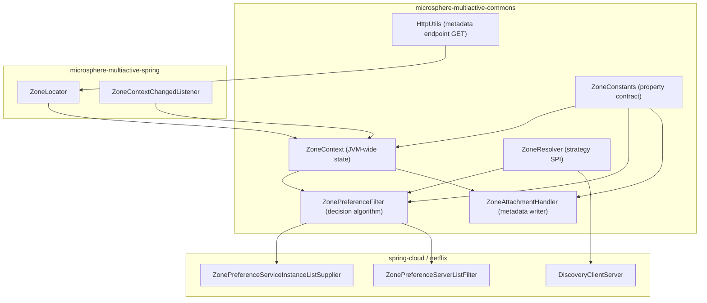
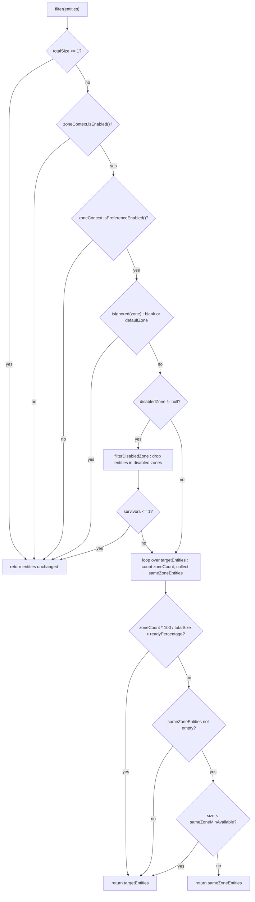

English version: [English](../microsphere-multiactive-commons.md)

# `microsphere-multiactive-commons` — 开发者指南

Maven 坐标：`io.github.microsphere-projects:microsphere-multiactive-commons:${revision}` —— 在本分支上是
`0.1.14-SNAPSHOT`。

---

## 概览

`microsphere-multiactive-commons` 是 1.x 线中不依赖框架的内核。它包含完整的区域状态模型（`ZoneContext`）、
完整的配置属性契约（`ZoneConstants`）、两个可移植算法（`ZonePreferenceFilter` + `ZoneResolver`）、
注册元数据写入器（`ZoneAttachmentHandler`）以及一个 HTTP 辅助类（`HttpUtils`）。它**完全不声明 Spring 类型**。

它的 POM 把分层表达得很清楚 —— 除测试外的每个依赖都是 `optional`：

```xml
<dependency>
    <groupId>io.github.microsphere-projects</groupId>
    <artifactId>microsphere-annotation-processor</artifactId>
    <optional>true</optional>
</dependency>

<dependency>
    <groupId>io.github.microsphere-projects</groupId>
    <artifactId>microsphere-java-core</artifactId>
    <optional>true</optional>
</dependency>
```

对维护者的推论：

- `io.microsphere.util.StringUtils`、`io.microsphere.io.IOUtils`、`io.microsphere.logging.Logger`、
  `io.microsphere.constants.SymbolConstants` 和 `io.microsphere.annotation.ConfigurationProperty` 来自
  **`microsphere-java-core`**，而它是 optional 的 —— 单独使用本模块的消费者必须显式提供它。
- 由于其中没有任何 Spring 类型，区域决策算法可以从任意 RPC/HTTP 栈中原样复用；上层模块中的 Spring、
  Spring Cloud 与 Netflix 适配器只是它外面的薄壳。

包：`io.microsphere.multiple.active.zone` —— 一个扁平包，六个类型，无子包，无 `src/main/resources`。

| 类型 | 种类 | 文件 |
|------|------|------|
| `ZoneConstants` | interface（常量契约） | `microsphere-multiactive-commons/src/main/java/io/microsphere/multiple/active/zone/ZoneConstants.java` |
| `ZoneContext` | class（可变单例） | `microsphere-multiactive-commons/src/main/java/io/microsphere/multiple/active/zone/ZoneContext.java` |
| `ZoneResolver<E>` | 函数式接口 | `microsphere-multiactive-commons/src/main/java/io/microsphere/multiple/active/zone/ZoneResolver.java` |
| `ZonePreferenceFilter<E>` | class（算法） | `microsphere-multiactive-commons/src/main/java/io/microsphere/multiple/active/zone/ZonePreferenceFilter.java` |
| `ZoneAttachmentHandler` | class | `microsphere-multiactive-commons/src/main/java/io/microsphere/multiple/active/zone/ZoneAttachmentHandler.java` |
| `HttpUtils` | abstract 工具类 | `microsphere-multiactive-commons/src/main/java/io/microsphere/multiple/active/zone/HttpUtils.java` |

---

## 架构设计

### 分层



职责严格切分：`ZoneContext` **持有**状态，`ZonePreferenceFilter` 用它**决策**，
`ZoneAttachmentHandler` **导出**它，`ZoneResolver` 把外部模型**读入**算法。

### 区域状态是进程级而非请求级

本快照中**没有任何 `ThreadLocal`**（通过搜索每个 `src/main/java` 文件核实）。区域保存在一个 `ZoneContext`
实例中，由它自己的静态字段急切创建：

```java
private static final ZoneContext instance = new ZoneContext();
...
public static ZoneContext get() {
    return instance;
}
```

七个可变字段全部是 `volatile`；变更统一经过 `isPropertyChanged(...)`，它触发 JavaBeans 的
`PropertyChangeSupport` 事件并记录日志。因此 `ZoneContext` 同时是一个单例、一个可观察 bean，
以及过滤器运行时的配置来源。

在 JVM bean 图之外唯一可见的“环境”区域值，是由 `CompositeZoneLocator` 写入、并由静态辅助方法读取的系统属性：

```java
public static String getCurrentZone() {
    return System.getProperty(CURRENT_ZONE_PROPERTY_NAME, DEFAULT_ZONE);
}
```

`CURRENT_ZONE_PROPERTY_NAME` 是 `microsphere.current.availability.zone`。注意它与
`ZoneContext.getZone()` 是**两个不同的值**：前者是物理发现到的区域，后者是过滤器比对所用的*有效*区域
（并且可以在运行时被覆盖为 `"originalZone"`、`"  "` → 会被 trim 等）。

---

## 源码分析

### `ZoneConstants`

`microsphere-multiactive-commons/src/main/java/io/microsphere/multiple/active/zone/ZoneConstants.java`

一个当作常量持有器使用的 `interface`。每个属性名都是由前缀*组合*而成的，因此命名树在结构上得到保证：

```java
String ZONE_PROPERTY_NAME = "microsphere.availability.zone";
String PREFERENCE_PROPERTY_NAME_PREFIX = ZONE_PROPERTY_NAME + DOT + "preference" + DOT;
String PREFERENCE_FILER_PROPERTY_NAME_PREFIX = PREFERENCE_PROPERTY_NAME_PREFIX + "filter" + DOT;
String PREFERENCE_UPSTREAM_PROPERTY_NAME_PREFIX = PREFERENCE_PROPERTY_NAME_PREFIX + "upstream" + DOT;
String LOCATOR_PROPERTY_NAME_PREFIX = ZONE_PROPERTY_NAME + DOT + "locator" + DOT;
String ZONE_ENABLED_PROPERTY_NAME = ZONE_PROPERTY_NAME + ENABLED_PROPERTY_NAME_SUFFIX;
```

关键设计点：

- 默认值以**两种形式**存在：一个 `String` 的 `..._PROPERTY_VALUE` 常量（供 `@ConfigurationProperty`
  注解使用，注解需要编译期字符串）和一个解析后的带类型常量
  （`boolean DEFAULT_ZONE_ENABLED = parseBoolean(...)`、`int DEFAULT_TIMEOUT = parseInt(...)`）。
  两者在 `ZoneConstantsTest` 中被断言相等，这正是防止它们漂移的护栏。
- `ENABLED_PROPERTY_NAME_SUFFIX`、`DOT`、`DEFAULT_ZONE_ENABLED_PROPERTY_VALUE`、
  `DEFAULT_PREFERENCE_ENABLED_PROPERTY_VALUE`……之所以是 public，是因为注解成员需要它们；它们并非面向用户的 API。
- `DEFAULT_ZONE = "defaultZone"` 在文档中被说明为“兼容 Eureka zone”，并引用
  `EurekaClientConfigBean#DEFAULT_ZONE`；`ORIGINAL_ZONE = "originalZone"` 是
  `microsphere.availability.zone` 属性的一个*哨兵值*，而不是属性名 —— 它指示
  `ZoneContextChangedListener` 回退到发现到的区域。
- 常量名 `PREFERENCE_FILER_PROPERTY_NAME_PREFIX` 含拼写错误（`FILER`）；它产出的*属性值*
  `microsphere.availability.zone.preference.filter.` 是正确的。重命名该常量会对任何 static-import 它的人造成源码不兼容。
- `DEFAULT_PREFERENCE_UPSTREAM_DISABLED_ZONE = null` 是一个 `null` 的 `String` 常量；代码依赖
  `disabledZone != null` 作为“功能关闭”开关，这就是为什么显式配置的空值与不配置的行为不同
  （见 `ZonePreferenceFilter` 下的说明）。

由 `ZoneConstantsTest` 断言的完整属性契约：

| 常量 | 值 | 解析后的默认值 | 声明类型 |
|----------|-------|----------------|---------------|
| `ZONE_PROPERTY_NAME` | `microsphere.availability.zone` | `"defaultZone"` | `String` |
| `CURRENT_ZONE_PROPERTY_NAME` | `microsphere.current.availability.zone` | `defaultZone`（经由 `System.getProperty` 兜底） | `String` |
| `ZONE_ENABLED_PROPERTY_NAME` | `microsphere.availability.zone.enabled` | `true` | `boolean` |
| `PREFERENCE_ENABLED_PROPERTY_NAME` | `microsphere.availability.zone.preference.enabled` | `false` | `boolean` |
| `PREFERENCE_FILTER_ORDER_PROPERTY_NAME` | `microsphere.availability.zone.preference.filter.order` | `10` | `int` |
| `PREFERENCE_UPSTREAM_ZONE_READY_PERCENTAGE_PROPERTY_NAME` | `microsphere.availability.zone.preference.upstream.zone-ready-percentage` | `100` | `int` |
| `PREFERENCE_UPSTREAM_SAME_ZONE_MIN_AVAILABLE_PROPERTY_NAME` | `microsphere.availability.zone.preference.upstream.same-zone-min-available` | `5` | `int` |
| `PREFERENCE_UPSTREAM_DISABLED_ZONE_PROPERTY_NAME` | `microsphere.availability.zone.preference.upstream.disabled-zone` | `null` | `String` |
| `LOCATOR_FAST_FAIL_PROPERTY_NAME` | `microsphere.availability.zone.locator.fast-fail` | `false` | `boolean` |
| `LOCATOR_TIMEOUT_PROPERTY_NAME` | `microsphere.availability.zone.locator.timeout` | `3000` | `int` |
| `DEFAULT_ZONE` | `defaultZone` | — | 哨兵值 |
| `ORIGINAL_ZONE` | `originalZone` | — | 哨兵值 |

### `ZoneContext`

`microsphere-multiactive-commons/src/main/java/io/microsphere/multiple/active/zone/ZoneContext.java`

字段（全部 `volatile`，全部从 `ZoneConstants` 默认值初始化）：

| 字段 | getter | setter | 默认值 |
|-------|--------|--------|---------|
| `enabled` | `isEnabled()` | `setEnabled(boolean)` | `true` |
| `zone` | `getZone()` | `setZone(String)` | `defaultZone` |
| `preferenceEnabled` | `isPreferenceEnabled()` | `setPreferenceEnabled(boolean)` | `false` |
| `preferenceFilterOrder` | `getPreferenceFilterOrder()` | `setPreferenceFilterOrder(int)` | `10` |
| `preferenceUpstreamZoneReadyPercentage` | `getPreferenceUpstreamZoneReadyPercentage()` | `setPreferenceUpstreamZoneReadyPercentage(int)` | `100` |
| `preferenceUpstreamSameZoneMinAvailable` | `getPreferenceUpstreamSameZoneMinAvailable()` | `setPreferenceUpstreamSameZoneMinAvailable(int)` | `5` |
| `preferenceUpstreamDisabledZone` | `getPreferenceUpstreamDisabledZone()` | `setPreferenceUpstreamDisabledZone(String)` | `null` |

唯一值得细看的方法是写入路径，它把规范化、通知与日志耦合在一起：

```java
private boolean isPropertyChanged(String propertyName, Object previousPropertyValue, Object newPropertyValue) {
    boolean changed = !Objects.equals(previousPropertyValue, newPropertyValue);
    if (changed) {
        propertyChangeSupport.firePropertyChange(propertyName, previousPropertyValue, newPropertyValue);
        logger.info("The property value [name : '{}'] is changed from '{}' to '{}'", propertyName, previousPropertyValue, newPropertyValue);
    } else {
        logger.trace("The property value [name : '{}'] is not changed : '{}'", propertyName, previousPropertyValue);
    }
    return changed;
}
```

下游代码所依赖的行为：

- **仅在变化时写入。** 赋值发生在 `if` *内部*，因此一次无变化的调用不会触碰该字段 —— 这也意味着被记录为
  “previous” 的值总是实际持有的那个值。
- **`setZone` 会 trim**：`this.zone = trimAllWhitespace(zone)`。`ZoneContextTest#testSetZoneTrimsWhitespace`
  钉住了 `"  zone-b  "` → `"zone-b"`，而 `testFilterIgnoredWhenZoneIsBlank` 钉住了 `"  "` → 空白 → 过滤器忽略该区域。
  由于被先比对的是*变化*，重复设置已持有的值会静默无操作。
- **`setPreferenceUpstreamDisabledZone` 规范化逗号列表**，通过 `resolveCommaDelimited(...)`，它做
  `split(value, COMMA)` + `StringJoiner(COMMA)` + 每个元素 `trimAllWhitespace`（`" zone-a , zone-b "` →
  `"zone-a,zone-b"`）。空白输入原样返回，这就是为什么 `setPreferenceUpstreamDisabledZone("")` 存储 `""`
  （因此在过滤器里仍保持 `disabledZone != null` 为 *真*），而 `null` 存储 `null`。
  `ZoneContextTest#testSetPreferenceUpstreamDisabledZoneEmptyString` 恰好钉住了这一点。
- `enable()` 返回*先前*的状态，并且仅在原先为 `false` 时才写入。
- `reset()` 恢复全部七个默认值；测试套件在 `@BeforeEach`/`@AfterEach` 中调用它，因为该实例是 JVM 级共享的 ——
  本模块每个新测试都必须遵循这一模式。
- `addPropertyChangeListener` / `removePropertyChangeListener` 是 public，并被 `ZoneContextChangedListener`
  用于临时监听器技巧（见 Spring 模块文档）。
- `toString()` 是手写的（`"ZoneContext{enabled=..., zone='...'}"`），并非基于 `StringJoiner`。

扩展点：无 —— 该类既不是 `final` 也不便于抽象继承；上层模块把它注入为 bean 而非子类化。
现实的扩展机制是观察它的属性变化。

### `ZoneResolver<E>`

`microsphere-multiactive-commons/src/main/java/io/microsphere/multiple/active/zone/ZoneResolver.java`

```java
public interface ZoneResolver<E> extends Function<E, String> {

    default String apply(E entity) {
        return resolve(entity);
    }

    String resolve(E entity);
}
```

内核中唯一的策略接缝。并未声明 `@FunctionalInterface`，但单一抽象方法使所有实现都与 lambda 兼容 ——
`ZoneResolverTest` 使用了 `entity -> entity + "-zone"`。继承 `Function` 是有意为之：resolver 可以被传给任何
期望映射函数的 JDK/Stream API；`apply` 被重定向到 `resolve`，因此覆盖 `resolve` 无法被绕过。
契约：区域未知时返回 `null` —— 绝不抛异常。

### `ZonePreferenceFilter<E>`

`microsphere-multiactive-commons/src/main/java/io/microsphere/multiple/active/zone/ZonePreferenceFilter.java`

核心决策过程。构造函数接收上下文与策略：

```java
public ZonePreferenceFilter(ZoneContext zoneContext, ZoneResolver<E> zoneResolver)
```

`filter(List<E>)` 严格执行一串**透传护栏**，随后是**三个结果分支**。阅读顺序很重要，
因为每个提前返回返回的都是*调用方原始的那个 list 实例*：

1. `totalSize = entities == null ? 0 : entities.size()`；若 `totalSize <= 1` 原样返回 `entities` —— 这一条护栏
   同时覆盖了 `null` 与空列表（由 `testFilterNullList`、`testFilterEmptyList`、`testFilterSingleElementList` 钉住）。
2. `!zoneContext.isEnabled()` → 返回 `entities`（trace 日志点名 `microsphere.availability.zone.enabled`）。
3. `!zoneContext.isPreferenceEnabled()` → 返回 `entities`（trace 日志点名
   `microsphere.availability.zone.preference.enabled`；这就是区域偏好**默认关闭**的原因）。
4. `isIgnored(zone)` → 返回 `entities`。`isIgnored` 是 `protected`，返回
   `isBlank(zone) || DEFAULT_ZONE.equalsIgnoreCase(zone)` —— 因此一个什么都没发现（`defaultZone`）的 JVM
   完全不做过滤，且这里的比对不区分大小写（`DEFAULTZONE` 会被忽略，由
   `testFilterIgnoredWhenZoneIsDEFAULTZONECaseInsensitive` 钉住）。
5. **禁用区预筛**：若 `getPreferenceUpstreamDisabledZone() != null`，`filterDisabledZone(...)` 用一个新
   `LinkedList` 收集解析出的区域不在逗号切分禁用集合中的实体（`isDisabledZone` 使用 `Objects.equals`，
   即区分大小写），并且 `totalSize` 会被**重新赋值**为存活数量。若存活 ≤ 1，则改为返回*原始*列表
   （安全阀，`testFilterWithDisabledZoneResultingInNotEnoughEntities`）。
6. **单次遍历分类**：对 `[0, totalSize)` 中的 `i` 解析区域；非 `null` 的解析结果使 `zoneCount` 递增，
   而 `matches(zone, resolvedZone)`（`Objects.equals`，区分大小写）收集 `sameZoneEntities`。
   `resolveZone(entity)` 对实体本身做空值保护，因此 `null` 元素可以被容忍。
7. **就绪百分比闸门**：`isUpstreamZoneNotReady` 用**整数除法**计算 `zoneCount * 100 / entitiesSize`
   并与阈值比较 `<`。在默认阈值 `100` 下，只有当*每个*实体都带区域时才会发生过滤；
   `testFilterUpstreamZoneNotReady` 与 `testFilterWithNullEntity*` 钉住了该闸门的两侧。
8. **最少可用闸门**：若存在若干同区域实体但 `sameZoneEntitiesSize < sameZoneMinAvailable`（默认 `5`），
   则返回更宽的 `targetEntities` 列表，而不是稀薄的同区域子集。
9. 否则返回 `sameZoneEntities`；若一个都不匹配，返回 `targetEntities`。



只有仔细阅读才能发现的、维护者必须刻意保留或刻意修正的观察：

- 存在**三个不同的返回值**：调用方的列表（`RT`）、禁用区过滤后的列表（`RT2`）、同区域子集（`RS`）。
  调用方可能依赖对象标识，这正是测试使用 `assertSame` 断言的原因。
- `getOrder()` 返回 `zoneContext.getPreferenceFilterOrder()`，但**本快照中没有生产代码调用它**：
  `ZonePreferenceServerListFilter` 不转发它，`ZonePreferenceServiceInstanceListSupplier` 也不需要它。
  它只被 `ZonePreferenceFilterTest#testGetOrder` 执行。因此
  `microsphere.availability.zone.preference.filter.order` 目前在本分支上**没有任何运行时效果**。
- 禁用区预筛直接用 `COMMA_CHAR` 切分，而 `ZoneContext` 已经把该字符串规范化过；两者一致，因为 joiner 也用 `","`。
- 设置 `microsphere.availability.zone.preference.upstream.disabled-zone=""` 会保持 `disabledZone != null`，
  并把 `split("", COMMA_CHAR)` 喂给 `isDisabledZone`。确切结果取决于 `io.microsphere.util.StringUtils.split`
  （外部）；该代码路径*会被到达*，这与 `null` 情形不同。请把它当作边界情况，而非成文特性。

### `ZoneAttachmentHandler`

`microsphere-multiactive-commons/src/main/java/io/microsphere/multiple/active/zone/ZoneAttachmentHandler.java`

内核的导出侧 —— 15 行有意义的代码：

```java
public void attachZone(Map<String, String> metadata) {
    String zone = zoneContext.getZone();
    if (isNotBlank(zone)) {
        String propertyName = ZONE_PROPERTY_NAME;
        // If metadata is unmodifiable, UnsupportedOperationException will be thrown.
        try {
            metadata.put(propertyName, zone);
            logger.info(...);
        } catch (Throwable e) {
            logger.warn("The zone ['{}'] can't be attached into meta-data [name : '{}']", zone, propertyName);
        }
    } else {
        logger.warn("No zone info can't be found in the context!");
    }
}
```

- 写入的键是 `microsphere.availability.zone` —— 与 `DefaultZoneLocator` 从 `Environment` 中*读取*的那个常量相同，
  也与 `CloudServerZoneResolver` / `EurekaInstanceInfoZoneResolver` 从元数据中读回的那个键相同。一个名字闭合了整条回路。
- 用的是 `isNotBlank(zone)`，**不是** `isIgnored(zone)`：`"defaultZone"` *会*被发布（由
  `ZoneAttachmentHandlerTest#testAttachZoneWithDefaultZone` 断言），尽管过滤器会忽略它。
  空白（trim 之后）的区域则完全不发布。
- `catch (Throwable …)` 加一条 warning：注册绝不能因为元数据不可变而失败 ——
  `testAttachZoneWithUnmodifiableMap` 钉住了不抛异常的契约。代价是静默失败：在元数据 map 不可变的注册中心上，
  区域就是永远不会出现。
- 以显式的 `ZoneContext` 构造；在 Spring Cloud 模块中它由 `@Import` 创建，并用 `zoneContext` bean 构造器注入。

### `HttpUtils`

`microsphere-multiactive-commons/src/main/java/io/microsphere/multiple/active/zone/HttpUtils.java`

```java
public static String doGet(String url, int timeout) throws IOException
```

一个原始的 `java.net.HttpURLConnection` GET，供 AWS 各 locator 使用：`isNotBlank(url)` 护栏、`openConnection()`、
`instanceof HttpURLConnection` 检查（因此 `file:` URL 返回 `null` —— 由 `testDoGetWithNonHttpUrl` 钉住）、
连接**与**读取超时都设为 `timeout`，响应体在 try-with-resources 中用 `IOUtils.copyToString(inputStream, UTF_8)` 读取，
`disconnect()` 放在 `finally`。响应体以 `String` 返回；非 2xx 响应不做检查 —— `getInputStream()` 抛 `IOException`，
由调用方记录。注意 `logger.info` 会打印整个响应体，在本分支上意味着元数据载荷会被记录在 info 级别。

该类是 `public abstract`，隐式的私有构造函数从未声明 —— 即可被继承但不可被实例化，
与 Spring 模块中 `ZoneUtils` 遵循的约定相同。

---

## 实际存在的设计模式

| 模式 | 本快照中的证据 |
|---------|---------------------------|
| 单例（急切、静态持有） | `private static final ZoneContext instance = new ZoneContext();` + `public static ZoneContext get()`；`ZoneContextTest#testGetSingletonInstance` 断言多次调用返回同一标识 |
| 观察者（JavaBeans 变体） | `PropertyChangeSupport` 字段、`addPropertyChangeListener` / `removePropertyChangeListener`、`isPropertyChanged` 内的 `firePropertyChange`；由 `ZoneContextChangedListener` 消费 |
| 策略 | `ZonePreferenceFilter` 在构造函数中接收一个 `ZoneResolver<E>`，从不探查实体类型 |
| 适配器（适配到 JDK 函数式类型） | `ZoneResolver<E> extends Function<E, String>`，用 `default apply(E)` 委托给 `resolve(E)` |
| 护栏子句 / 透传过滤链 | 在实际工作之前 `filter(...)` 中四个有序提前返回 |
| 故障安全退化（“绝不返回空服务器列表”） | `totalSize <= 1` 护栏、`currentSize <= 1` 护栏、就绪百分比闸门、最少可用闸门 |
| 常量接口（作为共享词汇表） | `ZoneConstants` 是一个只含常量与注解的 `interface` |
| 工具类（abstract，按约定不可实例化） | `HttpUtils` |

本模块刻意**不**存在的模式：没有 `ThreadLocal`/上下文持有器（经搜索核实），没有
`Composite`（那出现在 Spring 模块的 `CompositeZoneLocator` 中），没有自动配置（Spring Boot 模块），
没有模板方法继承体系（过滤器是一个基于组合的普通类）。

---

## 配置属性

本模块*定义*属性契约；它不读取 Spring 的 `Environment`（那是 Spring 模块的事）。
运行时默认值位于 `ZoneContext` 的字段初始化器中，这就是它们在非 Spring 用法下也生效的原因：

```java
zoneContext.setEnabled(true);
zoneContext.setPreferenceEnabled(true);
zoneContext.setZone("cn-hangzhou-a");
zoneContext.setPreferenceUpstreamZoneReadyPercentage(80);
zoneContext.setPreferenceUpstreamSameZoneMinAvailable(2);
zoneContext.setPreferenceUpstreamDisabledZone("cn-hangzhou-b");

ZonePreferenceFilter<Server> filter = new ZonePreferenceFilter<>(zoneContext, Server::getZone);
List<Server> sameZone = filter.filter(servers);
```

`enabled` 和 `preferenceEnabled` 必须**同时**为 true 才会发生任何过滤 —— 后者默认为 `false`，
这使区域偏好成为一个显式的 opt-in。

---

## 构建与测试

`microsphere-multiactive-commons/pom.xml` —— parent 为 `microsphere-multiactive-parent`，打包 `jar`，
无构建插件，无 profile，也没有自己的资源目录。

| 依赖 | 作用域 | 用途 |
|------------|-------|----------|
| `io.github.microsphere-projects:microsphere-annotation-processor` | optional（compile） | `@ConfigurationProperty` 处理 |
| `io.github.microsphere-projects:microsphere-java-core` | optional（compile） | `StringUtils`、`IOUtils`、`Logger`/`LoggerFactory`、`SymbolConstants`、`PropertyConstants` |
| `org.junit.jupiter:junit-jupiter` | test | 测试框架 |
| `io.github.microsphere-projects:microsphere-java-test` | test | 测试支撑（下面六个测试并未引用它） |
| `ch.qos.logback:logback-classic` | test | 测试期间的日志后端 |

版本全部继承自 `microsphere-multiactive-parent`，后者导入
`microsphere-spring-cloud-dependencies:0.1.26`。

测试（6 个类，全在 `io.microsphere.multiple.active.zone`，不启动任何 Spring 上下文）：

| 测试类 | 关注点 |
|------------|-------|
| `ZoneConstantsTest` | 单个方法，断言每个属性名与解析后的默认值 |
| `ZoneContextTest` | 默认值、trim、逗号规范化、`PropertyChangeEvent` 的触发/计数、`enable()`、`reset()`、`getCurrentZone()` 的系统属性语义、`toString()` |
| `ZonePreferenceFilterTest` | 用本地 `ZoneEntity` + lambda resolver 覆盖所有护栏与闸门 |
| `ZoneResolverTest` | `apply` 委托给 `resolve`、`null` 实体 |
| `ZoneAttachmentHandlerTest` | 有效/空白/默认/不可变元数据各情形 |
| `HttpUtilsTest` | `null`/空/空白/非 HTTP URL，以及一次真实的 `com.sun.net.httpserver.HttpServer` 往返 |

```bash
./mvnw -pl microsphere-multiactive-commons -am test
```

测试会改写共享的 `ZoneContext` 单例，并在 `@BeforeEach`/`@AfterEach` 调用 `reset()`；
`ZoneContextTest` 另外还会清除 `CURRENT_ZONE_PROPERTY_NAME`。本模块的新测试必须保持这种纪律，
否则会把状态泄漏到同一 JVM 中的其他测试类。

---

## 与 `0.2.x` / 当前线的差异

从本快照可见：

- 此处的 `ZoneContext` 是一个带七个字段的可变全局单例；`1.x` 内核**完全没有请求级/线程级的区域持有器**，
  因此按调用做跨区路由在这一线上无法表达。
- `ZonePreferenceFilter` 暴露了一个此处无人消费的 `getOrder()`；
  `microsphere.availability.zone.preference.filter.order` 在本分支上因此是惰性的。
- 六个类型全部标注 `@since 1.0.0`，尽管本分支的 Maven 版本是 `0.1.x` —— 在本分支上 Javadoc 的 `@since`
  行与 artifact 行并不一致。
- `HttpUtils` 以 `info` 记录完整的 HTTP 元数据响应，`ZoneContext` 以 `info` 记录每一次变化；
  `v0.1.10` 的发版说明记录了一次刻意的“debug → trace”降噪，而剩下的 `info` 调用就是文件中仍可见的那些。

---

## 相关

- [开发者指南索引](README.md)
- [microsphere-multiactive-spring](microsphere-multiactive-spring.md) —— `ZoneLocator` 链以及为本模块 `ZoneContext` 供数的监听器
- [microsphere-multiactive-spring-cloud](microsphere-multiactive-spring-cloud.md) —— 包裹 `ZonePreferenceFilter` 的 LoadBalancer 适配器
- [microsphere-multiactive-commons 用户指南](../../user-guide/zh/microsphere-multiactive-commons.md)
- [用户指南索引](../../user-guide/zh/README.md)
- [仓库 README](../../../../README.md)

## English

English version: [English](../microsphere-multiactive-commons.md)
