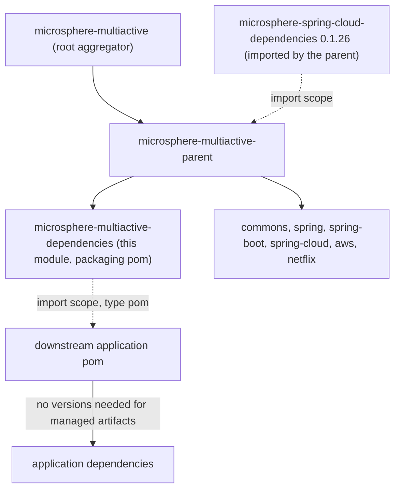
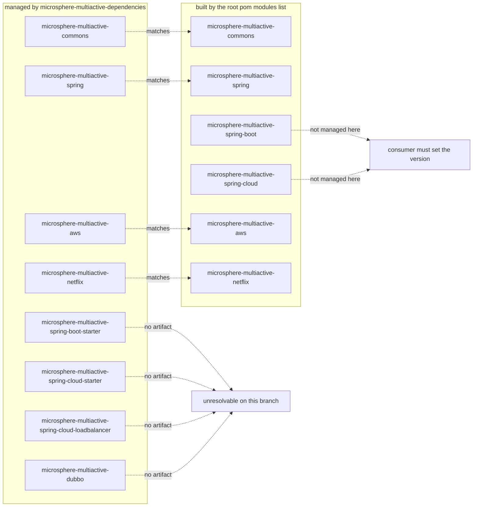

English version: [English](../microsphere-multiactive-dependencies.md)

# `microsphere-multiactive-dependencies` — 开发者指南

Maven 坐标：`io.github.microsphere-projects:microsphere-multiactive-dependencies:${revision}` ——
在本分支上是 `0.1.14-SNAPSHOT`；打包方式 `pom`。

---

## 概览

`microsphere-multiactive-dependencies` 是本项目的**面向消费者的 BOM**：本快照的 `README.md` 告诉用户去导入它，
从而让用户能够不带版本地编写 `microsphere-multiactive-*` 依赖。它不声明自身依赖、无构建配置、无源码 ——
只有一个列出项目坐标（均为 `${revision}`）的 `<dependencyManagement>` 块。

它是 reactor 的一片叶子：本构建中没有任何模块导入或依赖它（通过在每个 POM 中搜索
`microsphere-multiactive-dependencies` 核实；仅有的命中是它自身的 POM、根 POM 的 `<modules>` 列表、
根 `README.md` 的导入片段，以及那七个改为指向 `microsphere-multiactive-parent` 的 POM）。

---

## 架构设计

### 在构建中的位置



由于本 POM 继承 `microsphere-multiactive-parent`，而后者的 `dependencyManagement` 导入了
`microsphere-spring-cloud-dependencies:0.1.26`，按正常的 Maven 继承，本 BOM 的有效受管集合预期也会包含那些外部锁定项
以及它自己的八条项目条目。因此只导入本 BOM 的消费者也会一并得到 Microsphere Spring Cloud 的受管版本；
这一预期源自 POM 结构，而确切的结果集合取决于外部 BOM 的内容，后者不属于本快照。

### 完整的 POM

```xml
<parent>
    <groupId>io.github.microsphere-projects</groupId>
    <artifactId>microsphere-multiactive-parent</artifactId>
    <version>${revision}</version>
    <relativePath>../microsphere-multiactive-parent/pom.xml</relativePath>
</parent>

<artifactId>microsphere-multiactive-dependencies</artifactId>
<version>${revision}</version>
<packaging>pom</packaging>

<dependencyManagement>
    <dependencies>
        <!-- eight entries, all groupId io.github.microsphere-projects and version ${revision} -->
    </dependencies>
</dependencyManagement>
```

---

## 源码分析（POM 分析）

受管列表按文件顺序排列，并标注每个坐标**在本快照中**的状态：

| 受管 artifactId | 由本 reactor 构建？ | 说明 |
|---------------------|------------------------|-------|
| `microsphere-multiactive-commons` | 是 | 内核 |
| `microsphere-multiactive-spring` | 是 | `ZoneLocator` SPI + 监听器 |
| `microsphere-multiactive-spring-boot-starter` | **否** | 不存在这样的模块；在本分支上自动配置 artifact 是 `microsphere-multiactive-spring-boot` |
| `microsphere-multiactive-spring-cloud-starter` | **否** | 不存在这样的模块；Spring Cloud artifact 是 `microsphere-multiactive-spring-cloud` |
| `microsphere-multiactive-spring-cloud-loadbalancer` | **否** | LoadBalancer 类打包在 `microsphere-multiactive-spring-cloud` 内部 |
| `microsphere-multiactive-aws` | 是 | 三个平台 locator |
| `microsphere-multiactive-dubbo` | **否** | 本分支上根本没有 Dubbo 模块 |
| `microsphere-multiactive-netflix` | 是 | Eureka + Ribbon 适配器 |

维护者必须记在心里的推论：

- **并非每个受管坐标都能解析。** 一个导入了本 BOM 然后声明
  `microsphere-multiactive-spring-boot-starter`、`microsphere-multiactive-spring-cloud-starter`、
  `microsphere-multiactive-spring-cloud-loadbalancer` 或 `microsphere-multiactive-dubbo` 的应用，
  针对从本分支发布的 `0.1.x` 版本会依赖解析失败。可用的坐标是 `commons`、`spring`、`spring-boot`、
  `spring-cloud`、`aws` 和 `netflix`。
- **反过来说，确实被构建且是实际集成点的那两个 artifact ——
  `microsphere-multiactive-spring-boot` 和 `microsphere-multiactive-spring-cloud` —— 并未在此被管理**，
  因此消费者必须给它们显式版本。README 里“导入 BOM 然后去掉版本”的配方在本分支上因此并不能完全奏效。
- `microsphere-multiactive-parent` 未被管理（正确：它是继承 parent，而非依赖），也没有根聚合器的条目。
- 八条条目全部是 `<version>${revision}</version>` 且不带 `<type>`/`<scope>` —— 即纯 jar 坐标，
  版本与 reactor 绑定。本文件不锁定任何*第三方*版本；此事委托给 parent 的 BOM 导入。
- `groupId` 在八条条目中原样重复，并与 parent 链一致 —— 没有 `<groupId>` 属性间接层，
  这使文件便于 grep，但也意味着一次 group 改名要改动八行。

### 各部分如何对应（或不对应）



---

## 实际存在的设计模式

| 模式 | 本快照中的证据 |
|---------|---------------------------|
| **物料清单（BOM）** | 打包 `pom` + 仅含 `<dependencyManagement>` 的主体，通过 `<type>pom</type><scope>import</scope>` 消费，如根 `README.md` 所示 |
| **通过 `${revision}` 对齐版本** | 每条受管条目都解析为 reactor 版本，因此一次发布产出自洽的一套坐标 |
| **继承第三方管理** | 此处无外部版本；它们来自 `microsphere-multiactive-parent`，后者导入 `microsphere-spring-cloud-dependencies:0.1.26` |

不存在：没有 `<properties>`，没有 `<modules>`，没有 `<build>`，没有 `<profiles>`，没有 `<dependencies>` 段 ——
该文件是一份纯坐标清单。

---

## 扩展点与维护说明

1. **让 BOM 与 reactor 对齐。** 发布前，要么补上缺失的 `spring-boot` / `spring-cloud` 条目，
   要么移除本分支并不构建的那四个坐标。如今该文件宣称的模块布局（starter、独立的 LoadBalancer artifact、
   Dubbo artifact）匹配的是*另一套*分支结构。
2. **向 BOM 添加新模块** —— 一个 `<dependency>` 块，`groupId`
   `io.github.microsphere-projects`，`artifactId` 为新模块名，`<version>${revision}</version>`。
3. **不要在此锁定第三方版本** —— 那属于 `microsphere-multiactive-parent` 的 BOM 导入，
   或（模块本地需求）属于模块 POM（如 `microsphere-multiactive-netflix` 对 Ribbon `2.7.18` 的做法）。
4. **消费者仍然需要 `<type>`/`<scope>` 这对元素** —— 受管条目是 jar 坐标，因此导入本 BOM 的应用使用：

   ```xml
   <dependencyManagement>
       <dependencies>
           <!-- Microsphere Multiactive Dependencies -->
           <dependency>
               <groupId>io.github.microsphere-projects</groupId>
               <artifactId>microsphere-multiactive-dependencies</artifactId>
               <version>${microsphere-multiactive.version}</version>
               <type>pom</type>
               <scope>import</scope>
           </dependency>
       </dependencies>
   </dependencyManagement>
   ```

   这正是本快照 `README.md` 中的那段片段。

---

## 构建与测试

无需编译、无需测试；该模块只在 `install`/`deploy` 期间产出一个 POM artifact。

```bash
./mvnw -pl microsphere-multiactive-dependencies validate
./mvnw -pl microsphere-multiactive-dependencies install   # publishes the BOM pom locally
```

reactor 顺序把它排在第二（`parent`、`dependencies`、`commons`、`aws`、`netflix`、`spring`、`spring-boot`、
`spring-cloud`）；Maven 会按依赖图对 jar 模块重新排序，因此声明顺序只保证 parent 和 BOM 最先被安装。

---

## 与 `0.2.x` / 当前线的差异

从本快照可见：

- 受管坐标集合描述的是一套基于 starter 的模块布局（`spring-boot-starter`、`spring-cloud-starter`、
  `spring-cloud-loadbalancer`、`dubbo`），本分支并未实现；在 `1.x` 上 artifact 是
  `microsphere-multiactive-spring-boot` 和 `microsphere-multiactive-spring-cloud`，且没有 Dubbo 集成模块。
- 因此，在本分支上该 BOM 更像是“预期布局的记录”，而不是对全部六个已构建模块可用的版本锁定 ——
  把上表中标注 **否** 的四行当作权威的缺口清单。

---

## 相关

- [开发者指南索引](README.md)
- [microsphere-multiactive-parent](microsphere-multiactive-parent.md) —— 本 BOM 派生自的继承 parent
- [microsphere-multiactive-spring-boot](microsphere-multiactive-spring-boot.md) —— 在此构建但未被此管理
- [microsphere-multiactive-spring-cloud](microsphere-multiactive-spring-cloud.md) —— 在此构建但未被此管理
- [microsphere-multiactive-dependencies 用户指南](../../user-guide/zh/microsphere-multiactive-dependencies.md)
- [用户指南索引](../../user-guide/zh/README.md)
- [仓库 README](../../../../README.md)

---

## English

English version: [English](../microsphere-multiactive-dependencies.md)
