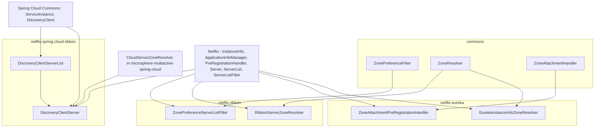
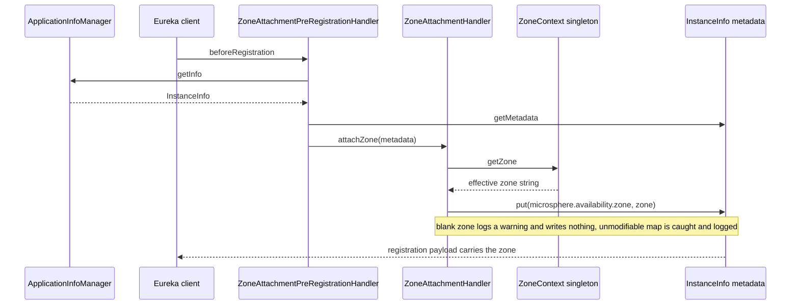
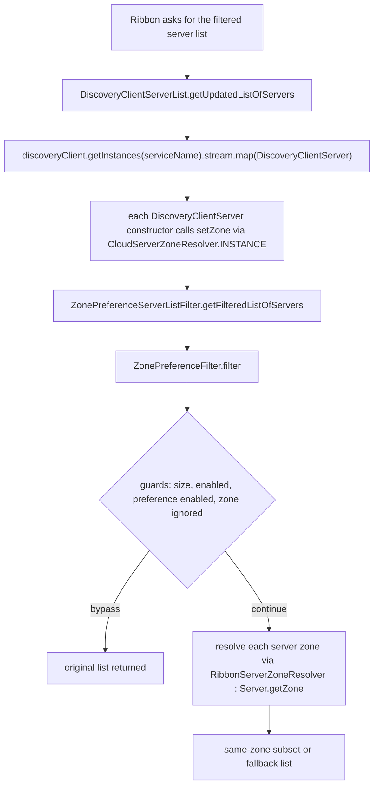

English version: [English](../microsphere-multiactive-netflix.md)

# `microsphere-multiactive-netflix` — 开发者指南

Maven 坐标：`io.github.microsphere-projects:microsphere-multiactive-netflix:${revision}` —— 在本分支上是
`0.1.14-SNAPSHOT`。

---

## 概览

`microsphere-multiactive-netflix` 是 Netflix OSS 适配器集合：注册/发现侧的 Eureka，客户端负载均衡侧的 Ribbon。
与 Spring Cloud 模块不同，它**不提供自动配置** —— 它的 `META-INF/spring.factories` 并不存在，唯一的资源是特性元数据。
此处每个类都是一个普通的、需手工装配的协作者。

| 类型 | 包 | 实现 / 继承 | 用途 |
|------|---------|----------------------|---------|
| `EurekaInstanceInfoZoneResolver` | `…zone.netflix.eureka` | `ZoneResolver<InstanceInfo>` | 从 Eureka `InstanceInfo` 元数据读取区域 |
| `ZoneAttachmentPreRegistrationHandler` | `…zone.netflix.eureka` | `PreRegistrationHandler`（Eureka client SPI） | 在注册前把区域附着进 `InstanceInfo` 元数据 |
| `RibbonServerZoneResolver<T extends Server>` | `…zone.netflix.ribbon` | `ZoneResolver<T>` | 从 Ribbon `Server` 读取区域 |
| `ZonePreferenceServerListFilter<T extends Server>` | `…zone.netflix.ribbon` | `ServerListFilter<T>`（Ribbon SPI） | 把服务器列表委托给 `ZonePreferenceFilter` |
| `DiscoveryClientServer` | `…zone.netflix.spring.cloud.ribbon` | `extends Server` | 把 Spring Cloud `ServiceInstance` 适配为 Ribbon `Server`，含区域 |
| `DiscoveryClientServerList` | `…zone.netflix.spring.cloud.ribbon` | `ServerList<DiscoveryClientServer>` | 用 Spring Cloud `DiscoveryClient` 为 Ribbon 供数 |

文件：

- `microsphere-multiactive-netflix/src/main/java/io/microsphere/multiple/active/zone/netflix/eureka/EurekaInstanceInfoZoneResolver.java`
- `microsphere-multiactive-netflix/src/main/java/io/microsphere/multiple/active/zone/netflix/eureka/ZoneAttachmentPreRegistrationHandler.java`
- `microsphere-multiactive-netflix/src/main/java/io/microsphere/multiple/active/zone/netflix/ribbon/RibbonServerZoneResolver.java`
- `microsphere-multiactive-netflix/src/main/java/io/microsphere/multiple/active/zone/netflix/ribbon/ZonePreferenceServerListFilter.java`
- `microsphere-multiactive-netflix/src/main/java/io/microsphere/multiple/active/zone/netflix/spring/cloud/ribbon/DiscoveryClientServer.java`
- `microsphere-multiactive-netflix/src/main/java/io/microsphere/multiple/active/zone/netflix/spring/cloud/ribbon/DiscoveryClientServerList.java`
- `microsphere-multiactive-netflix/src/main/resources/META-INF/config/default/features.yaml`

---

## 架构设计

### 分层：三条接缝，一个算法



本模块从不重新实现区域逻辑。`ZonePreferenceServerListFilter` 是三行委托；所有决策都留在 commons。
唯一真正的新逻辑是 `DiscoveryClientServer`，它桥接了两个对象模型。

### Eureka 注册流程



### Ribbon 过滤流程



---

## 源码分析

### `EurekaInstanceInfoZoneResolver`

```java
public class EurekaInstanceInfoZoneResolver implements ZoneResolver<InstanceInfo> {

    @Override
    public String resolve(InstanceInfo instanceInfo) {
        Map<String, String> metadata = instanceInfo.getMetadata();
        String instanceZone = metadata == null ? null : metadata.get(ZONE_PROPERTY_NAME);
        return instanceZone;
    }
}
```

- 读取的正是 `ZoneAttachmentHandler` 写入的**同一个**键（`ZoneConstants.ZONE_PROPERTY_NAME`），
  因此一对基于 Eureka 的提供者/消费者无需任何额外配置即可自洽。
- 对*元数据 map*做了空值保护，但没对 `InstanceInfo` 参数做。`ZonePreferenceFilter.resolveZone(entity)`
  在调用到这里之前会防护 `null` 实体，因此过滤路径是安全的；直接调用者则不然。
- 与 `CloudServerZoneResolver` 不同，本类**没有** `INSTANCE` 常量，因此每个使用点都会新建一个实例。

### `ZoneAttachmentPreRegistrationHandler`

```java
public class ZoneAttachmentPreRegistrationHandler implements PreRegistrationHandler {

    private final ApplicationInfoManager applicationInfoManager;
    private final ZoneAttachmentHandler zoneAttachmentHandler;

    public ZoneAttachmentPreRegistrationHandler(ApplicationInfoManager applicationInfoManager,
                                                ZoneAttachmentHandler zoneAttachmentHandler) { ... }

    @Override
    public void beforeRegistration() {
        InstanceInfo instanceInfo = applicationInfoManager.getInfo();
        Map<String, String> metadata = instanceInfo.getMetadata();
        zoneAttachmentHandler.attachZone(metadata);
    }
}
```

- 它是 Eureka 自己的 `com.netflix.discovery.PreRegistrationHandler` SPI，即实例注册前夕被调用的钩子 ——
  是 Spring Cloud `ZoneAttachmentListener` 的 Netflix 原生对应物。类 Javadoc 引用了
  `AbstractDiscoveryClientOptionalArgs`，那正是 Eureka 期望此类 handler 被提供的地方；
  **本快照中没有代码执行该装配**，因此注册留给了应用自己。
- 两个依赖都是 `final` 且构造器注入 —— 与 Spring Cloud 的监听器不同（后者在事件发生时从 `ApplicationContext`
  解析其 handler）。因此缺失的 `ZoneAttachmentHandler` bean 会在*构造*期失败。
  那个 bean 只由 Spring Cloud 模块的 `ZoneCloudAutoConfiguration` 贡献，所以本分支上的 Eureka 路径
  传递性地依赖该模块存在且其条件匹配。
- 没有 `instanceInfo == null` 保护；`applicationInfoManager.getInfo()` 被假定为非空。

### `RibbonServerZoneResolver<T extends Server>`

```java
public class RibbonServerZoneResolver<T extends Server> implements ZoneResolver<T> {

    @Override
    public String resolve(T server) {
        return server.getZone();
    }
}
```

- Ribbon 路径**唯一**的区域来源：Ribbon 的 `Server.getZone()`，由 Ribbon/Eureka 集成本身或
  `DiscoveryClientServer` 的构造函数填充。此处不发生任何元数据查找。
- 尽管除了参数之外从未使用 `T`，仍然写成泛型 `T extends Server` —— 这是为了让 resolver
  能被插入 `ZonePreferenceFilter<SomeServerSubtype>`。
- 它的类 Javadoc 使用了一个格式错误的标签（`@since ZoneResolver`），这就是它在 Javadoc 输出中渲染怪异的原因。

### `ZonePreferenceServerListFilter<T extends Server>`

```java
public class ZonePreferenceServerListFilter<T extends Server> implements ServerListFilter<T> {

    private ZonePreferenceFilter<T> filter;

    public ZonePreferenceServerListFilter(ZonePreferenceFilter<T> filter) {
        this.filter = filter;
    }

    @Override
    public List<T> getFilteredListOfServers(List<T> servers) {
        return filter.filter(servers);
    }
}
```

- 一个纯粹面向 commons 过滤器的**适配器**：一个接口方法，一次委托调用。没有额外护栏，没有日志，没有排序 ——
  所有安全阀（size ≤ 1、特性关闭、区域被忽略、就绪百分比、最少可用）都在 `ZonePreferenceFilter.filter(...)` 内部。
- `filter` 字段**不是** `final` 也没有 setter，因此实践上它实际上不可变，但在包内可通过反射/非子类方式篡改 ——
  与 `ZoneAttachmentPreRegistrationHandler` 相比是一个小不一致。
- **排序在这条路径上被丢弃。** `ZonePreferenceFilter.getOrder()` 未被转发，因此
  `microsphere.availability.zone.preference.filter.order` 对 Ribbon 链同样没有效果
  （与“本快照中没有任何东西消费 `getOrder()`”这一发现一致）。
- 类型参数 `T` 从 `ServerListFilter<T>` 一路贯穿进 `ZonePreferenceFilter<T>`，
  这正是同一个 commons 算法能同时服务 `Server`、由 `com.netflix.loadbalancer.InstanceInfo` 派生的服务器，
  或任意自定义子类型的原因。

### `DiscoveryClientServer`

```java
public class DiscoveryClientServer extends Server {

    private final ServiceInstance serviceInstance;
    private final ServiceInstanceMetaInfo metaInfo;

    public DiscoveryClientServer(ServiceInstance serviceInstance) {
        super(serviceInstance.getScheme(), serviceInstance.getHost(), serviceInstance.getPort());
        this.serviceInstance = serviceInstance;
        this.metaInfo = new ServiceInstanceMetaInfo(serviceInstance);
        this.setZone(resolveZone(serviceInstance));
    }

    private String resolveZone(ServiceInstance serviceInstance) {
        return INSTANCE.resolve(serviceInstance);
    }

    @Override public String getId() { return serviceInstance.getInstanceId(); }
    @Override public MetaInfo getMetaInfo() { return metaInfo; }

    final static class ServiceInstanceMetaInfo implements MetaInfo { … }
}
```

- 这就是让 Spring Cloud 发现能力可被 Ribbon 使用的**桥梁**。区域在构造函数中被解析一次，
  来源是 `CloudServerZoneResolver.INSTANCE` —— 即 Spring Cloud 模块的元数据读取者，
  使用 `microsphere.availability.zone` 键。这就是本模块依赖
  `microsphere-multiactive-spring-cloud` 的原因：这座桥刻意复用那个 resolver，而不重复实现元数据读取。
- 由于 `setZone(...)` 收到的就是元数据中所持的内容（可能为 `null`），
  基于 `RibbonServerZoneResolver` 的过滤器对未标注区域的实例看到的是 `null`，
  而 `ZonePreferenceFilter` 会把这些计入“上游区域就绪百分比”闸门，而不是当作不匹配。
- 标识映射是委托而非拷贝：`getId()` 返回 `serviceInstance.getInstanceId()`，
  嵌套的 `ServiceInstanceMetaInfo` 把 `getAppName()`/`getServiceIdForDiscovery()` 映射到 `serviceId`，
  把 `getInstanceId()` 映射到 `instanceId`。`getServerGroup()` 返回 `null` —— `ServiceInstance` 上不存在对应概念。
- 嵌套类被声明为 `final static`（修饰符顺序不常见）且包私有，每个 server 急切构造一次，
  即便 Ribbon 从不询问 `MetaInfo`。
- `serviceInstance` 从未做空值检查：`super(serviceInstance.getScheme(), …)` 对 `null` 实例会立即抛出。
- 两行格式错误的 Javadoc `@since`（`@since ServiceInstance`、`@since Server`）—— `@see` 的目标被敲进了错误的标签。

### `DiscoveryClientServerList`

```java
public class DiscoveryClientServerList implements ServerList<DiscoveryClientServer> {

    private final DiscoveryClient discoveryClient;
    private final String serviceName;

    @Override
    public List<DiscoveryClientServer> getInitialListOfServers() {
        return getUpdatedListOfServers();
    }

    @Override
    public List<DiscoveryClientServer> getUpdatedListOfServers() {
        return discoveryClient.getInstances(serviceName)
                .stream()
                .map(DiscoveryClientServer::new)
                .collect(Collectors.toList());
    }
}
```

- 两个 Ribbon 回调共享同一实现，因此首次轮询与周期轮询行为完全一致 —— 没有预热特例。
- **每次轮询都会重建**一个 `DiscoveryClientServer` 对象：不缓存、不复用标识。在 Ribbon 每 30 秒轮询一次的情况下，
  这会不断重读元数据并重新分配 `MetaInfo` 对象；这是设计的后果，不是代码缺陷。
- `discoveryClient.getInstances(serviceName)` 可能返回空列表；此时流产出空列表，
  `ZonePreferenceFilter` 的 `totalSize <= 1` 护栏原样返回它。
- `serviceName` 在构造时固定，因此本类的一个实例服务一个 Ribbon client —— 与 `ServerList` 通常按
  `ILoadBalancer` 实例化的方式一致。
- 未出现 `initialize(shutdown)`/`getFastIndexOfServers` 风格的覆盖，且 `ServerList` 是被
  `implemented`（而非 extends），因此不继承任何 `AbstractServerList` 的定时器/轮询行为。

### 特性元数据：`META-INF/config/default/features.yaml`

```yaml
microsphere:
  spring:
    cloud:
      features:
        named:
          microsphere-multiactive-netflix:
            - io.microsphere.multiple.active.zone.netflix.eureka.EurekaInstanceInfoZoneResolver
            - io.microsphere.multiple.active.zone.netflix.eureka.ZoneAttachmentPreRegistrationHandler
            - io.microsphere.multiple.active.zone.netflix.ribbon.RibbonServerZoneResolver
            - io.microsphere.multiple.active.zone.netflix.ribbon.ZonePreferenceServerListFilter
            - io.microsphere.multiple.active.zone.netflix.spring.cloud.ribbon.DiscoveryClientServerList
```

本模块六个适配器类中除 `DiscoveryClientServer` 之外的五个，被列为一个具名特性分组。该描述符的消费者位于
`microsphere-spring-cloud-commons`，在本仓库之外，因此运行时效果**无法从本快照核实**。

---

## 实际存在的设计模式

| 模式 | 本快照中的证据 |
|---------|---------------------------|
| **适配器** | `ZonePreferenceServerListFilter` 把 `ZonePreferenceFilter` 适配为 Ribbon 的 `ServerListFilter`；`DiscoveryClientServer` 把 `ServiceInstance` 适配为 `Server` |
| **桥梁（对象模型到对象模型）** | `DiscoveryClientServer` + `DiscoveryClientServerList` 把 Spring Cloud 发现模型连到 Ribbon 服务器模型，双方都不知道区域偏好的存在 |
| **委托 / 不重复策略** | 每一次过滤或附着调用都转发给 commons；本模块不含任何自己的 `if (zone…)` 逻辑 |
| **策略** | `RibbonServerZoneResolver` 与 `EurekaInstanceInfoZoneResolver` 是可互换的 `ZoneResolver` 实现，绑定到不同的实体图 |
| **模板回调（SPI 钩子）** | `ZoneAttachmentPreRegistrationHandler implements PreRegistrationHandler`，由 Eureka client 调用 |
| **泛型约束多态** | resolver 与 filter 上的 `<T extends Server>` 使一个算法可跨多种 server 子类型使用 |

不存在：没有自动配置，没有 `@Conditional*`，没有 `@Component`/`@Bean`，没有 `spring.factories`，
没有 `@Order`/`Ordered` 实现，也没有 `ThreadLocal`/请求作用域的区域。

---

## 装配本模块（代码所要求的）

由于没有任何东西被自动配置，集成本模块的维护者需要自己提供装配。这些类精确地规定了所需协作者：

```java
// commons -> Spring Cloud bean, contributed by ZoneCloudAutoConfiguration
ZoneAttachmentHandler zoneAttachmentHandler = ...;
ApplicationInfoManager applicationInfoManager = ...;

// Registration side (Eureka-native)
PreRegistrationHandler preRegistrationHandler =
        new ZoneAttachmentPreRegistrationHandler(applicationInfoManager, zoneAttachmentHandler);

// Consumer side (Ribbon)
ZoneContext zoneContext = ZoneContext.get();
ZonePreferenceFilter<Server> zonePreferenceFilter =
        new ZonePreferenceFilter<>(zoneContext, new RibbonServerZoneResolver<>());
ServerListFilter<Server> serverListFilter = new ZonePreferenceServerListFilter<>(zonePreferenceFilter);

// Spring-Cloud-discovery-backed Ribbon server list
ServerList<DiscoveryClientServer> serverList = new DiscoveryClientServerList(discoveryClient, "provider-service");
```

由构造函数可直接推出两个约束：`ZoneAttachmentHandler` 必须已经是一个 bean
（它只在 Spring Cloud 模块的自动配置中声明），并且 `ZonePreferenceFilter` 必须用*正确*的 `ZoneResolver`
构造（Ribbon 的 `Server` 用 `RibbonServerZoneResolver`，`InstanceInfo` 用 `EurekaInstanceInfoZoneResolver`，
`ServiceInstance` 用 `CloudServerZoneResolver`）。

---

## 构建与测试

`microsphere-multiactive-netflix/pom.xml` —— parent 为 `microsphere-multiactive-parent`，打包 `jar`，无插件，无 profile，
**没有 `src/test/java` 源码**，并带一个模块本地属性：

```xml
<properties>
    <netflix.ribbon.version>2.7.18</netflix.ribbon.version>
</properties>
```

这是构建中唯一引入**模块本地版本属性**的 POM。其余位置恰好只有两个版本旋钮：根 `pom.xml` 把其外部 parent 版本
写成字面量 `0.1.26`，`microsphere-multiactive-parent` 声明 `microsphere-spring-cloud.version=0.1.26`。
此处的 `<netflix.ribbon.version>2.7.18</netflix.ribbon.version>` 是第三个，
而三个 Ribbon artifact（`ribbon`、`ribbon-loadbalancer`、`ribbon-eureka`）通过该属性定版本，而非从任何 BOM 继承。

| 依赖 | 作用域 | 被谁使用 |
|------------|-------|---------|
| `microsphere-multiactive-spring-cloud`（`${revision}`） | **optional** | `DiscoveryClientServer`（`CloudServerZoneResolver`），传递地 `spring`/`commons`；Eureka handler 所需的 `ZoneAttachmentHandler` 类型 |
| `spring-cloud-commons`、`spring-cloud-context` | optional | `ServiceInstance`、`DiscoveryClient` |
| `spring-cloud-netflix-eureka-client` | optional | Eureka-on-Spring-Cloud 上下文；本模块没有类从它导入 |
| `com.netflix.eureka:eureka-client` | optional | `InstanceInfo`、`ApplicationInfoManager`、`PreRegistrationHandler`、`AbstractDiscoveryClientOptionalArgs`（仅 Javadoc） |
| `com.netflix.ribbon:ribbon`、`ribbon-loadbalancer`、`ribbon-eureka`，版本 `${netflix.ribbon.version}` = `2.7.18` | optional | `Server`、`ServerList`、`ServerListFilter`、`MetaInfo` |
| `spring-boot-starter`、`-actuator`、`-web` | optional | 本模块任何源码文件都未引用 |
| `microsphere-annotation-processor`、`spring-boot-configuration-processor`、`spring-boot-autoconfigure-processor` | optional | 编译期处理 |
| `junit-jupiter`、`spring-boot-starter-test`、`microsphere-spring-boot-test`、`logback-classic` | test | 已声明但未使用（不存在测试） |

与 AWS 模块一样，**每个非测试依赖都是 optional**，因此消费者必须自带 `microsphere-multiactive-commons`
（以及 `…-spring-cloud`，以及 Eureka/Ribbon 本身）；这个 jar 单独立用时没有任何必需的传递依赖。

一处值得为 POM 整理而记下的小结构不一致：本 POM 把 `<modelVersion>` 放在 `<parent>` **之前**，
而其他模块 POM 都把 `<parent>` 放在最前。Maven 两者都接受，因此只是外观问题。

```bash
# Compiles the module; there are no tests to run
./mvnw -pl microsphere-multiactive-netflix -am install
```

依据本快照的 `release-notes.md`，该模块是在 **`v0.1.0`** 中与 `DiscoveryClientServerList` 和 `DiscoveryClientServer`
一同**新增**的，而更早的 `microsphere-multiactive-spring-cloud-netflix` 模块在同一次发布中被移除 ——
这解释了为什么这些类位于 Netflix 模块内部的 `…netflix.spring.cloud.ribbon` 包下，而不是在某个 Spring Cloud 模块中。

---

## 与 `0.2.x` / 当前线的差异

从本快照可见：

- Netflix 集成**完全没有被自动配置**：没有 `spring.factories`，没有条件注解，没有 bean 声明。
  一切由应用实例化。
- Ribbon 以显式锁定的 `2.7.18` 版本获得支持，这也是本线面向 Hoxton（Ribbon 当时仍是 Spring Cloud 默认的
  客户端负载均衡器）而非 2022+ 的原因之一。
- Ribbon 的区域过滤丢弃了 `microsphere.availability.zone.preference.filter.order` 值：
  `ZonePreferenceServerListFilter` 不暴露任何排序。
- Spring-Cloud 到 Ribbon 的桥梁复用了 Spring Cloud 模块的 `CloudServerZoneResolver`，
  因此这个 Netflix artifact 与 Spring Cloud 相耦合，而不是纯粹的 Netflix 专属。
- 本分支上该模块不存在测试源码。

---

## 相关

- [开发者指南索引](README.md)
- [microsphere-multiactive-commons](microsphere-multiactive-commons.md) —— `ZonePreferenceFilter`、`ZoneResolver`、`ZoneAttachmentHandler`
- [microsphere-multiactive-spring-cloud](microsphere-multiactive-spring-cloud.md) —— `CloudServerZoneResolver` 与 `ZoneAttachmentHandler` bean
- [microsphere-multiactive-netflix 用户指南](../../user-guide/zh/microsphere-multiactive-netflix.md)
- [用户指南索引](../../user-guide/zh/README.md)
- [仓库 README](../../../../README.md)

## English

English version: [English](../microsphere-multiactive-netflix.md)
