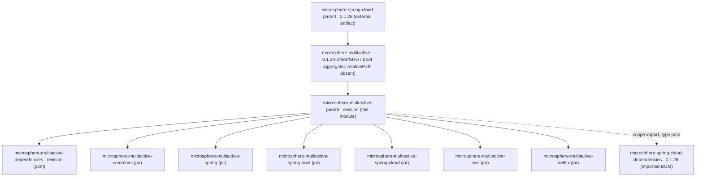
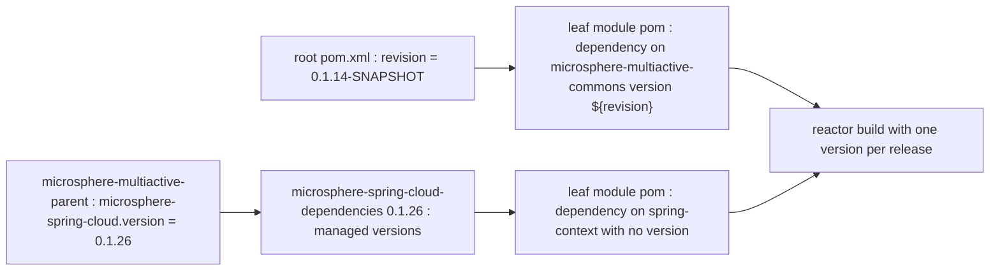

English version: [English](../microsphere-multiactive-parent.md)

# `microsphere-multiactive-parent` — 开发者指南

Maven 坐标：`io.github.microsphere-projects:microsphere-multiactive-parent:${revision}` —— 在本分支上是
`0.1.14-SNAPSHOT`；打包方式 `pom`。

---

## 概览

`microsphere-multiactive-parent` 是本构建中**其他七个模块**的**继承 parent** —— 六个 jar 模块以及
`microsphere-multiactive-dependencies` BOM。它是一个纯 POM 模块：完全没有 `src/` 目录，
只有 `microsphere-multiactive-parent/pom.xml`，也不向任何 classpath 贡献内容。

它在本分支上的职责被刻意收窄：

1. 位于外部 Microsphere parent 与叶子模块之间，使叶子 POM 保持精简；
2. 导入外部的 `microsphere-spring-cloud-dependencies` BOM，正是它锁定了 Spring Boot、Spring Cloud、
   Jackson、JUnit、Logback 以及本仓库中用到的每一个 `microsphere-*` artifact。

---

## 架构设计

### 它在继承链中的位置



注意这里的两步：**根聚合器** `microsphere-multiactive` 直接继承外部 parent
`microsphere-spring-cloud-parent:0.1.26`，而 `microsphere-multiactive-parent` 继承的是*根聚合器*
（`<relativePath>../pom.xml</relativePath>`）。因此外部 parent 的插件管理、编译器设置与 profile 是通过
两跳继承而非一跳被触达的。

### 完整的 POM

```xml
<parent>
    <groupId>io.github.microsphere-projects</groupId>
    <artifactId>microsphere-multiactive</artifactId>
    <version>${revision}</version>
    <relativePath>../pom.xml</relativePath>
</parent>

<artifactId>microsphere-multiactive-parent</artifactId>
<version>${revision}</version>
<packaging>pom</packaging>

<properties>
    <!-- BOM versions -->
    <microsphere-spring-cloud.version>0.1.26</microsphere-spring-cloud.version>
</properties>

<dependencyManagement>
    <dependencies>
        <dependency>
            <groupId>io.github.microsphere-projects</groupId>
            <artifactId>microsphere-spring-cloud-dependencies</artifactId>
            <version>${microsphere-spring-cloud.version}</version>
            <type>pom</type>
            <scope>import</scope>
        </dependency>
    </dependencies>
</dependencyManagement>
```

---

## 源码分析（POM 分析）

| 元素 | 值 | 效果 |
|---------|-------|--------|
| `<parent>` | `microsphere-multiactive:${revision}`，带 `<relativePath>../pom.xml</relativePath>` | 在 reactor 内解析；外部 parent 链被传递继承 |
| `<version>` | `${revision}` | CI 友好版本；唯一的真相来源是根 POM 的 `<revision>0.1.14-SNAPSHOT</revision>` |
| `<packaging>` | `pom` | 不产出 artifact；无需编译，没有 `target/classes` |
| `<properties>` | `microsphere-spring-cloud.version=0.1.26` | 本 POM 本地声明的**唯一**版本，也是升级 Microsphere Spring Cloud 线时要改的那一个数字 |
| `<dependencyManagement>` | 对 `microsphere-spring-cloud-dependencies:0.1.26` 的一次 `import` | 提供叶子模块不带 `<version>` 元素所消费的所有版本 |
| `<name>` / `<description>` | `Microsphere :: Multi-Active :: Parent` / `Microsphere Multi-Active Parent` | 仅站点/POM 元数据 |

本 POM **不**包含的内容，以及这些东西因此来自何处：

- **没有 `<pluginManagement>`，没有 `<build>`，没有编译器/source-target 设置。** 它们通过根聚合器从
  `microsphere-spring-cloud-parent:0.1.26` 继承而来。这就是为什么同一个 artifact 能在 CI 中从 Java 8 一直编译到
  Java 25，而此处连一个 `<source>` 声明都没有。
- **没有 profile。** `.github/workflows/maven-build.yml` 和 `.github/workflows/maven-publish.yml` 所激活的
  `test`、`coverage`、`publish`、`ci` 和 `spring-cloud-hoxton` / `-2020` / `-2021` profile 全部来自外部 parent。
- **没有针对本仓库自身模块的 `dependencyManagement` 条目。** 管理它们是
  `microsphere-multiactive-dependencies` 的职责 —— 而由于没有模块导入那个 BOM，叶子 POM 各自为它们的兄弟依赖写明
  `<version>${revision}</version>`，例如：

  ```xml
  <dependency>
      <groupId>io.github.microsphere-projects</groupId>
      <artifactId>microsphere-multiactive-commons</artifactId>
      <version>${revision}</version>
  </dependency>
  ```

  这是上面这个 POM 的直接结果：`microsphere-multiactive-parent` 管理**零个**项目内部坐标，因此 Maven 无法为兄弟模块
  提供版本，本构建中每一条跨模块依赖都必须自己声明 `<version>${revision}</version>`。这也意味着必须为这些坐标定义
  `${revision}` 才能解析，这恰恰是各模块设置显式 `<relativePath>` 回指 reactor 的原因。
- **没有 `<modules>`** —— 聚合位于根 POM。`microsphere-multiactive-parent` 只是 parent；构建它并不会构建那些 jar。
- **完全没有 `<dependency>` 段** —— 该 parent 贡献的是受管理的版本，而非实际依赖，因此叶子模块不会被继承来的 artifact 污染。

### 跨 reactor 的属性解析



---

## 实际存在的设计模式

| 模式 | 本快照中的证据 |
|---------|---------------------------|
| **继承 parent（Maven）** | 被其他七个模块 POM 以 `<parent>` 声明，带 `<relativePath>../microsphere-multiactive-parent/pom.xml</relativePath>` |
| **通过 BOM 导入锁定第三方** | 对 `microsphere-spring-cloud-dependencies` 使用 `<type>pom</type><scope>import</scope>` |
| **CI 友好的 `${revision}` 版本管理** | `${revision}` 用于本模块的 `<version>`、`<parent>` 版本以及兄弟模块依赖 |
| **单点版本旋钮** | `0.1.26` 是本 POM 中唯一的字面版本；根聚合器独立地把 `microsphere-spring-cloud-parent:0.1.26` 声明为其自身 parent，而 `microsphere-multiactive-netflix` 锁定 Ribbon `2.7.18` |

不存在：没有聚合（`<modules>`），没有对本项目自身 artifact 的 `dependencyManagement`，没有插件配置，没有 profile，
没有发布管理，没有源码目录。

---

## 扩展点与维护说明

1. **升级 Microsphere Spring Cloud 线** —— 在此改 `microsphere-spring-cloud.version`；每个被管理的第三方版本随之更新。
   发版说明显示此事被反复执行（`0.1.11` → `0.1.24`、`0.1.25`、`0.1.26` 于 HEAD），这正是本文件应有的角色。
2. **添加一个项目级的受管依赖** —— 若应作用于*本构建*，在此加一条 `<dependencyManagement>`；若应作用于*消费者*，
   加到 `microsphere-multiactive-dependencies`。维护这两个 POM 时，同时记住两者是主要的判断要点。
3. **添加新模块** —— 将 `microsphere-multiactive-parent` 声明为其 parent，带
   `<relativePath>../microsphere-multiactive-parent/pom.xml</relativePath>`，把该模块加入根 POM 的 `<modules>`，
   并给兄弟依赖 `<version>${revision}</version>`。
4. **留意 `${revision}` + `<parent>` 的相互作用** —— parent 自身的 `<version>` 是 `${revision}`，叶子模块重复它；
   发布命令必须传 `-Drevision=…`（如 `maven-publish.yml` 那样），否则 reactor 会构建 `0.1.14-SNAPSHOT`。

---

## 构建与测试

本模块没有需要编译的东西，也没有需要测试的东西。

```bash
# validate the effective POM and the inherited management
./mvnw -pl microsphere-multiactive-parent validate

# show what the external BOM actually pins, e.g. for spring-context
./mvnw -pl microsphere-multiactive-commons dependency:tree
```

`microsphere-multiactive-parent/pom.xml` 不声明任何插件，因此构建生命周期完全继承自
`microsphere-spring-cloud-parent:0.1.26`。那里是否配置了 `flatten-maven-plugin`（发布 `${revision}` POM 的常见做法）
**无法从本快照核实**，因为外部 parent 并未随仓库提供。

---

## 与 `0.2.x` / 当前线的差异

从本快照可见：

- 本 POM 把 `microsphere-spring-cloud.version` 锁定为 `0.1.26`，而 `0.2.x` 线上同名的 POM 追踪更新的
  Microsphere Spring Cloud 系列；由此推出的兼容窗口是 Hoxton → 2021（记录在本快照自身的 `README.md` 分支表中）。
- 该 parent **不**管理本仓库自身模块的坐标；期望消费者导入 `microsphere-multiactive-dependencies`，
  其在本分支上的条目指向的 artifact 并非全部存在于此（见
  [microsphere-multiactive-dependencies](microsphere-multiactive-dependencies.md)）。

---

## 相关

- [开发者指南索引](README.md)
- [microsphere-multiactive-dependencies](microsphere-multiactive-dependencies.md) —— 面向消费者的 BOM
- [microsphere-multiactive-commons](microsphere-multiactive-commons.md) —— 从本 parent 继承的第一个模块
- [microsphere-multiactive-parent 用户指南](../../user-guide/zh/microsphere-multiactive-parent.md)
- [用户指南索引](../../user-guide/zh/README.md)
- [仓库 README](../../../../README.md)

---

## English

English version: [English](../microsphere-multiactive-parent.md)
