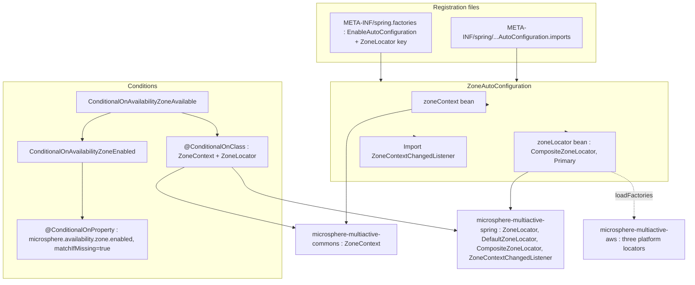
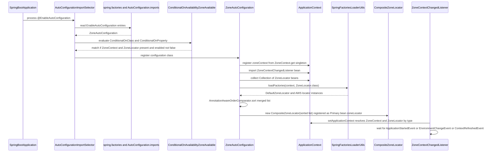
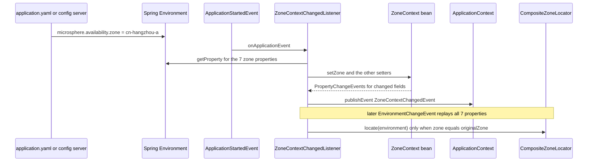

English version: [English](../microsphere-multiactive-spring-boot.md)

# `microsphere-multiactive-spring-boot` — 开发者指南

Maven 坐标：`io.github.microsphere-projects:microsphere-multiactive-spring-boot:${revision}` —— 在本分支上是
`0.1.14-SNAPSHOT`。

---

## 概览

`microsphere-multiactive-spring-boot` 按代码量是最小的模块（三个类），却是整个构建的枢纽：它把 `1.x` 内核加上
`ZoneLocator` SPI 变成一个可用的、无需 starter 的 Spring Boot 自动配置。它恰好做三件事：

1. 把 `ZoneContext` **单例**注册为名为 `zoneContext` 的 Spring bean；
2. 把**所有** `ZoneLocator` —— Spring bean 与 `spring.factories` 条目 —— 组装进名为 `zoneLocator` 的 `@Primary`
   `CompositeZoneLocator` bean；
3. 导入 `ZoneContextChangedListener`，使属性变化流入上下文。

包与文件：

| 类型 | 文件 |
|------|------|
| `ZoneAutoConfiguration` | `microsphere-multiactive-spring-boot/src/main/java/io/microsphere/multiple/active/zone/spring/boot/autoconfigure/ZoneAutoConfiguration.java` |
| `ConditionalOnAvailabilityZoneAvailable` | `microsphere-multiactive-spring-boot/src/main/java/io/microsphere/multiple/active/zone/spring/boot/condition/ConditionalOnAvailabilityZoneAvailable.java` |
| `ConditionalOnAvailabilityZoneEnabled` | `microsphere-multiactive-spring-boot/src/main/java/io/microsphere/multiple/active/zone/spring/boot/condition/ConditionalOnAvailabilityZoneEnabled.java` |

资源 —— 注册就发生在本模块：

- `microsphere-multiactive-spring-boot/src/main/resources/META-INF/spring.factories`
- `microsphere-multiactive-spring-boot/src/main/resources/META-INF/spring/org.springframework.boot.autoconfigure.AutoConfiguration.imports`

---

## 架构设计

### 分层



不存在第三层：除了上面这两个 bean，本模块不贡献任何 bean，也没有 `@ConfigurationProperties` 类，
尽管 `spring-boot-configuration-processor` 在 optional classpath 上。

### `spring.factories` 文件是一文件两用

```properties
org.springframework.boot.autoconfigure.EnableAutoConfiguration=\
io.microsphere.multiple.active.zone.spring.boot.autoconfigure.ZoneAutoConfiguration

io.microsphere.multiple.active.zone.spring.ZoneLocator=\
io.microsphere.multiple.active.zone.spring.DefaultZoneLocator
```

- 第一个键是经典的 Spring Boot 2.x 自动配置入口。
- 第二个键**不是** Spring Boot 的键：它是 Microsphere 的 `ZoneLocator` SPI 键，由
  `io.microsphere.spring.core.io.support.SpringFactoriesLoaderUtils.loadFactories(context, ZoneLocator.class)` 读取。
  因此同一个文件同时喂给 Boot 和本库自己的加载器，而 `DefaultZoneLocator` 在此注册，
  而不是在 `microsphere-multiactive-spring` 模块中（该模块不随附任何资源）。
- `AutoConfiguration.imports` 文件为 Spring Boot 2.7+/3.x 列出了同一个 `ZoneAutoConfiguration`。
  两个文件都提供，使一个 artifact 既能配合只读 `spring.factories` 的 Boot 版本，也能配合只读 `imports` 的版本。
  `ZoneAutoConfiguration` 是 `imports` 中唯一的条目；Spring Cloud 模块自带一对文件。

---

## 源码分析

### `ZoneAutoConfiguration`

```java
@Configuration(proxyBeanMethods = false)
@ConditionalOnAvailabilityZoneAvailable
@Import(value = {ZoneContextChangedListener.class})
public class ZoneAutoConfiguration {

    @Bean(name = ZONE_CONTEXT_BEAN_NAME)
    @ConditionalOnMissingBean
    public ZoneContext zoneContext() {
        return get();
    }

    @Primary
    @Bean(name = ZONE_LOCATOR_BEAN_NAME)
    @ConditionalOnMissingBean
    public CompositeZoneLocator zoneLocator(Collection<ZoneLocator> zoneLocatorBeans, ConfigurableApplicationContext context) {
        // Load from Spring Factories
        List<ZoneLocator> zoneLocators = loadFactories(context, ZoneLocator.class);
        List<ZoneLocator> allZoneLocators = new ArrayList<>(zoneLocatorBeans.size() + zoneLocators.size());
        // Add ZoneLocator Spring Beans
        allZoneLocators.addAll(zoneLocatorBeans);
        // Add ZoneLocator Spring Factories
        allZoneLocators.addAll(zoneLocators);
        // Sort by the order
        sort(allZoneLocators);
        return new CompositeZoneLocator(allZoneLocators);
    }
}
```

逐行推理：

- `@Configuration(proxyBeanMethods = false)` —— 轻量模式；此处没有任何 `@Bean` 方法被另一个方法调用，
  因此省去了方法间代理的开销。
- bean 名来自 `ZoneUtils.ZONE_CONTEXT_BEAN_NAME`（`"zoneContext"`）和
  `ZoneUtils.ZONE_LOCATOR_BEAN_NAME`（`"zoneLocator"`），因此 `ZoneUtils.getZoneContext(...)` /
  `getZoneLocator(...)` 按名使用的常量与实际 bean 定义不可能悄悄背离。
- `zoneContext()` 返回 `ZoneContext.get()`，**不是** `new ZoneContext()`。这个 bean 是*JVM 单例的一个别名*，
  正是它让非 Spring 代码路径（手工构造的 `ZonePreferenceFilter`、commons 测试）与 Spring 托管路径观察到同一份状态。
- 不带属性的 `@ConditionalOnMissingBean` 是针对**方法返回类型**求值的：
  - 若已存在任何 `ZoneContext` bean，`zoneContext()` 就被跳过；
  - 仅当已存在一个 **`CompositeZoneLocator`** bean 时，`zoneLocator()` 才被跳过。
    用户提供的自定义 `ZoneLocator` bean *不会*禁用这个 bean —— composite 仍会被创建、仍带 `@Primary`，
    而自定义 locator 会通过 `Collection<ZoneLocator>` 参数被收进去。这就是本分支上自定义发现逻辑的预期覆盖路径。
- `Collection<ZoneLocator>` 注入会排除当前正在创建的那个 bean，因此 composite 不会包装它自己。
- `loadFactories(context, ZoneLocator.class)` 追加通过 `spring.factories` 注册的 locator，
  这就是 `DefaultZoneLocator` 与三个 AWS locator **无需成为 Spring bean** 也能加入链的方式。
- bean 注册的 locator 被加在 factories 注册的**之前**，随后
  `AnnotationAwareOrderComparator.sort(...)` 对合并后的列表重排，因此插入顺序只在 order 相等的元素之间有意义。
  `sort` 是 `org.springframework.core.annotation.AnnotationAwareOrderComparator.sort` 的静态导入，
  即它尊重 `Ordered`、`@Order` 与返回 `int` 的 `getOrder()`。
- `CompositeZoneLocator` 在自己的构造函数里会再排一次；此处的预排序是冗余但无害的。
- `@Primary` 是承重的而非装饰性的：`ZoneContextChangedListener.setApplicationContext(...)` 按**类型**执行
  `context.getBean(ZoneLocator.class)`，而 composite 与每个单独的 locator bean 都是 `ZoneLocator`。
  没有 `@Primary`，那次查找会抛 `NoUniqueBeanDefinitionException`。
- **该配置构建这条链但从不运行它。** 没有 bean 方法调用 `locate(...)`，这里也没有
  `ApplicationRunner`/`SmartInitializingSingleton`。整个快照中 `ZoneLocator.locate(...)` 唯一的生产调用点是
  `ZoneContextChangedListener.revertOriginalZone()`，因此 AWS/ECS/EC2 元数据查询是惰性的 —— 它们发生在
  `microsphere.availability.zone` 被设为 `originalZone` 时，或应用代码直接调用 locator 时。见
  [microsphere-multiactive-spring](microsphere-multiactive-spring.md)。

### `ConditionalOnAvailabilityZoneAvailable`

```java
@Retention(RUNTIME)
@Target({TYPE, METHOD})
@Documented
@ConditionalOnClass(value = {
        ZoneContext.class,                  // Microsphere Multi-Active Commons
        ZoneLocator.class                   // Microsphere Multi-Active Spring
})
@ConditionalOnAvailabilityZoneEnabled
public @interface ConditionalOnAvailabilityZoneAvailable {
}
```

“Available”= classpath **且**开关。此处使用 `@ConditionalOnClass` 的 `Class[]` 重载（而非 `name = {…}`）之所以安全，
恰恰是因为 `microsphere-multiactive-spring-boot` 对 `commons` 与 `spring` 都有必需的编译期依赖；
在配置类解析时这些类型总是可加载的。

### `ConditionalOnAvailabilityZoneEnabled`

```java
@Retention(RUNTIME)
@Target({TYPE, METHOD})
@Documented
@ConditionalOnProperty(name = ZONE_ENABLED_PROPERTY_NAME, matchIfMissing = true)
public @interface ConditionalOnAvailabilityZoneEnabled {
}
```

- `ZONE_ENABLED_PROPERTY_NAME` 是 `microsphere.availability.zone.enabled`，而 `matchIfMissing = true` 意味着该特性
  **默认开启，除非显式关闭** —— 与 `ZoneContext` 中的 `DEFAULT_ZONE_ENABLED = true` 一致。
- 没有 `havingValue`，因此任何不能被强制转换为 `false` 的值都匹配。把该属性设为 `false` 会一步关闭
  `zoneContext`、`zoneLocator` **以及**被导入的监听器，因为该元注解位于配置类上。
- 这两个注解也被 `ZoneCloudAutoConfiguration` 复用，这就是它们取名通用化（`ConditionalOn…`）而非内联条件的原因；
  两者都带 Apache 许可证头，与本模块其余文件不同。

### 自动配置时序



### Boot 应用中运行期的“属性 → 上下文”流程



---

## 实际存在的设计模式

| 模式 | 本快照中的证据 |
|---------|---------------------------|
| **自动配置（Spring Boot）** | `@Configuration(proxyBeanMethods = false)` + `META-INF/spring.factories` 的 `EnableAutoConfiguration` 键 + `AutoConfiguration.imports`，两者都列出 `ZoneAutoConfiguration` |
| **元注解 / 组合 Conditional** | `ConditionalOnAvailabilityZoneAvailable` 组合了 `@ConditionalOnClass` 与 `@ConditionalOnAvailabilityZoneEnabled`，后者本身又组合了 `@ConditionalOnProperty` |
| **Primary bean 消歧** | 在 `zoneLocator` 上加 `@Primary`，使监听器中的 `getBean(ZoneLocator.class)` 能确定性地解析 |
| **bean 重叠护栏** | 两个 bean 方法上都有 `@ConditionalOnMissingBean`，分别针对返回类型 `ZoneContext` 与 `CompositeZoneLocator` 求值 |
| **通过配置文件实现 ServiceLoader SPI** | `loadFactories(context, ZoneLocator.class)` 读取 `io.microsphere.multiple.active.zone.spring.ZoneLocator` 键 |
| **单例之上的门面** | `zoneContext()` 把 `ZoneContext.get()` 作为受管 bean 暴露，而不是新建对象 |
| **导入非配置组件** | `@Import(ZoneContextChangedListener.class)` 而非一个 `@Bean` 方法 |

本分支上不存在（不要臆测）：没有 `@ConfigurationProperties` 绑定类，没有 actuator 端点，没有
`EnvironmentPostProcessor`，没有 `ApplicationContextInitializer`，而且 —— 尽管 POM 里有
`spring-boot-starter-actuator` 与 `spring-boot-starter-web` 这两个 optional 依赖 ——
**本模块中没有任何代码引用 actuator、web 或 servlet 类型**。那两个依赖目前未被使用。

---

## 扩展点

1. **替换整个发现策略** —— 定义你自己的 `CompositeZoneLocator` bean；`@ConditionalOnMissingBean`
   会让本模块的 bean 完全退让。
2. **添加一个发现来源** —— 声明一个 `ZoneLocator` `@Bean`（继承 `AbstractZoneLocator` 并选一个 `< 20` 的 order），
   或把类名加到你自己 `META-INF/spring.factories` 的 `ZoneLocator` 键下。两条路径都会汇入 composite。
3. **接管上下文** —— 声明任意一个 `ZoneContext` bean 以占据 `zoneContext` 这个槽位（例如在监听器运行前预置某些值）。
4. **总开关** —— `microsphere.availability.zone.enabled=false` 移除全部三项贡献。
   `ZoneAutoConfigurationTest` 正是用这个属性作为它的“全局禁用”场景。
5. **消费变化** —— 发布/订阅 `ZoneContextChangedEvent`；只有当至少一个属性确实变化时它才会被发出。

---

## 构建与测试

`microsphere-multiactive-spring-boot/pom.xml` —— parent 为 `microsphere-multiactive-parent`，打包 `jar`，无插件，无 profile。

| 依赖 | 作用域 | 说明 |
|------------|-------|-------|
| `microsphere-multiactive-spring`（`${revision}`） | compile（必需） | 传递引入 `commons`；这是唯一必需的项目内依赖 |
| `microsphere-spring-boot-core` | optional | 来自 Microsphere 线的 Boot 辅助类 |
| `spring-boot-starter`、`spring-boot-starter-actuator`、`spring-boot-starter-web` | optional | 源码实际用到的只有 `starter` 类型；actuator/web 未被引用 |
| `spring-boot-configuration-processor`、`spring-boot-autoconfigure-processor` | optional | 编译期元数据/注解处理 |
| `microsphere-annotation-processor` | optional | `@ConfigurationProperty` 支持 |
| `spring-boot-starter-test` | test | 测试支撑 |
| `microsphere-spring-boot-test` | test | 提供下面所用基类 `AutoConfigurationTest` |
| `org.junit.jupiter:junit-jupiter`、`ch.qos.logback:logback-classic` | test | 框架与日志 |

唯一的那个测试类很能说明问题：

```java
@SpringBootTest(classes = {ZoneAutoConfigurationTest.class}, webEnvironment = NONE)
class ZoneAutoConfigurationTest extends AutoConfigurationTest<ZoneAutoConfiguration> {

    @Override
    protected void configureAutoConfiguredClasses(Set<Class<?>> autoConfiguredClasses) {
        autoConfiguredClasses.add(ZoneContext.class);
        autoConfiguredClasses.add(CompositeZoneLocator.class);
    }

    @Override
    protected void configureGlobalDisabledPropertyValues(Set<String> globalDisabledPropertyValues) {
        globalDisabledPropertyValues.add("microsphere.availability.zone.enabled=false");
    }

    @Override
    protected void configureGlobalMissingClasses(Set<Class<?>> globalMissingClasses) {
        globalMissingClasses.add(ZoneContext.class);
        globalMissingClasses.add(ZoneLocator.class);
    }
}
```

它是*针对外部基类 `io.microsphere.spring.boot.test.AutoConfigurationTest`（来自
`microsphere-spring-boot-test`）的契约测试*。三个覆盖分别声明：该配置必须贡献的类、必须能禁用它的属性值，
以及它们的缺失必须能禁用该配置的类。基类实现位于另一个仓库，因此它所推出的确切断言
**无法从本快照核实**；可核实的是：本模块预期的自动配置足迹是 `ZoneContext` + `CompositeZoneLocator`，
预期的开关是 `microsphere.availability.zone.enabled=false`。

```bash
./mvnw -pl microsphere-multiactive-spring-boot -am test
```

---

## 与 `0.2.x` / 当前线的差异

从本快照可见：

- 自动配置注册在**两个**文件中（`spring.factories` **和** `AutoConfiguration.imports`），以跨越 Hoxton → 2021
  的 Boot 代际差。
- 本模块通过库自己的 `ZoneLocator` `spring.factories` 键注册 `DefaultZoneLocator`，AWS 模块对其三个 locator
  也采用同样做法；该 SPI 是 Microsphere 专有的，而不是 Boot 机制。
- locator bean 由 `@ConditionalOnMissingBean` 针对 `CompositeZoneLocator`（具体的返回类型）把关，
  因此自定义 `ZoneLocator` bean 与 composite 共存而非取代它；随后 `@Primary` 使
  `ZoneContextChangedListener` 中的按类型查找保持无歧义。
- `ZoneAutoConfiguration` 只创建 `zoneContext` 和 `zoneLocator` —— `ZonePreferenceFilter` 在此*不是* bean，
  它由 Spring Cloud 模块的 per-client LoadBalancer 配置贡献。
- 本快照中不存在 `microsphere-multiactive-spring-boot-starter` artifact，尽管项目 BOM 管理了该 artifact id；
  在本分支上 `microsphere-multiactive-spring-boot` **就是**那个 starter。

---

## 相关

- [开发者指南索引](README.md)
- [microsphere-multiactive-spring](microsphere-multiactive-spring.md) —— 本配置所装配的 SPI 与监听器
- [microsphere-multiactive-commons](microsphere-multiactive-commons.md) —— 被暴露为 bean 的 `ZoneContext` 单例
- [microsphere-multiactive-spring-cloud](microsphere-multiactive-spring-cloud.md) —— `@AutoConfigureAfter` 本配置
- [microsphere-multiactive-aws](microsphere-multiactive-aws.md) —— 通过 `loadFactories` 发现的 locator
- [microsphere-multiactive-spring-boot 用户指南](../../user-guide/zh/microsphere-multiactive-spring-boot.md)
- [用户指南索引](../../user-guide/zh/README.md)
- [仓库 README](../../../../README.md)

## English

English version: [English](../microsphere-multiactive-spring-boot.md)
