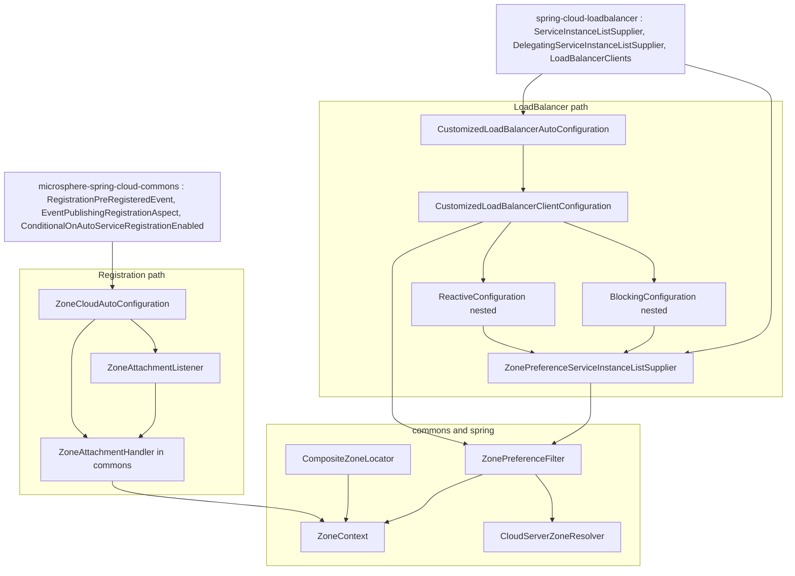
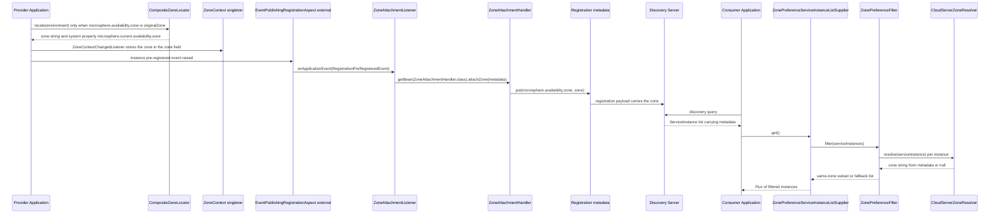
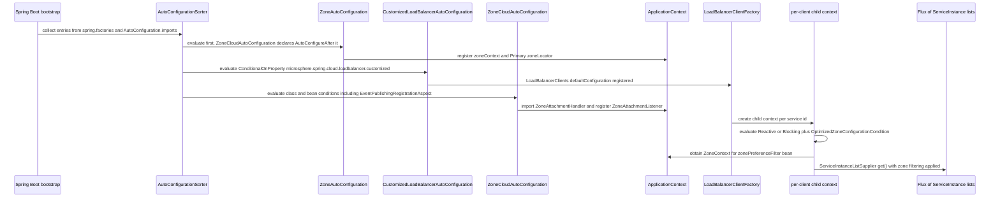

English version: [English](../microsphere-multiactive-spring-cloud.md)

# `microsphere-multiactive-spring-cloud` — 开发者指南

Maven 坐标：`io.github.microsphere-projects:microsphere-multiactive-spring-cloud:${revision}` ——
在本分支上是 `0.1.14-SNAPSHOT`。

---

## 概览

`microsphere-multiactive-spring-cloud` 是内核与真实微服务拓扑相遇之处。它贡献两个相互独立、可分别开关的特性：

1. **注册侧的区域附着** —— `ZoneCloudAutoConfiguration` + `ZoneAttachmentListener` 在实例注册前夕把区域写入
   `Registration.getMetadata()`，从而每个对端之后都能读到它。
2. **负载均衡侧的区域过滤** —— `CustomizedLoadBalancerAutoConfiguration` +
   `CustomizedLoadBalancerClientConfiguration` + `ZonePreferenceServiceInstanceListSupplier`
   安装一个 `ServiceInstanceListSupplier` 装饰器，把 `ZonePreferenceFilter` 应用到发现到的实例列表上。

外加一个共享辅助类：`CloudServerZoneResolver`，即过滤路径与 Netflix `DiscoveryClientServer` 适配器共用的
`ZoneResolver<ServiceInstance>`。

| 类型 | 文件 |
|------|------|
| `CloudServerZoneResolver` | `microsphere-multiactive-spring-cloud/src/main/java/io/microsphere/multiple/active/zone/spring/cloud/CloudServerZoneResolver.java` |
| `ZoneCloudAutoConfiguration` | `microsphere-multiactive-spring-cloud/src/main/java/io/microsphere/multiple/active/zone/spring/cloud/autoconfigure/ZoneCloudAutoConfiguration.java` |
| `ZoneAttachmentListener` | `microsphere-multiactive-spring-cloud/src/main/java/io/microsphere/multiple/active/zone/spring/cloud/event/ZoneAttachmentListener.java` |
| `CustomizedLoadBalancerAutoConfiguration` | `microsphere-multiactive-spring-cloud/src/main/java/io/microsphere/multiple/active/zone/spring/cloud/loadbalancer/CustomizedLoadBalancerAutoConfiguration.java` |
| `CustomizedLoadBalancerClientConfiguration` | `microsphere-multiactive-spring-cloud/src/main/java/io/microsphere/multiple/active/zone/spring/cloud/loadbalancer/CustomizedLoadBalancerClientConfiguration.java` |
| `ZonePreferenceServiceInstanceListSupplier` | `microsphere-multiactive-spring-cloud/src/main/java/io/microsphere/multiple/active/zone/spring/cloud/loadbalancer/ZonePreferenceServiceInstanceListSupplier.java` |

资源：

- `microsphere-multiactive-spring-cloud/src/main/resources/META-INF/spring.factories` —— **两个**自动配置条目，
  `ZoneCloudAutoConfiguration` 与 `CustomizedLoadBalancerAutoConfiguration`。
- `microsphere-multiactive-spring-cloud/src/main/resources/META-INF/spring/org.springframework.boot.autoconfigure.AutoConfiguration.imports`
  —— 为 Spring Boot 2.7+/3.x 提供同样的两个类。
- `microsphere-multiactive-spring-cloud/src/main/resources/META-INF/config/default/features.yaml` ——
  供 Microsphere Spring Cloud 特性注册表使用的特性元数据（见下文）。

注意 `1.x` 布局**没有独立的 `microsphere-multiactive-spring-cloud-loadbalancer` 模块**：LoadBalancer 类位于本模块内部，
尽管项目 BOM 宣称了那个 artifact id。

---

## 架构设计

### 分层



两条路径刻意互不引用：注册路径不需要 LoadBalancer，而即使应用从不注册自己，LoadBalancer 路径也能工作。

### 本线中区域跨 HTTP/RPC 的传播

区域**仅作为实例元数据**跨网络传输。本分支没有 header、没有 `ThreadLocal`、也没有按调用的区域；
消费者看到的是提供者在注册时发布的区域。



只有代码才能给出的两点澄清：

- 被附着的区域是 `ZoneContext.getZone()` —— 即**有效**值。它的填充要么直接来自
  `microsphere.availability.zone` 属性，要么在该属性持有 `originalZone` 哨兵时来自惰性的 `ZoneLocator` 链。
  本分支在附着过程中不会去 `microsphere.current.availability.zone` 系统属性里读发现值。
- 写入键（`ZoneAttachmentHandler` → `ZoneConstants.ZONE_PROPERTY_NAME`）与读取键
  （`CloudServerZoneResolver` → 同一个常量）是同一个，因此提供者与消费者之间的元数据契约就是 commons 中的一个常量。

---

## 源码分析

### `CloudServerZoneResolver`

```java
public class CloudServerZoneResolver implements ZoneResolver<ServiceInstance> {

    public static final CloudServerZoneResolver INSTANCE = new CloudServerZoneResolver();

    @Override
    public String resolve(ServiceInstance serviceInstance) {
        Map<String, String> instanceMetadata = serviceInstance.getMetadata();
        if (instanceMetadata != null) {
            return instanceMetadata.get(ZONE_PROPERTY_NAME);
        }
        return null;
    }
}
```

- 它是**闭合由 `ZoneAttachmentHandler` 开启的回路的那个读取者**：同一个
  `ZoneConstants.ZONE_PROPERTY_NAME`（`microsphere.availability.zone`）被写入实例元数据，也被从中读回。
- 契约：元数据缺失或键不存在时返回 `null` —— `ZonePreferenceFilter` 会把它计入“上游区域就绪百分比”，
  而不是当作一次不匹配。
- 提供了 public 静态 `INSTANCE` 字段以便无状态复用，但它也有 public 构造函数，因此
  `CustomizedLoadBalancerClientConfiguration` 调用 `new CloudServerZoneResolver()` 是合法的（代码也正是这么做的）。
  注意 `serviceInstance` 本身**没有**做空值保护 —— 传 `null` 会抛异常，
  这与 Netflix 模块中更具防御性的 `EurekaInstanceInfoZoneResolver` 不同。

### `ZoneCloudAutoConfiguration`

```java
@Configuration(proxyBeanMethods = false)
@ConditionalOnAvailabilityZoneAvailable
@ConditionalOnAutoServiceRegistrationEnabled
@ConditionalOnClass(name = {
        "org.aspectj.lang.annotation.Aspect",
        "io.microsphere.spring.cloud.client.service.registry.event.RegistrationPreRegisteredEvent",
        REGISTRATION_CLASS_NAME
})
@ConditionalOnBean(ZoneContext.class)
@AutoConfigureAfter(
        value = {ZoneAutoConfiguration.class},
        name = {
                "org.springframework.cloud.netflix.eureka.EurekaClientAutoConfiguration",
                "io.microsphere.spring.cloud.client.service.registry.autoconfigure.ServiceRegistryAutoConfiguration"
        })
@Import(value = {ZoneAttachmentHandler.class})
public class ZoneCloudAutoConfiguration {

    @Bean
    @ConditionalOnBean(type = "io.microsphere.spring.cloud.client.service.registry.aspect.EventPublishingRegistrationAspect")
    @ConditionalOnMissingBean
    public ZoneAttachmentListener zoneAttachmentListener() {
        return new ZoneAttachmentListener();
    }
}
```

每个条件都把特性再收窄一层，而收窄的顺序对排障很重要：

| 条件 | 效果 |
|-----------|--------|
| `@ConditionalOnAvailabilityZoneAvailable` | 继承自 Spring Boot 模块：需要 `ZoneContext` + `ZoneLocator` 类**且** `microsphere.availability.zone.enabled` 不为 `false` |
| `@ConditionalOnAutoServiceRegistrationEnabled` | 来自 `microsphere-spring-cloud-commons` 的外部注解；把特性绑定到服务注册中心的自动注册开启 |
| `@ConditionalOnClass(name = {…})` | 字符串形式，因此即使没有 AspectJ 或 Microsphere 注册 API 该类也能加载；需要 AspectJ API、`RegistrationPreRegisteredEvent` 和 `REGISTRATION_CLASS_NAME` 常量（值定义在外部 `ServiceRegistryConstants` 中，不在本快照内） |
| `@ConditionalOnBean(ZoneContext.class)` | 要求 `ZoneAutoConfiguration` 贡献的 `zoneContext` bean，即它无法独立工作 |
| `@AutoConfigureAfter(value = …, name = …)` | 在 `ZoneAutoConfiguration` 之后（类型安全）以及在 Eureka client / Microsphere 服务注册配置之后（字符串形式，因此允许缺失） |
| bean 方法上的 `@ConditionalOnBean(type = "…EventPublishingRegistrationAspect")` | 只有当确实有东西发布 `RegistrationPreRegisteredEvent` 时监听器才存在 |

`@Import(ZoneAttachmentHandler.class)` 值得特别注意：`ZoneAttachmentHandler` 是一个普通的 commons 类，
只有一个接收 `ZoneContext` 的构造函数。Spring 对非 `@Configuration` 类的 `@Import` 会注册一个按那唯一构造函数自动装配的
bean 定义，因此被导入的 handler 会收到 `zoneContext` bean。类上的 `@ConditionalOnBean(ZoneContext.class)`
正是使那次注入安全的前提。这也是整个构建中唯一声明 `ZoneAttachmentHandler` bean 的地方 ——
Netflix 模块期望被注入一个，因此 Eureka 路径隐式依赖本模块的自动配置处于激活状态。

各处都使用**字符串形式**的 `@ConditionalOnClass` / `@ConditionalOnBean(type = …)` 是一个刻意的可移植性选择：
一个 artifact 覆盖 Hoxton（Netflix 栈在场）到 2021（仅 LoadBalancer）。

### `ZoneAttachmentListener`

```java
public class ZoneAttachmentListener implements ApplicationListener<RegistrationPreRegisteredEvent>, ApplicationContextAware {

    @Override
    public void onApplicationEvent(RegistrationPreRegisteredEvent event) {
        Registration registration = event.getRegistration();
        Map<String, String> metadata = registration.getMetadata();
        ZoneAttachmentHandler zoneAttachmentHandler = applicationContext.getBean(ZoneAttachmentHandler.class);
        zoneAttachmentHandler.attachZone(metadata);
    }
}
```

- 泛型事件类型意味着由 Spring 基于 `ResolvableType` 的过滤决定该方法是否会被调用 —— 不匹配的事件根本到不了
  `onApplicationEvent`。
- handler 是**按事件**从 `ApplicationContext` 查找的，而不是构造函数注入。这使得监听器极易构造
  （`new ZoneAttachmentListener()`），但代价是每次注册都要做一次 bean 查找，并且这意味着缺失的
  `ZoneAttachmentHandler` bean 会在*事件发生时*而非启动时暴露为 `NoSuchBeanDefinitionException`。
- 实现的参数类型是来自 `microsphere-spring-cloud-commons` 的 `RegistrationPreRegisteredEvent`；
  但类 Javadoc 却链接到 Spring Cloud 自身的 `InstancePreRegisteredEvent`
  （“A listener for the `InstancePreRegisteredEvent` instance pre-registered event”）。该引用已过时 ——
  Spring Cloud 的那个事件只是被 import 进来，从未被处理。Eureka 原生的注册路径由 Netflix 模块覆盖。

### `CustomizedLoadBalancerAutoConfiguration`

```java
@Configuration(proxyBeanMethods = false)
@ConditionalOnProperty(value = "microsphere.spring.cloud.loadbalancer.customized", havingValue = "true")
@ConditionalOnClass(name = {
        "org.springframework.cloud.loadbalancer.annotation.LoadBalancerClient"
})
@LoadBalancerClients(defaultConfiguration = CustomizedLoadBalancerClientConfiguration.class)
public class CustomizedLoadBalancerAutoConfiguration {
}
```

- **空方法体是设计使然** —— 唯一的工作是 `@LoadBalancerClients` 注解，它把
  `CustomizedLoadBalancerClientConfiguration` 注册为每个 LoadBalancer client 的*默认*配置，
  从而把它装进每个 client 的子上下文。
- `@ConditionalOnProperty` 带 `havingValue = "true"` 且**没有** `matchIfMissing`，因此该特性**默认关闭**，
  必须用 `microsphere.spring.cloud.loadbalancer.customized=true` 显式启用。注意该属性*不*位于其他各处使用的
  `microsphere.availability.zone.` 前缀之下，且它的名字是硬编码字面量而非取自 `ZoneConstants`。
- 与 `ZoneCloudAutoConfiguration` 不同，本配置**不**受 `@ConditionalOnAvailabilityZoneAvailable` 门控：
  禁用 `microsphere.availability.zone.enabled` 并不会移除这个定制 supplier。届时阻止过滤的是过滤器内部的
  `ZoneContext.isEnabled()`，而不是 bean 注册。
- 类级 Javadoc 署名 `Walklown`，而模块其余部分署名 `Mercy Ma` —— 本文件与 commons 中的 `HttpUtils`
  是来自另一位作者的两大贡献。

### `CustomizedLoadBalancerClientConfiguration`

```java
@Configuration(proxyBeanMethods = false)
public class CustomizedLoadBalancerClientConfiguration {

    @ConditionalOnReactiveDiscoveryEnabled
    @Order(193827465)
    static class ReactiveConfiguration {

        @Bean
        @ConditionalOnBean(DiscoveryClient.class)
        @ConditionalOnMissingBean
        @Conditional(OptimizedZoneConfigurationCondition.class)
        public ServiceInstanceListSupplier optimizedZonePreferenceDiscoveryClientServiceInstanceListSupplier(
                ConfigurableApplicationContext context, ZonePreferenceFilter<ServiceInstance> zonePreferenceFilter) {
            return ServiceInstanceListSupplier.builder().withDiscoveryClient().withCaching()
                    .with((ctx, delegate) ->
                            new ZonePreferenceServiceInstanceListSupplier(delegate, zonePreferenceFilter))
                    .build(context);
        }
    }

    @ConditionalOnBlockingDiscoveryEnabled
    @Order(193827466)
    static class BlockingConfiguration { /* same shape, withBlockingDiscoveryClient() */ }

    @Bean
    public ZonePreferenceFilter<ServiceInstance> zonePreferenceFilter(ZoneContext zoneContext) {
        return new ZonePreferenceFilter<ServiceInstance>(zoneContext, new CloudServerZoneResolver());
    }

    static class OptimizedZoneConfigurationCondition implements Condition {

        @Override
        public boolean matches(ConditionContext context, AnnotatedTypeMetadata metadata) {
            return LoadBalancerEnvironmentPropertyUtils.equalToForClientOrDefault(context.getEnvironment(),
                    "configurations", "optimized-zone-preference");
        }
    }
}
```

维护者需要知道的要点：

- **类本身不带任何条件。** 因此只要用到本配置，`zonePreferenceFilter(...)` 就会被注册 ——
  包括用户直接从 `@LoadBalancerClient(...)` 引用它、而非经由
  `microsphere.spring.cloud.loadbalancer.customized` 开关的场景。由于它是一个 *LoadBalancer 子上下文*配置，
  `ZonePreferenceFilter` 实例是**每个 client 一个**，而它们全部共享同一个 JVM 级 `ZoneContext`。
- **supplier 链是用 Spring Cloud 的 builder 构建的**：由 discovery-client 支撑的实例 → 缓存装饰器 →
  经由通用 `.with((ctx, delegate) -> …)` 钩子追加的 `ZonePreferenceServiceInstanceListSupplier` 装饰器。
  缓存被刻意放在区域过滤器的**下方**，即缓存的是原始列表，而区域过滤在每次 `get()` 上重新应用 ——
  这是一个设计决策，使重新配置生效而无需让缓存失效。
- **两个互斥变体**（`ReactiveConfiguration` / `BlockingConfiguration`）由
  `@ConditionalOnReactiveDiscoveryEnabled` / `@ConditionalOnBlockingDiscoveryEnabled` 选取，
  带连续的 `@Order` 值 `193827465` 与 `193827466`。它们的绝对量级是本文件的一个局部事实；
  它们如何与 Spring Cloud 自身 `LoadBalancerClientConfiguration` 的嵌套 order 交错，无法从本快照核实。
- **在全局 opt-in 之上再加 per-client opt-in**：`OptimizedZoneConfigurationCondition` 委托给外部
  `LoadBalancerEnvironmentPropertyUtils.equalToForClientOrDefault(environment, "configurations", "optimized-zone-preference")`，
  即该 supplier 只对 `configurations` 值等于 `optimized-zone-preference`（client 专属或 `default`）的 client 出现。
  确切的组合属性键由那个外部工具类产生。
- 两个变体都额外要求一个 `DiscoveryClient` bean，并对任何已存在的 `ServiceInstanceListSupplier` 退让
  （`@ConditionalOnMissingBean` 针对 `ServiceInstanceListSupplier` 返回类型）。
- 尽管存在 `INSTANCE` 常量，代码用的却是 `new CloudServerZoneResolver()` —— 行为上等价（无状态），
  但若你日后要让 resolver 变成有状态，这一点值得知晓。
- 两个变体的 bean 方法名不同
  （`optimizedZonePreferenceDiscoveryClientServiceInstanceListSupplier` vs
  `optimizedZonePreferenceServiceInstanceListSupplier`），
  因此理论上若 reactive/blocking 条件同时满足，两者可以共存。

### `ZonePreferenceServiceInstanceListSupplier`

```java
public class ZonePreferenceServiceInstanceListSupplier extends DelegatingServiceInstanceListSupplier {

    private final ZonePreferenceFilter<ServiceInstance> zonePreferenceFilter;

    public ZonePreferenceServiceInstanceListSupplier(ServiceInstanceListSupplier delegate,
                                                     ZonePreferenceFilter<ServiceInstance> zonePreferenceFilter) {
        super(delegate);
        this.zonePreferenceFilter = zonePreferenceFilter;
    }

    @Override
    public Flux<List<ServiceInstance>> get() {
        return getDelegate().get().map(this::filteredByZone);
    }

    private List<ServiceInstance> filteredByZone(List<ServiceInstance> serviceInstances) {
        return zonePreferenceFilter.filter(serviceInstances);
    }
}
```

- 一个**薄的响应式装饰器**：`Flux.map` 把同步的 commons 过滤器应用到每个发出的列表上。没有额外订阅，
  没有调度器切换，没有错误处理 —— 过滤器抛出的任何异常都会作为 Flux 错误传播，
  这正是 commons 过滤器被写成永不抛异常、并优先返回兜底列表的原因。
- 只覆盖了 `get()`。该类**不**实现 `ServiceInstanceListSupplier#getServiceInstances()` 风格的“hint”感知方法，
  也没有 `zone` 感知变体；委托方所报告的区域始终是委托方自己的事。本类也不继承 Spring Cloud 自身的
  `org.springframework.cloud.loadbalancer.core.ZonePreferenceServiceInstanceListSupplier` ——
  它是一个委托给共享算法的独立重实现，仅在 Javadoc 中被提及。
- Javadoc 的 `@since` 标签格式错误
  （`@since org.springframework.cloud.loadbalancer.core.ZonePreferenceServiceInstanceListSupplier`）；
  本应写的 `@see` 目标被写进了错误的标签。同类缺陷也出现在 Netflix 模块（`@since ZoneResolver`、
  `@since DiscoveryClient`）。

### 特性元数据：`META-INF/config/default/features.yaml`

```yaml
microsphere:
  spring:
    cloud:
      features:
        named:
          microsphere-multiactive-commons:
            - io.microsphere.multiple.active.zone.ZoneAttachmentHandler
            - io.microsphere.multiple.active.zone.ZoneContext
            - io.microsphere.multiple.active.zone.ZonePreferenceFilter
            - io.microsphere.multiple.active.zone.ZoneResolver
          microsphere-multiactive-spring:
            - io.microsphere.multiple.active.zone.spring.ZoneLocator
            - io.microsphere.multiple.active.zone.spring.event.ZoneContextChangedListener
          microsphere-multiactive-spring-cloud:
            - WebEndpointApplicationContextInitializer=io.microsphere.spring.cloud.gateway.server.webmvc.context.WebEndpointApplicationContextInitializer
```

- 该文件为 Microsphere Spring Cloud 特性机制注册“具名特性 → 类”的分组（六个 commons 类型中列了四个；
  `ZoneConstants` 与 `HttpUtils` 未列出）。它的消费发生在本仓库之外，因此**在此无法核实**。
- 第三个分组没有列出本模块的任何类。它反而携带一个 `key=value` 条目，指向
  `…gateway.server.webmvc.context.WebEndpointApplicationContextInitializer`，
  它既不属于本模块也不属于任何区域相关代码 —— 这是复制某份网关特性描述符留下的痕迹。
  Netflix 模块随附一个形状相同的文件，其中列出的确实与它自己的类相符，因此该异常仅限本条目。
  请把它当作可疑项，而非成文行为。

### Spring Cloud 集成生命周期



---

## 实际存在的设计模式

| 模式 | 本快照中的证据 |
|---------|---------------------------|
| **装饰器** | `ZonePreferenceServiceInstanceListSupplier extends DelegatingServiceInstanceListSupplier`，用 `Flux.map` 包装 `getDelegate().get()` |
| **由 builder 构建的装饰器链** | `ServiceInstanceListSupplier.builder().withDiscoveryClient().withCaching().with(...).build(context)` |
| **组合 + 策略** | `ZonePreferenceFilter`（算法）由 `CloudServerZoneResolver`（策略）与 `ZoneContext`（策略参数）参数化 |
| **事件驱动监听器** | `ApplicationListener<RegistrationPreRegisteredEvent>` 触发元数据改写 |
| **带分层条件的自动配置** | `ZoneCloudAutoConfiguration`：类条件 + bean 条件 + `@AutoConfigureAfter` + 特性开关注解 |
| **静态单例持有** | `CloudServerZoneResolver.INSTANCE` |
| **服务定位器** | `ZoneAttachmentListener` 在事件发生时调用 `applicationContext.getBean(ZoneAttachmentHandler.class)` 而非注入 |
| **自定义 `Condition`** | `OptimizedZoneConfigurationCondition implements Condition`，按 LoadBalancer client 环境求值 |
| **嵌套条件配置变体** | `ReactiveConfiguration` / `BlockingConfiguration` 静态嵌套 `@Configuration` 类，带 `@Order` |
| **安装为默认子上下文配置** | `@LoadBalancerClients(defaultConfiguration = CustomizedLoadBalancerClientConfiguration.class)`，自动配置方法体除此之外为空 |

不存在：没有针对 `ZoneResolver` 的 `spring.factories` SPI，没有 `@ConfigurationProperties` 绑定类，
没有 actuator 端点，没有基于 `ThreadLocal` 的请求区域传播，也没有 Servlet 那种过滤器链。

---

## 扩展点

1. **过滤一个非 Spring-Cloud 的列表** —— 自己构造 `new ZonePreferenceFilter<>(zoneContext, yourResolver)`；
   本模块对该算法的唯一贡献是 `ServiceInstance` resolver 和 LoadBalancer 适配器。
2. **添加另一个 supplier 变体** —— 通过 `@LoadBalancerClient(name = "…", configuration = …)`
   扩展 `CustomizedLoadBalancerClientConfiguration` 的用法；filter bean 在该子配置内无条件创建，
   因此你的 supplier 可以直接注入 `ZonePreferenceFilter<ServiceInstance>`。
3. **为另一个注册 API 发布区域** —— 在注册中心自身的预注册事件上实现另一个监听器，
   并委托给共享的 `ZoneAttachmentHandler` bean，正如 Netflix 模块用
   `ZoneAttachmentPreRegistrationHandler` 所做的那样。
4. **改用不同的元数据键** —— 写入方（`ZoneAttachmentHandler`）与读取方（`CloudServerZoneResolver`）
   都使用 `ZoneConstants.ZONE_PROPERTY_NAME`；要改就得改 commons 里的那个常量，因为本模块中不出现任何键字面量。

---

## 构建与测试

`microsphere-multiactive-spring-cloud/pom.xml` —— parent 为 `microsphere-multiactive-parent`，打包 `jar`，无插件，无 profile。

| 依赖 | 作用域 | 说明 |
|------------|-------|-------|
| `microsphere-multiactive-spring-boot`（`${revision}`） | compile（必需） | 传递引入 `spring` 与 `commons` |
| `microsphere-spring-cloud-commons` | optional | `RegistrationPreRegisteredEvent`、`EventPublishingRegistrationAspect`、`ConditionalOnAutoServiceRegistrationEnabled`、`ServiceRegistryConstants`、`InMemoryServiceRegistry`（测试） |
| `spring-boot-starter`、`-actuator`、`-web` | optional | `spring-boot-starter-web` 正是引入 servlet/Reactor 相关 Boot web 类型的那个 |
| `spring-boot-configuration-processor`、`spring-boot-autoconfigure-processor`、`microsphere-annotation-processor` | optional | 编译期处理 |
| `spring-cloud-commons`、`spring-cloud-context` | optional | `ServiceInstance`、`DiscoveryClient`、`Registration`、`EnvironmentChangeEvent` |
| `spring-cloud-loadbalancer` | optional | `ServiceInstanceListSupplier`、`DelegatingServiceInstanceListSupplier`、`LoadBalancerClients`、`LoadBalancerEnvironmentPropertyUtils`（Reactor `Flux` 经它传递到达） |
| `spring-boot-starter-test`、`microsphere-spring-boot-test`、`junit-jupiter`、`logback-classic` | test | 测试支撑 |

所有面向 Spring Cloud 的依赖都是 optional，因此这一个 jar 跨越 Hoxton → 2021；代价是构建无法在没有外部 profile
的情况下保证与任何一个 Spring Cloud 版本的编译兼容性。

测试（2 个类）：

- `ZoneCloudAutoConfigurationTest extends AutoConfigurationTest<ZoneCloudAutoConfiguration>` 声明自动配置足迹
  `{ZoneAttachmentHandler, ZoneAttachmentListener}`、两个全局禁用值
  （`microsphere.availability.zone.enabled=false`、`spring.cloud.service-registry.auto-registration.enabled=false`）
  以及四个全局缺失类（`ZoneLocator`、`Aspect`、`RegistrationPreRegisteredEvent`、`Registration`）。
  它启动一个以 `ZoneContext` 与 `EventPublishingRegistrationAspect` 类播种的 `@SpringBootTest` 上下文。
- `ZoneCloudAutoConfigurationIntegrationTest` 是一个真实的 `@SpringBootTest`，带
  `properties = {"server.port=8080", "spring.application.name=test-service", "microsphere.spring.cloud.service-registry.auto-registration.simple.enabled=true"}`
  和 `@EnableAutoConfiguration`；它 `@Autowired` 了 `Registration`、`ServiceRegistry<Registration>`、`ZoneContext`、
  `CompositeZoneLocator`、`ZoneAttachmentHandler` 和 `ZoneAttachmentListener`，并断言 `zoneContext` 非空。
  它是整个构建中唯一证明整条注册链能够装配起来的测试。**没有任何断言验证元数据确实收到了区域**，
  而且**没有测试触及 LoadBalancer 一侧**。

```bash
./mvnw -pl microsphere-multiactive-spring-cloud -am test
```

---

## 与 `0.2.x` / 当前线的差异

从本快照可见：

- LoadBalancer 支持打包在 `microsphere-multiactive-spring-cloud` 内部；项目 BOM 仍然管理了一个本分支并不构建的
  独立 `microsphere-multiactive-spring-cloud-loadbalancer` artifact id。
- LoadBalancer 特性由 `microsphere.spring.cloud.loadbalancer.customized=true` 守卫（无 `matchIfMissing`），
  该属性位于 `microsphere.availability.zone.*` 命名空间之外，并且**不**受
  `@ConditionalOnAvailabilityZoneAvailable` 门控。
- 区域附着监听的是 Microsphere 的 `RegistrationPreRegisteredEvent`
  （Eureka 原生附着被委托给独立的 Netflix 模块，通过 `PreRegistrationHandler`）。
- `ZonePreferenceFilter` bean 创建在 Spring Cloud 的 **per-client 子上下文**中，每个 client 一个，
  全部共享 JVM 级的 `ZoneContext`。
- 两个自动配置类都同时提供了 `spring.factories` 与 `AutoConfiguration.imports`。

---

## 相关

- [开发者指南索引](README.md)
- [microsphere-multiactive-commons](microsphere-multiactive-commons.md) —— `ZonePreferenceFilter`、`ZoneAttachmentHandler`、`ZoneResolver`
- [microsphere-multiactive-spring-boot](microsphere-multiactive-spring-boot.md) —— 本模块在其之后运行的 `ZoneAutoConfiguration`
- [microsphere-multiactive-netflix](microsphere-multiactive-netflix.md) —— 这些适配器的 Eureka/Ribbon 对应物
- [microsphere-multiactive-spring-cloud 用户指南](../../user-guide/zh/microsphere-multiactive-spring-cloud.md)
- [用户指南索引](../../user-guide/zh/README.md)
- [仓库 README](../../../../README.md)

## English

English version: [English](../microsphere-multiactive-spring-cloud.md)
