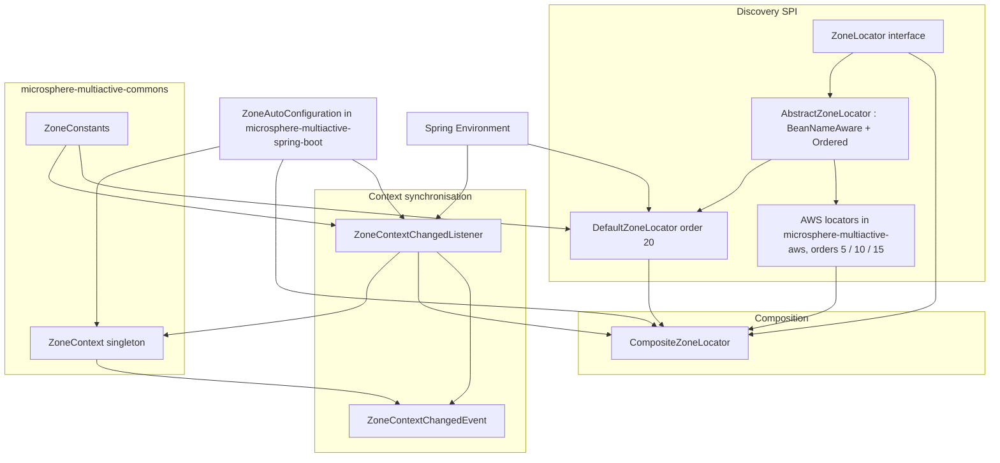
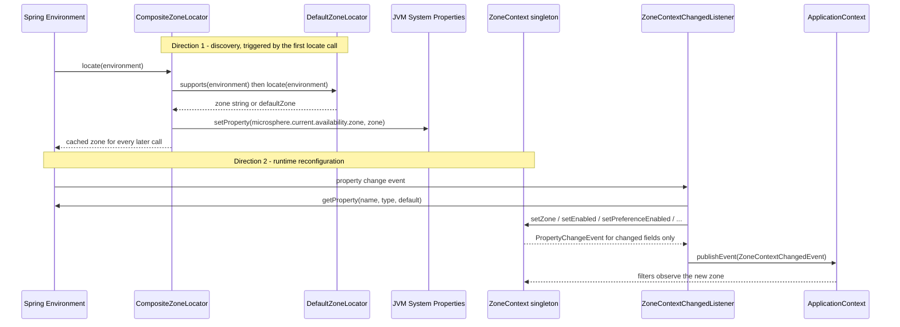
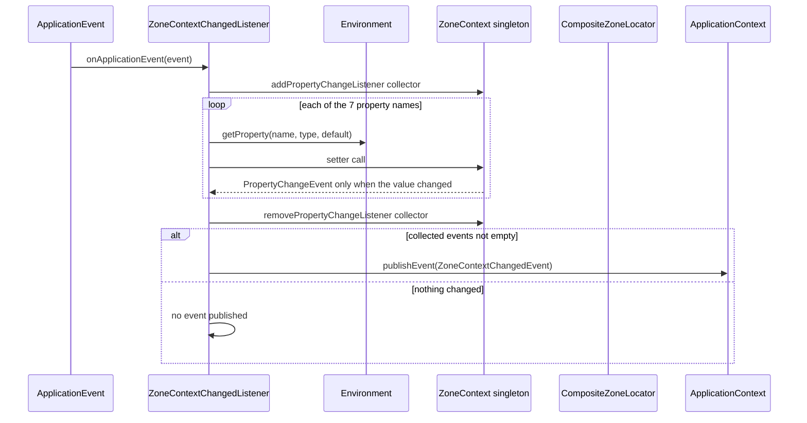
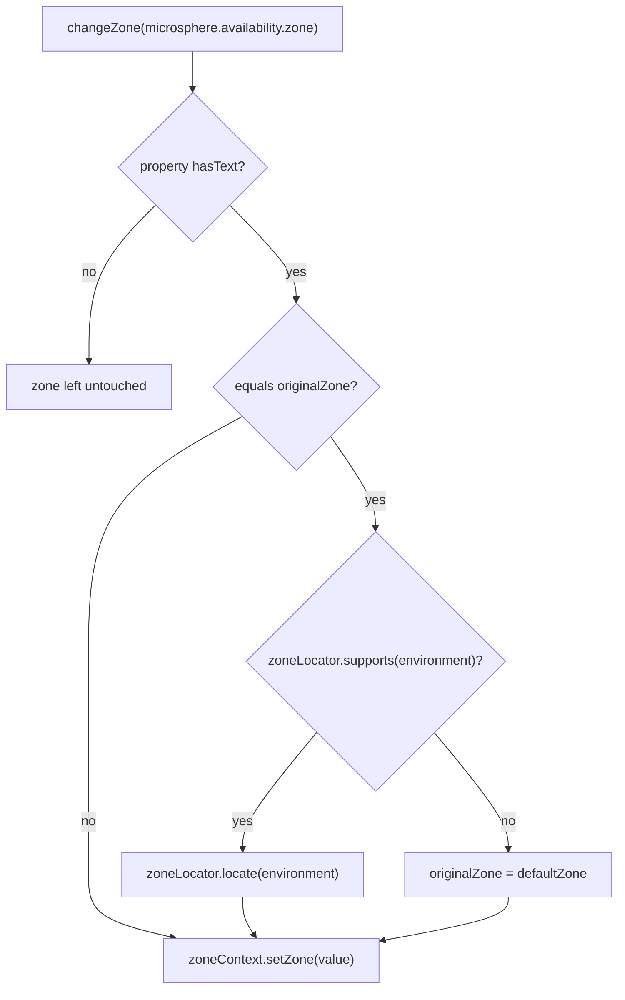

English version: [English](../microsphere-multiactive-spring.md)

# `microsphere-multiactive-spring` — 开发者指南

Maven 坐标：`io.github.microsphere-projects:microsphere-multiactive-spring:${revision}` —— 在本分支上是
`0.1.14-SNAPSHOT`。

---

## 概览

`microsphere-multiactive-spring` 是 Spring Framework 层。它拥有两样东西：

1. **`ZoneLocator` SPI** 及其组合逻辑 —— 一个进程如何发现它自身的可用区；
2. **`ZoneContextChangedListener`** —— Spring `Environment` 的属性如何被推入
   `microsphere-multiactive-commons` 的单例，以及随后如何发出 `ZoneContextChangedEvent`。

它不添加任何自动配置，也**完全没有 `src/main/resources`** —— 已核实：该模块只包含七个 Java 文件，别无其他。
它贡献的一切都必须显式注册（由 Spring Boot 模块注册，或在纯 Spring 应用中手工注册）。

包：

| 包 | 类型 | 职责 |
|---------|-------|----------------|
| `io.microsphere.multiple.active.zone.spring` | `ZoneLocator`、`AbstractZoneLocator`、`DefaultZoneLocator`、`CompositeZoneLocator`、`ZoneUtils` | 区域发现 |
| `io.microsphere.multiple.active.zone.spring.event` | `ZoneContextChangedEvent`、`ZoneContextChangedListener` | 属性 → 上下文同步、事件发布 |

---

## 架构设计

### 分层



职责切分清晰：`CompositeZoneLocator` 只*读*（发现），`ZoneContextChangedListener` 只*写*（写入 `ZoneContext`），
两者仅通过监听器所持有的那个 `ZoneLocator` bean 引用相遇。

### 区域上下文传播：两个方向

在这一线上，区域沿两个不同方向移动，两个模块各占其一：



**被发现**的区域存放在系统属性中（`microsphere.current.availability.zone`，可通过
`ZoneContext.getCurrentZone()` 读取）；过滤器使用的**有效**区域存放在 `ZoneContext.getZone()` 中。
把两者分开，正是 `"originalZone"` 回退特性能实现的前提。

**本线中没有任何东西急切地调用 `locate()`。** 在快照的每个 `src/main/java` 文件中搜索，
`ZoneLocator.locate(...)` 的生产调用点恰好只有两处：`CompositeZoneLocator` 内部（委托循环）与
`ZoneContextChangedListener.revertOriginalZone()` 内部。`ZoneAutoConfiguration` 只*构建*那个 composite，
从不调用它。因此这条 locator 链 —— 包括 AWS 的 HTTP 调用 —— **仅**在以下情况运行：

- `microsphere.availability.zone` 被设为哨兵值 `originalZone`（此时 `changeZone` 通过 locator 回退），或
- 应用代码自行获取 locator（如通过 `ZoneUtils.getZoneLocator(beanFactory)`）并自己调用 `locate(environment)`。

如果该属性保持不设，`ZoneContext.zone` 就保留其默认值 `"defaultZone"`，系统属性永不写入，
而 `ZonePreferenceFilter.isIgnored(...)` 会把所有过滤短路掉。

---

## 源码分析

### `ZoneLocator`

`microsphere-multiactive-spring/src/main/java/io/microsphere/multiple/active/zone/spring/ZoneLocator.java`

```java
public interface ZoneLocator {
    boolean supports(Environment environment);
    String locate(Environment environment);
}
```

维护者应留意的两点：

- `supports` 是“这个来源适用于我吗？”的谓词；`CompositeZoneLocator` 在每次 `locate` 之前调用它。
- 该接口**不**继承 `Ordered`，也没有 `getOrder()`。排序由抽象类提供，因此一个裸的 lambda 式实现
  （如 `CompositeZoneLocatorTest` 与 `ZoneContextChangedListenerTest` 中所用）是无序的，
  在 `AnnotationAwareOrderComparator` 下会被排到最后。
- 它同时充当 service-loader 的键：AWS 与 Spring Boot 模块中的 `META-INF/spring.factories`
  在*接口类名*下注册实现，由 `io.microsphere.spring.core.io.support.SpringFactoriesLoaderUtils.loadFactories` 消费。

### `AbstractZoneLocator`

`microsphere-multiactive-spring/src/main/java/io/microsphere/multiple/active/zone/spring/AbstractZoneLocator.java`

```java
public abstract class AbstractZoneLocator implements ZoneLocator, BeanNameAware, Ordered {
    protected final Logger logger = getLogger(getClass());
    protected String beanName;
    protected int order;

    public AbstractZoneLocator(int order) { setOrder(order); }

    @Override public final void setBeanName(String beanName) { this.beanName = beanName; }
    @Override public final int getOrder() { return order; }
    public final void setOrder(int order) { this.order = order; }
}
```

- `logger` 是 `protected final`，由 `getClass()` 创建，因此每个具体 locator 都以自己的名字记日志。
- `setBeanName`、`getOrder` 和 `setOrder` 是 `final`：子类不能改动排序契约；它们必须通过构造函数传入 order。
  `setOrder` 的存在是为了让 XML/Java 配置的 bean 定义能够重排一个 locator，`DefaultZoneLocatorTest#testSetOrder`
  钉住了这种可变性。
- `toString()` 是 `"ZoneLocator{beanName='...', order=...}"` —— 这个字符串正是出现在 `CompositeZoneLocator`
  日志中的内容，使按 locator 做日志定位变得直接。
- 构造函数**不是**无参的，因此每个子类都必须声明自己的默认构造函数并调用 `super(DEFAULT_ORDER)`；
  这就是该继承体系的模板契约。

### `DefaultZoneLocator`

`microsphere-multiactive-spring/src/main/java/io/microsphere/multiple/active/zone/spring/DefaultZoneLocator.java`

```java
public static final int DEFAULT_ORDER = 20;

@Override public boolean supports(Environment environment) { return true; }

@Override public String locate(Environment environment) {
    String zone = environment.getProperty(ZONE_PROPERTY_NAME);
    if (StringUtils.hasText(zone)) { ... return zone; }
    else { ... zone = DEFAULT_ZONE; }
    return zone;
}
```

- `supports` 无条件为 `true`，且 `locate` 从不返回 `null` —— 它返回 `"defaultZone"` 哨兵。
  由于 composite 停在**第一个非 null** 结果上，若没有任何平台 locator 先产出区域，
  `DefaultZoneLocator`（order 20，默认值最大）总是胜出。
- 两个推论，都在测试中核实：`testLocateWithoutZonePropertyFallsBackToDefault` 断言 `"defaultZone"`，
  随后 `CompositeZoneLocator` 把 `defaultZone` 写入系统属性；`ZonePreferenceFilter.isIgnored(...)`
  把 `"defaultZone"` 视为“忽略”，因此**一个只配置了 enabled 开关而未配置 zone 的应用不做任何同区域过滤** ——
  这正是预期的“除非你知道自己的区域否则不启用”的行为。
- 这个 locator 是**在 Spring Boot 模块中**通过 `META-INF/spring.factories` 注册的，而不是在此处。

### `CompositeZoneLocator`

`microsphere-multiactive-spring/src/main/java/io/microsphere/multiple/active/zone/spring/CompositeZoneLocator.java`

构造函数一次性规范化它的输入：

```java
public CompositeZoneLocator(List<ZoneLocator> zoneLocators) {
    Assert.notNull(zoneLocators, "The argument 'zoneLocators' must not be null!");
    this.zoneLocators = new ArrayList<>(zoneLocators);
    AnnotationAwareOrderComparator.sort(this.zoneLocators);
}
```

- `Assert.notNull` → `IllegalArgumentException`（由 `testConstructorWithNullThrows` 钉住）。
- 防御性拷贝：调用方的列表之后可以被改动而不影响 composite，且排序发生在副本上。
  `AnnotationAwareOrderComparator` 同时尊重 `Ordered`（来自 `AbstractZoneLocator`）与 `@Order` /
  `Ordered` 风格的注解，因此仅用注解的 locator 也能被正确排序。

`locate(Environment)` 是本模块中最具影响的方法：

```java
@Override
public String locate(Environment environment) {
    // return the located zone at the first time
    if (StringUtils.hasText(zone)) {
        return zone;
    }

    String zone = null;
    boolean fastFailEnabled = isFastFailEnabled(environment);
    ZoneLocator failedZoneLocator = null;

    for (ZoneLocator zoneLocator : zoneLocators) {
        try {
            if (zoneLocator.supports(environment)) {
                zone = zoneLocator.locate(environment);
                if (zone != null) {
                    logger.info("{} locates the zone : {}", zoneLocator, zone);
                    break;
                } else {
                    logger.warn("{} can't locate the zone", zoneLocator);
                    if (fastFailEnabled) {
                        failedZoneLocator = zoneLocator;
                        break;
                    }
                }
            } else {
                logger.trace("{} does not support to locate the zone", zoneLocator);
            }
        } catch (Throwable e) {
            logger.error("{} failed to locate the zone", zoneLocator, e);
            if (fastFailEnabled) {
                failedZoneLocator = zoneLocator;
                break;
            }
        }
    }

    if (failedZoneLocator != null) {
        throw new IllegalStateException("The zone can't be located by " + failedZoneLocator);
    }

    if (zone == null) {
        logger.warn("The zone can't be located by anyone of zoneLocators : {}", zoneLocators);
    }

    this.zone = zone;

    if (this.zone != null) {
        System.setProperty(CURRENT_ZONE_PROPERTY_NAME, this.zone);
    }

    return zone;
}
```

逐点语义，每一点都由 `CompositeZoneLocatorTest` 中的一个测试钉住：

| 行为 | 测试 |
|-----------|------|
| 第一个非 `null` 的 locator 胜出，后续的被跳过 | `testLocateWithFirstMatchingLocator` |
| 结果被缓存：第二次调用绝不重跑链 | `testLocateCachesResult` |
| 不支持的 locator 被静默跳过（trace 日志） | `testLocateSkipsUnsupportedLocators` |
| 全 `null` 的链返回 `null` 且仅告警 | `testLocateReturnsNullWhenNoneLocates` |
| locator 抛异常被吞掉且链继续（默认） | `testLocateWithExceptionNoFastFail` |
| `fast-fail=true` 把 `null` 变成硬失败 | `testLocateWithFastFailOnNullZone` |
| `fast-fail=true` 把异常变成硬失败 | `testLocateWithFastFailOnException` |
| 空的 locator 列表 → `supports` 为 false，`locate` 为 `null` | `testLocateWithEmptyLocatorList` |

维护者绝不能丢失的细节：

- **缓存靠的是 *hasText* 检查，而不是一个布尔标志。** `if (StringUtils.hasText(zone)) return zone;`
  意味着一次产出 `null` 的运行会在下次调用时重试 —— 链会被重新执行直到产生一个非空白值。
  这是刻意的（平台元数据在首次调用时可能尚未就绪），但也意味着 `locate` 不是纯读取。
- **fast-fail 在每次未缓存的调用时从 `Environment` 读取**，通过
  `isFastFailEnabled(environment)` → `getProperty(LOCATOR_FAST_FAIL_PROPERTY_NAME, boolean.class, DEFAULT_LOCATOR_FAST_FAIL)`。
- **`System.setProperty(CURRENT_ZONE_PROPERTY_NAME, …)` 是一个全局副作用**，
  每当解析出非 `null` 区域时都会执行 —— 包括 `"defaultZone"`。它正是 `ZoneContext.getCurrentZone()` 之后读取的值，
  并且本类从不清除它。对它做断言的测试必须清除它（如 `ZoneContextTest#tearDown` 所做）。
- 从 `locate` 抛出的 `IllegalStateException` 只携带该 locator 的 `toString()`；*失败* locator 的 cause 未被链接 ——
  它只存在于 error 日志中。
- `CompositeZoneLocator` 自身实现 `ZoneLocator` 但**不**继承 `AbstractZoneLocator`，因此它没有 order 也没有 bean name；
  `supports` 在任一委托支持时返回 `true`，且它自己的 `toString()` 会打印整个委托列表。

### `ZoneUtils`

`microsphere-multiactive-spring/src/main/java/io/microsphere/multiple/active/zone/spring/ZoneUtils.java`

```java
public static final String ZONE_CONTEXT_BEAN_NAME = "zoneContext";
public static final String ZONE_LOCATOR_BEAN_NAME = "zoneLocator";

private ZoneUtils() {}

public static ZoneContext getZoneContext(ConfigurableListableBeanFactory beanFactory) {
    return beanFactory.getBean(ZONE_CONTEXT_BEAN_NAME, ZoneContext.class);
}

public static ZoneLocator getZoneLocator(ConfigurableListableBeanFactory beanFactory) {
    return beanFactory.getBean(ZONE_LOCATOR_BEAN_NAME, ZoneLocator.class);
}
```

- 这些 bean 名是规范名：`ZoneAutoConfiguration` 用 `@Bean(name = ZONE_CONTEXT_BEAN_NAME)` /
  `@Bean(name = ZONE_LOCATOR_BEAN_NAME)` 声明它的 bean，测试也在相同常量下注册 bean。
- 抽象类加私有构造函数使其不可实例化；它还保留了一个**未被使用的 `logger` 字段**
  （`getLogger(ZoneUtils.class)`），没有任何方法引用它 —— 在本分支上是死代码。
- 一个值得注意的不对称：`ZoneContextChangedListener` 是**按类型**查找 bean
  （`context.getBean(ZoneContext.class)`、`context.getBean(ZoneLocator.class)`），
  而不是使用这些按名辅助方法。名字常量与按类型查找仅靠约定保持同步，
  因此若改 bean 名而未在 locator 上保留 `@Primary`，破坏的是监听器而非辅助方法。

### `ZoneContextChangedEvent`

`microsphere-multiactive-spring/src/main/java/io/microsphere/multiple/active/zone/spring/event/ZoneContextChangedEvent.java`

```java
public class ZoneContextChangedEvent extends ApplicationContextEvent {
    private final ZoneContext zoneContext;
    private final List<PropertyChangeEvent> propertyChangeEvents;

    public ZoneContextChangedEvent(ApplicationContext context, ZoneContext zoneContext, List<PropertyChangeEvent> propertyChangeEvents) {
        super(context);
        this.zoneContext = zoneContext;
        this.propertyChangeEvents = unmodifiableList(propertyChangeEvents);
    }
}
```

- 继承 `ApplicationContextEvent` 使 `getSource()` / `getApplicationContext()` 返回该上下文
  （由 `testGetSource` 断言）。
- `unmodifiableList(...)` 在构造函数中应用，因此这一批 `PropertyChangeEvent` 无法被监听器改动。
  注意它**不**拷贝 —— 它包装的仍是监听器持有的那个列表，这没问题，因为发布之后监听器不再触碰它。

### `ZoneContextChangedListener`

`microsphere-multiactive-spring/src/main/java/io/microsphere/multiple/active/zone/spring/event/ZoneContextChangedListener.java`

```java
public class ZoneContextChangedListener implements SmartApplicationListener, ApplicationContextAware, EnvironmentAware
```

**classpath 模式探测。** 三个 `static final` 布尔值在类初始化时由 `ClassLoaderUtils.resolveClass(...)`
的结果算出，当某个类缺失时该结果返回 `null`：

```java
private static final boolean IS_SPRING_CLOUD_APPLICATION = ENVIRONMENT_CHANGE_EVENT_CLASS != null && APPLICATION_STARTED_EVENT_CLASS != null;
private static final boolean IS_SPRING_BOOT_APPLICATION  = ENVIRONMENT_CHANGE_EVENT_CLASS == null && APPLICATION_STARTED_EVENT_CLASS != null;
```

因此 `supportsEventType` 有三个分支：

| 探测到的类 | 支持的事件类型 |
|------------------|----------------------|
| `EnvironmentChangeEvent` + `ApplicationStartedEvent` 都存在 | `EnvironmentChangeEvent` **或** `ApplicationStartedEvent` |
| 仅 `ApplicationStartedEvent` 存在 | `ApplicationStartedEvent` |
| 两者都不存在 | `ContextRefreshedEvent` |

两个类名都是硬编码字符串（`org.springframework.cloud.context.environment.EnvironmentChangeEvent`、
`org.springframework.boot.context.event.ApplicationStartedEvent`），因此本模块只需针对 `spring-context` 编译。
需要留意的边界：这些标志在首次类加载时就冻结（永不重新求值），一个*没有* `spring-cloud-context` 在 classpath 上的
Spring Boot 应用会按设计忽略 `EnvironmentChangeEvent`；第三种情形
`IS_SPRING_CLOUD_APPLICATION == false && IS_SPRING_BOOT_APPLICATION == false`
（即 `EnvironmentChangeEvent` 存在但 `ApplicationStartedEvent` 缺失）会落到 `ContextRefreshedEvent`。
本模块是一个 `SmartApplicationListener` 且没有覆盖 `getOrder()`，因此它以 `Ordered.LOWEST_PRECEDENCE` 运行。

**处理器表。** `ZONE_CONTEXT_PROPERTY_NAMES`（7 项，由 `testZonePropertyChangeListenerNames` 断言）与
`propertyChangedHandlers`（一个含 7 项的 `HashMap<String, Consumer<String>>`，由
`testPropertyChangedHandlersInitialized` 断言）在构造函数中通过 `initPropertyChangedHandlers()` 填充。
每个处理器把一个属性名映射到一个 `set…` 调用：

| 属性名 | 处理器 | `ZoneContext` setter |
|---------------|---------|----------------------|
| `microsphere.availability.zone` | `changeZone` | `setZone` |
| `microsphere.availability.zone.enabled` | `changeEnabled` | `setEnabled` |
| `microsphere.availability.zone.preference.enabled` | `changeZonePreferenceEnabled` | `setPreferenceEnabled` |
| `microsphere.availability.zone.preference.filter.order` | `changePreferenceFilterOrder` | `setPreferenceFilterOrder` |
| `microsphere.availability.zone.preference.upstream.zone-ready-percentage` | `changePreferenceUpstreamZoneReadyPercentage` | `setPreferenceUpstreamZoneReadyPercentage` |
| `microsphere.availability.zone.preference.upstream.same-zone-min-available` | `changePreferenceUpstreamSameZoneMinAvailable` | `setPreferenceUpstreamSameZoneMinAvailable` |
| `microsphere.availability.zone.preference.upstream.disabled-zone` | `changePreferenceUpstreamDisabledZone` | `setPreferenceUpstreamDisabledZone` |

两个集合都是 `protected`，且 `propertyChangedHandlers` 是一个可变实例字段：
`testChangeZoneContextWithUnknownPropertyNameSkipsNull` 在运行时移除一个条目以执行 `null`-处理器分支。
这就是成文的扩展接缝 —— 子类化（或配置）监听器可以增加或删除属性处理器。

**批量 + 观察者惯用法。** `changeZoneContext(...)` 通过临时挂上一个 `PropertyChangeListener`
来收集实际发生了什么变化：

```java
List<PropertyChangeEvent> propertyChangeEvents = new LinkedList<>();
PropertyChangeListener listener = propertyChangeEvents::add;
try {
    zoneContext.addPropertyChangeListener(listener);
    for (String propertyName : propertyNames) {
        Consumer<String> propertyChangedHandler = propertyChangedHandlers.get(propertyName);
        if (propertyChangedHandler != null) {
            propertyChangedHandler.accept(propertyName);
        }
    }
} finally {
    zoneContext.removePropertyChangeListener(listener);
}
boolean changed = !propertyChangeEvents.isEmpty();
if (changed) {
    publishZoneContextChangedEvent(propertyChangeEvents);
}
```

`onApplicationEvent(...)` 完全忽略它的参数，始终针对完整的 7 属性列表执行 `tryChangeZoneContext()`。
因此该监听器**不**使用 `EnvironmentChangeEvent` 提供的变化键集合 —— 每个事件都会重新应用每个属性。
所以属性的删除也被处理了：`getProperty(...)` 会回退到成文的默认值，并记录
“is not found or deleted, the default value … will be set”。

**`"originalZone"` 回退。** 唯一含真实逻辑的分支：

```java
private void changeZone(String propertyName) {
    String zone = getProperty(propertyName, ORIGINAL_ZONE);
    if (StringUtils.hasText(zone)) {
        if (ORIGINAL_ZONE.equalsIgnoreCase(zone)) {
            zone = revertOriginalZone();
        }
        zoneContext.setZone(zone);
    }
}

private String revertOriginalZone() {
    String originalZone = ZoneConstants.DEFAULT_ZONE;
    if (zoneLocator.supports(environment)) {
        originalZone = zoneLocator.locate(environment);
    } else {
        logger.warn("The zone can't be discovered by {}", zoneLocator);
    }
    ...
    return originalZone;
}
```

- 设置 `microsphere.availability.zone=originalZone`（不区分大小写）会通过注入的 `ZoneLocator` 重跑发现。
  `testRevertOriginalZoneWhenLocatorDoesNotSupport` 钉住了当 locator 报告 `supports == false` 时回退到 `"defaultZone"`。
- 设置 `microsphere.availability.zone=""` **什么都不做** —— `StringUtils.hasText("")` 为 `false`，
  当前区域得以保留（`testChangeZoneWithEmptyStringPropertyDoesNotChangeZone`）。本分支不支持清除一个区域；
  你只能覆盖它或回退它。
- 警惕它与缓存以及 `DefaultZoneLocator` 的两处相互作用：
  - `revertOriginalZone()` 调用 `zoneLocator.locate(environment)`，而如果该 locator 是
    `CompositeZoneLocator` 且其缓存字段已经填充，它会返回缓存值且**无法重新发现**。要发生重新发现，
      缓存值必须是空白的。
  - `DefaultZoneLocator.locate(...)` 读取 `microsphere.availability.zone` —— 恰恰是当前持有 `"originalZone"`
    的那个属性。`StringUtils.hasText("originalZone")` 为 `true`，因此若没有任何平台 locator 先返回区域，
    composite 会返回**字面字符串 `"originalZone"`**，缓存它、写入系统属性，而 `zoneContext.setZone("originalZone")`
    使它成为有效区域。`"originalZone"` 既不 `blank` 也不是 `defaultZone`，所以
    `ZonePreferenceFilter.isIgnored(...)` **不会**绕过过滤：过滤器随后会拿实体去和 `"originalZone"` 比对。
    唯一覆盖此情形的测试 `ZoneContextChangedListenerTest#testRevertOriginalZoneWhenZoneIsOriginal`
    在其注释中承认了这种歧义，并且只断言 `assertNotNull(zoneContext.getZone())`。

**Bean 装配。** `setApplicationContext` 按类型解析协作者，这依赖于 `ZoneAutoConfiguration` 安装的那个
`@Primary` composite locator：

```java
this.zoneContext = context.getBean(ZoneContext.class);
this.zoneLocator = context.getBean(ZoneLocator.class);
```

若存在多个非 `@Primary` 的 `ZoneLocator` bean，`getBean(ZoneLocator.class)` 会抛
`NoUniqueBeanDefinitionException` —— 这是本线添加自定义 locator bean 时的一个现实约束。





---

## 实际存在的设计模式

| 模式 | 本快照中的证据 |
|---------|---------------------------|
| **组合（Composite）** | `CompositeZoneLocator implements ZoneLocator`，委托给一个已排序的 `List<ZoneLocator>`，`supports` 语义为“任一委托支持” |
| **带短路的职责链** | `locate` 遍历 locator 并在第一个非 `null` 区域处 `break` |
| **策略 + 模板方法** | `AbstractZoneLocator` 固定了 `getOrder`/`setBeanName`/日志并要求 `super(order)`；子类提供 `supports`/`locate` |
| **观察者** | `SmartApplicationListener` 实现，外加围绕一批写入的临时 `PropertyChangeListener` 注册 |
| **带不可变载荷的事件对象** | `ZoneContextChangedEvent` 包装 `unmodifiableList(propertyChangeEvents)` |
| **命令表（处理器映射）** | `Map<String, Consumer<String>> propertyChangedHandlers`，形如 `this::changeZone` 的方法引用 |
| **空对象哨兵值** | `"defaultZone"`（忽略）与 `"originalZone"`（回退），同一属性的两个魔术字符串值 |
| **ServiceLoader 式 SPI** | AWS 与 Spring Boot 模块中以 `io.microsphere.multiple.active.zone.spring.ZoneLocator` 为键的 `META-INF/spring.factories` |
| **记忆化（Memoisation）** | `CompositeZoneLocator` 中的 `private volatile String zone` 缓存，由 `StringUtils.hasText` 把关 |

不存在：没有 `ThreadLocal`，没有 Servlet 那种过滤器链抽象（“链”指的是 locator 循环；
运行时过滤链是 commons 的 `ZonePreferenceFilter`），且本模块中没有 `@Configuration` 类 —— 自动配置位于 Spring Boot 模块。

---

## 扩展点

1. **添加一个 locator。** 继承 `AbstractZoneLocator`，选一个低于 `20` 的 order 使它在 `DefaultZoneLocator` 之前运行，
   并且要么把它注册为 Spring bean（Boot 模块收集 `Collection<ZoneLocator>`），要么把它的类名加到
   `META-INF/spring.factories` 中 `ZoneLocator` 接口键之下。记住：“不是我的平台”时返回 `null`，
   绝不抛异常，除非你依赖 `fast-fail`。
2. **重排一个已有的 locator。** `setOrder(int)` 是 `final` 但是 public —— bean 定义可以覆盖构造函数提供的 order。
3. **响应区域变化。** 监听 `ZoneContextChangedEvent`（它携带 `PropertyChangeEvent` 批次和 `ZoneContext` 快照）。
   这是为缓存了区域派生状态的自定义组件所认可的钩子。
4. **扩展或裁剪属性面。** `ZONE_CONTEXT_PROPERTY_NAMES` 和 `propertyChangedHandlers` 是 `protected`；
   子类可以为其自身的属性注册额外处理器。
5. **切换到纯 Spring。** 本模块没有任何东西需要 Boot；一个非 Boot 应用注册一个 `ZoneContext` bean
   （`ZoneContext.get()`）、一个名为 `zoneLocator` 的 `CompositeZoneLocator` bean，以及一个
   `ZoneContextChangedListener` bean，由 `ContextRefreshedEvent` 分支驱动首次同步。

---

## 构建与测试

`microsphere-multiactive-spring/pom.xml` —— parent 为 `microsphere-multiactive-parent`，打包 `jar`，无插件，无 profile，
**没有 `src/main/resources`**。

| 依赖 | 作用域 | 用途 |
|------------|-------|----------|
| `microsphere-multiactive-commons`（`${revision}`） | compile（必需） | `ZoneContext`、`ZoneConstants` |
| `microsphere-spring-context` | optional | `SpringFactoriesLoaderUtils`（由 Boot 模块使用，本模块代码并未使用） |
| `org.springframework:spring-context` | optional | `Environment`、`ApplicationContext`、`SmartApplicationListener` |
| `microsphere-annotation-processor` | optional | 注解处理 |
| `org.junit.jupiter:junit-jupiter` | test | 测试 |
| `org.springframework:spring-test` | test | 测试支撑 |
| `microsphere-spring-test` | test | 测试支撑 |
| `ch.qos.logback:logback-classic` | test | 日志后端 |

注意 `spring-context` 是 optional，因此消费者自带其 Spring 版本 —— 这正是单个 artifact 能同时服务 Hoxton 到 2021 的原因。

测试（5 个类）以及它们所确立的内容：

| 测试类 | 值得注意的断言 |
|------------|------------------|
| `CompositeZoneLocatorTest` | 匿名 `ZoneLocator` 夹具（`fixedLocator`、`unsupportedLocator`、`nullLocator`、`throwingLocator`）、缓存、fast-fail、`null` 列表时的 `IllegalArgumentException`、空列表行为 |
| `DefaultZoneLocatorTest` | `DEFAULT_ORDER == 20`、`setOrder`、`supports` 恒为 true、属性读取与 `"defaultZone"` 兜底、`beanName`/`toString`、protected `logger` 非空 |
| `ZoneUtilsTest` | 针对 `StaticApplicationContext` 按名查找 `zoneContext` 与 `zoneLocator` |
| `event/ZoneContextChangedEventTest` | `getZoneContext`、`getPropertyChangeEvents` 的标识/顺序、`getSource`/`getApplicationContext` |
| `event/ZoneContextChangedListenerTest` | 处理器表中每个属性各一个测试、事件发布、不发布的情形、`"originalZone"` 回退（含不支持-locator 兜底）、空字符串无操作、`ZONE_CONTEXT_PROPERTY_NAMES` 大小为 7、处理器映射大小为 7、移除处理器以到达 `null` 分支、`supportsEventType` |

```bash
./mvnw -pl microsphere-multiactive-spring -am test
```

`ZoneContextChangedListenerTest` 不能依赖自动注册：它手动调用 `listener.setEnvironment(...)` 和
`listener.setApplicationContext(...)`，然后自己触发 `ContextRefreshedEvent`，因为监听器是在 `ctx.refresh()` 之后
才注册的 —— 在此添加测试时值得照搬这个细节。

---

## 与 `0.2.x` / 当前线的差异

从本快照可见：

- 排序**不是** `ZoneLocator` 接口的一部分；只有 `AbstractZoneLocator` 实现 `Ordered`。
  任何直接实现 `ZoneLocator` 的东西都是无序的，会被排到最后。
- `CompositeZoneLocator` 把发现的区域发布进一个 **JVM 系统属性**，并在 `StringUtils.hasText` 之后记忆化；
  这个记忆化同样会钉住 `"defaultZone"` 哨兵，所以 `originalZone` 回退重放的是一个缓存值而非重新发现。
- `ZoneContextChangedListener` 在类初始化时从**静态 classpath 探测**中选取其事件类型，
  并总是重新应用全部七个属性，忽略 `EnvironmentChangeEvent` 提供的变化键集合。
- 监听器**按类型**解析 `ZoneContext` 和 `ZoneLocator`，而 `ZoneUtils` 提供的按名访问器在本快照的生产代码中并未使用。
- 本模块**不**持有 `META-INF/spring.factories` 条目：`DefaultZoneLocator` 改由 Spring Boot 模块注册。

---

## 相关

- [开发者指南索引](README.md)
- [microsphere-multiactive-commons](microsphere-multiactive-commons.md) —— 本模块写入其所依赖的 `ZoneContext` 与 `ZoneConstants`
- [microsphere-multiactive-spring-boot](microsphere-multiactive-spring-boot.md) —— 组合各 locator 的 `ZoneAutoConfiguration`
- [microsphere-multiactive-aws](microsphere-multiactive-aws.md) —— 排在 `DefaultZoneLocator` 之前的平台 locator
- [microsphere-multiactive-spring 用户指南](../../user-guide/zh/microsphere-multiactive-spring.md)
- [用户指南索引](../../user-guide/zh/README.md)
- [仓库 README](../../../../README.md)

## English

English version: [English](../microsphere-multiactive-spring.md)
