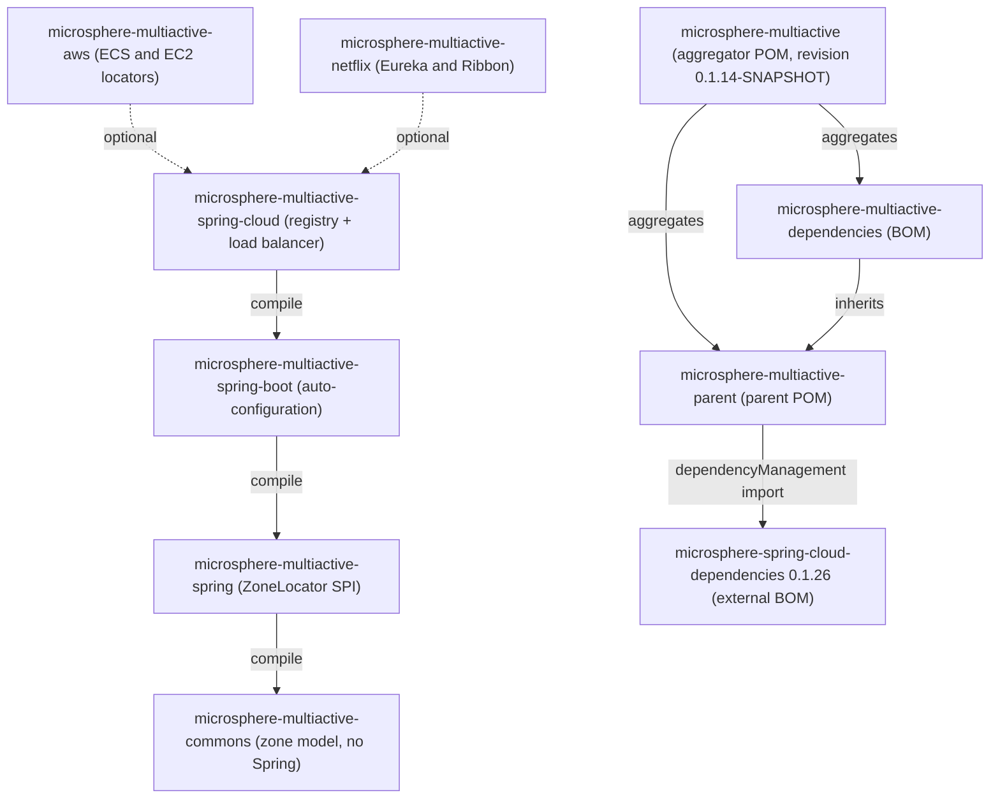

中文版本：[简体中文](zh/README.md)

# Microsphere Multiactive — User Guide (`1.x`)

This is the user guide for the **`1.x`** documentation line, which documents the **`release-1.x`** branch of
`microsphere-multiactive`. Microsphere Multiactive is a multi-active / zone-aware fault-tolerance library: it discovers
the availability zone a process runs in, publishes that zone into service-registration metadata, and narrows downstream
server lists so that calls prefer same-zone instances while still falling back to other zones.

**This line is for applications that must stay on the `0.1.x` artifacts** — that is, on Spring Boot 2.x and the Spring
Cloud `Hoxton` – `2021.0.x` release trains. If you are starting out or can move forward, use the current documentation
line instead: [../../current/user-guide/README.md](../../current/user-guide/README.md).

Every statement in these documents was read from the sources of this branch: POM files, `src/main/java`,
`src/main/resources/META-INF`, `src/test/java`, `.github/workflows` and the snapshot `README.md` /
`release-notes.md`. No API that does not exist here is documented.

## Version at a Glance

| Item | Value | Where it is defined |
|------|-------|---------------------|
| Git branch / documentation line | `release-1.x` / `1.x` | `.github/workflows/maven-build.yml`, `maven-publish.yml` |
| Artifact version in this snapshot | `0.1.14-SNAPSHOT` | `<revision>` property of the root [`pom.xml`](../../../pom.xml) |
| Newest published release of this line | `0.1.13` | [`release-notes.md`](../../../release-notes.md), root [`README.md`](../../../README.md) branch table |
| `groupId` of all modules | `io.github.microsphere-projects` | every module POM |
| JDK | no compiler level declared in this repository; CI compiles/tests on JDK 8, 11, 17, 21, 25 and deploys on JDK 11 | `.github/workflows/maven-build.yml`, `maven-publish.yml` |
| Maven | Apache Maven 3.9.15 (wrapper, `wrapperVersion=3.3.4`, `distributionType=only-script`) | `.mvn/wrapper/maven-wrapper.properties` |
| Spring Cloud compatibility | `Hoxton.SR12` – `2021.0.9`, via the CI Maven profiles `spring-cloud-hoxton`, `spring-cloud-2020`, `spring-cloud-2021` (default `spring-cloud-2021`) | root `README.md`, `.github/workflows/maven-build.yml` |
| Spring Boot compatibility | `2.3.12.RELEASE` (Hoxton) / `2.4.13` (2020.0.x) / `2.6.15` (2021.0.x, default) — declared by the external `microsphere-spring-cloud-parent:0.1.26` POM, not by this repository | `microsphere-multiactive-parent/pom.xml` import chain |
| Netflix | Ribbon `2.7.18` pinned in `microsphere-multiactive-netflix/pom.xml`; Eureka client and `spring-cloud-netflix-eureka-client` versions come from the selected Spring Cloud train | `microsphere-multiactive-netflix/pom.xml` |
| AWS | no AWS SDK: the locators use plain HTTP against the ECS/EC2 metadata endpoints and parse JSON with `jackson-databind` | `microsphere-multiactive-aws/pom.xml` and sources |
| External BOM imported by the parent | `io.github.microsphere-projects:microsphere-spring-cloud-dependencies:0.1.26` | `microsphere-multiactive-parent/pom.xml` |

## Contents

| Document | Module | One-line description |
|----------|--------|----------------------|
| [microsphere-multiactive-parent.md](microsphere-multiactive-parent.md) | `microsphere-multiactive-parent` | POM-only parent inherited by the other seven modules (six jars + the BOM); imports `microsphere-spring-cloud-dependencies:0.1.26` and carries the `${revision}` CI-friendly versioning |
| [microsphere-multiactive-dependencies.md](microsphere-multiactive-dependencies.md) | `microsphere-multiactive-dependencies` | The `1.x` BOM: pins all Multi-Active artifacts to `${revision}` — and the gaps you must cover by hand |
| [microsphere-multiactive-commons.md](microsphere-multiactive-commons.md) | `microsphere-multiactive-commons` | Framework-free zone model: `ZoneContext`, `ZoneConstants`, `ZoneResolver`, `ZonePreferenceFilter`, `ZoneAttachmentHandler`, `HttpUtils` |
| [microsphere-multiactive-spring.md](microsphere-multiactive-spring.md) | `microsphere-multiactive-spring` | The `ZoneLocator` SPI, `DefaultZoneLocator`, `CompositeZoneLocator`, `ZoneUtils` and the zone context events/listener |
| [microsphere-multiactive-spring-boot.md](microsphere-multiactive-spring-boot.md) | `microsphere-multiactive-spring-boot` | Spring Boot auto-configuration (`ZoneAutoConfiguration`) plus the `ConditionalOnAvailabilityZone*` annotations |
| [microsphere-multiactive-spring-cloud.md](microsphere-multiactive-spring-cloud.md) | `microsphere-multiactive-spring-cloud` | Zone attachment to service registration and the zone-aware Spring Cloud LoadBalancer `ServiceInstanceListSupplier` |
| [microsphere-multiactive-aws.md](microsphere-multiactive-aws.md) | `microsphere-multiactive-aws` | Three `ZoneLocator`s: ECS container metadata file, ECS task metadata endpoint v4, EC2 availability-zone endpoint |
| [microsphere-multiactive-netflix.md](microsphere-multiactive-netflix.md) | `microsphere-multiactive-netflix` | Netflix OSS adapters: Eureka metadata resolver and pre-registration handler, Ribbon `ServerListFilter`/`ServerList` — wired by hand, no auto-configuration |

## Module Relationships



Solid arrows are the required (compile-scope) module dependencies taken from each `pom.xml`; dashed arrows are
`<optional>true</optional>` dependencies. `microsphere-multiactive-aws` and `microsphere-multiactive-netflix` declare
`microsphere-multiactive-spring-cloud` optionally, so neither module brings anything with it — see their
[aws](microsphere-multiactive-aws.md) and [netflix](microsphere-multiactive-netflix.md) documents for the dependency
set you have to add yourself.

## Getting Started

Import the BOM, then add the highest-level module you need:

```xml
<dependencyManagement>
    <dependencies>
        <dependency>
            <groupId>io.github.microsphere-projects</groupId>
            <artifactId>microsphere-multiactive-dependencies</artifactId>
            <version>0.1.13</version>
            <type>pom</type>
            <scope>import</scope>
        </dependency>
    </dependencies>
</dependencyManagement>

<dependencies>
    <dependency>
        <groupId>io.github.microsphere-projects</groupId>
        <artifactId>microsphere-multiactive-commons</artifactId>
    </dependency>
    <!-- NOT managed by the 1.x BOM: the version must be explicit -->
    <dependency>
        <groupId>io.github.microsphere-projects</groupId>
        <artifactId>microsphere-multiactive-spring-cloud</artifactId>
        <version>0.1.13</version>
    </dependency>
</dependencies>
```

The root `README.md` of this branch suggests the property name `${microsphere-multiactive.version}` for the BOM
version. Note the asymmetry of this line: the BOM manages `commons`, `spring`, `aws` and `netflix`, but the two jars
that applications actually want at runtime — `microsphere-multiactive-spring-boot` and
`microsphere-multiactive-spring-cloud` — are **not** in it, while four coordinates it does declare
(`microsphere-multiactive-spring-boot-starter`, `microsphere-multiactive-spring-cloud-starter`,
`microsphere-multiactive-spring-cloud-loadbalancer`, `microsphere-multiactive-dubbo`) are not built by this branch.
Details in [microsphere-multiactive-dependencies.md](microsphere-multiactive-dependencies.md).

## Configuration Quick Reference

All property names are declared as constants in `ZoneConstants` (`microsphere-multiactive-commons`) and asserted
one by one in `ZoneConstantsTest`:

| Property key | Default | Purpose |
|--------------|---------|---------|
| `microsphere.availability.zone` | `defaultZone` | The zone of the current application; also the registration-metadata key; the value `originalZone` re-runs discovery |
| `microsphere.current.availability.zone` | unset | JVM system property written by `CompositeZoneLocator`, read by `ZoneContext.getCurrentZone()` |
| `microsphere.availability.zone.enabled` | `true` | Master switch; `false` also removes the Spring Boot auto-configured beans |
| `microsphere.availability.zone.preference.enabled` | `false` | Enables same-zone filtering (off by default) |
| `microsphere.availability.zone.preference.filter.order` | `10` | Order reported by `ZonePreferenceFilter.getOrder()` |
| `microsphere.availability.zone.preference.upstream.zone-ready-percentage` | `100` | Percentage of upstream entities that must carry a zone before preference applies |
| `microsphere.availability.zone.preference.upstream.same-zone-min-available` | `5` | Minimum same-zone entities before preference applies |
| `microsphere.availability.zone.preference.upstream.disabled-zone` | unset | Comma-delimited zones always excluded |
| `microsphere.availability.zone.locator.fast-fail` | `false` | Fail with `IllegalStateException` instead of falling through to the next `ZoneLocator` |
| `microsphere.availability.zone.locator.timeout` | `3000` | Connect/read timeout in ms for the two HTTP AWS locators |
| `microsphere.spring.cloud.loadbalancer.customized` | unset (off) | Installs the zone-aware `ServiceInstanceListSupplier` configuration for all LoadBalancer clients |
| `EC2_AVAILABILITY_ZONE_ENDPOINT_URI` | `http://169.254.169.254/latest/meta-data/placement/availability-zone` | Overrides the EC2 metadata URI read from the Spring `Environment` |
| `ECS_CONTAINER_METADATA_FILE` / `ECS_CONTAINER_METADATA_URI_V4` | unset | ECS metadata sources read from the Spring `Environment` |

`spring.cloud.service-registry.auto-registration.enabled` (Spring Cloud) and
`microsphere.spring.cloud.service-registry.auto-registration.simple.enabled` (Microsphere Spring Cloud Commons) also
gate the publisher side — see [microsphere-multiactive-spring-cloud.md](microsphere-multiactive-spring-cloud.md).

## What This Line Is For

- You run Spring Boot 2.3 – 2.6 with Spring Cloud `Hoxton`, `2020.0.x` or `2021.0.x`, and you need same-zone routing
  with Ribbon or Eureka-era registration.
- You want zone preference layered on top of the discovery client you already have, with explicit safety thresholds
  instead of an all-or-nothing zone filter.
- You must stay on `0.1.x` binaries; upgrading to the current line means moving to Spring Boot 3.x and Spring Cloud
  `2022.0.x`+.

Expect these `1.x`-specific constraints, documented in the module files:

- No starter modules: depend on `microsphere-multiactive-spring-boot` / `microsphere-multiactive-spring-cloud` directly
  and specify their versions.
- `microsphere-multiactive-aws` and `microsphere-multiactive-netflix` declare everything optional, so nothing arrives
  transitively.
- `microsphere-multiactive-netflix` has no auto-configuration at all; you register its classes yourself.
- Neither the AWS nor the Netflix module has test sources in this snapshot, so their examples are derived from the
  implementations rather than from tests.

## Building This Line from Source

```bash
git clone --branch release-1.x https://github.com/microsphere-projects/microsphere-multiactive.git
cd microsphere-multiactive

# full reactor with the default Spring Cloud train
./mvnw --batch-mode --update-snapshots --file pom.xml -Drevision=0.0.1-SNAPSHOT \
    test --activate-profiles test,coverage,spring-cloud-2021

# only the core modules
./mvnw -pl microsphere-multiactive-commons,microsphere-multiactive-spring -am install
```

## Related Documentation

- Root [README](../../../README.md) — project overview, badges, JavaDoc links.
- [Release notes](../../../release-notes.md) — per-version history of this line (`v0.1.0` … `v0.1.13`).
- Current documentation line: [../../current/user-guide/README.md](../../current/user-guide/README.md).
- Developer guide for this line — module-internal design and conventions:
  [index](../developer-guide/README.md),
  [parent](../developer-guide/microsphere-multiactive-parent.md),
  [dependencies](../developer-guide/microsphere-multiactive-dependencies.md),
  [commons](../developer-guide/microsphere-multiactive-commons.md),
  [spring](../developer-guide/microsphere-multiactive-spring.md),
  [spring-boot](../developer-guide/microsphere-multiactive-spring-boot.md),
  [spring-cloud](../developer-guide/microsphere-multiactive-spring-cloud.md),
  [aws](../developer-guide/microsphere-multiactive-aws.md),
  [netflix](../developer-guide/microsphere-multiactive-netflix.md).

## 中文

中文版本：[简体中文](zh/README.md)
