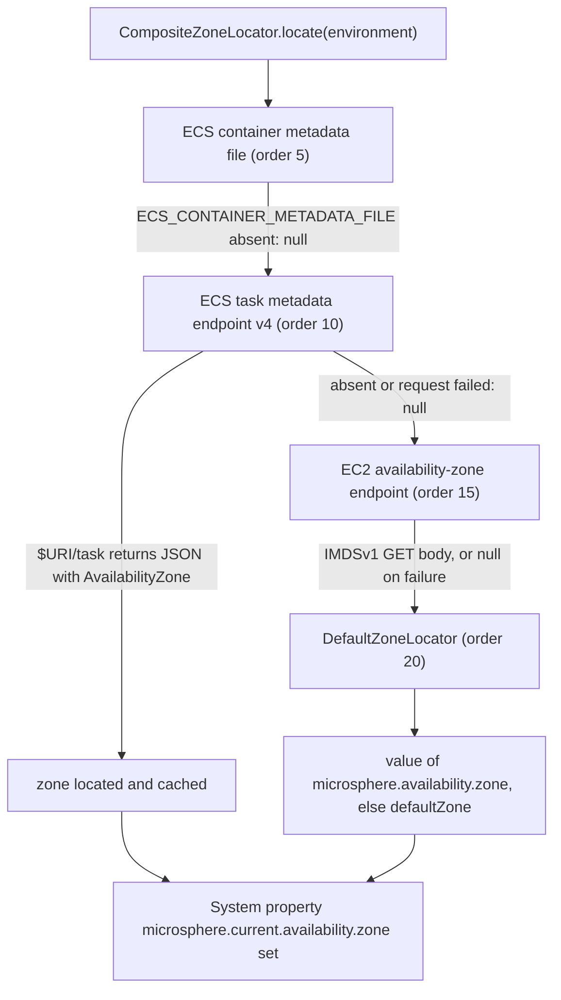

中文版本：[简体中文](zh/microsphere-multiactive-aws.md)

# microsphere-multiactive-aws

## Overview

`microsphere-multiactive-aws` provides three `ZoneLocator` implementations that discover the current AWS Availability
Zone from inside the instance or container:

| Class | Source of truth | Order |
|-------|-----------------|-------|
| `EcsContainerMetadataFileZoneLocator` | the ECS **container metadata file** pointed to by `ECS_CONTAINER_METADATA_FILE` | `5` |
| `EcsTaskMetadataEndpointV4ZoneLocator` | the ECS **task metadata endpoint v4** at `$ECS_CONTAINER_METADATA_URI_V4/task` | `10` |
| `Ec2AvailabilityZoneEndpointZoneLocator` | the EC2 **instance metadata** availability-zone endpoint | `15` |

They are ordered ahead of `DefaultZoneLocator` (`20`) from
[microsphere-multiactive-spring](microsphere-multiactive-spring.md), so real discovery wins over the configured
fallback, and the more specific ECS sources win over the generic EC2 endpoint.

There is **no AWS SDK** anywhere in this module: the locators issue plain HTTP GETs (through
`io.microsphere.multiple.active.zone.HttpUtils`) and parse JSON with `com.fasterxml.jackson.databind.ObjectMapper`.
Registration is by `META-INF/spring.factories` under the `ZoneLocator` key, which
[microsphere-multiactive-spring-boot](microsphere-multiactive-spring-boot.md) reads when building the
`CompositeZoneLocator`. Merely having this jar on the classpath is the whole integration.

## Maven Coordinates

```xml
<dependency>
    <groupId>io.github.microsphere-projects</groupId>
    <artifactId>microsphere-multiactive-aws</artifactId>
    <version>0.1.14-SNAPSHOT</version>
</dependency>
```

- `groupId`: `io.github.microsphere-projects`
- `artifactId`: `microsphere-multiactive-aws`
- `version`: `${revision}` → `0.1.14-SNAPSHOT` in this snapshot; newest published release `0.1.13`
- `packaging`: `jar`
- `<name>`: `Microsphere :: Multi-Active :: AWS`
- `<description>`: `Microsphere Multi-Active Amazon Web Services`
- Managed by [the BOM](microsphere-multiactive-dependencies.md): yes

## Version Information

| Item | Value | Verified in |
|------|-------|-------------|
| Documentation line / Git branch | `1.x` / `release-1.x` | this doc set |
| Artifact version | `0.1.14-SNAPSHOT` | root `pom.xml` `<revision>` |
| Compile-scope dependencies | **none** — every dependency of this module is `<optional>true</optional>` | `microsphere-multiactive-aws/pom.xml` |
| Optional dependencies | `microsphere-annotation-processor`, `io.github.microsphere-projects:microsphere-multiactive-spring-cloud:${revision}`, `spring-boot-starter`, `spring-boot-starter-actuator`, `spring-boot-configuration-processor`, `spring-boot-autoconfigure-processor`, `spring-cloud-commons`, `spring-cloud-context`, `com.fasterxml.jackson.core:jackson-databind` | `microsphere-multiactive-aws/pom.xml` |
| Test dependencies | `junit-jupiter`, `spring-boot-starter-test`, `microsphere-spring-boot-test`, `logback-classic` | `microsphere-multiactive-aws/pom.xml` |
| Test sources | **none** — this module has no `src/test/java` directory in this snapshot | `find` over the module |
| JDK | no compiler level declared in this repository; CI compiles this module on JDK 8, 11, 17, 21, 25 | reactor POMs, `.github/workflows/maven-build.yml` |
| Spring Boot / Spring Cloud | the same range as the rest of the line: Boot 2.3.12.RELEASE / 2.4.13 / 2.6.15 with Spring Cloud Hoxton.SR12 / 2020.0.5 / 2021.0.9 (default `spring-cloud-2021`) | CI profiles, external `microsphere-spring-cloud-parent:0.1.26` |
| Jackson | `jackson-databind` is required for the two ECS locators; its version is managed outside this repository | `microsphere-multiactive-aws/pom.xml` |
| AWS service versions | not pinned here; the locators target the ECS container agent features documented in their Javadoc — metadata file from agent 1.15.0, task metadata endpoint v4 from agent 1.39.0 (Linux EC2) / 1.54.0 (Windows EC2 with `awsvpc`) | class Javadoc of `EcsContainerMetadataFileZoneLocator`, `EcsTaskMetadataEndpointV4ZoneLocator` |

> **Nothing comes transitively.** All nine dependencies are optional, and `microsphere-multiactive-spring-cloud` is the
> one chosen to reach the `ZoneLocator` interface. The AWS sources actually compile against
> `io.microsphere.multiple.active.zone.spring.AbstractZoneLocator` (the `spring` module),
> `io.microsphere.io.IOUtils` (`microsphere-java-core`), `org.springframework.context.EnvironmentAware` /
> `org.springframework.core.env.Environment` / `org.springframework.util.StringUtils` (Spring Framework) and
> `com.fasterxml.jackson.databind.ObjectMapper` (`jackson-databind`). Adding only this jar therefore yields
> `NoClassDefFoundError`. See [Integration](#integration) for the dependency set that works.

## Public API

All classes are in package `io.microsphere.multiple.active.zone.spring.aws` and extend `AbstractZoneLocator`.

### `EcsContainerMetadataFileZoneLocator`

| Member | Value / behaviour |
|--------|-------------------|
| `public static final String METADATA_FILE_ENV_NAME` | `ECS_CONTAINER_METADATA_FILE` |
| `public static final int DEFAULT_ORDER` | `5` |
| `public EcsContainerMetadataFileZoneLocator()` | `super(DEFAULT_ORDER)` |
| `supports(Environment)` | `environment.containsProperty("ECS_CONTAINER_METADATA_FILE")` |
| `locate(Environment)` | reads the file named by the property (a `java.io.File`, read directly from the filesystem), parses it as JSON with a fresh `ObjectMapper`, returns `metadata.get("AvailabilityZone")` as a `String`; returns `null` when the path is blank, the file is not readable (`canRead()` false), the field is absent, or anything throws |

The JSON field name is the private constant `ZONE_FIELD_NAME = "AvailabilityZone"`. This locator is a file reader, not
an HTTP client: it works for ECS tasks that write the container metadata file, and its `zone` value is the raw field,
e.g. `us-east-1a`.

### `EcsTaskMetadataEndpointV4ZoneLocator`

| Member | Value / behaviour |
|--------|-------------------|
| `public static final String METADATA_URI_V4_ENV_NAME` | `ECS_CONTAINER_METADATA_URI_V4` |
| `public static final int DEFAULT_ORDER` | `10` |
| `public EcsTaskMetadataEndpointV4ZoneLocator()` | `super(DEFAULT_ORDER)` |
| `supports(Environment)` | `environment.containsProperty("ECS_CONTAINER_METADATA_URI_V4")` |
| `locate(Environment)` | GETs `uri + "/task"` with `HttpUtils.doGet(...)`, parses the JSON body with a fresh `ObjectMapper`, returns the `AvailabilityZone` field as a `String`, or `null` on blank URI / HTTP error / parse error / absent field |
| `setEnvironment(Environment)` | `implements EnvironmentAware`; captures `microsphere.availability.zone.locator.timeout` (default `3000`) and uses it as the connect and read timeout for later calls |

Two consequences of the implementation: the timeout is only read once, at `EnvironmentAware` callback time, and it is
read by *all* AWS HTTP locators independently; and any failure is swallowed and reported as `null`, which lets the next
locator in the chain try (unless `microsphere.availability.zone.locator.fast-fail=true`).

### `Ec2AvailabilityZoneEndpointZoneLocator`

| Member | Value / behaviour |
|--------|-------------------|
| `public static final String AVAILABILITY_ZONE_ENDPOINT_URI_PROPERTY_NAME` | `EC2_AVAILABILITY_ZONE_ENDPOINT_URI` |
| `public static final String DEFAULT_AVAILABILITY_ZONE_ENDPOINT_URI` | `http://169.254.169.254/latest/meta-data/placement/availability-zone` |
| `public static final int DEFAULT_ORDER` | `15` |
| `public Ec2AvailabilityZoneEndpointZoneLocator()` | `super(DEFAULT_ORDER)` |
| `supports(Environment)` | always `true` — this locator always attempts the link-local metadata endpoint |
| `locate(Environment)` | GETs `environment.getProperty("EC2_AVAILABILITY_ZONE_ENDPOINT_URI", DEFAULT_AVAILABILITY_ZONE_ENDPOINT_URI)` and returns the **raw response body** — no JSON parsing, no trimming. On a real instance the value is like `us-east-1a`; off-EC2 the request fails, is logged and `null` is returned |
| `setEnvironment(Environment)` | `implements EnvironmentAware`; same timeout property, same default `3000` |

Two operational notes that follow directly from the code:

- **IMDSv2.** `HttpUtils.doGet` sends a plain GET with no `X-aws-ec2-metadata-token` header, so on instances whose
  metadata service requires session tokens (IMDSv2 "required") this locator will not obtain a zone. Set
  `EC2_AVAILABILITY_ZONE_ENDPOINT_URI` to a reachable endpoint, or rely on the ECS locators.
- **The value is unparsed.** Whatever the endpoint returns becomes the zone, so any trailing newline in the response
  body ends up in the located string. `ZoneContext.setZone(...)` applies `trimAllWhitespace`, so the stored zone is
  normalised, but `CompositeZoneLocator` publishes the untrimmed value to the
  `microsphere.current.availability.zone` system property.

`EC2_AVAILABILITY_ZONE_ENDPOINT_URI` is read from the Spring `Environment`, so you can set it as an OS environment
variable, a JVM system property or an `application.properties` entry.

## Auto-Configuration and the `spring.factories` Contract

`META-INF/spring.factories` of this module contains one key and three values, in this order:

```properties
io.microsphere.multiple.active.zone.spring.ZoneLocator=\
io.microsphere.multiple.active.zone.spring.aws.EcsContainerMetadataFileZoneLocator,\
io.microsphere.multiple.active.zone.spring.aws.EcsTaskMetadataEndpointV4ZoneLocator,\
io.microsphere.multiple.active.zone.spring.aws.Ec2AvailabilityZoneEndpointZoneLocator
```

`ZoneAutoConfiguration` in [microsphere-multiactive-spring-boot](microsphere-multiactive-spring-boot.md) loads every
entry of this key and merges them with the `ZoneLocator` beans before sorting, so all three locators plus
`DefaultZoneLocator` (registered under the same key by the boot module) end up in the `CompositeZoneLocator`, ordered
`5, 10, 15, 20`.

This mechanism is *not* Spring Boot auto-configuration: the module declares no `EnableAutoConfiguration` entry and no
`AutoConfiguration.imports` file, and contains no `@Configuration` class. There is nothing to exclude and no
`microsphere.aws.*` property to set.

## Behaviour You Can Rely On

Given a JVM launched inside an ECS task on EC2 with `ECS_CONTAINER_METADATA_URI_V4` set:



Because `Ec2AvailabilityZoneEndpointZoneLocator.supports(...)` is always `true` and it returns `null` on failure, an
application outside AWS silently falls through to `DefaultZoneLocator` — the library never fails to start because of
metadata discovery, unless you turn on `microsphere.availability.zone.locator.fast-fail`. With fast-fail enabled the
first AWS locator that supports but cannot locate aborts the chain with `IllegalStateException`, which on non-AWS
infrastructure means `Ec2AvailabilityZoneEndpointZoneLocator` will be the one blamed.

## Examples

This module has no test sources in this snapshot, so the examples below are written against the implementation as it
exists here — the property names, environment variable names, orders and `null` semantics are taken directly from the
sources.

### Discover the zone explicitly

```java
StandardEnvironment environment = new StandardEnvironment();
Map<String, Object> props = new HashMap<>();
props.put("ECS_CONTAINER_METADATA_URI_V4", "http://169.254.170.2");
props.put(ZoneConstants.LOCATOR_TIMEOUT_PROPERTY_NAME, "1500");
environment.getPropertySources().addFirst(new MapPropertySource("aws", props));

EcsTaskMetadataEndpointV4ZoneLocator locator = new EcsTaskMetadataEndpointV4ZoneLocator();
locator.setEnvironment(environment);                 // EnvironmentAware: timeout is captured here

if (locator.supports(environment)) {                 // true: the v4 variable is present
    String zone = locator.locate(environment);       // GET http://169.254.170.2/task, read AvailabilityZone
    // zone is "us-east-1a" inside a task in that AZ, or null if the endpoint is unreachable
}
```

### Let the composite chain decide (the usual setup)

```java
CompositeZoneLocator zoneLocator = new CompositeZoneLocator(Arrays.asList(
        new EcsContainerMetadataFileZoneLocator(),   // 5
        new EcsTaskMetadataEndpointV4ZoneLocator(),  // 10
        new Ec2AvailabilityZoneEndpointZoneLocator() // 15
));

// DefaultZoneLocator is not listed above on purpose: in a Spring Boot application the
// spring-boot module adds it (and the three AWS locators) through the ZoneLocator spring.factories key.
String zone = zoneLocator.locate(environment);       // first non-null wins; also sets the system property
```

### Override the metadata endpoint for tests

```java
Map<String, Object> props = new HashMap<>();
props.put(Ec2AvailabilityZoneEndpointZoneLocator.AVAILABILITY_ZONE_ENDPOINT_URI_PROPERTY_NAME,
        "http://localhost:" + port + "/latest/meta-data/placement/availability-zone");
environment.getPropertySources().addFirst(new MapPropertySource("aws-endpoint", props));

Ec2AvailabilityZoneEndpointZoneLocator locator = new Ec2AvailabilityZoneEndpointZoneLocator();
String zone = locator.locate(environment);           // returns the response body verbatim
```

`HttpUtilsTest` in [microsphere-multiactive-commons](microsphere-multiactive-commons.md) shows the underlying contract
used by both HTTP locators: `HttpUtils.doGet(url, timeout)` returns the body for a reachable HTTP endpoint and `null`
for blank or non-HTTP URLs, and throws `IOException` on transport errors (which the locators catch).

## Integration

`microsphere-multiactive-aws` is managed by the BOM, so no version is needed once the BOM is imported — but you must
add the modules and libraries its optional dependencies hide:

```xml
<dependencyManagement>
    <dependencies>
        <dependency>
            <groupId>io.github.microsphere-projects</groupId>
            <artifactId>microsphere-multiactive-dependencies</artifactId>
            <version>0.1.13</version>
            <type>pom</type>
            <scope>import</scope>
        </dependency>
    </dependencies>
</dependencyManagement>

<dependencies>
    <!-- brings commons + spring + the ZoneLocator / ZoneContext types -->
    <dependency>
        <groupId>io.github.microsphere-projects</groupId>
        <artifactId>microsphere-multiactive-spring-cloud</artifactId>
        <version>0.1.13</version>
    </dependency>
    <!-- the AWS zone locators -->
    <dependency>
        <groupId>io.github.microsphere-projects</groupId>
        <artifactId>microsphere-multiactive-aws</artifactId>
    </dependency>
    <!-- required at runtime: the locators use io.microsphere.io.IOUtils -->
    <dependency>
        <groupId>io.github.microsphere-projects</groupId>
        <artifactId>microsphere-java-core</artifactId>
    </dependency>
    <!-- required at runtime by the two ECS locators -->
    <dependency>
        <groupId>com.fasterxml.jackson.core</groupId>
        <artifactId>jackson-databind</artifactId>
    </dependency>
</dependencies>
```

Then configure only what the locators read:

```properties
# optional: the timeout used by both HTTP locators, in milliseconds (default 3000)
microsphere.availability.zone.locator.timeout=2000
# optional: point the EC2 locator somewhere else than the link-local IMDS address
EC2_AVAILABILITY_ZONE_ENDPOINT_URI=http://169.254.169.254/latest/meta-data/placement/availability-zone
# optional: fail loudly instead of falling back to defaultZone
microsphere.availability.zone.locator.fast-fail=false
```

No `@Enable...` annotation, no `@Import`, no bean declaration is required: the `spring.factories` key does the wiring
(see [microsphere-multiactive-spring-boot.md](microsphere-multiactive-spring-boot.md)). If you also want the zone
written into your service registration, add [microsphere-multiactive-spring-cloud.md](microsphere-multiactive-spring-cloud.md).

## Related Documentation

- [User guide index](README.md)
- [microsphere-multiactive-spring.md](microsphere-multiactive-spring.md) — `ZoneLocator`, `AbstractZoneLocator`, `CompositeZoneLocator`
- [microsphere-multiactive-spring-boot.md](microsphere-multiactive-spring-boot.md) — where the `spring.factories` entries are consumed
- [microsphere-multiactive-commons.md](microsphere-multiactive-commons.md) — `HttpUtils`, `ZoneConstants`
- Root [README](../../../README.md) and [release notes](../../../release-notes.md)
- Developer guide: [../developer-guide/microsphere-multiactive-aws.md](../developer-guide/microsphere-multiactive-aws.md)

## 中文

中文版本：[简体中文](zh/microsphere-multiactive-aws.md)
