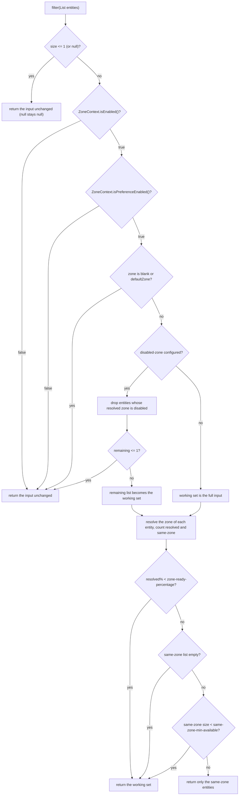

中文版本：[简体中文](zh/microsphere-multiactive-commons.md)

# microsphere-multiactive-commons

## Overview

`microsphere-multiactive-commons` is the framework-free core of the library. It knows nothing about Spring: it defines
the zone model (`ZoneContext`), the property vocabulary (`ZoneConstants`), the two extension contracts
(`ZoneResolver`, and the zone-aware filter `ZonePreferenceFilter`), the metadata writer (`ZoneAttachmentHandler`) and a
tiny HTTP helper (`HttpUtils`).

Everything above this module — [microsphere-multiactive-spring](microsphere-multiactive-spring.md) and its descendants —
builds on these six types. If you only need zone semantics inside your own load balancer or registry client, this jar
is the only one you need.

## Maven Coordinates

```xml
<dependency>
    <groupId>io.github.microsphere-projects</groupId>
    <artifactId>microsphere-multiactive-commons</artifactId>
    <version>0.1.14-SNAPSHOT</version>
</dependency>
```

- `groupId`: `io.github.microsphere-projects`
- `artifactId`: `microsphere-multiactive-commons`
- `version`: `${revision}` → `0.1.14-SNAPSHOT` in this snapshot; newest published release `0.1.13`
- `packaging`: `jar`
- `<name>`: `Microsphere :: Multi-Active :: Commons`
- Managed by [the BOM](microsphere-multiactive-dependencies.md): yes

## Version Information

| Item | Value | Verified in |
|------|-------|-------------|
| Documentation line / Git branch | `1.x` / `release-1.x` | this doc set |
| Artifact version | `0.1.14-SNAPSHOT` | root `pom.xml` `<revision>` |
| Compile-scope dependencies | none declared in this module's POM | `microsphere-multiactive-commons/pom.xml` |
| Optional dependencies | `io.github.microsphere-projects:microsphere-annotation-processor`, `io.github.microsphere-projects:microsphere-java-core` | `microsphere-multiactive-commons/pom.xml` |
| Test dependencies | `org.junit.jupiter:junit-jupiter`, `io.github.microsphere-projects:microsphere-java-test`, `ch.qos.logback:logback-classic` | `microsphere-multiactive-commons/pom.xml` |
| JDK | no compiler level declared in this repository; CI tests this module on JDK 8, 11, 17, 21, 25 | reactor POMs, `.github/workflows/maven-build.yml` |
| Spring / Spring Boot requirement | **none** — the module imports no `org.springframework.*` type | all six sources under `src/main/java` |
| External library versions | `microsphere-java-core` / `microsphere-annotation-processor` versions come from the imported `microsphere-spring-cloud-dependencies:0.1.26` BOM, not from this repository | `microsphere-multiactive-parent/pom.xml` |

> **Runtime caveat.** Both `microsphere-java-core` and `microsphere-annotation-processor` are declared
> `<optional>true</optional>`, so they are **not** transitive. Yet the sources use `io.microsphere.logging.Logger`,
> `io.microsphere.util.StringUtils`, `io.microsphere.io.IOUtils` and `io.microsphere.annotation.ConfigurationProperty`
> at compile time. When you depend on `microsphere-multiactive-commons` directly, add
> `io.github.microsphere-projects:microsphere-java-core` yourself, or `ZoneContext` will fail with
> `NoClassDefFoundError` at class initialization. Applications that already depend on
> `microsphere-multiactive-spring-boot` or `microsphere-multiactive-spring-cloud` get what they need from those modules'
> own dependency graphs.

## Public API

All types live in package `io.microsphere.multiple.active.zone`.

### `ZoneConstants` (`interface`)

`public interface ZoneConstants` — the complete property vocabulary of the library. Every key used by any module is
declared here; the values are asserted one-by-one in `ZoneConstantsTest`. The interface is a constant holder; it has no
methods.

Zone properties:

| Constant | Value | Meaning |
|----------|-------|---------|
| `ENABLED_PROPERTY_NAME_SUFFIX` | `.enabled` | suffix used to build every `*.enabled` key |
| `DEFAULT_ZONE` | `defaultZone` | default zone value; deliberately compatible with the Eureka `DEFAULT_ZONE` name; treated as "no zone" by `ZonePreferenceFilter` |
| `ORIGINAL_ZONE` | `originalZone` | sentinel *value* for the zone property; assigning it to `microsphere.availability.zone` makes `ZoneContextChangedListener` re-run discovery (see [spring](microsphere-multiactive-spring.md)) |
| `ZONE_PROPERTY_NAME` | `microsphere.availability.zone` | the zone of the current application, and the metadata key written into service registrations |
| `CURRENT_ZONE_PROPERTY_NAME` | `microsphere.current.availability.zone` | the zone published as a JVM system property |
| `DEFAULT_ZONE_ENABLED_PROPERTY_VALUE` | `"true"` | string form of the default |
| `DEFAULT_ZONE_ENABLED` | `true` | default of the master switch |
| `ZONE_ENABLED_PROPERTY_NAME` | `microsphere.availability.zone.enabled` | master switch |

Zone preference properties:

| Constant | Value | Meaning |
|----------|-------|---------|
| `PREFERENCE_PROPERTY_NAME_PREFIX` | `microsphere.availability.zone.preference.` | prefix |
| `DEFAULT_PREFERENCE_ENABLED_PROPERTY_VALUE` | `"false"` | string form of the default |
| `DEFAULT_ZONE_PREFERENCE_ENABLED` | `false` | same-zone preference is **off** by default |
| `PREFERENCE_ENABLED_PROPERTY_NAME` | `microsphere.availability.zone.preference.enabled` | enables same-zone preference |

Zone preference filter properties:

| Constant | Value | Meaning |
|----------|-------|---------|
| `PREFERENCE_FILER_PROPERTY_NAME_PREFIX` | `microsphere.availability.zone.preference.filter.` | prefix. The constant name is misspelled (`FILER`) in this line — the *value* is correct |
| `DEFAULT_ZONE_PREFERENCE_FILTER_ORDER_PROPERTY_VALUE` | `"10"` | string form of the default |
| `DEFAULT_ZONE_PREFERENCE_FILTER_ORDER` | `10` | default order |
| `PREFERENCE_FILTER_ORDER_PROPERTY_NAME` | `microsphere.availability.zone.preference.filter.order` | order reported by `ZonePreferenceFilter.getOrder()` |

Zone preference upstream properties:

| Constant | Value | Meaning |
|----------|-------|---------|
| `PREFERENCE_UPSTREAM_PROPERTY_NAME_PREFIX` | `microsphere.availability.zone.preference.upstream.` | prefix |
| `DEFAULT_PREFERENCE_UPSTREAM_ZONE_READY_PERCENTAGE_PROPERTY_VALUE` | `"100"` | string form of the default |
| `DEFAULT_PREFERENCE_UPSTREAM_ZONE_READY_PERCENTAGE` | `100` | percentage of upstream entities that must carry a resolvable zone before preference is trusted |
| `PREFERENCE_UPSTREAM_ZONE_READY_PERCENTAGE_PROPERTY_NAME` | `microsphere.availability.zone.preference.upstream.zone-ready-percentage` | readiness gate |
| `DEFAULT_PREFERENCE_UPSTREAM_SAME_ZONE_MIN_AVAILABLE_PROPERTY_VALUE` | `"5"` | string form of the default |
| `DEFAULT_PREFERENCE_UPSTREAM_SAME_ZONE_MIN_AVAILABLE` | `5` | minimum number of same-zone entities required before preference is applied |
| `PREFERENCE_UPSTREAM_SAME_ZONE_MIN_AVAILABLE_PROPERTY_NAME` | `microsphere.availability.zone.preference.upstream.same-zone-min-available` | minimum same-zone count |
| `DEFAULT_PREFERENCE_UPSTREAM_DISABLED_ZONE` | `null` | no zone is drained by default |
| `PREFERENCE_UPSTREAM_DISABLED_ZONE_PROPERTY_NAME` | `microsphere.availability.zone.preference.upstream.disabled-zone` | comma-delimited zones always excluded from the result |

Zone locator properties:

| Constant | Value | Meaning |
|----------|-------|---------|
| `LOCATOR_PROPERTY_NAME_PREFIX` | `microsphere.availability.zone.locator.` | prefix |
| `DEFAULT_LOCATOR_FAST_FAIL_PROPERTY_VALUE` | `"false"` | string form of the default |
| `DEFAULT_LOCATOR_FAST_FAIL` | `false` | discovery does not fail fast by default |
| `LOCATOR_FAST_FAIL_PROPERTY_NAME` | `microsphere.availability.zone.locator.fast-fail` | read by `CompositeZoneLocator` |
| `DEFAULT_TIMEOUT_PROPERTY_VALUE` | `"3000"` | string form of the default |
| `DEFAULT_TIMEOUT` | `3000` | connect/read timeout in milliseconds |
| `LOCATOR_TIMEOUT_PROPERTY_NAME` | `microsphere.availability.zone.locator.timeout` | read by the AWS metadata locators only |

Note: this module defines the constants; it is `microsphere-multiactive-spring` (locators, listener) and
`microsphere-multiactive-aws` (timeout) that actually read them from an environment. `microsphere.availability.zone` is
also the key `ZoneAttachmentHandler` writes into registration metadata, which is what
`CloudServerZoneResolver` and `EurekaInstanceInfoZoneResolver` read back.

### `ZoneContext` (`class`)

`public class ZoneContext` — the mutable, JVM-wide holder of the effective zone configuration. It is a singleton by
convention, is observable through `java.beans.PropertyChangeSupport`, and every setter fires a property-change event
only when the value actually differs (`Objects.equals`) from the current one.

| Member | Signature | Behaviour verified by tests |
|--------|-----------|------------------------------|
| `get()` | `public static ZoneContext get()` | returns the single shared instance; repeated calls return the same object (`ZoneContextTest#testGetSingletonInstance`) |
| `getCurrentZone()` | `public static String getCurrentZone()` | reads the **JVM system property** `microsphere.current.availability.zone`, falling back to `defaultZone` — it does not read the singleton (`ZoneContextTest#testGetCurrentZoneFromSystemProperty`) |
| `isEnabled()` / `setEnabled(boolean)` | | default `true` |
| `getZone()` / `setZone(String)` | | `setZone` applies `trimAllWhitespace`, so `"  zone-b  "` becomes `"zone-b"`; setting the identical value fires no event |
| `isPreferenceEnabled()` / `setPreferenceEnabled(boolean)` | | default `false` |
| `getPreferenceFilterOrder()` / `setPreferenceFilterOrder(int)` | | default `10` |
| `getPreferenceUpstreamZoneReadyPercentage()` / `setPreferenceUpstreamZoneReadyPercentage(int)` | | default `100` |
| `getPreferenceUpstreamSameZoneMinAvailable()` / `setPreferenceUpstreamSameZoneMinAvailable(int)` | | default `5` |
| `getPreferenceUpstreamDisabledZone()` / `setPreferenceUpstreamDisabledZone(String)` | | comma-delimited; each element is trimmed, so `" zone-a , zone-b "` is stored as `"zone-a,zone-b"`. A blank or `null` value is stored as given, which means `""` disables draining and `null` also disables draining (`ZonePreferenceFilter` checks `!= null`) |
| `enable()` | `public boolean enable()` | enables the context and returns the **previous** status; already-enabled → returns `true` without firing an event |
| `reset()` | `public void reset()` | restores all seven fields to the `ZoneConstants` defaults |
| `addPropertyChangeListener(PropertyChangeListener)` / `removePropertyChangeListener(PropertyChangeListener)` | | registration is global (all property names) |
| `toString()` | | `ZoneContext{enabled=..., zone='...', preferenceEnabled=..., preferenceFilterOrder=..., preferenceUpstreamZoneReadyPercentage=..., preferenceUpstreamSameZoneMinAvailable=..., preferenceUpstreamDisabledZone=...}` |

The class declares no constructor, so `new ZoneContext()` is legal — but it gives you a detached instance; `ZoneContext.get()`
is the object the Spring modules bind into the application context.

### `ZoneResolver<E>` (`interface`)

```java
public interface ZoneResolver<E> extends Function<E, String> {
    default String apply(E entity) { return resolve(entity); }
    String resolve(E entity);
}
```

Maps an arbitrary entity (a server, an instance, a `ServiceInstance`) to its zone, returning `null` when the zone is
unknown. Because it extends `Function<E, String>` it can be written as a lambda, and `apply` simply delegates to
`resolve` — implemented, not inherited (`ZoneResolverTest#testApplyDelegatesToResolve`):

```java
ZoneResolver<String> resolver = entity -> entity + "-zone";
assertEquals("test-zone", resolver.apply("test"));
assertEquals("test-zone", resolver.resolve("test"));
assertNull(((ZoneResolver<String>) entity -> entity).apply(null));
```

### `ZonePreferenceFilter<E>` (`class`)

`public class ZonePreferenceFilter<E>` — the reusable decision engine behind every zone-aware filter in this library
(`ZonePreferenceServerListFilter` in Ribbon, `ZonePreferenceServiceInstanceListSupplier` in Spring Cloud LoadBalancer).

| Member | Signature | Notes |
|--------|-----------|-------|
| constructor | `public ZonePreferenceFilter(ZoneContext zoneContext, ZoneResolver<E> zoneResolver)` | both collaborators are required |
| `filter` | `public List<E> filter(List<E> entities)` | returns a list; may return the input instance itself (identity is preserved in the pass-through cases asserted by `ZonePreferenceFilterTest`) |
| `getOrder` | `public int getOrder()` | delegates to `zoneContext.getPreferenceFilterOrder()`; the class does **not** implement `org.springframework.core.Ordered` on this line — adapters expose the order through their own mechanism |
| `isIgnored` | `protected boolean isIgnored(String zone)` | `true` when the zone is blank or equals `defaultZone` ignoring case |

Decision order, exactly as implemented:



Consequences worth knowing before you turn the feature on:

- Zone comparison is case-sensitive (`Objects.equals`), while the *ignore* check against `defaultZone` is
  case-insensitive.
- The percentage test uses integer arithmetic (`zoneCount * 100 / totalSize`), so a threshold of `100` requires that
  **every** entity in the working set resolves a zone. That is why the shipped default `100` makes preference a
  deliberately conservative feature.
- The whole mechanism is off by default (`DEFAULT_ZONE_PREFERENCE_ENABLED = false`), independently of
  `microsphere.availability.zone.enabled`.
- If filtering would leave fewer than two entities — either because all zones were drained or because the same-zone
  list is below `same-zone-min-available` — the filter returns more entities rather than nothing. Zone preference is
  never allowed to starve traffic.

### `ZoneAttachmentHandler` (`class`)

`public class ZoneAttachmentHandler` — writes the current zone into the metadata map of a service registration.

| Member | Signature | Notes |
|--------|-----------|-------|
| constructor | `public ZoneAttachmentHandler(ZoneContext zoneContext)` | |
| `attachZone` | `public void attachZone(Map<String, String> metadata)` | puts `microsphere.availability.zone` → `zoneContext.getZone()`. Blank zones are skipped with a warning. Any `Throwable` raised by the map (e.g. `UnsupportedOperationException` on an unmodifiable map) is caught and logged as a warning: registration continues without the zone |

Because it is the writer whose key matches the readers (`CloudServerZoneResolver`, `EurekaInstanceInfoZoneResolver`),
the metadata key `microsphere.availability.zone` is the wire contract between the upstream and downstream side of this
library.

### `HttpUtils` (`abstract class`)

`public abstract class HttpUtils` — non-instantiable utility for the AWS metadata endpoints.

| Member | Signature | Notes |
|--------|-----------|-------|
| `doGet` | `public static String doGet(String url, int timeout) throws IOException` | `null`/blank URL → `null`; a non-`HttpURLConnection` (for example a `file:` URL) → `null`; otherwise sets connect **and** read timeout to `timeout` ms, reads the body as UTF-8 and returns it, disconnecting in a `finally` block |

`doGet` performs a plain HTTP GET: it issues no IMDSv2 session token and sends no custom headers, so on EC2 instances
configured for "required" IPv4 tokens the availability-zone call will not return metadata. It also propagates
`IOException` — the AWS locators catch it and log, they do not rethrow.

## Configuration Properties

`microsphere-multiactive-commons` reads nothing itself; it publishes the vocabulary that the Spring modules read. The
full key list and defaults are the table under `ZoneConstants` above, restated here as user-facing settings:

| Property key | Default | Effect once consumed by `microsphere-multiactive-spring` / `-spring-cloud` |
|--------------|---------|-----------------------------------------------------------------------------|
| `microsphere.availability.zone` | `defaultZone` | declares the zone explicitly; the value `originalZone` triggers re-discovery |
| `microsphere.current.availability.zone` | unset (system property) | written by `CompositeZoneLocator`, read by `ZoneContext.getCurrentZone()` |
| `microsphere.availability.zone.enabled` | `true` | master switch |
| `microsphere.availability.zone.preference.enabled` | `false` | switches same-zone filtering on |
| `microsphere.availability.zone.preference.filter.order` | `10` | order of the zone preference filter |
| `microsphere.availability.zone.preference.upstream.zone-ready-percentage` | `100` | minimum percentage of upstream entities that must carry a zone |
| `microsphere.availability.zone.preference.upstream.same-zone-min-available` | `5` | minimum same-zone entities before preference is applied |
| `microsphere.availability.zone.preference.upstream.disabled-zone` | unset | comma-delimited zones to drain |
| `microsphere.availability.zone.locator.fast-fail` | `false` | fail instead of falling through to the next locator |
| `microsphere.availability.zone.locator.timeout` | `3000` | HTTP timeout of the AWS metadata locators |

## Examples

These are adapted from the tests in this snapshot (`src/test/java` of this module), which cover every class above.

### Drive the context and observe changes (`ZoneContextTest`)

```java
ZoneContext zoneContext = ZoneContext.get();
zoneContext.reset();

List<PropertyChangeEvent> events = new ArrayList<>();
PropertyChangeListener listener = events::add;
zoneContext.addPropertyChangeListener(listener);

zoneContext.setZone("  zone-b  ");
assertEquals("zone-b", zoneContext.getZone());   // whitespace trimmed

zoneContext.setZone("zone-b");                   // same value: no event
assertEquals(1, events.size());

zoneContext.removePropertyChangeListener(listener);
zoneContext.reset();                             // back to enabled / defaultZone / preference off
assertTrue(zoneContext.isEnabled());
assertEquals("defaultZone", zoneContext.getZone());
assertFalse(zoneContext.isPreferenceEnabled());
```

### Read the zone published by discovery (`ZoneContextTest`)

```java
System.setProperty(ZoneConstants.CURRENT_ZONE_PROPERTY_NAME, "sys-zone");
assertEquals("sys-zone", ZoneContext.getCurrentZone());

System.clearProperty(ZoneConstants.CURRENT_ZONE_PROPERTY_NAME);
assertEquals("defaultZone", ZoneContext.getCurrentZone());
```

### Same-zone preference filtering (`ZonePreferenceFilterTest`)

```java
static class ZoneEntity {
    final String zone;

    ZoneEntity(String zone) {
        this.zone = zone;
    }
}

ZoneResolver<ZoneEntity> resolver = entity -> entity == null ? null : entity.zone;

ZoneContext zoneContext = ZoneContext.get();
zoneContext.reset();
zoneContext.setEnabled(true);
zoneContext.setPreferenceEnabled(true);
zoneContext.setZone("zone-a");
zoneContext.setPreferenceUpstreamZoneReadyPercentage(100);
zoneContext.setPreferenceUpstreamSameZoneMinAvailable(1);

ZonePreferenceFilter<ZoneEntity> filter = new ZonePreferenceFilter<>(zoneContext, resolver);

List<ZoneEntity> entities = Arrays.asList(
        new ZoneEntity("zone-a"),
        new ZoneEntity("zone-b"),
        new ZoneEntity("zone-a")
);

List<ZoneEntity> result = filter.filter(entities);
assertEquals(2, result.size());
result.forEach(e -> assertEquals("zone-a", e.zone));
```

### Two safety valves of the same filter (`ZonePreferenceFilterTest`)

```java
// The application sits in the neutral zone: preference is ignored entirely.
zoneContext.setZone("defaultZone");
List<ZoneEntity> entities = Arrays.asList(new ZoneEntity("zone-a"), new ZoneEntity("zone-b"));
assertSame(entities, filter.filter(entities));

// Not enough same-zone instances: the full list is returned instead of the thin same-zone list.
zoneContext.setZone("zone-a");
zoneContext.setPreferenceUpstreamSameZoneMinAvailable(5);
List<ZoneEntity> sparse = Arrays.asList(new ZoneEntity("zone-a"), new ZoneEntity("zone-b"), new ZoneEntity("zone-b"));
assertSame(sparse, filter.filter(sparse));

// Draining a zone: entities carrying "zone-c" never reach the caller.
zoneContext.setPreferenceUpstreamDisabledZone("zone-c");
List<ZoneEntity> mixed = Arrays.asList(
        new ZoneEntity("zone-a"), new ZoneEntity("zone-b"),
        new ZoneEntity("zone-c"), new ZoneEntity("zone-a"));
List<ZoneEntity> drained = filter.filter(mixed);
assertEquals(2, drained.size());
drained.forEach(e -> assertEquals("zone-a", e.zone));
```

### Attach the zone to registration metadata (`ZoneAttachmentHandlerTest`)

```java
ZoneContext zoneContext = ZoneContext.get();
zoneContext.reset();
zoneContext.setZone("zone-a");

ZoneAttachmentHandler handler = new ZoneAttachmentHandler(zoneContext);

Map<String, String> metadata = new HashMap<>();
handler.attachZone(metadata);
assertEquals("zone-a", metadata.get(ZoneConstants.ZONE_PROPERTY_NAME));

// An unmodifiable metadata map does not break registration; the zone is simply absent.
Map<String, String> unmodifiable = Collections.unmodifiableMap(new HashMap<>());
handler.attachZone(unmodifiable);
assertFalse(unmodifiable.containsKey(ZoneConstants.ZONE_PROPERTY_NAME));
```

### Fetch a metadata document (`HttpUtilsTest`)

```java
// A reachable endpoint returns the body as a String.
String url = "http://localhost:" + port + "/zone";
String result = HttpUtils.doGet(url, 3000);
assertEquals("hello zone", result);

// Blank URLs and non-HTTP protocols return null instead of throwing.
assertNull(HttpUtils.doGet("   ", 1000));
assertNull(HttpUtils.doGet(tempFile.toUri().toString(), 1000));
```

## Integration

Add the jar (and the core library it needs) and wire the three types yourself — no Spring required:

```xml
<dependencyManagement>
    <dependencies>
        <dependency>
            <groupId>io.github.microsphere-projects</groupId>
            <artifactId>microsphere-multiactive-dependencies</artifactId>
            <version>0.1.13</version>
            <type>pom</type>
            <scope>import</scope>
        </dependency>
    </dependencies>
</dependencyManagement>

<dependencies>
    <dependency>
        <groupId>io.github.microsphere-projects</groupId>
        <artifactId>microsphere-multiactive-commons</artifactId>
    </dependency>
    <dependency>
        <groupId>io.github.microsphere-projects</groupId>
        <artifactId>microsphere-java-core</artifactId>
    </dependency>
</dependencies>
```

```java
ZoneContext zoneContext = ZoneContext.get();
zoneContext.setEnabled(true);
zoneContext.setPreferenceEnabled(true);
zoneContext.setZone("zone-a");
zoneContext.setPreferenceUpstreamSameZoneMinAvailable(1);

ZonePreferenceFilter<MyNode> filter = new ZonePreferenceFilter<>(zoneContext, MyNode::getZone);
List<MyNode> targets = filter.filter(allNodes);
```

To let external configuration drive the context instead of hard-coded calls, use
[microsphere-multiactive-spring](microsphere-multiactive-spring.md).

## Related Documentation

- [User guide index](README.md)
- Sibling modules: [spring](microsphere-multiactive-spring.md),
  [spring-boot](microsphere-multiactive-spring-boot.md), [spring-cloud](microsphere-multiactive-spring-cloud.md),
  [aws](microsphere-multiactive-aws.md), [netflix](microsphere-multiactive-netflix.md)
- Root [README](../../../README.md) and [release notes](../../../release-notes.md)
- Developer guide: [../developer-guide/microsphere-multiactive-commons.md](../developer-guide/microsphere-multiactive-commons.md)

## 中文

中文版本：[简体中文](zh/microsphere-multiactive-commons.md)
