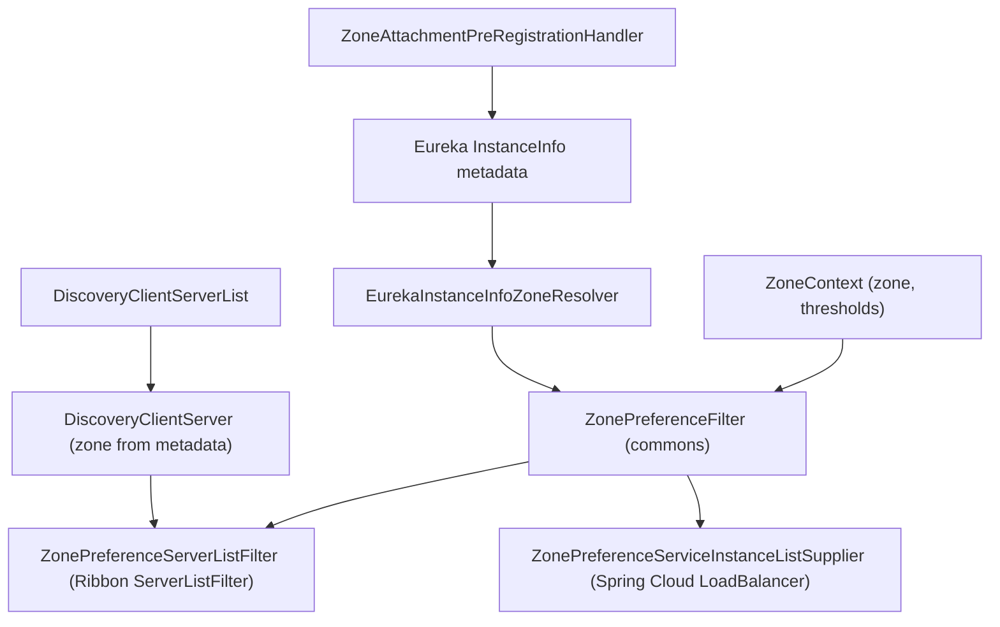

中文版本：[简体中文](zh/microsphere-multiactive-netflix.md)

# microsphere-multiactive-netflix

## Overview

`microsphere-multiactive-netflix` adapts the zone model of
[microsphere-multiactive-commons](microsphere-multiactive-commons.md) to the Netflix OSS stack that was standard on the
Spring Cloud `Hoxton` generation, which is what this `1.x` line supports:

- **Eureka**: a `ZoneResolver` that reads the zone back out of `InstanceInfo` metadata, and a
  `PreRegistrationHandler` that writes the zone into that same metadata before registration.
- **Ribbon**: a `ZoneResolver` based on `Server.getZone()`, a Ribbon `ServerListFilter` that delegates to the shared
  `ZonePreferenceFilter`, and a Ribbon `ServerList` fed by a Spring Cloud `DiscoveryClient`.

The most important thing to know about this module on this line: **it contains no auto-configuration and no
`@Configuration` class.** It ships plain classes that you instantiate and register yourself, plus one `features.yaml`.
Nothing happens by adding the jar.

## Maven Coordinates

```xml
<dependency>
    <groupId>io.github.microsphere-projects</groupId>
    <artifactId>microsphere-multiactive-netflix</artifactId>
    <version>0.1.14-SNAPSHOT</version>
</dependency>
```

- `groupId`: `io.github.microsphere-projects`
- `artifactId`: `microsphere-multiactive-netflix`
- `version`: `${revision}` → `0.1.14-SNAPSHOT` in this snapshot; newest published release `0.1.13`
- `packaging`: `jar`
- `<name>`: `Microsphere :: Multi-Active :: Netflix`
- Managed by [the BOM](microsphere-multiactive-dependencies.md): yes

## Version Information

| Item | Value | Verified in |
|------|-------|-------------|
| Documentation line / Git branch | `1.x` / `release-1.x` | this doc set |
| Artifact version | `0.1.14-SNAPSHOT` | root `pom.xml` `<revision>` |
| Netflix Ribbon | `2.7.18`, via the module-local property `netflix.ribbon.version` applied to `com.netflix.ribbon:ribbon`, `ribbon-loadbalancer`, `ribbon-eureka` (all optional) | `microsphere-multiactive-netflix/pom.xml` |
| Eureka client | `com.netflix.eureka:eureka-client` (optional) plus `org.springframework.cloud:spring-cloud-netflix-eureka-client` (optional); both versions are managed outside this repository | `microsphere-multiactive-netflix/pom.xml` |
| Compile-scope dependencies | **none** — every dependency of this module is `<optional>true</optional>` | `microsphere-multiactive-netflix/pom.xml` |
| Optional dependencies | `microsphere-annotation-processor`, `io.github.microsphere-projects:microsphere-multiactive-spring-cloud:${revision}`, `spring-boot-starter`, `spring-boot-starter-actuator`, `spring-boot-starter-web`, `spring-boot-configuration-processor`, `spring-boot-autoconfigure-processor`, `spring-cloud-commons`, `spring-cloud-context`, `spring-cloud-netflix-eureka-client`, `eureka-client`, the three Ribbon artifacts | `microsphere-multiactive-netflix/pom.xml` |
| Test dependencies | `junit-jupiter`, `spring-boot-starter-test`, `microsphere-spring-boot-test`, `logback-classic` | `microsphere-multiactive-netflix/pom.xml` |
| Test sources | **none** — this module has no `src/test/java` directory in this snapshot | `find` over the module |
| JDK | no compiler level declared in this repository; CI compiles this module on JDK 8, 11, 17, 21, 25 | reactor POMs, `.github/workflows/maven-build.yml` |
| Spring Cloud compatibility | Hoxton.SR12 with Boot 2.3.12.RELEASE through 2021.0.9 with Boot 2.6.15 (CI profiles `spring-cloud-hoxton`, `spring-cloud-2020`, `spring-cloud-2021`; default `spring-cloud-2021`) | `.github/workflows/maven-build.yml`, external `microsphere-spring-cloud-parent:0.1.26` |
| Types actually used from the declared dependencies | `com.netflix.appinfo.*`, `com.netflix.discovery.*` (Eureka), `com.netflix.loadbalancer.*` (Ribbon), `org.springframework.cloud.client.ServiceInstance` and `...discovery.DiscoveryClient` (spring-cloud-commons), and this project's own types. `spring-cloud-netflix-eureka-client`, `spring-boot-starter-web` and `ribbon-eureka` are declared but referenced by no source file of this module | all imports of `src/main/java` |

> **Ribbon is not part of the Spring Cloud release train here.** From `2020.0.x` onwards Spring Cloud dropped
> Netflix Ribbon, which is why this POM pins `com.netflix.ribbon:*:2.7.18` itself. Expect to keep Ribbon on your
> classpath deliberately, and to be on your own for its maintenance, whenever you use this module on
> `spring-cloud-2020` / `spring-cloud-2021`.
>
> **Nothing comes transitively.** Like the AWS module, this jar declares all of its dependencies optional. To use it
> you need `microsphere-multiactive-spring-cloud` (or, minimally, `microsphere-multiactive-spring` + `commons` +
> `microsphere-java-core`), Eureka's `eureka-client`, the Ribbon artifacts and `spring-cloud-commons`.

## Resources

The module ships exactly one resource, `META-INF/config/default/features.yaml`:

```yaml
microsphere:
  spring:
    cloud:
      features:
        named:
          microsphere-multiactive-netflix:
            - io.microsphere.multiple.active.zone.netflix.eureka.EurekaInstanceInfoZoneResolver
            - io.microsphere.multiple.active.zone.netflix.eureka.ZoneAttachmentPreRegistrationHandler
            - io.microsphere.multiple.active.zone.netflix.ribbon.RibbonServerZoneResolver
            - io.microsphere.multiple.active.zone.netflix.ribbon.ZonePreferenceServerListFilter
            - io.microsphere.multiple.active.zone.netflix.spring.cloud.ribbon.DiscoveryClientServerList
```

It declares the membership of the feature named `microsphere-multiactive-netflix` for the Microsphere Spring Cloud
feature mechanism. `DiscoveryClientServer` is not part of the list. There is no `spring.factories` and no
`AutoConfiguration.imports` in this module.

## Public API

### `EurekaInstanceInfoZoneResolver` (`class`, package `io.microsphere.multiple.active.zone.netflix.eureka`)

`public class EurekaInstanceInfoZoneResolver implements ZoneResolver<InstanceInfo>`

| Member | Behaviour |
|--------|-----------|
| `resolve(InstanceInfo)` | `instanceInfo.getMetadata()` then `.get("microsphere.availability.zone")`; returns `null` when the metadata map is `null`. A `null` `InstanceInfo` argument raises `NullPointerException` — callers such as `ZonePreferenceFilter` never pass one |

This is the reader that pairs with `ZoneAttachmentHandler`: both use the `ZoneConstants.ZONE_PROPERTY_NAME` key, so an
instance registered through this library resolves its own zone.

### `ZoneAttachmentPreRegistrationHandler` (`class`, same package)

`public class ZoneAttachmentPreRegistrationHandler implements com.netflix.discovery.PreRegistrationHandler`

| Member | Behaviour |
|--------|-----------|
| `ZoneAttachmentPreRegistrationHandler(ApplicationInfoManager, ZoneAttachmentHandler)` | both collaborators are stored; no defaults |
| `beforeRegistration()` | `applicationInfoManager.getInfo().getMetadata()` → `zoneAttachmentHandler.attachZone(metadata)` |

The class Javadoc names `AbstractDiscoveryClientOptionalArgs` as the integration point — that is where Eureka's
discovery client expects a `PreRegistrationHandler` to be supplied.

### `RibbonServerZoneResolver` (`class`, package `...zone.netflix.ribbon`)

```java
public class RibbonServerZoneResolver<T extends Server> implements ZoneResolver<T> {
    @Override
    public String resolve(T server) {
        return server.getZone();
    }
}
```

The class-level generic (`<T extends Server>`) is permissive on purpose, so the resolver also works for
`DiscoveryClientServer` and any other Ribbon `Server` subtype. Unlike the Eureka resolver, this one reads Ribbon's own
zone attribution (`Server.getZone()`), not instance metadata.

### `ZonePreferenceServerListFilter` (`class`, same package)

```java
public class ZonePreferenceServerListFilter<T extends Server> implements ServerListFilter<T> {
    public ZonePreferenceServerListFilter(ZonePreferenceFilter<T> filter) { ... }
    @Override
    public List<T> getFilteredListOfServers(List<T> servers) {
        return filter.filter(servers);
    }
}
```

A thin adapter: it overrides only `getFilteredListOfServers` and forwards to
`ZonePreferenceFilter.filter(List<E>)`, which returns the input unchanged when the feature is off, when preference is
disabled, when the current zone is blank or `defaultZone`, or whenever narrowing would leave fewer than two servers.
`ZonePreferenceFilter.getOrder()` carries the configured order but this adapter does not expose it to Ribbon — Ribbon
ordering has to be arranged where the filter is registered.

### `DiscoveryClientServer` (`class`, package `...zone.netflix.spring.cloud.ribbon`)

`public class DiscoveryClientServer extends com.netflix.loadbalancer.Server`

| Member | Behaviour |
|--------|-----------|
| `public DiscoveryClientServer(ServiceInstance serviceInstance)` | calls `super(serviceInstance.getScheme(), serviceInstance.getHost(), serviceInstance.getPort())`, then `setZone(resolveZone(serviceInstance))` |
| zone source | `CloudServerZoneResolver.INSTANCE.resolve(serviceInstance)` — i.e. the `microsphere.availability.zone` metadata entry written on the provider side |
| `getId()` | overridden to return `serviceInstance.getInstanceId()` |
| `getMetaInfo()` | returns an inner `ServiceInstanceMetaInfo` |
| `ServiceInstanceMetaInfo` (`final static class`, package-private, implements `Server.MetaInfo`) | `getAppName()` → `serviceId`; `getServerGroup()` → `null`; `getServiceIdForDiscovery()` → `serviceId`; `getInstanceId()` → `instanceId` |

This is what makes the Ribbon path zone-aware without Eureka-specific `InstanceInfo` types: the Spring Cloud
`ServiceInstance` metadata is projected into Ribbon's `Server.zone`.

### `DiscoveryClientServerList` (`class`, same package)

`public class DiscoveryClientServerList implements ServerList<DiscoveryClientServer>`

| Member | Behaviour |
|--------|-----------|
| `DiscoveryClientServerList(DiscoveryClient discoveryClient, String serviceName)` | both are stored; no null checks |
| `getUpdatedListOfServers()` | `discoveryClient.getInstances(serviceName).stream().map(DiscoveryClientServer::new).collect(toList())` |
| `getInitialListOfServers()` | returns `getUpdatedListOfServers()` — the two are identical in this implementation |

## How the Netflix Path Relates to the Spring Cloud Path

The library offers two alternative upstream filters for the same decision engine, and on this line they do not
interfere:

| Concern | Spring Cloud LoadBalancer path ([spring-cloud](microsphere-multiactive-spring-cloud.md)) | Netflix path (this module) |
|---------|-------------------------------------------------------------------------------------------|----------------------------|
| Activation | property-driven auto-configuration (`microsphere.spring.cloud.loadbalancer.customized`) | manual bean/class wiring only |
| Filter | `ZonePreferenceServiceInstanceListSupplier` | `ZonePreferenceServerListFilter` |
| Zone source | `CloudServerZoneResolver` (metadata) | `RibbonServerZoneResolver` (`Server.getZone()`) or `DiscoveryClientServer` (metadata → `Server.getZone()`) |
| Registration side | `ZoneAttachmentListener` on `RegistrationPreRegisteredEvent` | `ZoneAttachmentPreRegistrationHandler` on Eureka's `PreRegistrationHandler` |



## Examples

This module has no test sources in this snapshot, so the examples below are written against the implementation exactly
as it appears here — no API is invented, and the integration points that belong to Ribbon or Eureka rather than to this
library are called out instead of being guessed at.

### Wire the Ribbon filter with the `Server.getZone()` resolver

```java
ZoneContext zoneContext = ZoneContext.get();
zoneContext.reset();
zoneContext.setEnabled(true);
zoneContext.setPreferenceEnabled(true);
zoneContext.setZone("us-east-1a");
zoneContext.setPreferenceUpstreamSameZoneMinAvailable(1);
zoneContext.setPreferenceUpstreamZoneReadyPercentage(100);

ZonePreferenceFilter<Server> preferenceFilter =
        new ZonePreferenceFilter<>(zoneContext, new RibbonServerZoneResolver<Server>());

ServerListFilter<Server> ribbonFilter = new ZonePreferenceServerListFilter<>(preferenceFilter);

List<Server> servers = Arrays.asList(
        new Server("instance-a", "host-a", 8080),   // Ribbon assigns a zone from its own zone resolver
        new Server("instance-b", "host-b", 8080));

List<Server> filtered = ribbonFilter.getFilteredListOfServers(servers);
```

`getFilteredListOfServers` hands the list straight to `ZonePreferenceFilter`, so all the pass-through rules of
[commons](microsphere-multiactive-commons.md) apply: fewer than two servers, feature off, preference off, or a blank /
`defaultZone` current zone all return the input untouched.

### Serve Ribbon from a Spring Cloud `DiscoveryClient`

```java
DiscoveryClient discoveryClient = /* the application's DiscoveryClient bean */;

DiscoveryClientServerList serverList = new DiscoveryClientServerList(discoveryClient, "orders-service");

List<DiscoveryClientServer> servers = serverList.getUpdatedListOfServers();
// identical to getInitialListOfServers(): both map every ServiceInstance into a DiscoveryClientServer
for (DiscoveryClientServer server : servers) {
    // getId()      -> serviceInstance.getInstanceId()
    // getZone()    -> metadata["microsphere.availability.zone"], null when the provider wrote no zone
    // getMetaInfo().getAppName() -> serviceInstance.getServiceId()
}
```

### Attach the zone to a Eureka instance before registration

```java
ApplicationInfoManager applicationInfoManager = /* the Eureka ApplicationInfoManager */;
ZoneContext zoneContext = ZoneContext.get();
zoneContext.setZone("us-east-1a");

ZoneAttachmentHandler zoneAttachmentHandler = new ZoneAttachmentHandler(zoneContext);
ZoneAttachmentPreRegistrationHandler handler =
        new ZoneAttachmentPreRegistrationHandler(applicationInfoManager, zoneAttachmentHandler);

handler.beforeRegistration();

Map<String, String> metadata = applicationInfoManager.getInfo().getMetadata();
assertEquals("us-east-1a", metadata.get(ZoneConstants.ZONE_PROPERTY_NAME));
```

Supplying the handler to the Eureka `DiscoveryClient` uses `AbstractDiscoveryClientOptionalArgs`, the class the Javadoc
of `ZoneAttachmentPreRegistrationHandler` points at; that wiring belongs to Eureka, not to this module, and this
snapshot does not perform it for you.

### Resolve a zone from Eureka metadata

```java
ZoneResolver<InstanceInfo> resolver = new EurekaInstanceInfoZoneResolver();

InstanceInfo instanceInfo = /* from the Eureka registry */;
String zone = resolver.resolve(instanceInfo);   // metadata["microsphere.availability.zone"], or null
```

## Integration

```xml
<dependencyManagement>
    <dependencies>
        <dependency>
            <groupId>io.github.microsphere-projects</groupId>
            <artifactId>microsphere-multiactive-dependencies</artifactId>
            <version>0.1.13</version>
            <type>pom</type>
            <scope>import</scope>
        </dependency>
    </dependencies>
</dependencyManagement>

<dependencies>
    <!-- the zone machinery: commons + spring + spring-boot + the Cloud resolver -->
    <dependency>
        <groupId>io.github.microsphere-projects</groupId>
        <artifactId>microsphere-multiactive-spring-cloud</artifactId>
        <version>0.1.13</version>
    </dependency>
    <!-- the Netflix adapters documented here -->
    <dependency>
        <groupId>io.github.microsphere-projects</groupId>
        <artifactId>microsphere-multiactive-netflix</artifactId>
    </dependency>
</dependencies>
```

`microsphere-multiactive-netflix` is version-managed by the BOM; `microsphere-multiactive-spring-cloud` is not (see
[the BOM notes](microsphere-multiactive-dependencies.md)). Because every dependency of the Netflix module is optional,
add Ribbon (`com.netflix.ribbon:ribbon-loadbalancer:2.7.18`), `com.netflix.eureka:eureka-client` and
`spring-cloud-commons` to your application as well — unless they already arrive through your Eureka client.

Minimal setup, no configuration properties of its own:

```java
@Configuration
public class ZoneNetflixConfiguration {

    @Bean
    public ZonePreferenceFilter<Server> zonePreferenceFilter(ZoneContext zoneContext) {
        return new ZonePreferenceFilter<>(zoneContext, new RibbonServerZoneResolver<Server>());
    }

    @Bean
    public ZonePreferenceServerListFilter<Server> zonePreferenceServerListFilter(
            ZonePreferenceFilter<Server> zonePreferenceFilter) {
        return new ZonePreferenceServerListFilter<>(zonePreferenceFilter);
    }

    @Bean
    public ZoneAttachmentHandler zoneAttachmentHandler(ZoneContext zoneContext) {
        return new ZoneAttachmentHandler(zoneContext);
    }
}
```

The `ZoneContext` bean shown above is normally provided by
[microsphere-multiactive-spring-boot](microsphere-multiactive-spring-boot.md). Registering the `ServerListFilter` with
a Ribbon `ILoadBalancer`, and the `PreRegistrationHandler` with a Eureka `DiscoveryClient`, are the two remaining steps
— both are Netflix-side APIs, and this module deliberately leaves them to you on the `1.x` line.

## Related Documentation

- [User guide index](README.md)
- [microsphere-multiactive-commons.md](microsphere-multiactive-commons.md) — `ZonePreferenceFilter`, `ZoneResolver`, `ZoneAttachmentHandler`, `ZoneConstants`
- [microsphere-multiactive-spring-cloud.md](microsphere-multiactive-spring-cloud.md) — `CloudServerZoneResolver`, and the LoadBalancer alternative
- [microsphere-multiactive-aws.md](microsphere-multiactive-aws.md) — where the zone values (`us-east-1a`) come from
- Root [README](../../../README.md) and [release notes](../../../release-notes.md)
- Developer guide: [../developer-guide/microsphere-multiactive-netflix.md](../developer-guide/microsphere-multiactive-netflix.md)

## 中文

中文版本：[简体中文](zh/microsphere-multiactive-netflix.md)
