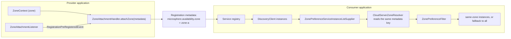

中文版本：[简体中文](zh/microsphere-multiactive-spring-cloud.md)

# microsphere-multiactive-spring-cloud

## Overview

`microsphere-multiactive-spring-cloud` closes the loop on the Spring Cloud side, with two independent features:

1. **Publisher side** — when a service registers itself, its zone is written into the registration metadata under the
   key `microsphere.availability.zone`. Implemented by `ZoneCloudAutoConfiguration`, `ZoneAttachmentListener` and the
   imported `ZoneAttachmentHandler`.
2. **Consumer side** — Spring Cloud LoadBalancer instance lists are narrowed to same-zone instances before load
   balancing. Implemented by `CustomizedLoadBalancerAutoConfiguration`, `CustomizedLoadBalancerClientConfiguration` and
   `ZonePreferenceServiceInstanceListSupplier`, all driven by `ZonePreferenceFilter` from
   [microsphere-multiactive-commons](microsphere-multiactive-commons.md).

`CloudServerZoneResolver` is the bridge: it reads the metadata key back out of a `ServiceInstance`.

Neither feature is on by default: the publisher side requires a service-registry integration with auto-registration
enabled, and the consumer side requires an explicit opt-in property.



## Maven Coordinates

```xml
<dependency>
    <groupId>io.github.microsphere-projects</groupId>
    <artifactId>microsphere-multiactive-spring-cloud</artifactId>
    <version>0.1.14-SNAPSHOT</version>
</dependency>
```

- `groupId`: `io.github.microsphere-projects`
- `artifactId`: `microsphere-multiactive-spring-cloud`
- `version`: `${revision}` → `0.1.14-SNAPSHOT` in this snapshot; newest published release `0.1.13`
- `packaging`: `jar`
- `<name>`: `Microsphere :: Multi-Active :: Spring Cloud`
- Managed by [the BOM](microsphere-multiactive-dependencies.md): **no** — the BOM of this line lists
  `microsphere-multiactive-spring-cloud-starter` and `microsphere-multiactive-spring-cloud-loadbalancer` instead, and
  neither is built by this branch, so the version of this artifact must be declared explicitly.

## Version Information

| Item | Value | Verified in |
|------|-------|-------------|
| Documentation line / Git branch | `1.x` / `release-1.x` | this doc set |
| Artifact version | `0.1.14-SNAPSHOT` | root `pom.xml` `<revision>` |
| Compile-scope dependency | `io.github.microsphere-projects:microsphere-multiactive-spring-boot:${revision}` (transitively `spring`, `commons`) | `microsphere-multiactive-spring-cloud/pom.xml` |
| Optional dependencies | `microsphere-annotation-processor`, `io.github.microsphere-projects:microsphere-spring-cloud-commons`, `spring-boot-starter`, `spring-boot-starter-actuator`, `spring-boot-starter-web`, `spring-boot-configuration-processor`, `spring-boot-autoconfigure-processor`, `org.springframework.cloud:spring-cloud-commons`, `spring-cloud-context`, `spring-cloud-loadbalancer` | `microsphere-multiactive-spring-cloud/pom.xml` |
| Test dependencies | `junit-jupiter`, `spring-boot-starter-test`, `microsphere-spring-boot-test`, `logback-classic` | `microsphere-multiactive-spring-cloud/pom.xml` |
| JDK | no compiler level declared in this repository; CI tests this module on JDK 8, 11, 17, 21, 25 | reactor POMs, `.github/workflows/maven-build.yml` |
| Spring Cloud compatibility | `Hoxton.SR12` / `2020.0.5` / `2021.0.9`, each paired with Spring Boot `2.3.12.RELEASE` / `2.4.13` / `2.6.15` (default profile `spring-cloud-2021`); the versions come from the external parent, the profile names from CI | `.github/workflows/maven-build.yml`, `microsphere-multiactive-parent/pom.xml` |
| Reactor requirement | `ZonePreferenceServiceInstanceListSupplier.get()` returns `reactor.core.publisher.Flux`, supplied by `spring-cloud-loadbalancer` | source of this module |
| Module requirements | publisher side: a Spring Cloud `Registration`, `RegistrationPreRegisteredEvent` and `EventPublishingRegistrationAspect` from `microsphere-spring-cloud-commons`; consumer side: `spring-cloud-loadbalancer` and a `DiscoveryClient` bean | `ZoneCloudAutoConfiguration`, `CustomizedLoadBalancerClientConfiguration` |

> **Runtime prerequisites.** `microsphere-spring-cloud-commons` is declared optional but the code and the conditions
> depend on it directly (`ConditionalOnAutoServiceRegistrationEnabled`, `RegistrationPreRegisteredEvent`,
> `ServiceRegistryConstants.REGISTRATION_CLASS_NAME`, `EventPublishingRegistrationAspect`). Add it to your build if you
> want the publisher side to activate. Spring Cloud LoadBalancer itself must also be on the classpath for the consumer
> side.

## Auto-Configuration Registration

Both configurations are registered, again through two files:

| Resource | Content |
|----------|---------|
| `META-INF/spring.factories` → `org.springframework.boot.autoconfigure.EnableAutoConfiguration` | `io.microsphere.multiple.active.zone.spring.cloud.autoconfigure.ZoneCloudAutoConfiguration`, `io.microsphere.multiple.active.zone.spring.cloud.loadbalancer.CustomizedLoadBalancerAutoConfiguration` |
| `META-INF/spring/org.springframework.boot.autoconfigure.AutoConfiguration.imports` | the same two classes |
| `META-INF/config/default/features.yaml` | declares the class membership of the features named `microsphere-multiactive-commons`, `microsphere-multiactive-spring`, `microsphere-multiactive-spring-cloud` for the Microsphere Spring Cloud feature mechanism |

The shipped `features.yaml` lists, verbatim:

```yaml
microsphere:
  spring:
    cloud:
      features:
        named:
          microsphere-multiactive-commons:
            - io.microsphere.multiple.active.zone.ZoneAttachmentHandler
            - io.microsphere.multiple.active.zone.ZoneContext
            - io.microsphere.multiple.active.zone.ZonePreferenceFilter
            - io.microsphere.multiple.active.zone.ZoneResolver
          microsphere-multiactive-spring:
            - io.microsphere.multiple.active.zone.spring.ZoneLocator
            - io.microsphere.multiple.active.zone.spring.event.ZoneContextChangedListener
          microsphere-multiactive-spring-cloud:
            - WebEndpointApplicationContextInitializer=io.microsphere.spring.cloud.gateway.server.webmvc.context.WebEndpointApplicationContextInitializer
```

The last entry names a Spring Cloud Gateway class rather than a class of this module; it is present as-is in this
snapshot.

## Public API

### `CloudServerZoneResolver` (`class`, package `io.microsphere.multiple.active.zone.spring.cloud`)

`public class CloudServerZoneResolver implements ZoneResolver<ServiceInstance>`

| Member | Signature / behaviour |
|--------|----------------------|
| `INSTANCE` | `public static final CloudServerZoneResolver INSTANCE` — a stateless singleton you can reuse instead of instantiating |
| `resolve(ServiceInstance)` | returns `serviceInstance.getMetadata().get("microsphere.availability.zone")`, or `null` when the metadata map is `null` |

### `ZoneCloudAutoConfiguration` (`class`, package `...spring.cloud.autoconfigure`)

The publisher-side configuration. Its full condition set:

```java
@Configuration(proxyBeanMethods = false)
@ConditionalOnAvailabilityZoneAvailable
@ConditionalOnAutoServiceRegistrationEnabled
@ConditionalOnClass(name = {
        "org.aspectj.lang.annotation.Aspect",                                                                        // AspectJ API
        "io.microsphere.spring.cloud.client.service.registry.event.RegistrationPreRegisteredEvent",                  // Microsphere Spring Cloud Commons API
        REGISTRATION_CLASS_NAME
})
@ConditionalOnBean(ZoneContext.class)
@AutoConfigureAfter(
        value = {
                ZoneAutoConfiguration.class
        },
        name = {
                "org.springframework.cloud.netflix.eureka.EurekaClientAutoConfiguration",                            // Spring Cloud Netflix Eureka API
                "io.microsphere.spring.cloud.client.service.registry.autoconfigure.ServiceRegistryAutoConfiguration" // Microsphere Spring Cloud Commons API
        })
@Import(value = {
        ZoneAttachmentHandler.class
})
public class ZoneCloudAutoConfiguration {
}
```

| Element | Detail |
|---------|--------|
| `@ConditionalOnAvailabilityZoneAvailable` | requires `ZoneContext` + `ZoneLocator` classes and `microsphere.availability.zone.enabled` (default `true`) — see [spring-boot](microsphere-multiactive-spring-boot.md) |
| `@ConditionalOnAutoServiceRegistrationEnabled` | from `microsphere-spring-cloud-commons`; the tests disable the feature with `spring.cloud.service-registry.auto-registration.enabled=false` |
| `@ConditionalOnClass(name = ...)` | AspectJ, `RegistrationPreRegisteredEvent` and `REGISTRATION_CLASS_NAME` (a constant of `ServiceRegistryConstants` in `microsphere-spring-cloud-commons`; its literal value is not part of this repository) |
| `@ConditionalOnBean(ZoneContext.class)` | needs the `ZoneContext` bean, normally created by `ZoneAutoConfiguration` |
| `@AutoConfigureAfter(...)` | ordered after `ZoneAutoConfiguration`, Eureka's `EurekaClientAutoConfiguration` and Microsphere's `ServiceRegistryAutoConfiguration` |
| `@Import(ZoneAttachmentHandler.class)` | registers `ZoneAttachmentHandler` itself as a bean (Spring treats an imported plain class as a bean definition); it is **not** declared with a `@Bean` method here |

Bean produced:

| Bean | Conditions | Value |
|------|-----------|-------|
| `zoneAttachmentListener()` | `@ConditionalOnBean(type = "io.microsphere.spring.cloud.client.service.registry.aspect.EventPublishingRegistrationAspect")`, `@ConditionalOnMissingBean` | `new ZoneAttachmentListener()` |

Consequence: the listener exists **only** when `EventPublishingRegistrationAspect` is also a bean. If the aspect is
absent, no zone is attached even though the configuration itself matched.

### `ZoneAttachmentListener` (`class`, package `...spring.cloud.event`)

`public class ZoneAttachmentListener implements ApplicationListener<RegistrationPreRegisteredEvent>, ApplicationContextAware`

| Member | Behaviour |
|--------|-----------|
| `onApplicationEvent(RegistrationPreRegisteredEvent)` | takes `event.getRegistration().getMetadata()`, looks up the `ZoneAttachmentHandler` bean and calls `attachZone(metadata)` |
| `setApplicationContext(ApplicationContext)` | stores the context used for that lookup |

Note the generic argument: this line listens for Microsphere's `RegistrationPreRegisteredEvent`, not for Spring Cloud's
own `InstancePreRegisteredEvent` (the latter is only referenced in the Javadoc).

### `CustomizedLoadBalancerAutoConfiguration` (`class`, package `...spring.cloud.loadbalancer`)

```java
@Configuration(proxyBeanMethods = false)
@ConditionalOnProperty(value = "microsphere.spring.cloud.loadbalancer.customized", havingValue = "true")
@ConditionalOnClass(name = {
        "org.springframework.cloud.loadbalancer.annotation.LoadBalancerClient"
})
@LoadBalancerClients(defaultConfiguration = CustomizedLoadBalancerClientConfiguration.class)
public class CustomizedLoadBalancerAutoConfiguration {
}
```

| Element | Detail |
|---------|--------|
| `microsphere.spring.cloud.loadbalancer.customized` | must be exactly `true`; there is no `matchIfMissing`, so the feature is **off** by default |
| `@ConditionalOnClass(name = ...)` | requires Spring Cloud LoadBalancer on the classpath |
| `@LoadBalancerClients(defaultConfiguration = ...)` | installs `CustomizedLoadBalancerClientConfiguration` as the default configuration for **every** load-balancer client |

### `CustomizedLoadBalancerClientConfiguration` (`class`)

Registered per load-balancer client context. It contributes one always-present bean and two conditional suppliers:

| Bean / member | Conditions | Behaviour |
|---------------|-----------|-----------|
| `zonePreferenceFilter(ZoneContext)` | none | `new ZonePreferenceFilter<>(zoneContext, new CloudServerZoneResolver())` — note a fresh resolver instance, not the `INSTANCE` singleton |
| `ReactiveConfiguration.optimizedZonePreferenceDiscoveryClientServiceInstanceListSupplier(ConfigurableApplicationContext, ZonePreferenceFilter<ServiceInstance>)` | `@ConditionalOnReactiveDiscoveryEnabled`, `@Order(193827465)`, `@ConditionalOnBean(DiscoveryClient.class)`, `@ConditionalOnMissingBean`, `@Conditional(OptimizedZoneConfigurationCondition.class)` | `ServiceInstanceListSupplier.builder().withDiscoveryClient().withCaching().with((ctx, delegate) -> new ZonePreferenceServiceInstanceListSupplier(delegate, zonePreferenceFilter)).build(context)` |
| `BlockingConfiguration.optimizedZonePreferenceServiceInstanceListSupplier(ConfigurableApplicationContext, ZonePreferenceFilter<ServiceInstance>)` | `@ConditionalOnBlockingDiscoveryEnabled`, `@Order(193827466)`, plus the same three conditions as above | identical chain built with `.withBlockingDiscoveryClient()` |
| `OptimizedZoneConfigurationCondition` (`static class` implementing `Condition`) | | `LoadBalancerEnvironmentPropertyUtils.equalToForClientOrDefault(context.getEnvironment(), "configurations", "optimized-zone-preference")` — i.e. the supplier is installed only for a client whose LoadBalancer `configurations` property resolves to `optimized-zone-preference` |

The two `@Order` values are only large enough to place these nested configurations behind Spring Cloud's own
`ReactiveBlockingLoadBalancerClient` / default-retry configurations in the per-client context; the numbers themselves
carry no documented meaning.

The `configurations` key is resolved by Spring Cloud LoadBalancer's own per-client property mechanism, so the property
name follows Spring Cloud conventions (`spring.cloud.loadbalancer.` prefix, per-client and default variants) rather than
anything defined in this repository — the value this library looks for is `optimized-zone-preference`.

### `ZonePreferenceServiceInstanceListSupplier` (`class`)

`public class ZonePreferenceServiceInstanceListSupplier extends DelegatingServiceInstanceListSupplier`

| Member | Behaviour |
|--------|-----------|
| constructor | `public ZonePreferenceServiceInstanceListSupplier(ServiceInstanceListSupplier delegate, ZonePreferenceFilter<ServiceInstance> zonePreferenceFilter)` |
| `get()` | `return getDelegate().get().map(this::filteredByZone);` — every emitted list passes through `ZonePreferenceFilter.filter(...)` |
| `filteredByZone(List<ServiceInstance>)` | `private`; delegates to the filter |

Its Javadoc `@see` points at Spring Cloud's own
`org.springframework.cloud.loadbalancer.core.ZonePreferenceServiceInstanceListSupplier`; this class is the replacement
for it, adding the disabled-zone draining, the readiness percentage and the minimum-available thresholds from
[commons](microsphere-multiactive-commons.md).

## Configuration Properties

| Property | Default | Effect |
|----------|---------|--------|
| `microsphere.spring.cloud.loadbalancer.customized` | unset → feature off | installs `CustomizedLoadBalancerClientConfiguration` as the default configuration for all load-balancer clients |
| `...configurations = optimized-zone-preference` (Spring Cloud LoadBalancer key, resolved via `LoadBalancerEnvironmentPropertyUtils.equalToForClientOrDefault`) | unset → supplier not installed | opts a specific client (or the default) into the zone-preference supplier |
| `microsphere.availability.zone.enabled` | `true` | master switch inherited from the boot layer; `false` disables both configurations |
| `microsphere.availability.zone.preference.enabled` | `false` | must be `true` before the supplier narrows anything |
| `microsphere.availability.zone.preference.upstream.zone-ready-percentage` | `100` | readiness gate of the filter |
| `microsphere.availability.zone.preference.upstream.same-zone-min-available` | `5` | minimum same-zone instance count |
| `microsphere.availability.zone.preference.upstream.disabled-zone` | unset | zones drained before preference |
| `microsphere.availability.zone` | `defaultZone` | zone of the current application; also the metadata key written and read |
| `spring.cloud.service-registry.auto-registration.enabled` | Spring Cloud default | disables the publisher-side `ZoneCloudAutoConfiguration` when `false` (asserted by `ZoneCloudAutoConfigurationTest`) |
| `microsphere.spring.cloud.service-registry.auto-registration.simple.enabled` | unset | used by the integration test to register against `InMemoryServiceRegistry` (property owned by `microsphere-spring-cloud-commons`) |

## Examples

### Conditional contract of the publisher-side configuration (`ZoneCloudAutoConfigurationTest`)

```java
@SpringBootTest(
        classes = {
                ZoneContext.class,
                EventPublishingRegistrationAspect.class,
                ZoneCloudAutoConfigurationTest.class
        },
        webEnvironment = NONE
)
class ZoneCloudAutoConfigurationTest extends AutoConfigurationTest<ZoneCloudAutoConfiguration> {

    @Override
    protected void configureAutoConfiguredClasses(Set<Class<?>> autoConfiguredClasses) {
        autoConfiguredClasses.add(ZoneAttachmentHandler.class);
        autoConfiguredClasses.add(ZoneAttachmentListener.class);
    }

    @Override
    protected void configureGlobalDisabledPropertyValues(Set<String> globalDisabledPropertyValues) {
        globalDisabledPropertyValues.add("microsphere.availability.zone.enabled=false");
        globalDisabledPropertyValues.add("spring.cloud.service-registry.auto-registration.enabled=false");
    }

    @Override
    protected void configureGlobalMissingClasses(Set<Class<?>> globalMissingClasses) {
        globalMissingClasses.add(ZoneLocator.class);
        globalMissingClasses.add(Aspect.class);
        globalMissingClasses.add(RegistrationPreRegisteredEvent.class);
        globalMissingClasses.add(Registration.class);
    }
}
```

Read as a specification: the two beans this configuration is expected to contribute are `ZoneAttachmentHandler` and
`ZoneAttachmentListener`, and the configuration backs off for any of four reasons — the zone feature disabled, auto
registration disabled, `ZoneLocator` missing, or AspectJ / `RegistrationPreRegisteredEvent` / `Registration` missing.

### End-to-end registration (`ZoneCloudAutoConfigurationIntegrationTest`)

```java
@SpringBootTest(
        classes = {
                InMemoryServiceRegistry.class,
                ZoneCloudAutoConfigurationIntegrationTest.class
        },
        webEnvironment = NONE,
        properties = {
                "server.port=8080",
                "spring.application.name=test-service",
                "microsphere.spring.cloud.service-registry.auto-registration.simple.enabled=true"
        }
)
@EnableAutoConfiguration
@EnableConfigurationProperties(value = {
        ServerProperties.class
})
public class ZoneCloudAutoConfigurationIntegrationTest {

    @Autowired
    private Registration registration;

    @Autowired
    private ServiceRegistry<Registration> serviceRegistry;

    @Autowired
    private ZoneContext zoneContext;

    @Autowired
    private CompositeZoneLocator compositeZoneLocator;

    @Autowired
    private ZoneAttachmentHandler zoneAttachmentHandler;

    @Autowired
    private ZoneAttachmentListener zoneAttachmentListener;

    @Test
    void test() {
        assertNotNull(zoneContext);
    }
}
```

`InMemoryServiceRegistry` (from `microsphere-spring-cloud-commons`) stands in for a real registry; the test proves the
whole publisher-side bean graph wires up — `Registration`, `ServiceRegistry`, `ZoneContext`, `CompositeZoneLocator`,
`ZoneAttachmentHandler` and `ZoneAttachmentListener` all resolve.

### Resolving a zone from instance metadata (`CloudServerZoneResolver`)

```java
ServiceInstance instance = /* from DiscoveryClient */;
String zone = CloudServerZoneResolver.INSTANCE.resolve(instance);
// equivalent to instance.getMetadata().get("microsphere.availability.zone"), null when metadata is null
```

## Integration

```xml
<dependency>
    <groupId>io.github.microsphere-projects</groupId>
    <artifactId>microsphere-multiactive-spring-cloud</artifactId>
    <version>0.1.13</version>
</dependency>
```

The version is mandatory: [the 1.x BOM](microsphere-multiactive-dependencies.md) does not manage this artifactId.

Minimal setup, provider and consumer sides together:

```properties
# both sides
microsphere.availability.zone=zone-a
microsphere.availability.zone.enabled=true

# consumer side: same-zone preference + explicit opt-in of the customized load balancer configuration
microsphere.availability.zone.preference.enabled=true
microsphere.availability.zone.preference.upstream.zone-ready-percentage=80
microsphere.availability.zone.preference.upstream.same-zone-min-available=2
microsphere.spring.cloud.loadbalancer.customized=true
```

For a single client rather than all of them, keep `microsphere.spring.cloud.loadbalancer.customized=true` and select the
`optimized-zone-preference` configuration through Spring Cloud LoadBalancer's `configurations` property for that
client, which is what `OptimizedZoneConfigurationCondition` checks. Per-client selection uses the client name, so
consult the Spring Cloud LoadBalancer documentation of the release train you are on; the value to set is
`optimized-zone-preference`.

If you need the zone in your own code rather than in a filter, the beans are available for injection:

```java
@Autowired
private ZonePreferenceFilter<ServiceInstance> zonePreferenceFilter;

List<ServiceInstance> preferred = zonePreferenceFilter.filter(allInstances);
```

## Related Documentation

- [User guide index](README.md)
- Upstream: [commons](microsphere-multiactive-commons.md), [spring](microsphere-multiactive-spring.md),
  [spring-boot](microsphere-multiactive-spring-boot.md)
- Downstream: [aws](microsphere-multiactive-aws.md) and [netflix](microsphere-multiactive-netflix.md) both declare this
  module as an optional dependency
- Root [README](../../../README.md) and [release notes](../../../release-notes.md)
- Developer guide: [../developer-guide/microsphere-multiactive-spring-cloud.md](../developer-guide/microsphere-multiactive-spring-cloud.md)

## 中文

中文版本：[简体中文](zh/microsphere-multiactive-spring-cloud.md)
