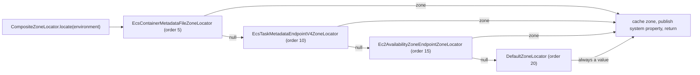

中文版本：[简体中文](zh/microsphere-multiactive-spring.md)

# microsphere-multiactive-spring

## Overview

`microsphere-multiactive-spring` is the Spring Framework layer. It turns the framework-free zone model of
[microsphere-multiactive-commons](microsphere-multiactive-commons.md) into a discovery mechanism:

- `ZoneLocator` is the SPI that answers "which zone am I running in?" from a Spring `Environment`.
- `AbstractZoneLocator` adds `Ordered` / `BeanNameAware` behaviour to implementations.
- `DefaultZoneLocator` is the always-supported fallback that reads `microsphere.availability.zone`.
- `CompositeZoneLocator` runs an ordered list of locators, returns the first non-null answer, caches it and publishes it
  as a JVM system property.
- `ZoneContextChangedListener` refreshes the `ZoneContext` from the `Environment` whenever the application context
  starts or the environment changes, and republishes the result as a `ZoneContextChangedEvent`.
- `ZoneUtils` centralises the two well-known bean names.

This module contains no auto-configuration and no `META-INF` resources at all: on plain Spring you register the beans
yourself, and on Spring Boot the beans are created by
[microsphere-multiactive-spring-boot](microsphere-multiactive-spring-boot.md).

## Maven Coordinates

```xml
<dependency>
    <groupId>io.github.microsphere-projects</groupId>
    <artifactId>microsphere-multiactive-spring</artifactId>
    <version>0.1.14-SNAPSHOT</version>
</dependency>
```

- `groupId`: `io.github.microsphere-projects`
- `artifactId`: `microsphere-multiactive-spring`
- `version`: `${revision}` → `0.1.14-SNAPSHOT` in this snapshot; newest published release `0.1.13`
- `packaging`: `jar`
- `<name>`: `Microsphere :: Multi-Active :: Spring`
- Managed by [the BOM](microsphere-multiactive-dependencies.md): yes

## Version Information

| Item | Value | Verified in |
|------|-------|-------------|
| Documentation line / Git branch | `1.x` / `release-1.x` | this doc set |
| Artifact version | `0.1.14-SNAPSHOT` | root `pom.xml` `<revision>` |
| Compile-scope dependency | `io.github.microsphere-projects:microsphere-multiactive-commons:${revision}` (transitive, not optional) | `microsphere-multiactive-spring/pom.xml` |
| Optional dependencies | `microsphere-annotation-processor`, `microsphere-spring-context`, `org.springframework:spring-context` | `microsphere-multiactive-spring/pom.xml` |
| Test dependencies | `junit-jupiter`, `org.springframework:spring-test`, `io.github.microsphere-projects:microsphere-spring-test`, `logback-classic` | `microsphere-multiactive-spring/pom.xml` |
| JDK | no compiler level declared in this repository; CI tests this module on JDK 8, 11, 17, 21, 25 | reactor POMs, `.github/workflows/maven-build.yml` |
| Spring Framework | the version is not declared in this repository; it comes from the Spring Boot train selected by the active Maven profile — Boot 2.3.12.RELEASE (Spring 5.2.x) through Boot 2.6.15 (Spring 5.3.x) | `microsphere-multiactive-parent/pom.xml`, CI profiles `spring-cloud-hoxton` / `-2020` / `-2021` |
| Module requirements | an `org.springframework.core.env.Environment` and, for the listener, a `ZoneContext` bean and a `ZoneLocator` bean in the context | sources of this module |

> **Runtime prerequisites.** `microsphere-spring-context` and `spring-context` are declared optional, so they are not
> transitive. The sources of this module also use `io.microsphere.logging.*` and `io.microsphere.util.*`
> (`AbstractZoneLocator`, `CompositeZoneLocator`, `ZoneUtils`, `ZoneContextChangedListener`), which come from
> `microsphere-java-core` — declared optional one level down in `microsphere-multiactive-commons`. In a Spring Boot
> application `spring-context` is already present; add `microsphere-java-core` if you depend on this jar standalone.

## Public API

### `ZoneLocator` (`interface`, package `io.microsphere.multiple.active.zone.spring`)

```java
public interface ZoneLocator {
    boolean supports(Environment environment);
    String locate(Environment environment);
}
```

| Method | Contract |
|--------|----------|
| `supports(Environment)` | whether this locator can contribute in the current environment. When it returns `false`, `CompositeZoneLocator` skips `locate` entirely |
| `locate(Environment)` | the zone, or `null` when unknown. Returning `null` lets the next locator try; throwing is caught by the composite |

Implementations are `DefaultZoneLocator` (this module) and the three AWS locators in
[microsphere-multiactive-aws](microsphere-multiactive-aws.md).

### `AbstractZoneLocator` (`abstract class`)

`public abstract class AbstractZoneLocator implements ZoneLocator, BeanNameAware, Ordered`

| Member | Signature | Notes |
|--------|-----------|-------|
| constructor | `protected` implicitly via `public AbstractZoneLocator(int order)` | the only constructor takes the initial order |
| `setBeanName(String)` | `public final void` | Spring `BeanNameAware`; stores into the `protected String beanName` field |
| `getOrder()` | `public final int getOrder()` | `Ordered`; final, so subclasses cannot change the contract |
| `setOrder(int)` | `public final void setOrder(int)` | re-orders at runtime |
| `logger` | `protected final io.microsphere.logging.Logger` | named after the concrete subclass |
| `toString()` | `ZoneLocator{beanName='...', order=...}` | used verbatim in the composite's log lines |

Because `getOrder()` is `final`, custom locators must set the order through the constructor or `setOrder`, not by
overriding.

### `DefaultZoneLocator` (`class`)

`public class DefaultZoneLocator extends AbstractZoneLocator`

| Member | Value / behaviour |
|--------|-------------------|
| `public static final int DEFAULT_ORDER` | `20` |
| `public DefaultZoneLocator()` | delegates to `super(DEFAULT_ORDER)` |
| `supports(Environment)` | always `true` — this is the catch-all locator |
| `locate(Environment)` | returns `environment.getProperty("microsphere.availability.zone")` when it has text, otherwise `ZoneConstants.DEFAULT_ZONE` (`defaultZone`). It never returns `null` |

Asserted by `DefaultZoneLocatorTest`: `DEFAULT_ORDER` is 20, `setOrder(5)` changes it, an absent property yields
`defaultZone`, and a property of `zone-a` yields `zone-a`.

### `CompositeZoneLocator` (`class`)

`public class CompositeZoneLocator implements ZoneLocator` — the bean registered under the name `zoneLocator`.

| Member | Signature / behaviour |
|--------|----------------------|
| constructor | `public CompositeZoneLocator(List<ZoneLocator> zoneLocators)` — copies the list, then sorts it with `AnnotationAwareOrderComparator`. A `null` argument raises `IllegalArgumentException` (`Assert.notNull`) |
| `supports(Environment)` | `true` if **at least one** delegate supports, `false` otherwise (an empty list never supports) |
| `locate(Environment)` | see the steps below |
| `toString()` | `CompositeZoneLocator{zoneLocators=[...], zone=...}` |

`locate` behaves as implemented:

1. If a zone was located before, the cached value is returned immediately — discovery runs at most once per instance.
2. `microsphere.availability.zone.locator.fast-fail` (`boolean`, default `false`) is read from the `Environment`.
3. Delegates are visited in order. For each one: `supports` → `locate`; the first non-`null` result wins and the loop
   stops. A delegate that returns `null` logs a warning; a delegate that throws is logged at error level and skipped.
4. With fast-fail on, the first delegate that returns `null` **or** throws stops the loop and, after the loop, an
   `IllegalStateException("The zone can't be located by <locator>")` is thrown.
5. If nobody located a zone, `null` is returned and cached as such (a warning is logged) — the next call re-runs
   discovery because `StringUtils.hasText(null)` is `false`.
6. On success, the zone is also written to the JVM system property `microsphere.current.availability.zone`, which is
   what `ZoneContext.getCurrentZone()` reads.

`CompositeZoneLocatorTest` asserts each branch: first-match wins, caching, unsupported delegates skipped, `null` result
when nobody locates, fast-fail on a `null` locator, fast-fail on a throwing locator, fall-through to the next locator
when fast-fail is off, and an empty delegate list.

### `ZoneUtils` (`abstract class`)

| Member | Value / signature |
|--------|-------------------|
| `public static final String ZONE_CONTEXT_BEAN_NAME` | `zoneContext` |
| `public static final String ZONE_LOCATOR_BEAN_NAME` | `zoneLocator` |
| `public static ZoneContext getZoneContext(ConfigurableListableBeanFactory)` | `beanFactory.getBean("zoneContext", ZoneContext.class)` |
| `public static ZoneLocator getZoneLocator(ConfigurableListableBeanFactory)` | `beanFactory.getBean("zoneLocator", ZoneLocator.class)` |

The class is `abstract` with a private constructor: it is not instantiable. Overriding the two bean names is not
possible on this line — if you declare your own `ZoneContext`/`ZoneLocator` beans, use exactly these names or
`ZoneUtils` (and therefore `ZoneAutoConfiguration`'s lookups) will not find them.

### `ZoneContextChangedEvent` (`class`, package `...zone.spring.event`)

`public class ZoneContextChangedEvent extends ApplicationContextEvent`

| Member | Signature |
|--------|-----------|
| constructor | `public ZoneContextChangedEvent(ApplicationContext context, ZoneContext zoneContext, List<PropertyChangeEvent> propertyChangeEvents)` — the list is wrapped with `Collections.unmodifiableList` |
| `getZoneContext()` | `public ZoneContext getZoneContext()` — the context after the change |
| `getPropertyChangeEvents()` | `public List<java.beans.PropertyChangeEvent> getPropertyChangeEvents()` — one entry per property that actually changed |
| `getSource()` / `getApplicationContext()` | inherited; both return the publishing `ApplicationContext` |

### `ZoneContextChangedListener` (`class`, package `...zone.spring.event`)

`public class ZoneContextChangedListener implements SmartApplicationListener, ApplicationContextAware, EnvironmentAware`

Which event triggers a refresh depends on what is on the classpath. The two class names are resolved once in static
initialisation, so the decision is fixed at class-load time:

| Classpath | Trigger events handled |
|-----------|------------------------|
| Spring Cloud (`EnvironmentChangeEvent` **and** `ApplicationStartedEvent` resolvable) | `org.springframework.cloud.context.environment.EnvironmentChangeEvent` and `org.springframework.boot.context.event.ApplicationStartedEvent` |
| Spring Boot only (`ApplicationStartedEvent` resolvable, `EnvironmentChangeEvent` not) | `ApplicationStartedEvent` |
| Plain Spring Framework (neither) | `org.springframework.context.event.ContextRefreshedEvent` |

On each trigger, `changeZoneContext(...)` applies all seven watched properties and, if at least one `PropertyChangeEvent`
was produced, publishes a `ZoneContextChangedEvent`. The mapping is:

| Property read from the `Environment` | `ZoneContext` setter | Default when the property is absent |
|--------------------------------------|----------------------|--------------------------------------|
| `microsphere.availability.zone` | `setZone(String)` | previous zone is kept — an absent or blank value changes nothing |
| `microsphere.availability.zone.enabled` | `setEnabled(boolean)` | `true` |
| `microsphere.availability.zone.preference.enabled` | `setPreferenceEnabled(boolean)` | `false` |
| `microsphere.availability.zone.preference.filter.order` | `setPreferenceFilterOrder(int)` | `10` |
| `microsphere.availability.zone.preference.upstream.zone-ready-percentage` | `setPreferenceUpstreamZoneReadyPercentage(int)` | `100` |
| `microsphere.availability.zone.preference.upstream.same-zone-min-available` | `setPreferenceUpstreamSameZoneMinAvailable(int)` | `5` |
| `microsphere.availability.zone.preference.upstream.disabled-zone` | `setPreferenceUpstreamDisabledZone(String)` | `null` |

Two members are `protected` and therefore part of the extension surface:

- `ZONE_CONTEXT_PROPERTY_NAMES` — the immutable list of the seven keys above (size asserted as `7`).
- `propertyChangedHandlers` — a `Map<String, Consumer<String>>` keyed by the same names; removing an entry disables that
  property for that listener instance.

`setApplicationContext(ApplicationContext)` looks up `ZoneContext` **and** `ZoneLocator` **by type**; both beans must
exist or the listener fails to initialise.

**Revert to discovery.** Setting the zone property to the sentinel value `originalZone`
(`ZoneConstants.ORIGINAL_ZONE`, compared case-insensitively) makes the listener call
`zoneLocator.locate(environment)` and use the result; if the locator's `supports(...)` is `false`, the zone becomes
`defaultZone`. Verified by `ZoneContextChangedListenerTest#testRevertOriginalZoneWhenLocatorDoesNotSupport`.

> Gotcha in this combination: when the located zone comes from `DefaultZoneLocator`, that locator re-reads
> `microsphere.availability.zone` — which currently holds the sentinel `originalZone` — and returns it verbatim.
> `testRevertOriginalZoneWhenZoneIsOriginal` asserts only that the result is non-null, which reflects the actual
> behaviour. To revert to genuinely discovered coordinates, put a real discovery locator first (see the AWS module).

## Locator Ordering in Practice

`CompositeZoneLocator` sorts delegates ascending, so a first non-`null` answer wins. The orders fixed by the code on
this line are:

| `ZoneLocator` | Module | Order | `supports(...)` | `locate(...)` returns `null` when |
|---------------|--------|-------|-----------------|-----------------------------------|
| `EcsContainerMetadataFileZoneLocator` | aws | `5` | the environment contains `ECS_CONTAINER_METADATA_FILE` | path blank, file unreadable, JSON parse failure |
| `EcsTaskMetadataEndpointV4ZoneLocator` | aws | `10` | the environment contains `ECS_CONTAINER_METADATA_URI_V4` | URI blank, HTTP or JSON failure |
| `Ec2AvailabilityZoneEndpointZoneLocator` | aws | `15` | always `true` | HTTP request failure |
| `DefaultZoneLocator` | spring | `20` | always `true` | never — falls back to `defaultZone` |



Because `DefaultZoneLocator` never returns `null` and `supports` is `true`, it is the terminator of the chain: as long
as it is present, `locate` always produces a value and fast-fail can only be triggered by locators ordered before it.

## Examples

Adapted from `src/test/java` of this module.

### Locate from a Spring property (`DefaultZoneLocatorTest`)

```java
DefaultZoneLocator locator = new DefaultZoneLocator();
assertEquals(DefaultZoneLocator.DEFAULT_ORDER, locator.getOrder()); // 20

StandardEnvironment environment = new StandardEnvironment();
Map<String, Object> props = new HashMap<>();
props.put(ZoneConstants.ZONE_PROPERTY_NAME, "zone-a");
environment.getPropertySources().addFirst(new MapPropertySource("test", props));

assertEquals("zone-a", locator.locate(environment));

// No property at all: the default zone is applied instead of null.
assertEquals(ZoneConstants.DEFAULT_ZONE, new DefaultZoneLocator().locate(new StandardEnvironment()));
```

### Compose locators and control failure handling (`CompositeZoneLocatorTest`)

```java
ZoneLocator unsupported = new ZoneLocator() {
    @Override
    public boolean supports(Environment env) {
        return false;
    }

    @Override
    public String locate(Environment env) {
        return "should-not-be-called";
    }
};

ZoneLocator fixed = new ZoneLocator() {
    @Override
    public boolean supports(Environment env) {
        return true;
    }

    @Override
    public String locate(Environment env) {
        return "zone-b";
    }
};

CompositeZoneLocator composite = new CompositeZoneLocator(Arrays.asList(unsupported, fixed));
assertTrue(composite.supports(new StandardEnvironment()));
assertEquals("zone-b", composite.locate(new StandardEnvironment()));
// The result is cached: a second call returns the same zone without re-running discovery.
assertEquals("zone-b", composite.locate(new StandardEnvironment()));
```

```java
// Fast-fail: with microsphere.availability.zone.locator.fast-fail=true a locator that supports
// but cannot locate (or that throws) aborts the whole chain with IllegalStateException.
StandardEnvironment env = new StandardEnvironment();
Map<String, Object> props = new HashMap<>();
props.put(ZoneConstants.LOCATOR_FAST_FAIL_PROPERTY_NAME, "true");
env.getPropertySources().addFirst(new MapPropertySource("test", props));

CompositeZoneLocator composite = new CompositeZoneLocator(Collections.singletonList(nullLocator()));
assertThrows(IllegalStateException.class, () -> composite.locate(env));

// Without fast-fail the exception is logged and the next locator still gets a chance.
CompositeZoneLocator lenient = new CompositeZoneLocator(
        Arrays.asList(throwingLocator(), fixedLocator("zone-fallback")));
assertEquals("zone-fallback", lenient.locate(new StandardEnvironment()));
```

### Register the listener on plain Spring (`ZoneContextChangedListenerTest`)

```java
ZoneContext zoneContext = ZoneContext.get();
zoneContext.reset();

GenericApplicationContext ctx = new GenericApplicationContext();
ctx.getBeanFactory().registerSingleton(ZoneUtils.ZONE_CONTEXT_BEAN_NAME, zoneContext);
ctx.getBeanFactory().registerSingleton(ZoneUtils.ZONE_LOCATOR_BEAN_NAME,
        new CompositeZoneLocator(Collections.singletonList(new DefaultZoneLocator())));

Map<String, Object> props = new HashMap<>();
props.put(ZoneConstants.ZONE_PROPERTY_NAME, "zone-from-prop");
props.put(ZoneConstants.PREFERENCE_ENABLED_PROPERTY_NAME, "true");
props.put(ZoneConstants.PREFERENCE_UPSTREAM_SAME_ZONE_MIN_AVAILABLE_PROPERTY_NAME, "3");
ctx.getEnvironment().getPropertySources().addFirst(new MapPropertySource("test-props", props));

ctx.refresh();

ZoneContextChangedListener listener = new ZoneContextChangedListener();
listener.setEnvironment(ctx.getEnvironment());
listener.setApplicationContext(ctx);
ctx.addApplicationListener(listener);
listener.onApplicationEvent(new ContextRefreshedEvent(ctx));   // plain Spring trigger

assertEquals("zone-from-prop", zoneContext.getZone());
assertTrue(zoneContext.isPreferenceEnabled());
assertEquals(3, zoneContext.getPreferenceUpstreamSameZoneMinAvailable());
ctx.close();
```

### React to a zone change (`ZoneContextChangedEventTest`)

```java
ZoneContext zoneContext = ZoneContext.get();
PropertyChangeEvent pce1 = new PropertyChangeEvent(zoneContext, "zone", "old-zone", "new-zone");
PropertyChangeEvent pce2 = new PropertyChangeEvent(zoneContext, "enabled", true, false);

ZoneContextChangedEvent event =
        new ZoneContextChangedEvent(ctx, zoneContext, Arrays.asList(pce1, pce2));

assertEquals(2, event.getPropertyChangeEvents().size());
assertSame(zoneContext, event.getZoneContext());
assertSame(ctx, event.getApplicationContext());
```

### Retrieve the beans by well-known name (`ZoneUtilsTest`)

```java
StaticApplicationContext context = new StaticApplicationContext();
ZoneContext zoneContext = ZoneContext.get();
context.getBeanFactory().registerSingleton(ZoneUtils.ZONE_CONTEXT_BEAN_NAME, zoneContext);
context.getBeanFactory().registerSingleton(ZoneUtils.ZONE_LOCATOR_BEAN_NAME, new DefaultZoneLocator());

assertSame(zoneContext, ZoneUtils.getZoneContext(context.getBeanFactory()));
assertSame(ZoneUtils.getZoneLocator(context.getBeanFactory()).getClass(), DefaultZoneLocator.class);
```

## Integration

On plain Spring Framework, both beans and the listener are declared by hand. The bean names must be
`zoneContext` and `zoneLocator`, and both must be present because `ZoneContextChangedListener` looks them up by type:

```xml
<dependency>
    <groupId>io.github.microsphere-projects</groupId>
    <artifactId>microsphere-multiactive-spring</artifactId>
    <version>0.1.13</version>
</dependency>
```

```java
@Configuration
public class ZoneConfiguration {

    @Bean(name = ZoneUtils.ZONE_CONTEXT_BEAN_NAME)
    public ZoneContext zoneContext() {
        return ZoneContext.get();
    }

    @Bean(name = ZoneUtils.ZONE_LOCATOR_BEAN_NAME)
    public ZoneLocator zoneLocator() {
        List<ZoneLocator> locators = new ArrayList<>();
        locators.add(new DefaultZoneLocator());     // order 20, always terminates the chain
        return new CompositeZoneLocator(locators);
    }

    @Bean
    public ZoneContextChangedListener zoneContextChangedListener() {
        return new ZoneContextChangedListener();
    }
}
```

With `spring-boot` or `spring-cloud` on the classpath, prefer
[the auto-configuration module](microsphere-multiactive-spring-boot.md): it creates exactly these beans and imports
the listener for you.

## Related Documentation

- [User guide index](README.md)
- Upstream: [microsphere-multiactive-commons.md](microsphere-multiactive-commons.md)
- Downstream: [spring-boot](microsphere-multiactive-spring-boot.md),
  [spring-cloud](microsphere-multiactive-spring-cloud.md), [aws](microsphere-multiactive-aws.md),
  [netflix](microsphere-multiactive-netflix.md)
- Root [README](../../../README.md) and [release notes](../../../release-notes.md)
- Developer guide: [../developer-guide/microsphere-multiactive-spring.md](../developer-guide/microsphere-multiactive-spring.md)

## 中文

中文版本：[简体中文](zh/microsphere-multiactive-spring.md)
