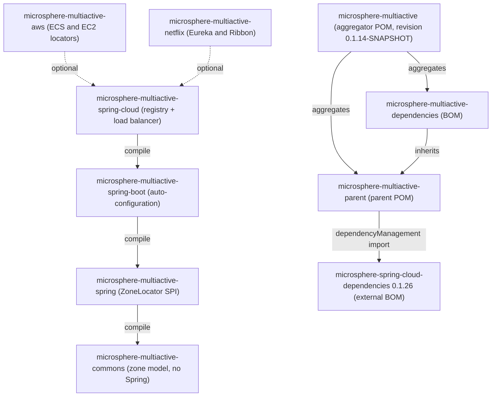

English version: [English](../README.md)

# Microsphere Multiactive —— 用户指南（`1.x`）

本文档是 **`1.x`** 文档线的用户指南，对应 `microsphere-multiactive` 仓库的 **`release-1.x`** 分支。
Microsphere Multiactive 是一个多活 / 可用区感知的容错库：它发现进程所在的可用区（zone），把该可用区写入服务注册
元数据，并在下游服务列表上做同区优先路由，同时保留跨区兜底能力。

**本文档线面向必须停留在 `0.1.x` 制品的应用**，也就是必须运行在 Spring Boot 2.x 与 Spring Cloud
`Hoxton` – `2021.0.x` 版本序列上的应用。如果你刚开始接入，或者可以向前升级，请使用当前文档线：
[../../../current/user-guide/zh/README.md](../../../current/user-guide/zh/README.md)。

本文档中的每一条结论都来自该分支的源码：POM 文件、`src/main/java`、`src/main/resources/META-INF`、
`src/test/java`、`.github/workflows` 以及快照内的 `README.md` / `release-notes.md`。快照中不存在的 API 一律不写。

## 版本一览

| 项目 | 取值 | 定义位置 |
|------|-------|---------------------|
| Git 分支 / 文档线 | `release-1.x` / `1.x` | `.github/workflows/maven-build.yml`、`maven-publish.yml` |
| 本快照中的制品版本 | `0.1.14-SNAPSHOT` | 根 [`pom.xml`](../../../../pom.xml) 的 `<revision>` 属性 |
| 该线最近一次已发布的版本 | `0.1.13` | [`release-notes.md`](../../../../release-notes.md)、根 [`README.md`](../../../../README.md) 分支表 |
| 所有模块的 `groupId` | `io.github.microsphere-projects` | 各模块 POM |
| JDK | 本仓库任何 POM 都未声明编译级别；CI 在 JDK 8、11、17、21、25 上编译与测试，在 JDK 11 上发布 | `.github/workflows/maven-build.yml`、`maven-publish.yml` |
| Maven | Apache Maven 3.9.15（wrapper，`wrapperVersion=3.3.4`、`distributionType=only-script`） | `.mvn/wrapper/maven-wrapper.properties` |
| Spring Cloud 兼容范围 | `Hoxton.SR12` – `2021.0.9`，由 CI 的 Maven profile `spring-cloud-hoxton`、`spring-cloud-2020`、`spring-cloud-2021`（默认 `spring-cloud-2021`）决定 | 根 `README.md`、`.github/workflows/maven-build.yml` |
| Spring Boot 兼容范围 | `2.3.12.RELEASE`（Hoxton）/ `2.4.13`（2020.0.x）/ `2.6.15`（2021.0.x，默认）——这些版本由外部的 `microsphere-spring-cloud-parent:0.1.26` POM 声明，不在本仓库内 | `microsphere-multiactive-parent/pom.xml` 的导入链 |
| Netflix | Ribbon 在 `microsphere-multiactive-netflix/pom.xml` 中固定为 `2.7.18`；Eureka client 与 `spring-cloud-netflix-eureka-client` 的版本由所选 Spring Cloud 版本序列决定 | `microsphere-multiactive-netflix/pom.xml` |
| AWS | 不含任何 AWS SDK：locator 直接对 ECS/EC2 元数据端点发起 HTTP 请求，并用 `jackson-databind` 解析 JSON | `microsphere-multiactive-aws/pom.xml` 及源码 |
| parent 导入的外部 BOM | `io.github.microsphere-projects:microsphere-spring-cloud-dependencies:0.1.26` | `microsphere-multiactive-parent/pom.xml` |

## 目录

| 文档 | 模块 | 一句话说明 |
|----------|--------|----------------------|
| [microsphere-multiactive-parent.md](microsphere-multiactive-parent.md) | `microsphere-multiactive-parent` | 纯 POM 的父模块，被其余七个模块（六个 jar + BOM）继承；导入 `microsphere-spring-cloud-dependencies:0.1.26`，并承载 `${revision}` 的 CI 友好版本管理 |
| [microsphere-multiactive-dependencies.md](microsphere-multiactive-dependencies.md) | `microsphere-multiactive-dependencies` | `1.x` 的 BOM：把所有 Multi-Active 制品统一到 `${revision}`——以及你必须手工补齐的缺口 |
| [microsphere-multiactive-commons.md](microsphere-multiactive-commons.md) | `microsphere-multiactive-commons` | 与框架无关的可用区模型：`ZoneContext`、`ZoneConstants`、`ZoneResolver`、`ZonePreferenceFilter`、`ZoneAttachmentHandler`、`HttpUtils` |
| [microsphere-multiactive-spring.md](microsphere-multiactive-spring.md) | `microsphere-multiactive-spring` | `ZoneLocator` SPI、`DefaultZoneLocator`、`CompositeZoneLocator`、`ZoneUtils` 以及可用区上下文的事件与监听器 |
| [microsphere-multiactive-spring-boot.md](microsphere-multiactive-spring-boot.md) | `microsphere-multiactive-spring-boot` | Spring Boot 自动配置（`ZoneAutoConfiguration`）以及 `ConditionalOnAvailabilityZone*` 条件注解 |
| [microsphere-multiactive-spring-cloud.md](microsphere-multiactive-spring-cloud.md) | `microsphere-multiactive-spring-cloud` | 向服务注册写入可用区，并提供支持可用区的 Spring Cloud LoadBalancer `ServiceInstanceListSupplier` |
| [microsphere-multiactive-aws.md](microsphere-multiactive-aws.md) | `microsphere-multiactive-aws` | 三个 `ZoneLocator`：ECS 容器元数据文件、ECS 任务元数据端点 v4、EC2 可用区端点 |
| [microsphere-multiactive-netflix.md](microsphere-multiactive-netflix.md) | `microsphere-multiactive-netflix` | Netflix OSS 适配：Eureka 元数据解析器与预注册处理器、Ribbon `ServerListFilter`/`ServerList`——需手工装配，无自动配置 |

## 模块依赖关系



实线箭头取自各 `pom.xml` 中必选（compile 作用域）的模块依赖；虚线箭头是 `<optional>true</optional>` 依赖。
`microsphere-multiactive-aws` 与 `microsphere-multiactive-netflix` 都以 optional 方式声明了
`microsphere-multiactive-spring-cloud`，因此这两个模块不会带来任何传递依赖——需要补哪些依赖请看
[aws](microsphere-multiactive-aws.md) 与 [netflix](microsphere-multiactive-netflix.md) 两篇文档。

## 快速开始

导入 BOM，然后添加你需要的最高层模块：

```xml
<dependencyManagement>
    <dependencies>
        <dependency>
            <groupId>io.github.microsphere-projects</groupId>
            <artifactId>microsphere-multiactive-dependencies</artifactId>
            <version>0.1.13</version>
            <type>pom</type>
            <scope>import</scope>
        </dependency>
    </dependencies>
</dependencyManagement>

<dependencies>
    <dependency>
        <groupId>io.github.microsphere-projects</groupId>
        <artifactId>microsphere-multiactive-commons</artifactId>
    </dependency>
    <!-- NOT managed by the 1.x BOM: the version must be explicit -->
    <dependency>
        <groupId>io.github.microsphere-projects</groupId>
        <artifactId>microsphere-multiactive-spring-cloud</artifactId>
        <version>0.1.13</version>
    </dependency>
</dependencies>
```

该分支的根 `README.md` 建议用属性名 `${microsphere-multiactive.version}` 来管理 BOM 版本。请注意本条线的不对称性：
BOM 管理了 `commons`、`spring`、`aws`、`netflix`，但应用真正需要的两个 jar——
`microsphere-multiactive-spring-boot` 与 `microsphere-multiactive-spring-cloud`——**不在** BOM 中；反之 BOM 声明的
四个坐标（`microsphere-multiactive-spring-boot-starter`、`microsphere-multiactive-spring-cloud-starter`、
`microsphere-multiactive-spring-cloud-loadbalancer`、`microsphere-multiactive-dubbo`）在本分支并不构建。
详见 [microsphere-multiactive-dependencies.md](microsphere-multiactive-dependencies.md)。

## 配置项速查

所有属性名都以常量形式声明在 `ZoneConstants`（`microsphere-multiactive-commons`）中，并在 `ZoneConstantsTest`
中逐个断言校验：

| 属性键 | 默认值 | 作用 |
|--------------|---------|---------|
| `microsphere.availability.zone` | `defaultZone` | 当前应用的可用区；同时也是注册元数据的键；取值 `originalZone` 会重新触发发现 |
| `microsphere.current.availability.zone` | 未设置 | 由 `CompositeZoneLocator` 写入的 JVM 系统属性，`ZoneContext.getCurrentZone()` 读取它 |
| `microsphere.availability.zone.enabled` | `true` | 总开关；设为 `false` 时 Spring Boot 自动配置的 Bean 也不会创建 |
| `microsphere.availability.zone.preference.enabled` | `false` | 开启同区优先过滤（默认关闭） |
| `microsphere.availability.zone.preference.filter.order` | `10` | `ZonePreferenceFilter.getOrder()` 返回的排序值 |
| `microsphere.availability.zone.preference.upstream.zone-ready-percentage` | `100` | 上游实例中带可用区信息的比例达到该值后，同区优先才生效 |
| `microsphere.availability.zone.preference.upstream.same-zone-min-available` | `5` | 同区实例数达到该下限后，同区优先才生效 |
| `microsphere.availability.zone.preference.upstream.disabled-zone` | 未设置 | 逗号分隔、始终被剔除的可用区 |
| `microsphere.availability.zone.locator.fast-fail` | `false` | 快速失败并抛 `IllegalStateException`，而不再回退到下一个 `ZoneLocator` |
| `microsphere.availability.zone.locator.timeout` | `3000` | 两个基于 HTTP 的 AWS locator 的连接/读取超时（毫秒） |
| `microsphere.spring.cloud.loadbalancer.customized` | 未设置（关闭） | 为所有 LoadBalancer 客户端安装支持可用区的 `ServiceInstanceListSupplier` 配置 |
| `EC2_AVAILABILITY_ZONE_ENDPOINT_URI` | `http://169.254.169.254/latest/meta-data/placement/availability-zone` | 覆盖从 Spring `Environment` 读取的 EC2 元数据 URI |
| `ECS_CONTAINER_METADATA_FILE` / `ECS_CONTAINER_METADATA_URI_V4` | 未设置 | 从 Spring `Environment` 读取的 ECS 元数据来源 |

`spring.cloud.service-registry.auto-registration.enabled`（Spring Cloud）与
`microsphere.spring.cloud.service-registry.auto-registration.simple.enabled`（Microsphere Spring Cloud Commons）
同样会约束服务注册侧的行为——见 [microsphere-multiactive-spring-cloud.md](microsphere-multiactive-spring-cloud.md)。

## 本文档线的适用场景

- 你运行的是 Spring Boot 2.3 – 2.6 加 Spring Cloud `Hoxton`、`2020.0.x` 或 `2021.0.x`，需要在 Ribbon 或
  Eureka 一代的服务注册之上做同区路由。
- 你希望在自己已有的 discovery client 之上叠加可用区优先，并使用明确的安全阈值，而不是全有或全无的可用区过滤。
- 你必须停留在 `0.1.x` 制品；升级到当前文档线意味着迁移到 Spring Boot 3.x 与 Spring Cloud `2022.0.x`+。

请预期以下 `1.x` 特有限制（均已在对应模块文档中说明）：

- 没有 starter 模块：直接依赖 `microsphere-multiactive-spring-boot` / `microsphere-multiactive-spring-cloud`
  并显式指定版本。
- `microsphere-multiactive-aws` 与 `microsphere-multiactive-netflix` 的所有依赖都是 optional，因此没有任何传递依赖。
- `microsphere-multiactive-netflix` 完全没有自动配置；它的类需要你自行注册。
- 本快照中 AWS 与 Netflix 模块都没有测试源码，因此这两篇文档里的示例源自实现代码本身，而非源自测试。

## 从源码构建本文档线

```bash
git clone --branch release-1.x https://github.com/microsphere-projects/microsphere-multiactive.git
cd microsphere-multiactive

# full reactor with the default Spring Cloud train
./mvnw --batch-mode --update-snapshots --file pom.xml -Drevision=0.0.1-SNAPSHOT \
    test --activate-profiles test,coverage,spring-cloud-2021

# only the core modules
./mvnw -pl microsphere-multiactive-commons,microsphere-multiactive-spring -am install
```

## 相关文档

- 根 [README](../../../../README.md) —— 项目概览、徽章、JavaDoc 链接。
- [发布说明](../../../../release-notes.md) —— 本条线的逐版本历史（`v0.1.0` … `v0.1.13`）。
- 当前文档线：[../../../current/user-guide/zh/README.md](../../../current/user-guide/zh/README.md)。
- 本条线开发者指南——模块内部设计与约定：
  [索引](../../developer-guide/zh/README.md)、
  [parent](../../developer-guide/zh/microsphere-multiactive-parent.md)、
  [dependencies](../../developer-guide/zh/microsphere-multiactive-dependencies.md)、
  [commons](../../developer-guide/zh/microsphere-multiactive-commons.md)、
  [spring](../../developer-guide/zh/microsphere-multiactive-spring.md)、
  [spring-boot](../../developer-guide/zh/microsphere-multiactive-spring-boot.md)、
  [spring-cloud](../../developer-guide/zh/microsphere-multiactive-spring-cloud.md)、
  [aws](../../developer-guide/zh/microsphere-multiactive-aws.md)、
  [netflix](../../developer-guide/zh/microsphere-multiactive-netflix.md)。

## English

English version: [English](../README.md)
