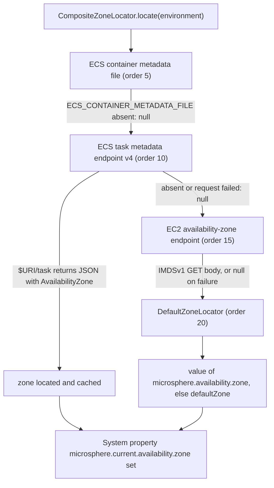

English version: [English](../microsphere-multiactive-aws.md)

# microsphere-multiactive-aws

## 概述

`microsphere-multiactive-aws` 提供三个 `ZoneLocator` 实现，它们从实例或容器内部发现当前的 AWS 可用区
（Availability Zone）：

| 类 | 事实来源 | 顺序 |
|-------|-----------------|-------|
| `EcsContainerMetadataFileZoneLocator` | 由 `ECS_CONTAINER_METADATA_FILE` 指向的 ECS **容器元数据文件** | `5` |
| `EcsTaskMetadataEndpointV4ZoneLocator` | 位于 `$ECS_CONTAINER_METADATA_URI_V4/task` 的 ECS **任务元数据端点 v4** | `10` |
| `Ec2AvailabilityZoneEndpointZoneLocator` | EC2 **实例元数据**的可用区端点 | `15` |

它们的顺序排在 [microsphere-multiactive-spring](microsphere-multiactive-spring.md) 的 `DefaultZoneLocator`（`20`）
之前，因此真实发现会优先于配置的兜底值，而更具体的 ECS 来源又优先于泛化的 EC2 端点。

本模块中**没有任何 AWS SDK**：定位器发起的是普通 HTTP GET（通过
`io.microsphere.multiple.active.zone.HttpUtils`），并用 `com.fasterxml.jackson.databind.ObjectMapper` 解析 JSON。
注册方式是 `META-INF/spring.factories` 中的 `ZoneLocator` key，而
[microsphere-multiactive-spring-boot](microsphere-multiactive-spring-boot.md) 在构建 `CompositeZoneLocator` 时会读取
该 key。仅仅把这个 jar 放上类路径，就是全部的集成工作。

## Maven 坐标

```xml
<dependency>
    <groupId>io.github.microsphere-projects</groupId>
    <artifactId>microsphere-multiactive-aws</artifactId>
    <version>0.1.14-SNAPSHOT</version>
</dependency>
```

- `groupId`：`io.github.microsphere-projects`
- `artifactId`：`microsphere-multiactive-aws`
- `version`：`${revision}` → 本快照中为 `0.1.14-SNAPSHOT`；最新已发布版本 `0.1.13`
- `packaging`：`jar`
- `<name>`：`Microsphere :: Multi-Active :: AWS`
- `<description>`：`Microsphere Multi-Active Amazon Web Services`
- 是否由 [BOM](microsphere-multiactive-dependencies.md) 托管：是

## 版本信息

| 项目 | 值 | 依据 |
|------|-------|-------------|
| 文档线 / Git 分支 | `1.x` / `release-1.x` | 本文档集 |
| 构件版本 | `0.1.14-SNAPSHOT` | 根 `pom.xml` 的 `<revision>` |
| compile 作用域依赖 | **无**——本模块的每个依赖都是 `<optional>true</optional>` | `microsphere-multiactive-aws/pom.xml` |
| optional 依赖 | `microsphere-annotation-processor`、`io.github.microsphere-projects:microsphere-multiactive-spring-cloud:${revision}`、`spring-boot-starter`、`spring-boot-starter-actuator`、`spring-boot-configuration-processor`、`spring-boot-autoconfigure-processor`、`spring-cloud-commons`、`spring-cloud-context`、`com.fasterxml.jackson.core:jackson-databind` | `microsphere-multiactive-aws/pom.xml` |
| test 依赖 | `junit-jupiter`、`spring-boot-starter-test`、`microsphere-spring-boot-test`、`logback-classic` | `microsphere-multiactive-aws/pom.xml` |
| 测试源码 | **无**——本模块在本快照中没有 `src/test/java` 目录 | 对该模块的 `find` |
| JDK | 本仓库未声明编译级别；CI 在 JDK 8、11、17、21、25 上编译本模块 | reactor 各 POM、`.github/workflows/maven-build.yml` |
| Spring Boot / Spring Cloud | 与本线其余部分相同：Boot 2.3.12.RELEASE / 2.4.13 / 2.6.15，搭配 Spring Cloud Hoxton.SR12 / 2020.0.5 / 2021.0.9（默认 `spring-cloud-2021`） | CI profile、外部 `microsphere-spring-cloud-parent:0.1.26` |
| Jackson | 两个 ECS 定位器需要 `jackson-databind`；其版本在本仓库之外托管 | `microsphere-multiactive-aws/pom.xml` |
| AWS 服务版本 | 未在此钉住；定位器面向的是其 Javadoc 中记录的 ECS 容器 Agent 特性——容器元数据文件自 agent 1.15.0，任务元数据端点 v4 自 agent 1.39.0（Linux EC2）/ 1.54.0（使用 `awsvpc` 的 Windows EC2） | `EcsContainerMetadataFileZoneLocator`、`EcsTaskMetadataEndpointV4ZoneLocator` 的类 Javadoc |

> **没有任何东西是传递来的。** 全部九个依赖都是 optional，而为了拿到 `ZoneLocator` 接口所选用的却是
> `microsphere-multiactive-spring-cloud`。AWS 源码真正编译依赖的是
> `io.microsphere.multiple.active.zone.spring.AbstractZoneLocator`（`spring` 模块）、`io.microsphere.io.IOUtils`
> （`microsphere-java-core`）、`org.springframework.context.EnvironmentAware` /
> `org.springframework.core.env.Environment` / `org.springframework.util.StringUtils`（Spring Framework）以及
> `com.fasterxml.jackson.databind.ObjectMapper`（`jackson-databind`）。因此只添加这个 jar 会得到
> `NoClassDefFoundError`。可用的依赖组合见下文"集成"一节。

## 公共 API

所有类都位于包 `io.microsphere.multiple.active.zone.spring.aws`，并继承 `AbstractZoneLocator`。

### `EcsContainerMetadataFileZoneLocator`

| 成员 | 值 / 行为 |
|--------|-------------------|
| `public static final String METADATA_FILE_ENV_NAME` | `ECS_CONTAINER_METADATA_FILE` |
| `public static final int DEFAULT_ORDER` | `5` |
| `public EcsContainerMetadataFileZoneLocator()` | `super(DEFAULT_ORDER)` |
| `supports(Environment)` | `environment.containsProperty("ECS_CONTAINER_METADATA_FILE")` |
| `locate(Environment)` | 读取该属性所指名的文件（一个 `java.io.File`，直接从文件系统读取），用新建的 `ObjectMapper` 将其按 JSON 解析，返回 `metadata.get("AvailabilityZone")` 的 `String` 值；当路径为空、文件不可读（`canRead()` 为 false）、字段缺失或任何异常发生时返回 `null` |

JSON 字段名是私有常量 `ZONE_FIELD_NAME = "AvailabilityZone"`。这个定位器是文件读取器而不是 HTTP 客户端：它适用于
会写出容器元数据文件的 ECS 任务，其 `zone` 值就是原始字段，例如 `us-east-1a`。

### `EcsTaskMetadataEndpointV4ZoneLocator`

| 成员 | 值 / 行为 |
|--------|-------------------|
| `public static final String METADATA_URI_V4_ENV_NAME` | `ECS_CONTAINER_METADATA_URI_V4` |
| `public static final int DEFAULT_ORDER` | `10` |
| `public EcsTaskMetadataEndpointV4ZoneLocator()` | `super(DEFAULT_ORDER)` |
| `supports(Environment)` | `environment.containsProperty("ECS_CONTAINER_METADATA_URI_V4")` |
| `locate(Environment)` | 用 `HttpUtils.doGet(...)` 对 `uri + "/task"` 发 GET，用新建的 `ObjectMapper` 解析 JSON 响应体，返回 `AvailabilityZone` 字段的 `String` 值；在 URI 为空 / HTTP 错误 / 解析错误 / 字段缺失时返回 `null` |
| `setEnvironment(Environment)` | `implements EnvironmentAware`；捕获 `microsphere.availability.zone.locator.timeout`（默认 `3000`）并在后续调用中作为连接与读取超时使用 |

由实现直接推出的两个后果：超时只在 `EnvironmentAware` 回调时读取一次，而且*所有* AWS HTTP 定位器各自独立读取它；
任何失败都会被吞掉并表现为 `null`，从而让链中的下一个定位器继续尝试（除非
`microsphere.availability.zone.locator.fast-fail=true`）。

### `Ec2AvailabilityZoneEndpointZoneLocator`

| 成员 | 值 / 行为 |
|--------|-------------------|
| `public static final String AVAILABILITY_ZONE_ENDPOINT_URI_PROPERTY_NAME` | `EC2_AVAILABILITY_ZONE_ENDPOINT_URI` |
| `public static final String DEFAULT_AVAILABILITY_ZONE_ENDPOINT_URI` | `http://169.254.169.254/latest/meta-data/placement/availability-zone` |
| `public static final int DEFAULT_ORDER` | `15` |
| `public Ec2AvailabilityZoneEndpointZoneLocator()` | `super(DEFAULT_ORDER)` |
| `supports(Environment)` | 始终 `true`——该定位器总会尝试链路本地元数据端点 |
| `locate(Environment)` | 对 `environment.getProperty("EC2_AVAILABILITY_ZONE_ENDPOINT_URI", DEFAULT_AVAILABILITY_ZONE_ENDPOINT_URI)` 发 GET，并返回**原始响应体**——不做 JSON 解析，也不做 trim。在真实实例上取值形如 `us-east-1a`；在 EC2 之外请求会失败，被记录并返回 `null` |
| `setEnvironment(Environment)` | `implements EnvironmentAware`；同一个超时属性，同样默认 `3000` |

由代码直接导出的两点运维说明：

- **IMDSv2。** `HttpUtils.doGet` 发送的是不带 `X-aws-ec2-metadata-token` 请求头的普通 GET，因此在要求会话令牌
  （IMDSv2 "required"）的实例上，该定位器取不到可用区。请把
  `EC2_AVAILABILITY_ZONE_ENDPOINT_URI` 指向一个可达的端点，或者依赖 ECS 定位器。
- **取值未经解析。** 端点返回什么，可用区就是什么，因此响应体中的任何尾部换行都会进入定位到的字符串。
  `ZoneContext.setZone(...)` 会执行 `trimAllWhitespace`，所以存储的可用区是规范化的，但 `CompositeZoneLocator`
  发布到 `microsphere.current.availability.zone` 系统属性的是未 trim 的值。

`EC2_AVAILABILITY_ZONE_ENDPOINT_URI` 从 Spring 的 `Environment` 读取，所以你可以把它设置为操作系统环境变量、JVM
系统属性或 `application.properties` 条目。

## 自动配置与 `spring.factories` 契约

本模块的 `META-INF/spring.factories` 只包含一个 key 和三个值，顺序如下：

```properties
io.microsphere.multiple.active.zone.spring.ZoneLocator=\
io.microsphere.multiple.active.zone.spring.aws.EcsContainerMetadataFileZoneLocator,\
io.microsphere.multiple.active.zone.spring.aws.EcsTaskMetadataEndpointV4ZoneLocator,\
io.microsphere.multiple.active.zone.spring.aws.Ec2AvailabilityZoneEndpointZoneLocator
```

[microsphere-multiactive-spring-boot](microsphere-multiactive-spring-boot.md) 中的 `ZoneAutoConfiguration` 会加载该
key 下的每个条目，并把它们与 `ZoneLocator` bean 合并后再排序，于是这三个定位器加上 `DefaultZoneLocator`（由 boot
模块在同一 key 下注册）最终都进入 `CompositeZoneLocator`，顺序为 `5, 10, 15, 20`。

这套机制*不是* Spring Boot 自动配置：本模块没有声明 `EnableAutoConfiguration` 条目，也没有
`AutoConfiguration.imports` 文件，并且不含任何 `@Configuration` 类。因此没有可排除的东西，也没有 `microsphere.aws.*`
之类的属性要设置。

## 你可以依赖的行为

给定一个在 EC2 上的 ECS 任务内启动、且设置了 `ECS_CONTAINER_METADATA_URI_V4` 的 JVM：



由于 `Ec2AvailabilityZoneEndpointZoneLocator.supports(...)` 始终为 `true` 且失败时返回 `null`，位于 AWS 之外的应用会
静默落到 `DefaultZoneLocator`——除非你打开 `microsphere.availability.zone.locator.fast-fail`，否则本库绝不会因为元数据
发现失败而无法启动。开启 fast-fail 后，第一个"支持但无法定位"的 AWS 定位器会用 `IllegalStateException` 中止整条链，
而在非 AWS 基础设施上被归咎的会是 `Ec2AvailabilityZoneEndpointZoneLocator`。

## 示例

本模块在本快照中没有测试源码，因此下面的示例是依照此处实现本身写出的——属性名、环境变量名、顺序以及 `null` 语义
都直接取自源码。

### 显式发现可用区

```java
StandardEnvironment environment = new StandardEnvironment();
Map<String, Object> props = new HashMap<>();
props.put("ECS_CONTAINER_METADATA_URI_V4", "http://169.254.170.2");
props.put(ZoneConstants.LOCATOR_TIMEOUT_PROPERTY_NAME, "1500");
environment.getPropertySources().addFirst(new MapPropertySource("aws", props));

EcsTaskMetadataEndpointV4ZoneLocator locator = new EcsTaskMetadataEndpointV4ZoneLocator();
locator.setEnvironment(environment);                 // EnvironmentAware: timeout is captured here

if (locator.supports(environment)) {                 // true: the v4 variable is present
    String zone = locator.locate(environment);       // GET http://169.254.170.2/task, read AvailabilityZone
    // zone is "us-east-1a" inside a task in that AZ, or null if the endpoint is unreachable
}
```

### 让组合链自行决定（常见配置）

```java
CompositeZoneLocator zoneLocator = new CompositeZoneLocator(Arrays.asList(
        new EcsContainerMetadataFileZoneLocator(),   // 5
        new EcsTaskMetadataEndpointV4ZoneLocator(),  // 10
        new Ec2AvailabilityZoneEndpointZoneLocator() // 15
));

// DefaultZoneLocator is not listed above on purpose: in a Spring Boot application the
// spring-boot module adds it (and the three AWS locators) through the ZoneLocator spring.factories key.
String zone = zoneLocator.locate(environment);       // first non-null wins; also sets the system property
```

### 为测试覆盖元数据端点

```java
Map<String, Object> props = new HashMap<>();
props.put(Ec2AvailabilityZoneEndpointZoneLocator.AVAILABILITY_ZONE_ENDPOINT_URI_PROPERTY_NAME,
        "http://localhost:" + port + "/latest/meta-data/placement/availability-zone");
environment.getPropertySources().addFirst(new MapPropertySource("aws-endpoint", props));

Ec2AvailabilityZoneEndpointZoneLocator locator = new Ec2AvailabilityZoneEndpointZoneLocator();
String zone = locator.locate(environment);           // returns the response body verbatim
```

[microsphere-multiactive-commons](microsphere-multiactive-commons.md) 中的 `HttpUtilsTest` 展示了两个 HTTP 定位器所
依赖的底层契约：`HttpUtils.doGet(url, timeout)` 对可达的 HTTP 端点返回响应体，对空白或非 HTTP 的 URL 返回 `null`，
并在传输层错误时抛出 `IOException`（定位器会捕获它）。

## 集成

`microsphere-multiactive-aws` 由 BOM 托管，因此导入 BOM 后无需写版本——但你必须补齐它的 optional 依赖所隐藏的那些
模块与库：

```xml
<dependencyManagement>
    <dependencies>
        <dependency>
            <groupId>io.github.microsphere-projects</groupId>
            <artifactId>microsphere-multiactive-dependencies</artifactId>
            <version>0.1.13</version>
            <type>pom</type>
            <scope>import</scope>
        </dependency>
    </dependencies>
</dependencyManagement>

<dependencies>
    <!-- brings commons + spring + the ZoneLocator / ZoneContext types -->
    <dependency>
        <groupId>io.github.microsphere-projects</groupId>
        <artifactId>microsphere-multiactive-spring-cloud</artifactId>
        <version>0.1.13</version>
    </dependency>
    <!-- the AWS zone locators -->
    <dependency>
        <groupId>io.github.microsphere-projects</groupId>
        <artifactId>microsphere-multiactive-aws</artifactId>
    </dependency>
    <!-- required at runtime: the locators use io.microsphere.io.IOUtils -->
    <dependency>
        <groupId>io.github.microsphere-projects</groupId>
        <artifactId>microsphere-java-core</artifactId>
    </dependency>
    <!-- required at runtime by the two ECS locators -->
    <dependency>
        <groupId>com.fasterxml.jackson.core</groupId>
        <artifactId>jackson-databind</artifactId>
    </dependency>
</dependencies>
```

然后只需配置定位器会读取的那些项：

```properties
# optional: the timeout used by both HTTP locators, in milliseconds (default 3000)
microsphere.availability.zone.locator.timeout=2000
# optional: point the EC2 locator somewhere else than the link-local IMDS address
EC2_AVAILABILITY_ZONE_ENDPOINT_URI=http://169.254.169.254/latest/meta-data/placement/availability-zone
# optional: fail loudly instead of falling back to defaultZone
microsphere.availability.zone.locator.fast-fail=false
```

不需要 `@Enable...` 注解、不需要 `@Import`、不需要声明 bean：`spring.factories` 这个 key 就完成了装配
（见 [microsphere-multiactive-spring-boot.md](microsphere-multiactive-spring-boot.md)）。如果你还想把可用区写入自己
的服务注册，请添加 [microsphere-multiactive-spring-cloud.md](microsphere-multiactive-spring-cloud.md)。

## 相关文档

- [用户指南索引](README.md)
- [microsphere-multiactive-spring.md](microsphere-multiactive-spring.md) — `ZoneLocator`、`AbstractZoneLocator`、`CompositeZoneLocator`
- [microsphere-multiactive-spring-boot.md](microsphere-multiactive-spring-boot.md) — `spring.factories` 条目在此被消费
- [microsphere-multiactive-commons.md](microsphere-multiactive-commons.md) — `HttpUtils`、`ZoneConstants`
- 根 [README](../../../../README.md) 与[发布说明](../../../../release-notes.md)
- 开发者指南：[../../developer-guide/zh/microsphere-multiactive-aws.md](../../developer-guide/zh/microsphere-multiactive-aws.md)

## English

English version: [English](../microsphere-multiactive-aws.md)
