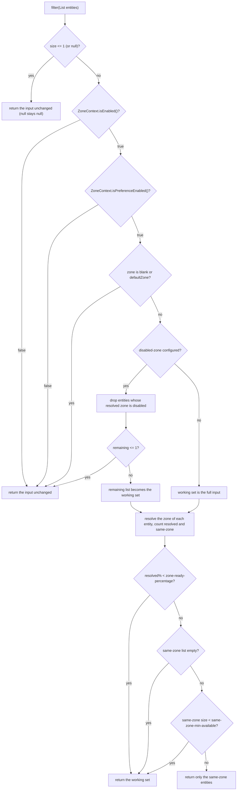

English version: [English](../microsphere-multiactive-commons.md)

# microsphere-multiactive-commons

## 概述

`microsphere-multiactive-commons` 是本项目库中与框架无关的核心。它完全不知道 Spring 的存在：它定义了可用区模型
（`ZoneContext`）、属性词汇表（`ZoneConstants`）、两个扩展契约（`ZoneResolver`，以及可用区感知过滤器
`ZonePreferenceFilter`）、元数据写入器（`ZoneAttachmentHandler`）和一个极小的 HTTP 工具类（`HttpUtils`）。

本模块之上的所有内容——[microsphere-multiactive-spring](microsphere-multiactive-spring.md) 及其下游——都建立在这
六个类型之上。如果你只想在自己的负载均衡器或注册中心客户端内部使用可用区语义，那么这个 jar 就是你唯一需要的。

## Maven 坐标

```xml
<dependency>
    <groupId>io.github.microsphere-projects</groupId>
    <artifactId>microsphere-multiactive-commons</artifactId>
    <version>0.1.14-SNAPSHOT</version>
</dependency>
```

- `groupId`：`io.github.microsphere-projects`
- `artifactId`：`microsphere-multiactive-commons`
- `version`：`${revision}` → 本快照中为 `0.1.14-SNAPSHOT`；最新已发布版本 `0.1.13`
- `packaging`：`jar`
- `<name>`：`Microsphere :: Multi-Active :: Commons`
- 是否由 [BOM](microsphere-multiactive-dependencies.md) 托管：是

## 版本信息

| 项目 | 值 | 依据 |
|------|-------|-------------|
| 文档线 / Git 分支 | `1.x` / `release-1.x` | 本文档集 |
| 构件版本 | `0.1.14-SNAPSHOT` | 根 `pom.xml` 的 `<revision>` |
| compile 作用域依赖 | 本模块 POM 中未声明任何依赖 | `microsphere-multiactive-commons/pom.xml` |
| optional 依赖 | `io.github.microsphere-projects:microsphere-annotation-processor`、`io.github.microsphere-projects:microsphere-java-core` | `microsphere-multiactive-commons/pom.xml` |
| test 依赖 | `org.junit.jupiter:junit-jupiter`、`io.github.microsphere-projects:microsphere-java-test`、`ch.qos.logback:logback-classic` | `microsphere-multiactive-commons/pom.xml` |
| JDK | 本仓库未声明编译级别；CI 在 JDK 8、11、17、21、25 上测试本模块 | reactor 各 POM、`.github/workflows/maven-build.yml` |
| Spring / Spring Boot 要求 | **无**——本模块不导入任何 `org.springframework.*` 类型 | `src/main/java` 下的全部六个源文件 |
| 外部库版本 | `microsphere-java-core` / `microsphere-annotation-processor` 的版本来自导入的 `microsphere-spring-cloud-dependencies:0.1.26` BOM，而不是本仓库 | `microsphere-multiactive-parent/pom.xml` |

> **运行时注意事项。** `microsphere-java-core` 和 `microsphere-annotation-processor` 都被声明为
> `<optional>true</optional>`，因此它们**不会**传递依赖。然而源码在编译期使用了
> `io.microsphere.logging.Logger`、`io.microsphere.util.StringUtils`、`io.microsphere.io.IOUtils` 和
> `io.microsphere.annotation.ConfigurationProperty`。当你直接依赖 `microsphere-multiactive-commons` 时，请自行添加
> `io.github.microsphere-projects:microsphere-java-core`，否则 `ZoneContext` 会在类初始化时抛出
> `NoClassDefFoundError`。已经依赖 `microsphere-multiactive-spring-boot` 或
> `microsphere-multiactive-spring-cloud` 的应用可以从这些模块自身的依赖图中获得所需内容。

## 公共 API

所有类型都位于包 `io.microsphere.multiple.active.zone` 中。

### `ZoneConstants`（`interface`）

`public interface ZoneConstants`——本项目库完整的属性词汇表。任何模块使用的每个 key 都声明在这里；其值在
`ZoneConstantsTest` 中被逐个断言。该接口是一个常量持有者，没有方法。

可用区属性：

| 常量 | 值 | 含义 |
|----------|-------|---------|
| `ENABLED_PROPERTY_NAME_SUFFIX` | `.enabled` | 用于构建每个 `*.enabled` key 的后缀 |
| `DEFAULT_ZONE` | `defaultZone` | 默认可用区值；有意与 Eureka 的 `DEFAULT_ZONE` 命名保持兼容；`ZonePreferenceFilter` 将其视为"无可用区" |
| `ORIGINAL_ZONE` | `originalZone` | 可用区属性的哨兵*值*；把 `microsphere.availability.zone` 赋值为它会使 `ZoneContextChangedListener` 重新执行发现流程（见 [spring](microsphere-multiactive-spring.md)） |
| `ZONE_PROPERTY_NAME` | `microsphere.availability.zone` | 当前应用的可用区，同时也是写入服务注册的元数据 key |
| `CURRENT_ZONE_PROPERTY_NAME` | `microsphere.current.availability.zone` | 作为 JVM 系统属性发布的可用区 |
| `DEFAULT_ZONE_ENABLED_PROPERTY_VALUE` | `"true"` | 默认值的字符串形式 |
| `DEFAULT_ZONE_ENABLED` | `true` | 主开关的默认值 |
| `ZONE_ENABLED_PROPERTY_NAME` | `microsphere.availability.zone.enabled` | 主开关 |

可用区偏好属性：

| 常量 | 值 | 含义 |
|----------|-------|---------|
| `PREFERENCE_PROPERTY_NAME_PREFIX` | `microsphere.availability.zone.preference.` | 前缀 |
| `DEFAULT_PREFERENCE_ENABLED_PROPERTY_VALUE` | `"false"` | 默认值的字符串形式 |
| `DEFAULT_ZONE_PREFERENCE_ENABLED` | `false` | 同可用区偏好默认**关闭** |
| `PREFERENCE_ENABLED_PROPERTY_NAME` | `microsphere.availability.zone.preference.enabled` | 启用同可用区偏好 |

可用区偏好过滤器属性：

| 常量 | 值 | 含义 |
|----------|-------|---------|
| `PREFERENCE_FILER_PROPERTY_NAME_PREFIX` | `microsphere.availability.zone.preference.filter.` | 前缀。该常量名在本线中拼写有误（`FILER`）——其*值*是正确的 |
| `DEFAULT_ZONE_PREFERENCE_FILTER_ORDER_PROPERTY_VALUE` | `"10"` | 默认值的字符串形式 |
| `DEFAULT_ZONE_PREFERENCE_FILTER_ORDER` | `10` | 默认顺序 |
| `PREFERENCE_FILTER_ORDER_PROPERTY_NAME` | `microsphere.availability.zone.preference.filter.order` | `ZonePreferenceFilter.getOrder()` 报告的顺序 |

可用区偏好上游属性：

| 常量 | 值 | 含义 |
|----------|-------|---------|
| `PREFERENCE_UPSTREAM_PROPERTY_NAME_PREFIX` | `microsphere.availability.zone.preference.upstream.` | 前缀 |
| `DEFAULT_PREFERENCE_UPSTREAM_ZONE_READY_PERCENTAGE_PROPERTY_VALUE` | `"100"` | 默认值的字符串形式 |
| `DEFAULT_PREFERENCE_UPSTREAM_ZONE_READY_PERCENTAGE` | `100` | 上游实体中必须能解析出可用区的百分比，低于该值则不信任偏好 |
| `PREFERENCE_UPSTREAM_ZONE_READY_PERCENTAGE_PROPERTY_NAME` | `microsphere.availability.zone.preference.upstream.zone-ready-percentage` | 就绪度门槛 |
| `DEFAULT_PREFERENCE_UPSTREAM_SAME_ZONE_MIN_AVAILABLE_PROPERTY_VALUE` | `"5"` | 默认值的字符串形式 |
| `DEFAULT_PREFERENCE_UPSTREAM_SAME_ZONE_MIN_AVAILABLE` | `5` | 应用偏好之前所需的最少同可用区实体数量 |
| `PREFERENCE_UPSTREAM_SAME_ZONE_MIN_AVAILABLE_PROPERTY_NAME` | `microsphere.availability.zone.preference.upstream.same-zone-min-available` | 同可用区最小数量 |
| `DEFAULT_PREFERENCE_UPSTREAM_DISABLED_ZONE` | `null` | 默认不排空任何可用区 |
| `PREFERENCE_UPSTREAM_DISABLED_ZONE_PROPERTY_NAME` | `microsphere.availability.zone.preference.upstream.disabled-zone` | 逗号分隔的可用区，永远从结果中排除 |

可用区定位器属性：

| 常量 | 值 | 含义 |
|----------|-------|---------|
| `LOCATOR_PROPERTY_NAME_PREFIX` | `microsphere.availability.zone.locator.` | 前缀 |
| `DEFAULT_LOCATOR_FAST_FAIL_PROPERTY_VALUE` | `"false"` | 默认值的字符串形式 |
| `DEFAULT_LOCATOR_FAST_FAIL` | `false` | 默认情况下发现流程不会快速失败 |
| `LOCATOR_FAST_FAIL_PROPERTY_NAME` | `microsphere.availability.zone.locator.fast-fail` | 由 `CompositeZoneLocator` 读取 |
| `DEFAULT_TIMEOUT_PROPERTY_VALUE` | `"3000"` | 默认值的字符串形式 |
| `DEFAULT_TIMEOUT` | `3000` | 连接/读取超时，单位毫秒 |
| `LOCATOR_TIMEOUT_PROPERTY_NAME` | `microsphere.availability.zone.locator.timeout` | 仅由 AWS 元数据定位器读取 |

说明：本模块定义这些常量；真正从环境中读取它们的是 `microsphere-multiactive-spring`（定位器、监听器）和
`microsphere-multiactive-aws`（超时）。`microsphere.availability.zone` 同时也是 `ZoneAttachmentHandler` 写入注册
元数据的 key，而 `CloudServerZoneResolver` 与 `EurekaInstanceInfoZoneResolver` 读回的就是它。

### `ZoneContext`（`class`）

`public class ZoneContext`——生效可用区配置的可变、JVM 全局持有者。按约定它是单例，通过
`java.beans.PropertyChangeSupport` 可被观察，并且每个 setter 只在值与当前值确实不同（`Objects.equals`）时才触发
属性变更事件。

| 成员 | 签名 | 由测试验证的行为 |
|--------|-----------|------------------------------|
| `get()` | `public static ZoneContext get()` | 返回唯一共享实例；重复调用返回同一对象（`ZoneContextTest#testGetSingletonInstance`） |
| `getCurrentZone()` | `public static String getCurrentZone()` | 读取 **JVM 系统属性** `microsphere.current.availability.zone`，缺省回退到 `defaultZone`——它不读取单例（`ZoneContextTest#testGetCurrentZoneFromSystemProperty`） |
| `isEnabled()` / `setEnabled(boolean)` | | 默认 `true` |
| `getZone()` / `setZone(String)` | | `setZone` 会执行 `trimAllWhitespace`，因此 `"  zone-b  "` 变为 `"zone-b"`；设置相同值不触发事件 |
| `isPreferenceEnabled()` / `setPreferenceEnabled(boolean)` | | 默认 `false` |
| `getPreferenceFilterOrder()` / `setPreferenceFilterOrder(int)` | | 默认 `10` |
| `getPreferenceUpstreamZoneReadyPercentage()` / `setPreferenceUpstreamZoneReadyPercentage(int)` | | 默认 `100` |
| `getPreferenceUpstreamSameZoneMinAvailable()` / `setPreferenceUpstreamSameZoneMinAvailable(int)` | | 默认 `5` |
| `getPreferenceUpstreamDisabledZone()` / `setPreferenceUpstreamDisabledZone(String)` | | 逗号分隔；每个元素都会被 trim，因此 `" zone-a , zone-b "` 存储为 `"zone-a,zone-b"`。空白值或 `null` 会按原样存储，也就是说 `""` 表示不排空，`null` 同样表示不排空（`ZonePreferenceFilter` 判断的是 `!= null`） |
| `enable()` | `public boolean enable()` | 启用该上下文并返回**之前**的状态；已启用时→直接返回 `true` 且不触发事件 |
| `reset()` | `public void reset()` | 将全部七个字段恢复为 `ZoneConstants` 默认值 |
| `addPropertyChangeListener(PropertyChangeListener)` / `removePropertyChangeListener(PropertyChangeListener)` | | 注册是全局的（所有属性名） |
| `toString()` | | `ZoneContext{enabled=..., zone='...', preferenceEnabled=..., preferenceFilterOrder=..., preferenceUpstreamZoneReadyPercentage=..., preferenceUpstreamSameZoneMinAvailable=..., preferenceUpstreamDisabledZone=...}` |

该类未声明任何构造器，因此 `new ZoneContext()` 是合法的——但你得到的是一个游离实例；Spring 模块绑定到应用上下文中的对象是 `ZoneContext.get()`。

### `ZoneResolver<E>`（`interface`）

```java
public interface ZoneResolver<E> extends Function<E, String> {
    default String apply(E entity) { return resolve(entity); }
    String resolve(E entity);
}
```

把任意实体（一个 server、一个 instance、一个 `ServiceInstance`）映射到它的可用区，未知可用区时返回 `null`。
由于它继承 `Function<E, String>`，因此可以写成 lambda，而 `apply` 只是委托给 `resolve`——是重写实现而非直接继承
（`ZoneResolverTest#testApplyDelegatesToResolve`）：

```java
ZoneResolver<String> resolver = entity -> entity + "-zone";
assertEquals("test-zone", resolver.apply("test"));
assertEquals("test-zone", resolver.resolve("test"));
assertNull(((ZoneResolver<String>) entity -> entity).apply(null));
```

### `ZonePreferenceFilter<E>`（`class`）

`public class ZonePreferenceFilter<E>`——本项目库中每个可用区感知过滤器背后可复用的决策引擎
（Ribbon 的 `ZonePreferenceServerListFilter`、Spring Cloud LoadBalancer 的
`ZonePreferenceServiceInstanceListSupplier`）。

| 成员 | 签名 | 说明 |
|--------|-----------|-------|
| 构造器 | `public ZonePreferenceFilter(ZoneContext zoneContext, ZoneResolver<E> zoneResolver)` | 两个协作对象都是必需的 |
| `filter` | `public List<E> filter(List<E> entities)` | 返回列表；可能直接返回输入实例本身（`ZonePreferenceFilterTest` 断言的透传情形会保留引用同一性） |
| `getOrder` | `public int getOrder()` | 委托给 `zoneContext.getPreferenceFilterOrder()`；本线中该类**不**实现 `org.springframework.core.Ordered`——适配器通过各自的机制暴露顺序 |
| `isIgnored` | `protected boolean isIgnored(String zone)` | 当可用区为空白，或忽略大小写等于 `defaultZone` 时返回 `true` |

决策顺序，与实际实现完全一致：



在打开该特性之前值得了解的几个推论：

- 可用区比较是大小写敏感的（`Objects.equals`），而针对 `defaultZone` 的*忽略*检查则是大小写不敏感的。
- 百分比判断使用整数运算（`zoneCount * 100 / totalSize`），因此阈值为 `100` 时要求工作集中**每个**实体都能解析出
  可用区。这正是随附默认值 `100` 让"偏好"成为一个刻意保守的特性。
- 整套机制默认关闭（`DEFAULT_ZONE_PREFERENCE_ENABLED = false`），且与 `microsphere.availability.zone.enabled` 相互独立。
- 如果过滤后剩余实体少于两个——无论是因为所有可用区都被排空，还是因为同可用区列表低于 `same-zone-min-available`——
  过滤器会返回更多实体而不是一无所有。同可用区偏好绝不允许把流量饿死。

### `ZoneAttachmentHandler`（`class`）

`public class ZoneAttachmentHandler`——把当前可用区写入服务注册的元数据 map。

| 成员 | 签名 | 说明 |
|--------|-----------|-------|
| 构造器 | `public ZoneAttachmentHandler(ZoneContext zoneContext)` | |
| `attachZone` | `public void attachZone(Map<String, String> metadata)` | 放入 `microsphere.availability.zone` → `zoneContext.getZone()`。空白可用区会跳过并输出警告。map 抛出的任何 `Throwable`（例如对不可修改 map 抛出的 `UnsupportedOperationException`）都会被捕获并记为警告：注册流程在没有可用区的情况下继续 |

由于它是与读取方 key 相匹配的写入方（`CloudServerZoneResolver`、`EurekaInstanceInfoZoneResolver`），元数据 key
`microsphere.availability.zone` 就是本项目库上游侧与下游侧之间的线上契约。

### `HttpUtils`（`abstract class`）

`public abstract class HttpUtils`——不可实例化的工具类，服务于 AWS 元数据端点。

| 成员 | 签名 | 说明 |
|--------|-----------|-------|
| `doGet` | `public static String doGet(String url, int timeout) throws IOException` | `null`/空白 URL → `null`；非 `HttpURLConnection`（例如 `file:` URL）→ `null`；否则把连接**和**读取超时都设为 `timeout` 毫秒，以 UTF-8 读取响应体并返回，并在 `finally` 块中断开连接 |

`doGet` 执行的是普通 HTTP GET：它不申请 IMDSv2 会话令牌，也不发送自定义请求头，因此在配置为"必须"使用 IPv4
令牌的 EC2 实例上，可用区调用将不会返回元数据。它还会传播 `IOException`——AWS 定位器会捕获它并记录日志，而不会
重新抛出。

## 配置属性

`microsphere-multiactive-commons` 自身不读取任何内容；它发布的是供 Spring 各模块读取的词汇表。完整的 key 列表与
默认值就是上面 `ZoneConstants` 下的表格，此处以面向用户的设置形式重述：

| 属性 key | 默认值 | 被 `microsphere-multiactive-spring` / `-spring-cloud` 消费后的效果 |
|--------------|---------|-----------------------------------------------------------------------------|
| `microsphere.availability.zone` | `defaultZone` | 显式声明可用区；值 `originalZone` 触发重新发现 |
| `microsphere.current.availability.zone` | 未设置（系统属性） | 由 `CompositeZoneLocator` 写入，由 `ZoneContext.getCurrentZone()` 读取 |
| `microsphere.availability.zone.enabled` | `true` | 主开关 |
| `microsphere.availability.zone.preference.enabled` | `false` | 打开同可用区过滤 |
| `microsphere.availability.zone.preference.filter.order` | `10` | 可用区偏好过滤器的顺序 |
| `microsphere.availability.zone.preference.upstream.zone-ready-percentage` | `100` | 必须携带可用区的上游实体最小百分比 |
| `microsphere.availability.zone.preference.upstream.same-zone-min-available` | `5` | 应用偏好之前的同可用区实体最小数量 |
| `microsphere.availability.zone.preference.upstream.disabled-zone` | 未设置 | 逗号分隔的要排空的可用区 |
| `microsphere.availability.zone.locator.fast-fail` | `false` | 直接失败，而不是继续落到下一个定位器 |
| `microsphere.availability.zone.locator.timeout` | `3000` | AWS 元数据定位器的 HTTP 超时 |

## 示例

以下示例改写自本快照中本模块 `src/test/java` 下的测试，它们覆盖了上面每个类。

### 驱动上下文并观察变更（`ZoneContextTest`）

```java
ZoneContext zoneContext = ZoneContext.get();
zoneContext.reset();

List<PropertyChangeEvent> events = new ArrayList<>();
PropertyChangeListener listener = events::add;
zoneContext.addPropertyChangeListener(listener);

zoneContext.setZone("  zone-b  ");
assertEquals("zone-b", zoneContext.getZone());   // whitespace trimmed

zoneContext.setZone("zone-b");                   // same value: no event
assertEquals(1, events.size());

zoneContext.removePropertyChangeListener(listener);
zoneContext.reset();                             // back to enabled / defaultZone / preference off
assertTrue(zoneContext.isEnabled());
assertEquals("defaultZone", zoneContext.getZone());
assertFalse(zoneContext.isPreferenceEnabled());
```

### 读取发现流程发布的可用区（`ZoneContextTest`）

```java
System.setProperty(ZoneConstants.CURRENT_ZONE_PROPERTY_NAME, "sys-zone");
assertEquals("sys-zone", ZoneContext.getCurrentZone());

System.clearProperty(ZoneConstants.CURRENT_ZONE_PROPERTY_NAME);
assertEquals("defaultZone", ZoneContext.getCurrentZone());
```

### 同可用区偏好过滤（`ZonePreferenceFilterTest`）

```java
static class ZoneEntity {
    final String zone;

    ZoneEntity(String zone) {
        this.zone = zone;
    }
}

ZoneResolver<ZoneEntity> resolver = entity -> entity == null ? null : entity.zone;

ZoneContext zoneContext = ZoneContext.get();
zoneContext.reset();
zoneContext.setEnabled(true);
zoneContext.setPreferenceEnabled(true);
zoneContext.setZone("zone-a");
zoneContext.setPreferenceUpstreamZoneReadyPercentage(100);
zoneContext.setPreferenceUpstreamSameZoneMinAvailable(1);

ZonePreferenceFilter<ZoneEntity> filter = new ZonePreferenceFilter<>(zoneContext, resolver);

List<ZoneEntity> entities = Arrays.asList(
        new ZoneEntity("zone-a"),
        new ZoneEntity("zone-b"),
        new ZoneEntity("zone-a")
);

List<ZoneEntity> result = filter.filter(entities);
assertEquals(2, result.size());
result.forEach(e -> assertEquals("zone-a", e.zone));
```

### 同一过滤器的两个安全阀（`ZonePreferenceFilterTest`）

```java
// The application sits in the neutral zone: preference is ignored entirely.
zoneContext.setZone("defaultZone");
List<ZoneEntity> entities = Arrays.asList(new ZoneEntity("zone-a"), new ZoneEntity("zone-b"));
assertSame(entities, filter.filter(entities));

// Not enough same-zone instances: the full list is returned instead of the thin same-zone list.
zoneContext.setZone("zone-a");
zoneContext.setPreferenceUpstreamSameZoneMinAvailable(5);
List<ZoneEntity> sparse = Arrays.asList(new ZoneEntity("zone-a"), new ZoneEntity("zone-b"), new ZoneEntity("zone-b"));
assertSame(sparse, filter.filter(sparse));

// Draining a zone: entities carrying "zone-c" never reach the caller.
zoneContext.setPreferenceUpstreamDisabledZone("zone-c");
List<ZoneEntity> mixed = Arrays.asList(
        new ZoneEntity("zone-a"), new ZoneEntity("zone-b"),
        new ZoneEntity("zone-c"), new ZoneEntity("zone-a"));
List<ZoneEntity> drained = filter.filter(mixed);
assertEquals(2, drained.size());
drained.forEach(e -> assertEquals("zone-a", e.zone));
```

### 把可用区附加到注册元数据（`ZoneAttachmentHandlerTest`）

```java
ZoneContext zoneContext = ZoneContext.get();
zoneContext.reset();
zoneContext.setZone("zone-a");

ZoneAttachmentHandler handler = new ZoneAttachmentHandler(zoneContext);

Map<String, String> metadata = new HashMap<>();
handler.attachZone(metadata);
assertEquals("zone-a", metadata.get(ZoneConstants.ZONE_PROPERTY_NAME));

// An unmodifiable metadata map does not break registration; the zone is simply absent.
Map<String, String> unmodifiable = Collections.unmodifiableMap(new HashMap<>());
handler.attachZone(unmodifiable);
assertFalse(unmodifiable.containsKey(ZoneConstants.ZONE_PROPERTY_NAME));
```

### 拉取一份元数据文档（`HttpUtilsTest`）

```java
// A reachable endpoint returns the body as a String.
String url = "http://localhost:" + port + "/zone";
String result = HttpUtils.doGet(url, 3000);
assertEquals("hello zone", result);

// Blank URLs and non-HTTP protocols return null instead of throwing.
assertNull(HttpUtils.doGet("   ", 1000));
assertNull(HttpUtils.doGet(tempFile.toUri().toString(), 1000));
```

## 集成

添加该 jar（以及它需要的核心库）并自行装配这三个类型——不需要 Spring：

```xml
<dependencyManagement>
    <dependencies>
        <dependency>
            <groupId>io.github.microsphere-projects</groupId>
            <artifactId>microsphere-multiactive-dependencies</artifactId>
            <version>0.1.13</version>
            <type>pom</type>
            <scope>import</scope>
        </dependency>
    </dependencies>
</dependencyManagement>

<dependencies>
    <dependency>
        <groupId>io.github.microsphere-projects</groupId>
        <artifactId>microsphere-multiactive-commons</artifactId>
    </dependency>
    <dependency>
        <groupId>io.github.microsphere-projects</groupId>
        <artifactId>microsphere-java-core</artifactId>
    </dependency>
</dependencies>
```

```java
ZoneContext zoneContext = ZoneContext.get();
zoneContext.setEnabled(true);
zoneContext.setPreferenceEnabled(true);
zoneContext.setZone("zone-a");
zoneContext.setPreferenceUpstreamSameZoneMinAvailable(1);

ZonePreferenceFilter<MyNode> filter = new ZonePreferenceFilter<>(zoneContext, MyNode::getZone);
List<MyNode> targets = filter.filter(allNodes);
```

若希望由外部配置而不是硬编码调用来驱动上下文，请使用
[microsphere-multiactive-spring](microsphere-multiactive-spring.md)。

## 相关文档

- [用户指南索引](README.md)
- 兄弟模块：[spring](microsphere-multiactive-spring.md)、[spring-boot](microsphere-multiactive-spring-boot.md)、
  [spring-cloud](microsphere-multiactive-spring-cloud.md)、[aws](microsphere-multiactive-aws.md)、
  [netflix](microsphere-multiactive-netflix.md)
- 根 [README](../../../../README.md) 与[发布说明](../../../../release-notes.md)
- 开发者指南：[../../developer-guide/zh/microsphere-multiactive-commons.md](../../developer-guide/zh/microsphere-multiactive-commons.md)

## English

English version: [English](../microsphere-multiactive-commons.md)
