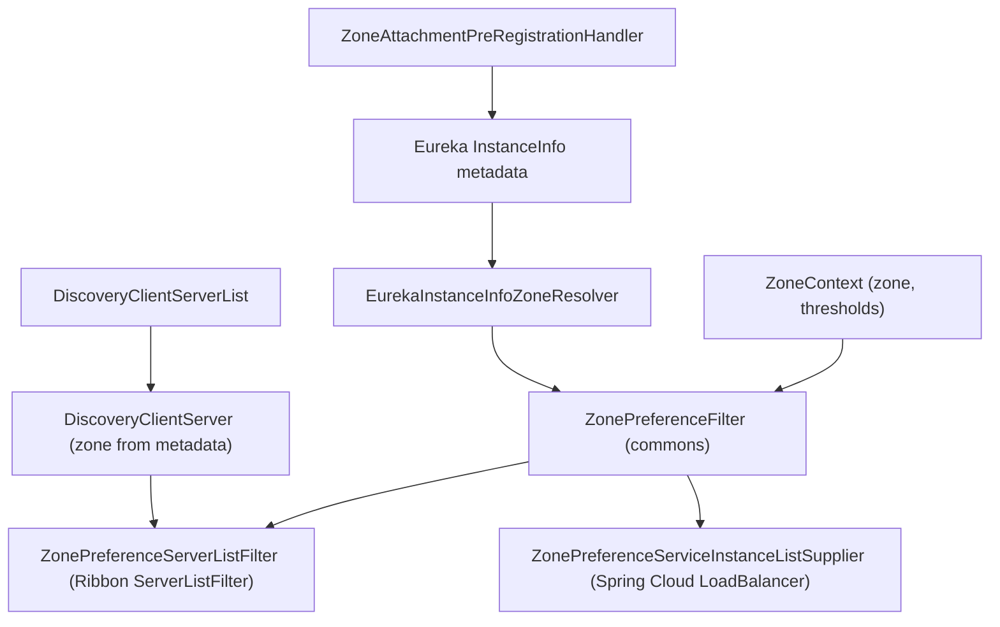

English version: [English](../microsphere-multiactive-netflix.md)

# microsphere-multiactive-netflix

## 概述

`microsphere-multiactive-netflix` 把 [microsphere-multiactive-commons](microsphere-multiactive-commons.md) 的可用区
模型适配到 Spring Cloud `Hoxton` 代际所标配的 Netflix OSS 技术栈上——而本 `1.x` 线支持的正是这一代：

- **Eureka**：一个从 `InstanceInfo` 元数据中读回可用区的 `ZoneResolver`，以及一个在注册之前把可用区写入同一份元数据的
  `PreRegistrationHandler`。
- **Ribbon**：一个基于 `Server.getZone()` 的 `ZoneResolver`、一个委托给共享 `ZonePreferenceFilter` 的 Ribbon
  `ServerListFilter`，以及一个由 Spring Cloud `DiscoveryClient` 提供数据的 Ribbon `ServerList`。

关于本模块在本线上最重要的一点：**它不含自动配置，也没有 `@Configuration` 类。** 它提供的是普通类，由你自己实例化并
注册，外加一个 `features.yaml`。仅仅添加 jar 不会发生任何事情。

## Maven 坐标

```xml
<dependency>
    <groupId>io.github.microsphere-projects</groupId>
    <artifactId>microsphere-multiactive-netflix</artifactId>
    <version>0.1.14-SNAPSHOT</version>
</dependency>
```

- `groupId`：`io.github.microsphere-projects`
- `artifactId`：`microsphere-multiactive-netflix`
- `version`：`${revision}` → 本快照中为 `0.1.14-SNAPSHOT`；最新已发布版本 `0.1.13`
- `packaging`：`jar`
- `<name>`：`Microsphere :: Multi-Active :: Netflix`
- 是否由 [BOM](microsphere-multiactive-dependencies.md) 托管：是

## 版本信息

| 项目 | 值 | 依据 |
|------|-------|-------------|
| 文档线 / Git 分支 | `1.x` / `release-1.x` | 本文档集 |
| 构件版本 | `0.1.14-SNAPSHOT` | 根 `pom.xml` 的 `<revision>` |
| Netflix Ribbon | `2.7.18`，通过模块内属性 `netflix.ribbon.version` 应用到 `com.netflix.ribbon:ribbon`、`ribbon-loadbalancer`、`ribbon-eureka`（均为 optional） | `microsphere-multiactive-netflix/pom.xml` |
| Eureka 客户端 | `com.netflix.eureka:eureka-client`（optional）加上 `org.springframework.cloud:spring-cloud-netflix-eureka-client`（optional）；两者版本都在本仓库之外托管 | `microsphere-multiactive-netflix/pom.xml` |
| compile 作用域依赖 | **无**——本模块的每个依赖都是 `<optional>true</optional>` | `microsphere-multiactive-netflix/pom.xml` |
| optional 依赖 | `microsphere-annotation-processor`、`io.github.microsphere-projects:microsphere-multiactive-spring-cloud:${revision}`、`spring-boot-starter`、`spring-boot-starter-actuator`、`spring-boot-starter-web`、`spring-boot-configuration-processor`、`spring-boot-autoconfigure-processor`、`spring-cloud-commons`、`spring-cloud-context`、`spring-cloud-netflix-eureka-client`、`eureka-client`，以及三个 Ribbon 构件 | `microsphere-multiactive-netflix/pom.xml` |
| test 依赖 | `junit-jupiter`、`spring-boot-starter-test`、`microsphere-spring-boot-test`、`logback-classic` | `microsphere-multiactive-netflix/pom.xml` |
| 测试源码 | **无**——本模块在本快照中没有 `src/test/java` 目录 | 对该模块的 `find` |
| JDK | 本仓库未声明编译级别；CI 在 JDK 8、11、17、21、25 上编译本模块 | reactor 各 POM、`.github/workflows/maven-build.yml` |
| Spring Cloud 兼容性 | 从 Hoxton.SR12 配 Boot 2.3.12.RELEASE 一直到 2021.0.9 配 Boot 2.6.15（CI profile `spring-cloud-hoxton`、`spring-cloud-2020`、`spring-cloud-2021`；默认 `spring-cloud-2021`） | `.github/workflows/maven-build.yml`、外部 `microsphere-spring-cloud-parent:0.1.26` |
| 声明依赖中真正被使用的类型 | `com.netflix.appinfo.*`、`com.netflix.discovery.*`（Eureka）、`com.netflix.loadbalancer.*`（Ribbon）、`org.springframework.cloud.client.ServiceInstance` 与 `...discovery.DiscoveryClient`（spring-cloud-commons），以及本项目自己的类型。`spring-cloud-netflix-eureka-client`、`spring-boot-starter-web` 和 `ribbon-eureka` 虽有声明，但本模块没有任何源文件引用它们 | `src/main/java` 的全部 import |

> **Ribbon 不在本线的 Spring Cloud 版本列车之中。** 从 `2020.0.x` 起 Spring Cloud 移除了 Netflix Ribbon，这正是本
> POM 自己钉住 `com.netflix.ribbon:*:2.7.18` 的原因。在 `spring-cloud-2020` / `spring-cloud-2021` 上使用本模块时，
> 请把 Ribbon 有意识地保留在你的类路径上，并且其维护也要依靠你自己。
>
> **没有任何东西是传递来的。** 与 AWS 模块一样，这个 jar 把它的依赖全部声明为 optional。要使用它，你需要
> `microsphere-multiactive-spring-cloud`（或者最低限度地 `microsphere-multiactive-spring` + `commons` +
> `microsphere-java-core`）、Eureka 的 `eureka-client`、Ribbon 构件以及 `spring-cloud-commons`。

## 资源

本模块只携带一个资源，`META-INF/config/default/features.yaml`：

```yaml
microsphere:
  spring:
    cloud:
      features:
        named:
          microsphere-multiactive-netflix:
            - io.microsphere.multiple.active.zone.netflix.eureka.EurekaInstanceInfoZoneResolver
            - io.microsphere.multiple.active.zone.netflix.eureka.ZoneAttachmentPreRegistrationHandler
            - io.microsphere.multiple.active.zone.netflix.ribbon.RibbonServerZoneResolver
            - io.microsphere.multiple.active.zone.netflix.ribbon.ZonePreferenceServerListFilter
            - io.microsphere.multiple.active.zone.netflix.spring.cloud.ribbon.DiscoveryClientServerList
```

它面向 Microsphere Spring Cloud 特性机制，声明了名为 `microsphere-multiactive-netflix` 的特性成员。
`DiscoveryClientServer` 不在列表中。本模块没有 `spring.factories`，也没有 `AutoConfiguration.imports`。

## 公共 API

### `EurekaInstanceInfoZoneResolver`（`class`，包 `io.microsphere.multiple.active.zone.netflix.eureka`）

`public class EurekaInstanceInfoZoneResolver implements ZoneResolver<InstanceInfo>`

| 成员 | 行为 |
|--------|-----------|
| `resolve(InstanceInfo)` | 先 `instanceInfo.getMetadata()`，再 `.get("microsphere.availability.zone")`；元数据 map 为 `null` 时返回 `null`。参数 `InstanceInfo` 为 `null` 时会抛 `NullPointerException`——`ZonePreferenceFilter` 这类调用方不会传 null |

这是与 `ZoneAttachmentHandler` 配对读取的一端：两者都使用 `ZoneConstants.ZONE_PROPERTY_NAME` 这个 key，因此经由本库
注册的实例能够解析出自己的可用区。

### `ZoneAttachmentPreRegistrationHandler`（`class`，同包）

`public class ZoneAttachmentPreRegistrationHandler implements com.netflix.discovery.PreRegistrationHandler`

| 成员 | 行为 |
|--------|-----------|
| `ZoneAttachmentPreRegistrationHandler(ApplicationInfoManager, ZoneAttachmentHandler)` | 两个协作对象都被保存；没有默认值 |
| `beforeRegistration()` | `applicationInfoManager.getInfo().getMetadata()` → `zoneAttachmentHandler.attachZone(metadata)` |

该类的 Javadoc 把 `AbstractDiscoveryClientOptionalArgs` 指认为集成点——Eureka 的发现客户端正是在这里期望被提供
一个 `PreRegistrationHandler`。

### `RibbonServerZoneResolver`（`class`，包 `...zone.netflix.ribbon`）

```java
public class RibbonServerZoneResolver<T extends Server> implements ZoneResolver<T> {
    @Override
    public String resolve(T server) {
        return server.getZone();
    }
}
```

类级泛型（`<T extends Server>`）是刻意宽松的，因此该 resolver 对 `DiscoveryClientServer` 及其他任何 Ribbon `Server`
子类型同样有效。与 Eureka 的 resolver 不同，它读取的是 Ribbon 自身的可用区归属（`Server.getZone()`），而不是实例元数据。

### `ZonePreferenceServerListFilter`（`class`，同包）

```java
public class ZonePreferenceServerListFilter<T extends Server> implements ServerListFilter<T> {
    public ZonePreferenceServerListFilter(ZonePreferenceFilter<T> filter) { ... }
    @Override
    public List<T> getFilteredListOfServers(List<T> servers) {
        return filter.filter(servers);
    }
}
```

一个薄适配器：它只重写 `getFilteredListOfServers` 并转发给 `ZonePreferenceFilter.filter(List<E>)`；后者在特性关闭、
偏好关闭、当前可用区为空白或 `defaultZone`，以及收窄后会剩下少于两个 server 时，都会原样返回输入。
`ZonePreferenceFilter.getOrder()` 携带了配置的顺序，但本适配器并不把它暴露给 Ribbon——Ribbon 的顺序需要在注册该
过滤器的地方另行安排。

### `DiscoveryClientServer`（`class`，包 `...zone.netflix.spring.cloud.ribbon`）

`public class DiscoveryClientServer extends com.netflix.loadbalancer.Server`

| 成员 | 行为 |
|--------|-----------|
| `public DiscoveryClientServer(ServiceInstance serviceInstance)` | 调用 `super(serviceInstance.getScheme(), serviceInstance.getHost(), serviceInstance.getPort())`，随后 `setZone(resolveZone(serviceInstance))` |
| 可用区来源 | `CloudServerZoneResolver.INSTANCE.resolve(serviceInstance)`——也就是发布侧写入的 `microsphere.availability.zone` 元数据条目 |
| `getId()` | 被重写为返回 `serviceInstance.getInstanceId()` |
| `getMetaInfo()` | 返回内部的 `ServiceInstanceMetaInfo` |
| `ServiceInstanceMetaInfo`（`final static class`，包级私有，实现 `Server.MetaInfo`） | `getAppName()` → `serviceId`；`getServerGroup()` → `null`；`getServiceIdForDiscovery()` → `serviceId`；`getInstanceId()` → `instanceId` |

正是它让 Ribbon 这条路径在不依赖 Eureka 专有 `InstanceInfo` 类型的情况下具备可用区感知：Spring Cloud `ServiceInstance`
的元数据被投射进了 Ribbon 的 `Server.zone`。

### `DiscoveryClientServerList`（`class`，同包）

`public class DiscoveryClientServerList implements ServerList<DiscoveryClientServer>`

| 成员 | 行为 |
|--------|-----------|
| `DiscoveryClientServerList(DiscoveryClient discoveryClient, String serviceName)` | 两者都被保存；没有 null 校验 |
| `getUpdatedListOfServers()` | `discoveryClient.getInstances(serviceName).stream().map(DiscoveryClientServer::new).collect(toList())` |
| `getInitialListOfServers()` | 返回 `getUpdatedListOfServers()`——在该实现中两者完全相同 |

## Netflix 路径与 Spring Cloud 路径的关系

本项目库为同一个决策引擎提供两条可选的上游过滤路径，而在本线上它们互不干扰：

| 关注点 | Spring Cloud LoadBalancer 路径（[spring-cloud](microsphere-multiactive-spring-cloud.md)） | Netflix 路径（本模块） |
|---------|-------------------------------------------------------------------------------------------|----------------------------|
| 激活方式 | 属性驱动的自动配置（`microsphere.spring.cloud.loadbalancer.customized`） | 只能手工装配 bean/类 |
| 过滤器 | `ZonePreferenceServiceInstanceListSupplier` | `ZonePreferenceServerListFilter` |
| 可用区来源 | `CloudServerZoneResolver`（元数据） | `RibbonServerZoneResolver`（`Server.getZone()`）或 `DiscoveryClientServer`（元数据 → `Server.getZone()`） |
| 注册侧 | `ZoneAttachmentListener` 监听 `RegistrationPreRegisteredEvent` | `ZoneAttachmentPreRegistrationHandler` 实现 Eureka 的 `PreRegistrationHandler` |



## 示例

本模块在本快照中没有测试源码，因此下面的示例严格依照此处出现的实现写出——没有臆造任何 API；而那些属于 Ribbon 或
Eureka 而非本库的集成点，只被明确指认，不去猜测其用法。

### 用 `Server.getZone()` resolver 接上 Ribbon 过滤器

```java
ZoneContext zoneContext = ZoneContext.get();
zoneContext.reset();
zoneContext.setEnabled(true);
zoneContext.setPreferenceEnabled(true);
zoneContext.setZone("us-east-1a");
zoneContext.setPreferenceUpstreamSameZoneMinAvailable(1);
zoneContext.setPreferenceUpstreamZoneReadyPercentage(100);

ZonePreferenceFilter<Server> preferenceFilter =
        new ZonePreferenceFilter<>(zoneContext, new RibbonServerZoneResolver<Server>());

ServerListFilter<Server> ribbonFilter = new ZonePreferenceServerListFilter<>(preferenceFilter);

List<Server> servers = Arrays.asList(
        new Server("instance-a", "host-a", 8080),   // Ribbon assigns a zone from its own zone resolver
        new Server("instance-b", "host-b", 8080));

List<Server> filtered = ribbonFilter.getFilteredListOfServers(servers);
```

`getFilteredListOfServers` 把列表直接交给 `ZonePreferenceFilter`，因此
[commons](microsphere-multiactive-commons.md) 中所有的透传规则都适用：server 少于两个、特性关闭、偏好关闭，或当前
可用区为空白 / `defaultZone`，都会原样返回输入。

### 用 Spring Cloud `DiscoveryClient` 为 Ribbon 提供数据

```java
DiscoveryClient discoveryClient = /* the application's DiscoveryClient bean */;

DiscoveryClientServerList serverList = new DiscoveryClientServerList(discoveryClient, "orders-service");

List<DiscoveryClientServer> servers = serverList.getUpdatedListOfServers();
// identical to getInitialListOfServers(): both map every ServiceInstance into a DiscoveryClientServer
for (DiscoveryClientServer server : servers) {
    // getId()      -> serviceInstance.getInstanceId()
    // getZone()    -> metadata["microsphere.availability.zone"], null when the provider wrote no zone
    // getMetaInfo().getAppName() -> serviceInstance.getServiceId()
}
```

### 在注册之前把可用区附加到 Eureka 实例

```java
ApplicationInfoManager applicationInfoManager = /* the Eureka ApplicationInfoManager */;
ZoneContext zoneContext = ZoneContext.get();
zoneContext.setZone("us-east-1a");

ZoneAttachmentHandler zoneAttachmentHandler = new ZoneAttachmentHandler(zoneContext);
ZoneAttachmentPreRegistrationHandler handler =
        new ZoneAttachmentPreRegistrationHandler(applicationInfoManager, zoneAttachmentHandler);

handler.beforeRegistration();

Map<String, String> metadata = applicationInfoManager.getInfo().getMetadata();
assertEquals("us-east-1a", metadata.get(ZoneConstants.ZONE_PROPERTY_NAME));
```

要把该 handler 交给 Eureka 的 `DiscoveryClient`，使用的是 `AbstractDiscoveryClientOptionalArgs`，也就是
`ZoneAttachmentPreRegistrationHandler` 的 Javadoc 指向的那个类；这处装配属于 Eureka 而不是本模块，本快照不会替你完成它。

### 从 Eureka 元数据解析可用区

```java
ZoneResolver<InstanceInfo> resolver = new EurekaInstanceInfoZoneResolver();

InstanceInfo instanceInfo = /* from the Eureka registry */;
String zone = resolver.resolve(instanceInfo);   // metadata["microsphere.availability.zone"], or null
```

## 集成

```xml
<dependencyManagement>
    <dependencies>
        <dependency>
            <groupId>io.github.microsphere-projects</groupId>
            <artifactId>microsphere-multiactive-dependencies</artifactId>
            <version>0.1.13</version>
            <type>pom</type>
            <scope>import</scope>
        </dependency>
    </dependencies>
</dependencyManagement>

<dependencies>
    <!-- the zone machinery: commons + spring + spring-boot + the Cloud resolver -->
    <dependency>
        <groupId>io.github.microsphere-projects</groupId>
        <artifactId>microsphere-multiactive-spring-cloud</artifactId>
        <version>0.1.13</version>
    </dependency>
    <!-- the Netflix adapters documented here -->
    <dependency>
        <groupId>io.github.microsphere-projects</groupId>
        <artifactId>microsphere-multiactive-netflix</artifactId>
    </dependency>
</dependencies>
```

`microsphere-multiactive-netflix` 的版本由 BOM 托管；`microsphere-multiactive-spring-cloud` 不是（见
[BOM 说明](microsphere-multiactive-dependencies.md)）。由于 Netflix 模块的每个依赖都是 optional，你还需要把 Ribbon
（`com.netflix.ribbon:ribbon-loadbalancer:2.7.18`）、`com.netflix.eureka:eureka-client` 和 `spring-cloud-commons`
一并加进应用——除非它们已经随你的 Eureka 客户端一起到来了。

最小配置，本模块没有自己的配置属性：

```java
@Configuration
public class ZoneNetflixConfiguration {

    @Bean
    public ZonePreferenceFilter<Server> zonePreferenceFilter(ZoneContext zoneContext) {
        return new ZonePreferenceFilter<>(zoneContext, new RibbonServerZoneResolver<Server>());
    }

    @Bean
    public ZonePreferenceServerListFilter<Server> zonePreferenceServerListFilter(
            ZonePreferenceFilter<Server> zonePreferenceFilter) {
        return new ZonePreferenceServerListFilter<>(zonePreferenceFilter);
    }

    @Bean
    public ZoneAttachmentHandler zoneAttachmentHandler(ZoneContext zoneContext) {
        return new ZoneAttachmentHandler(zoneContext);
    }
}
```

上面展示的 `ZoneContext` bean 通常由
[microsphere-multiactive-spring-boot](microsphere-multiactive-spring-boot.md) 提供。剩下的两步是把
`ServerListFilter` 注册到 Ribbon 的 `ILoadBalancer`，以及把 `PreRegistrationHandler` 注册到 Eureka 的
`DiscoveryClient`——两者都是 Netflix 侧的 API，而在 `1.x` 线上本模块刻意把它们交给你自己完成。

## 相关文档

- [用户指南索引](README.md)
- [microsphere-multiactive-commons.md](microsphere-multiactive-commons.md) — `ZonePreferenceFilter`、`ZoneResolver`、`ZoneAttachmentHandler`、`ZoneConstants`
- [microsphere-multiactive-spring-cloud.md](microsphere-multiactive-spring-cloud.md) — `CloudServerZoneResolver`，以及 LoadBalancer 那条替代路径
- [microsphere-multiactive-aws.md](microsphere-multiactive-aws.md) — 可用区取值（`us-east-1a`）的来源
- 根 [README](../../../../README.md) 与[发布说明](../../../../release-notes.md)
- 开发者指南：[../../developer-guide/zh/microsphere-multiactive-netflix.md](../../developer-guide/zh/microsphere-multiactive-netflix.md)

## English

English version: [English](../microsphere-multiactive-netflix.md)
