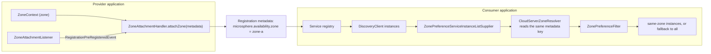

English version: [English](../microsphere-multiactive-spring-cloud.md)

# microsphere-multiactive-spring-cloud

## 概述

`microsphere-multiactive-spring-cloud` 在 Spring Cloud 一侧闭环，包含两个相互独立的特性：

1. **发布侧**——服务在注册自己时，其可用区会以 `microsphere.availability.zone` 为 key 写入注册的元数据。由
   `ZoneCloudAutoConfiguration`、`ZoneAttachmentListener` 以及被导入的 `ZoneAttachmentHandler` 实现。
2. **消费侧**——在负载均衡之前，把 Spring Cloud LoadBalancer 的实例列表收窄为同可用区实例。由
   `CustomizedLoadBalancerAutoConfiguration`、`CustomizedLoadBalancerClientConfiguration` 和
   `ZonePreferenceServiceInstanceListSupplier` 实现，三者都由
   [microsphere-multiactive-commons](microsphere-multiactive-commons.md) 中的 `ZonePreferenceFilter` 驱动。

`CloudServerZoneResolver` 是桥梁：它从 `ServiceInstance` 中把这个元数据 key 读回来。

两个特性默认都不开启：发布侧需要启用自动注册的服务注册中心集成，消费侧需要显式的 opt-in 属性。



## Maven 坐标

```xml
<dependency>
    <groupId>io.github.microsphere-projects</groupId>
    <artifactId>microsphere-multiactive-spring-cloud</artifactId>
    <version>0.1.14-SNAPSHOT</version>
</dependency>
```

- `groupId`：`io.github.microsphere-projects`
- `artifactId`：`microsphere-multiactive-spring-cloud`
- `version`：`${revision}` → 本快照中为 `0.1.14-SNAPSHOT`；最新已发布版本 `0.1.13`
- `packaging`：`jar`
- `<name>`：`Microsphere :: Multi-Active :: Spring Cloud`
- 是否由 [BOM](microsphere-multiactive-dependencies.md) 托管：**否**——本线的 BOM 列出的是
  `microsphere-multiactive-spring-cloud-starter` 和 `microsphere-multiactive-spring-cloud-loadbalancer`，
  而这两个都不由本分支构建，因此该构件的版本必须显式声明。

## 版本信息

| 项目 | 值 | 依据 |
|------|-------|-------------|
| 文档线 / Git 分支 | `1.x` / `release-1.x` | 本文档集 |
| 构件版本 | `0.1.14-SNAPSHOT` | 根 `pom.xml` 的 `<revision>` |
| compile 作用域依赖 | `io.github.microsphere-projects:microsphere-multiactive-spring-boot:${revision}`（传递带 `spring`、`commons`） | `microsphere-multiactive-spring-cloud/pom.xml` |
| optional 依赖 | `microsphere-annotation-processor`、`io.github.microsphere-projects:microsphere-spring-cloud-commons`、`spring-boot-starter`、`spring-boot-starter-actuator`、`spring-boot-starter-web`、`spring-boot-configuration-processor`、`spring-boot-autoconfigure-processor`、`org.springframework.cloud:spring-cloud-commons`、`spring-cloud-context`、`spring-cloud-loadbalancer` | `microsphere-multiactive-spring-cloud/pom.xml` |
| test 依赖 | `junit-jupiter`、`spring-boot-starter-test`、`microsphere-spring-boot-test`、`logback-classic` | `microsphere-multiactive-spring-cloud/pom.xml` |
| JDK | 本仓库未声明编译级别；CI 在 JDK 8、11、17、21、25 上测试本模块 | reactor 各 POM、`.github/workflows/maven-build.yml` |
| Spring Cloud 兼容性 | `Hoxton.SR12` / `2020.0.5` / `2021.0.9`，分别与 Spring Boot `2.3.12.RELEASE` / `2.4.13` / `2.6.15` 搭配（默认 profile 为 `spring-cloud-2021`）；版本来自外部父工程，profile 名来自 CI | `.github/workflows/maven-build.yml`、`microsphere-multiactive-parent/pom.xml` |
| reactor 要求 | `ZonePreferenceServiceInstanceListSupplier.get()` 返回 `reactor.core.publisher.Flux`，由 `spring-cloud-loadbalancer` 提供 | 本模块源码 |
| 模块运行要求 | 发布侧：来自 `microsphere-spring-cloud-commons` 的 Spring Cloud `Registration`、`RegistrationPreRegisteredEvent` 与 `EventPublishingRegistrationAspect`；消费侧：`spring-cloud-loadbalancer` 以及一个 `DiscoveryClient` bean | `ZoneCloudAutoConfiguration`、`CustomizedLoadBalancerClientConfiguration` |

> **运行时前置条件。** `microsphere-spring-cloud-commons` 虽然声明为 optional，但代码和条件都直接依赖它
> （`ConditionalOnAutoServiceRegistrationEnabled`、`RegistrationPreRegisteredEvent`、
> `ServiceRegistryConstants.REGISTRATION_CLASS_NAME`、`EventPublishingRegistrationAspect`）。若你希望发布侧生效，
> 请把它加入你的构建。消费侧同样要求 Spring Cloud LoadBalancer 本身在类路径上。

## 自动配置注册

两个配置都完成了注册，同样通过两个文件：

| 资源 | 内容 |
|----------|---------|
| `META-INF/spring.factories` → `org.springframework.boot.autoconfigure.EnableAutoConfiguration` | `io.microsphere.multiple.active.zone.spring.cloud.autoconfigure.ZoneCloudAutoConfiguration`、`io.microsphere.multiple.active.zone.spring.cloud.loadbalancer.CustomizedLoadBalancerAutoConfiguration` |
| `META-INF/spring/org.springframework.boot.autoconfigure.AutoConfiguration.imports` | 同上两个类 |
| `META-INF/config/default/features.yaml` | 面向 Microsphere Spring Cloud 特性机制，声明名为 `microsphere-multiactive-commons`、`microsphere-multiactive-spring`、`microsphere-multiactive-spring-cloud` 的特性成员 |

随附的 `features.yaml`，逐字如下：

```yaml
microsphere:
  spring:
    cloud:
      features:
        named:
          microsphere-multiactive-commons:
            - io.microsphere.multiple.active.zone.ZoneAttachmentHandler
            - io.microsphere.multiple.active.zone.ZoneContext
            - io.microsphere.multiple.active.zone.ZonePreferenceFilter
            - io.microsphere.multiple.active.zone.ZoneResolver
          microsphere-multiactive-spring:
            - io.microsphere.multiple.active.zone.spring.ZoneLocator
            - io.microsphere.multiple.active.zone.spring.event.ZoneContextChangedListener
          microsphere-multiactive-spring-cloud:
            - WebEndpointApplicationContextInitializer=io.microsphere.spring.cloud.gateway.server.webmvc.context.WebEndpointApplicationContextInitializer
```

最后一条指向的是 Spring Cloud Gateway 的某个类，而不是本模块的类；本快照中原样存在该条目。

## 公共 API

### `CloudServerZoneResolver`（`class`，包 `io.microsphere.multiple.active.zone.spring.cloud`）

`public class CloudServerZoneResolver implements ZoneResolver<ServiceInstance>`

| 成员 | 签名 / 行为 |
|--------|----------------------|
| `INSTANCE` | `public static final CloudServerZoneResolver INSTANCE`——一个无状态单例，可复用而无需自行实例化 |
| `resolve(ServiceInstance)` | 返回 `serviceInstance.getMetadata().get("microsphere.availability.zone")`；元数据 map 为 `null` 时返回 `null` |

### `ZoneCloudAutoConfiguration`（`class`，包 `...spring.cloud.autoconfigure`）

发布侧的配置。其完整条件集：

```java
@Configuration(proxyBeanMethods = false)
@ConditionalOnAvailabilityZoneAvailable
@ConditionalOnAutoServiceRegistrationEnabled
@ConditionalOnClass(name = {
        "org.aspectj.lang.annotation.Aspect",                                                                        // AspectJ API
        "io.microsphere.spring.cloud.client.service.registry.event.RegistrationPreRegisteredEvent",                  // Microsphere Spring Cloud Commons API
        REGISTRATION_CLASS_NAME
})
@ConditionalOnBean(ZoneContext.class)
@AutoConfigureAfter(
        value = {
                ZoneAutoConfiguration.class
        },
        name = {
                "org.springframework.cloud.netflix.eureka.EurekaClientAutoConfiguration",                            // Spring Cloud Netflix Eureka API
                "io.microsphere.spring.cloud.client.service.registry.autoconfigure.ServiceRegistryAutoConfiguration" // Microsphere Spring Cloud Commons API
        })
@Import(value = {
        ZoneAttachmentHandler.class
})
public class ZoneCloudAutoConfiguration {
}
```

| 元素 | 细节 |
|---------|--------|
| `@ConditionalOnAvailabilityZoneAvailable` | 要求存在 `ZoneContext` + `ZoneLocator` 类，且 `microsphere.availability.zone.enabled`（默认 `true`）——见 [spring-boot](microsphere-multiactive-spring-boot.md) |
| `@ConditionalOnAutoServiceRegistrationEnabled` | 来自 `microsphere-spring-cloud-commons`；测试用 `spring.cloud.service-registry.auto-registration.enabled=false` 禁用该特性 |
| `@ConditionalOnClass(name = ...)` | AspectJ、`RegistrationPreRegisteredEvent` 与 `REGISTRATION_CLASS_NAME`（`microsphere-spring-cloud-commons` 中 `ServiceRegistryConstants` 的常量；其字面值不属于本仓库） |
| `@ConditionalOnBean(ZoneContext.class)` | 需要 `ZoneContext` bean，通常由 `ZoneAutoConfiguration` 创建 |
| `@AutoConfigureAfter(...)` | 排在 `ZoneAutoConfiguration`、Eureka 的 `EurekaClientAutoConfiguration` 与 Microsphere 的 `ServiceRegistryAutoConfiguration` 之后 |
| `@Import(ZoneAttachmentHandler.class)` | 把 `ZoneAttachmentHandler` 自身注册为一个 bean（Spring 会把被导入的普通类当作 bean 定义处理）；这里**并没有**用 `@Bean` 方法声明它 |

产出的 bean：

| Bean | 条件 | 值 |
|------|-----------|-------|
| `zoneAttachmentListener()` | `@ConditionalOnBean(type = "io.microsphere.spring.cloud.client.service.registry.aspect.EventPublishingRegistrationAspect")`、`@ConditionalOnMissingBean` | `new ZoneAttachmentListener()` |

由此带来的后果：该监听器**仅**在 `EventPublishingRegistrationAspect` 同样是一个 bean 时才存在。如果缺少该切面，
即便配置本身匹配成功，也不会附加任何可用区。

### `ZoneAttachmentListener`（`class`，包 `...spring.cloud.event`）

`public class ZoneAttachmentListener implements ApplicationListener<RegistrationPreRegisteredEvent>, ApplicationContextAware`

| 成员 | 行为 |
|--------|-----------|
| `onApplicationEvent(RegistrationPreRegisteredEvent)` | 取 `event.getRegistration().getMetadata()`，查找 `ZoneAttachmentHandler` bean 并调用 `attachZone(metadata)` |
| `setApplicationContext(ApplicationContext)` | 保存用于上述查找的上下文 |

注意泛型参数：本线监听的是 Microsphere 的 `RegistrationPreRegisteredEvent`，而不是 Spring Cloud 自己的
`InstancePreRegisteredEvent`（后者只出现在 Javadoc 的引用中）。

### `CustomizedLoadBalancerAutoConfiguration`（`class`，包 `...spring.cloud.loadbalancer`）

```java
@Configuration(proxyBeanMethods = false)
@ConditionalOnProperty(value = "microsphere.spring.cloud.loadbalancer.customized", havingValue = "true")
@ConditionalOnClass(name = {
        "org.springframework.cloud.loadbalancer.annotation.LoadBalancerClient"
})
@LoadBalancerClients(defaultConfiguration = CustomizedLoadBalancerClientConfiguration.class)
public class CustomizedLoadBalancerAutoConfiguration {
}
```

| 元素 | 细节 |
|---------|--------|
| `microsphere.spring.cloud.loadbalancer.customized` | 必须恰好为 `true`；没有 `matchIfMissing`，因此该特性默认**关闭** |
| `@ConditionalOnClass(name = ...)` | 要求类路径上存在 Spring Cloud LoadBalancer |
| `@LoadBalancerClients(defaultConfiguration = ...)` | 把 `CustomizedLoadBalancerClientConfiguration` 安装为**每个**负载均衡客户端的默认配置 |

### `CustomizedLoadBalancerClientConfiguration`（`class`）

按负载均衡客户端上下文注册。它贡献一个始终存在的 bean 和两个条件化的 provider：

| Bean / 成员 | 条件 | 行为 |
|---------------|-----------|-----------|
| `zonePreferenceFilter(ZoneContext)` | 无 | `new ZonePreferenceFilter<>(zoneContext, new CloudServerZoneResolver())`——注意这里用的是新建的 resolver 实例，而不是 `INSTANCE` 单例 |
| `ReactiveConfiguration.optimizedZonePreferenceDiscoveryClientServiceInstanceListSupplier(ConfigurableApplicationContext, ZonePreferenceFilter<ServiceInstance>)` | `@ConditionalOnReactiveDiscoveryEnabled`、`@Order(193827465)`、`@ConditionalOnBean(DiscoveryClient.class)`、`@ConditionalOnMissingBean`、`@Conditional(OptimizedZoneConfigurationCondition.class)` | `ServiceInstanceListSupplier.builder().withDiscoveryClient().withCaching().with((ctx, delegate) -> new ZonePreferenceServiceInstanceListSupplier(delegate, zonePreferenceFilter)).build(context)` |
| `BlockingConfiguration.optimizedZonePreferenceServiceInstanceListSupplier(ConfigurableApplicationContext, ZonePreferenceFilter<ServiceInstance>)` | `@ConditionalOnBlockingDiscoveryEnabled`、`@Order(193827466)`，再加上与上面相同的三个条件 | 用 `.withBlockingDiscoveryClient()` 构建的同一条链 |
| `OptimizedZoneConfigurationCondition`（实现 `Condition` 的 `static class`） | | `LoadBalancerEnvironmentPropertyUtils.equalToForClientOrDefault(context.getEnvironment(), "configurations", "optimized-zone-preference")`——即只有当某个客户端的 LoadBalancer `configurations` 属性解析为 `optimized-zone-preference` 时才安装该 supplier |

这两个 `@Order` 值只是足够大，以便把这些嵌套配置排到每个客户端上下文中 Spring Cloud 自己的
`ReactiveBlockingLoadBalancerClient` / default-retry 配置之后；数字本身没有文档化的含义。

`configurations` key 由 Spring Cloud LoadBalancer 自身的按客户端属性机制解析，因此属性名遵循 Spring Cloud 的约定
（`spring.cloud.loadbalancer.` 前缀，以及按客户端与默认两种变体），而不是由本仓库定义——本项目库查找的值是
`optimized-zone-preference`。

### `ZonePreferenceServiceInstanceListSupplier`（`class`）

`public class ZonePreferenceServiceInstanceListSupplier extends DelegatingServiceInstanceListSupplier`

| 成员 | 行为 |
|--------|-----------|
| 构造器 | `public ZonePreferenceServiceInstanceListSupplier(ServiceInstanceListSupplier delegate, ZonePreferenceFilter<ServiceInstance> zonePreferenceFilter)` |
| `get()` | `return getDelegate().get().map(this::filteredByZone);`——每个发出的列表都会经过 `ZonePreferenceFilter.filter(...)` |
| `filteredByZone(List<ServiceInstance>)` | `private`；委托给过滤器 |

它的 Javadoc `@see` 指向 Spring Cloud 自己的
`org.springframework.cloud.loadbalancer.core.ZonePreferenceServiceInstanceListSupplier`；本类是它的替代品，额外加入了
[commons](microsphere-multiactive-commons.md) 提供的排空可用区、就绪百分比与最小可用数量这些阈值。

## 配置属性

| 属性 | 默认值 | 效果 |
|----------|---------|--------|
| `microsphere.spring.cloud.loadbalancer.customized` | 未设置 → 特性关闭 | 把 `CustomizedLoadBalancerClientConfiguration` 安装为所有负载均衡客户端的默认配置 |
| `...configurations = optimized-zone-preference`（Spring Cloud LoadBalancer 的 key，通过 `LoadBalancerEnvironmentPropertyUtils.equalToForClientOrDefault` 解析） | 未设置 → 不安装 supplier | 让某个具体客户端（或默认客户端）启用可用区偏好 supplier |
| `microsphere.availability.zone.enabled` | `true` | 从 boot 层继承的主开关；`false` 会禁用两个配置 |
| `microsphere.availability.zone.preference.enabled` | `false` | 只有它为 `true` 时 supplier 才会真正收窄列表 |
| `microsphere.availability.zone.preference.upstream.zone-ready-percentage` | `100` | 过滤器的就绪度门槛 |
| `microsphere.availability.zone.preference.upstream.same-zone-min-available` | `5` | 同可用区实例最小数量 |
| `microsphere.availability.zone.preference.upstream.disabled-zone` | 未设置 | 在应用偏好之前被排空的可用区 |
| `microsphere.availability.zone` | `defaultZone` | 当前应用的可用区；同时也是被写入与读取的元数据 key |
| `spring.cloud.service-registry.auto-registration.enabled` | Spring Cloud 默认值 | 为 `false` 时禁用发布侧的 `ZoneCloudAutoConfiguration`（由 `ZoneCloudAutoConfigurationTest` 断言） |
| `microsphere.spring.cloud.service-registry.auto-registration.simple.enabled` | 未设置 | 集成测试用它向 `InMemoryServiceRegistry` 注册（该属性归 `microsphere-spring-cloud-commons` 所有） |

## 示例

### 发布侧配置的条件契约（`ZoneCloudAutoConfigurationTest`）

```java
@SpringBootTest(
        classes = {
                ZoneContext.class,
                EventPublishingRegistrationAspect.class,
                ZoneCloudAutoConfigurationTest.class
        },
        webEnvironment = NONE
)
class ZoneCloudAutoConfigurationTest extends AutoConfigurationTest<ZoneCloudAutoConfiguration> {

    @Override
    protected void configureAutoConfiguredClasses(Set<Class<?>> autoConfiguredClasses) {
        autoConfiguredClasses.add(ZoneAttachmentHandler.class);
        autoConfiguredClasses.add(ZoneAttachmentListener.class);
    }

    @Override
    protected void configureGlobalDisabledPropertyValues(Set<String> globalDisabledPropertyValues) {
        globalDisabledPropertyValues.add("microsphere.availability.zone.enabled=false");
        globalDisabledPropertyValues.add("spring.cloud.service-registry.auto-registration.enabled=false");
    }

    @Override
    protected void configureGlobalMissingClasses(Set<Class<?>> globalMissingClasses) {
        globalMissingClasses.add(ZoneLocator.class);
        globalMissingClasses.add(Aspect.class);
        globalMissingClasses.add(RegistrationPreRegisteredEvent.class);
        globalMissingClasses.add(Registration.class);
    }
}
```

把它当规范来读：该配置预期贡献的两个 bean 是 `ZoneAttachmentHandler` 和 `ZoneAttachmentListener`；而配置退避的原因
共有四类——可用区特性被禁用、自动注册被禁用、`ZoneLocator` 缺失，或 AspectJ / `RegistrationPreRegisteredEvent` /
`Registration` 缺失。

### 端到端注册（`ZoneCloudAutoConfigurationIntegrationTest`）

```java
@SpringBootTest(
        classes = {
                InMemoryServiceRegistry.class,
                ZoneCloudAutoConfigurationIntegrationTest.class
        },
        webEnvironment = NONE,
        properties = {
                "server.port=8080",
                "spring.application.name=test-service",
                "microsphere.spring.cloud.service-registry.auto-registration.simple.enabled=true"
        }
)
@EnableAutoConfiguration
@EnableConfigurationProperties(value = {
        ServerProperties.class
})
public class ZoneCloudAutoConfigurationIntegrationTest {

    @Autowired
    private Registration registration;

    @Autowired
    private ServiceRegistry<Registration> serviceRegistry;

    @Autowired
    private ZoneContext zoneContext;

    @Autowired
    private CompositeZoneLocator compositeZoneLocator;

    @Autowired
    private ZoneAttachmentHandler zoneAttachmentHandler;

    @Autowired
    private ZoneAttachmentListener zoneAttachmentListener;

    @Test
    void test() {
        assertNotNull(zoneContext);
    }
}
```

`InMemoryServiceRegistry`（来自 `microsphere-spring-cloud-commons`）代替真实注册中心；该测试证明发布侧的整张 bean
图能够装配起来——`Registration`、`ServiceRegistry`、`ZoneContext`、`CompositeZoneLocator`、`ZoneAttachmentHandler`
和 `ZoneAttachmentListener` 都能解析成功。

### 从实例元数据解析可用区（`CloudServerZoneResolver`）

```java
ServiceInstance instance = /* from DiscoveryClient */;
String zone = CloudServerZoneResolver.INSTANCE.resolve(instance);
// equivalent to instance.getMetadata().get("microsphere.availability.zone"), null when metadata is null
```

## 集成

```xml
<dependency>
    <groupId>io.github.microsphere-projects</groupId>
    <artifactId>microsphere-multiactive-spring-cloud</artifactId>
    <version>0.1.13</version>
</dependency>
```

版本是必写的：[1.x BOM](microsphere-multiactive-dependencies.md) 并不托管这个 artifactId。

最小配置，发布侧与消费侧一起：

```properties
# both sides
microsphere.availability.zone=zone-a
microsphere.availability.zone.enabled=true

# consumer side: same-zone preference + explicit opt-in of the customized load balancer configuration
microsphere.availability.zone.preference.enabled=true
microsphere.availability.zone.preference.upstream.zone-ready-percentage=80
microsphere.availability.zone.preference.upstream.same-zone-min-available=2
microsphere.spring.cloud.loadbalancer.customized=true
```

如果只想作用于单个客户端而不是全部，请保留 `microsphere.spring.cloud.loadbalancer.customized=true`，并通过 Spring
Cloud LoadBalancer 的 `configurations` 属性为该客户端选择 `optimized-zone-preference` 配置——
`OptimizedZoneConfigurationCondition` 检查的就是它。按客户端选择依赖客户端名，因此请查阅你所用版本列车的 Spring
Cloud LoadBalancer 文档；要设置的值是 `optimized-zone-preference`。

如果你需要在自己的代码而不是过滤器里使用可用区，这些 bean 可以直接注入：

```java
@Autowired
private ZonePreferenceFilter<ServiceInstance> zonePreferenceFilter;

List<ServiceInstance> preferred = zonePreferenceFilter.filter(allInstances);
```

## 相关文档

- [用户指南索引](README.md)
- 上游：[commons](microsphere-multiactive-commons.md)、[spring](microsphere-multiactive-spring.md)、
  [spring-boot](microsphere-multiactive-spring-boot.md)
- 下游：[aws](microsphere-multiactive-aws.md) 和 [netflix](microsphere-multiactive-netflix.md) 都把本模块声明为 optional 依赖
- 根 [README](../../../../README.md) 与[发布说明](../../../../release-notes.md)
- 开发者指南：[../../developer-guide/zh/microsphere-multiactive-spring-cloud.md](../../developer-guide/zh/microsphere-multiactive-spring-cloud.md)

## English

English version: [English](../microsphere-multiactive-spring-cloud.md)
