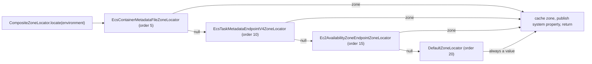

English version: [English](../microsphere-multiactive-spring.md)

# microsphere-multiactive-spring

## 概述

`microsphere-multiactive-spring` 是 Spring Framework 层。它把
[microsphere-multiactive-commons](microsphere-multiactive-commons.md) 中与框架无关的可用区模型变为一套发现机制：

- `ZoneLocator` 是回答"我运行在哪个可用区？"的 SPI，答案来自 Spring 的 `Environment`。
- `AbstractZoneLocator` 为实现类补上 `Ordered` / `BeanNameAware` 行为。
- `DefaultZoneLocator` 是始终可用的兜底实现，读取 `microsphere.availability.zone`。
- `CompositeZoneLocator` 按顺序执行一组定位器，返回第一个非 null 的答案，把它缓存起来并作为 JVM 系统属性发布。
- `ZoneContextChangedListener` 在应用上下文启动或环境变化时从 `Environment` 刷新 `ZoneContext`，并把结果作为
  `ZoneContextChangedEvent` 重新发布。
- `ZoneUtils` 集中管理两个约定俗成的 bean 名。

本模块不包含任何自动配置，也完全没有 `META-INF` 资源：在纯 Spring 下由你自己注册这些 bean；在 Spring Boot 下这些
bean 由 [microsphere-multiactive-spring-boot](microsphere-multiactive-spring-boot.md) 创建。

## Maven 坐标

```xml
<dependency>
    <groupId>io.github.microsphere-projects</groupId>
    <artifactId>microsphere-multiactive-spring</artifactId>
    <version>0.1.14-SNAPSHOT</version>
</dependency>
```

- `groupId`：`io.github.microsphere-projects`
- `artifactId`：`microsphere-multiactive-spring`
- `version`：`${revision}` → 本快照中为 `0.1.14-SNAPSHOT`；最新已发布版本 `0.1.13`
- `packaging`：`jar`
- `<name>`：`Microsphere :: Multi-Active :: Spring`
- 是否由 [BOM](microsphere-multiactive-dependencies.md) 托管：是

## 版本信息

| 项目 | 值 | 依据 |
|------|-------|-------------|
| 文档线 / Git 分支 | `1.x` / `release-1.x` | 本文档集 |
| 构件版本 | `0.1.14-SNAPSHOT` | 根 `pom.xml` 的 `<revision>` |
| compile 作用域依赖 | `io.github.microsphere-projects:microsphere-multiactive-commons:${revision}`（传递、非 optional） | `microsphere-multiactive-spring/pom.xml` |
| optional 依赖 | `microsphere-annotation-processor`、`microsphere-spring-context`、`org.springframework:spring-context` | `microsphere-multiactive-spring/pom.xml` |
| test 依赖 | `junit-jupiter`、`org.springframework:spring-test`、`io.github.microsphere-projects:microsphere-spring-test`、`logback-classic` | `microsphere-multiactive-spring/pom.xml` |
| JDK | 本仓库未声明编译级别；CI 在 JDK 8、11、17、21、25 上测试本模块 | reactor 各 POM、`.github/workflows/maven-build.yml` |
| Spring Framework | 版本未在本仓库声明；它来自当前 Maven profile 选中的 Spring Boot 版本列车——从 Boot 2.3.12.RELEASE（Spring 5.2.x）到 Boot 2.6.15（Spring 5.3.x） | `microsphere-multiactive-parent/pom.xml`、CI profile `spring-cloud-hoxton` / `-2020` / `-2021` |
| 模块运行要求 | 一个 `org.springframework.core.env.Environment`；就监听器而言，上下文中还需要 `ZoneContext` bean 和 `ZoneLocator` bean | 本模块源码 |

> **运行时前置条件。** `microsphere-spring-context` 和 `spring-context` 都声明为 optional，因此不会传递。本模块的
> 源码还使用了 `io.microsphere.logging.*` 与 `io.microsphere.util.*`
> （`AbstractZoneLocator`、`CompositeZoneLocator`、`ZoneUtils`、`ZoneContextChangedListener`），它们来自
> `microsphere-java-core`——在下一层的 `microsphere-multiactive-commons` 中声明为 optional。在 Spring Boot 应用中
> `spring-context` 已经存在；如果你独立依赖本 jar，请添加 `microsphere-java-core`。

## 公共 API

### `ZoneLocator`（`interface`，包 `io.microsphere.multiple.active.zone.spring`）

```java
public interface ZoneLocator {
    boolean supports(Environment environment);
    String locate(Environment environment);
}
```

| 方法 | 契约 |
|--------|----------|
| `supports(Environment)` | 本定位器在当前环境下是否能提供答案。返回 `false` 时，`CompositeZoneLocator` 完全跳过 `locate` |
| `locate(Environment)` | 可用区，未知时返回 `null`。返回 `null` 会让下一个定位器尝试；抛出的异常会被组合定位器捕获 |

实现类有：`DefaultZoneLocator`（本模块）以及
[microsphere-multiactive-aws](microsphere-multiactive-aws.md) 中的三个 AWS 定位器。

### `AbstractZoneLocator`（`abstract class`）

`public abstract class AbstractZoneLocator implements ZoneLocator, BeanNameAware, Ordered`

| 成员 | 签名 | 说明 |
|--------|-----------|-------|
| 构造器 | `public AbstractZoneLocator(int order)`（隐式 `protected` 语义） | 唯一的构造器接收初始顺序 |
| `setBeanName(String)` | `public final void` | Spring 的 `BeanNameAware`；存入 `protected String beanName` 字段 |
| `getOrder()` | `public final int getOrder()` | `Ordered`；声明为 final，因此子类无法改变该契约 |
| `setOrder(int)` | `public final void setOrder(int)` | 运行时重新设定顺序 |
| `logger` | `protected final io.microsphere.logging.Logger` | 以具体子类命名 |
| `toString()` | `ZoneLocator{beanName='...', order=...}` | 在组合定位器的日志行中原样使用 |

由于 `getOrder()` 是 `final`，自定义定位器必须通过构造器或 `setOrder` 设置顺序，而不能通过重写。

### `DefaultZoneLocator`（`class`）

`public class DefaultZoneLocator extends AbstractZoneLocator`

| 成员 | 值 / 行为 |
|--------|-------------------|
| `public static final int DEFAULT_ORDER` | `20` |
| `public DefaultZoneLocator()` | 委托给 `super(DEFAULT_ORDER)` |
| `supports(Environment)` | 始终为 `true`——这是兜底定位器 |
| `locate(Environment)` | 当 `microsphere.availability.zone` 有文本时返回该值，否则返回 `ZoneConstants.DEFAULT_ZONE`（`defaultZone`）。它永不返回 `null` |

`DefaultZoneLocatorTest` 断言了：`DEFAULT_ORDER` 为 20、`setOrder(5)` 能改变它、属性缺失时得到 `defaultZone`、属性为
`zone-a` 时得到 `zone-a`。

### `CompositeZoneLocator`（`class`）

`public class CompositeZoneLocator implements ZoneLocator`——即以 `zoneLocator` 之名注册的 bean。

| 成员 | 签名 / 行为 |
|--------|----------------------|
| 构造器 | `public CompositeZoneLocator(List<ZoneLocator> zoneLocators)`——复制该列表，然后用 `AnnotationAwareOrderComparator` 排序。参数为 `null` 时抛 `IllegalArgumentException`（`Assert.notNull`） |
| `supports(Environment)` | **至少一个**委托支持时返回 `true`，否则 `false`（空列表永不支持） |
| `locate(Environment)` | 见下面步骤 |
| `toString()` | `CompositeZoneLocator{zoneLocators=[...], zone=...}` |

`locate` 的实际行为：

1. 如果此前已经定位到可用区，立即返回缓存值——每个实例最多执行一次发现。
2. 从 `Environment` 读取 `microsphere.availability.zone.locator.fast-fail`（`boolean`，默认 `false`）。
3. 依序访问委托。对每一个：`supports` → `locate`；第一个非 `null` 结果胜出并结束循环。返回 `null` 的委托会记录警告；
   抛出异常的委托以 error 级别记录并被跳过。
4. 开启 fast-fail 后，第一个返回 `null` **或**抛异常的委托会中止整个循环，并在循环结束后抛出
   `IllegalStateException("The zone can't be located by <locator>")`。
5. 如果无人定位成功，返回 `null` 并按 `null` 缓存（会记录警告）——下次调用会重新执行发现，因为
   `StringUtils.hasText(null)` 为 `false`。
6. 成功时，该可用区同时被写入 JVM 系统属性 `microsphere.current.availability.zone`，也就是
   `ZoneContext.getCurrentZone()` 读取的值。

`CompositeZoneLocatorTest` 为每个分支都做了断言：第一个匹配者胜出、缓存、跳过不支持的委托、无人定位时返回 `null`、
fast-fail 遇到返回 `null` 的定位器、fast-fail 遇到抛异常的定位器、未开启 fast-fail 时继续落到下一个定位器，以及空委托列表。

### `ZoneUtils`（`abstract class`）

| 成员 | 值 / 签名 |
|--------|-------------------|
| `public static final String ZONE_CONTEXT_BEAN_NAME` | `zoneContext` |
| `public static final String ZONE_LOCATOR_BEAN_NAME` | `zoneLocator` |
| `public static ZoneContext getZoneContext(ConfigurableListableBeanFactory)` | `beanFactory.getBean("zoneContext", ZoneContext.class)` |
| `public static ZoneLocator getZoneLocator(ConfigurableListableBeanFactory)` | `beanFactory.getBean("zoneLocator", ZoneLocator.class)` |

该类是 `abstract` 且构造器私有：不可实例化。在本线中无法覆盖这两个 bean 名——如果你声明自己的
`ZoneContext`/`ZoneLocator` bean，必须使用完全一致的这两个名字，否则 `ZoneUtils`（进而
`ZoneAutoConfiguration` 的查找）将找不到它们。

### `ZoneContextChangedEvent`（`class`，包 `...zone.spring.event`）

`public class ZoneContextChangedEvent extends ApplicationContextEvent`

| 成员 | 签名 |
|--------|-----------|
| 构造器 | `public ZoneContextChangedEvent(ApplicationContext context, ZoneContext zoneContext, List<PropertyChangeEvent> propertyChangeEvents)`——该列表会被 `Collections.unmodifiableList` 包装 |
| `getZoneContext()` | `public ZoneContext getZoneContext()`——变更之后的上下文 |
| `getPropertyChangeEvents()` | `public List<java.beans.PropertyChangeEvent> getPropertyChangeEvents()`——每个真正发生变更的属性对应一个条目 |
| `getSource()` / `getApplicationContext()` | 继承而来；两者都返回发布事件的 `ApplicationContext` |

### `ZoneContextChangedListener`（`class`，包 `...zone.spring.event`）

`public class ZoneContextChangedListener implements SmartApplicationListener, ApplicationContextAware, EnvironmentAware`

由哪个事件触发刷新，取决于类路径上有什么。这两个类名在静态初始化中被解析一次，因此该决策在类加载时就已固定：

| 类路径 | 处理的事件类型 |
|-----------|------------------------|
| Spring Cloud（`EnvironmentChangeEvent` **和** `ApplicationStartedEvent` 都可解析） | `org.springframework.cloud.context.environment.EnvironmentChangeEvent` 和 `org.springframework.boot.context.event.ApplicationStartedEvent` |
| 仅 Spring Boot（`ApplicationStartedEvent` 可解析，`EnvironmentChangeEvent` 不可） | `ApplicationStartedEvent` |
| 纯 Spring Framework（两者都不可） | `org.springframework.context.event.ContextRefreshedEvent` |

每次触发时，`changeZoneContext(...)` 会应用上述七个被监听的属性，并且只要产生了至少一个 `PropertyChangeEvent`，就发布一个
`ZoneContextChangedEvent`。映射关系为：

| 从 `Environment` 读取的属性 | `ZoneContext` setter | 属性缺失时的默认值 |
|--------------------------------------|----------------------|--------------------------------------|
| `microsphere.availability.zone` | `setZone(String)` | 保留先前的可用区——值缺失或为空白时不做任何变更 |
| `microsphere.availability.zone.enabled` | `setEnabled(boolean)` | `true` |
| `microsphere.availability.zone.preference.enabled` | `setPreferenceEnabled(boolean)` | `false` |
| `microsphere.availability.zone.preference.filter.order` | `setPreferenceFilterOrder(int)` | `10` |
| `microsphere.availability.zone.preference.upstream.zone-ready-percentage` | `setPreferenceUpstreamZoneReadyPercentage(int)` | `100` |
| `microsphere.availability.zone.preference.upstream.same-zone-min-available` | `setPreferenceUpstreamSameZoneMinAvailable(int)` | `5` |
| `microsphere.availability.zone.preference.upstream.disabled-zone` | `setPreferenceUpstreamDisabledZone(String)` | `null` |

有两个成员是 `protected` 的，因此属于扩展面：

- `ZONE_CONTEXT_PROPERTY_NAMES`——上面七个 key 构成的不可变列表（长度被断言为 `7`）。
- `propertyChangedHandlers`——以同样的名字为 key 的 `Map<String, Consumer<String>>`；移除某个条目即可在该监听器实例上禁用该属性。

`setApplicationContext(ApplicationContext)` 是**按类型**查找 `ZoneContext` **和** `ZoneLocator` 的；这两个 bean 必须存在，
否则监听器初始化失败。

**回退到发现流程。** 把可用区属性设置为哨兵值 `originalZone`（`ZoneConstants.ORIGINAL_ZONE`，比较时忽略大小写）会使
监听器调用 `zoneLocator.locate(environment)` 并使用其结果；如果定位器的 `supports(...)` 为 `false`，可用区就变成
`defaultZone`。由 `ZoneContextChangedListenerTest#testRevertOriginalZoneWhenLocatorDoesNotSupport` 验证。

> 这一组合下的坑：当定位结果来自 `DefaultZoneLocator` 时，该定位器会重新读取
> `microsphere.availability.zone`——此时它的值正是哨兵 `originalZone`——并原样返回。
> `testRevertOriginalZoneWhenZoneIsOriginal` 只断言结果非 null，这与实际行为一致。要想真正回退到"发现"得到的坐标，
> 请把真正的发现型定位器排在前面（见 AWS 模块）。

## 定位器顺序的实际情形

`CompositeZoneLocator` 按升序对委托排序，因此第一个非 `null` 答案胜出。本线代码中固定的顺序为：

| `ZoneLocator` | 模块 | 顺序 | `supports(...)` | `locate(...)` 何时返回 `null` |
|---------------|--------|-------|-----------------|-----------------------------------|
| `EcsContainerMetadataFileZoneLocator` | aws | `5` | 环境中存在 `ECS_CONTAINER_METADATA_FILE` | 路径为空、文件不可读、JSON 解析失败 |
| `EcsTaskMetadataEndpointV4ZoneLocator` | aws | `10` | 环境中存在 `ECS_CONTAINER_METADATA_URI_V4` | URI 为空、HTTP 或 JSON 失败 |
| `Ec2AvailabilityZoneEndpointZoneLocator` | aws | `15` | 始终 `true` | HTTP 请求失败 |
| `DefaultZoneLocator` | spring | `20` | 始终 `true` | 从不——回退到 `defaultZone` |



由于 `DefaultZoneLocator` 永不返回 `null` 且 `supports` 为 `true`，它就是这条链的终止者：只要它在链中，
`locate` 总会产生一个值，而 fast-fail 只可能由排在它之前的定位器触发。

## 示例

改写自本模块 `src/test/java` 下的测试。

### 从 Spring 属性定位（`DefaultZoneLocatorTest`）

```java
DefaultZoneLocator locator = new DefaultZoneLocator();
assertEquals(DefaultZoneLocator.DEFAULT_ORDER, locator.getOrder()); // 20

StandardEnvironment environment = new StandardEnvironment();
Map<String, Object> props = new HashMap<>();
props.put(ZoneConstants.ZONE_PROPERTY_NAME, "zone-a");
environment.getPropertySources().addFirst(new MapPropertySource("test", props));

assertEquals("zone-a", locator.locate(environment));

// No property at all: the default zone is applied instead of null.
assertEquals(ZoneConstants.DEFAULT_ZONE, new DefaultZoneLocator().locate(new StandardEnvironment()));
```

### 组合定位器并控制失败处理（`CompositeZoneLocatorTest`）

```java
ZoneLocator unsupported = new ZoneLocator() {
    @Override
    public boolean supports(Environment env) {
        return false;
    }

    @Override
    public String locate(Environment env) {
        return "should-not-be-called";
    }
};

ZoneLocator fixed = new ZoneLocator() {
    @Override
    public boolean supports(Environment env) {
        return true;
    }

    @Override
    public String locate(Environment env) {
        return "zone-b";
    }
};

CompositeZoneLocator composite = new CompositeZoneLocator(Arrays.asList(unsupported, fixed));
assertTrue(composite.supports(new StandardEnvironment()));
assertEquals("zone-b", composite.locate(new StandardEnvironment()));
// The result is cached: a second call returns the same zone without re-running discovery.
assertEquals("zone-b", composite.locate(new StandardEnvironment()));
```

```java
// Fast-fail: with microsphere.availability.zone.locator.fast-fail=true a locator that supports
// but cannot locate (or that throws) aborts the whole chain with IllegalStateException.
StandardEnvironment env = new StandardEnvironment();
Map<String, Object> props = new HashMap<>();
props.put(ZoneConstants.LOCATOR_FAST_FAIL_PROPERTY_NAME, "true");
env.getPropertySources().addFirst(new MapPropertySource("test", props));

CompositeZoneLocator composite = new CompositeZoneLocator(Collections.singletonList(nullLocator()));
assertThrows(IllegalStateException.class, () -> composite.locate(env));

// Without fast-fail the exception is logged and the next locator still gets a chance.
CompositeZoneLocator lenient = new CompositeZoneLocator(
        Arrays.asList(throwingLocator(), fixedLocator("zone-fallback")));
assertEquals("zone-fallback", lenient.locate(new StandardEnvironment()));
```

### 在纯 Spring 上注册监听器（`ZoneContextChangedListenerTest`）

```java
ZoneContext zoneContext = ZoneContext.get();
zoneContext.reset();

GenericApplicationContext ctx = new GenericApplicationContext();
ctx.getBeanFactory().registerSingleton(ZoneUtils.ZONE_CONTEXT_BEAN_NAME, zoneContext);
ctx.getBeanFactory().registerSingleton(ZoneUtils.ZONE_LOCATOR_BEAN_NAME,
        new CompositeZoneLocator(Collections.singletonList(new DefaultZoneLocator())));

Map<String, Object> props = new HashMap<>();
props.put(ZoneConstants.ZONE_PROPERTY_NAME, "zone-from-prop");
props.put(ZoneConstants.PREFERENCE_ENABLED_PROPERTY_NAME, "true");
props.put(ZoneConstants.PREFERENCE_UPSTREAM_SAME_ZONE_MIN_AVAILABLE_PROPERTY_NAME, "3");
ctx.getEnvironment().getPropertySources().addFirst(new MapPropertySource("test-props", props));

ctx.refresh();

ZoneContextChangedListener listener = new ZoneContextChangedListener();
listener.setEnvironment(ctx.getEnvironment());
listener.setApplicationContext(ctx);
ctx.addApplicationListener(listener);
listener.onApplicationEvent(new ContextRefreshedEvent(ctx));   // plain Spring trigger

assertEquals("zone-from-prop", zoneContext.getZone());
assertTrue(zoneContext.isPreferenceEnabled());
assertEquals(3, zoneContext.getPreferenceUpstreamSameZoneMinAvailable());
ctx.close();
```

### 响应可用区变更（`ZoneContextChangedEventTest`）

```java
ZoneContext zoneContext = ZoneContext.get();
PropertyChangeEvent pce1 = new PropertyChangeEvent(zoneContext, "zone", "old-zone", "new-zone");
PropertyChangeEvent pce2 = new PropertyChangeEvent(zoneContext, "enabled", true, false);

ZoneContextChangedEvent event =
        new ZoneContextChangedEvent(ctx, zoneContext, Arrays.asList(pce1, pce2));

assertEquals(2, event.getPropertyChangeEvents().size());
assertSame(zoneContext, event.getZoneContext());
assertSame(ctx, event.getApplicationContext());
```

### 按约定名获取 bean（`ZoneUtilsTest`）

```java
StaticApplicationContext context = new StaticApplicationContext();
ZoneContext zoneContext = ZoneContext.get();
context.getBeanFactory().registerSingleton(ZoneUtils.ZONE_CONTEXT_BEAN_NAME, zoneContext);
context.getBeanFactory().registerSingleton(ZoneUtils.ZONE_LOCATOR_BEAN_NAME, new DefaultZoneLocator());

assertSame(zoneContext, ZoneUtils.getZoneContext(context.getBeanFactory()));
assertSame(ZoneUtils.getZoneLocator(context.getBeanFactory()).getClass(), DefaultZoneLocator.class);
```

## 集成

在纯 Spring Framework 下，bean 与监听器都要手工声明。两个 bean 名必须是 `zoneContext` 和 `zoneLocator`，
并且二者都必须存在，因为 `ZoneContextChangedListener` 是按类型查找它们的：

```xml
<dependency>
    <groupId>io.github.microsphere-projects</groupId>
    <artifactId>microsphere-multiactive-spring</artifactId>
    <version>0.1.13</version>
</dependency>
```

```java
@Configuration
public class ZoneConfiguration {

    @Bean(name = ZoneUtils.ZONE_CONTEXT_BEAN_NAME)
    public ZoneContext zoneContext() {
        return ZoneContext.get();
    }

    @Bean(name = ZoneUtils.ZONE_LOCATOR_BEAN_NAME)
    public ZoneLocator zoneLocator() {
        List<ZoneLocator> locators = new ArrayList<>();
        locators.add(new DefaultZoneLocator());     // order 20, always terminates the chain
        return new CompositeZoneLocator(locators);
    }

    @Bean
    public ZoneContextChangedListener zoneContextChangedListener() {
        return new ZoneContextChangedListener();
    }
}
```

如果类路径上有 `spring-boot` 或 `spring-cloud`，请优先使用
[自动配置模块](microsphere-multiactive-spring-boot.md)：它创建的就是上面这些 bean，并替你导入监听器。

## 相关文档

- [用户指南索引](README.md)
- 上游：[microsphere-multiactive-commons.md](microsphere-multiactive-commons.md)
- 下游：[spring-boot](microsphere-multiactive-spring-boot.md)、[spring-cloud](microsphere-multiactive-spring-cloud.md)、
  [aws](microsphere-multiactive-aws.md)、[netflix](microsphere-multiactive-netflix.md)
- 根 [README](../../../../README.md) 与[发布说明](../../../../release-notes.md)
- 开发者指南：[../../developer-guide/zh/microsphere-multiactive-spring.md](../../developer-guide/zh/microsphere-multiactive-spring.md)

## English

English version: [English](../microsphere-multiactive-spring.md)
