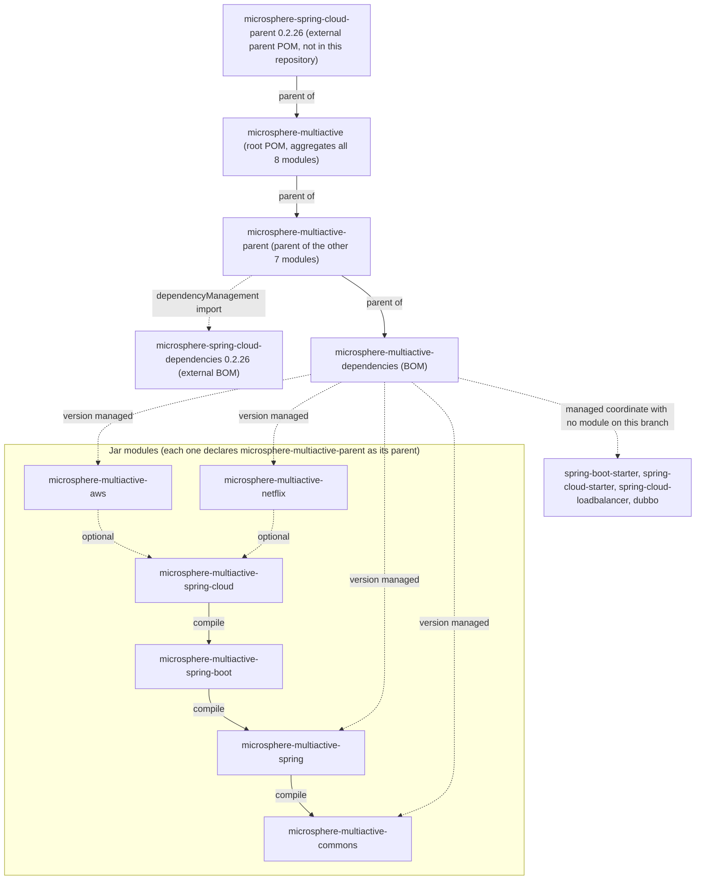
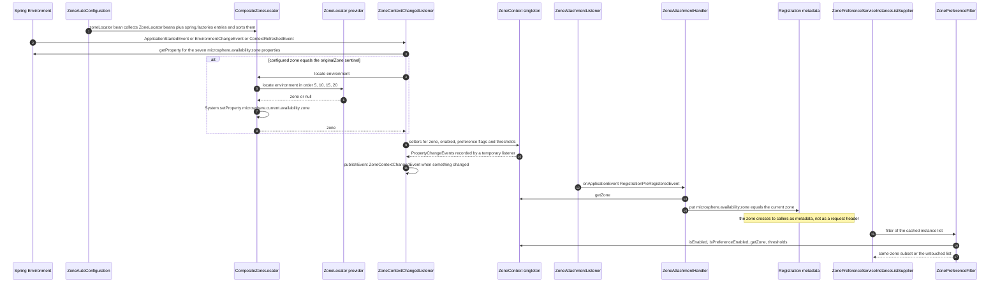

中文版本：[简体中文](zh/README.md)

# Microsphere Multiactive — Developer Guide (`current`)

This is the developer guide for the **`current`** documentation line, which documents the **`release`** branch of
`microsphere-multiactive` at version `0.2.14-SNAPSHOT` (the `<revision>` property of the root `pom.xml`).

It is written for maintainers. Every class name, method signature, property name, default value, order value, POM
element, resource file and command line in these pages was read from that snapshot: the nine `pom.xml` files (the root
POM plus the eight module POMs), `src/main/java`, `src/main/resources/META-INF` and `src/test/java`. Where a module has
no tests, no auto-configuration or no resource file, the guide says so instead of implying structure that is not there.
Behaviour that depends on
artifacts outside this repository (the external `microsphere-*` parent chain, `microsphere-spring-cloud-commons`,
Spring Boot or Ribbon classes) is described only as far as this snapshot's code shows it, and the boundary is marked.

If you only want to use the library, read the [User Guide](../user-guide/README.md) instead.

## Contents

| Document | Module | What the module doc covers |
|----------|--------|----------------------------|
| [microsphere-multiactive-parent.md](microsphere-multiactive-parent.md) | `microsphere-multiactive-parent` | The POM hierarchy, the four-deep inheritance chain, `${revision}`, the external BOM import, the duplicated `0.2.26` pins, and the fact that no POM here contains a `<build>` section |
| [microsphere-multiactive-dependencies.md](microsphere-multiactive-dependencies.md) | `microsphere-multiactive-dependencies` | The BOM's eight managed coordinates verified against the reactor, the four coordinates with no module, the two real modules with no entry, and the three-file checklist for renaming a module |
| [microsphere-multiactive-commons.md](microsphere-multiactive-commons.md) | `microsphere-multiactive-commons` | `ZoneContext` as a JVM-wide singleton with `PropertyChangeSupport`, the `ZoneConstants` property table, the nine-step `ZonePreferenceFilter.filter()` cascade, `ZoneResolver`, `ZoneAttachmentHandler`, `HttpUtils` |
| [microsphere-multiactive-spring.md](microsphere-multiactive-spring.md) | `microsphere-multiactive-spring` | The `ZoneLocator` SPI, `AbstractZoneLocator`'s `final` overrides, `DefaultZoneLocator`, `CompositeZoneLocator`'s memoization/fast-fail/system-property behaviour, `ZoneUtils` bean names, `ZoneContextChangedEvent`/`ZoneContextChangedListener` |
| [microsphere-multiactive-spring-boot.md](microsphere-multiactive-spring-boot.md) | `microsphere-multiactive-spring-boot` | `ZoneAutoConfiguration`'s two beans and two registration channels, the composed `@ConditionalOnAvailabilityZoneAvailable`/`Enabled` annotations, `AutoConfiguration.imports`, `spring.factories`, the boot sequence |
| [microsphere-multiactive-spring-cloud.md](microsphere-multiactive-spring-cloud.md) | `microsphere-multiactive-spring-cloud` | `ZoneCloudAutoConfiguration`'s condition stack, `ZoneAttachmentListener`, `CloudServerZoneResolver`, the `CustomizedLoadBalancer*` classes, `ZonePreferenceServiceInstanceListSupplier`, the three independent switch properties, `features.yaml` |
| [microsphere-multiactive-aws.md](microsphere-multiactive-aws.md) | `microsphere-multiactive-aws` | The three ECS/EC2 locators, their `5`/`10`/`15` order ladder versus `DefaultZoneLocator`'s `20`, the `spring.factories` registration, the always-attempted IMDS call, the timeout plumbing, the absence of tests |
| [microsphere-multiactive-netflix.md](microsphere-multiactive-netflix.md) | `microsphere-multiactive-netflix` | `ZonePreferenceServerListFilter`, the two `ZoneResolver` adapters, `ZoneAttachmentPreRegistrationHandler`, `DiscoveryClientServer`/`DiscoveryClientServerList`, the `features.yaml` registration, the Ribbon version pin, the absence of tests |

Read them in the order `commons` → `spring` → `spring-boot` → `spring-cloud`, then `aws` and `netflix`; the first four
form the call chain, the last two are providers plugged into it. `parent` and `dependencies` matter as soon as you
touch a POM.

## Section Skeleton

Every module document uses the same headings, so cross-document reading is predictable:

`Overview` → `Architecture Design` → `Source Analysis` → (`Runtime Flow`) → `Extension Points` →
`Design Patterns Actually Present in the Code` → `Build and Test` → `Related Documents` → `中文`.

Two exceptions worth knowing: `Runtime Flow` appears only in the two documents with real request-path logic
(`commons` and `spring-cloud`), and the two POM-only documents (`parent` and `dependencies`) shorten the pattern
heading to `Design Patterns Actually Present`.

## Overall Architecture

Eight Maven modules, two of them POM-only and six of them JARs, arranged in one compile chain plus two plug-in
providers:

| Layer | Module | Responsibility | Key types |
|-------|--------|----------------|-----------|
| State | `commons` | Hold the zone and the policy flags for the whole JVM; decide | `ZoneContext`, `ZoneConstants`, `ZonePreferenceFilter`, `ZoneResolver`, `ZoneAttachmentHandler`, `HttpUtils` |
| Discovery | `spring` | Find out the zone from the platform, in a pluggable ordered way | `ZoneLocator`, `AbstractZoneLocator`, `DefaultZoneLocator`, `CompositeZoneLocator`, `ZoneUtils` |
| Binding | `spring` + `spring-boot` | Feed Spring configuration into the singleton, react to changes | `ZoneContextChangedListener`, `ZoneContextChangedEvent`, `ZoneAutoConfiguration`, `@ConditionalOnAvailabilityZoneAvailable` |
| Publication | `spring-cloud` | Write the zone into service-registration metadata | `ZoneCloudAutoConfiguration`, `ZoneAttachmentListener`, `CloudServerZoneResolver` |
| Decision at call time | `spring-cloud` | Filter the instance list before the load balancer picks | `ZonePreferenceServiceInstanceListSupplier`, `CustomizedLoadBalancerAutoConfiguration`, `CustomizedLoadBalancerClientConfiguration` |
| Providers | `aws`, `netflix` | Platform-specific zone sources and legacy Ribbon/Eureka adapters | three `AbstractZoneLocator` subclasses; six Ribbon/Eureka/DiscoveryClient adapters |

The zone travels **as metadata, not as a per-request header**. `ZoneAttachmentHandler.attachZone(metadata)` writes
`microsphere.availability.zone` into the registration metadata of the instance; peers read it back out of whatever
entity they hold — `ServiceInstance` (`CloudServerZoneResolver`), Eureka `InstanceInfo`
(`EurekaInstanceInfoZoneResolver`), Ribbon `Server` (`RibbonServerZoneResolver`) — and hand it to
`ZonePreferenceFilter`. There is no `ThreadLocal`, no reactor context and no request-scoped bean anywhere in the
snapshot; the mutable state is the `ZoneContext` singleton plus the `microsphere.current.availability.zone` system
property.

Two consequences a maintainer should keep in mind:

- The value that `ZonePreferenceFilter` compares against is `zoneContext.getZone()` (the instance field bound from
  configuration), while `ZoneContext.getCurrentZone()` reads the system property written by `CompositeZoneLocator`.
  Inside this snapshot no class calls `getCurrentZone()` — it is public API for external consumers.
- In main sources, `ZoneLocator.locate(environment)` has exactly two callers: `CompositeZoneLocator` (its own
  delegation loop) and `ZoneContextChangedListener.revertOriginalZone()`, which runs only when the configured zone is
  the literal sentinel `originalZone`. Platform discovery therefore shows up in the current-zone system property, and
  the filter's own zone normally comes from configuration.

### Module dependencies

Derived from the nine `pom.xml` files (the root POM plus the eight module POMs): solid arrows are `<parent>`
relationships and required (compile-scope) intra-reactor dependencies; dashed arrows are imports and
`<optional>true</optional>` dependencies.



Notes on that graph, all of them verifiable in the POMs:

- `commons` is the only module with no intra-reactor dependency, and it depends on no framework: `ZoneContext` and
  friends are plain Java plus `microsphere-java-core` / `microsphere-annotation-processor`, both `<optional>`.
- Every one of the six JAR modules declares `microsphere-annotation-processor` as an optional dependency; that is the
  only dependency all six have in common.
- `aws` and `netflix` depend on `spring-cloud` only optionally, so a consumer that wants them must pull the chain
  itself. `netflix` really uses it (`DiscoveryClientServer` imports `CloudServerZoneResolver`); `aws` compiles
  against `commons` + `spring` + `spring-context` only — its optional `spring-cloud` dependency is a classpath
  convenience, not a code reference.
- The BOM manages `commons`, `spring`, `aws` and `netflix`, but **not** `spring-boot` and `spring-cloud`, the two
  modules most consumers add. See [microsphere-multiactive-dependencies.md](microsphere-multiactive-dependencies.md).

### Zone lifecycle across modules



Both diagrams are reproduced unchanged in the [Chinese](zh/README.md) version.

## Extension Points Across Modules

| Goal | Mechanism | Module |
|------|-----------|--------|
| Teach the library a new way to find the zone | Add a class extending `AbstractZoneLocator` (or implementing `ZoneLocator`), give it an order, register it under the key `io.microsphere.multiple.active.zone.spring.ZoneLocator` in `META-INF/spring.factories`, or publish it as a bean | `spring`, `aws` |
| Read the zone from a new entity type | Implement `ZoneResolver<E>`: the existing ones read it from a `ServiceInstance`'s metadata (`CloudServerZoneResolver`), from an Eureka `InstanceInfo`'s metadata (`EurekaInstanceInfoZoneResolver`) or from a Ribbon `Server` (`RibbonServerZoneResolver`) | `commons`, `spring-cloud`, `netflix` |
| Change when preference is skipped | Subclass `ZonePreferenceFilter<E>` and override the `protected isIgnored(String zone)` hook | `commons` |
| Replace the whole locator chain | Declare your own `CompositeZoneLocator` bean: `@ConditionalOnMissingBean` keys on the method's return type, so a plain `ZoneLocator` bean only joins the chain | `spring-boot` |
| Push a new zone into a running process | Set `microsphere.availability.zone`; the value `originalZone` makes `ZoneContextChangedListener` re-discover via the locator chain | `spring` |
| React to a zone change | Listen for `ZoneContextChangedEvent` (it carries the `PropertyChangeEvent` list) | `spring` |
| Filter a Ribbon server list instead of a LoadBalancer list | Apply `ZonePreferenceServerListFilter`, or use `DiscoveryClientServerList` as the `ServerList` | `netflix` |
| Opt a client into zone preference | `microsphere.spring.cloud.loadbalancer.customized=true` plus the `optimized-zone-preference` per-client configuration | `spring-cloud` |

## Build and Test

Requirements read from the snapshot: JDK 17 or later (CI matrix is `17`, `21`, `25`), and the Maven Wrapper
`.mvn/wrapper/maven-wrapper.properties` pins wrapper version `3.3.4`, `distributionType=only-script`, Apache Maven
`3.9.16`. Run commands from the repository root so that `${revision}` resolves from the root POM.

```bash
# full reactor: compile + unit tests
./mvnw clean test

# one module and everything it needs
./mvnw -pl microsphere-multiactive-spring-cloud -am test

# a single test class; the last flag stops the sibling modules built by -am
# from failing on the name filter
./mvnw -pl microsphere-multiactive-commons -am test -Dtest=ZonePreferenceFilterTest -Dsurefire.failIfNoSpecifiedTests=false

# artifacts without running tests
./mvnw clean install -DskipTests

# what the publish workflow runs (needs the external parent's distributionManagement and credentials)
./mvnw -Drevision=0.2.14 deploy
```

On Windows use `mvnw.cmd` instead of `./mvnw`.

`test`, `coverage`, `publish`, `ci` and `spring-cloud-2022` … `spring-cloud-2025` are **not** defined in this
repository: none of the nine POMs contains a `<profiles>`, `<build>` or `<pluginManagement>` section. They come from
the external parent chain, so the exact CI command line below only works where those parents resolve.

| Workflow | Trigger | Command | Notes |
|----------|---------|---------|-------|
| `.github/workflows/maven-build.yml` | push to `main`/`dev`, pull request to `main`/`dev`/`release` | `mvn --batch-mode --update-snapshots --file pom.xml -Drevision=0.0.1-SNAPSHOT test --activate-profiles test,coverage,spring-cloud-<year>` | matrix of JDK 17/21/25 × `spring-cloud-2022`…`2025`; uses system `mvn`; uploads coverage to Codecov |
| `.github/workflows/maven-publish.yml` | push to `release`, or `workflow_dispatch` with a `major.minor.patch` input | `./mvnw --batch-mode --update-snapshots --file pom.xml -Drevision=<input> -Dgpg.skip=true deploy --activate-profiles publish,ci` | Java 17 only; tags the release, generates `release-notes.md`, bumps `<revision>` to the next patch and merges `release` into `main` |

### Test inventory

31 main classes, 14 test classes. Coverage is concentrated in the framework-free and Spring layers:

| Module | Main classes | Test classes |
|--------|--------------|--------------|
| `commons` | 6 | `HttpUtilsTest`, `ZoneAttachmentHandlerTest`, `ZoneConstantsTest`, `ZoneContextTest`, `ZonePreferenceFilterTest`, `ZoneResolverTest` |
| `spring` | 7 | `CompositeZoneLocatorTest`, `DefaultZoneLocatorTest`, `ZoneUtilsTest`, `event/ZoneContextChangedEventTest`, `event/ZoneContextChangedListenerTest` |
| `spring-boot` | 3 (+2 resources) | `ZoneAutoConfigurationTest` |
| `spring-cloud` | 6 (+2 resources) | `ZoneCloudAutoConfigurationTest`, `ZoneCloudAutoConfigurationIntegrationTest` |
| `aws` | 3 (+1 resource) | none |
| `netflix` | 6 (+1 resource) | none |
| `parent`, `dependencies` | 0 (POM-only) | none |

Nothing tests the AWS locators, the Netflix adapters, or the Spring Cloud LoadBalancer path
(`ZonePreferenceServiceInstanceListSupplier` and the two `CustomizedLoadBalancer*` classes). Treat changes there as
needing manual verification against a real registry; the module documents say which specific classes are untested.

## Conventions

- One version for everything: `<revision>` in the root POM, and `${revision}` in every `<version>` and `<parent>`
  element. Publishing overrides it with `-Drevision=`, and the workflow then rewrites the property.
- Framework dependencies are `<optional>true</optional>` so the library never forces a Spring version on consumers;
  only intra-reactor JARs are compile scope.
- Property names live in `ZoneConstants` as `*_PROPERTY_NAME` constants derived from `ZONE_PROPERTY_NAME`, each
  documented with `@ConfigurationProperty`; new switches should follow that pattern rather than inline strings.
  The LoadBalancer annotations are the existing exception (`microsphere.spring.cloud.*`).
- The two bean names are a contract, defined in `ZoneUtils`: `zoneContext` and `zoneLocator`. `@ConditionalOnBean`
  and `@AutoConfigureAfter` in later modules depend on them.
- Zone providers are ordered: `5` (ECS container file), `10` (ECS task metadata v4), `15` (EC2 endpoint), `20`
  (`DefaultZoneLocator`, terminal fallback). New providers must pick a slot below `20` or they will never run.
- Every module doc ends with a `Related Documents` section; keep EN and `zh/` mirrors byte-identical inside fenced
  blocks when you update one.

## Known Inconsistencies In This Snapshot

These are findings, not documentation defects; each is argued in the linked module document.

| Finding | Module | Detail |
|---------|--------|--------|
| BOM coordinates out of sync with the reactor | `dependencies` | Four managed artifacts have no module (`spring-boot-starter`, `spring-cloud-starter`, `spring-cloud-loadbalancer`, `dubbo`); two existing modules are unmanaged (`spring-boot`, `spring-cloud`) |
| Duplicate version pin | `parent` | `0.2.26` appears both as the root `<parent>` version and as `microsphere-spring-cloud.version`; both must be edited together |
| Stale `features.yaml` entry | `spring-cloud` | Under the third named key (`microsphere-multiactive-spring-cloud`) the file lists `WebEndpointApplicationContextInitializer` from a Spring Cloud Gateway package, while the two keys above it list this repository's classes |
| Two property namespaces | `spring-cloud` | Zone state uses `microsphere.availability.zone.*`, the LoadBalancer switches use `microsphere.spring.cloud.*` |
| Magic `@Order` values | `spring-cloud` | `193827465` (reactive) and `193827466` (blocking) with no comment explaining them |
| Optional dependency unused by code | `aws` | `spring-cloud` is declared optional but no `aws` class imports it |
| POM element order | `netflix` | `<modelVersion>` follows `<parent>` instead of preceding it, unlike all other modules |
| No tests at all | `aws`, `netflix` | Neither module has a `src/test` directory |
| No auto-configuration class | `aws`, `netflix`, `commons`, `spring` | Only `spring-boot` and `spring-cloud` ship an `AutoConfiguration.imports` file; `aws` registers its locators through `spring.factories`, `netflix` lists its classes in `features.yaml`, and `commons`/`spring` have no resources at all |

## Related Documents

- Repository [README](../../../README.md) — badges, module table, getting-started snippet.
- [Release notes](../../../release-notes.md) — version history for this line.
- [User Guide index](../user-guide/README.md) — installation, configuration and usage for consumers; it has the same
  eight per-module documents, mirrored in `zh/`.
- Per-module user-facing docs: [parent](../user-guide/microsphere-multiactive-parent.md),
  [dependencies](../user-guide/microsphere-multiactive-dependencies.md),
  [commons](../user-guide/microsphere-multiactive-commons.md),
  [spring](../user-guide/microsphere-multiactive-spring.md),
  [spring-boot](../user-guide/microsphere-multiactive-spring-boot.md),
  [spring-cloud](../user-guide/microsphere-multiactive-spring-cloud.md),
  [aws](../user-guide/microsphere-multiactive-aws.md),
  [netflix](../user-guide/microsphere-multiactive-netflix.md).

## 中文

中文版本：[简体中文](zh/README.md)
