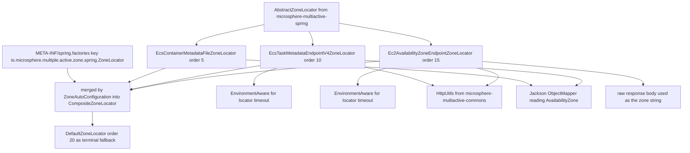
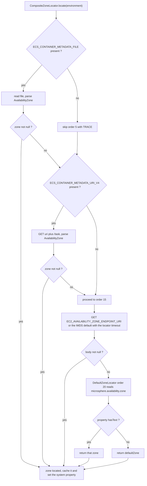

中文版本：[简体中文](zh/microsphere-multiactive-aws.md)

# `microsphere-multiactive-aws` — Developer Guide

Maven coordinates: `io.github.microsphere-projects:microsphere-multiactive-aws:${revision}`
(`0.2.14-SNAPSHOT` on this branch).

---

## Overview

`microsphere-multiactive-aws` contributes three `ZoneLocator` implementations that discover the current EC2
Availability Zone from AWS-supplied runtime facts. It contains **no auto-configuration class, no `@Bean` method and no
condition** — the entire integration surface is one `META-INF/spring.factories` file plus three plain classes.

Package: `io.microsphere.multiple.active.zone.spring.aws` (three types, all `@since 1.0.0`). Note that the package is
`...zone.spring.aws`, i.e. it belongs to the *Spring* namespace, not a separate AWS abstraction layer — the module is a
plug-in to `-spring`, nothing more.

| Class | Source of truth | Order | Requires an AWS environment variable? |
|---|---|---|---|
| `EcsContainerMetadataFileZoneLocator` | ECS **container** metadata *file*, path from `ECS_CONTAINER_METADATA_FILE` | `5` | yes |
| `EcsTaskMetadataEndpointV4ZoneLocator` | ECS **task** metadata endpoint v4, base URI from `ECS_CONTAINER_METADATA_URI_V4` | `10` | yes |
| `Ec2AvailabilityZoneEndpointZoneLocator` | EC2 instance-metadata placement endpoint (default `http://169.254.169.254/...`) | `15` | no |

## Architecture Design

### Layering



The `5 → 10 → 15 → 20` ladder is the module's whole design: the most specific, cheapest and most reliable source wins,
and `DefaultZoneLocator` (registered by `-spring-boot`) is the last resort.

### Package Structure

| Path | Contents |
|---|---|
| `src/main/java/io/microsphere/multiple/active/zone/spring/aws/` | the three locators |
| `src/main/resources/META-INF/spring.factories` | the SPI registration of all three (CRLF line endings in the snapshot) |
| — | **no `src/test/java` and no `src/test/resources`: this module ships no tests in the release branch** |

### Dependency Contract

From `microsphere-multiactive-aws/pom.xml`:

| Dependency | Scope | Note |
|---|---|---|
| `microsphere-multiactive-spring-cloud` | **`optional`** | Declared optional, and *not referenced by any import in this module* — the code only uses types from `-spring` (`AbstractZoneLocator`, `ZoneLocator`) and `-commons` (`HttpUtils`, `ZoneConstants`) |
| `com.fasterxml.jackson.core:jackson-databind` | `optional` | Used by the two ECS locators to parse metadata JSON |
| `org.springframework:spring-core`/`spring-context` types | via the chain above | `Environment`, `EnvironmentAware`, `StringUtils` |
| `spring-boot-starter`, `-actuator`, config/autoconfigure processors | `optional` | No class in the module references Boot APIs |
| `junit-jupiter`, `spring-boot-starter-test`, `microsphere-spring-boot-test`, `logback-classic` | `test` | Declared but unused: there are no test sources |

Two consequences a maintainer must hold together:

1. Because the internal dependency is `optional`, adding `microsphere-multiactive-aws` to an application **does not**
   pull in `-spring`/`-commons` transitively. The module is inert unless one of the other modules (typically
   `-spring-boot` or `-spring-cloud`) is also present — that is why the documented usage is "add it next to the Spring
   Boot module", not "add it alone".
2. Because there are no tests, changes here are verified only by compiling against the declared dependencies and by
   running on real ECS/EC2 hosts.

## Source Analysis

### SPI registration

`src/main/resources/META-INF/spring.factories` (exact content):

```properties
io.microsphere.multiple.active.zone.spring.ZoneLocator=\
io.microsphere.multiple.active.zone.spring.aws.EcsContainerMetadataFileZoneLocator,\
io.microsphere.multiple.active.zone.spring.aws.EcsTaskMetadataEndpointV4ZoneLocator,\
io.microsphere.multiple.active.zone.spring.aws.Ec2AvailabilityZoneEndpointZoneLocator
```

The key is the `ZoneLocator` interface FQN, matching the key `microsphere-multiactive-spring-boot` uses for
`DefaultZoneLocator`. `ZoneAutoConfiguration.zoneLocator(...)` calls
`loadFactories(context, ZoneLocator.class)`, so these three classes are instantiated by `SpringFactoriesLoader` —
**not** as Spring beans. That has two hard effects:

- `@Autowired`/`@Value`/`@Conditional` do **not** apply inside these locators; the only callbacks they can receive are
  the Aware interfaces Spring happens to wire for `createAndParseList` instances in the application context, which is why
  `EnvironmentAware` is the mechanism used for timeout injection.
- No `@ConditionalOnClass` guard protects the JAR: if `jackson-databind` is missing from a consumer's classpath, loading
  the ECS locators fails at instantiation time rather than being silently skipped. Keep Jackson available (or remove the
  ECS entries from the factories file in a fork) when using this module.

### `EcsContainerMetadataFileZoneLocator`

`microsphere-multiactive-aws/src/main/java/io/microsphere/multiple/active/zone/spring/aws/EcsContainerMetadataFileZoneLocator.java`

- `METADATA_FILE_ENV_NAME = "ECS_CONTAINER_METADATA_FILE"`, `DEFAULT_ORDER = 5`, private constant
  `ZONE_FIELD_NAME = "AvailabilityZone"`.
- `supports(environment)` is `environment.containsProperty(METADATA_FILE_ENV_NAME)` — the file-based source is only tried
  when the ECS agent injected the variable. (Spring's `Environment` resolves OS environment variables, so `containsProperty`
  covers the real-env case as well as test-injected properties.)
- `locate(environment)`: reads the path, requires `StringUtils.hasText`, checks `File.canRead()`, streams the file,
  `IOUtils.copyToString(inputStream, UTF_8)`, parses with a fresh `new ObjectMapper()` into a raw `Map`, takes
  `metadata.get("AvailabilityZone")` and converts with `String.valueOf`. Every failure path is *logged and returns
  `null`*: unreadable file → `WARN`; any `Throwable` during read/parse → `ERROR`; blank variable → `TRACE`. Returning
  `null` is the contract that lets the composite fall through to the next locator.
- Not `EnvironmentAware`: a local file read needs no timeout, so nothing is cached from the environment.

### `EcsTaskMetadataEndpointV4ZoneLocator`

`.../EcsTaskMetadataEndpointV4ZoneLocator.java`

- `METADATA_URI_V4_ENV_NAME = "ECS_CONTAINER_METADATA_URI_V4"`, `DEFAULT_ORDER = 10`, `ZONE_FIELD_NAME = "AvailabilityZone"`.
- `supports(environment)` again probes for the environment variable's presence.
- `locate(environment)` builds `String taskURL = uri + "/task";` and calls
  `HttpUtils.doGet(taskURL, timeout)`, then parses the JSON with Jackson exactly as the file locator does and reads the
  same `AvailabilityZone` field. So the *shape* of the data differs (endpoint vs file) but the extraction is identical.
- `implements EnvironmentAware`, and `setEnvironment` is the only place the timeout is read:
  `environment.getProperty(LOCATOR_TIMEOUT_PROPERTY_NAME, int.class, DEFAULT_TIMEOUT)` — i.e.
  `microsphere.availability.zone.locator.timeout`, default `3000`. The field is `private int timeout = DEFAULT_TIMEOUT;`
  so it is never unset. Note the ordering subtlety: because factories-instantiated objects are not full Spring beans,
  this callback only runs if the instance is registered as a bean (e.g. an application re-declares it); otherwise the
  default `3000` applies.
- All failures (`Throwable`) are logged at `ERROR` and yield `null`, so an unreachable v4 endpoint degrades to the next
  locator instead of failing startup.

### `Ec2AvailabilityZoneEndpointZoneLocator`

`.../Ec2AvailabilityZoneEndpointZoneLocator.java`

- Two public URI constants: `AVAILABILITY_ZONE_ENDPOINT_URI_PROPERTY_NAME = "EC2_AVAILABILITY_ZONE_ENDPOINT_URI"` and
  `DEFAULT_AVAILABILITY_ZONE_ENDPOINT_URI = "http://169.254.169.254/latest/meta-data/placement/availability-zone"` —
  the EC2 Instance Metadata Service placement path, overridable entirely through the environment.
- `DEFAULT_ORDER = 15`, and **`supports(environment)` returns `true` unconditionally.** This is the only locator in the
  repository that always claims support, and it is what makes the module's failure mode worth understanding:
  `getAvailabilityZoneEndpointURI(...)` falls back to the link-local default, so `locate` will always *attempt* an HTTP
  GET to `169.254.169.254`. On non-EC2 hosts that attempt costs up to the configured timeout (both connect and read are
  set to `timeout` by `HttpUtils.doGet`) before returning `null` and falling through to `DefaultZoneLocator`.
  In a local development loop with `microsphere.availability.zone.locator.fast-fail=true`, fast-fail would trip on this
  locator rather than on the property-based one.
- Unlike the ECS locators, there is **no JSON parsing**: `zone = HttpUtils.doGet(uri, timeout);` — the raw response body
  *is* the zone, because the IMDS placement endpoint returns a bare string. Errors are logged at `ERROR` and produce
  `null`; a missing/blank resolved URI logs `WARN`.
- Also `EnvironmentAware` with the same `LOCATOR_TIMEOUT_PROPERTY_NAME` handling as the v4 locator.

### Ordering, fast-fail and the resulting decision ladder



Each `null` above also produces a `WARN` from the composite, and if
`microsphere.availability.zone.locator.fast-fail=true`, the first `null` or exception aborts the chain with
`IllegalStateException` instead of continuing.

## Extension Points

| Extension point | How |
|---|---|
| Override the IMDS endpoint | Set `EC2_AVAILABILITY_ZONE_ENDPOINT_URI` (e.g. to a proxy or a different metadata base). Useful when the host enforces a token-based metadata mode, since `HttpUtils.doGet` issues a plain `GET` with no headers |
| Tune discovery latency/failure | `microsphere.availability.zone.locator.timeout` (default `3000` ms, used by both HTTP locators) and `microsphere.availability.zone.locator.fast-fail` (default `false`) |
| Add another cloud | Implement `ZoneLocator` extending `AbstractZoneLocator`, pick an order, and register in `spring.factories` under the same key — the AWS module is the reference implementation of that pattern |
| Force a zone and skip discovery | `microsphere.availability.zone=<zone>` still needs ordering consideration: the AWS locators run first (`5`/`10`/`15`), so use `DefaultZoneLocator`'s ordering (`20`) as the fallback path, or set `microsphere.availability.zone.enabled=false` |

## Design Patterns Actually Present in the Code

- **Strategy with an explicit order ladder** — three interchangeable `ZoneLocator` strategies whose relative precedence is
  expressed as `int` constants passed to `super(order)` (5/10/15), consumed by
  `AnnotationAwareOrderComparator` in the composite.
- **Template Method** — each locator inherits logging, `beanName` and ordering from `AbstractZoneLocator` and supplies
  only `supports`/`locate`.
- **Guard-then-execute protocol** — `supports()` as an environment-variable probe (`containsProperty`) before `locate()`,
  implemented for the two ECS locators; the EC2 locator deliberately replaces the probe with a configurable default URI.
- **Fail-soft / null-object fallthrough** — every I/O and parse failure is caught (`Throwable`), logged, and converted into
  `null` so the chain continues; the library never rethrows out of `locate` unless fast-fail is enabled.
- **SPI registration without componentscan** — `spring.factories` keyed by interface FQN, loaded through
  `SpringFactoriesLoader`, i.e. classpath plug-in architecture rather than bean scanning.
- **Not present**: no Spring beans, no conditions, no `ZoneResolver`, no `ZonePreferenceFilter` usage, and no tests in
  this module.

## Build and Test

```bash
# compile and run the (currently empty) test phase, plus required upstream modules
./mvnw -pl microsphere-multiactive-aws -am test

# verify only that the module still compiles against the optional chain
./mvnw -pl microsphere-multiactive-aws -am -DskipTests package

# Windows
mvnw.cmd -pl microsphere-multiactive-aws -am test
```

`-am` is mandatory here: the module's own dependency on `microsphere-multiactive-spring-cloud` is `optional`, so the
`-commons`/`-spring` classes it compiles against come from the reactor, not from a published jar of `-aws` alone.

**There is no automated test in this module** (`src/test` does not exist), and no `features.yaml`. When adding coverage,
prefer `StandardEnvironment` + `MapPropertySource` to simulate the AWS environment variables — this is the technique the
`-spring` tests already use (`CompositeZoneLocatorTest.newEnvironment()`, `ZoneContextChangedListenerTest.buildContext(...)`)
— and use a local `HttpServer` for the HTTP locators, as `HttpUtilsTest` in `-commons` does.

## Related Documents

- [Developer Guide index](README.md)
- [microsphere-multiactive-spring](microsphere-multiactive-spring.md) — `AbstractZoneLocator` and the composite that
  consumes these strategies
- [microsphere-multiactive-spring-boot](microsphere-multiactive-spring-boot.md) — where `spring.factories` entries are
  actually loaded
- [microsphere-multiactive-commons](microsphere-multiactive-commons.md) — `HttpUtils` and the locator property names
- [User Guide](../user-guide/README.md)
- [Repository README](../../../README.md)

## 中文

中文版本：[简体中文](zh/microsphere-multiactive-aws.md)
