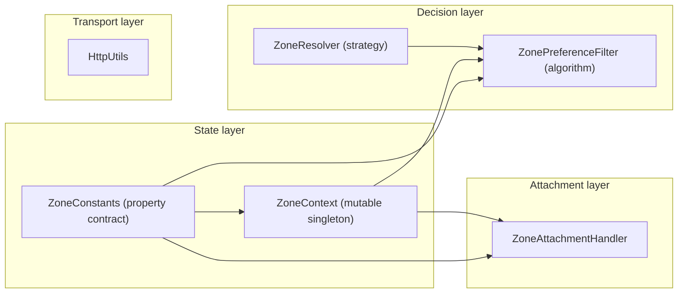
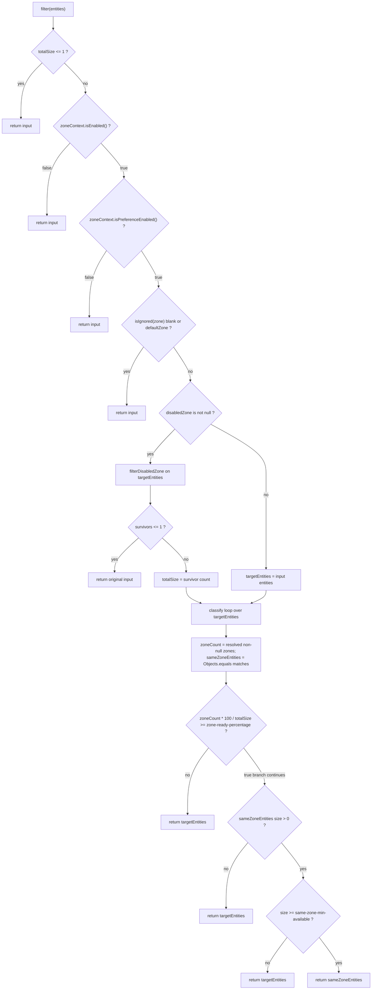
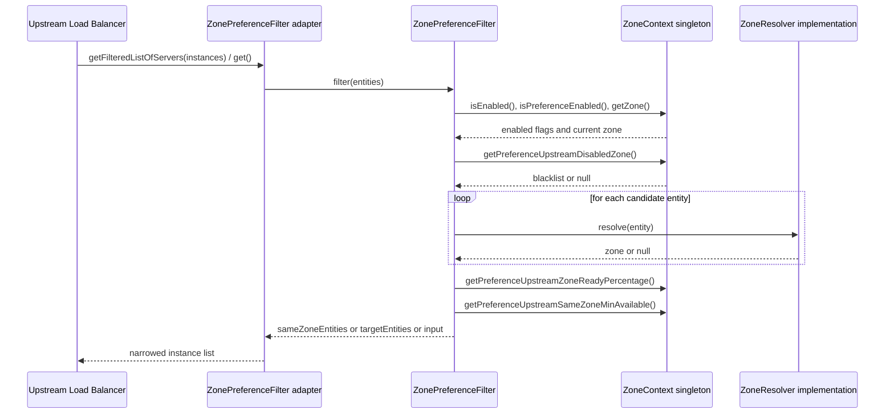

中文版本：[简体中文](zh/microsphere-multiactive-commons.md)

# `microsphere-multiactive-commons` — Developer Guide

Maven coordinates: `io.github.microsphere-projects:microsphere-multiactive-commons:${revision}` (`0.2.14-SNAPSHOT` on this branch).

---

## Overview

`microsphere-multiactive-commons` is the dependency-free kernel of the library. It defines the zone state model
(`ZoneContext`), the complete configuration-property contract (`ZoneConstants`), the two portable algorithms that do the
actual work (`ZonePreferenceFilter` and `ZoneResolver`), the registration-metadata writer
(`ZoneAttachmentHandler`), and one HTTP helper (`HttpUtils`).

Its most important architectural property is visible in its `pom.xml`: **every compile-scoped dependency is declared
`<optional>true</optional>`**. The only mandatory dependencies are test-scoped (`junit-jupiter`,
`microsphere-java-test`, `logback-classic`). Consequently the module has no Spring, no Servlet and no RPC types on its
API surface, and the entire zone model is reusable outside a Spring application. All Spring/Framework-specific
adapters live in the higher modules (`-spring`, `-spring-boot`, `-spring-cloud`, `-netflix`).

- Java package: `io.microsphere.multiple.active.zone` — one flat package, six types.
- All types are tagged `@since 1.0.0`.

## Architecture Design

### Layering



- **State layer** — `ZoneConstants` is the single source of truth for property names and defaults; `ZoneContext` holds
  the resolved runtime values and notifies observers on change.
- **Decision layer** — `ZoneResolver<E>` is the per-framework strategy "given an instance descriptor, what zone is it
  in?"; `ZonePreferenceFilter<E>` consumes a `ZoneContext` plus a `ZoneResolver<E>` and narrows a candidate list to the
  same-zone subset, with fallbacks.
- **Attachment layer** — `ZoneAttachmentHandler` performs the opposite direction of the resolver: it stamps *this*
  process's zone into the metadata map that a service registry will broadcast to peers.
- **Transport layer** — `HttpUtils` exists solely so that the AWS locators (`microsphere-multiactive-aws`) can read
  instance-metadata endpoints without pulling in an HTTP client.

The types `ZoneContext`, `ZoneAttachmentHandler`, `ZonePreferenceFilter` and `ZoneResolver` are exactly the four
entries the sibling `microsphere-multiactive-spring-cloud` module declares under the feature name
`microsphere-multiactive-commons` in `META-INF/config/default/features.yaml`, which is the outward-facing description of
what the kernel contributes.

### Package Structure

| Path (relative to the module) | Types | Responsibility |
|---|---|---|
| `src/main/java/io/microsphere/multiple/active/zone/` | `ZoneConstants`, `ZoneContext`, `ZoneResolver`, `ZonePreferenceFilter`, `ZoneAttachmentHandler`, `HttpUtils` | Zone state, property contract, preference algorithm, metadata attachment, metadata HTTP reads |
| `src/test/java/io/microsphere/multiple/active/zone/` | `ZoneConstantsTest`, `ZoneContextTest`, `ZoneResolverTest`, `ZonePreferenceFilterTest`, `ZoneAttachmentHandlerTest`, `HttpUtilsTest` | Behavioural pins for each of the six types |
| — | no `src/main/resources` | The module contributes no `spring.factories`, no auto-configuration and no `features.yaml` |

### Dependency Contract

From `microsphere-multiactive-commons/pom.xml` (parent: `microsphere-multiactive-parent`, `relativePath`
`../microsphere-multiactive-parent/pom.xml`):

| Dependency | Scope | Note |
|---|---|---|
| `io.github.microsphere-projects:microsphere-annotation-processor` | `optional` | Compile-time only; backs the `@ConfigurationProperty` metadata annotations used in `ZoneConstants` |
| `io.github.microsphere-projects:microsphere-java-core` | `optional` | Supplies `io.microsphere.logging.Logger`/`LoggerFactory`, `io.microsphere.util.StringUtils`, `io.microsphere.io.IOUtils`, `io.microsphere.constants.SymbolConstants`, `io.microsphere.constants.PropertyConstants`, `io.microsphere.annotation.ConfigurationProperty` |
| `org.junit.jupiter:junit-jupiter` | `test` | |
| `io.github.microsphere-projects:microsphere-java-test` | `test` | |
| `ch.qos.logback:logback-classic` | `test` | |

Versions are not written here; they are inherited from the imported `microsphere-spring-cloud-dependencies` BOM via the
parent POM. Because the two production dependencies are `optional`, downstream consumers must provide them
themselves — in practice they arrive transitively through `microsphere-spring-context` / `microsphere-spring-boot-core`
in the upper modules.

## Source Analysis

### `ZoneConstants`

`microsphere-multiactive-commons/src/main/java/io/microsphere/multiple/active/zone/ZoneConstants.java`

An `interface` used purely as a constant namespace. Every property name is **derived**, not typed out, from three
prefixes:

```
ZONE_PROPERTY_NAME          = "microsphere.availability.zone"
PREFERENCE_PROPERTY_NAME_PREFIX   = ZONE_PROPERTY_NAME + DOT + "preference" + DOT
LOCATOR_PROPERTY_NAME_PREFIX      = ZONE_PROPERTY_NAME + DOT + "locator" + DOT
```

`ENABLED_PROPERTY_NAME_SUFFIX` is `DOT + ENABLED_PROPERTY_NAME` (`".enabled"`), so
`ZONE_ENABLED_PROPERTY_NAME` = `microsphere.availability.zone.enabled` and
`PREFERENCE_ENABLED_PROPERTY_NAME` = `microsphere.availability.zone.preference.enabled`.

Two zone *values* matter to the algorithm rather than to configuration:

- `DEFAULT_ZONE = "defaultZone"` — chosen for Eureka compatibility (the Javadoc references
  `org.springframework.cloud.netflix.eureka.EurekaClientConfigBean#DEFAULT_ZONE`). `defaultZone` is the "no zone
  assigned" sentinel; `ZonePreferenceFilter.isIgnored()` treats it case-insensitively.
- `ORIGINAL_ZONE = "originalZone"` — a *write target*, not a real zone. Assigning it to the zone property instructs
  `ZoneContextChangedListener` (in `-spring`) to re-derive the zone from the `ZoneLocator` chain, i.e. it is the
  "undo a manual failover" command.

Defaults, each paired with a `*_PROPERTY_VALUE` string and a parsed `int`/`boolean` sibling so a single literal is the
source of truth:

| Property | Default | Constant |
|---|---|---|
| `microsphere.availability.zone` | `defaultZone` | `DEFAULT_ZONE` |
| `microsphere.availability.zone.enabled` | `true` | `DEFAULT_ZONE_ENABLED` |
| `microsphere.availability.zone.preference.enabled` | `false` | `DEFAULT_ZONE_PREFERENCE_ENABLED` |
| `microsphere.availability.zone.preference.filter.order` | `10` | `DEFAULT_ZONE_PREFERENCE_FILTER_ORDER` |
| `microsphere.availability.zone.preference.upstream.zone-ready-percentage` | `100` | `DEFAULT_PREFERENCE_UPSTREAM_ZONE_READY_PERCENTAGE` |
| `microsphere.availability.zone.preference.upstream.same-zone-min-available` | `5` | `DEFAULT_PREFERENCE_UPSTREAM_SAME_ZONE_MIN_AVAILABLE` |
| `microsphere.availability.zone.preference.upstream.disabled-zone` | `null` | `DEFAULT_PREFERENCE_UPSTREAM_DISABLED_ZONE` |
| `microsphere.availability.zone.locator.fast-fail` | `false` | `DEFAULT_LOCATOR_FAST_FAIL` |
| `microsphere.availability.zone.locator.timeout` | `3000` | `DEFAULT_TIMEOUT` |
| `microsphere.current.availability.zone` | (none — read-back only) | `CURRENT_ZONE_PROPERTY_NAME` |

Note `microsphere.availability.zone.enabled` defaults to `true` while `...preference.enabled` defaults to `false`: the
feature is *installed but inert* until zone preference is switched on explicitly. This is what makes the library safe
to drop into an existing deployment.

Each name carries a `@ConfigurationProperty(defaultValue = ..., source = APPLICATION_SOURCE, type = ...)` annotation
from `microsphere-annotation-processor`. No generated `additional-spring-configuration-metadata.json` is committed to
the repository, so these annotations are metadata for tooling/processors at build time.

`ZoneConstantsTest` pins every derived name and default verbatim — any refactor of the prefix arithmetic will fail that
test, which is its purpose as a contract lock.

### `ZoneContext`

`microsphere-multiactive-commons/src/main/java/io/microsphere/multiple/active/zone/ZoneContext.java`

```java
public class ZoneContext {
    private static final ZoneContext instance = new ZoneContext();
    public static ZoneContext get() { return instance; }
    public static String getCurrentZone() { ... }
}
```

Seven `volatile` fields mirror the seven configurable properties. There is **no `ThreadLocal` and no
`InheritableThreadLocal` anywhere in this repository** (verified by search across all sources) — the zone is a
process-wide, JVM-global fact, not a per-request/per-call context. Maintainers changing anything related to "context"
must keep this in mind: one JVM serves exactly one zone, and per-call zone selection is expressed by filtering instance
lists rather than by carrying a context across threads.

Change propagation uses `java.beans.PropertyChangeSupport`:

```java
private boolean isPropertyChanged(String propertyName, Object previousPropertyValue, Object newPropertyValue) {
    boolean changed = !Objects.equals(previousPropertyValue, newPropertyValue);
    if (changed) {
        propertyChangeSupport.firePropertyChange(propertyName, previousPropertyValue, newPropertyValue);
        logger.info(...);
    } else {
        logger.trace(...);
    }
    return changed;
}
```

Every setter has the shape `if (isPropertyChanged(...)) { this.field = ...; }`. Two consequences:

1. **Listeners are notified before the field is written.** A `PropertyChangeListener` invoked during
   `setZone("zone-b")` still observes `getZone()` returning the old value, and only after the setter returns is the new
   value visible. `ZoneContextChangedListener` relies on this: it just *records* the events into a list and publishes
   them later, so it never reads stale state. Do not add a listener that reads the context back.
2. **Idempotent writes are silent.** Setting the same value produces no event and no `INFO` log. `ZoneContextTest`
   asserts this explicitly (`testSetEnabledNoChangeDoesNotFireEvent`, `testSetZoneSameValueNoEvent`).

Normalisation in setters:

- `setZone` applies `trimAllWhitespace`, so `"  zone-b  "` becomes `"zone-b"`; assigning a blank value can therefore
  produce `""`, which then makes `ZonePreferenceFilter.isIgnored()` short-circuit.
- `setPreferenceUpstreamDisabledZone` applies `resolveCommaDelimited`, which splits on `COMMA`, trims each token and
  rejoins with `StringJoiner(",")`, so `" zone-a , zone-b "` is stored as `"zone-a,zone-b"`. Blank/null input is
  returned untouched (so `""` is stored as `""`, and `null` as `null`) — asserted by
  `testSetPreferenceUpstreamDisabledZoneBlank` and `testSetPreferenceUpstreamDisabledZoneEmptyString`.

Lifecycle helpers: `enable()` returns the previous enabled status and only writes when disabled; `reset()` restores all
seven defaults and is the isolation mechanism used by `@BeforeEach`/`@AfterEach` in every test of this module and of
`-spring`.

`getCurrentZone()` is unrelated to the singleton: it reads the **JVM system property**
`microsphere.current.availability.zone`, defaulting to `DEFAULT_ZONE`. That property is written by
`CompositeZoneLocator.locate(...)` in the `-spring` module, and gives code without a Spring context a cheap way to ask
"which zone did discovery decide I am in?".

### `ZoneResolver<E>`

`microsphere-multiactive-commons/src/main/java/io/microsphere/multiple/active/zone/ZoneResolver.java`

```java
public interface ZoneResolver<E> extends Function<E, String> {
    default String apply(E entity) { return resolve(entity); }
    String resolve(E entity);
}
```

The single-method strategy seam of the whole library. Extending `Function<E, String>` lets a resolver be passed to any
JDK/Stream API, while `resolve` remains the semantically named method; the default `apply` simply delegates, so
`ZoneResolverTest` asserts both entry points return the same thing. Implementations return `null` when the zone is
unknown — that `null` is *meaningful data*: `ZonePreferenceFilter` counts it against the "zone ready percentage"
denominator instead of throwing.

Three implementations exist in the codebase, one per integration style:
`CloudServerZoneResolver` (`-spring-cloud`, reads `ServiceInstance.getMetadata()`),
`EurekaInstanceInfoZoneResolver` (`-netflix`, reads `InstanceInfo.getMetadata()`),
`RibbonServerZoneResolver` (`-netflix`, reads `Server.getZone()`).

### `ZonePreferenceFilter<E>`

`microsphere-multiactive-commons/src/main/java/io/microsphere/multiple/active/zone/ZonePreferenceFilter.java`

The decision engine. Constructor-injected with a `ZoneContext` and a `ZoneResolver<E>` — it is not a Spring bean type
and holds no framework references, so it is directly unit-testable (see `ZonePreferenceFilterTest`, which uses a
hand-rolled `ZoneEntity`/lambda resolver).

`filter(List<E> entities)` is a linear chain of short-circuits, each of which returns the input **unchanged and by
identity** (`assertSame` in the tests) whenever the feature cannot safely decide:

1. `totalSize <= 1` → return input (also covers `null`, since `totalSize` is computed as
   `entities == null ? 0 : entities.size()`; `filter(null)` returns `null`).
2. `!zoneContext.isEnabled()` → return input, `TRACE` hints the `microsphere.availability.zone.enabled` property.
3. `!zoneContext.isPreferenceEnabled()` → return input (the default state).
4. `isIgnored(zone)` → return input. `isIgnored` is `isBlank(zone) || DEFAULT_ZONE.equalsIgnoreCase(zone)` and is
   declared **`protected`** — the deliberate subclass hook for projects whose "no zone" marker differs from
   `defaultZone`.
5. **Disabled-zone (drain) pass**: if `getPreferenceUpstreamDisabledZone() != null`, `filterDisabledZone` builds a new
   `LinkedList` retaining entities whose resolved zone is not in the comma-split blacklist. If fewer than two entities
   survive, the *original* list is returned — draining must never collapse the pool to a single instance. Otherwise
   `totalSize` is re-assigned to the surviving count and all later ratios are computed against it.
6. **Classification pass**: one loop over `targetEntities`; `resolveZone(entity)` (null-safe: a `null` entity resolves
   to `null`) increments `zoneCount` only when a zone was resolved, and appends to `sameZoneEntities` when
   `Objects.equals(zone, resolvedZone)`.
7. **Ready-ratio gate**: `isUpstreamZoneNotReady` computes `zoneCount * 100 / entitiesSize` (integer arithmetic) and
   returns `targetEntities` when the percentage is below `getPreferenceUpstreamZoneReadyPercentage()`. With the default
   threshold `100`, a *single* zone-less instance in the list disables zone preference for the whole list — this is the
   "all peers must be zone-tagged before we trust tagging" safety valve.
8. **Min-available gate**: if same-zone entities exist but fewer than `getPreferenceUpstreamSameZoneMinAvailable()`
   (default `5`), return `targetEntities`. The same-zone subset is only taken when it is large enough to carry load.
9. Otherwise return `sameZoneEntities`; if the subset is empty, return `targetEntities`.

`getOrder()` is a pure delegate to `zoneContext.getPreferenceFilterOrder()`, letting Spring order the adapters that
wrap this filter.

Every early return logs at `TRACE` (including the property name that would enable the feature), so the reason a
deployment is not locality-preferring is always recoverable from logs.



### `ZoneAttachmentHandler`

`microsphere-multiactive-commons/src/main/java/io/microsphere/multiple/active/zone/ZoneAttachmentHandler.java`

A five-line idea with defensive engineering. It reads `zoneContext.getZone()` and, when not blank, puts it under
`ZoneConstants.ZONE_PROPERTY_NAME` into the supplied metadata `Map<String, String>`. The `put` is wrapped in
`try { ... } catch (Throwable e)` precisely because registries hand out unmodifiable maps (the comment in the source
says so); failure degrades to a `WARN` rather than breaking registration, and `ZoneAttachmentHandlerTest` covers the
valid-zone, blank-zone, `defaultZone`, and unmodifiable-map cases.

Two callers exist, one per integration style: `ZoneAttachmentListener` (`-spring-cloud`, event-driven) and
`ZoneAttachmentPreRegistrationHandler` (`-netflix`, Eureka `PreRegistrationHandler`). Both inject it, so the write path
is defined exactly once.

Note the asymmetry a maintainer should remember: `attachZone` does *not* skip `defaultZone` (it publishes it), while
`ZonePreferenceFilter.isIgnored` *does* skip it. So an unassigned instance advertises `microsphere.availability.zone=defaultZone`,
and consumers reading that value treat it as "no locality signal".

### `HttpUtils`

`microsphere-multiactive-commons/src/main/java/io/microsphere/multiple/active/zone/HttpUtils.java`

An `abstract` (non-instantiable utility) class exposing `static String doGet(String url, int timeout)`. It opens a
`URLConnection`, and **only if the connection is an `HttpURLConnection`** sets both connect and read timeout to the same
`timeout` argument, reads the body via `IOUtils.copyToString(inputStream, UTF_8)` in a try-with-resources, and calls
`disconnect()` in `finally`. Non-HTTP URLs and blank URLs return `null` (asserted by `HttpUtilsTest`, which also covers
a `@TempDir` file URI). Successful reads are logged at `INFO` including the whole response body — relevant when AWS
metadata endpoints are polled in a noisy environment.

## Extension Points

| Extension point | How | Where it is consumed |
|---|---|---|
| `ZoneResolver<E>` | Implement and inject into `ZonePreferenceFilter`'s constructor | `-spring-cloud` (`CloudServerZoneResolver`), `-netflix` (`EurekaInstanceInfoZoneResolver`, `RibbonServerZoneResolver`) |
| `ZonePreferenceFilter<E>` | Subclass and override `protected boolean isIgnored(String zone)` to redefine "no zone assigned" | any module that constructs the filter |
| `ZoneContext` | `addPropertyChangeListener(...)` for atomic bulk changes; `reset()` for tests; `ZoneContext.get()` is also published as the `zoneContext` bean so Spring code can inject it instead of calling the static | `-spring` (`ZoneContextChangedListener`), `-spring-boot` (`ZoneAutoConfiguration`) |
| Property contract | Add a constant to `ZoneConstants` with `@ConfigurationProperty`, wire it into `ZoneContext` (field + setter + getter + `reset()`), then register a handler in `ZoneContextChangedListener.propertyChangedHandlers` and append the name to `ZONE_CONTEXT_PROPERTY_NAMES` | `-spring`, `-spring-boot`, `-spring-cloud` |
| `HttpUtils` | Reused by the AWS metadata locators rather than duplicating HTTP code | `-aws` |

## Design Patterns Actually Present in the Code

- **Singleton** — `ZoneContext.instance` with `get()`; `CloudServerZoneResolver.INSTANCE` (in `-spring-cloud`) is a
  similar eager singleton resolver.
- **Observer** — `java.beans.PropertyChangeSupport` inside `ZoneContext`, with `addPropertyChangeListener` /
  `removePropertyChangeListener`. This is the mechanism the Spring layer turns into an `ApplicationEvent`.
- **Strategy** — `ZoneResolver<E>` injected into `ZonePreferenceFilter`; one algorithm, many zone-reading strategies.
- **Memoization** — the `ZoneContext` setters log-and-skip unchanged writes, and the related "compute once" behaviour
  lives in `CompositeZoneLocator` (see the `-spring` guide).
- **Service-locator-free injection** — `ZoneAttachmentHandler`, `ZoneContext` and `ZonePreferenceFilter` receive their
  collaborators through constructors, never through static lookups; only `ZoneAttachmentListener` resolves the handler
  from the `ApplicationContext` (see the `-spring-cloud` guide).
- **Template-method *guard* pair** — `ZoneResolver.apply` delegating to `resolve`, and `ZonePreferenceFilter.filter`
  calling the overridable `isIgnored`/`resolveZone` hooks. Claimed only in the precise sense the code shows.
- **Not used, despite being a common assumption**: no `ThreadLocal`/`InheritableThreadLocal` context, no
  `@ConfigurationProperties` binding class in this module, no `ServiceLoader`/`spring.factories` file in this module, and
  no decorator/chain-of-responsibility here (those appear in `-spring` and `-spring-cloud`).

## Runtime Flow

`ZonePreferenceFilter` is stateless between calls; the flow below shows the kernel as it is actually driven by an
upstream load balancer.



## Build and Test

The module is built by the reactor from the repository root; no profile is required for a plain compile, while CI
activates `test,coverage` plus one `spring-cloud-*` profile (see `.github/workflows/maven-build.yml`, which runs
`mvn --batch-mode --update-snapshots --file pom.xml -Drevision=0.0.1-SNAPSHOT test --activate-profiles
test,coverage,<profile>`).

```bash
# build + test this module and everything it needs
./mvnw -pl microsphere-multiactive-commons -am test

# single test class / method
./mvnw -pl microsphere-multiactive-commons test -Dtest=ZonePreferenceFilterTest
./mvnw -pl microsphere-multiactive-commons test -Dtest=ZoneContextTest#testReset

# Windows
mvnw.cmd -pl microsphere-multiactive-commons -am test
```

Tests use Maven Wrapper 3.3.4 (`distributionType=only-script`, Maven 3.9.16). There is no `src/test/resources`, so
logging defaults come from `logback-classic` on the test classpath.

Test inventory and what each pins:

| Test class | Contract protected |
|---|---|
| `ZoneConstantsTest` | exact property-name strings and default values, i.e. the public config contract |
| `ZoneContextTest` | singleton identity, defaults, whitespace/comma normalisation, event firing and *non*-firing, `reset()`, `enable()`, `getCurrentZone()` from the system property |
| `ZoneResolverTest` | `apply()` delegates to `resolve()`, `null` passthrough |
| `ZonePreferenceFilterTest` | every short-circuit and gate of the decision cascade, identity returns (`assertSame`), disabled-zone drain and its "not enough entities" fallback |
| `ZoneAttachmentHandlerTest` | metadata written for real zones and `defaultZone`, skipped for blank zones, survives unmodifiable maps |
| `HttpUtilsTest` | `null` for blank/non-HTTP URLs, body for HTTP URLs |

Because `ZoneContext` is a JVM singleton, the tests in this module are only isolated **within a class**: several
suites mutate the same global state. Any new test must call `ZoneContext.get().reset()` in `@BeforeEach` **and**
`@AfterEach`, and clear `CURRENT_ZONE_PROPERTY_NAME` when it touches `getCurrentZone()`, exactly as the existing ones
do; also keep surefire forking configured so that a shared JVM does not leak zone state across modules.

## Related Documents

- [Developer Guide index](README.md)
- [microsphere-multiactive-spring](microsphere-multiactive-spring.md) — the `ZoneLocator` chain and the listener that
  feeds this module's `ZoneContext`
- [microsphere-multiactive-spring-cloud](microsphere-multiactive-spring-cloud.md) — the LoadBalancer adapter around
  `ZonePreferenceFilter`
- [User Guide](../user-guide/README.md)
- [Repository README](../../../README.md)

## 中文

中文版本：[简体中文](zh/microsphere-multiactive-commons.md)
