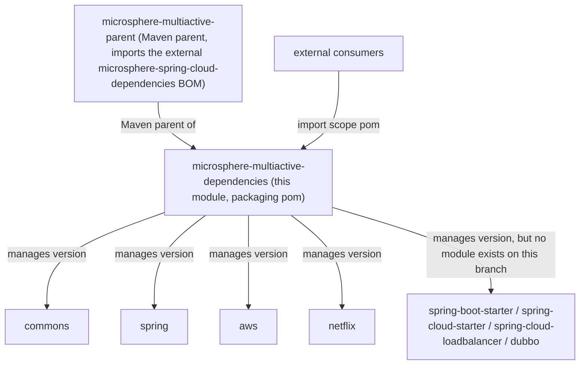
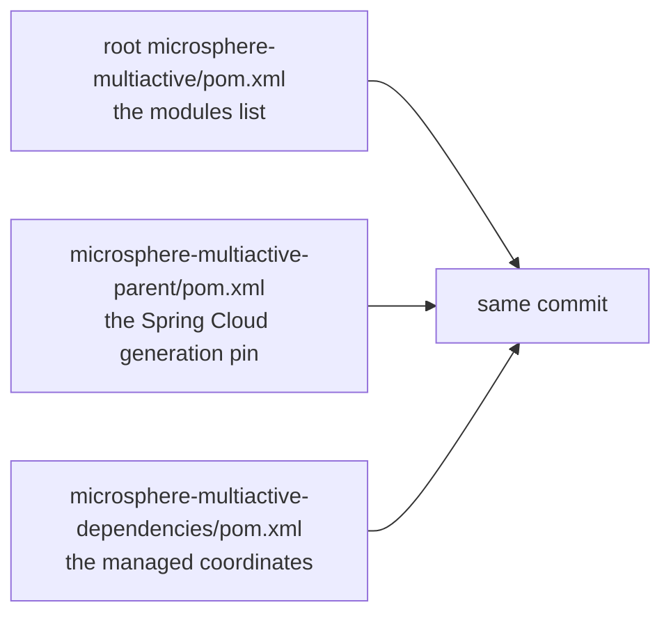

中文版本：[简体中文](zh/microsphere-multiactive-dependencies.md)

# `microsphere-multiactive-dependencies` — Developer Guide

Maven coordinates: `io.github.microsphere-projects:microsphere-multiactive-dependencies:${revision}`, packaging `pom`
— this is the project's **BOM**.

---

## Overview

`microsphere-multiactive-dependencies` is a pure `<dependencyManagement>` document. It has no sources, no resources, no
plugins and no `<parent>` build configuration: it inherits from `microsphere-multiactive-parent` purely so that
`${revision}` resolves the same way as in the modules it manages, and it lists eight internal artefacts at that version.

Its consumer-facing purpose is the one advertised in the repository README — import this BOM, then declare
multiactive dependencies without versions.

## Architecture Design

### Where it sits



### The managed coordinates, verified against the reactor

`microsphere-multiactive-dependencies/pom.xml` declares exactly these eight entries, each with `<version>${revision}</version>`:

| Managed `artifactId` | A module with that `artifactId` exists on this branch? | Note |
|---|---|---|
| `microsphere-multiactive-commons` | **yes** | Kernel |
| `microsphere-multiactive-spring` | **yes** | |
| `microsphere-multiactive-aws` | **yes** | |
| `microsphere-multiactive-netflix` | **yes** | |
| `microsphere-multiactive-spring-boot-starter` | **no** | The actual module is `microsphere-multiactive-spring-boot` |
| `microsphere-multiactive-spring-cloud-starter` | **no** | The actual module is `microsphere-multiactive-spring-cloud` |
| `microsphere-multiactive-spring-cloud-loadbalancer` | **no** | No such module; the LoadBalancer classes live inside `microsphere-multiactive-spring-cloud` |
| `microsphere-multiactive-dubbo` | **no** | Not listed in the root POM's `<modules>` either — no Dubbo integration exists in this branch |

Conversely, **two modules that do exist are not managed here**: `microsphere-multiactive-spring-boot` and
`microsphere-multiactive-spring-cloud`. Neither artefact id appears in the BOM.

The practical consequences, stated precisely:

1. A consumer that imports the BOM and declares `microsphere-multiactive-spring-boot` (the real jar with the
   auto-configuration) gets **no managed version** and must write `<version>` explicitly. The same applies to
   `microsphere-multiactive-spring-cloud`.
2. A consumer that copies a BOM-driven declaration for `-spring-boot-starter`, `-spring-cloud-starter` or
   `-dubbo` will get a resolution failure for an artefact that was never built from this branch.
3. The four managed-and-existing entries are correct and stable: `commons`, `spring`, `aws`, `netflix`.

This is a documentation-grade finding rather than a runtime bug in the library code: nothing inside the reactor depends
on the BOM (the modules take their internal versions from `${revision}` directly), so a build passes while the BOM is
inconsistent. Whenever a module is added, renamed or removed, this file must be edited in the same change — see the
checklist below.

### POM Structure

| Element | Value |
|---|---|
| `<parent>` | `microsphere-multiactive-parent:${revision}`, `relativePath ../microsphere-multiactive-parent/pom.xml` |
| `<packaging>` | `pom` |
| `<dependencyManagement><dependencies>` | eight `io.github.microsphere-projects` entries, all `${revision}`, no `<type>`, no `<scope>`, no exclusions |
| `<build>`, `<profiles>`, `<repositories>`, `<distributionManagement>` | absent |
| `<properties>` | absent — `revision` is inherited from the root POM |

Note the BOM manages **only internal artefacts**: it deliberately does not re-import or re-list third-party versions.
Third-party version management arrives from `microsphere-spring-cloud-dependencies`, imported one level up in
`microsphere-multiactive-parent`. That separation is why a module such as `-netflix` must pin
`netflix.ribbon.version` itself (Ribbon is absent from the upstream BOM).

## Source Analysis

No Java sources exist. The three facts that matter to a maintainer:

### Managed entries carry no scope or type

Every entry is `<version>${revision}</version>` only. They therefore manage *the version* but nothing else — the
consumer (or the module POM) still decides scope, and optional/transitive behaviour is defined solely in the module
POMs. In particular, `-aws` and `-netflix` remain `optional`-dependency-heavy by design; importing this BOM does not
make them self-sufficient. Adding `<optional>true</optional>` or `<scope>` here would be an API change with
compile-time impact on every consumer, so treat those elements as intentionally absent.

### `${revision}` is the coupling that keeps the BOM honest

Because each entry reads `${revision}`, the BOM can never drift from the modules it manages *within one build*:
`./mvnw -Drevision=0.3.0 deploy` produces a BOM that pins `0.3.0` for all eight coordinates, including the four that do
not exist. That is the mechanism by which the missing modules stay missing rather than becoming version-skewed — a good
signal when triaging: **an unresolved `microsphere-multiactive-*-starter` dependency is a naming problem, not a
version problem.**

### Change checklist for this file

When you touch the module set, all three of these must move together, and they are in three different files:



| Change | Required edit |
|---|---|
| New module | Add to root `<modules>` **and** to the BOM's `<dependencyManagement>` |
| Rename a module (e.g. towards `...-spring-boot-starter`) | Update the module's `<artifactId>`, the BOM entry, and every intra-reactor dependency declaration that references the old id |
| Remove a module | Delete from `<modules>` **and** from the BOM — the four currently-managed-but-absent coordinates show what happens when this is forgotten |
| Split `...-spring-cloud` into `...-spring-cloud-starter` + `...-spring-cloud-loadbalancer` | This is the one hypothesis consistent with the BOM's present content; if that split lands, the BOM is already correct and `commons`/`spring`/`aws`/`netflix` stay as they are |

## Extension Points

| Use | How |
|---|---|
| Consume the library in an external build | Import this BOM with `<scope>import</scope>`, then declare `commons`, `spring`, `aws`, `netflix` without versions — and keep an explicit `<version>` on `microsphere-multiactive-spring-boot` / `microsphere-multiactive-spring-cloud` until the BOM lists them |
| Override one managed version locally | Declare the artefact in your own `<dependencyManagement>` *before* the BOM import; first declaration wins in Maven |
| Align with the upstream stack | Versions of Spring Boot / Spring Cloud / microsphere artefacts come from `microsphere-spring-cloud-dependencies`, not from this file |

## Design Patterns Actually Present

- **Bill of Materials (`<dependencyManagement>` + `<scope>import</scope>`)** — the standard Maven
  dependency-management-as-artefact pattern; this module exists solely to be imported.
- **Inheritance for property resolution** — the BOM's parent is `microsphere-multiactive-parent`, not the aggregator, so
  `${revision}` and any future property come from the same chain as the managed modules.
- **Single-source versioning (`${revision}`)** — no hard-coded versions anywhere in the file.
- **Layered BOM composition** — internal artefacts here, third-party artefacts in the imported upstream BOM; verified by
  the complete absence of non-`io.github.microsphere-projects` entries in this file.

## Build and Test

```bash
# validate the POM and its parent resolution
./mvnw -pl microsphere-multiactive-dependencies validate

# print the resolved management section (useful when editing coordinates)
./mvnw -pl microsphere-multiactive-dependencies help:effective-pom

# Windows
mvnw.cmd -pl microsphere-multiactive-dependencies validate
```

There is nothing to compile or test: `src/` does not exist, so `test` on this module is a no-op. The publishing job
(`.github/workflows/maven-publish.yml`) deploys this POM together with the rest of the reactor using
`-Drevision=${{ inputs.revision }} ... deploy --activate-profiles publish,ci`, which is how a BOM with stale coordinates
reaches Central — another reason to keep the checklist above current.

## Related Documents

- [Developer Guide index](README.md)
- [microsphere-multiactive-parent](microsphere-multiactive-parent.md) — this BOM's Maven parent and the upstream BOM
  import
- [microsphere-multiactive-spring-boot](microsphere-multiactive-spring-boot.md) and
  [microsphere-multiactive-spring-cloud](microsphere-multiactive-spring-cloud.md) — the two modules missing from this
  BOM
- [User Guide](../user-guide/README.md)
- [Repository README](../../../README.md)

## 中文

中文版本：[简体中文](zh/microsphere-multiactive-dependencies.md)
