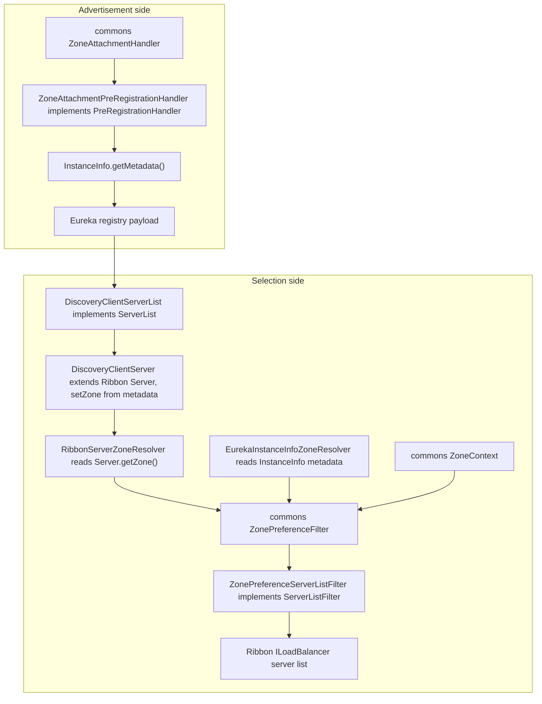
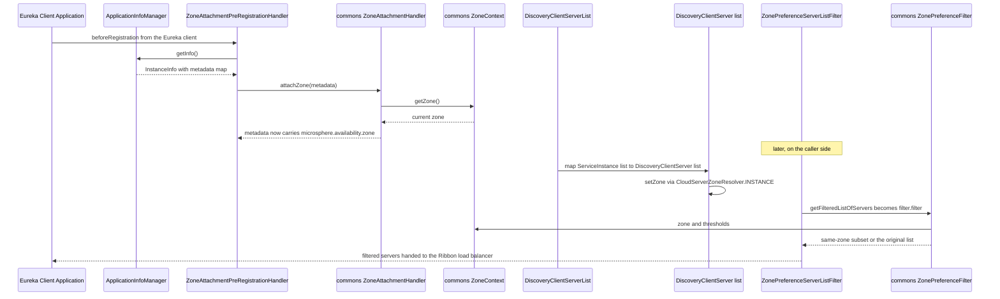

中文版本：[简体中文](zh/microsphere-multiactive-netflix.md)

# `microsphere-multiactive-netflix` — Developer Guide

Maven coordinates: `io.github.microsphere-projects:microsphere-multiactive-netflix:${revision}`
(`0.2.14-SNAPSHOT` on this branch).

---

## Overview

`microsphere-multiactive-netflix` is the legacy-stack counterpart of `microsphere-multiactive-spring-cloud`: it plugs
the same commons `ZonePreferenceFilter` / `ZoneAttachmentHandler` pair into **Netflix Eureka client + Netflix Ribbon**
instead of into Spring Cloud LoadBalancer and the microsphere service-registry events.

Six classes in three packages, **no auto-configuration, no `spring.factories`, and no tests**:

| Package | Types |
|---|---|
| `io.microsphere.multiple.active.zone.netflix.eureka` | `EurekaInstanceInfoZoneResolver`, `ZoneAttachmentPreRegistrationHandler` |
| `io.microsphere.multiple.active.zone.netflix.ribbon` | `RibbonServerZoneResolver`, `ZonePreferenceServerListFilter` |
| `io.microsphere.multiple.active.zone.netflix.spring.cloud.ribbon` | `DiscoveryClientServer`, `DiscoveryClientServerList` |

The absence of configuration classes is the module's defining characteristic: everything must be wired by the
application. The `META-INF/config/default/features.yaml` file catalogs the five public types (for microsphere's feature
switch mechanism) but performs no wiring.

## Architecture Design

### Layering



Two independent `ZoneResolver` implementations serve the two different entity types that appear at the two ends of the
protocol — `InstanceInfo` (Eureka client model) and `Server` (Ribbon model) — while one commons
`ZonePreferenceFilter` algorithm serves both. `DiscoveryClientServer` is the hinge that lets a Spring Cloud
`ServiceInstance` enter the Ribbon model with its zone already attached.

### Package Structure

| Path | Contents |
|---|---|
| `src/main/java/io/microsphere/multiple/active/zone/netflix/eureka/` | zone read/write against the Eureka client model |
| `src/main/java/io/microsphere/multiple/active/zone/netflix/ribbon/` | zone resolution + filtering against the Ribbon model |
| `src/main/java/io/microsphere/multiple/active/zone/netflix/spring/cloud/ribbon/` | bridge from Spring Cloud `ServiceInstance` to Ribbon `Server` |
| `src/main/resources/META-INF/config/default/features.yaml` | feature catalogue listing five classes |
| — | no `src/main/resources/META-INF/spring.factories`, no `AutoConfiguration.imports`, no `src/test/java` |

### Dependency Contract

From `microsphere-multiactive-netflix/pom.xml` — the only module in the reactor that declares its own version property:

```xml
<properties>
    <netflix.ribbon.version>2.7.18</netflix.ribbon.version>
</properties>
```

| Dependency | Scope | Note |
|---|---|---|
| `microsphere-multiactive-spring-cloud` | `optional` | Reaches `-spring`/`-commons` and `CloudServerZoneResolver`; optional, so consumers must supply the chain themselves |
| `com.netflix.ribbon:ribbon`, `ribbon-loadbalancer`, `ribbon-eureka` | `optional`, `${netflix.ribbon.version}` = `2.7.18` | Versions are pinned *here*, unlike every other dependency that comes from the imported BOM |
| `com.netflix.eureka:eureka-client` | `optional` (BOM-managed) | `InstanceInfo`, `ApplicationInfoManager`, `PreRegistrationHandler` |
| `org.springframework.cloud:spring-cloud-netflix-eureka-client` | `optional` | |
| `spring-cloud-commons`, `spring-cloud-context` | `optional` | `ServiceInstance`, `DiscoveryClient` used by the bridge classes |
| `spring-boot-starter`, `-actuator`, `-web`, processors | `optional` | |
| `junit-jupiter`, `spring-boot-starter-test`, `microsphere-spring-boot-test`, `logback-classic` | `test` | Declared; no test sources exist |

Note the `pom.xml` quirk: this module places `<modelVersion>` before `<parent>`, unlike its siblings. Cosmetic, but a
grep for consistent formatting will hit it.

## Source Analysis

### `ZonePreferenceServerListFilter<T extends Server>`

`microsphere-multiactive-netflix/src/main/java/io/microsphere/multiple/active/zone/netflix/ribbon/ZonePreferenceServerListFilter.java`

```java
public class ZonePreferenceServerListFilter<T extends Server> implements ServerListFilter<T> {
    private ZonePreferenceFilter<T> filter;

    public ZonePreferenceServerListFilter(ZonePreferenceFilter<T> filter) {
        this.filter = filter;
    }

    @Override
    public List<T> getFilteredListOfServers(List<T> servers) {
        return filter.filter(servers);
    }
}
```

The whole client-side story in five lines: Ribbon's `com.netflix.loadbalancer.ServerListFilter` SPI slot (invoked by
Ribbon's load balancers after the server list is refreshed) is filled by an adapter that forwards to the commons
`ZonePreferenceFilter`. `ZonePreferenceFilter.filter` short-circuits return the *same* list instance, so Ribbon sees the
identical `List` object it passed in whenever the feature is off — no copying, no re-ordering.

The generic bound `T extends Server` is what makes the class usable with Ribbon's own subclassed server types, and the
matching `ZonePreferenceFilter<T>` must be constructed with a `ZoneResolver<T>` — in practice `RibbonServerZoneResolver`.

Note the field is `private` but **not** `final` and has no accessor: the collaborator is constructor-injected only, yet
unlike the other classes in the project the reference is technically mutable. There is no `getOrder()` delegation here
even though the commons filter has one — `ServerListFilter` in Ribbon does not carry an order contract, so the
`microsphere.availability.zone.preference.filter.order` property has no effect on the Ribbon path (it only orders the
Spring-side adapters). A maintainer comparing behaviour between `-spring-cloud` and `-netflix` should keep that in mind.

### `RibbonServerZoneResolver<T extends Server>`

`.../netflix/ribbon/RibbonServerZoneResolver.java`

```java
public class RibbonServerZoneResolver<T extends Server> implements ZoneResolver<T> {
    public String resolve(T server) {
        return server.getZone();
    }
}
```

Reads Ribbon's *native* zone field (`Server`'s `getZone()`/`setZone(...)` accessors) rather than a metadata
map. That is precisely why `DiscoveryClientServer` must copy the Spring Cloud metadata zone into `Server.setZone(...)`
at construction: without that bridge, this resolver would always see `null`, and the commons filter's
zone-ready-percentage gate would reject zone preference for the entire list.

No null check on `server` — the commons filter already guards (`resolveZone` returns `null` for a `null` entity before
delegating), so a `null` never reaches `resolve` in practice.

### `EurekaInstanceInfoZoneResolver`

`.../netflix/eureka/EurekaInstanceInfoZoneResolver.java`

```java
public class EurekaInstanceInfoZoneResolver implements ZoneResolver<InstanceInfo> {
    public String resolve(InstanceInfo instanceInfo) {
        Map<String, String> metadata = instanceInfo.getMetadata();
        String instanceZone = metadata == null ? null : metadata.get(ZONE_PROPERTY_NAME);
        return instanceZone;
    }
}
```

The Eureka-model mirror of `CloudServerZoneResolver`: same key (`ZoneConstants.ZONE_PROPERTY_NAME`), same
null-metadata behaviour, different entity type. It is the resolver to pair with a `ZonePreferenceFilter<InstanceInfo>`
when an application filters Eureka `InstanceInfo` lists directly (e.g. via `ribbon-eureka`'s own `NIWSDiscoveryPing`
style data) rather than Ribbon `Server`s.

### `ZoneAttachmentPreRegistrationHandler`

`.../netflix/eureka/ZoneAttachmentPreRegistrationHandler.java`

```java
public class ZoneAttachmentPreRegistrationHandler implements PreRegistrationHandler {
    public ZoneAttachmentPreRegistrationHandler(ApplicationInfoManager applicationInfoManager, ZoneAttachmentHandler zoneAttachmentHandler) { ... }

    public void beforeRegistration() {
        InstanceInfo instanceInfo = applicationInfoManager.getInfo();
        Map<String, String> metadata = instanceInfo.getMetadata();
        zoneAttachmentHandler.attachZone(metadata);
    }
}
```

The advertisement side, using Eureka's own hook: `com.netflix.discovery.PreRegistrationHandler` is invoked by the Eureka
client immediately before each registration/renormalise, which is the last moment at which `InstanceInfo` metadata can
still be modified. The handler therefore needs no event system at all — unlike `ZoneAttachmentListener` in
`-spring-cloud`, which depends on the microsphere `RegistrationPreRegisteredEvent` plus an AspectJ aspect to get the same
timing. The class Javadoc's `@see AbstractDiscoveryClientOptionalArgs` records how it is meant to be installed: the
application passes it to the Eureka client's optional args, because this module provides no configuration to do so.

Both dependencies are constructor-injected, and `ApplicationInfoManager.getInfo()` is fetched at callback time (not
cached), so a zone change in `ZoneContext` between registrations is picked up on the next registration cycle.

### `DiscoveryClientServer` — the bridge

`.../netflix/spring/cloud/ribbon/DiscoveryClientServer.java`

```java
public class DiscoveryClientServer extends Server {
    private final ServiceInstance serviceInstance;
    private final ServiceInstanceMetaInfo metaInfo;

    public DiscoveryClientServer(ServiceInstance serviceInstance) {
        super(serviceInstance.getScheme(), serviceInstance.getHost(), serviceInstance.getPort());
        this.serviceInstance = serviceInstance;
        this.metaInfo = new ServiceInstanceMetaInfo(serviceInstance);
        this.setZone(resolveZone(serviceInstance));
    }

    private String resolveZone(ServiceInstance serviceInstance) {
        return INSTANCE.resolve(serviceInstance);
    }

    @Override
    public String getId() {
        return serviceInstance.getInstanceId();
    }

    final static class ServiceInstanceMetaInfo implements MetaInfo { /* getAppName, getServerGroup, getServiceIdForDiscovery, getInstanceId */ }
}
```

This is where the Spring Cloud zone protocol is translated into Ribbon vocabulary, and it has four distinct moves:

1. `super(scheme, host, port)` — Ribbon identity built from the `ServiceInstance` triple, so Ribbon's `Server` keying
   works unchanged.
2. `this.setZone(INSTANCE.resolve(serviceInstance))` — reuses `CloudServerZoneResolver.INSTANCE` from
   `-spring-cloud` to read `microsphere.availability.zone` out of the instance metadata. **This static call is the only
   code coupling between the Netflix stack and the Spring Cloud stack**, and it is why this module declares an (optional)
   dependency on `microsphere-multiactive-spring-cloud` instead of duplicating the resolver.
3. `getId()` overridden to return `serviceInstance.getInstanceId()` — Ribbon's `Server.getId()` is normally derived from
   host/port, which collides when several instances of the same service share a host in test setups; using the registry
   instance id makes Ribbon's per-server statistics correct.
4. `ServiceInstanceMetaInfo` — a `final static` nested `MetaInfo` implementation: `getAppName()` and
   `getServiceIdForDiscovery()` both return `serviceInstance.getServiceId()`, `getInstanceId()` returns
   `serviceInstance.getInstanceId()`, and `getServerGroup()` deliberately returns `null` (there is no such concept on
   `ServiceInstance`).

Carries the Apache License header, like the two other Ribbon-side classes.

### `DiscoveryClientServerList`

`.../netflix/spring/cloud/ribbon/DiscoveryClientServerList.java`

```java
public class DiscoveryClientServerList implements ServerList<DiscoveryClientServer> {
    private final DiscoveryClient discoveryClient;
    private final String serviceName;

    public List<DiscoveryClientServer> getInitialListOfServers() {
        return getUpdatedListOfServers();
    }

    public List<DiscoveryClientServer> getUpdatedListOfServers() {
        return discoveryClient.getInstances(serviceName)
                .stream()
                .map(DiscoveryClientServer::new)
                .collect(Collectors.toList());
    }
}
```

A Ribbon `ServerList` whose data source is Spring Cloud's `DiscoveryClient` — i.e. the zone-aware registration metadata
written by `-spring-cloud`/`-netflix` flows back out as Ribbon `Server` objects carrying a zone. The two constructor
arguments (`DiscoveryClient`, logical service name) are all it needs; there is no zone configuration here because the
zone travels with each instance.

`getInitialListOfServers()` delegates to `getUpdatedListOfServers()`: initial and periodic refresh share one code path,
so the first list Ribbon sees is already zone-populated. The method reference `DiscoveryClientServer::new` is the only
place the bridge class is instantiated, so every server in the list has passed through `setZone(...)`.

### Registration-side and selection-side pairing



## Extension Points

| Extension point | How |
|---|---|
| Install the zone into Eureka metadata | Construct `ZoneAttachmentPreRegistrationHandler(applicationInfoManager, zoneAttachmentHandler)` and register it via `AbstractDiscoveryClientOptionalArgs` (the pairing recorded in the class Javadoc) |
| Add locality filtering to Ribbon | Publish `ZonePreferenceFilter<Server>(zoneContext, new RibbonServerZoneResolver<>())`, wrap it in `ZonePreferenceServerListFilter`, and set it as the client's `ServerListFilter` |
| Discover Ribbon servers from Spring Cloud | Instantiate `DiscoveryClientServerList(discoveryClient, serviceName)` as the client's `ServerList` |
| Filter Eureka `InstanceInfo` directly | Pair `ZonePreferenceFilter<InstanceInfo>` with `EurekaInstanceInfoZoneResolver` |
| Change the Ribbon version | `<netflix.ribbon.version>` in this module's `pom.xml` (`2.7.18`) |

Because nothing is auto-configured, **all** of the above are application-side responsibilities; this is the module to
touch when adding a Netflix integration rather than the module that touches the application.

## Design Patterns Actually Present in the Code

- **Adapter (two directions)** — `ZonePreferenceServerListFilter` adapts the commons filter to Ribbon's `ServerListFilter`;
  `DiscoveryClientServerList` adapts Spring Cloud's `DiscoveryClient` to Ribbon's `ServerList`.
- **Bridge** — `DiscoveryClientServer` bridges the Spring Cloud `ServiceInstance` abstraction into the Ribbon `Server`
  abstraction, carrying the zone across by `setZone`.
- **Strategy** — `ZoneResolver` implemented twice for two entity models (`InstanceInfo`, `Server`).
- **Template Method (Ribbon-side)** — the classes extend/conform to Netflix SPI types (`Server`, `ServerList`,
  `ServerListFilter`, `PreRegistrationHandler`) and fill exactly the slots those types define.
- **Hook/Callback** — `PreRegistrationHandler.beforeRegistration()` as the library's write point, mirroring the event-based
  `ZoneAttachmentListener` on the Spring Cloud side.
- **Singleton reuse** — `CloudServerZoneResolver.INSTANCE` referenced statically from another module.
- **Flyweight-ish statelessness** — the resolvers and the filter hold no per-entity state; the entity lists are the only
  mutable inputs.
- **Not present**: no decorator of a supplier chain (that is `-spring-cloud`), no auto-configuration, no conditional
  annotations, no `spring.factories`, and no ordering integration (the commons filter's `getOrder()` is unused here).

## Build and Test

```bash
# build + test this module (nothing to run) and its required upstream modules
./mvnw -pl microsphere-multiactive-netflix -am test

# compile only, which is the practical CI signal for this module
./mvnw -pl microsphere-multiactive-netflix -am -DskipTests package

# Windows
mvnw.cmd -pl microsphere-multiactive-netflix -am test
```

There are **no tests in this module** and no test resources, so `-am` (also-make) is what makes the command meaningful:
it rebuilds `-commons`, `-spring`, `-spring-boot` and `-spring-cloud` first, and the compile itself is the only check
that the Netflix SPI usages still match Ribbon `2.7.18` / Eureka client APIs.

To exercise behaviour manually, the reusable seams to drive are `ZonePreferenceServerListFilter.getFilteredListOfServers`
(whose input/output contract is already pinned in `ZonePreferenceFilterTest` in `-commons`) and the
`DiscoveryClientServer` constructor (zone propagation from metadata to `Server.getZone()`).

## Related Documents

- [Developer Guide index](README.md)
- [microsphere-multiactive-commons](microsphere-multiactive-commons.md) — `ZonePreferenceFilter`,
  `ZoneAttachmentHandler`, `ZoneResolver`
- [microsphere-multiactive-spring-cloud](microsphere-multiactive-spring-cloud.md) — the LoadBalancer equivalent, and
  the home of `CloudServerZoneResolver`
- [microsphere-multiactive-aws](microsphere-multiactive-aws.md) — where the zone value originates
- [User Guide](../user-guide/README.md)
- [Repository README](../../../README.md)

## 中文

中文版本：[简体中文](zh/microsphere-multiactive-netflix.md)
