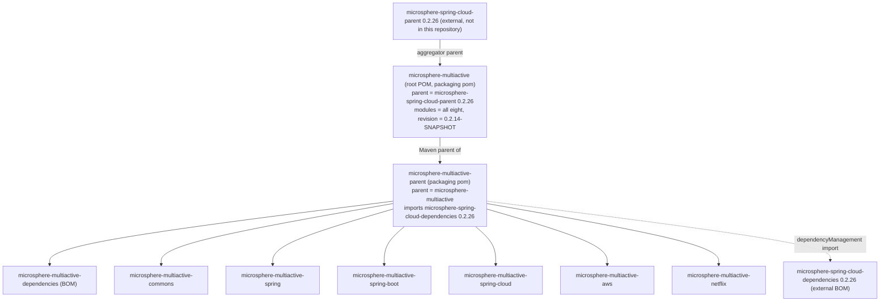

中文版本：[简体中文](zh/microsphere-multiactive-parent.md)

# `microsphere-multiactive-parent` — Developer Guide

Maven coordinates: `io.github.microsphere-projects:microsphere-multiactive-parent:${revision}`, packaging `pom`.

---

## Overview

`microsphere-multiactive-parent` is the shared **Maven parent** of every library module in the reactor
(`commons`, `spring`, `spring-boot`, `spring-cloud`, `aws`, `netflix`) as well as of the
`microsphere-multiactive-dependencies` BOM. It has no sources, no resources and no tests — its only artefact is a POM,
and its only content is one version property plus one imported BOM.

Its role is to be the single place where "which Spring Cloud generation this library targets" is decided.

## Architecture Design

### Where it sits in the Maven graph

The repository uses a **two-level POM hierarchy with a separate aggregator**, which is easy to misread, so it is worth
stating exactly:



Read carefully, a library module's inheritance chain is four deep:

`microsphere-multiactive-spring-cloud` → `microsphere-multiactive-parent` → `microsphere-multiactive`
(the root aggregator, which is also a Maven parent) → `microsphere-spring-cloud-parent:0.2.26`
(from `org/io.github.microsphere-projects`, external to this repository).

The `<relativePath>` in each child is explicit — `../microsphere-multiactive-parent/pom.xml` for the library modules,
and `../pom.xml` for `microsphere-multiactive-parent` — so the reactor builds without resolving parents from a
repository.

### POM Structure

`microsphere-multiactive-parent/pom.xml` contains, in full:

| Element | Value | Effect |
|---|---|---|
| `<parent>` | `io.github.microsphere-projects:microsphere-multiactive:${revision}`, `relativePath ../pom.xml` | Inherits from the root aggregator |
| `<artifactId>` / `<version>` / `<packaging>` | `microsphere-multiactive-parent`, `${revision}`, `pom` | Aggregates nothing (`<modules>` is absent — it is a *parent*, not an aggregator) |
| `<name>` / `<description>` | `Microsphere :: Multi-Active :: Parent` | Artefact metadata |
| `<properties>` | `<microsphere-spring-cloud.version>0.2.26</microsphere-spring-cloud.version>` | **The one tunable in this file** |
| `<dependencyManagement>` | imports `io.github.microsphere-projects:microsphere-spring-cloud-dependencies:${microsphere-spring-cloud.version}` with `<type>pom</type><scope>import</scope>` | Supplies versions for every dependency the modules declare without a version |

There is deliberately **no `<build>` section, no `<pluginManagement>`, no `<profiles>` and no `<distributionManagement>`**
in this file — verified by searching all POMs in the repository, none of the nine POMs (the root aggregator POM plus
the eight module POMs) contains a `<build>` element.
Compiler settings, surefire/failsafe configuration, the `test`/`coverage`/`publish`/`ci` profiles and the
`spring-cloud-2022 … spring-cloud-2025` profiles all come from `microsphere-spring-cloud-parent` and the BOM it imports.
That is why CI can write `--activate-profiles test,coverage,spring-cloud-2024` while nothing in this repository defines
those profiles.

### Responsibility Boundaries

| Concern | Owner |
|---|---|
| Java/Spring compiler settings, test/coverage/publish profiles, GPG & deploy config | external `microsphere-spring-cloud-parent:0.2.26` |
| Third-party and microsphere dependency **versions** | external `microsphere-spring-cloud-dependencies:0.2.26`, imported here |
| **This-branch** Spring Cloud generation pin | `microsphere-spring-cloud.version` property, here |
| Version coordinates of the *multiactive* artefacts for consumers | `microsphere-multiactive-dependencies` (see its guide) |
| Reactor module list and `${revision}` default | the root `microsphere-multiactive` POM |
| Per-module dependency scopes/optionality | each module's own POM |

## Source Analysis

There is no Java source in this module. The two POM-level facts that a maintainer must know:

### The `microsphere-spring-cloud.version` property

`0.2.26` in this snapshot, and it is **the same value as the root POM's external parent version**:

```xml
<!-- root pom.xml -->
<parent>
    <groupId>io.github.microsphere-projects</groupId>
    <artifactId>microsphere-spring-cloud-parent</artifactId>
    <version>0.2.26</version>
</parent>

<!-- microsphere-multiactive-parent/pom.xml -->
<properties>
    <microsphere-spring-cloud.version>0.2.26</microsphere-spring-cloud.version>
</properties>
```

These two occurrences are not linked by a property reference, so **upgrading the Spring Cloud parent means editing both
places in the same commit**. Keeping them divergent is a legitimate state (parent BOM and parent POM are separate
artefacts) but in this repository they have always moved together, and a bump that touches only one will produce a
mismatch that Maven will not complain about — verify both when bumping.

### The `${revision}` convention

Every module, including this parent, declares `<version>${revision}</version>`, and `${revision}` is defined once in the
root POM as `0.2.14-SNAPSHOT`. The reactor therefore has a single version knob, and both CI workflows override it on the
command line rather than editing the POM:

- Build: `mvn ... -Drevision=0.0.1-SNAPSHOT test --activate-profiles test,coverage,<spring-cloud-*>`
  (`.github/workflows/maven-build.yml`)
- Release: `./mvnw ... -Drevision=${{ inputs.revision }} -Dgpg.skip=true deploy --activate-profiles publish,ci`,
  with the input validated against `^[0-9]+\.[0-9]+\.[0-9]+$`, and the job triggered by a push to the **`release`**
  branch (`.github/workflows/maven-publish.yml`). This branch is therefore the publishing branch for the `current`
  documentation line.

No `flatten-maven-plugin` is declared anywhere in this repository, so the resolution of `${revision}` in *published*
POMs is the external parent's responsibility; do not assume `${revision}` survives into consumed metadata without
checking the released POM on the repository.

## Extension Points

| Change you need to make | Edit |
|---|---|
| Move this branch onto a different Spring Cloud / microsphere-spring-cloud generation | `microsphere-spring-cloud.version` here **and** the root POM's `<parent>` version |
| Add a new library module | Create its POM with `<parent>` = `microsphere-multiactive-parent` and `<relativePath>../microsphere-multiactive-parent/pom.xml</relativePath>`, then add it to `<modules>` in the **root** `microsphere-multiactive/pom.xml` (this parent declares no `<modules>`) **and** to `microsphere-multiactive-dependencies` |
| Pin a dependency version centrally for all modules | Prefer the external `microsphere-spring-cloud-dependencies` BOM; local pinning is what `netflix.ribbon.version` does inside the Netflix module when the BOM has no entry |
| Change the version of the whole reactor | `-Drevision=<x>` at build time, or `revision` in the root POM |

## Design Patterns Actually Present

This is a POM-only module, so the "patterns" are Maven structural ones, and both are genuinely present:

- **Parent/aggregator separation** — the reactor root aggregates all modules *and* acts as the parent of
  `microsphere-multiactive-parent`, while the library modules take their *parent* from a POM that is itself a module.
  This keeps "what gets built" independent from "what configuration is inherited".
- **BOM import (`<scope>import</scope>`)** — used instead of inheritance to pull dependency management from
  `microsphere-spring-cloud-dependencies`, which is what allows this parent to inherit from the root POM at the same
  time (a POM cannot have two parents, but it can import any number of BOMs).
- **Version-property pattern (`${revision}`)** — a single CI-overridable version for the whole reactor.
- **Single-source version property** — `microsphere-spring-cloud.version` referenced only once (in the import), i.e. a
  placeholder for future divergence.

## Build and Test

```bash
# nothing to compile; this command validates the POM and the inherited configuration
./mvnw -pl microsphere-multiactive-parent validate

# see the effective version/parent resolution
./mvnw -pl microsphere-multiactive-parent help:effective-pom -Drevision=0.2.14-SNAPSHOT

# the whole reactor, as CI does it
./mvnw --batch-mode -Drevision=0.0.1-SNAPSHOT test --activate-profiles test,coverage,spring-cloud-2024

# Windows
mvnw.cmd -pl microsphere-multiactive-parent validate
```

There are no tests to run (`src/` does not exist). The meaningful check on this POM is that the reactor still resolves:
if `microsphere-spring-cloud-dependencies:${microsphere-spring-cloud.version}` is not available in a configured
repository, every module build fails at dependency resolution with a message pointing at this file.

## Related Documents

- [Developer Guide index](README.md)
- [microsphere-multiactive-dependencies](microsphere-multiactive-dependencies.md) — the sibling POM module that is this
  parent's child, and the BOM consumers import
- [microsphere-multiactive-commons](microsphere-multiactive-commons.md) — the first module in the compile chain
- [User Guide](../user-guide/README.md)
- [Repository README](../../../README.md)

## 中文

中文版本：[简体中文](zh/microsphere-multiactive-parent.md)
