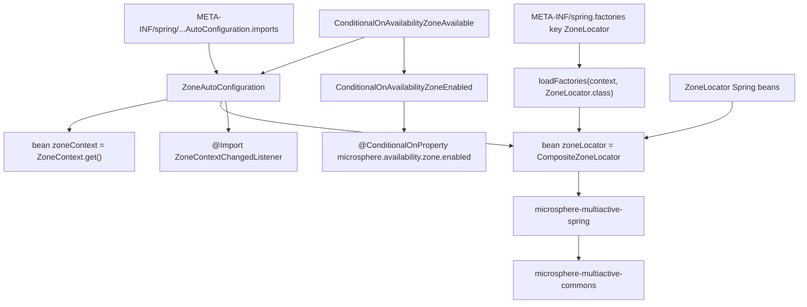
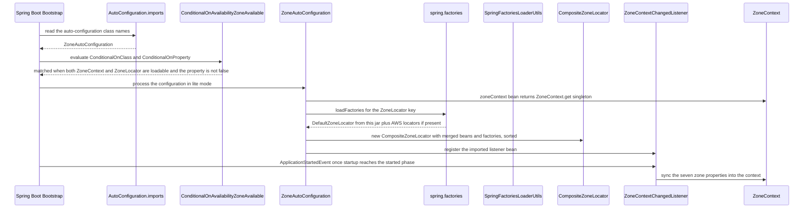

中文版本：[简体中文](zh/microsphere-multiactive-spring-boot.md)

# `microsphere-multiactive-spring-boot` — Developer Guide

Maven coordinates: `io.github.microsphere-projects:microsphere-multiactive-spring-boot:${revision}`
(`0.2.14-SNAPSHOT` on this branch).

---

## Overview

`microsphere-multiactive-spring-boot` is the bootstrapping layer. It contains **two production classes plus two
resource files** and its entire job is to make the `ZoneLocator` chain and the `ZoneContext` appear automatically in a
Spring Boot application, while remaining invisible when the zone feature is switched off.

Three responsibilities:

1. **Auto-configuration** — `ZoneAutoConfiguration` registers the `zoneContext` and `zoneLocator` beans.
2. **Feature gating** — `ConditionalOnAvailabilityZoneAvailable` / `ConditionalOnAvailabilityZoneEnabled` decide, from
   the classpath and from `microsphere.availability.zone.enabled`, whether the configuration applies at all.
3. **SPI registration** — `META-INF/spring.factories` publishes the `ZoneLocator` implementations that
   `ZoneAutoConfiguration` loads, and `META-INF/spring/org.springframework.boot.autoconfigure.AutoConfiguration.imports`
   publishes the auto-configuration itself.

Packages: `io.microsphere.multiple.active.zone.spring.boot.autoconfigure` (one type) and
`io.microsphere.multiple.active.zone.spring.boot.condition` (two annotation types). All `@since 1.0.0`.

> Naming note: the artifact id is `microsphere-multiactive-spring-boot`, not `...-spring-boot-starter`. The
> sibling BOM manages a `microsphere-multiactive-spring-boot-starter` coordinate that has no module on this branch —
> see [microsphere-multiactive-dependencies](microsphere-multiactive-dependencies.md).

## Architecture Design

### Layering



Everything above `ZoneAutoConfiguration` is Spring Boot plumbing; everything below it is the module chain
`-spring` → `-commons`. The module adds no new domain concept of its own — which is exactly why it is small.

### Package Structure

| Path | Types / files | Responsibility |
|---|---|---|
| `src/main/java/io/microsphere/multiple/active/zone/spring/boot/autoconfigure/` | `ZoneAutoConfiguration` | Bean registration for the zone model |
| `src/main/java/io/microsphere/multiple/active/zone/spring/boot/condition/` | `ConditionalOnAvailabilityZoneAvailable`, `ConditionalOnAvailabilityZoneEnabled` | Composed conditional annotations |
| `src/main/resources/META-INF/spring/org.springframework.boot.autoconfigure.AutoConfiguration.imports` | one line: `...boot.autoconfigure.ZoneAutoConfiguration` | Spring Boot 2.7+/3.x auto-configuration registration |
| `src/main/resources/META-INF/spring.factories` | `io.microsphere.multiple.active.zone.spring.ZoneLocator=io.microsphere.multiple.active.zone.spring.DefaultZoneLocator` | `ZoneLocator` SPI registration |
| `src/test/java/.../boot/autoconfigure/` | `ZoneAutoConfigurationTest` | Positive/negative auto-configuration assertions |

`ConditionalOnAvailabilityZoneAvailable` and `ConditionalOnAvailabilityZoneEnabled` carry the full Apache License 2.0
header; `ZoneAutoConfiguration` does not — an inconsistency in the snapshot, harmless but visible if you grep for
headers.

### Dependency Contract

From `microsphere-multiactive-spring-boot/pom.xml`:

| Dependency | Scope | Note |
|---|---|---|
| `microsphere-multiactive-spring` | compile (`${revision}`) | Pulls `commons` transitively — the only hard requirement |
| `microsphere-spring-boot-core` | `optional` | Supplies `io.microsphere.spring.core.io.support.SpringFactoriesLoaderUtils` used by `loadFactories(...)` |
| `spring-boot-starter`, `spring-boot-starter-actuator`, `spring-boot-starter-web` | `optional` | Compile-only access to Boot; the actuator/web starters are not referenced by any class in this module |
| `spring-boot-configuration-processor`, `spring-boot-autoconfigure-processor` | `optional` | Build-time annotation processors |
| `junit-jupiter`, `spring-boot-starter-test`, `microsphere-spring-boot-test`, `logback-classic` | `test` | `microsphere-spring-boot-test` provides the `AutoConfigurationTest` base class |

## Source Analysis

### `ZoneAutoConfiguration`

`microsphere-multiactive-spring-boot/src/main/java/io/microsphere/multiple/active/zone/spring/boot/autoconfigure/ZoneAutoConfiguration.java`

Class-level annotations, all load-bearing:

```java
@Configuration(proxyBeanMethods = false)
@ConditionalOnAvailabilityZoneAvailable
@Import(value = {ZoneContextChangedListener.class})
public class ZoneAutoConfiguration {
```

- `proxyBeanMethods = false` — lite mode. Neither bean method calls the other, so no CGLIB proxy is needed; this also
  means `zoneLocator(...)` cannot obtain the `ZoneContext` by invoking `zoneContext()` and instead relies on injection
  elsewhere.
- `@ConditionalOnAvailabilityZoneAvailable` — see the conditional section below.
- `@Import(ZoneContextChangedListener.class)` — the listener from `-spring` is registered as a bean here rather than
  being a `@Bean` method, which keeps it out of `@ConditionalOnMissingBean` reach (applications cannot silently replace
  the binding logic while still getting the beans).

**Bean 1 — `zoneContext`:**

```java
@Bean(name = ZONE_CONTEXT_BEAN_NAME)
@ConditionalOnMissingBean
public ZoneContext zoneContext() {
    return get();
}
```

`ZONE_CONTEXT_BEAN_NAME` and `get()` are static imports of `ZoneUtils.ZONE_CONTEXT_BEAN_NAME` and
`ZoneContext.get()`. The bean *is* the commons singleton — this is the bridge that lets constructor injection
(`ZonePreferenceFilter`, `ZoneAttachmentHandler`) and static access
(`ZoneContext.get()`, `CloudServerZoneResolver.INSTANCE`) observe exactly the same object.
`@ConditionalOnMissingBean` permits an application to publish its own `ZoneContext` bean first, in which case this
method is skipped; the name-based constant, however, is what `ZoneUtils.getZoneContext(...)` and
`ZoneContextChangedListener` look up by type.

**Bean 2 — `zoneLocator`:**

```java
@Primary
@Bean(name = ZONE_LOCATOR_BEAN_NAME)
@ConditionalOnMissingBean
public CompositeZoneLocator zoneLocator(Collection<ZoneLocator> zoneLocatorBeans, ConfigurableApplicationContext context) {
    // Load from Spring Factories
    List<ZoneLocator> zoneLocators = loadFactories(context, ZoneLocator.class);
    List<ZoneLocator> allZoneLocators = new ArrayList<>(zoneLocatorBeans.size() + zoneLocators.size());
    // Add ZoneLocator Spring Beans
    allZoneLocators.addAll(zoneLocatorBeans);
    // Add ZoneLocator Spring Factories
    allZoneLocators.addAll(zoneLocators);
    // Sort by the order
    sort(allZoneLocators);
    return new CompositeZoneLocator(allZoneLocators);
}
```

Two independent registration channels are merged here, and this is the central design decision of the module:

| Channel | Requires | Best for |
|---|---|---|
| Spring beans of type `ZoneLocator` | a `@Bean`/component-scan declaration | zone sources that need DI (config, other services) |
| `META-INF/spring.factories` under key `io.microsphere.multiple.active.zone.spring.ZoneLocator` | only a jar on the classpath | libraries such as `microsphere-multiactive-aws`, which ship locators with **no** `@Configuration` class at all |

`loadFactories(context, ZoneLocator.class)` is
`io.microsphere.spring.core.io.support.SpringFactoriesLoaderUtils.loadFactories`, i.e. a Spring `SpringFactoriesLoader`
wrapper bound to the application context's class loader. Consequences maintainers should know:

- Adding a locator module (AWS) does **not** require an auto-configuration class or a `@Conditional`; presence of the
  jar plus a `spring.factories` line is sufficient.
- Ordering is decided solely by `AnnotationAwareOrderComparator` after the merge (`sort`), so bean-declared and
  factories-declared locators interleave by their `order`/`@Order` values, not by registration channel.
- The merged list is then re-sorted inside `CompositeZoneLocator`'s constructor as well; the two sorts are consistent,
  not conflicting.
- `@Primary` on the composite matters because every other bean of type `ZoneLocator` also lives in the context: an
  injection point asking for `ZoneLocator` (as `ZoneContextChangedListener` does via
  `context.getBean(ZoneLocator.class)`) must receive the composite, not an individual strategy.
- `Collection<ZoneLocator>` excludes the composite itself — Spring filters self-references when resolving multi-element
  dependencies, so there is no recursion between `zoneLocator()` and the locator beans.

### `ConditionalOnAvailabilityZoneEnabled`

`.../boot/condition/ConditionalOnAvailabilityZoneEnabled.java`

```java
@Retention(RUNTIME)
@Target({TYPE, METHOD})
@Documented
@ConditionalOnProperty(name = ZONE_ENABLED_PROPERTY_NAME, matchIfMissing = true)
public @interface ConditionalOnAvailabilityZoneEnabled {}
```

A meta-annotation over `@ConditionalOnProperty`, naming `microsphere.availability.zone.enabled` via the shared
`ZoneConstants` import. `matchIfMissing = true` is why the library is active by default: absence of the property means
enabled, and `false` is the only way to turn the beans off. This is *bean-creation* gating, distinct from the runtime
`ZoneContext.isEnabled()` check used by `ZonePreferenceFilter` — see the note at the end of this section.

### `ConditionalOnAvailabilityZoneAvailable`

`.../boot/condition/ConditionalOnAvailabilityZoneAvailable.java`

```java
@Retention(RUNTIME)
@Target({TYPE, METHOD})
@Documented
@ConditionalOnClass(value = {
        ZoneContext.class,                  // Microsphere Multi-Active Commons
        ZoneLocator.class                   // Microsphere Multi-Active Spring
})
@ConditionalOnAvailabilityZoneEnabled
public @interface ConditionalOnAvailabilityZoneAvailable {}
```

A *compound* conditional: classpath present **and** property enabled. The two `@ConditionalOnClass` values double as
documentation of the module chain — `ZoneContext` proves `-commons` is on the classpath, `ZoneLocator` proves
`-spring` is, and both are referenced by `Class` literals rather than by name, which is safe here because this module
depends on both at compile scope.

Because it is a plain annotation composed of standard Boot conditionals, it is reusable:
`ZoneCloudAutoConfiguration` (`-spring-cloud`) applies the same `@ConditionalOnAvailabilityZoneAvailable`, so both
layers switch off together.

**Gating subtlety worth knowing when debugging.** `matchIfMissing = true` means `-spring-boot` registers the
`zoneContext`/`zoneLocator` beans *even when zone routing is effectively off* (because
`microsphere.availability.zone.preference.enabled` defaults to `false`). Conversely, setting
`microsphere.availability.zone.enabled=false` removes the beans entirely, so a consumer that injects `ZoneContext`
or `ZoneLocator` will fail to start — the enabled flag is not a runtime toggle for applications that depend on those
beans. The runtime toggle that keeps beans alive is `ZoneContext.setEnabled(false)`, reachable through
`changeEnabled(...)` in `ZoneContextChangedListener`.

### Boot Sequence



## Extension Points

| Extension point | Mechanism |
|---|---|
| Replace the whole configuration | `@ConditionalOnMissingBean` with no attributes keys on the method's return type: `zoneContext()` backs off when a `ZoneContext` bean already exists, `zoneLocator()` backs off only when a `CompositeZoneLocator` bean already exists (declare one — the name is irrelevant to the condition, but `ZoneUtils.ZONE_LOCATOR_BEAN_NAME` is what `ZoneUtils.getZoneLocator(...)` looks up). A plain `@Bean ZoneLocator` does **not** replace the composite; it joins the chain through the injected `Collection<ZoneLocator>` |
| Add a zone source without touching an application | Ship a jar with `META-INF/spring.factories` containing the `io.microsphere.multiple.active.zone.spring.ZoneLocator` key — the pattern `-aws` uses |
| Reuse the gate | Apply `@ConditionalOnAvailabilityZoneAvailable` / `@ConditionalOnAvailabilityZoneEnabled` to your own configuration (as `-spring-cloud` does) |
| Disable everything | `microsphere.availability.zone.enabled=false` — both the base and the Spring Cloud auto-configurations back off; `ZoneCloudAutoConfigurationTest` and `ZoneAutoConfigurationTest` pin this as a "global disabled property value" |

## Design Patterns Actually Present in the Code

- **Auto-configuration with conditional back-off** — Spring Boot's `AutoConfiguration.imports` + `@ConditionalOnClass` +
  `@ConditionalOnProperty(matchIfMissing = true)` + `@ConditionalOnMissingBean` + `@Primary`.
- **Composed (meta-)annotation / Composite conditional** — `@ConditionalOnAvailabilityZoneAvailable` layers a class
  check over a property check by annotating itself with both standard conditionals.
- **SPI via `spring.factories`** — the interface FQN used as the factory key
  (`io.microsphere.multiple.active.zone.spring.ZoneLocator`), loaded with
  `SpringFactoriesLoaderUtils.loadFactories` and merged with Spring beans.
- **Registry merging + ordered selection** — `Collection` injection plus factories results, sorted by
  `AnnotationAwareOrderComparator` before being handed to the composite.
- **Singleton bridge** — exposing `ZoneContext.get()` as a bean so a static singleton and an injected collaborator are
  the same instance.
- **Delegation, not duplication** — the module defines no new algorithm; every class either configures or gates.

## Build and Test

```bash
# build + test this module and everything it needs (commons, spring)
./mvnw -pl microsphere-multiactive-spring-boot -am test

# single test class
./mvnw -pl microsphere-multiactive-spring-boot test -Dtest=ZoneAutoConfigurationTest

# Windows, mirroring CI with profiles
mvnw.cmd -pl microsphere-multiactive-spring-boot -am --activate-profiles test,coverage,spring-cloud-2024 test
```

`ZoneAutoConfigurationTest` extends `io.microsphere.spring.boot.test.AutoConfigurationTest<ZoneAutoConfiguration>`
from `microsphere-spring-boot-test` and is annotated `@SpringBootTest(classes = ZoneAutoConfigurationTest.class,
webEnvironment = NONE)`. Rather than asserting bean presence itself, it feeds the base class three declarative sets —
which is how the conditional logic is covered:

| Override | Values | Meaning |
|---|---|---|
| `configureAutoConfiguredClasses` | `ZoneContext`, `CompositeZoneLocator` | must be present when the configuration matches |
| `configureGlobalDisabledPropertyValues` | `microsphere.availability.zone.enabled=false` | context must start with these properties set and the configuration must back off |
| `configureGlobalMissingClasses` | `ZoneContext`, `ZoneLocator` | context must survive each class being absent (the `@ConditionalOnClass` guard) |

The repository root has the Maven Wrapper (`mvnw`, `mvnw.cmd`; wrapper 3.3.4, `distributionType=only-script`, Maven
3.9.16), and the reactor contains eight modules rooted at `microsphere-multiactive` with `${revision}` =
`0.2.14-SNAPSHOT`, so `-Drevision=<version>` is honoured when flattening.

## Related Documents

- [Developer Guide index](README.md)
- [microsphere-multiactive-spring](microsphere-multiactive-spring.md) — what these beans actually do
- [microsphere-multiactive-spring-cloud](microsphere-multiactive-spring-cloud.md) — the layer built on top of this one
- [microsphere-multiactive-aws](microsphere-multiactive-aws.md) — a locator-only module using the `spring.factories` channel
- [User Guide](../user-guide/README.md)
- [Repository README](../../../README.md)

## 中文

中文版本：[简体中文](zh/microsphere-multiactive-spring-boot.md)
