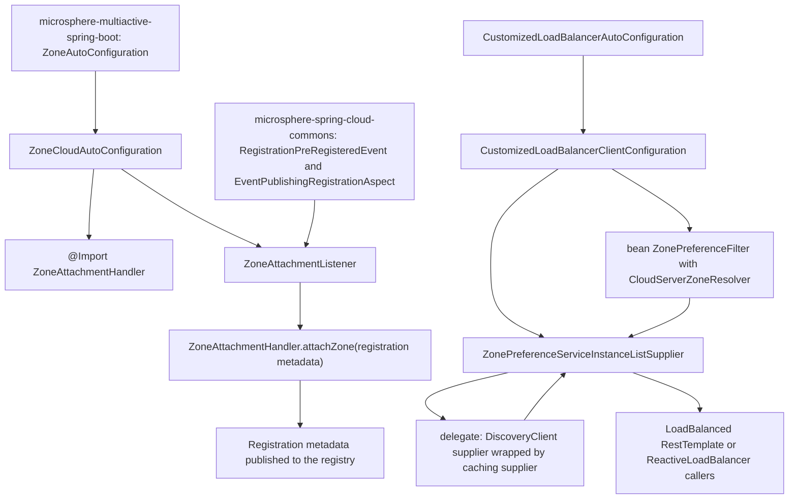
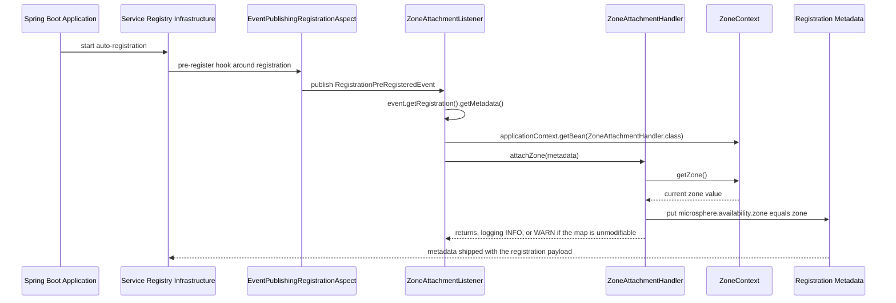
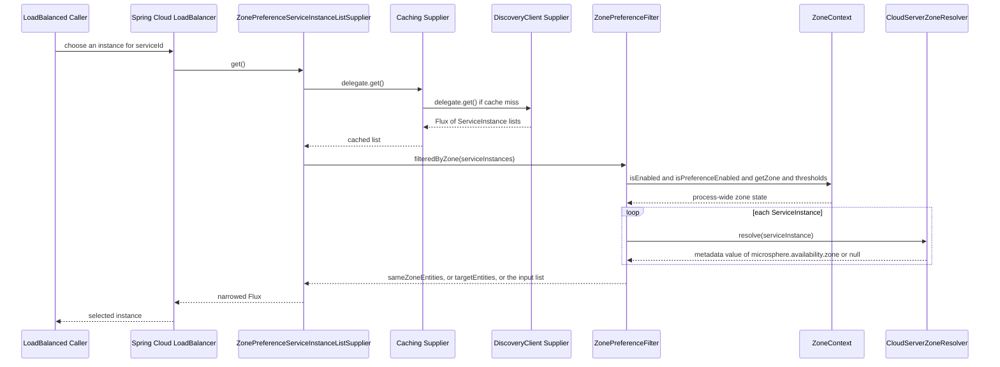

中文版本：[简体中文](zh/microsphere-multiactive-spring-cloud.md)

# `microsphere-multiactive-spring-cloud` — Developer Guide

Maven coordinates: `io.github.microsphere-projects:microsphere-multiactive-spring-cloud:${revision}`
(`0.2.14-SNAPSHOT` on this branch).

---

## Overview

`microsphere-multiactive-spring-cloud` is the deepest integration module: it sits on top of `-spring-boot` (and thus
`-spring` and `-commons`) and connects the zone model to the two Spring Cloud concerns that decide traffic locality.

1. **Outbound advertisement (registry side)** — `ZoneCloudAutoConfiguration` + `ZoneAttachmentListener` stamp
   *this* instance's zone into `Registration.getMetadata()` just before service registration, using the
   microsphere-spring-cloud `RegistrationPreRegisteredEvent`.
2. **Inbound selection (client side)** — `CustomizedLoadBalancerAutoConfiguration` +
   `CustomizedLoadBalancerClientConfiguration` + `ZonePreferenceServiceInstanceListSupplier` insert the commons
   `ZonePreferenceFilter` into Spring Cloud LoadBalancer's `ServiceInstanceListSupplier` chain.
3. **Zone reading** — `CloudServerZoneResolver` implements the commons `ZoneResolver<ServiceInstance>` by pulling
   `microsphere.availability.zone` out of instance metadata — the exact key the advertisement side writes. Those two
   classes form the two halves of the cross-process propagation protocol.

Packages: `...zone.spring.cloud` (`CloudServerZoneResolver`), `...zone.spring.cloud.autoconfigure`
(`ZoneCloudAutoConfiguration`), `...zone.spring.cloud.event` (`ZoneAttachmentListener`),
`...zone.spring.cloud.loadbalancer` (`CustomizedLoadBalancerAutoConfiguration`,
`CustomizedLoadBalancerClientConfiguration`, `ZonePreferenceServiceInstanceListSupplier`). All `@since 1.0.0`.

## Architecture Design

### Layering



Two features, two completely independent auto-configuration classes and two independent switches:
`ZoneCloudAutoConfiguration` needs service auto-registration to exist, while
`CustomizedLoadBalancerAutoConfiguration` needs an explicit property. An application may enable either, both, or
neither.

### Package Structure

| Path | Types / files | Responsibility |
|---|---|---|
| `src/main/java/.../spring/cloud/` | `CloudServerZoneResolver` | `ZoneResolver<ServiceInstance>` reading metadata |
| `src/main/java/.../spring/cloud/autoconfigure/` | `ZoneCloudAutoConfiguration` | Registration-side auto-configuration |
| `src/main/java/.../spring/cloud/event/` | `ZoneAttachmentListener` | `ApplicationListener<RegistrationPreRegisteredEvent>` |
| `src/main/java/.../spring/cloud/loadbalancer/` | `CustomizedLoadBalancerAutoConfiguration`, `CustomizedLoadBalancerClientConfiguration`, `ZonePreferenceServiceInstanceListSupplier` | Client-side zone preference |
| `src/main/resources/META-INF/spring/org.springframework.boot.autoconfigure.AutoConfiguration.imports` | `ZoneCloudAutoConfiguration`, `CustomizedLoadBalancerAutoConfiguration` | Registers both entry points |
| `src/main/resources/META-INF/config/default/features.yaml` | three named features | Declares which classes each feature area owns |
| `src/test/java/.../spring/cloud/autoconfigure/` | `ZoneCloudAutoConfigurationTest`, `ZoneCloudAutoConfigurationIntegrationTest` | Conditional coverage plus a real registration context |

### Dependency Contract

From `microsphere-multiactive-spring-cloud/pom.xml`:

| Dependency | Scope | Note |
|---|---|---|
| `microsphere-multiactive-spring-boot` | compile (`${revision}`) | Brings `-spring` and `-commons` transitively; the only hard requirement |
| `microsphere-spring-cloud-commons` | `optional` | Source of `RegistrationPreRegisteredEvent`, `EventPublishingRegistrationAspect`, `ConditionalOnAutoServiceRegistrationEnabled`, `ServiceRegistryConstants` and `InMemoryServiceRegistry` (test) |
| `spring-cloud-commons`, `spring-cloud-context`, `spring-cloud-loadbalancer` | `optional` | Compile-only access; `reactor.core.publisher.Flux` used by the supplier arrives through `spring-cloud-loadbalancer` |
| `spring-boot-starter`, `-actuator`, `-web` | `optional` | |
| `spring-boot-configuration-processor`, `spring-boot-autoconfigure-processor` | `optional` | |
| `junit-jupiter`, `spring-boot-starter-test`, `microsphere-spring-boot-test`, `logback-classic` | `test` | |

Because every framework dependency is `optional`, the class-level conditions must not reference those types as `Class`
literals — which is exactly why `ZoneCloudAutoConfiguration` and `CustomizedLoadBalancerAutoConfiguration` use
`@ConditionalOnClass(name = "...")` string forms while `-spring-boot` (which *does* depend on Boot at compile scope)
uses `@ConditionalOnClass(value = {ZoneContext.class, ZoneLocator.class})`.

## Source Analysis

### `ZoneCloudAutoConfiguration`

`microsphere-multiactive-spring-cloud/src/main/java/io/microsphere/multiple/active/zone/spring/cloud/autoconfigure/ZoneCloudAutoConfiguration.java`

The most heavily conditioned class in the repository:

```java
@Configuration(proxyBeanMethods = false)
@ConditionalOnAvailabilityZoneAvailable
@ConditionalOnAutoServiceRegistrationEnabled
@ConditionalOnClass(name = {
        "org.aspectj.lang.annotation.Aspect",                                                                        // AspectJ API
        "io.microsphere.spring.cloud.client.service.registry.event.RegistrationPreRegisteredEvent",                  // Microsphere Spring Cloud Commons API
        REGISTRATION_CLASS_NAME
})
@ConditionalOnBean(ZoneContext.class)
@AutoConfigureAfter(
        value = {
                ZoneAutoConfiguration.class
        },
        name = {
                "org.springframework.cloud.netflix.eureka.EurekaClientAutoConfiguration",                            // Spring Cloud Netflix Eureka API
                "io.microsphere.spring.cloud.client.service.registry.autoconfigure.ServiceRegistryAutoConfiguration" // Microsphere Spring Cloud Commons API
        })
@Import(value = {
        ZoneAttachmentHandler.class
})
public class ZoneCloudAutoConfiguration {

    @Bean
    @ConditionalOnBean(type = "io.microsphere.spring.cloud.client.service.registry.aspect.EventPublishingRegistrationAspect")
    @ConditionalOnMissingBean
    public ZoneAttachmentListener zoneAttachmentListener() {
        return new ZoneAttachmentListener();
    }

}
```

Reading the gates in order:

| Gate | Purpose |
|---|---|
| `@ConditionalOnAvailabilityZoneAvailable` | Reuses the `-spring-boot` compound gate (classpath + `microsphere.availability.zone.enabled`), so the whole stack switches off together |
| `@ConditionalOnAutoServiceRegistrationEnabled` | From `microsphere-spring-cloud-commons`; nothing to attach if the process does not self-register (the sibling test pins `spring.cloud.service-registry.auto-registration.enabled=false` as a disabling value) |
| `@ConditionalOnClass(name = {...})` | Three string names: AspectJ's `@Aspect`, the microsphere `RegistrationPreRegisteredEvent`, and `REGISTRATION_CLASS_NAME` (a static import of `io.microsphere.spring.cloud.client.service.registry.constants.ServiceRegistryConstants.REGISTRATION_CLASS_NAME`) |
| `@ConditionalOnBean(ZoneContext.class)` | The commons `ZoneContext` bean must already be registered by `ZoneAutoConfiguration` |
| `@AutoConfigureAfter(value = {ZoneAutoConfiguration.class}, name = {...})` | Ordering: this configuration is evaluated *after* the base zone configuration and after Eureka/microsphere service-registry configuration, which is a requirement for `@ConditionalOnBean` to see those beans |

`@Import(ZoneAttachmentHandler.class)` registers the commons handler as a bean without declaring a `@Bean` method for
it; since `ZoneAttachmentHandler` has a single constructor taking `ZoneContext`, Spring performs the injection
implicitly — and `@ConditionalOnBean(ZoneContext.class)` is what guarantees the argument is available.

The `@ConditionalOnBean(type = ...)` on the bean method is a *second*, narrower guard: the listener is only useful when
`EventPublishingRegistrationAspect` is present to publish the event it listens for. `type` (a String) is used rather
than `value` (a Class) because that class lives in an optional dependency.

### `ZoneAttachmentListener`

`.../spring/cloud/event/ZoneAttachmentListener.java`

```java
public class ZoneAttachmentListener implements ApplicationListener<RegistrationPreRegisteredEvent>, ApplicationContextAware {
    public void onApplicationEvent(RegistrationPreRegisteredEvent event) {
        Registration registration = event.getRegistration();
        Map<String, String> metadata = registration.getMetadata();
        ZoneAttachmentHandler zoneAttachmentHandler = applicationContext.getBean(ZoneAttachmentHandler.class);
        zoneAttachmentHandler.attachZone(metadata);
    }
}
```

The write half of the protocol. It is a plain `ApplicationListener` (not a `SmartApplicationListener`, unlike its
`-spring` sibling) with the generic parameter carrying the event type, and it resolves its collaborator from the
`ApplicationContext` *inside* the callback instead of injecting it in the constructor. That choice matters for
maintainers: it defers the lookup to event time, so the listener can be created even in contexts where the handler bean
is defined later (imported configurations are processed in registration order). The Javadoc also cross-references
`InstancePreRegisteredEvent` (the Spring Cloud Netflix analogue) — the class *listens to* the microsphere event, not the
Netflix one; the reference is documentation only.

End-to-end, the advertised key/value is `microsphere.availability.zone=<zone>` — see the commons guide for why
`defaultZone` is published as-is rather than skipped.

### `CloudServerZoneResolver`

`.../spring/cloud/CloudServerZoneResolver.java`

```java
public class CloudServerZoneResolver implements ZoneResolver<ServiceInstance> {
    public static final CloudServerZoneResolver INSTANCE = new CloudServerZoneResolver();
    public String resolve(ServiceInstance serviceInstance) {
        Map<String, String> instanceMetadata = serviceInstance.getMetadata();
        if (instanceMetadata != null) {
            return instanceMetadata.get(ZONE_PROPERTY_NAME);
        }
        return null;
    }
}
```

The read half. Eagerly-held public singleton `INSTANCE` (stateless, therefore shareable) — and the same instance is used
two ways: injected into the `ZonePreferenceFilter` bean by `CustomizedLoadBalancerClientConfiguration`, and called
directly as `INSTANCE.resolve(...)` by `DiscoveryClientServer` in the `-netflix` module to populate Ribbon's
`Server.setZone(...)`. Null metadata yields `null`, which `ZonePreferenceFilter` counts against the ready-percentage
denominator.

### `CustomizedLoadBalancerAutoConfiguration`

`.../spring/cloud/loadbalancer/CustomizedLoadBalancerAutoConfiguration.java`

```java
@Configuration(proxyBeanMethods = false)
@ConditionalOnProperty(value = "microsphere.spring.cloud.loadbalancer.customized", havingValue = "true")
@ConditionalOnClass(name = {"org.springframework.cloud.loadbalancer.annotation.LoadBalancerClient"})
@LoadBalancerClients(defaultConfiguration = CustomizedLoadBalancerClientConfiguration.class)
public class CustomizedLoadBalancerAutoConfiguration {}
```

An empty body whose only effect is the `@LoadBalancerClients` registration. Two important differences from the other
switches in the library:

- `havingValue = "true"` with no `matchIfMissing`, so **this feature is opt-in**: absent property means off. Zone
  preference in LoadBalancer therefore requires *two* things —
  `microsphere.availability.zone.preference.enabled=true` (the commons runtime gate) *and*
  `microsphere.spring.cloud.loadbalancer.customized=true` (this registration switch).
- The property name uses the `microsphere.spring.cloud.*` namespace, not the `microsphere.availability.zone.*` namespace
  used by every other property in the project. This is a real inconsistency in the snapshot; keep it in mind when
  documenting or renaming.

`defaultConfiguration` means the customizer is applied to *every* named LoadBalancer client context, unless a specific
`@LoadBalancerClient` overrides it.

### `CustomizedLoadBalancerClientConfiguration`

`.../spring/cloud/loadbalancer/CustomizedLoadBalancerClientConfiguration.java`

This class is *not* an auto-configuration: it is a per-client configuration installed into the Spring Cloud
`LoadBalancerClientFactory` named contexts, which is why it mixes `@Order`ed nested configurations with a plain top-level
bean.

**Top-level bean — the strategy wiring:**

```java
@Bean
public ZonePreferenceFilter<ServiceInstance> zonePreferenceFilter(ZoneContext zoneContext) {
    return new ZonePreferenceFilter<ServiceInstance>(zoneContext, new CloudServerZoneResolver());
}
```

Note there is no `@ConditionalOnMissingBean` here, and note the fresh `new CloudServerZoneResolver()` even though
`INSTANCE` exists. `ZoneContext` resolves from the *parent* application context (the named child contexts created by
Spring Cloud's `NamedContextFactory` keep the main context as their parent), which is also why this bean is created once
per client rather than once per application. Because the filter holds a reference to the singleton `ZoneContext`,
runtime changes made by `ZoneContextChangedListener` are observed by every client's supplier without re-creating it.

**Nested reactive/blocking variants:**

```java
@ConditionalOnReactiveDiscoveryEnabled
@Order(193827465)
static class ReactiveConfiguration {
    @Bean
    @ConditionalOnBean(DiscoveryClient.class)
    @ConditionalOnMissingBean
    @Conditional(OptimizedZoneConfigurationCondition.class)
    public ServiceInstanceListSupplier optimizedZonePreferenceDiscoveryClientServiceInstanceListSupplier(
            ConfigurableApplicationContext context, ZonePreferenceFilter<ServiceInstance> zonePreferenceFilter) {
        return ServiceInstanceListSupplier.builder().withDiscoveryClient().withCaching()
                .with((ctx, delegate) -> new ZonePreferenceServiceInstanceListSupplier(delegate, zonePreferenceFilter))
                .build(context);
    }
}

@ConditionalOnBlockingDiscoveryEnabled
@Order(193827466)
static class BlockingConfiguration { /* same shape, withBlockingDiscoveryClient(), bean named
        optimizedZonePreferenceServiceInstanceListSupplier */ }
```

Points a maintainer needs:

- The two nested classes are package-private `static` classes annotated `@Configuration`-style (they are picked up as
  nested configuration classes of the enclosing `@Configuration`), mutually exclusive via
  `@ConditionalOnReactiveDiscoveryEnabled` / `@ConditionalOnBlockingDiscoveryEnabled`.
- The `@Order` values are bare magic numbers (`193827465`, `193827466`, differing by one) whose only purpose is to slot
  these suppliers ahead of/behind Spring Cloud's own `LoadBalancerClientConfiguration` nested suppliers. They are not
  derived from `ZoneConstants` and are not documented in the source — treat them as load-bearing when touching ordering.
- `.withDiscoveryClient()` (reactive) vs `.withBlockingDiscoveryClient()` (blocking) select the underlying
  `DiscoveryClient`-backed supplier; `withCaching()` then wraps it, and the final `.with(customizer)` wraps the result —
  so per Spring Cloud's builder semantics `ZonePreferenceServiceInstanceListSupplier` ends up the **outermost**
  decorator, i.e. *filtering is applied after the cache*, which is what makes runtime zone changes take effect on the
  next `get()` without invalidating the cache.
- `OptimizedZoneConfigurationCondition` is an inner `static class implements Condition` delegating to
  `LoadBalancerEnvironmentPropertyUtils.equalToForClientOrDefault(context.getEnvironment(), "configurations",
  "optimized-zone-preference")` — the supplier is only installed for a client whose
  `<client>.loadbalancer.configurations` (or the default) equals `optimized-zone-preference`. This is a *third* switch,
  per-client, using Spring Cloud's own configurations vocabulary rather than a `microsphere.*` property.

### `ZonePreferenceServiceInstanceListSupplier`

`.../spring/cloud/loadbalancer/ZonePreferenceServiceInstanceListSupplier.java`

```java
public class ZonePreferenceServiceInstanceListSupplier extends DelegatingServiceInstanceListSupplier {
    private final ZonePreferenceFilter<ServiceInstance> zonePreferenceFilter;

    public Flux<List<ServiceInstance>> get() {
        return getDelegate().get().map(this::filteredByZone);
    }
}
```

A textbook Decorator over the reactive supplier, carrying an Apache License header and a Javadoc that names its
inspiration: *"Optimized
`org.springframework.cloud.loadbalancer.core.ZonePreferenceServiceInstanceListSupplier`"*. Where Spring Cloud's own
version depends on `ZoneConfig`/health `zone` hints, this one delegates all decisions to the commons filter, so the
thresholds (ready percentage, min available, disabled-zone drain) and the `defaultZone` semantics stay identical to the
Ribbon path in `-netflix`. All state lives in the injected filter, so the supplier adds no fields beyond the delegate.

### `META-INF/config/default/features.yaml`

A declarative feature catalogue consumed by microsphere-spring-cloud's feature mechanism (not by Spring Boot itself):

```yaml
microsphere:
  spring:
    cloud:
      features:
        named:
          microsphere-multiactive-commons:
            - io.microsphere.multiple.active.zone.ZoneAttachmentHandler
            - io.microsphere.multiple.active.zone.ZoneContext
            - io.microsphere.multiple.active.zone.ZonePreferenceFilter
            - io.microsphere.multiple.active.zone.ZoneResolver
          microsphere-multiactive-spring:
            - io.microsphere.multiple.active.zone.spring.ZoneLocator
            - io.microsphere.multiple.active.zone.spring.event.ZoneContextChangedListener
          microsphere-multiactive-spring-cloud:
            - WebEndpointApplicationContextInitializer=io.microsphere.spring.cloud.gateway.server.webmvc.context.WebEndpointApplicationContextInitializer
```

The first two entries accurately list the classes contributed by those modules. The third is **stale/wrong in this
snapshot**: it points at `io.microsphere.spring.cloud.gateway.server.webmvc.context.WebEndpointApplicationContextInitializer`,
a Gateway class that lives in neither this module nor anywhere in the repository. Nothing in the Java sources references
this file, so it has no effect on zone behaviour — but a maintainer should not trust it as a module inventory.

## Extension Points

| Extension point | How |
|---|---|
| Per-client opt-in | Set `<clientName>.loadbalancer.configurations=optimized-zone-preference` (or the default) so `OptimizedZoneConfigurationCondition` matches |
| Custom supplier ordering | Declare your own `ServiceInstanceListSupplier` bean in a `@LoadBalancerClient` configuration; `@ConditionalOnMissingBean` on both nested variants backs off |
| Replace the advertisement path | Provide your own `ZoneAttachmentListener` bean, or call `ZoneAttachmentHandler.attachZone(metadata)` from your own pre-registration hook (as `-netflix` does with `PreRegistrationHandler`) |
| Reuse the resolver | `CloudServerZoneResolver.INSTANCE` for any `ServiceInstance`-typed zone read |
| Disable the stack | `microsphere.availability.zone.enabled=false` kills both auto-configurations via `@ConditionalOnAvailabilityZoneAvailable`; `spring.cloud.service-registry.auto-registration.enabled=false` kills only the registration side; omitting `microsphere.spring.cloud.loadbalancer.customized=true` leaves the client side off |

## Design Patterns Actually Present in the Code

- **Decorator** — `ZonePreferenceServiceInstanceListSupplier extends DelegatingServiceInstanceListSupplier`, wrapping
  caching + discovery suppliers via the fluent builder.
- **Builder (fluent)** — `ServiceInstanceListSupplier.builder().withDiscoveryClient().withCaching().with(...)`
  .build(context).
- **Strategy** — `ZoneResolver` (`CloudServerZoneResolver`) injected into `ZonePreferenceFilter`; the filter is the
  algorithm, the resolver the varying step.
- **Singleton** — `CloudServerZoneResolver.INSTANCE`, shared with the `-netflix` module.
- **Observer** — `ZoneAttachmentListener` as an `ApplicationListener` on a registration lifecycle event.
- **Layered `@Conditional` composition** — class-presence, property, bean-presence and ordering conditions combined on one
  configuration, plus a hand-written `Condition` (`OptimizedZoneConfigurationCondition`) for the per-client check that the
  annotation forms cannot express.
- **Named-context scoping** — the client configuration is installed through `@LoadBalancerClients(defaultConfiguration =
  ...)`, so its beans live in Spring Cloud's per-client child contexts while `ZoneContext` is resolved from the parent.
- **`@AutoConfigureAfter` ordering** — used with the `name` attribute to depend on configurations that are not compile-time
  references (Eureka, microsphere service registry).
- **Template-ish nesting** — `ReactiveConfiguration`/`BlockingConfiguration` are structurally identical twins differing
  only in the discovery-client flavour and `@Order`; described as observed duplication, not an abstract template.

## Runtime Flow

### Registration-side attachment



### Client-side selection



## Build and Test

```bash
# build + test this module and everything it needs (commons, spring, spring-boot)
./mvnw -pl microsphere-multiactive-spring-cloud -am test

# single test class
./mvnw -pl microsphere-multiactive-spring-cloud test -Dtest=ZoneCloudAutoConfigurationTest
./mvnw -pl microsphere-multiactive-spring-cloud test -Dtest=ZoneCloudAutoConfigurationIntegrationTest

# Windows, mirroring the CI matrix (Java 17/21/25 x spring-cloud-2022..2025)
mvnw.cmd -pl microsphere-multiactive-spring-cloud -am --activate-profiles test,coverage,spring-cloud-2025 test
```

| Test class | What it exercises |
|---|---|
| `ZoneCloudAutoConfigurationTest` | `AutoConfigurationTest<ZoneCloudAutoConfiguration>` with `@SpringBootTest(classes = {ZoneContext.class, EventPublishingRegistrationAspect.class, test class}, webEnvironment = NONE)`; requires `ZoneAttachmentHandler` and `ZoneAttachmentListener` when matched; backs off on `microsphere.availability.zone.enabled=false` and `spring.cloud.service-registry.auto-registration.enabled=false`; must survive each of `ZoneLocator`, `Aspect`, `RegistrationPreRegisteredEvent`, `Registration` being absent |
| `ZoneCloudAutoConfigurationIntegrationTest` | A real `@EnableAutoConfiguration` context with `InMemoryServiceRegistry` and properties `server.port=8080`, `spring.application.name=test-service`, `microsphere.spring.cloud.service-registry.auto-registration.simple.enabled=true`; autowires `Registration`, `ServiceRegistry<Registration>`, `ZoneContext`, `CompositeZoneLocator`, `ZoneAttachmentHandler`, `ZoneAttachmentListener` — i.e. it proves the whole conditional stack actually lines up, since a missing bean would fail injection before the single `assertNotNull(zoneContext)` assertion |

There is no `src/test/resources`, so integration-test properties are supplied inline via `@SpringBootTest(properties = ...)`.
The LoadBalancer path has **no automated test** in this snapshot — changes to `CustomizedLoadBalancerClientConfiguration`
ordering or to `OptimizedZoneConfigurationCondition` are only covered by manual/integration verification.

## Related Documents

- [Developer Guide index](README.md)
- [microsphere-multiactive-commons](microsphere-multiactive-commons.md) — the filter and resolver this module adapts
- [microsphere-multiactive-spring-boot](microsphere-multiactive-spring-boot.md) — the gate and beans this module builds on
- [microsphere-multiactive-netflix](microsphere-multiactive-netflix.md) — the Ribbon/Eureka counterpart of both flows
- [User Guide](../user-guide/README.md)
- [Repository README](../../../README.md)

## 中文

中文版本：[简体中文](zh/microsphere-multiactive-spring-cloud.md)
