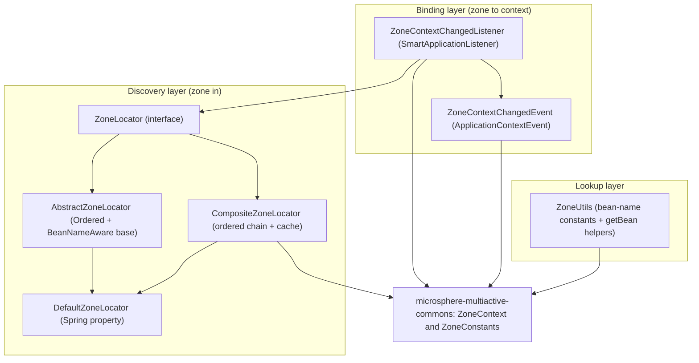
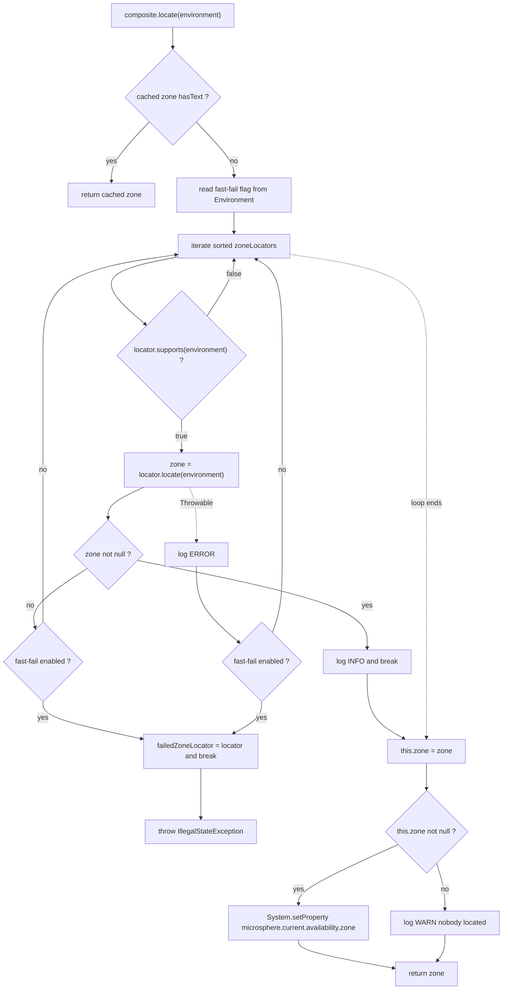
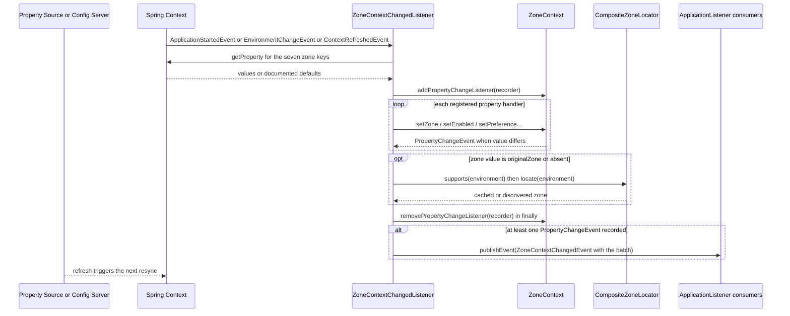

中文版本：[简体中文](zh/microsphere-multiactive-spring.md)

# `microsphere-multiactive-spring` — Developer Guide

Maven coordinates: `io.github.microsphere-projects:microsphere-multiactive-spring:${revision}` (`0.2.14-SNAPSHOT` on
this branch).

---

## Overview

`microsphere-multiactive-spring` turns the framework-neutral kernel of `microsphere-multiactive-commons` into a
Spring-native discovery mechanism. It adds two things and nothing else:

1. **`ZoneLocator`** — an ordered, pluggable *strategy chain* that answers "which availability zone is this process
   running in?", with a `CompositeZoneLocator` that tries each configured locator in order.
2. **`ZoneContextChangedListener`** — a `SmartApplicationListener` that binds Spring `Environment` properties and
   lifecycle/refresh events onto the `ZoneContext` singleton, and re-publishes every resulting change as a Spring
   `ZoneContextChangedEvent`.

Packages: `io.microsphere.multiple.active.zone.spring` (five types) and
`io.microsphere.multiple.active.zone.spring.event` (two types). All `@since 1.0.0`.

Note what this module does **not** contain: no `src/main/resources` at all — hence no `spring.factories` and no
auto-configuration. Registration of `DefaultZoneLocator` and bootstrapping of the beans is the job of
`microsphere-multiactive-spring-boot`. This module is usable with plain Spring Framework by declaring the beans by
hand.

## Architecture Design

### Layering



Three distinct concerns, in three distinct places: *discovery* (locate), *binding* (properties → context),
*lookup* (bean names). Keeping them apart is what allows `-spring-boot` to add only configuration annotations and
`-spring-cloud` to add only event/registry glue.

### Package Structure

| Package | Types | Responsibility |
|---|---|---|
| `io.microsphere.multiple.active.zone.spring` | `ZoneLocator`, `AbstractZoneLocator`, `DefaultZoneLocator`, `CompositeZoneLocator`, `ZoneUtils` | Zone discovery strategy contract, base class, default and composite implementations, bean lookup |
| `io.microsphere.multiple.active.zone.spring.event` | `ZoneContextChangedListener`, `ZoneContextChangedEvent` | Environment-to-`ZoneContext` binding and its `ApplicationEvent` bridge |
| `src/test/java/.../spring` | `CompositeZoneLocatorTest`, `DefaultZoneLocatorTest`, `ZoneUtilsTest` | Chain semantics, ordering, fallback, fast-fail |
| `src/test/java/.../spring/event` | `ZoneContextChangedListenerTest`, `ZoneContextChangedEventTest` | Property binding per key, event publication, revert semantics |

### Dependency Contract

From `microsphere-multiactive-spring/pom.xml`:

| Dependency | Scope | Note |
|---|---|---|
| `microsphere-multiactive-commons` | compile (`${revision}`) | The only non-optional internal dependency — `ZoneContext`/`ZoneConstants` are on the public API of this module |
| `microsphere-spring-context` | `optional` | |
| `org.springframework:spring-context` | `optional` | Compile-only: consumers supply the Spring version, which is what makes this module usable across Spring 5/6 lines |
| `microsphere-annotation-processor` | `optional` | |
| `junit-jupiter`, `spring-test`, `microsphere-spring-test`, `logback-classic` | `test` | |

## Source Analysis

### `ZoneLocator`

`microsphere-multiactive-spring/src/main/java/io/microsphere/multiple/active/zone/spring/ZoneLocator.java`

```java
public interface ZoneLocator {
    boolean supports(Environment environment);
    String locate(Environment environment);
}
```

The SPI of the whole library, and the extension point third parties implement. The contract is spelled out in the
Javadoc: *"if `true`, `locate(Environment)` will be invoked, or invocation will be ignored"* — `supports` is a
guard, not a preference, and `locate` must return `null` (not throw) when it cannot determine a zone, so that the
composite can fall through to the next strategy.

Both methods take `Environment` as a parameter rather than holding it as state. That is what lets `Environment` be
supplied at call time and lets locators be constructed as plain objects (the tests build them anonymously with no
container at all).

### `AbstractZoneLocator`

`.../spring/AbstractZoneLocator.java`

```java
public abstract class AbstractZoneLocator implements ZoneLocator, BeanNameAware, Ordered {
    protected final Logger logger = getLogger(getClass());
    protected String beanName;
    protected int order;
    public AbstractZoneLocator(int order) { setOrder(order); }
}
```

Three pieces of shared plumbing:

- `getLogger(getClass())` — the logger is named after the *concrete* subclass, so `EcsContainerMetadataFileZoneLocator`
  logs under its own category even though the field is declared here.
- `BeanNameAware` + `Ordered` implementations are `final`, so subclasses cannot break the identity/order semantics; each
  subclass must pass an order to `super(int)`, which forces every locator author to make the ordering decision
  explicitly (see the AWS `5 / 10 / 15` and default `20` orders).
- `toString()` returns `ZoneLocator{beanName='...', order=...}`. `CompositeZoneLocator` logs with `{}` placeholders on
  the locator instances, so this string is what appears in the log lines
  `... locates the zone : ...` / `... can't locate the zone` — it is diagnostics output, not cosmetic.

### `DefaultZoneLocator`

`.../spring/DefaultZoneLocator.java`

`DEFAULT_ORDER = 20` and `supports()` returns `true` unconditionally: it is the terminal fallback of the chain.
`locate()` reads `ZoneConstants.ZONE_PROPERTY_NAME` (`microsphere.availability.zone`) from the `Environment`; if
`StringUtils.hasText` fails it returns `DEFAULT_ZONE` (`defaultZone`) at `TRACE`. Because it is registered through
`spring.factories` by the `-spring-boot` module (key `io.microsphere.multiple.active.zone.spring.ZoneLocator`), it is
always present even when no other locator module is on the classpath.

Important interplay: `DefaultZoneLocator` reads the *same* property that `ZoneContextChangedListener` writes into the
context. That is what makes `ORIGINAL_ZONE` reversal work — and also why setting the property to a literal zone name
overrides the cloud-metadata locators only until they are consulted (they are ordered ahead of it, `5`/`10`/`15` vs
`20`).

### `CompositeZoneLocator`

`.../spring/CompositeZoneLocator.java`

The `@Primary` `zoneLocator` bean created by `ZoneAutoConfiguration`. It implements `ZoneLocator` itself, so callers
cannot tell a composite from a single strategy.

Constructor — defensive and eager:

```java
public CompositeZoneLocator(List<ZoneLocator> zoneLocators) {
    Assert.notNull(zoneLocators, "The argument 'zoneLocators' must not be null!");
    this.zoneLocators = new ArrayList<>(zoneLocators);
    AnnotationAwareOrderComparator.sort(this.zoneLocators);
}
```

It *copies* the incoming list (`UnsupportedOperationException` on an immutable input list is avoided) and sorts once at
construction using `AnnotationAwareOrderComparator`, which respects both `Ordered` (as implemented by
`AbstractZoneLocator`) and `@Order` annotations — so a third-party locator may use either style.

`supports(environment)` is an existential check: `true` as soon as any delegate supports.

`locate(environment)` is the interesting method, and it has four behaviours worth separating:

1. **Memoization.** `if (StringUtils.hasText(zone)) { return zone; }` — the `volatile String zone` field is the cache.
   Discovery runs at most once per JVM for a given composite instance, so an unreachable metadata endpoint is not
   re-polled on every call. The side effect for maintainers: **a wrong zone cannot be fixed by re-running discovery
   through this bean** — the value is fixed once computed, and runtime changes must go through `ZoneContext`
   (see `ZoneContextChangedListener`).
2. **Short-circuit chain.** For each locator in order: skip if `!supports` (`TRACE`), call `locate`, and `break` on the
   first non-`null` result (`INFO`). A `null` result logs `WARN` and continues.
3. **Fast-fail.** `isFastFailEnabled(environment)` reads `LOCATOR_FAST_FAIL_PROPERTY_NAME`
   (`microsphere.availability.zone.locator.fast-fail`, default `false`). When enabled, the first locator that returns
   `null` *or* throws marks `failedZoneLocator` and breaks the loop, after which
   `IllegalStateException("The zone can't be located by " + failedZoneLocator)` is thrown. When disabled, a
   `Throwable` from a delegate is logged at `ERROR` and the chain simply continues — the library prefers degrading to
   `defaultZone` over failing startup. Both branches are pinned by `CompositeZoneLocatorTest`
   (`testLocateWithFastFailOnNullZone`, `testLocateWithFastFailOnException`, `testLocateWithExceptionNoFastFail`).
4. **Publish to the JVM.** After the loop, `this.zone = zone;` and, when non-`null`,
   `System.setProperty(CURRENT_ZONE_PROPERTY_NAME, this.zone)` — the write that
   `ZoneContext.getCurrentZone()` (commons) reads back. Note that a `null` outcome is also cached as `null`
   (so `StringUtils.hasText` allows retry) and only logged as `WARN`.

Empty-chain behaviour is defined: `supports` `false`, `locate` `null`
(`testLocateWithEmptyLocatorList`).



### `ZoneUtils`

`.../spring/ZoneUtils.java`

```java
public static final String ZONE_CONTEXT_BEAN_NAME = "zoneContext";
public static final String ZONE_LOCATOR_BEAN_NAME  = "zoneLocator";
public static ZoneContext getZoneContext(ConfigurableListableBeanFactory beanFactory) { ... }
public static ZoneLocator getZoneLocator(ConfigurableListableBeanFactory beanFactory) { ... }
```

An `abstract` class with a `private` constructor (non-instantiable utility) holding the two well-known bean names plus
typed `getBean` lookups. These names are the *contract* between this module and the `@Bean(name = ...)` declarations in
`ZoneAutoConfiguration` — both sides import these constants rather than duplicating strings, so renaming a bean name is
a single-constant change. The helpers accept `ConfigurableListableBeanFactory` (not `ApplicationContext`) so they also
work on the raw bean factory, which is what refresh-time code and `-spring-boot`/`-spring-cloud` internals have access
to.

### `ZoneContextChangedListener`

`.../spring/event/ZoneContextChangedListener.java`

The only stateful bridge between the Spring world and the commons `ZoneContext`. Declared as
`implements SmartApplicationListener, ApplicationContextAware, EnvironmentAware`.

**Which event it reacts to is decided by the classpath** — this is the trick that lets one class serve plain Spring,
Spring Boot and Spring Cloud:

```java
private static final Class<?> APPLICATION_STARTED_EVENT_CLASS =
        resolveClass("org.springframework.boot.context.event.ApplicationStartedEvent", classLoader);
private static final Class<?> ENVIRONMENT_CHANGE_EVENT_CLASS =
        resolveClass("org.springframework.cloud.context.environment.EnvironmentChangeEvent", classLoader);
private static final boolean IS_SPRING_CLOUD_APPLICATION = ENVIRONMENT_CHANGE_EVENT_CLASS != null
        && APPLICATION_STARTED_EVENT_CLASS != null;
private static final boolean IS_SPRING_BOOT_APPLICATION = ENVIRONMENT_CHANGE_EVENT_CLASS == null
        && APPLICATION_STARTED_EVENT_CLASS != null;
```

`io.microsphere.util.ClassLoaderUtils.resolveClass` returns `null` instead of throwing, so these are *safe* classpath
probes evaluated once in static initialisers. `supportsEventType` then selects:

| Detected stack | Listens to |
|---|---|
| Spring Boot **and** Spring Cloud present | `EnvironmentChangeEvent` **or** `ApplicationStartedEvent` |
| Spring Boot only | `ApplicationStartedEvent` |
| Plain Spring Framework | `ContextRefreshedEvent` |

`onApplicationEvent(ApplicationEvent)` ignores the event payload entirely and calls `tryChangeZoneContext()`, i.e.
*any* of those events triggers a full re-sync of all seven properties — a refresh-driven resync rather than a
per-property diff. `getOrder()` is not overridden, so Spring's `SmartApplicationListener` default ordering applies.

The seven keys are declared once in `ZONE_CONTEXT_PROPERTY_NAMES` (`protected static`, asserted by
`ZoneContextChangedListenerTest` to contain exactly those seven and size `7`) and mapped in the constructor by
`initPropertyChangedHandlers()` into `propertyChangedHandlers`, a `Map<String, Consumer<String>>` — a strategy
registry keyed by property name:

| Property | Handler | Effect |
|---|---|---|
| `microsphere.availability.zone` | `changeZone` | `zoneContext.setZone(...)` |
| `...zone.enabled` | `changeEnabled` | `setEnabled` |
| `...preference.enabled` | `changeZonePreferenceEnabled` | `setPreferenceEnabled` |
| `...preference.filter.order` | `changePreferenceFilterOrder` | `setPreferenceFilterOrder` |
| `...preference.upstream.zone-ready-percentage` | `changePreferenceUpstreamZoneReadyPercentage` | `setPreferenceUpstreamZoneReadyPercentage` |
| `...preference.upstream.same-zone-min-available` | `changePreferenceUpstreamSameZoneMinAvailable` | `setPreferenceUpstreamSameZoneMinAvailable` |
| `...preference.upstream.disabled-zone` | `changePreferenceUpstreamDisabledZone` | `setPreferenceUpstreamDisabledZone` |

`changeZoneContext(Iterable<String>)` is the cleverest method in the module:

```java
List<PropertyChangeEvent> propertyChangeEvents = new LinkedList<>();
PropertyChangeListener listener = propertyChangeEvents::add;
try {
    zoneContext.addPropertyChangeListener(listener);
    for (String propertyName : propertyNames) { ... propertyChangedHandler.accept(propertyName); }
} finally {
    zoneContext.removePropertyChangeListener(listener);
}
if (!propertyChangeEvents.isEmpty()) { publishZoneContextChangedEvent(propertyChangeEvents); }
```

Rather than computing before/after values itself, the listener temporarily attaches a recording
`PropertyChangeListener` (a method reference into the list) to the commons `ZoneContext`, applies all handlers, then
detaches it in `finally`. The captured `PropertyChangeEvent` list *is* the diff. If it is non-empty, a single
`ZoneContextChangedEvent` carrying the whole batch is published. This makes the Spring `ApplicationEvent` fire
exactly once per resync, only when something actually changed — and it is why the "listener observes stale values"
behaviour of `ZoneContext` (documented in the commons guide) is harmless here.

`changeZone(String)` implements the manual-failover/revert semantics:

```java
String zone = getProperty(propertyName, ORIGINAL_ZONE);
if (StringUtils.hasText(zone)) {
    if (ORIGINAL_ZONE.equalsIgnoreCase(zone)) { zone = revertOriginalZone(); }
    zoneContext.setZone(zone);
}
```

- The default for the property is `ORIGINAL_ZONE`, so an *absent or deleted* property resolves to `originalZone` and
  therefore triggers a re-derivation instead of wiping the zone.
- An explicit `"originalZone"` value does the same — the operator's "undo my failover" command.
- Any other non-blank value is applied as-is, overriding discovery. This is the hot-switchover path.
- An empty string fails `StringUtils.hasText` and leaves the zone untouched
  (`testChangeZoneWithEmptyStringPropertyDoesNotChangeZone`).

`revertOriginalZone()` asks the injected `ZoneLocator` (`zoneLocator.supports(environment)` first) and falls back to
`ZoneConstants.DEFAULT_ZONE` when it does not support — `testRevertOriginalZoneWhenLocatorDoesNotSupport` pins that
`defaultZone` outcome. Watch the recursion hazard here: it calls `zoneLocator.locate(...)`, and if the zone property
itself names a literal zone, `DefaultZoneLocator` returns that literal (the test comments call this out). Since
`CompositeZoneLocator` caches, the revert normally re-reads the cached discovery result.

`getProperty(...)` treats a missing property as "restore default", logging at `INFO` — the mechanism by which removing
a property from a config server and refreshing reverts the runtime to the documented default rather than to `null`.

`setApplicationContext` resolves both collaborators eagerly (`context.getBean(ZoneContext.class)`,
`context.getBean(ZoneLocator.class)`), so this listener **requires** the `ZoneAutoConfiguration` beans to exist; it is
`@Import`ed by that configuration, which guarantees the order.



### `ZoneContextChangedEvent`

`.../spring/event/ZoneContextChangedEvent.java`

```java
public class ZoneContextChangedEvent extends ApplicationContextEvent {
    public ZoneContextChangedEvent(ApplicationContext context, ZoneContext zoneContext,
                                   List<PropertyChangeEvent> propertyChangeEvents) { ... }
}
```

A batch payload: `getZoneContext()` plus `getPropertyChangeEvents()`, the latter wrapped in
`Collections.unmodifiableList(...)` in the constructor so subscribers cannot rewrite history. `getSource()` /
`getApplicationContext()` come from `ApplicationContextEvent`. `ZoneContextChangedEventTest` asserts the context is the
source, the list is returned in insertion order, and the elements are the *same* `PropertyChangeEvent` instances that
`ZoneContext` fired — evidence that the event is a pass-through of the recorded diff, not a re-derivation.

Subscribers use this to react to locality changes atomically (e.g. refresh caches or re-tag metrics) instead of
registering seven `PropertyChangeListener`s.

## Extension Points

| Extension point | How to use |
|---|---|
| New zone source | Implement `ZoneLocator` (extend `AbstractZoneLocator` to get `Ordered`/`BeanNameAware`/logging), choose an order below `20`, register it as a Spring bean **or** in `META-INF/spring.factories` under key `io.microsphere.multiple.active.zone.spring.ZoneLocator`; `ZoneAutoConfiguration` merges both sets (`-spring-boot` guide) |
| Runtime failover | Set `microsphere.availability.zone=<zone>` (or `originalZone` to revert) in the environment and publish an `EnvironmentChangeEvent` / context refresh |
| React to zone changes | Subscribe to `ZoneContextChangedEvent` |
| Custom property set | Extend/subclass is not the intended path — add a constant to `ZoneConstants`, a field to `ZoneContext`, and a handler to `ZONE_CONTEXT_PROPERTY_NAMES` + `propertyChangedHandlers` |
| Programmatic lookup | `ZoneUtils.getZoneContext(beanFactory)` / `ZoneUtils.getZoneLocator(beanFactory)` using the shared bean-name constants |

## Design Patterns Actually Present in the Code

- **Composite + Strategy + short-circuit chain** — `CompositeZoneLocator` implements the same `ZoneLocator` interface it
  composes, sorts its children, and returns the first successful strategy's result. `supports()` is the composite's
  existential guard.
- **Template Method** — `AbstractZoneLocator` fixes logging, `beanName` and `order` (both `final` overrides) and leaves
  `supports`/`locate` abstract; each concrete locator supplies only the discovery algorithm plus its order.
- **Memoization** — the `volatile` `zone` field in `CompositeZoneLocator`, with the `StringUtils.hasText` pre-check.
- **Observer, bridged across two mechanisms** — `PropertyChangeSupport` (commons) is consumed by a
  method-reference `PropertyChangeListener`, then re-emitted as a Spring `ApplicationEvent`. One observer network
  adapted into another.
- **Recording/Memento-style diff capture** — attach a temporary listener, mutate, detach in `finally`, publish the
  captured change list (a deliberate substitute for hand-written before/after comparison).
- **Strategy registry** — `Map<String, Consumer<String>> propertyChangedHandlers` keyed by property name, populated by
  method references in `initPropertyChangedHandlers()`.
- **Classpath-driven polymorphism (bridge variant)** — `resolveClass(...)` + the two `IS_SPRING_*_APPLICATION` static
  booleans let one listener choose its trigger event without declaring optional Maven dependencies on Boot or Cloud.
- **Service Locator (bounded)** — `ZoneUtils` centralises bean-name constants and `getBean` lookups.
- **Ordered integration** — `Ordered`, `@Order` and `AnnotationAwareOrderComparator` are the ordering mechanism; note
  that `ZoneContextChangedListener` does *not* override `getOrder()`.

## Build and Test

```bash
# build + test this module and everything it needs (commons)
./mvnw -pl microsphere-multiactive-spring -am test

# single test class / method
./mvnw -pl microsphere-multiactive-spring test -Dtest=CompositeZoneLocatorTest
./mvnw -pl microsphere-multiactive-spring test -Dtest=ZoneContextChangedListenerTest#testContextRefreshChangesZone

# Windows
mvnw.cmd -pl microsphere-multiactive-spring -am test
```

`spring-boot`/`spring-cloud`/`aws`/`netflix` depend on this module transitively, so a change here recompiles the whole
chain (`./mvnw test` at the root, or `-pl <module> -am` as CI does with its `test,coverage,spring-cloud-*` profiles).

Test inventory:

| Test class | Contract protected |
|---|---|
| `CompositeZoneLocatorTest` | `null` list rejected, first-match wins, result cached across calls, unsupported delegates skipped, fast-fail throws `IllegalStateException` on both `null` and exception, non-fast-fail continues past exceptions, empty chain returns `null` |
| `DefaultZoneLocatorTest` | default order `20`, `setOrder`, `supports` always `true`, property hit vs `DEFAULT_ZONE` fallback, `setBeanName`, `toString` content |
| `ZoneUtilsTest` | both lookups return the registered singleton instances (`assertSame`) |
| `ZoneContextChangedListenerTest` | each of the seven properties binds to its field, `ZoneContextChangedEvent` is published on change, empty/absent property handling, `originalZone` revert including the unsupported-locator path, the seven-name/ seven-handler invariants |
| `ZoneContextChangedEventTest` | context is source, unmodifiable batch list, identity of the recorded `PropertyChangeEvent`s |

Because these tests share the `ZoneContext` singleton, each one calls `reset()` around its body; `GenericApplicationContext`
instances are built manually (registering `zoneContext`/`zoneLocator` singletons under the `ZoneUtils` names) rather
than via annotations, which is why the listener tests invoke `onApplicationEvent(...)` explicitly after `refresh()`.

## Related Documents

- [Developer Guide index](README.md)
- [microsphere-multiactive-commons](microsphere-multiactive-commons.md) — the kernel this module binds into
- [microsphere-multiactive-spring-boot](microsphere-multiactive-spring-boot.md) — the auto-configuration that wires
  these beans
- [microsphere-multiactive-aws](microsphere-multiactive-aws.md) — the three production `ZoneLocator` implementations
- [User Guide](../user-guide/README.md)
- [Repository README](../../../README.md)

## 中文

中文版本：[简体中文](zh/microsphere-multiactive-spring.md)
