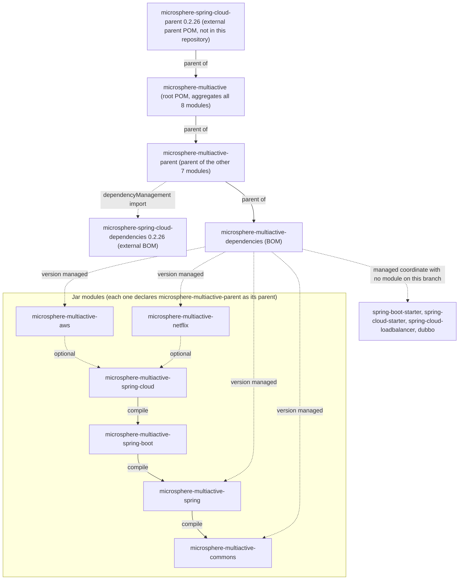
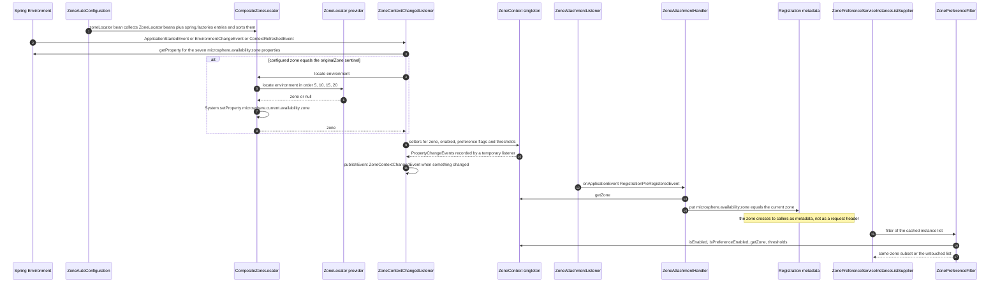

English version: [English](../README.md)

# Microsphere Multiactive 开发者指南（`current`）

本文属于 **`current`** 文档线，对应 `microsphere-multiactive` 的 **`release`** 分支，版本为 `0.2.14-SNAPSHOT`
（根 `pom.xml` 中的 `<revision>` 属性）。

本指南面向维护者。文中每一个类名、方法签名、属性名、默认值、order 数值、POM 元素、资源文件与命令行都取自该快照：
九个 `pom.xml`（根 POM 加八个模块 POM）、`src/main/java`、`src/main/resources/META-INF` 以及 `src/test/java`。若某个模块没有测试、没有自动
配置或没有资源文件，指南会直接说明，而不会暗示并不存在的结构。依赖本仓库之外构件（外部 `microsphere-*` 父工程链、
`microsphere-spring-cloud-commons`、Spring Boot 或 Ribbon 类）的行为，只在本快照代码可证实的范围内描述，并标明边界。

如果你只是使用这个库，请阅读 [用户指南](../../user-guide/zh/README.md)。

## 目录

| 文档 | 模块 | 该模块文档覆盖的内容 |
|------|------|----------------------|
| [microsphere-multiactive-parent.md](microsphere-multiactive-parent.md) | `microsphere-multiactive-parent` | POM 层级、四代继承链、`${revision}`、外部 BOM 导入、重复出现的 `0.2.26` 版本钉，以及“这里没有任何 POM 含 `<build>` 段”这一事实 |
| [microsphere-multiactive-dependencies.md](microsphere-multiactive-dependencies.md) | `microsphere-multiactive-dependencies` | 将 BOM 的八条受管坐标与反应堆逐条核对、四条无模块对应的坐标、两个未被受管的真实模块，以及重命名模块时的三处修改清单 |
| [microsphere-multiactive-commons.md](microsphere-multiactive-commons.md) | `microsphere-multiactive-commons` | 作为 JVM 级单例并带 `PropertyChangeSupport` 的 `ZoneContext`、`ZoneConstants` 属性表、`ZonePreferenceFilter.filter()` 的九步决策级联、`ZoneResolver`、`ZoneAttachmentHandler`、`HttpUtils` |
| [microsphere-multiactive-spring.md](microsphere-multiactive-spring.md) | `microsphere-multiactive-spring` | `ZoneLocator` SPI、`AbstractZoneLocator` 的 `final` 覆盖、`DefaultZoneLocator`、`CompositeZoneLocator` 的记忆化/快速失败/系统属性行为、`ZoneUtils` bean 名、`ZoneContextChangedEvent`/`ZoneContextChangedListener` |
| [microsphere-multiactive-spring-boot.md](microsphere-multiactive-spring-boot.md) | `microsphere-multiactive-spring-boot` | `ZoneAutoConfiguration` 的两个 bean 与两条注册通道、组合注解 `@ConditionalOnAvailabilityZoneAvailable`/`Enabled`、`AutoConfiguration.imports`、`spring.factories`、启动时序 |
| [microsphere-multiactive-spring-cloud.md](microsphere-multiactive-spring-cloud.md) | `microsphere-multiactive-spring-cloud` | `ZoneCloudAutoConfiguration` 的条件栈、`ZoneAttachmentListener`、`CloudServerZoneResolver`、`CustomizedLoadBalancer*` 类、`ZonePreferenceServiceInstanceListSupplier`、三个互相独立的开关属性、`features.yaml` |
| [microsphere-multiactive-aws.md](microsphere-multiactive-aws.md) | `microsphere-multiactive-aws` | 三个 ECS/EC2 定位器、它们的 `5`/`10`/`15` 顺序阶梯与 `DefaultZoneLocator` 的 `20`、`spring.factories` 注册、总会发起的 IMDS 调用、超时参数的接线、无测试的事实 |
| [microsphere-multiactive-netflix.md](microsphere-multiactive-netflix.md) | `microsphere-multiactive-netflix` | `ZonePreferenceServerListFilter`、两个 `ZoneResolver` 适配器、`ZoneAttachmentPreRegistrationHandler`、`DiscoveryClientServer`/`DiscoveryClientServerList`、`features.yaml` 注册、Ribbon 版本钉、无测试的事实 |

建议按 `commons` → `spring` → `spring-boot` → `spring-cloud` 的顺序阅读，再看 `aws` 与 `netflix`：前四个模块构成完整
调用链，后两个是插入其中的提供者。只要你改动 POM，`parent` 与 `dependencies` 两篇就必须先看。

## 章节骨架

每个模块文档都使用相同的小节顺序，便于跨文档定位：

`概述` → `架构设计` → `源码解析` → （`运行期流程`） → `扩展点` → `代码中真实存在的设计模式` → `构建与测试` →
`相关文档` → `English`。

其中 `运行期流程` 只出现在真正具有请求路径逻辑的两篇（`commons` 与 `spring-cloud`）中。

## 总体架构

八个 Maven 模块，两个仅 POM、六个 JAR，组成一条编译链加上两个插件式提供者：

| 层次 | 模块 | 职责 | 关键类型 |
|------|------|------|----------|
| 状态 | `commons` | 保存整个 JVM 的 zone 与策略开关，并完成决策 | `ZoneContext`、`ZoneConstants`、`ZonePreferenceFilter`、`ZoneResolver`、`ZoneAttachmentHandler`、`HttpUtils` |
| 发现 | `spring` | 以可插拔、可排序的方式从平台获知 zone | `ZoneLocator`、`AbstractZoneLocator`、`DefaultZoneLocator`、`CompositeZoneLocator`、`ZoneUtils` |
| 绑定 | `spring` + `spring-boot` | 把 Spring 配置写进单例，并响应变更 | `ZoneContextChangedListener`、`ZoneContextChangedEvent`、`ZoneAutoConfiguration`、`@ConditionalOnAvailabilityZoneAvailable` |
| 发布 | `spring-cloud` | 将 zone 写入服务注册元数据 | `ZoneCloudAutoConfiguration`、`ZoneAttachmentListener`、`CloudServerZoneResolver` |
| 调用期决策 | `spring-cloud` | 在负载均衡器挑选之前过滤实例列表 | `ZonePreferenceServiceInstanceListSupplier`、`CustomizedLoadBalancerAutoConfiguration`、`CustomizedLoadBalancerClientConfiguration` |
| 提供者 | `aws`、`netflix` | 平台相关的 zone 来源，以及遗留 Ribbon/Eureka 适配 | 三个 `AbstractZoneLocator` 子类；六个 Ribbon/Eureka/DiscoveryClient 适配器 |

zone 是**以元数据的形式传播，而不是每次请求的头部**。`ZoneAttachmentHandler.attachZone(metadata)` 把
`microsphere.availability.zone` 写入实例的注册元数据；对端再从自己手上的实体把它读回来——`ServiceInstance`
（`CloudServerZoneResolver`）、Eureka `InstanceInfo`（`EurekaInstanceInfoZoneResolver`）、Ribbon `Server`
（`RibbonServerZoneResolver`）——随后交给 `ZonePreferenceFilter`。整个快照里没有任何 `ThreadLocal`、没有 reactor
context、也没有 request-scope bean；可变状态只有 `ZoneContext` 单例以及
`microsphere.current.availability.zone` 系统属性。

维护者需要记住由此带来的两点：

- `ZonePreferenceFilter` 比较的基准是 `zoneContext.getZone()`（由配置绑定的实例字段），而
  `ZoneContext.getCurrentZone()` 读取的是 `CompositeZoneLocator` 写入的系统属性。本快照中没有任何类调用
  `getCurrentZone()`——它是给外部使用者准备的公共 API。
- 在 main 源码里，`ZoneLocator.locate(environment)` 只有两处调用方：`CompositeZoneLocator`（自身的委托循环）与
  `ZoneContextChangedListener.revertOriginalZone()`，而后者仅在配置值恰好是哨兵字面量 `originalZone` 时才执行。因此
  平台发现的结果体现在“当前 zone 系统属性”上，过滤器自身使用的 zone 通常来自配置。

### 模块依赖

下图由九个 `pom.xml`（根 POM 与八个模块 POM）推导：实线表示 `<parent>` 关系与必需（compile scope）的反应堆内依赖；虚线表示 import 与
`<optional>true</optional>` 依赖。



关于该图的说明，全部可在 POM 中核对：

- `commons` 是唯一没有反应堆内依赖的模块，也不依赖任何框架：`ZoneContext` 等都是普通 Java，只外加
  `microsphere-java-core` / `microsphere-annotation-processor`，两者均为 `<optional>`。
- 六个 JAR 模块都声明了可选的 `microsphere-annotation-processor`，这是它们唯一共同的依赖。
- `aws` 与 `netflix` 对 `spring-cloud` 只是可选依赖，因此使用方需要自己引入这条链。`netflix` 确实用到它
  （`DiscoveryClientServer` 导入了 `CloudServerZoneResolver`）；`aws` 只编译依赖 `commons` + `spring` +
  `spring-context`——它的可选 `spring-cloud` 依赖只是路径上的便利，代码中并无引用。
- BOM 受管 `commons`、`spring`、`aws`、`netflix`，却**没有**受管 `spring-boot` 与 `spring-cloud`，而这两个恰恰是多数
  使用方引入的模块。详见 [microsphere-multiactive-dependencies.md](microsphere-multiactive-dependencies.md)。

### 跨模块的 zone 生命周期



以上两张图与[英文版](../README.md)中的围栏内容逐字节一致。

## 跨模块扩展点

| 目标 | 机制 | 模块 |
|------|------|------|
| 教会库一种新的 zone 获取方式 | 新增继承 `AbstractZoneLocator`（或实现 `ZoneLocator`）的类，指定 order，并在 `META-INF/spring.factories` 中以键 `io.microsphere.multiple.active.zone.spring.ZoneLocator` 注册，或将其发布为 bean | `spring`、`aws` |
| 从新的实体类型读取 zone | 实现 `ZoneResolver<E>`：现有实现分别从 `ServiceInstance` 的元数据（`CloudServerZoneResolver`）、Eureka `InstanceInfo` 的元数据（`EurekaInstanceInfoZoneResolver`）或 Ribbon `Server`（`RibbonServerZoneResolver`）取 zone | `commons`、`spring-cloud`、`netflix` |
| 改变“何时跳过同 zone 优先” | 继承 `ZonePreferenceFilter<E>` 并覆盖 `protected isIgnored(String zone)` 钩子 | `commons` |
| 替换整条定位器链 | 自行声明一个 `CompositeZoneLocator` Bean：不带属性的 `@ConditionalOnMissingBean` 以方法返回类型为判定依据，因此普通的 `ZoneLocator` Bean 只会加入这条链 | `spring-boot` |
| 在运行中推送新的 zone | 设置 `microsphere.availability.zone`；取值 `originalZone` 会让 `ZoneContextChangedListener` 通过定位器链重新发现 | `spring` |
| 响应 zone 变更 | 监听 `ZoneContextChangedEvent`（它携带 `PropertyChangeEvent` 列表） | `spring` |
| 过滤 Ribbon 服务器列表而非 LoadBalancer 列表 | 应用 `ZonePreferenceServerListFilter`，或把 `DiscoveryClientServerList` 作为 `ServerList` | `netflix` |
| 为某个客户端开启 zone 优先 | `microsphere.spring.cloud.loadbalancer.customized=true`，并按客户端配置 `optimized-zone-preference` | `spring-cloud` |

## 构建与测试

从快照读到的要求：JDK 17 及以上（CI 矩阵为 `17`、`21`、`25`）；`.mvn/wrapper/maven-wrapper.properties` 钉住 wrapper
版本 `3.3.4`、`distributionType=only-script`、Apache Maven `3.9.16`。命令请在仓库根目录执行，这样 `${revision}` 才能
由根 POM 解析。

```bash
# full reactor: compile + unit tests
./mvnw clean test

# one module and everything it needs
./mvnw -pl microsphere-multiactive-spring-cloud -am test

# a single test class; the last flag stops the sibling modules built by -am
# from failing on the name filter
./mvnw -pl microsphere-multiactive-commons -am test -Dtest=ZonePreferenceFilterTest -Dsurefire.failIfNoSpecifiedTests=false

# artifacts without running tests
./mvnw clean install -DskipTests

# what the publish workflow runs (needs the external parent's distributionManagement and credentials)
./mvnw -Drevision=0.2.14 deploy
```

Windows 下把 `./mvnw` 换成 `mvnw.cmd`。

`test`、`coverage`、`publish`、`ci` 以及 `spring-cloud-2022` … `spring-cloud-2025` **并不定义在本仓库中**：九个 POM
里没有任何 `<profiles>`、`<build>` 或 `<pluginManagement>` 段，它们来自外部父工程链，因此下面这条 CI 命令行只有在
能解析到这些父工程时才可用。

| 工作流 | 触发条件 | 命令 | 说明 |
|--------|----------|------|------|
| `.github/workflows/maven-build.yml` | 推送到 `main`/`dev`，或向 `main`/`dev`/`release` 提 PR | `mvn --batch-mode --update-snapshots --file pom.xml -Drevision=0.0.1-SNAPSHOT test --activate-profiles test,coverage,spring-cloud-<year>` | JDK 17/21/25 × `spring-cloud-2022`…`2025` 矩阵；使用系统 `mvn`；覆盖率上传 Codecov |
| `.github/workflows/maven-publish.yml` | 推送到 `release`，或带 `major.minor.patch` 输入的 `workflow_dispatch` | `./mvnw --batch-mode --update-snapshots --file pom.xml -Drevision=<input> -Dgpg.skip=true deploy --activate-profiles publish,ci` | 仅 Java 17；打 tag、生成 `release-notes.md`、把 `<revision>` 递增到下一个 patch 并将 `release` 合并进 `main` |

### 测试清单

main 类 31 个，测试类 14 个。覆盖集中在“无框架”层与 Spring 层：

| 模块 | main 类 | 测试类 |
|------|---------|--------|
| `commons` | 6 | `HttpUtilsTest`、`ZoneAttachmentHandlerTest`、`ZoneConstantsTest`、`ZoneContextTest`、`ZonePreferenceFilterTest`、`ZoneResolverTest` |
| `spring` | 7 | `CompositeZoneLocatorTest`、`DefaultZoneLocatorTest`、`ZoneUtilsTest`、`event/ZoneContextChangedEventTest`、`event/ZoneContextChangedListenerTest` |
| `spring-boot` | 3（+2 资源） | `ZoneAutoConfigurationTest` |
| `spring-cloud` | 6（+2 资源） | `ZoneCloudAutoConfigurationTest`、`ZoneCloudAutoConfigurationIntegrationTest` |
| `aws` | 3（+1 资源） | 无 |
| `netflix` | 6（+1 资源） | 无 |
| `parent`、`dependencies` | 0（仅 POM） | 无 |

没有任何测试覆盖 AWS 定位器、Netflix 适配器，以及 Spring Cloud LoadBalancer 路径
（`ZonePreferenceServiceInstanceListSupplier` 与两个 `CustomizedLoadBalancer*` 类）。改动这些位置请视为需要在真实注册
中心上手工验证；各模块文档已指明哪些类完全没有测试。

## 约定

- 全局单一版本：根 POM 的 `<revision>`，其余每个 `<version>` 与 `<parent>` 元素都写 `${revision}`。发布时用
  `-Drevision=` 覆盖，工作流随后回写该属性。
- 框架依赖一律 `<optional>true</optional>`，库不会把某个 Spring 版本强加给使用方；只有反应堆内 JAR 才是 compile
  作用域。
- 属性名集中在 `ZoneConstants` 中，以由 `ZONE_PROPERTY_NAME` 派生的 `*_PROPERTY_NAME` 常量表达，并用
  `@ConfigurationProperty` 说明；新增开关应沿用该模式而不是内联字符串。LoadBalancer 的注解是现存的反例
  （`microsphere.spring.cloud.*`）。
- 两个 bean 名是一项契约，定义在 `ZoneUtils`：`zoneContext` 与 `zoneLocator`。后续模块的 `@ConditionalOnBean` 与
  `@AutoConfigureAfter` 依赖它们。
- zone 提供者有明确顺序：`5`（ECS 容器元数据文件）、`10`（ECS 任务元数据 v4）、`15`（EC2 端点）、`20`
  （`DefaultZoneLocator`，兜底）。新提供者必须选一个低于 `20` 的位置，否则永远不会执行。
- 每个模块文档都以 `相关文档` 小节结尾；更新其一时要保证 EN 与 `zh/` 镜像的围栏代码块逐字节一致。

## 本快照中已知的不一致

以下是对现状的发现，而非文档缺陷；每条都在相应模块文档中有论证。

| 发现 | 模块 | 细节 |
|------|------|------|
| BOM 坐标与反应堆不同步 | `dependencies` | 四条受管坐标没有对应模块（`spring-boot-starter`、`spring-cloud-starter`、`spring-cloud-loadbalancer`、`dubbo`）；两个真实存在的模块未被受管（`spring-boot`、`spring-cloud`） |
| 版本号重复钉 | `parent` | `0.2.26` 同时出现在根 `<parent>` 版本与 `microsphere-spring-cloud.version` 中，必须一起修改 |
| `features.yaml` 存在陈旧条目 | `spring-cloud` | 第三个命名键（`microsphere-multiactive-spring-cloud`）下列的是 Spring Cloud Gateway 包里的 `WebEndpointApplicationContextInitializer`，而其上方两个键列的是本仓库的类 |
| 两套属性命名空间 | `spring-cloud` | zone 状态使用 `microsphere.availability.zone.*`，LoadBalancer 开关使用 `microsphere.spring.cloud.*` |
| 魔法 `@Order` 数值 | `spring-cloud` | `193827465`（响应式）与 `193827466`（阻塞式），源码中没有注释说明由来 |
| 可选依赖未被代码使用 | `aws` | 声明了可选的 `spring-cloud`，但 `aws` 中没有任何类导入它 |
| POM 元素顺序 | `netflix` | `<modelVersion>` 位于 `<parent>` 之后，与其他模块相反 |
| 完全没有测试 | `aws`、`netflix` | 两个模块都没有 `src/test` 目录 |
| 没有自动配置类 | `aws`、`netflix`、`commons`、`spring` | 只有 `spring-boot` 与 `spring-cloud` 提供 `AutoConfiguration.imports` 文件；`aws` 通过 `spring.factories` 注册定位器，`netflix` 在 `features.yaml` 中列出自己的类，而 `commons`/`spring` 完全没有资源文件 |

## 相关文档

- 仓库 [README](../../../../README.md) —— 徽章、模块表、上手片段。
- [发布说明](../../../../release-notes.md) —— 本条线的版本历史。
- [用户指南索引](../../user-guide/zh/README.md) —— 面向使用者的安装、配置与用法；它同样包含八篇按模块划分的文档，
  并在 `zh/` 下有镜像。
- 按模块的用户指南：[parent](../../user-guide/zh/microsphere-multiactive-parent.md)、
  [dependencies](../../user-guide/zh/microsphere-multiactive-dependencies.md)、
  [commons](../../user-guide/zh/microsphere-multiactive-commons.md)、
  [spring](../../user-guide/zh/microsphere-multiactive-spring.md)、
  [spring-boot](../../user-guide/zh/microsphere-multiactive-spring-boot.md)、
  [spring-cloud](../../user-guide/zh/microsphere-multiactive-spring-cloud.md)、
  [aws](../../user-guide/zh/microsphere-multiactive-aws.md)、
  [netflix](../../user-guide/zh/microsphere-multiactive-netflix.md)。

## English

English version: [English](../README.md)
