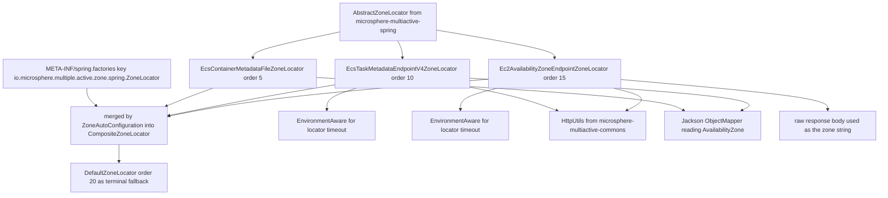
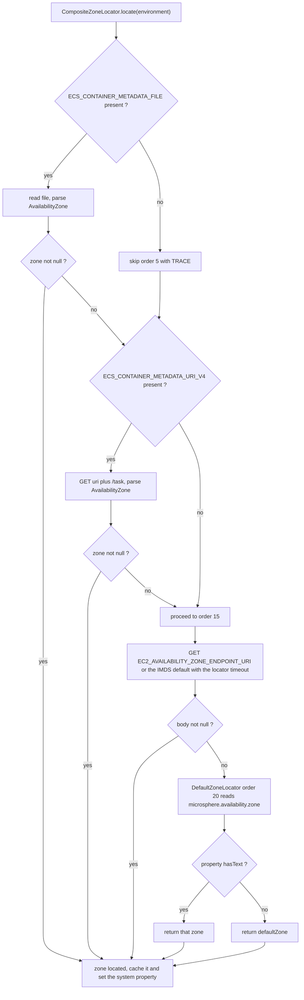

English version: [English](../microsphere-multiactive-aws.md)

# `microsphere-multiactive-aws` — 开发者指南

Maven 坐标：`io.github.microsphere-projects:microsphere-multiactive-aws:${revision}`（本分支为
`0.2.14-SNAPSHOT`）。

---

## 概述

`microsphere-multiactive-aws` 只提供三个 `ZoneLocator` 实现，它们依据 AWS
提供的运行期事实发现当前 EC2 Availability Zone。本模块**没有自动配置类、没有 `@Bean`
方法、也没有条件注解** —— 全部集成面就是一个 `META-INF/spring.factories` 文件加三个普通类。

包：`io.microsphere.multiple.active.zone.spring.aws`（三个类型，均标注 `@since 1.0.0`）。注意包名是
`...zone.spring.aws`，即它属于 *Spring* 命名空间，而不是独立的 AWS 抽象层 —— 本模块就是 `-spring`
的一个插件，仅此而已。

| 类 | 事实来源 | order | 是否需要 AWS 环境变量？ |
|---|---|---|---|
| `EcsContainerMetadataFileZoneLocator` | ECS **容器**元数据*文件*，路径来自 `ECS_CONTAINER_METADATA_FILE` | `5` | 需要 |
| `EcsTaskMetadataEndpointV4ZoneLocator` | ECS **任务**元数据端点 v4，基础 URI 来自 `ECS_CONTAINER_METADATA_URI_V4` | `10` | 需要 |
| `Ec2AvailabilityZoneEndpointZoneLocator` | EC2 实例元数据 placement 端点（默认 `http://169.254.169.254/...`） | `15` | 不需要 |

## 架构设计

### 分层结构



`5 → 10 → 15 → 20` 这个阶梯就是本模块的全部设计：越具体、越廉价、越可靠的数据源越先胜出，而
`DefaultZoneLocator`（由 `-spring-boot` 注册）是最后手段。

### 包结构

| 路径 | 内容 |
|---|---|
| `src/main/java/io/microsphere/multiple/active/zone/spring/aws/` | 三个定位器 |
| `src/main/resources/META-INF/spring.factories` | 三个定位器的 SPI 注册（快照中为 CRLF 行尾） |
| —— | **没有 `src/test/java` 也没有 `src/test/resources`：release 分支中本模块不含任何测试** |

### 依赖契约

摘自 `microsphere-multiactive-aws/pom.xml`：

| 依赖 | 作用域 | 说明 |
|---|---|---|
| `microsphere-multiactive-spring-cloud` | **`optional`** | 声明为 optional，而且*本模块没有任何 import 引用它* —— 代码只使用 `-spring`（`AbstractZoneLocator`、`ZoneLocator`）与 `-commons`（`HttpUtils`、`ZoneConstants`）中的类型 |
| `com.fasterxml.jackson.core:jackson-databind` | `optional` | 两个 ECS 定位器用来解析元数据 JSON |
| `org.springframework` 的 `Environment`、`EnvironmentAware`、`StringUtils` 等类型 | 经上述链路而来 | |
| `spring-boot-starter`、`-actuator`、配置/自动配置处理器 | `optional` | 模块中没有类引用 Boot API |
| `junit-jupiter`、`spring-boot-starter-test`、`microsphere-spring-boot-test`、`logback-classic` | `test` | 已声明但未使用：没有测试源码 |

维护者必须同时记住两点后果：

1. 由于内部依赖是 `optional`，把 `microsphere-multiactive-aws` 加入应用**不会**传递引入
   `-spring`/`-commons`。除非同时存在其他模块（通常是 `-spring-boot` 或 `-spring-cloud`），否则本模块毫无作用 ——
   这就是文档中推荐“与 Spring Boot 模块一起添加”而非“单独添加”的原因。
2. 由于没有测试，此处的改动只能通过“针对声明依赖编译通过”以及“在真实 ECS/EC2 主机上运行”来验证。

## 源码解析

### SPI 注册

`src/main/resources/META-INF/spring.factories`（完整内容）：

```properties
io.microsphere.multiple.active.zone.spring.ZoneLocator=\
io.microsphere.multiple.active.zone.spring.aws.EcsContainerMetadataFileZoneLocator,\
io.microsphere.multiple.active.zone.spring.aws.EcsTaskMetadataEndpointV4ZoneLocator,\
io.microsphere.multiple.active.zone.spring.aws.Ec2AvailabilityZoneEndpointZoneLocator
```

键是 `ZoneLocator` 接口的全限定名，与 `microsphere-multiactive-spring-boot` 为 `DefaultZoneLocator`
使用的键一致。`ZoneAutoConfiguration.zoneLocator(...)` 调用 `loadFactories(context, ZoneLocator.class)`，因此这三个类由
`SpringFactoriesLoader` 实例化 —— **不是** Spring Bean。这带来两个硬性影响：

- 这些定位器内部 `@Autowired`/`@Value`/`@Conditional`
  都不生效；它们能收到的回调只有 Spring 恰好为该实例装配的 Aware
  接口，这正是超时注入采用 `EnvironmentAware` 的原因。
- 没有任何 `@ConditionalOnClass` 守卫保护这个 jar：若消费者类路径缺少 `jackson-databind`，加载 ECS
  定位器会在实例化阶段失败，而不是被静默跳过。使用本模块时请保证 Jackson
  可用（或在分支版本中从 factories 文件里删掉 ECS 条目）。

### `EcsContainerMetadataFileZoneLocator`

`microsphere-multiactive-aws/src/main/java/io/microsphere/multiple/active/zone/spring/aws/EcsContainerMetadataFileZoneLocator.java`

- `METADATA_FILE_ENV_NAME = "ECS_CONTAINER_METADATA_FILE"`、`DEFAULT_ORDER = 5`，私有常量
  `ZONE_FIELD_NAME = "AvailabilityZone"`。
- `supports(environment)` 即 `environment.containsProperty(METADATA_FILE_ENV_NAME)` ——
  只有 ECS agent 注入了该变量时才会尝试这个文件来源。（Spring 的 `Environment` 会解析操作系统环境变量，因此
  `containsProperty` 同时覆盖真实环境变量与测试注入的属性。）
- `locate(environment)`：读取路径，要求 `StringUtils.hasText`，检查 `File.canRead()`，以流方式读取文件，
  `IOUtils.copyToString(inputStream, UTF_8)`，用*新建的* `new ObjectMapper()` 解析为原始 `Map`，取
  `metadata.get("AvailabilityZone")` 并用 `String.valueOf` 转换。所有失败路径都是*记录日志并返回 `null`*：文件不可读 →
  `WARN`；读取/解析过程中的任意 `Throwable` → `ERROR`；变量为空白 → `TRACE`。返回 `null`
  正是让组合器落到下一个定位器的契约。
- 未实现 `EnvironmentAware`：本地文件读取不需要超时，因此不从环境缓存任何内容。

### `EcsTaskMetadataEndpointV4ZoneLocator`

`.../EcsTaskMetadataEndpointV4ZoneLocator.java`

- `METADATA_URI_V4_ENV_NAME = "ECS_CONTAINER_METADATA_URI_V4"`、`DEFAULT_ORDER = 10`、`ZONE_FIELD_NAME = "AvailabilityZone"`。
- `supports(environment)` 同样探测该环境变量是否存在。
- `locate(environment)` 构造 `String taskURL = uri + "/task";` 并调用 `HttpUtils.doGet(taskURL, timeout)`，随后与文件定位器完全一致地用
  Jackson 解析 JSON 并读取同一个 `AvailabilityZone` 字段。也就是说*数据形态*不同（端点 vs 文件），而提取逻辑相同。
- `implements EnvironmentAware`，而 `setEnvironment` 是唯一读取超时的地方：
  `environment.getProperty(LOCATOR_TIMEOUT_PROPERTY_NAME, int.class, DEFAULT_TIMEOUT)`，即
  `microsphere.availability.zone.locator.timeout`，默认 `3000`。字段声明为
  `private int timeout = DEFAULT_TIMEOUT;`，因此绝不会处于未设置状态。注意这里的次序细节：由于由 factories
  实例化的对象并非完整 Spring Bean，只有当该实例被注册为 Bean（例如应用重新声明它）时这个回调才会执行；否则生效的是默认的 `3000`。
- 所有失败（`Throwable`）以 `ERROR` 记录并返回 `null`，因此 v4 端点不可达时会降级到下一个定位器，而不是让启动失败。

### `Ec2AvailabilityZoneEndpointZoneLocator`

`.../Ec2AvailabilityZoneEndpointZoneLocator.java`

- 两个公有 URI 常量：`AVAILABILITY_ZONE_ENDPOINT_URI_PROPERTY_NAME = "EC2_AVAILABILITY_ZONE_ENDPOINT_URI"`
  与 `DEFAULT_AVAILABILITY_ZONE_ENDPOINT_URI = "http://169.254.169.254/latest/meta-data/placement/availability-zone"`
  —— 即 EC2 实例元数据服务的 placement 路径，可通过环境完全覆盖。
- `DEFAULT_ORDER = 15`，并且 **`supports(environment)` 无条件返回 `true`。**
  这是仓库中唯一总是声称支持的定位器，也正是本模块失败模式值得理解的原因：
  `getAvailabilityZoneEndpointURI(...)`
  会回退到链路本地默认地址，因此 `locate` 总会*尝试*向 `169.254.169.254`
  发起一次 HTTP GET。在非 EC2 主机上，这次尝试最多消耗配置的那个超时（`HttpUtils.doGet`
  把 connect 与 read 都设为 `timeout`），之后返回 `null` 并落到 `DefaultZoneLocator`。
  在设置了 `microsphere.availability.zone.locator.fast-fail=true`
  的本地开发循环里，触发快速失败的会是这个定位器，而不是基于属性的那个。
- 与 ECS 定位器不同，这里**没有 JSON 解析**：`zone = HttpUtils.doGet(uri, timeout);` ——
  原始响应体*就是*可用区，因为 IMDS placement 端点返回的是裸字符串。错误以 `ERROR` 记录并产生 `null`；解析后的 URI
  缺失/空白则记录 `WARN`。
- 同样实现 `EnvironmentAware`，超时处理方式与 v4 定位器一致。

### 排序、快速失败与最终决策阶梯



上述每个 `null` 都会让组合器额外输出一条 `WARN`；而如果
`microsphere.availability.zone.locator.fast-fail=true`，第一个 `null` 或异常会直接以
`IllegalStateException` 中断整条链，而不再继续。

## 扩展点

| 扩展点 | 方式 |
|---|---|
| 覆盖 IMDS 端点 | 设置 `EC2_AVAILABILITY_ZONE_ENDPOINT_URI`（例如指向代理或不同的元数据基址）。当主机强制要求基于 token 的元数据模式时尤其有用，因为 `HttpUtils.doGet` 只发出不带任何请求头的普通 `GET` |
| 调整发现耗时/失败行为 | `microsphere.availability.zone.locator.timeout`（默认 `3000` ms，两个 HTTP 定位器都使用）与 `microsphere.availability.zone.locator.fast-fail`（默认 `false`） |
| 增加其他云 | 实现 `ZoneLocator` 并继承 `AbstractZoneLocator`，选定 order，在同一键下注册到 `spring.factories` —— AWS 模块就是该模式的参考实现 |
| 强制指定可用区并跳过发现 | `microsphere.availability.zone=<zone>` 仍需考虑次序：AWS 定位器先执行（`5`/`10`/`15`），因此要利用 `DefaultZoneLocator` 的次序（`20`）作为回退路径，或者设置 `microsphere.availability.zone.enabled=false` |

## 代码中真实存在的设计模式

- **带显式次序阶梯的策略（Strategy）** —— 三个可互换的 `ZoneLocator`
  策略，其相对优先级以传给 `super(order)` 的 `int` 常量表达（5/10/15），由组合器中的
  `AnnotationAwareOrderComparator` 消费。
- **模板方法（Template Method）** —— 每个定位器从 `AbstractZoneLocator` 继承日志、`beanName`
  与排序，只提供 `supports`/`locate`。
- **守卫后执行协议** —— 两个 ECS 定位器把 `supports()` 实现为环境变量探测（`containsProperty`）；EC2
  定位器则刻意用“可配置的默认 URI”取代探测。
- **软失败 / 空对象式落空传递** —— 每次 I/O 与解析失败都被捕获（`Throwable`）、记录并转换为 `null`，从而让链继续；除非开启
  fast-fail，库本身绝不会从 `locate` 抛出异常。
- **无需组件扫描的 SPI 注册** —— 以接口全限定名为键写在 `spring.factories`，通过 `SpringFactoriesLoader`
  加载，即类路径插件化架构而非 Bean 扫描。
- **不存在的东西**：没有 Spring Bean、没有条件注解、没有 `ZoneResolver`、没有 `ZonePreferenceFilter`
  的使用，本模块也没有测试。

## 构建与测试

```bash
# compile and run the (currently empty) test phase, plus required upstream modules
./mvnw -pl microsphere-multiactive-aws -am test

# verify only that the module still compiles against the optional chain
./mvnw -pl microsphere-multiactive-aws -am -DskipTests package

# Windows
mvnw.cmd -pl microsphere-multiactive-aws -am test
```

这里 `-am` 是必须的：本模块对 `microsphere-multiactive-spring-cloud`
的依赖是 `optional`，因此它编译时所依赖的 `-commons`/`-spring`
类来自反应堆，而不是仅凭已发布的 `-aws` jar。

**本模块没有自动化测试**（`src/test`
不存在），也没有 `features.yaml`。若要补充覆盖率，推荐用 `StandardEnvironment` + `MapPropertySource`
来模拟 AWS 环境变量 —— 这正是 `-spring` 测试已在使用的技巧（`CompositeZoneLocatorTest.newEnvironment()`、
`ZoneContextChangedListenerTest.buildContext(...)`）；HTTP
类定位器则可用本地 `HttpServer`，如同 `-commons` 中的 `HttpUtilsTest` 那样。

## 相关文档

- [开发者指南索引](README.md)
- [microsphere-multiactive-spring](microsphere-multiactive-spring.md) —— `AbstractZoneLocator`
  以及消费这些策略的组合器
- [microsphere-multiactive-spring-boot](microsphere-multiactive-spring-boot.md) —— `spring.factories`
  条目真正被加载的地方
- [microsphere-multiactive-commons](microsphere-multiactive-commons.md) —— `HttpUtils` 与定位器属性名
- [用户指南](../../user-guide/zh/README.md)
- [仓库 README](../../../../README.md)

## English

English version: [English](../microsphere-multiactive-aws.md)
