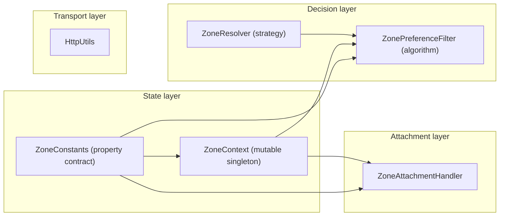
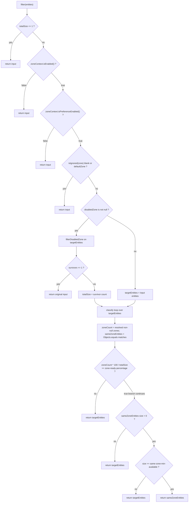
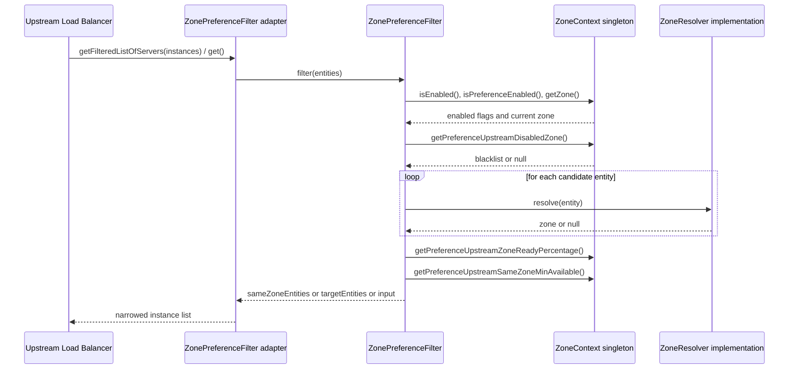

English version: [English](../microsphere-multiactive-commons.md)

# `microsphere-multiactive-commons` — 开发者指南

Maven 坐标：`io.github.microsphere-projects:microsphere-multiactive-commons:${revision}`（本分支为 `0.2.14-SNAPSHOT`）。

---

## 概述

`microsphere-multiactive-commons` 是库中零依赖的内核。它定义了可用区状态模型（`ZoneContext`）、完整的配置属性契约
（`ZoneConstants`）、承担实际工作的两个可移植算法（`ZonePreferenceFilter` 与 `ZoneResolver`）、注册元数据写入器
（`ZoneAttachmentHandler`）以及一个 HTTP 工具类（`HttpUtils`）。

其最重要的架构特征可以直接从 `pom.xml` 读出：**所有 compile 作用域的依赖都被声明为
`<optional>true</optional>`**。唯一必需的依赖是 test 作用域的（`junit-jupiter`、`microsphere-java-test`、
`logback-classic`）。因此该模块的 API 表面上不存在 Spring、Servlet 或 RPC 类型，整套可用区模型可以在 Spring 应用之外复用。
所有 Spring/框架相关的适配器都位于上层模块（`-spring`、`-spring-boot`、`-spring-cloud`、`-netflix`）。

- Java 包：`io.microsphere.multiple.active.zone` —— 单个扁平包，六个类型。
- 所有类型都标注 `@since 1.0.0`。

## 架构设计

### 分层结构



- **状态层** —— `ZoneConstants` 是属性名与默认值的唯一事实来源；`ZoneContext` 保存解析后的运行期取值，并在变化时通知观察者。
- **决策层** —— `ZoneResolver<E>` 是面向各框架的策略“给定一个实例描述对象，它属于哪个可用区？”；
  `ZonePreferenceFilter<E>` 消费一个 `ZoneContext` 加一个 `ZoneResolver<E>`，把候选列表收敛为同可用区子集，并带回退逻辑。
- **挂载层** —— `ZoneAttachmentHandler` 执行与解析器相反的方向：把*本进程*的可用区写入服务注册中心将广播给对端实例的元数据
  Map。
- **传输层** —— `HttpUtils` 的存在只是为了让 AWS 定位器（`microsphere-multiactive-aws`）能够在不引入 HTTP 客户端的前提下读取
  实例元数据端点。

`ZoneContext`、`ZoneAttachmentHandler`、`ZonePreferenceFilter` 与 `ZoneResolver` 这四个类型，正是同级模块
`microsphere-multiactive-spring-cloud` 在 `META-INF/config/default/features.yaml` 中以特性名
`microsphere-multiactive-commons` 声明的条目，这从外部视角描述了内核提供了什么。

### 包结构

| 路径（相对模块目录） | 类型 | 职责 |
|---|---|---|
| `src/main/java/io/microsphere/multiple/active/zone/` | `ZoneConstants`、`ZoneContext`、`ZoneResolver`、`ZonePreferenceFilter`、`ZoneAttachmentHandler`、`HttpUtils` | 可用区状态、属性契约、偏好算法、元数据挂载、元数据 HTTP 读取 |
| `src/test/java/io/microsphere/multiple/active/zone/` | `ZoneConstantsTest`、`ZoneContextTest`、`ZoneResolverTest`、`ZonePreferenceFilterTest`、`ZoneAttachmentHandlerTest`、`HttpUtilsTest` | 对六个类型逐一进行行为锚定 |
| —— | 无 `src/main/resources` | 该模块不提供 `spring.factories`、自动配置类或 `features.yaml` |

### 依赖契约

摘自 `microsphere-multiactive-commons/pom.xml`（父 POM 为 `microsphere-multiactive-parent`，`relativePath` 为
`../microsphere-multiactive-parent/pom.xml`）：

| 依赖 | 作用域 | 说明 |
|---|---|---|
| `io.github.microsphere-projects:microsphere-annotation-processor` | `optional` | 仅编译期；支撑 `ZoneConstants` 中使用的 `@ConfigurationProperty` 元数据注解 |
| `io.github.microsphere-projects:microsphere-java-core` | `optional` | 提供 `io.microsphere.logging.Logger`/`LoggerFactory`、`io.microsphere.util.StringUtils`、`io.microsphere.io.IOUtils`、`io.microsphere.constants.SymbolConstants`、`io.microsphere.constants.PropertyConstants`、`io.microsphere.annotation.ConfigurationProperty` |
| `org.junit.jupiter:junit-jupiter` | `test` | |
| `io.github.microsphere-projects:microsphere-java-test` | `test` | |
| `ch.qos.logback:logback-classic` | `test` | |

这里不书写版本号；版本由父 POM 导入的 `microsphere-spring-cloud-dependencies` BOM 继承而来。由于两个生产依赖都是
`optional`，下游使用者必须自备它们——实践中它们经由上层模块的 `microsphere-spring-context` /
`microsphere-spring-boot-core` 传递而来。

## 源码解析

### `ZoneConstants`

`microsphere-multiactive-commons/src/main/java/io/microsphere/multiple/active/zone/ZoneConstants.java`

一个仅用作常量命名空间的 `interface`。每个属性名都是由三个前缀**推导**而来，而不是手写字符串：

```
ZONE_PROPERTY_NAME          = "microsphere.availability.zone"
PREFERENCE_PROPERTY_NAME_PREFIX   = ZONE_PROPERTY_NAME + DOT + "preference" + DOT
LOCATOR_PROPERTY_NAME_PREFIX      = ZONE_PROPERTY_NAME + DOT + "locator" + DOT
```

`ENABLED_PROPERTY_NAME_SUFFIX` 等于 `DOT + ENABLED_PROPERTY_NAME`（即 `".enabled"`），因此
`ZONE_ENABLED_PROPERTY_NAME` = `microsphere.availability.zone.enabled`，
`PREFERENCE_ENABLED_PROPERTY_NAME` = `microsphere.availability.zone.preference.enabled`。

有两个可用区*取值*影响的是算法而不是配置：

- `DEFAULT_ZONE = "defaultZone"` —— 为兼容 Eureka 而选（Javadoc 引用了
  `org.springframework.cloud.netflix.eureka.EurekaClientConfigBean#DEFAULT_ZONE`）。`defaultZone` 是“未分配可用区”的哨兵值；
  `ZonePreferenceFilter.isIgnored()` 对其做大小写无关比较。
- `ORIGINAL_ZONE = "originalZone"` —— 一个*写入目标*，而非真实可用区。把它赋给可用区属性，是在指示
  `ZoneContextChangedListener`（位于 `-spring`）重新从 `ZoneLocator` 链推导可用区，也就是“撤销一次手工故障切换”的命令。

每个默认值都同时配有一个 `*_PROPERTY_VALUE` 字符串与一个解析后的 `int`/`boolean` 兄弟常量，使同一份字面量成为唯一来源：

| 属性 | 默认值 | 常量 |
|---|---|---|
| `microsphere.availability.zone` | `defaultZone` | `DEFAULT_ZONE` |
| `microsphere.availability.zone.enabled` | `true` | `DEFAULT_ZONE_ENABLED` |
| `microsphere.availability.zone.preference.enabled` | `false` | `DEFAULT_ZONE_PREFERENCE_ENABLED` |
| `microsphere.availability.zone.preference.filter.order` | `10` | `DEFAULT_ZONE_PREFERENCE_FILTER_ORDER` |
| `microsphere.availability.zone.preference.upstream.zone-ready-percentage` | `100` | `DEFAULT_PREFERENCE_UPSTREAM_ZONE_READY_PERCENTAGE` |
| `microsphere.availability.zone.preference.upstream.same-zone-min-available` | `5` | `DEFAULT_PREFERENCE_UPSTREAM_SAME_ZONE_MIN_AVAILABLE` |
| `microsphere.availability.zone.preference.upstream.disabled-zone` | `null` | `DEFAULT_PREFERENCE_UPSTREAM_DISABLED_ZONE` |
| `microsphere.availability.zone.locator.fast-fail` | `false` | `DEFAULT_LOCATOR_FAST_FAIL` |
| `microsphere.availability.zone.locator.timeout` | `3000` | `DEFAULT_TIMEOUT` |
| `microsphere.current.availability.zone` | （无——仅用于读回） | `CURRENT_ZONE_PROPERTY_NAME` |

注意 `microsphere.availability.zone.enabled` 默认为 `true`，而 `...preference.enabled` 默认为 `false`：特性是*已装配但惰性*
的，只有显式打开可用区偏好才生效。这正是本库可以安全植入既有部署的原因。

每个属性名都带有来自 `microsphere-annotation-processor` 的
`@ConfigurationProperty(defaultValue = ..., source = APPLICATION_SOURCE, type = ...)` 注解。仓库中没有提交任何生成的
`additional-spring-configuration-metadata.json`，因此这些注解是构建期给工具/注解处理器使用的元数据。

`ZoneConstantsTest` 逐字锚定了每个派生属性名与默认值——任何对前缀运算的重构都会让该测试失败，这正是它的契约锁定作用。

### `ZoneContext`

`microsphere-multiactive-commons/src/main/java/io/microsphere/multiple/active/zone/ZoneContext.java`

```java
public class ZoneContext {
    private static final ZoneContext instance = new ZoneContext();
    public static ZoneContext get() { return instance; }
    public static String getCurrentZone() { ... }
}
```

七个 `volatile` 字段与七个可配置属性一一对应。本仓库中**不存在任何 `ThreadLocal` 与
`InheritableThreadLocal`**（已对全部源码检索确认）——可用区是进程级、JVM 全局的事实，而不是按请求/按调用的上下文。
维护任何与“上下文”相关的改动时必须记住这一点：一个 JVM 只服务一个可用区，而按调用粒度的本地性选择是通过过滤实例列表实现的，
不是通过跨线程携带上下文实现的。

变化传播使用 `java.beans.PropertyChangeSupport`：

```java
private boolean isPropertyChanged(String propertyName, Object previousPropertyValue, Object newPropertyValue) {
    boolean changed = !Objects.equals(previousPropertyValue, newPropertyValue);
    if (changed) {
        propertyChangeSupport.firePropertyChange(propertyName, previousPropertyValue, newPropertyValue);
        logger.info(...);
    } else {
        logger.trace(...);
    }
    return changed;
}
```

每个 setter 的形状都是 `if (isPropertyChanged(...)) { this.field = ...; }`。由此产生两个后果：

1. **监听器在字段被写入之前收到通知。** 当 `setZone("zone-b")` 触发 `PropertyChangeListener` 时，监听器看到的
   `getZone()` 仍是旧值，只有 setter 返回后新值才可见。`ZoneContextChangedListener` 恰好依赖这一点：它只是把事件*收集*进一个
   List，稍后再发布，因此永远不会读到过期状态。请勿新增一个在回调中回读上下文的监听器。
2. **幂等写入是静默的。** 设置相同的值不会产生事件也不会产生 `INFO` 日志。`ZoneContextTest` 显式断言了这一点
   （`testSetEnabledNoChangeDoesNotFireEvent`、`testSetZoneSameValueNoEvent`）。

setter 中的归一化逻辑：

- `setZone` 应用 `trimAllWhitespace`，因此 `"  zone-b  "` 变为 `"zone-b"`；赋空白值可能得到 `""`，
  进而使 `ZonePreferenceFilter.isIgnored()` 短路返回。
- `setPreferenceUpstreamDisabledZone` 应用 `resolveCommaDelimited`：以 `COMMA` 切分、逐段 `trimAllWhitespace`，再用
  `StringJoiner(",")` 重新拼接，所以 `" zone-a , zone-b "` 会存成 `"zone-a,zone-b"`。空白/`null` 输入原样返回（因此 `""`
  存为 `""`，`null` 存为 `null`）——由 `testSetPreferenceUpstreamDisabledZoneBlank` 与
  `testSetPreferenceUpstreamDisabledZoneEmptyString` 断言。

生命周期辅助方法：`enable()` 返回之前的启用状态，且仅在处于禁用时才写入；`reset()` 恢复全部七个默认值，是本模块及
`-spring` 模块所有测试在 `@BeforeEach`/`@AfterEach` 中使用的隔离手段。

`getCurrentZone()` 与该单例无关：它读取 **JVM 系统属性** `microsphere.current.availability.zone`，缺省为
`DEFAULT_ZONE`。该属性由 `-spring` 模块中的 `CompositeZoneLocator.locate(...)` 写入，为没有 Spring 上下文的代码提供了一种廉价方式去询问
“服务发现最终判定我在哪个可用区？”。

### `ZoneResolver<E>`

`microsphere-multiactive-commons/src/main/java/io/microsphere/multiple/active/zone/ZoneResolver.java`

```java
public interface ZoneResolver<E> extends Function<E, String> {
    default String apply(E entity) { return resolve(entity); }
    String resolve(E entity);
}
```

整个库唯一的策略接缝。继承 `Function<E, String>` 使解析器可以传给任何 JDK/Stream API，同时保留语义化的 `resolve`
方法；默认的 `apply` 只是委派，因此 `ZoneResolverTest` 断言两个入口返回相同结果。实现类在无法得知可用区时返回 `null`——这个
`null` 是*有意义的数据*：`ZonePreferenceFilter` 把它计入“可用区就绪百分比”的分母而不是抛异常。

代码库中共有三个实现，每种集成风格一个：`CloudServerZoneResolver`（`-spring-cloud`，读取
`ServiceInstance.getMetadata()`）、`EurekaInstanceInfoZoneResolver`（`-netflix`，读取
`InstanceInfo.getMetadata()`）、`RibbonServerZoneResolver`（`-netflix`，读取 `Server.getZone()`）。

### `ZonePreferenceFilter<E>`

`microsphere-multiactive-commons/src/main/java/io/microsphere/multiple/active/zone/ZonePreferenceFilter.java`

决策引擎。通过构造器注入 `ZoneContext` 与 `ZoneResolver<E>`——它不是 Spring Bean 类型，也不持有任何框架引用，因此可以直接单元测试
（见 `ZonePreferenceFilterTest`，它手写了一个 `ZoneEntity` 与 lambda 解析器）。

`filter(List<E> entities)` 是一串线性短路判断，只要算法无法安全决策，就**按同一性**原样返回入参（测试中用 `assertSame` 断言）：

1. `totalSize <= 1` → 返回入参（也覆盖 `null`，因为 `totalSize` 计算为
   `entities == null ? 0 : entities.size()`；`filter(null)` 返回 `null`）。
2. `!zoneContext.isEnabled()` → 返回入参，并以 `TRACE` 提示 `microsphere.availability.zone.enabled` 属性。
3. `!zoneContext.isPreferenceEnabled()` → 返回入参（默认状态）。
4. `isIgnored(zone)` → 返回入参。`isIgnored` 即 `isBlank(zone) || DEFAULT_ZONE.equalsIgnoreCase(zone)`，并声明为
   **`protected`**——这是为“未分配可用区”标记与 `defaultZone` 不同的项目预留的显式钩子。
5. **禁用可用区（排空）阶段**：若 `getPreferenceUpstreamDisabledZone() != null`，`filterDisabledZone` 构造新的
   `LinkedList`，保留解析出的可用区不在逗号分隔黑名单中的实例。若存活实例少于两个，则返回*原始*列表——排空操作绝不能把实例池压缩到只剩一个。
   否则把 `totalSize` 重新赋值为存活数量，后续所有比例都基于它计算。
6. **分类阶段**：对 `targetEntities` 单次遍历；`resolveZone(entity)`（空值安全：`null` 实体解析为 `null`）仅在解析出可用区时递增
   `zoneCount`，并在 `Objects.equals(zone, resolvedZone)` 时把实例追加到 `sameZoneEntities`。
7. **就绪比例闸门**：`isUpstreamZoneNotReady` 以整数运算计算 `zoneCount * 100 / entitiesSize`，当该百分比低于
   `getPreferenceUpstreamZoneReadyPercentage()` 时返回 `targetEntities`。默认阈值为 `100`，意味着列表中*只要有一个*无可用区实例，
   整批实例的可用区偏好就会被关闭——这是“必须先保证所有对端都带可用区标签，才信任该标签”的安全阀。
8. **最小可用闸门**：若存在同可用区实例但数量小于 `getPreferenceUpstreamSameZoneMinAvailable()`（默认 `5`），返回
   `targetEntities`。只有同可用区子集足够大、能够承载流量时才采用它。
9. 否则返回 `sameZoneEntities`；若子集为空则返回 `targetEntities`。

`getOrder()` 是对 `zoneContext.getPreferenceFilterOrder()` 的纯委派，便于 Spring 对包装该过滤器的适配器排序。

每个提前返回都会以 `TRACE` 记录日志（包含可打开该特性的属性名），因此某套部署未启用本地性偏好总是可以从日志中还原原因。



### `ZoneAttachmentHandler`

`microsphere-multiactive-commons/src/main/java/io/microsphere/multiple/active/zone/ZoneAttachmentHandler.java`

一个只有几行思路、但做了防御性工程的类。它读取 `zoneContext.getZone()`，非空白时以
`ZoneConstants.ZONE_PROPERTY_NAME` 为键写入传入的元数据 `Map<String, String>`。`put` 被
`try { ... } catch (Throwable e)` 包裹，原因正是注册中心会交出不可修改的 Map（源码注释明确说明）；失败时降级为
`WARN`，而不是让注册流程中断。`ZoneAttachmentHandlerTest` 覆盖了有效可用区、空白可用区、`defaultZone`
以及不可修改 Map 四种情形。

存在两个调用方，每种集成风格一个：`ZoneAttachmentListener`（`-spring-cloud`，事件驱动）与
`ZoneAttachmentPreRegistrationHandler`（`-netflix`，Eureka `PreRegistrationHandler`）。二者都注入它，因此写入路径只被定义了一次。

维护者需要记住一处不对称：`attachZone` *不会*跳过 `defaultZone`（它会照原样发布），而
`ZonePreferenceFilter.isIgnored` *会*跳过它。因此未分配可用区的实例会广播
`microsphere.availability.zone=defaultZone`，消费方读到该值时理解为“没有本地性信号”。

### `HttpUtils`

`microsphere-multiactive-commons/src/main/java/io/microsphere/multiple/active/zone/HttpUtils.java`

一个 `abstract`（不可实例化的工具）类，暴露 `static String doGet(String url, int timeout)`。它打开一个
`URLConnection`，**仅当连接是 `HttpURLConnection` 时**才把 connect 与 read 超时都设为传入的 `timeout`，在
try-with-resources 中通过 `IOUtils.copyToString(inputStream, UTF_8)` 读取响应体，并在 `finally` 中调用
`disconnect()`。非 HTTP 的 URL 与空白 URL 返回 `null`（`HttpUtilsTest` 断言之，其中还覆盖了 `@TempDir` 文件 URI）。
读取成功时会以 `INFO` 记录日志并输出完整响应体——在轮询 AWS 元数据端点的环境中值得关注。

## 扩展点

| 扩展点 | 方式 | 被消费的位置 |
|---|---|---|
| `ZoneResolver<E>` | 实现后通过构造器注入 `ZonePreferenceFilter` | `-spring-cloud`（`CloudServerZoneResolver`）、`-netflix`（`EurekaInstanceInfoZoneResolver`、`RibbonServerZoneResolver`） |
| `ZonePreferenceFilter<E>` | 继承并覆写 `protected boolean isIgnored(String zone)` 以重新定义“未分配可用区” | 任何构造该过滤器的模块 |
| `ZoneContext` | 通过 `addPropertyChangeListener(...)` 感知原子批量变更；`reset()` 用于测试；`ZoneContext.get()` 同时作为 `zoneContext` Bean 发布，因此 Spring 代码可注入而无需调用静态方法 | `-spring`（`ZoneContextChangedListener`）、`-spring-boot`（`ZoneAutoConfiguration`） |
| 属性契约 | 在 `ZoneConstants` 增加带 `@ConfigurationProperty` 的常量，接入 `ZoneContext`（字段 + setter + getter + `reset()`），再在 `ZoneContextChangedListener.propertyChangedHandlers` 注册处理器并把属性名追加进 `ZONE_CONTEXT_PROPERTY_NAMES` | `-spring`、`-spring-boot`、`-spring-cloud` |
| `HttpUtils` | 被 AWS 元数据定位器复用，避免重复实现 HTTP 逻辑 | `-aws` |

## 代码中真实存在的设计模式

- **单例（Singleton）** —— `ZoneContext.instance` 配合 `get()`；`CloudServerZoneResolver.INSTANCE`（在
  `-spring-cloud`）同样是急切实例的单例解析器。
- **观察者（Observer）** —— `ZoneContext` 内部的 `java.beans.PropertyChangeSupport`，配套
  `addPropertyChangeListener` / `removePropertyChangeListener`。Spring 层正是把这一机制转换为 `ApplicationEvent`。
- **策略（Strategy）** —— 注入到 `ZonePreferenceFilter` 的 `ZoneResolver<E>`：一个算法，多种可用区读取策略。
- **结果缓存（Memoization）** —— `ZoneContext` 的 setter 对未变更的写入只记日志并跳过；真正的“只计算一次”行为位于
  `CompositeZoneLocator`（见 `-spring` 指南）。
- **不依赖服务定位器的注入** —— `ZoneAttachmentHandler`、`ZoneContext`、`ZonePreferenceFilter` 都通过构造器接收协作者，
  完全不做静态查找；只有 `ZoneAttachmentListener` 会从 `ApplicationContext` 解析该处理器（见 `-spring-cloud` 指南）。
- **模板方法的*守卫*配对** —— `ZoneResolver.apply` 委派到 `resolve`，以及 `ZonePreferenceFilter.filter`
  调用可覆写的 `isIgnored`/`resolveZone` 钩子。仅按代码呈现的确切含义提出。
- **未被使用（但常被误以为存在）**：本模块没有 `ThreadLocal`/`InheritableThreadLocal` 上下文，没有
  `@ConfigurationProperties` 绑定类，没有 `ServiceLoader`/`spring.factories` 文件；也没有装饰器或职责链（它们出现在
  `-spring` 与 `-spring-cloud` 中）。

## 运行期流程

`ZonePreferenceFilter` 在两次调用之间不保存状态；下图展示内核被上游负载均衡器实际驱动的过程。



## 构建与测试

该模块由仓库根目录的反应堆构建；普通编译无需任何 profile，而 CI 会激活 `test,coverage` 加上一个 `spring-cloud-*`
profile（见 `.github/workflows/maven-build.yml`，其命令为 `mvn --batch-mode --update-snapshots --file pom.xml
-Drevision=0.0.1-SNAPSHOT test --activate-profiles test,coverage,<profile>`）。

```bash
# build + test this module and everything it needs
./mvnw -pl microsphere-multiactive-commons -am test

# single test class / method
./mvnw -pl microsphere-multiactive-commons test -Dtest=ZonePreferenceFilterTest
./mvnw -pl microsphere-multiactive-commons test -Dtest=ZoneContextTest#testReset

# Windows
mvnw.cmd -pl microsphere-multiactive-commons -am test
```

测试使用 Maven Wrapper 3.3.4（`distributionType=only-script`，Maven 3.9.16）。没有 `src/test/resources`，因此日志默认配置来自测试类路径上的
`logback-classic`。

测试清单及其锚定的契约：

| 测试类 | 保护的契约 |
|---|---|
| `ZoneConstantsTest` | 精确的属性名字符串与默认值，即对外配置契约 |
| `ZoneContextTest` | 单例同一性、默认值、空白与逗号归一化、事件的产生与*不*产生、`reset()`、`enable()`、`getCurrentZone()` 读取系统属性 |
| `ZoneResolverTest` | `apply()` 委派到 `resolve()`，`null` 透传 |
| `ZonePreferenceFilterTest` | 决策链上的每个短路与每个闸门、按同一性返回（`assertSame`）、禁用可用区排空及其“实例不足”回退 |
| `ZoneAttachmentHandlerTest` | 真实可用区与 `defaultZone` 会写入元数据、空白可用区跳过、遇到不可修改 Map 不崩溃 |
| `HttpUtilsTest` | 空白/非 HTTP URL 返回 `null`，HTTP URL 返回响应体 |

由于 `ZoneContext` 是 JVM 单例，本模块的测试只在**单个测试类内部**是隔离的：多个套件修改的是同一份全局状态。任何新增测试都必须在
`@BeforeEach` **和** `@AfterEach` 中调用 `ZoneContext.get().reset()`，并在涉及 `getCurrentZone()` 时清理
`CURRENT_ZONE_PROPERTY_NAME`，与现有测试保持一致；同时确保 surefire 的 fork 配置得当，避免共享 JVM 导致可用区状态跨模块泄漏。

## 相关文档

- [开发者指南索引](README.md)
- [microsphere-multiactive-spring](microsphere-multiactive-spring.md) —— `ZoneLocator` 链以及为本模块 `ZoneContext` 灌值的监听器
- [microsphere-multiactive-spring-cloud](microsphere-multiactive-spring-cloud.md) —— 包裹 `ZonePreferenceFilter` 的 LoadBalancer 适配器
- [用户指南](../../user-guide/zh/README.md)
- [仓库 README](../../../../README.md)

## English

English version: [English](../microsphere-multiactive-commons.md)
