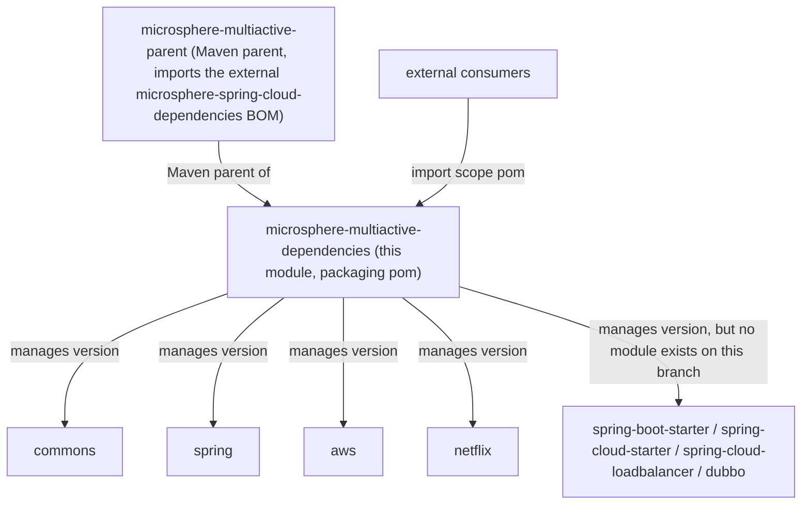
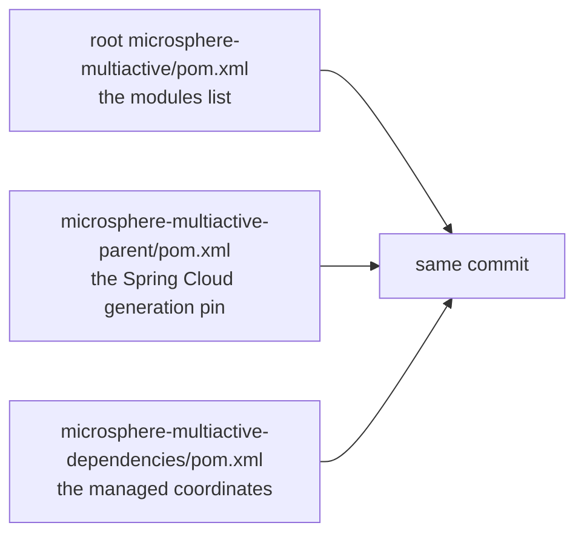

English version: [English](../microsphere-multiactive-dependencies.md)

# `microsphere-multiactive-dependencies` — 开发者指南

Maven 坐标：`io.github.microsphere-projects:microsphere-multiactive-dependencies:${revision}`，打包类型 `pom`
—— 这就是本项目的 **BOM**。

---

## 概述

`microsphere-multiactive-dependencies` 是一份纯粹的 `<dependencyManagement>`
文档。它没有源码、没有资源、没有插件、也没有任何构建配置：它从 `microsphere-multiactive-parent`
继承，仅仅是为了让 `${revision}` 与它所管理的模块解析出同一个值，然后以该版本列出八个内部构件。

它面向消费者的用途，正是仓库 README
中宣传的那样：导入这个 BOM，之后声明 multiactive 依赖时就不必再写版本。

## 架构设计

### 它所处的位置



### 逐条核对过的受管坐标

`microsphere-multiactive-dependencies/pom.xml` 恰好声明了以下八条，每一条都是
`<version>${revision}</version>`：

| 受管的 `artifactId` | 本分支上是否存在同名模块？ | 说明 |
|---|---|---|
| `microsphere-multiactive-commons` | **存在** | 内核 |
| `microsphere-multiactive-spring` | **存在** | |
| `microsphere-multiactive-aws` | **存在** | |
| `microsphere-multiactive-netflix` | **存在** | |
| `microsphere-multiactive-spring-boot-starter` | **不存在** | 实际模块名是 `microsphere-multiactive-spring-boot` |
| `microsphere-multiactive-spring-cloud-starter` | **不存在** | 实际模块名是 `microsphere-multiactive-spring-cloud` |
| `microsphere-multiactive-spring-cloud-loadbalancer` | **不存在** | 没有该模块；LoadBalancer 相关的类位于 `microsphere-multiactive-spring-cloud` 内 |
| `microsphere-multiactive-dubbo` | **不存在** | 根 POM 的 `<modules>` 里也没有它 —— 本分支不存在 Dubbo 集成 |

反过来，**确实存在的两个模块并未被本 BOM 管理**：`microsphere-multiactive-spring-boot` 与
`microsphere-multiactive-spring-cloud`。这两个构件 id 在 BOM 中都没有出现。

精确表述其实际后果：

1. 导入 BOM 之后声明 `microsphere-multiactive-spring-boot`（真正含自动配置的那个 jar）的消费者，
   **拿不到受管版本**，必须显式书写 `<version>`。`microsphere-multiactive-spring-cloud` 同理。
2. 照搬 BOM 去声明 `-spring-boot-starter`、`-spring-cloud-starter` 或 `-dubbo`
   的消费者，会得到一个本分支从未构建过的构件解析失败。
3. 四条既受管又真实存在的条目是正确且稳定的：`commons`、`spring`、`aws`、`netflix`。

这是一条文档级别的事实，而不是库代码中的运行期缺陷：反应堆内部没有任何东西依赖这个 BOM（各模块直接使用
`${revision}` 声明内部依赖版本），因此即使 BOM
不一致，构建依然通过。每当新增、重命名或删除模块时，本文件必须在同一次变更中一起修改 —— 见下方清单。

### POM 结构

| 元素 | 取值 |
|---|---|
| `<parent>` | `microsphere-multiactive-parent:${revision}`，`relativePath ../microsphere-multiactive-parent/pom.xml` |
| `<packaging>` | `pom` |
| `<dependencyManagement><dependencies>` | 八个 `io.github.microsphere-projects` 条目，全部是 `${revision}`，没有 `<type>`、没有 `<scope>`、没有排除项 |
| `<build>`、`<profiles>`、`<repositories>`、`<distributionManagement>` | 不存在 |
| `<properties>` | 不存在 —— `revision` 从根 POM 继承 |

注意本 BOM **只管理内部构件**：它刻意不再导入或罗列第三方版本。第三方版本管理来自上一级的
`microsphere-multiactive-parent` 中对 `microsphere-spring-cloud-dependencies` 的导入。正是这一职责划分，导致
`-netflix` 这类模块必须自己钉住 `netflix.ribbon.version`（上游 BOM 中没有 Ribbon）。

## 源码解析

不存在 Java 源码。对维护者真正重要的是三件事：

### 受管条目不携带 scope 或 type

每条都只是 `<version>${revision}</version>`。因此它们管理的是*版本*而非其他 ——
作用域仍由消费者（或模块 POM）决定，optional/传递行为完全定义在各模块 POM
中。尤其地，`-aws` 与 `-netflix` 依旧是“重度 optional”的设计；导入本 BOM
并不会让它们自给自足。在此处添加 `<optional>true</optional>` 或 `<scope>`
会对所有消费者造成编译期影响的 API 变更，因此请把它们的缺失当作有意为之。

### `${revision}` 是让 BOM 保持诚实的耦合点

由于每条都写 `${revision}`，在*同一次构建*中 BOM
永远不可能与其管理的模块版本漂移：`./mvnw -Drevision=0.3.0 deploy`
会产出一份为全部八个坐标钉住 `0.3.0` 的 BOM，包括其中四个并不存在的模块。这正是“缺失的模块保持缺失、而不会变成版本错配”的机制 ——
排查问题时这是一个有用的信号：**无法解析的 `microsphere-multiactive-*-starter`
依赖是命名问题，不是版本问题。**

### 修改本文件时的清单

改动模块集合时，以下三处必须一起移动，而它们位于三个不同文件：



| 变更 | 需要的修改 |
|---|---|
| 新增模块 | 同时加入根 `<modules>` **和** BOM 的 `<dependencyManagement>` |
| 重命名模块（例如改成 `...-spring-boot-starter`） | 更新该模块的 `<artifactId>`、BOM 条目，以及所有引用旧 id 的反应堆内依赖声明 |
| 删除模块 | 从 `<modules>` **和** BOM 中同时删除 —— 当前那四条“受管但模块不存在”的坐标就是忘记这一步的后果 |
| 把 `...-spring-cloud` 拆成 `...-spring-cloud-starter` + `...-spring-cloud-loadbalancer` | 这是与 BOM 现有内容唯一自洽的推测；若该拆分落地，BOM 已经是对的，`commons`/`spring`/`aws`/`netflix` 保持不变 |

## 扩展点

| 用途 | 方式 |
|---|---|
| 在外部构建中消费本库 | 以 `<scope>import</scope>` 导入本 BOM，随后无版本声明 `commons`、`spring`、`aws`、`netflix`；在 BOM 补齐之前，为 `microsphere-multiactive-spring-boot` / `microsphere-multiactive-spring-cloud` 保留显式 `<version>` |
| 本地覆盖某个受管版本 | 在 BOM 导入*之前*于你自己的 `<dependencyManagement>` 中声明该构件；Maven 中先声明者胜 |
| 与上游技术栈对齐 | Spring Boot / Spring Cloud / microsphere 构件的版本来自 `microsphere-spring-cloud-dependencies`，不来自本文件 |

## 代码中真实存在的设计模式

- **物料清单（Bill of Materials，`<dependencyManagement>` + `<scope>import</scope>`）** —— 标准的 Maven
  “依赖管理即构件”模式；本模块存在的唯一目的就是被导入。
- **为属性解析而继承** —— BOM 的父 POM 是 `microsphere-multiactive-parent`
  而非聚合器，因此 `${revision}` 与将来的任何属性都来自与被管理模块相同的继承链。
- **单一版本来源（`${revision}`）** —— 整个文件中没有任何硬编码版本。
- **分层 BOM 组合** —— 内部构件在此，第三方构件在导入的上游 BOM
  中；本文件中完全不存在非 `io.github.microsphere-projects` 的条目，据此可验证。

## 构建与测试

```bash
# validate the POM and its parent resolution
./mvnw -pl microsphere-multiactive-dependencies validate

# print the resolved management section (useful when editing coordinates)
./mvnw -pl microsphere-multiactive-dependencies help:effective-pom

# Windows
mvnw.cmd -pl microsphere-multiactive-dependencies validate
```

没有任何东西需要编译或测试：`src/` 不存在，因此对该模块执行 `test` 是空操作。发布任务
（`.github/workflows/maven-publish.yml`）会在部署整个反应堆时一并发布这份 POM，命令为
`-Drevision=${{ inputs.revision }} ... deploy --activate-profiles publish,ci` ——
这正是含陈旧坐标的 BOM 抵达 Central 的途径，也是必须保持上述清单常新的另一个理由。

## 相关文档

- [开发者指南索引](README.md)
- [microsphere-multiactive-parent](microsphere-multiactive-parent.md) —— 本 BOM 的 Maven 父 POM 及上游 BOM 导入
- [microsphere-multiactive-spring-boot](microsphere-multiactive-spring-boot.md) 与
  [microsphere-multiactive-spring-cloud](microsphere-multiactive-spring-cloud.md) —— 本 BOM 中缺失的两个模块
- [用户指南](../../user-guide/zh/README.md)
- [仓库 README](../../../../README.md)

## English

English version: [English](../microsphere-multiactive-dependencies.md)
