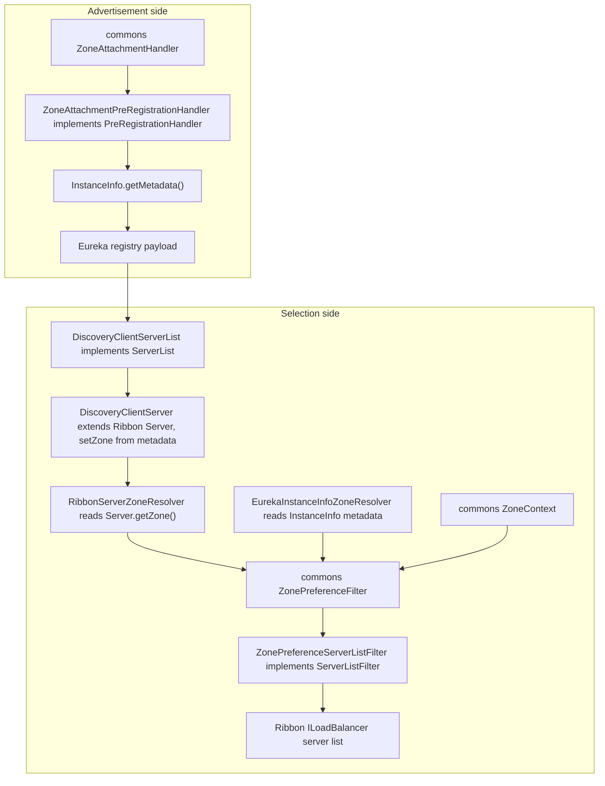
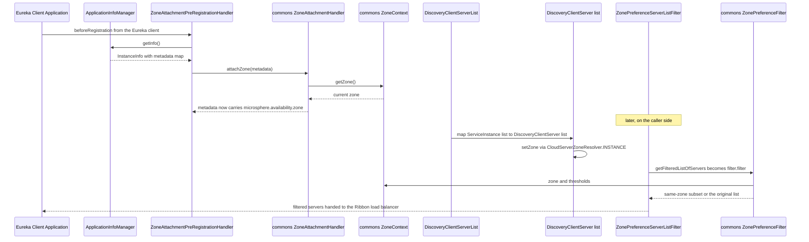

English version: [English](../microsphere-multiactive-netflix.md)

# `microsphere-multiactive-netflix` — 开发者指南

Maven 坐标：`io.github.microsphere-projects:microsphere-multiactive-netflix:${revision}`（本分支为
`0.2.14-SNAPSHOT`）。

---

## 概述

`microsphere-multiactive-netflix` 是 `microsphere-multiactive-spring-cloud`
在旧技术栈上的对应物：它把同一套 commons 的 `ZonePreferenceFilter` / `ZoneAttachmentHandler`
接入 **Netflix Eureka client + Netflix Ribbon**，而不是接入 Spring Cloud LoadBalancer 与 microsphere
服务注册事件。

六个类分布在三个包中，**没有自动配置、没有 `spring.factories`、也没有测试**：

| 包 | 类型 |
|---|---|
| `io.microsphere.multiple.active.zone.netflix.eureka` | `EurekaInstanceInfoZoneResolver`、`ZoneAttachmentPreRegistrationHandler` |
| `io.microsphere.multiple.active.zone.netflix.ribbon` | `RibbonServerZoneResolver`、`ZonePreferenceServerListFilter` |
| `io.microsphere.multiple.active.zone.netflix.spring.cloud.ribbon` | `DiscoveryClientServer`、`DiscoveryClientServerList` |

“没有配置类”正是本模块的定义性特征：一切都要由应用自己接线。
`META-INF/config/default/features.yaml` 只是登记了五个公开类型（供 microsphere
的特性开关机制使用），并不执行任何装配。

## 架构设计

### 分层结构



两个独立的 `ZoneResolver` 实现分别服务于协议两端出现的两种实体类型 —— `InstanceInfo`（Eureka 客户端模型）与
`Server`（Ribbon 模型），而共用同一个 commons `ZonePreferenceFilter` 算法。`DiscoveryClientServer`
就是那个枢纽，它让 Spring Cloud 的 `ServiceInstance`
在进入 Ribbon 模型时已经带上了可用区。

### 包结构

| 路径 | 内容 |
|---|---|
| `src/main/java/io/microsphere/multiple/active/zone/netflix/eureka/` | 针对 Eureka 客户端模型的可用区读写 |
| `src/main/java/io/microsphere/multiple/active/zone/netflix/ribbon/` | 针对 Ribbon 模型的可用区解析与过滤 |
| `src/main/java/io/microsphere/multiple/active/zone/netflix/spring/cloud/ribbon/` | 从 Spring Cloud `ServiceInstance` 到 Ribbon `Server` 的桥接 |
| `src/main/resources/META-INF/config/default/features.yaml` | 列出五个类型的特性目录 |
| —— | 没有 `src/main/resources/META-INF/spring.factories`，没有 `AutoConfiguration.imports`，没有 `src/test/java` |

### 依赖契约

摘自 `microsphere-multiactive-netflix/pom.xml` ——
反应堆中唯一声明了自身版本属性的模块：

```xml
<properties>
    <netflix.ribbon.version>2.7.18</netflix.ribbon.version>
</properties>
```

| 依赖 | 作用域 | 说明 |
|---|---|---|
| `microsphere-multiactive-spring-cloud` | `optional` | 可达 `-spring`/`-commons` 与 `CloudServerZoneResolver`；因为是 optional，消费者必须自备这条链 |
| `com.netflix.ribbon:ribbon`、`ribbon-loadbalancer`、`ribbon-eureka` | `optional`，`${netflix.ribbon.version}` = `2.7.18` | 版本*在此*固定，不同于其他全部来自导入 BOM 的依赖 |
| `com.netflix.eureka:eureka-client` | `optional`（由 BOM 管理） | `InstanceInfo`、`ApplicationInfoManager`、`PreRegistrationHandler` |
| `org.springframework.cloud:spring-cloud-netflix-eureka-client` | `optional` | |
| `spring-cloud-commons`、`spring-cloud-context` | `optional` | 桥接类使用的 `ServiceInstance`、`DiscoveryClient` |
| `spring-boot-starter`、`-actuator`、`-web`、各处理器 | `optional` | |
| `junit-jupiter`、`spring-boot-starter-test`、`microsphere-spring-boot-test`、`logback-classic` | `test` | 已声明；但不存在测试源码 |

注意 `pom.xml` 的一处怪异：本模块把 `<modelVersion>` 放在 `<parent>`
之前，与其他兄弟模块不同。无关紧要，但用一致性检查去搜会命中。

## 源码解析

### `ZonePreferenceServerListFilter<T extends Server>`

`microsphere-multiactive-netflix/src/main/java/io/microsphere/multiple/active/zone/netflix/ribbon/ZonePreferenceServerListFilter.java`

```java
public class ZonePreferenceServerListFilter<T extends Server> implements ServerListFilter<T> {
    private ZonePreferenceFilter<T> filter;

    public ZonePreferenceServerListFilter(ZonePreferenceFilter<T> filter) {
        this.filter = filter;
    }

    @Override
    public List<T> getFilteredListOfServers(List<T> servers) {
        return filter.filter(servers);
    }
}
```

客户端侧的全部逻辑只有五行：Ribbon 的 `com.netflix.loadbalancer.ServerListFilter`
插槽（由 Ribbon 负载均衡器在服务列表刷新后调用）由一个适配器占据，该适配器直接转发给 commons 的
`ZonePreferenceFilter`。当特性关闭时 `ZonePreferenceFilter.filter`
返回的是*同一个*列表实例，因此 Ribbon 拿到的仍是它自己传入的那个 `List` 对象 —— 没有拷贝、没有重排。

泛型上界 `T extends Server` 使本类可用于 Ribbon
自身派生的服务类型，而相配的 `ZonePreferenceFilter<T>` 必须以一个 `ZoneResolver<T>`
构造 —— 实践中就是 `RibbonServerZoneResolver`。

注意该字段是 `private` 但**不是** `final`，也没有访问器：协作者只能通过构造器注入，但与项目中其他类不同，这个引用在技术上可变。
这里也没有委派 `getOrder()`，尽管 commons 过滤器提供了该方法 —— Ribbon 的
`ServerListFilter` 不携带顺序契约，因此 `microsphere.availability.zone.preference.filter.order`
属性对 Ribbon 路径没有任何影响（它只用于给 Spring 侧的适配器排序）。在 `-spring-cloud` 与 `-netflix`
之间比对行为的维护者要记住这一点。

### `RibbonServerZoneResolver<T extends Server>`

`.../netflix/ribbon/RibbonServerZoneResolver.java`

```java
public class RibbonServerZoneResolver<T extends Server> implements ZoneResolver<T> {
    public String resolve(T server) {
        return server.getZone();
    }
}
```

读取的是 Ribbon *原生*的可用区字段（`Server` 的 `getZone()`/`setZone(...)` 访问器），而不是元数据
Map。这正是为什么 `DiscoveryClientServer` 必须在构造时把 Spring Cloud 元数据中的可用区拷贝进
`Server.setZone(...)`：没有这座桥，该解析器永远只能看到 `null`，而 commons
过滤器的可用区就绪百分比闸门就会为整个列表否掉可用区偏好。

`server` 参数没有空值检查 —— commons 过滤器已经做了守卫（`resolveZone`
在委派之前就会把 `null` 实体解析为 `null`），因此实践中 `null` 不会到达 `resolve`。

### `EurekaInstanceInfoZoneResolver`

`.../netflix/eureka/EurekaInstanceInfoZoneResolver.java`

```java
public class EurekaInstanceInfoZoneResolver implements ZoneResolver<InstanceInfo> {
    public String resolve(InstanceInfo instanceInfo) {
        Map<String, String> metadata = instanceInfo.getMetadata();
        String instanceZone = metadata == null ? null : metadata.get(ZONE_PROPERTY_NAME);
        return instanceZone;
    }
}
```

`CloudServerZoneResolver` 在 Eureka 模型上的镜像：同一个键（`ZoneConstants.ZONE_PROPERTY_NAME`）、同样的
null-元数据行为、不同的实体类型。当应用直接过滤 Eureka 的 `InstanceInfo`
列表（例如经由 `ribbon-eureka` 自身的数据）而不是 Ribbon `Server`
时，就应把它与 `ZonePreferenceFilter<InstanceInfo>` 配对使用。

### `ZoneAttachmentPreRegistrationHandler`

`.../netflix/eureka/ZoneAttachmentPreRegistrationHandler.java`

```java
public class ZoneAttachmentPreRegistrationHandler implements PreRegistrationHandler {
    public ZoneAttachmentPreRegistrationHandler(ApplicationInfoManager applicationInfoManager, ZoneAttachmentHandler zoneAttachmentHandler) { ... }

    public void beforeRegistration() {
        InstanceInfo instanceInfo = applicationInfoManager.getInfo();
        Map<String, String> metadata = instanceInfo.getMetadata();
        zoneAttachmentHandler.attachZone(metadata);
    }
}
```

广播侧，使用 Eureka 自己的钩子：`com.netflix.discovery.PreRegistrationHandler`
由 Eureka 客户端在每次注册/重规范化之前立即调用，而那正是 `InstanceInfo`
元数据仍可被修改的最后一刻。因此该处理器完全不需要事件系统 —— 与 `-spring-cloud` 中依赖 microsphere
`RegistrationPreRegisteredEvent` 加一个 AspectJ 切面才能获得同样时机的 `ZoneAttachmentListener`
形成对照。类 Javadoc 中的 `@see AbstractDiscoveryClientOptionalArgs`
记录了它预期的安装方式：由应用把它传给 Eureka 客户端的 optional args，因为本模块没有提供任何配置来做这件事。

两个依赖都是构造器注入，而 `ApplicationInfoManager.getInfo()`
是在回调时获取（不缓存），因此两次注册之间 `ZoneContext`
的可用区变更会在下一个注册周期被采纳。

### `DiscoveryClientServer` —— 桥接点

`.../netflix/spring/cloud/ribbon/DiscoveryClientServer.java`

```java
public class DiscoveryClientServer extends Server {
    private final ServiceInstance serviceInstance;
    private final ServiceInstanceMetaInfo metaInfo;

    public DiscoveryClientServer(ServiceInstance serviceInstance) {
        super(serviceInstance.getScheme(), serviceInstance.getHost(), serviceInstance.getPort());
        this.serviceInstance = serviceInstance;
        this.metaInfo = new ServiceInstanceMetaInfo(serviceInstance);
        this.setZone(resolveZone(serviceInstance));
    }

    private String resolveZone(ServiceInstance serviceInstance) {
        return INSTANCE.resolve(serviceInstance);
    }

    @Override
    public String getId() {
        return serviceInstance.getInstanceId();
    }

    final static class ServiceInstanceMetaInfo implements MetaInfo { /* getAppName, getServerGroup, getServiceIdForDiscovery, getInstanceId */ }
}
```

Spring Cloud 的可用区协议正是在这里被翻译成 Ribbon 的语汇，它包含四个动作：

1. `super(scheme, host, port)` —— 用 `ServiceInstance`
   三元组构造 Ribbon 身份，因此 Ribbon 的 `Server`
   键控机制可以原样工作。
2. `this.setZone(INSTANCE.resolve(serviceInstance))` —— 复用 `-spring-cloud` 的
   `CloudServerZoneResolver.INSTANCE` 从实例元数据中读取 `microsphere.availability.zone`。
   **这个静态调用是 Netflix 技术栈与 Spring Cloud 技术栈之间唯一的代码耦合**，也正是本模块声明（optional 的）
   `microsphere-multiactive-spring-cloud` 依赖而不是复制一个解析器的原因。
3. `getId()` 被覆写为返回 `serviceInstance.getInstanceId()` —— Ribbon 的 `Server.getId()`
   通常由 host/port 派生，当同一服务的多个实例在测试环境中共用一个主机时就会冲突；使用注册中心的实例 id
   能让 Ribbon 的每实例统计保持正确。
4. `ServiceInstanceMetaInfo` —— 一个 `final static` 嵌套的 `MetaInfo` 实现：`getAppName()` 与
   `getServiceIdForDiscovery()` 都返回 `serviceInstance.getServiceId()`，`getInstanceId()` 返回
   `serviceInstance.getInstanceId()`，而 `getServerGroup()`
   刻意返回 `null`（`ServiceInstance` 上没有对应概念）。

与另外两个 Ribbon 侧的类一样，带有 Apache License 文件头。

### `DiscoveryClientServerList`

`.../netflix/spring/cloud/ribbon/DiscoveryClientServerList.java`

```java
public class DiscoveryClientServerList implements ServerList<DiscoveryClientServer> {
    private final DiscoveryClient discoveryClient;
    private final String serviceName;

    public List<DiscoveryClientServer> getInitialListOfServers() {
        return getUpdatedListOfServers();
    }

    public List<DiscoveryClientServer> getUpdatedListOfServers() {
        return discoveryClient.getInstances(serviceName)
                .stream()
                .map(DiscoveryClientServer::new)
                .collect(Collectors.toList());
    }
}
```

一个数据源为 Spring Cloud `DiscoveryClient` 的 Ribbon `ServerList` ——
即由 `-spring-cloud`/`-netflix` 写入的、带可用区的注册元数据，重新以携带可用区的 Ribbon `Server`
对象形式流出。它只需要构造器的两个参数（`DiscoveryClient`
与逻辑服务名）；这里没有任何可用区配置，因为可用区是随每个实例一起传递的。

`getInitialListOfServers()` 委派给 `getUpdatedListOfServers()`：初始列表与周期刷新共用一条代码路径，因此
Ribbon 看到的第一份列表就已经填好了可用区。方法引用 `DiscoveryClientServer::new`
是桥接类唯一的实例化点，所以列表中的每个 server 都必定经过了 `setZone(...)`。

### 广播侧与选取侧的配对



## 扩展点

| 扩展点 | 方式 |
|---|---|
| 把可用区写入 Eureka 元数据 | 构造 `ZoneAttachmentPreRegistrationHandler(applicationInfoManager, zoneAttachmentHandler)`，并通过 `AbstractDiscoveryClientOptionalArgs` 注册（这一配对关系记录在类的 Javadoc 中） |
| 为 Ribbon 增加本地性过滤 | 发布 `ZonePreferenceFilter<Server>(zoneContext, new RibbonServerZoneResolver<>())`，用 `ZonePreferenceServerListFilter` 包裹它，并设为客户端的 `ServerListFilter` |
| 通过 Spring Cloud 发现 Ribbon 服务 | 把 `DiscoveryClientServerList(discoveryClient, serviceName)` 实例化作为客户端的 `ServerList` |
| 直接过滤 Eureka `InstanceInfo` | 将 `ZonePreferenceFilter<InstanceInfo>` 与 `EurekaInstanceInfoZoneResolver` 配对 |
| 更换 Ribbon 版本 | 本模块 `pom.xml` 中的 `<netflix.ribbon.version>`（`2.7.18`） |

由于没有任何自动配置，上述**全部**都是应用侧职责；要新增 Netflix 集成时应改动本模块，而不是指望本模块去改动应用。

## 代码中真实存在的设计模式

- **适配器（Adapter，双向）** —— `ZonePreferenceServerListFilter` 把 commons 过滤器适配为 Ribbon 的
  `ServerListFilter`；`DiscoveryClientServerList` 把 Spring Cloud 的 `DiscoveryClient` 适配为 Ribbon 的
  `ServerList`。
- **桥接（Bridge）** —— `DiscoveryClientServer` 把 Spring Cloud 的 `ServiceInstance`
  抽象桥接到 Ribbon 的 `Server` 抽象，并通过 `setZone` 把可用区带过去。
- **策略（Strategy）** —— `ZoneResolver` 为两种实体模型（`InstanceInfo`、`Server`）各实现一次。
- **模板方法（Ribbon 侧）** —— 这些类继承/实现 Netflix 的 SPI 类型（`Server`、`ServerList`、
  `ServerListFilter`、`PreRegistrationHandler`），并精确填充这些类型定义的插槽。
- **钩子/回调（Hook）** —— `PreRegistrationHandler.beforeRegistration()`
  作为本库的写入点，与 Spring Cloud 侧基于事件的 `ZoneAttachmentListener` 互为镜像。
- **单例复用** —— 跨模块静态引用 `CloudServerZoneResolver.INSTANCE`。
- **类享元式的无状态** —— 解析器与过滤器不持有每实体状态；实体列表是唯一的可变输入。
- **不存在的东西**：没有 supplier 链的装饰器（那是 `-spring-cloud`）、没有自动配置、没有条件注解、没有
  `spring.factories`，也没有排序集成（commons 过滤器的 `getOrder()` 在此未被使用）。

## 构建与测试

```bash
# build + test this module (nothing to run) and its required upstream modules
./mvnw -pl microsphere-multiactive-netflix -am test

# compile only, which is the practical CI signal for this module
./mvnw -pl microsphere-multiactive-netflix -am -DskipTests package

# Windows
mvnw.cmd -pl microsphere-multiactive-netflix -am test
```

本模块**没有测试**，也没有测试资源，因此让命令有意义的正是 `-am`（also-make）：它会先构建
`-commons`、`-spring`、`-spring-boot` 与 `-spring-cloud`，而编译本身就是唯一能确认 Netflix SPI
用法仍与 Ribbon `2.7.18` / Eureka 客户端 API 相匹配的检查。

要手工验证行为，可驱动的可复用接缝是
`ZonePreferenceServerListFilter.getFilteredListOfServers`（其输入/输出契约已在 `-commons` 的
`ZonePreferenceFilterTest` 中锚定）以及 `DiscoveryClientServer`
的构造器（可用区从元数据传播到 `Server.getZone()`）。

## 相关文档

- [开发者指南索引](README.md)
- [microsphere-multiactive-commons](microsphere-multiactive-commons.md) —— `ZonePreferenceFilter`、
  `ZoneAttachmentHandler`、`ZoneResolver`
- [microsphere-multiactive-spring-cloud](microsphere-multiactive-spring-cloud.md) —— LoadBalancer
  等价实现，也是 `CloudServerZoneResolver` 的归属模块
- [microsphere-multiactive-aws](microsphere-multiactive-aws.md) —— 可用区取值的来源
- [用户指南](../../user-guide/zh/README.md)
- [仓库 README](../../../../README.md)

## English

English version: [English](../microsphere-multiactive-netflix.md)
