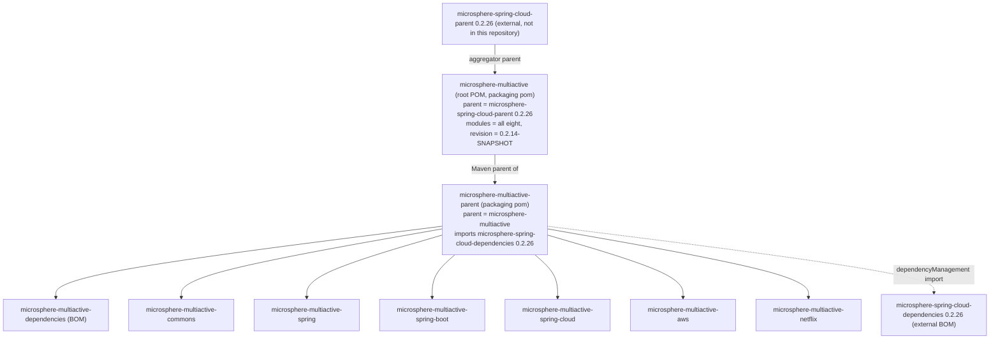

English version: [English](../microsphere-multiactive-parent.md)

# `microsphere-multiactive-parent` — 开发者指南

Maven 坐标：`io.github.microsphere-projects:microsphere-multiactive-parent:${revision}`，打包类型 `pom`。

---

## 概述

`microsphere-multiactive-parent` 是反应堆中**所有**库模块（`commons`、`spring`、`spring-boot`、`spring-cloud`、`aws`、
`netflix`）以及 `microsphere-multiactive-dependencies` BOM 共同的 **Maven 父 POM**。它没有源码、没有资源、没有测试 ——
唯一产物就是一个 POM，而其中唯一的内容就是一个版本属性加一个导入的 BOM。

它的职责是成为决定“本库面向哪一代 Spring Cloud”的唯一地点。

## 架构设计

### 它在 Maven 图中的位置

本仓库使用的是**两级 POM 层次 + 独立的聚合器**，这一点很容易被误读，因此值得精确说明：



仔细来看，一个库模块的继承链有四层：

`microsphere-multiactive-spring-cloud` → `microsphere-multiactive-parent` → `microsphere-multiactive`
（根聚合器，它同时也是一个 Maven 父 POM）→ `microsphere-spring-cloud-parent:0.2.26`
（来自 `org/io.github.microsphere-projects`，不在本仓库内）。

每个子 POM 里的 `<relativePath>` 都是显式书写的 —— 库模块用
`../microsphere-multiactive-parent/pom.xml`，`microsphere-multiactive-parent` 用 `../pom.xml`
—— 因此反应堆无需从仓库解析父 POM 即可构建。

### POM 结构

`microsphere-multiactive-parent/pom.xml` 的完整内容如下：

| 元素 | 取值 | 效果 |
|---|---|---|
| `<parent>` | `io.github.microsphere-projects:microsphere-multiactive:${revision}`，`relativePath ../pom.xml` | 从根聚合器继承 |
| `<artifactId>` / `<version>` / `<packaging>` | `microsphere-multiactive-parent`、`${revision}`、`pom` | 不聚合任何模块（没有 `<modules>` —— 它是*父 POM*，不是聚合器） |
| `<name>` / `<description>` | `Microsphere :: Multi-Active :: Parent` | 构件元数据 |
| `<properties>` | `<microsphere-spring-cloud.version>0.2.26</microsphere-spring-cloud.version>` | **本文件中唯一可调项** |
| `<dependencyManagement>` | 以 `<type>pom</type><scope>import</scope>` 导入 `io.github.microsphere-projects:microsphere-spring-cloud-dependencies:${microsphere-spring-cloud.version}` | 为各模块中所有不写版本的依赖提供版本 |

本文件中**没有 `<build>`、没有 `<pluginManagement>`、没有 `<profiles>`、也没有
`<distributionManagement>`** —— 通过对仓库中全部 POM 的检索确认：九个 POM（根聚合 POM 加八个模块 POM）里没有任何一个包含 `<build>`
元素。编译器设置、surefire/failsafe 配置、`test`/`coverage`/`publish`/`ci` profile 以及
`spring-cloud-2022 … spring-cloud-2025` profile 全部来自 `microsphere-spring-cloud-parent`
及其导入的 BOM。这就是为什么 CI 可以写出 `--activate-profiles test,coverage,spring-cloud-2024`
而本仓库中并未定义这些 profile。

### 职责边界

| 关注点 | 归属 |
|---|---|
| Java/Spring 编译设置、test/coverage/publish profile、GPG 与部署配置 | 外部的 `microsphere-spring-cloud-parent:0.2.26` |
| 第三方与 microsphere 依赖的**版本** | 外部的 `microsphere-spring-cloud-dependencies:0.2.26`，在此处导入 |
| **本分支**锁定的 Spring Cloud 代际 | 本文件中的 `microsphere-spring-cloud.version` 属性 |
| 供消费者使用的 *multiactive* 构件版本坐标 | `microsphere-multiactive-dependencies`（见其指南） |
| 反应堆模块清单与 `${revision}` 默认值 | 根 `microsphere-multiactive` POM |
| 各模块的依赖作用域/是否 optional | 每个模块自己的 POM |

## 源码解析

本模块没有 Java 源码。维护者必须知道的两条 POM 层面事实如下：

### `microsphere-spring-cloud.version` 属性

本快照中为 `0.2.26`，而且它与**根 POM 的外部父 POM 版本完全相同**：

```xml
<!-- root pom.xml -->
<parent>
    <groupId>io.github.microsphere-projects</groupId>
    <artifactId>microsphere-spring-cloud-parent</artifactId>
    <version>0.2.26</version>
</parent>

<!-- microsphere-multiactive-parent/pom.xml -->
<properties>
    <microsphere-spring-cloud.version>0.2.26</microsphere-spring-cloud.version>
</properties>
```

这两处并没有通过属性引用互相绑定，因此**升级 Spring Cloud 父 POM 意味着要在同一次提交里改两个地方**。让它们取值不同在技术上是一种合法状态（父
BOM 与父 POM 是两个不同构件），但本仓库中它们始终一起移动；只改一处的升级会产生 Maven
不会报错的不一致 —— 升级时两处都要核对。

### `${revision}` 约定

每个模块（包括本父 POM）都声明 `<version>${revision}</version>`，而 `${revision}`
在根 POM 中定义一次，值为 `0.2.14-SNAPSHOT`。于是整个反应堆只有一个版本旋钮，两个 CI workflow
都是在命令行覆盖它，而不是修改 POM：

- 构建：`mvn ... -Drevision=0.0.1-SNAPSHOT test --activate-profiles
  test,coverage,<spring-cloud-*>`（`.github/workflows/maven-build.yml`）
- 发布：`./mvnw ... -Drevision=${{ inputs.revision }} -Dgpg.skip=true deploy --activate-profiles
  publish,ci`，输入需通过 `^[0-9]+\.[0-9]+\.[0-9]+$` 校验，且该 job 由推送到
  **`release`** 分支触发（`.github/workflows/maven-publish.yml`）。因此本分支就是 `current`
  文档线对应的发布分支。

本仓库中没有任何地方声明 `flatten-maven-plugin`，所以*已发布* POM 中
`${revision}` 的解析是外部父 POM 的职责；在未核实仓库中已发布 POM 之前，不要假设 `${revision}`
会原样出现在被消费的元数据里。

## 扩展点

| 你需要做的改动 | 修改位置 |
|---|---|
| 把本分支迁到另一代 Spring Cloud / microsphere-spring-cloud | 本文件的 `microsphere-spring-cloud.version` **以及**根 POM 的 `<parent>` 版本 |
| 新增一个库模块 | 为其 POM 声明 `<parent>` = `microsphere-multiactive-parent` 与 `<relativePath>../microsphere-multiactive-parent/pom.xml</relativePath>`，然后加入**根** `microsphere-multiactive/pom.xml` 的 `<modules>`（本父 POM 不声明 `<modules>`）**并且**加入 `microsphere-multiactive-dependencies` |
| 为所有模块集中钉住某个依赖版本 | 优先使用外部 `microsphere-spring-cloud-dependencies` BOM；局部钉版本的做法可参考 Netflix 模块在 BOM 无条目时使用的 `netflix.ribbon.version` |
| 修改整个反应堆的版本 | 构建时传 `-Drevision=<x>`，或改根 POM 的 `revision` |

## 代码中真实存在的设计模式

这是一个纯 POM 模块，因此这里的“模式”是 Maven 结构层面的，而且两者都确实存在：

- **父 POM 与聚合器分离** —— 反应堆根 POM 既聚合所有模块、*又*充当
  `microsphere-multiactive-parent` 的父 POM，而库模块的*父 POM*
  本身也是一个模块。这让“构建什么”与“继承什么配置”彼此独立。
- **BOM 导入（`<scope>import</scope>`）** —— 用导入而非继承来引入
  `microsphere-spring-cloud-dependencies` 的依赖管理，正因如此本父 POM 才能同时从根 POM
  继承（一个 POM 不能有两个父 POM，但可以导入任意多个 BOM）。
- **版本属性模式（`${revision}`）** —— 整个反应堆共用一个可由 CI 覆盖的版本。
- **单一来源版本属性** —— `microsphere-spring-cloud.version`
  只被引用一次（在 import 中），即为将来可能出现的取值分化预留的占位。

## 构建与测试

```bash
# nothing to compile; this command validates the POM and the inherited configuration
./mvnw -pl microsphere-multiactive-parent validate

# see the effective version/parent resolution
./mvnw -pl microsphere-multiactive-parent help:effective-pom -Drevision=0.2.14-SNAPSHOT

# the whole reactor, as CI does it
./mvnw --batch-mode -Drevision=0.0.1-SNAPSHOT test --activate-profiles test,coverage,spring-cloud-2024

# Windows
mvnw.cmd -pl microsphere-multiactive-parent validate
```

没有测试可运行（`src/` 不存在）。对这个 POM 有意义的检查是反应堆仍能解析：如果
`microsphere-spring-cloud-dependencies:${microsphere-spring-cloud.version}`
不在已配置的仓库中，所有模块都会在依赖解析阶段失败，而报错信息指向的就是本文件。

## 相关文档

- [开发者指南索引](README.md)
- [microsphere-multiactive-dependencies](microsphere-multiactive-dependencies.md) —— 本父 POM
  的同胞兼子模块，也是消费者导入的 BOM
- [microsphere-multiactive-commons](microsphere-multiactive-commons.md) —— 编译链上的第一个模块
- [用户指南](../../user-guide/zh/README.md)
- [仓库 README](../../../../README.md)

## English

English version: [English](../microsphere-multiactive-parent.md)
