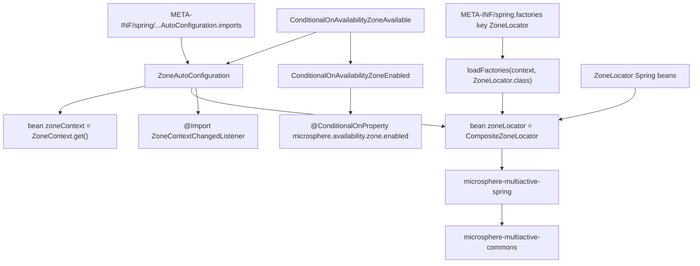
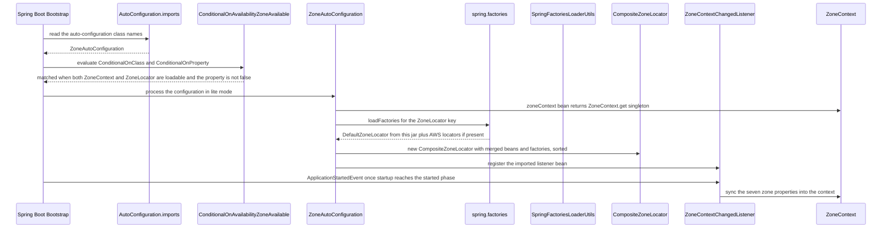

English version: [English](../microsphere-multiactive-spring-boot.md)

# `microsphere-multiactive-spring-boot` — 开发者指南

Maven 坐标：`io.github.microsphere-projects:microsphere-multiactive-spring-boot:${revision}`（本分支为
`0.2.14-SNAPSHOT`）。

---

## 概述

`microsphere-multiactive-spring-boot` 是启动装配层。它只包含**两个生产类加两个资源文件**，其全部职责就是让
`ZoneLocator` 链与 `ZoneContext` 在 Spring Boot 应用中自动出现，同时在可用区特性被关闭时彻底隐形。

三项职责：

1. **自动配置** —— `ZoneAutoConfiguration` 注册 `zoneContext` 与 `zoneLocator` 两个 Bean。
2. **特性开关** —— `ConditionalOnAvailabilityZoneAvailable` / `ConditionalOnAvailabilityZoneEnabled` 依据类路径与
   `microsphere.availability.zone.enabled` 决定是否应用该配置。
3. **SPI 注册** —— `META-INF/spring.factories` 发布 `ZoneAutoConfiguration` 要加载的 `ZoneLocator`
   实现，`META-INF/spring/org.springframework.boot.autoconfigure.AutoConfiguration.imports` 发布自动配置类本身。

包：`io.microsphere.multiple.active.zone.spring.boot.autoconfigure`（一个类型）与
`io.microsphere.multiple.active.zone.spring.boot.condition`（两个注解类型）。全部标注 `@since 1.0.0`。

> 命名说明：构件 id 是 `microsphere-multiactive-spring-boot`，而不是 `...-spring-boot-starter`。同级 BOM 管理了一个
> `microsphere-multiactive-spring-boot-starter` 坐标，而本分支上并不存在对应模块 —— 见
> [microsphere-multiactive-dependencies](microsphere-multiactive-dependencies.md)。

## 架构设计

### 分层结构



`ZoneAutoConfiguration` 之上全是 Spring Boot 的装配设施；其之下则是模块链 `-spring` → `-commons`。
本模块没有引入任何新的领域概念 —— 这也正是它如此小巧的原因。

### 包结构

| 路径 | 类型 / 文件 | 职责 |
|---|---|---|
| `src/main/java/io/microsphere/multiple/active/zone/spring/boot/autoconfigure/` | `ZoneAutoConfiguration` | 可用区模型的 Bean 注册 |
| `src/main/java/io/microsphere/multiple/active/zone/spring/boot/condition/` | `ConditionalOnAvailabilityZoneAvailable`、`ConditionalOnAvailabilityZoneEnabled` | 组合式条件注解 |
| `src/main/resources/META-INF/spring/org.springframework.boot.autoconfigure.AutoConfiguration.imports` | 一行：`...boot.autoconfigure.ZoneAutoConfiguration` | Spring Boot 2.7+/3.x 自动配置注册 |
| `src/main/resources/META-INF/spring.factories` | `io.microsphere.multiple.active.zone.spring.ZoneLocator=io.microsphere.multiple.active.zone.spring.DefaultZoneLocator` | `ZoneLocator` SPI 注册 |
| `src/test/java/.../boot/autoconfigure/` | `ZoneAutoConfigurationTest` | 自动配置的正/反向断言 |

`ConditionalOnAvailabilityZoneAvailable` 与 `ConditionalOnAvailabilityZoneEnabled` 带有完整的 Apache License 2.0
文件头；`ZoneAutoConfiguration` 没有 —— 这是快照中的一处不一致，无害但可通过搜索文件头发现。

### 依赖契约

摘自 `microsphere-multiactive-spring-boot/pom.xml`：

| 依赖 | 作用域 | 说明 |
|---|---|---|
| `microsphere-multiactive-spring` | compile（`${revision}`） | 传递引入 `commons` —— 唯一硬性要求 |
| `microsphere-spring-boot-core` | `optional` | 提供 `loadFactories(...)` 使用的 `io.microsphere.spring.core.io.support.SpringFactoriesLoaderUtils` |
| `spring-boot-starter`、`spring-boot-starter-actuator`、`spring-boot-starter-web` | `optional` | 仅编译期访问 Boot；本模块没有任何类引用 actuator/web starter |
| `spring-boot-configuration-processor`、`spring-boot-autoconfigure-processor` | `optional` | 构建期注解处理器 |
| `junit-jupiter`、`spring-boot-starter-test`、`microsphere-spring-boot-test`、`logback-classic` | `test` | `microsphere-spring-boot-test` 提供 `AutoConfigurationTest` 基类 |

## 源码解析

### `ZoneAutoConfiguration`

`microsphere-multiactive-spring-boot/src/main/java/io/microsphere/multiple/active/zone/spring/boot/autoconfigure/ZoneAutoConfiguration.java`

类级注解，每一个都承担实际作用：

```java
@Configuration(proxyBeanMethods = false)
@ConditionalOnAvailabilityZoneAvailable
@Import(value = {ZoneContextChangedListener.class})
public class ZoneAutoConfiguration {
```

- `proxyBeanMethods = false` —— lite 模式。两个 bean 方法彼此不调用，因此不需要 CGLIB 代理；这也意味着
  `zoneLocator(...)` 无法通过调用 `zoneContext()` 拿到 `ZoneContext`，而是依赖别处的注入。
- `@ConditionalOnAvailabilityZoneAvailable` —— 见下方条件注解一节。
- `@Import(ZoneContextChangedListener.class)` —— `-spring` 中的监听器在此被注册为 Bean，而不是写成 `@Bean`
  方法，从而使其不受 `@ConditionalOnMissingBean` 影响（应用可以在保留两个 Bean 的同时，无法悄悄替换绑定逻辑）。

**Bean 1 —— `zoneContext`：**

```java
@Bean(name = ZONE_CONTEXT_BEAN_NAME)
@ConditionalOnMissingBean
public ZoneContext zoneContext() {
    return get();
}
```

`ZONE_CONTEXT_BEAN_NAME` 与 `get()` 分别是 `ZoneUtils.ZONE_CONTEXT_BEAN_NAME` 和 `ZoneContext.get()`
的静态导入。这个 Bean *就是* commons 中的单例 —— 它是一座桥梁，使构造器注入（`ZonePreferenceFilter`、
`ZoneAttachmentHandler`）与静态访问（`ZoneContext.get()`、`CloudServerZoneResolver.INSTANCE`）看到的是完全同一个对象。
`@ConditionalOnMissingBean` 允许应用先发布自己的 `ZoneContext` Bean，此时该方法被跳过；而基于名称的常量正是
`ZoneUtils.getZoneContext(...)` 与 `ZoneContextChangedListener`（按类型）查找时所依赖的东西。

**Bean 2 —— `zoneLocator`：**

```java
@Primary
@Bean(name = ZONE_LOCATOR_BEAN_NAME)
@ConditionalOnMissingBean
public CompositeZoneLocator zoneLocator(Collection<ZoneLocator> zoneLocatorBeans, ConfigurableApplicationContext context) {
    // Load from Spring Factories
    List<ZoneLocator> zoneLocators = loadFactories(context, ZoneLocator.class);
    List<ZoneLocator> allZoneLocators = new ArrayList<>(zoneLocatorBeans.size() + zoneLocators.size());
    // Add ZoneLocator Spring Beans
    allZoneLocators.addAll(zoneLocatorBeans);
    // Add ZoneLocator Spring Factories
    allZoneLocators.addAll(zoneLocators);
    // Sort by the order
    sort(allZoneLocators);
    return new CompositeZoneLocator(allZoneLocators);
}
```

这里合并了两条互不相干的注册通道，这也是本模块的核心设计决策：

| 通道 | 前提条件 | 适用场景 |
|---|---|---|
| 类型为 `ZoneLocator` 的 Spring Bean | 需要 `@Bean`/组件扫描声明 | 需要 DI 的可用区来源（配置、其他服务） |
| `META-INF/spring.factories` 中键为 `io.microsphere.multiple.active.zone.spring.ZoneLocator` 的条目 | 只需要 jar 在类路径上 | 例如 `microsphere-multiactive-aws` 这类**完全不写** `@Configuration` 类的库 |

`loadFactories(context, ZoneLocator.class)` 即
`io.microsphere.spring.core.io.support.SpringFactoriesLoaderUtils.loadFactories`，本质上是绑定到应用上下文类加载器的 Spring
`SpringFactoriesLoader` 包装器。维护者应当知道以下几点后果：

- 增加一个定位器模块（AWS）**不需要**自动配置类或 `@Conditional`；jar 存在加上 `spring.factories` 一行即可。
- 顺序完全由合并后的 `AnnotationAwareOrderComparator`（`sort`）决定，因此 Bean 声明与 factories 声明的定位器按
  `order`/`@Order` 值交错排列，而与注册通道无关。
- 合并后的列表在 `CompositeZoneLocator` 构造器中还会再排一次；两次排序是一致的，并不冲突。
- 组合器上的 `@Primary` 很关键，因为所有其他 `ZoneLocator` 类型的 Bean 也在同一个上下文中：请求
  `ZoneLocator` 的注入点（`ZoneContextChangedListener` 通过 `context.getBean(ZoneLocator.class)`
  就是这样）必须拿到组合器，而不是某个具体策略。
- `Collection<ZoneLocator>` 不包含组合器自身 —— Spring 在解析多元素依赖时会过滤自引用，因此 `zoneLocator()`
  与其他定位器 Bean 之间不存在递归。

### `ConditionalOnAvailabilityZoneEnabled`

`.../boot/condition/ConditionalOnAvailabilityZoneEnabled.java`

```java
@Retention(RUNTIME)
@Target({TYPE, METHOD})
@Documented
@ConditionalOnProperty(name = ZONE_ENABLED_PROPERTY_NAME, matchIfMissing = true)
public @interface ConditionalOnAvailabilityZoneEnabled {}
```

`@ConditionalOnProperty` 的元注解，通过共享的 `ZoneConstants` 静态导入引用
`microsphere.availability.zone.enabled`。`matchIfMissing = true` 正是本库默认启用的原因：属性缺失即视为启用，
只有显式写 `false` 才会关闭这些 Bean。这是*Bean 创建*层面的门控，与 `ZonePreferenceFilter`
使用的运行期 `ZoneContext.isEnabled()` 判断是两回事 —— 见本节末尾的说明。

### `ConditionalOnAvailabilityZoneAvailable`

`.../boot/condition/ConditionalOnAvailabilityZoneAvailable.java`

```java
@Retention(RUNTIME)
@Target({TYPE, METHOD})
@Documented
@ConditionalOnClass(value = {
        ZoneContext.class,                  // Microsphere Multi-Active Commons
        ZoneLocator.class                   // Microsphere Multi-Active Spring
})
@ConditionalOnAvailabilityZoneEnabled
public @interface ConditionalOnAvailabilityZoneAvailable {}
```

一个*复合*条件：类路径存在 **且** 属性启用。两个 `@ConditionalOnClass`
值同时充当模块链的文档 —— `ZoneContext` 证明类路径上有 `-commons`，`ZoneLocator`
证明有 `-spring`，并且二者都以 `Class` 字面量而非字符串引用，这在这里是安全的，因为本模块以 compile 作用域依赖二者。

由于它只是由标准 Boot 条件注解组合而成的普通注解，因此可复用：`ZoneCloudAutoConfiguration`（`-spring-cloud`）
应用了同一个 `@ConditionalOnAvailabilityZoneAvailable`，于是两层会一起关闭。

**调试时值得知道的门控细节。** `matchIfMissing = true` 意味着即便可用区路由实际上处于关闭状态（因为
`microsphere.availability.zone.preference.enabled` 默认为 `false`），`-spring-boot` 仍会注册
`zoneContext`/`zoneLocator` Bean。反过来，设置 `microsphere.availability.zone.enabled=false`
会把 Bean 完全移除，因此注入了 `ZoneContext` 或 `ZoneLocator` 的消费方将无法启动 —— 对于依赖这些 Bean
的应用，enabled 标志并不是一个运行期开关。保持 Bean 存活的同时关闭路由的运行期开关是
`ZoneContext.setEnabled(false)`，可通过 `ZoneContextChangedListener` 中的 `changeEnabled(...)` 达成。

### 启动装配顺序



## 扩展点

| 扩展点 | 机制 |
|---|---|
| 替换整个配置 | 不带属性的 `@ConditionalOnMissingBean` 以方法的返回类型为判定依据：已存在 `ZoneContext` Bean 时 `zoneContext()` 退让，只有已存在 `CompositeZoneLocator` Bean 时 `zoneLocator()` 才退让（自行声明一个即可——条件判断与 Bean 名无关，但 `ZoneUtils.getZoneLocator(...)` 按 `ZoneUtils.ZONE_LOCATOR_BEAN_NAME` 查找）。仅仅声明一个普通 `@Bean ZoneLocator` **不会**替换组合器，它会通过被注入的 `Collection<ZoneLocator>` 加入这条链 |
| 在不改动应用的前提下增加可用区来源 | 发布一个 jar，其中 `META-INF/spring.factories` 含键 `io.microsphere.multiple.active.zone.spring.ZoneLocator` —— 这正是 `-aws` 采用的模式 |
| 复用门控 | 在你自己的配置类上应用 `@ConditionalOnAvailabilityZoneAvailable` / `@ConditionalOnAvailabilityZoneEnabled`（`-spring-cloud` 就是这么做的） |
| 全部关闭 | `microsphere.availability.zone.enabled=false` —— 基础层与 Spring Cloud 层的自动配置都会退让；`ZoneCloudAutoConfigurationTest` 与 `ZoneAutoConfigurationTest` 把它固定为“全局禁用属性值” |

## 代码中真实存在的设计模式

- **带回退条件的自动配置** —— Spring Boot 的 `AutoConfiguration.imports` + `@ConditionalOnClass` +
  `@ConditionalOnProperty(matchIfMissing = true)` + `@ConditionalOnMissingBean` + `@Primary`。
- **组合式（元）注解 / 复合条件** —— `ConditionalOnAvailabilityZoneAvailable`
  通过同时以两个标准条件注解修饰自身，把类路径检查叠加到属性检查之上。
- **基于 `spring.factories` 的 SPI** —— 以接口全限定名作为 factory 键
  （`io.microsphere.multiple.active.zone.spring.ZoneLocator`），由
  `SpringFactoriesLoaderUtils.loadFactories` 加载并与 Spring Bean 合并。
- **注册表合并 + 有序选取** —— `Collection` 注入与 factories 结果合并，交给组合器之前由
  `AnnotationAwareOrderComparator` 排序。
- **单例桥接** —— 把 `ZoneContext.get()` 作为 Bean 暴露，使静态单例与注入的协作者是同一实例。
- **委派而非重复** —— 本模块不定义新算法；每个类要么做配置，要么做门控。

## 构建与测试

```bash
# build + test this module and everything it needs (commons, spring)
./mvnw -pl microsphere-multiactive-spring-boot -am test

# single test class
./mvnw -pl microsphere-multiactive-spring-boot test -Dtest=ZoneAutoConfigurationTest

# Windows, mirroring CI with profiles
mvnw.cmd -pl microsphere-multiactive-spring-boot -am --activate-profiles test,coverage,spring-cloud-2024 test
```

`ZoneAutoConfigurationTest` 继承来自 `microsphere-spring-boot-test` 的
`io.microsphere.spring.boot.test.AutoConfigurationTest<ZoneAutoConfiguration>`，并标注
`@SpringBootTest(classes = ZoneAutoConfigurationTest.class, webEnvironment = NONE)`。它自己不断言 Bean
是否存在，而是向基类提供三个声明式集合 —— 条件逻辑正是这样被覆盖的：

| 覆写方法 | 取值 | 含义 |
|---|---|---|
| `configureAutoConfiguredClasses` | `ZoneContext`、`CompositeZoneLocator` | 配置匹配时这些类必须存在 |
| `configureGlobalDisabledPropertyValues` | `microsphere.availability.zone.enabled=false` | 设置这些属性后上下文必须能启动，且配置必须退让 |
| `configureGlobalMissingClasses` | `ZoneContext`、`ZoneLocator` | 每个类缺失时上下文都必须存活（即 `@ConditionalOnClass` 守卫） |

仓库根目录带有 Maven Wrapper（`mvnw`、`mvnw.cmd`；wrapper 3.3.4，`distributionType=only-script`，Maven
3.9.16），反应堆以 `microsphere-multiactive` 为根包含八个模块，`${revision}` = `0.2.14-SNAPSHOT`，
因此展平时 `-Drevision=<version>` 会被采纳。

## 相关文档

- [开发者指南索引](README.md)
- [microsphere-multiactive-spring](microsphere-multiactive-spring.md) —— 这些 Bean 究竟做什么
- [microsphere-multiactive-spring-cloud](microsphere-multiactive-spring-cloud.md) —— 构建在本层之上的模块
- [microsphere-multiactive-aws](microsphere-multiactive-aws.md) —— 仅含定位器、走 `spring.factories` 通道的模块
- [用户指南](../../user-guide/zh/README.md)
- [仓库 README](../../../../README.md)

## English

English version: [English](../microsphere-multiactive-spring-boot.md)
