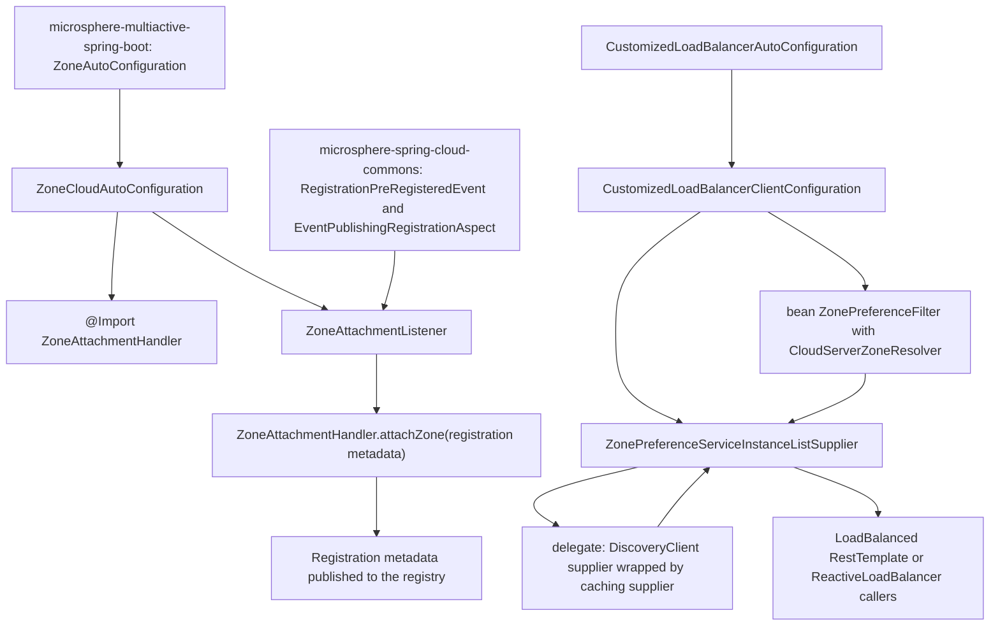
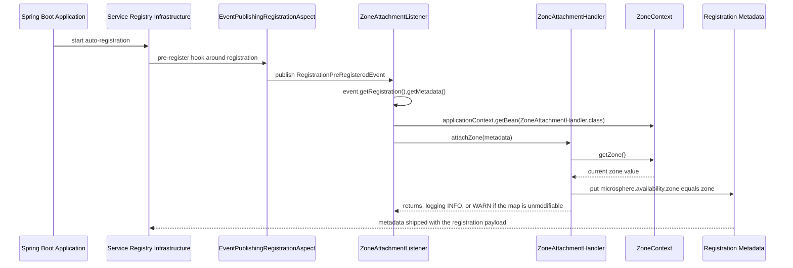
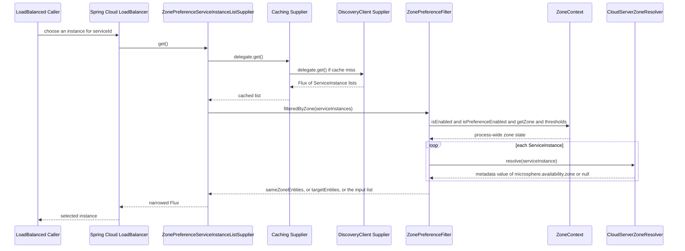

English version: [English](../microsphere-multiactive-spring-cloud.md)

# `microsphere-multiactive-spring-cloud` — 开发者指南

Maven 坐标：`io.github.microsphere-projects:microsphere-multiactive-spring-cloud:${revision}`（本分支为
`0.2.14-SNAPSHOT`）。

---

## 概述

`microsphere-multiactive-spring-cloud` 是最上层的集成模块：它位于 `-spring-boot`（进而依赖 `-spring` 与 `-commons`）之上，
把可用区模型接入决定流量本地性的两个 Spring Cloud 关注点。

1. **对外广播（注册中心侧）** —— `ZoneCloudAutoConfiguration` + `ZoneAttachmentListener` 在服务注册前，把*本*实例的可用区写入
   `Registration.getMetadata()`，借助的是 microsphere-spring-cloud 的 `RegistrationPreRegisteredEvent`。
2. **对内选取（客户端侧）** —— `CustomizedLoadBalancerAutoConfiguration` +
   `CustomizedLoadBalancerClientConfiguration` + `ZonePreferenceServiceInstanceListSupplier`
   把 commons 的 `ZonePreferenceFilter` 插入 Spring Cloud LoadBalancer 的 `ServiceInstanceListSupplier` 链。
3. **可用区读取** —— `CloudServerZoneResolver` 通过从实例元数据中取出 `microsphere.availability.zone`
   实现 commons 的 `ZoneResolver<ServiceInstance>` —— 而这正是广播侧写入的那个键。这两个类构成跨进程传播协议的两半。

包：`...zone.spring.cloud`（`CloudServerZoneResolver`）、`...zone.spring.cloud.autoconfigure`
（`ZoneCloudAutoConfiguration`）、`...zone.spring.cloud.event`（`ZoneAttachmentListener`）、
`...zone.spring.cloud.loadbalancer`（`CustomizedLoadBalancerAutoConfiguration`、
`CustomizedLoadBalancerClientConfiguration`、`ZonePreferenceServiceInstanceListSupplier`）。全部标注 `@since 1.0.0`。

## 架构设计

### 分层结构



两项特性、两个完全独立的自动配置类、两套独立的开关：`ZoneCloudAutoConfiguration` 要求存在服务自动注册，而
`CustomizedLoadBalancerAutoConfiguration` 要求一个显式属性。应用可以只启用其中之一、两者都启用、或都不启用。

### 包结构

| 路径 | 类型 / 文件 | 职责 |
|---|---|---|
| `src/main/java/.../spring/cloud/` | `CloudServerZoneResolver` | 读取元数据的 `ZoneResolver<ServiceInstance>` |
| `src/main/java/.../spring/cloud/autoconfigure/` | `ZoneCloudAutoConfiguration` | 注册侧自动配置 |
| `src/main/java/.../spring/cloud/event/` | `ZoneAttachmentListener` | `ApplicationListener<RegistrationPreRegisteredEvent>` |
| `src/main/java/.../spring/cloud/loadbalancer/` | `CustomizedLoadBalancerAutoConfiguration`、`CustomizedLoadBalancerClientConfiguration`、`ZonePreferenceServiceInstanceListSupplier` | 客户端侧可用区偏好 |
| `src/main/resources/META-INF/spring/org.springframework.boot.autoconfigure.AutoConfiguration.imports` | `ZoneCloudAutoConfiguration`、`CustomizedLoadBalancerAutoConfiguration` | 注册两个入口 |
| `src/main/resources/META-INF/config/default/features.yaml` | 三个命名特性 | 声明各特性域拥有哪些类 |
| `src/test/java/.../spring/cloud/autoconfigure/` | `ZoneCloudAutoConfigurationTest`、`ZoneCloudAutoConfigurationIntegrationTest` | 条件覆盖 + 真实注册上下文 |

### 依赖契约

摘自 `microsphere-multiactive-spring-cloud/pom.xml`：

| 依赖 | 作用域 | 说明 |
|---|---|---|
| `microsphere-multiactive-spring-boot` | compile（`${revision}`） | 传递引入 `-spring` 与 `-commons`；唯一硬性要求 |
| `microsphere-spring-cloud-commons` | `optional` | 提供 `RegistrationPreRegisteredEvent`、`EventPublishingRegistrationAspect`、`ConditionalOnAutoServiceRegistrationEnabled`、`ServiceRegistryConstants`，测试中还用到 `InMemoryServiceRegistry` |
| `spring-cloud-commons`、`spring-cloud-context`、`spring-cloud-loadbalancer` | `optional` | 仅编译期访问；supplier 使用的 `reactor.core.publisher.Flux` 经由 `spring-cloud-loadbalancer` 而来 |
| `spring-boot-starter`、`-actuator`、`-web` | `optional` | |
| `spring-boot-configuration-processor`、`spring-boot-autoconfigure-processor` | `optional` | |
| `junit-jupiter`、`spring-boot-starter-test`、`microsphere-spring-boot-test`、`logback-classic` | `test` | |

由于所有框架依赖都是 `optional`，类级条件注解就不能以 `Class` 字面量引用这些类型 ——
这恰好解释了为什么 `ZoneCloudAutoConfiguration` 与 `CustomizedLoadBalancerAutoConfiguration`
使用 `@ConditionalOnClass(name = "...")` 字符串形式，而 `-spring-boot`（确实在 compile 作用域依赖 Boot）
使用的是 `@ConditionalOnClass(value = {ZoneContext.class, ZoneLocator.class})`。

## 源码解析

### `ZoneCloudAutoConfiguration`

`microsphere-multiactive-spring-cloud/src/main/java/io/microsphere/multiple/active/zone/spring/cloud/autoconfigure/ZoneCloudAutoConfiguration.java`

仓库中条件最密集的一个类：

```java
@Configuration(proxyBeanMethods = false)
@ConditionalOnAvailabilityZoneAvailable
@ConditionalOnAutoServiceRegistrationEnabled
@ConditionalOnClass(name = {
        "org.aspectj.lang.annotation.Aspect",                                                                        // AspectJ API
        "io.microsphere.spring.cloud.client.service.registry.event.RegistrationPreRegisteredEvent",                  // Microsphere Spring Cloud Commons API
        REGISTRATION_CLASS_NAME
})
@ConditionalOnBean(ZoneContext.class)
@AutoConfigureAfter(
        value = {
                ZoneAutoConfiguration.class
        },
        name = {
                "org.springframework.cloud.netflix.eureka.EurekaClientAutoConfiguration",                            // Spring Cloud Netflix Eureka API
                "io.microsphere.spring.cloud.client.service.registry.autoconfigure.ServiceRegistryAutoConfiguration" // Microsphere Spring Cloud Commons API
        })
@Import(value = {
        ZoneAttachmentHandler.class
})
public class ZoneCloudAutoConfiguration {

    @Bean
    @ConditionalOnBean(type = "io.microsphere.spring.cloud.client.service.registry.aspect.EventPublishingRegistrationAspect")
    @ConditionalOnMissingBean
    public ZoneAttachmentListener zoneAttachmentListener() {
        return new ZoneAttachmentListener();
    }

}
```

按顺序解读这些闸门：

| 闸门 | 目的 |
|---|---|
| `@ConditionalOnAvailabilityZoneAvailable` | 复用 `-spring-boot` 的复合闸门（类路径 + `microsphere.availability.zone.enabled`），使整套栈一起关闭 |
| `@ConditionalOnAutoServiceRegistrationEnabled` | 来自 `microsphere-spring-cloud-commons`；若本进程不自注册就没有可挂载的东西（同级测试把 `spring.cloud.service-registry.auto-registration.enabled=false` 固定为禁用值） |
| `@ConditionalOnClass(name = {...})` | 三个字符串名：AspectJ 的 `@Aspect`、microsphere 的 `RegistrationPreRegisteredEvent`、以及 `REGISTRATION_CLASS_NAME`（静态导入自 `io.microsphere.spring.cloud.client.service.registry.constants.ServiceRegistryConstants.REGISTRATION_CLASS_NAME`） |
| `@ConditionalOnBean(ZoneContext.class)` | commons 的 `ZoneContext` Bean 必须已被 `ZoneAutoConfiguration` 注册 |
| `@AutoConfigureAfter(value = {ZoneAutoConfiguration.class}, name = {...})` | 排序：本配置在基础可用区配置之后、也在 Eureka/microsphere 服务注册配置之后求值 —— 这正是 `@ConditionalOnBean` 能看到那些 Bean 的前提 |

`@Import(ZoneAttachmentHandler.class)` 在不声明 `@Bean` 方法的情况下把 commons 处理器注册为 Bean；由于
`ZoneAttachmentHandler` 只有一个以 `ZoneContext` 为参数的构造器，Spring 会隐式完成注入 ——
而 `@ConditionalOnBean(ZoneContext.class)` 正是保证该参数可用的条件。

Bean 方法上的 `@ConditionalOnBean(type = ...)` 是*第二*道、也是更窄的守卫：只有当
`EventPublishingRegistrationAspect` 存在、能够发布该监听器所等待的事件时，监听器才有意义。这里使用 `type`（字符串）而不是
`value`（Class），正是因为该类位于 optional 依赖中。

### `ZoneAttachmentListener`

`.../spring/cloud/event/ZoneAttachmentListener.java`

```java
public class ZoneAttachmentListener implements ApplicationListener<RegistrationPreRegisteredEvent>, ApplicationContextAware {
    public void onApplicationEvent(RegistrationPreRegisteredEvent event) {
        Registration registration = event.getRegistration();
        Map<String, String> metadata = registration.getMetadata();
        ZoneAttachmentHandler zoneAttachmentHandler = applicationContext.getBean(ZoneAttachmentHandler.class);
        zoneAttachmentHandler.attachZone(metadata);
    }
}
```

协议写入的一半。它是一个普通的 `ApplicationListener`（不像 `-spring` 中的同胞那样是
`SmartApplicationListener`），以泛型参数承载事件类型；并且它是在回调*内部*从 `ApplicationContext`
解析协作者，而不是在构造器中注入。这个选择对维护者很重要：它把查找推迟到事件发生时，因此即使 handler
Bean 定义得更晚，监听器也能被创建（被导入的配置按注册顺序处理）。Javadoc 还交叉引用了 `InstancePreRegisteredEvent`（Spring
Cloud Netflix 的对应事件）—— 但本类*监听的是* microsphere 事件而非 Netflix 事件，那处引用只是文档说明。

端到端来看，对外广播的键值是 `microsphere.availability.zone=<zone>` —— 关于 `defaultZone`
为何照原样发布而不跳过，见 commons 指南。

### `CloudServerZoneResolver`

`.../spring/cloud/CloudServerZoneResolver.java`

```java
public class CloudServerZoneResolver implements ZoneResolver<ServiceInstance> {
    public static final CloudServerZoneResolver INSTANCE = new CloudServerZoneResolver();
    public String resolve(ServiceInstance serviceInstance) {
        Map<String, String> instanceMetadata = serviceInstance.getMetadata();
        if (instanceMetadata != null) {
            return instanceMetadata.get(ZONE_PROPERTY_NAME);
        }
        return null;
    }
}
```

协议读取的一半。公有急切初始化的单例 `INSTANCE`（无状态，因此可共享）—— 同一个实例被两种方式复用：由
`CustomizedLoadBalancerClientConfiguration` 注入进 `ZonePreferenceFilter` Bean；以及在 `-netflix`
模块中被 `DiscoveryClientServer` 直接以 `INSTANCE.resolve(...)` 调用来填充 Ribbon 的 `Server.setZone(...)`。
元数据为 `null` 时返回 `null`，而 `ZonePreferenceFilter` 会把这种情况计入就绪百分比的分母。

### `CustomizedLoadBalancerAutoConfiguration`

`.../spring/cloud/loadbalancer/CustomizedLoadBalancerAutoConfiguration.java`

```java
@Configuration(proxyBeanMethods = false)
@ConditionalOnProperty(value = "microsphere.spring.cloud.loadbalancer.customized", havingValue = "true")
@ConditionalOnClass(name = {"org.springframework.cloud.loadbalancer.annotation.LoadBalancerClient"})
@LoadBalancerClients(defaultConfiguration = CustomizedLoadBalancerClientConfiguration.class)
public class CustomizedLoadBalancerAutoConfiguration {}
```

一个空体类，唯一效果就是通过 `@LoadBalancerClients` 完成注册。与本库其他开关有两点重要差异：

- `havingValue = "true"` 且没有 `matchIfMissing`，因此**该特性是显式开启式的**：属性缺失即为关闭。于是 LoadBalancer
  的可用区偏好需要*两样*东西 —— `microsphere.availability.zone.preference.enabled=true`（commons
  运行期闸门）*且* `microsphere.spring.cloud.loadbalancer.customized=true`（这里的注册开关）。
- 该属性名使用的是 `microsphere.spring.cloud.*` 命名空间，而不是项目中其他所有属性使用的
  `microsphere.availability.zone.*` 命名空间。这是快照中真实存在的一处不一致；编写文档或改名时要记住。

`defaultConfiguration` 意味着该定制器会应用到*每一个*命名的 LoadBalancer 客户端上下文，除非某个具体的
`@LoadBalancerClient` 覆盖了它。

### `CustomizedLoadBalancerClientConfiguration`

`.../spring/cloud/loadbalancer/CustomizedLoadBalancerClientConfiguration.java`

这个类*不是*自动配置类：它是安装进 Spring Cloud `LoadBalancerClientFactory`
命名上下文的每客户端配置，这也是它把带 `@Order` 的嵌套配置与普通顶层 Bean 混在一起的原因。

**顶层 Bean —— 策略接线：**

```java
@Bean
public ZonePreferenceFilter<ServiceInstance> zonePreferenceFilter(ZoneContext zoneContext) {
    return new ZonePreferenceFilter<ServiceInstance>(zoneContext, new CloudServerZoneResolver());
}
```

注意这里没有 `@ConditionalOnMissingBean`，也注意尽管 `INSTANCE`
存在却仍然 `new CloudServerZoneResolver()`。`ZoneContext` 是从*父*应用上下文解析而来的（Spring Cloud 的
`NamedContextFactory` 创建的命名子上下文会以主上下文作为父上下文），这也解释了为什么该 Bean 是“每个客户端一个”而非“每个应用一个”。由于
filter 持有的是单例 `ZoneContext` 的引用，`ZoneContextChangedListener`
所做的运行期变更会被所有客户端的 supplier 立刻观察到，而无需重建它们。

**响应式/阻塞两个变体：**

```java
@ConditionalOnReactiveDiscoveryEnabled
@Order(193827465)
static class ReactiveConfiguration {
    @Bean
    @ConditionalOnBean(DiscoveryClient.class)
    @ConditionalOnMissingBean
    @Conditional(OptimizedZoneConfigurationCondition.class)
    public ServiceInstanceListSupplier optimizedZonePreferenceDiscoveryClientServiceInstanceListSupplier(
            ConfigurableApplicationContext context, ZonePreferenceFilter<ServiceInstance> zonePreferenceFilter) {
        return ServiceInstanceListSupplier.builder().withDiscoveryClient().withCaching()
                .with((ctx, delegate) -> new ZonePreferenceServiceInstanceListSupplier(delegate, zonePreferenceFilter))
                .build(context);
    }
}

@ConditionalOnBlockingDiscoveryEnabled
@Order(193827466)
static class BlockingConfiguration { /* same shape, withBlockingDiscoveryClient(), bean named
        optimizedZonePreferenceServiceInstanceListSupplier */ }
```

维护者需要了解的要点：

- 这两个嵌套类是包级私有的 `static` 类，以配置类方式使用（作为外层 `@Configuration`
  的嵌套配置类被拾取），并通过 `@ConditionalOnReactiveDiscoveryEnabled` /
  `@ConditionalOnBlockingDiscoveryEnabled` 互斥。
- `@Order` 取值是裸的魔数（`193827465`、`193827466`，相差一），唯一目的是把这些 supplier
  排到 Spring Cloud 自身 `LoadBalancerClientConfiguration` 嵌套 supplier
  的前/后。它们既不来自 `ZoneConstants`，源码中也没有注释 —— 触碰排序时请把它们视为承重结构。
- `.withDiscoveryClient()`（响应式）与 `.withBlockingDiscoveryClient()`（阻塞）选择底层的
  `DiscoveryClient` supplier；`withCaching()` 随后包裹它，最后的 `.with(customizer)`
  再包裹其结果 —— 因此按 Spring Cloud 的 builder 语义，`ZonePreferenceServiceInstanceListSupplier`
  成为**最外层**装饰器，即*过滤发生在缓存之后*，这正是运行期可用区变更无需失效缓存即可在下次 `get()` 生效的原因。
- `OptimizedZoneConfigurationCondition` 是一个内部 `static class implements Condition`，委派给
  `LoadBalancerEnvironmentPropertyUtils.equalToForClientOrDefault(context.getEnvironment(), "configurations",
  "optimized-zone-preference")` —— 只有当某客户端的 `<client>.loadbalancer.configurations`（或默认值）等于
  `optimized-zone-preference` 时才安装该 supplier。这是*第三个*开关，粒度到每个客户端，且使用的是 Spring Cloud
  自身的 configurations 词汇而不是 `microsphere.*` 属性。

### `ZonePreferenceServiceInstanceListSupplier`

`.../spring/cloud/loadbalancer/ZonePreferenceServiceInstanceListSupplier.java`

```java
public class ZonePreferenceServiceInstanceListSupplier extends DelegatingServiceInstanceListSupplier {
    private final ZonePreferenceFilter<ServiceInstance> zonePreferenceFilter;

    public Flux<List<ServiceInstance>> get() {
        return getDelegate().get().map(this::filteredByZone);
    }
}
```

一个教科书式的装饰器（Decorator），并且带有 Apache License
文件头，Javadoc 也点明了它的灵感来源：*"Optimized
`org.springframework.cloud.loadbalancer.core.ZonePreferenceServiceInstanceListSupplier`"*。
Spring Cloud 自带的版本依赖 `ZoneConfig`/健康检查的 `zone`
提示，而本版本把所有决策委派给 commons 的过滤器，因此各项阈值（就绪百分比、最小可用数、禁用可用区排空）以及 `defaultZone`
语义与 `-netflix` 中的 Ribbon 路径完全一致。全部状态都在注入的 filter 中，所以除了 delegate 之外该 supplier 没有新增字段。

### `META-INF/config/default/features.yaml`

供 microsphere-spring-cloud 特性机制消费的声明式特性目录（不由 Spring Boot 使用）：

```yaml
microsphere:
  spring:
    cloud:
      features:
        named:
          microsphere-multiactive-commons:
            - io.microsphere.multiple.active.zone.ZoneAttachmentHandler
            - io.microsphere.multiple.active.zone.ZoneContext
            - io.microsphere.multiple.active.zone.ZonePreferenceFilter
            - io.microsphere.multiple.active.zone.ZoneResolver
          microsphere-multiactive-spring:
            - io.microsphere.multiple.active.zone.spring.ZoneLocator
            - io.microsphere.multiple.active.zone.spring.event.ZoneContextChangedListener
          microsphere-multiactive-spring-cloud:
            - WebEndpointApplicationContextInitializer=io.microsphere.spring.cloud.gateway.server.webmvc.context.WebEndpointApplicationContextInitializer
```

前两项准确列出了这两个模块贡献的类。第三项在**本快照中是过期/错误的**：它指向
`io.microsphere.spring.cloud.gateway.server.webmvc.context.WebEndpointApplicationContextInitializer`，
一个既不在本模块、也不在本仓库任何位置的 Gateway 类。Java 源码中没有任何地方引用该文件，因此它对可用区行为没有影响 ——
但维护者不应把它当作模块清单来信任。

## 扩展点

| 扩展点 | 方式 |
|---|---|
| 按客户端开启 | 设置 `<clientName>.loadbalancer.configurations=optimized-zone-preference`（或默认配置），使 `OptimizedZoneConfigurationCondition` 匹配 |
| 自定义 supplier 排序 | 在 `@LoadBalancerClient` 配置中声明自己的 `ServiceInstanceListSupplier` Bean；两个嵌套变体上的 `@ConditionalOnMissingBean` 会自动退让 |
| 替换广播路径 | 提供自己的 `ZoneAttachmentListener` Bean，或在你自己的注册前钩子中调用 `ZoneAttachmentHandler.attachZone(metadata)`（`-netflix` 用 `PreRegistrationHandler` 就是这么做的） |
| 复用解析器 | 任何针对 `ServiceInstance` 的可用区读取都可以用 `CloudServerZoneResolver.INSTANCE` |
| 关闭整套栈 | `microsphere.availability.zone.enabled=false` 经由 `@ConditionalOnAvailabilityZoneAvailable` 同时干掉两个自动配置；`spring.cloud.service-registry.auto-registration.enabled=false` 只干掉注册侧；不设置 `microsphere.spring.cloud.loadbalancer.customized=true` 则客户端侧保持关闭 |

## 代码中真实存在的设计模式

- **装饰器（Decorator）** —— `ZonePreferenceServiceInstanceListSupplier extends DelegatingServiceInstanceListSupplier`，
  通过流式 builder 包裹缓存与发现 supplier。
- **建造者（Builder，流式）** —— `ServiceInstanceListSupplier.builder().withDiscoveryClient().withCaching().with(...)`
  .build(context)。
- **策略（Strategy）** —— 注入 `ZonePreferenceFilter` 的 `ZoneResolver`（`CloudServerZoneResolver`）：filter
  是算法，resolver 是可变步骤。
- **单例（Singleton）** —— `CloudServerZoneResolver.INSTANCE`，与 `-netflix` 模块共享。
- **观察者（Observer）** —— `ZoneAttachmentListener` 作为监听注册生命周期事件的 `ApplicationListener`。
- **分层 `@Conditional` 组合** —— 在一个配置类上组合类存在性、属性、Bean 存在性与排序条件，再加一个手写的
  `Condition`（`OptimizedZoneConfigurationCondition`）来处理注解形式无法表达的每客户端判断。
- **命名上下文作用域** —— 客户端配置通过 `@LoadBalancerClients(defaultConfiguration = ...)`
  安装，因此其 Bean 位于 Spring Cloud 的每客户端子上下文中，而 `ZoneContext` 从父上下文解析。
- **`@AutoConfigureAfter` 排序** —— 结合 `name`
  属性使用，以便依赖于那些并非编译期引用的配置类（Eureka、microsphere 服务注册）。
- **近似模板式的双生嵌套类** —— `ReactiveConfiguration`/`BlockingConfiguration`
  结构完全相同，只在发现客户端风格与 `@Order` 上不同；此处按“实际观察到的重复”描述，而非抽象模板。

## 运行期流程

### 注册侧挂载



### 客户端侧选取



## 构建与测试

```bash
# build + test this module and everything it needs (commons, spring, spring-boot)
./mvnw -pl microsphere-multiactive-spring-cloud -am test

# single test class
./mvnw -pl microsphere-multiactive-spring-cloud test -Dtest=ZoneCloudAutoConfigurationTest
./mvnw -pl microsphere-multiactive-spring-cloud test -Dtest=ZoneCloudAutoConfigurationIntegrationTest

# Windows, mirroring the CI matrix (Java 17/21/25 x spring-cloud-2022..2025)
mvnw.cmd -pl microsphere-multiactive-spring-cloud -am --activate-profiles test,coverage,spring-cloud-2025 test
```

| 测试类 | 验证内容 |
|---|---|
| `ZoneCloudAutoConfigurationTest` | `AutoConfigurationTest<ZoneCloudAutoConfiguration>`，配合 `@SpringBootTest(classes = {ZoneContext.class, EventPublishingRegistrationAspect.class, 测试类}, webEnvironment = NONE)`；匹配时必须存在 `ZoneAttachmentHandler` 与 `ZoneAttachmentListener`；在 `microsphere.availability.zone.enabled=false` 与 `spring.cloud.service-registry.auto-registration.enabled=false` 时退让；`ZoneLocator`、`Aspect`、`RegistrationPreRegisteredEvent`、`Registration` 各自缺失时都必须能存活 |
| `ZoneCloudAutoConfigurationIntegrationTest` | 真实的 `@EnableAutoConfiguration` 上下文，配合 `InMemoryServiceRegistry` 以及属性 `server.port=8080`、`spring.application.name=test-service`、`microsphere.spring.cloud.service-registry.auto-registration.simple.enabled=true`；注入 `Registration`、`ServiceRegistry<Registration>`、`ZoneContext`、`CompositeZoneLocator`、`ZoneAttachmentHandler`、`ZoneAttachmentListener` —— 也就是说它证明了整套条件链确实对得上，因为缺少任一 Bean 会在唯一的 `assertNotNull(zoneContext)` 断言之前就因注入失败而报错 |

没有 `src/test/resources`，因此集成测试属性通过 `@SpringBootTest(properties = ...)` 内联提供。LoadBalancer
路径在本快照中**没有任何自动化测试** —— 对 `CustomizedLoadBalancerClientConfiguration` 排序或
`OptimizedZoneConfigurationCondition` 的改动只能依靠手工/集成验证。

## 相关文档

- [开发者指南索引](README.md)
- [microsphere-multiactive-commons](microsphere-multiactive-commons.md) —— 本模块所适配的过滤器与解析器
- [microsphere-multiactive-spring-boot](microsphere-multiactive-spring-boot.md) —— 本模块所依赖的闸门与 Bean
- [microsphere-multiactive-netflix](microsphere-multiactive-netflix.md) —— 上述两条流程在 Ribbon/Eureka 侧的对应实现
- [用户指南](../../user-guide/zh/README.md)
- [仓库 README](../../../../README.md)

## English

English version: [English](../microsphere-multiactive-spring-cloud.md)
