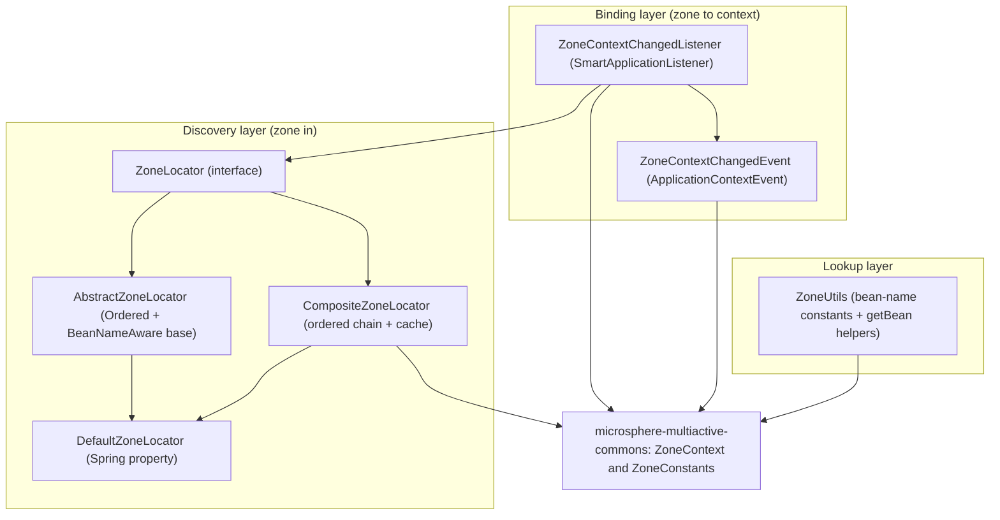
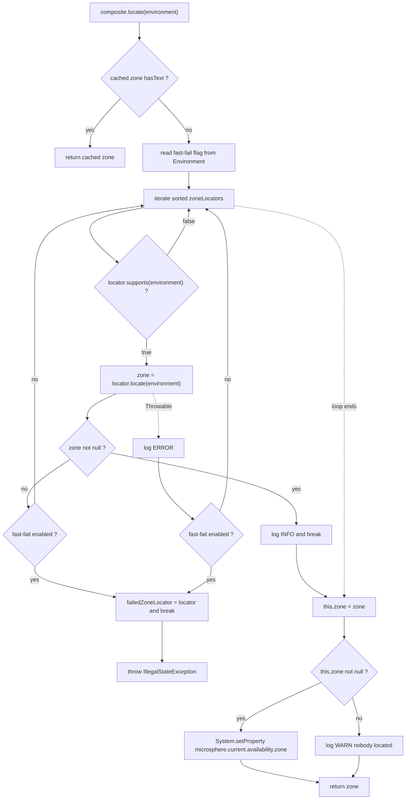
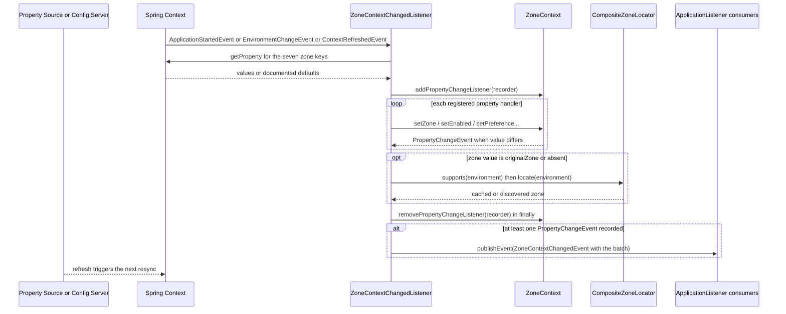

English version: [English](../microsphere-multiactive-spring.md)

# `microsphere-multiactive-spring` — 开发者指南

Maven 坐标：`io.github.microsphere-projects:microsphere-multiactive-spring:${revision}`（本分支为 `0.2.14-SNAPSHOT`）。

---

## 概述

`microsphere-multiactive-spring` 把 `microsphere-multiactive-commons` 中与框架无关的内核变成了 Spring 原生的服务发现机制。
它只增加了两件事，别无其他：

1. **`ZoneLocator`** —— 一条有序、可插拔的*策略链*，用于回答“本进程运行在哪个可用区？”，并由
   `CompositeZoneLocator` 按顺序依次尝试各个定位器。
2. **`ZoneContextChangedListener`** —— 一个 `SmartApplicationListener`，把 Spring `Environment` 属性与生命周期/刷新事件绑定到
   `ZoneContext` 单例上，并把由此产生的每一项变更以 Spring `ZoneContextChangedEvent` 的形式重新发布。

包：`io.microsphere.multiple.active.zone.spring`（五个类型）与
`io.microsphere.multiple.active.zone.spring.event`（两个类型）。全部标注 `@since 1.0.0`。

请注意本模块**不包含**的内容：完全没有 `src/main/resources` —— 因此没有 `spring.factories`，也没有自动配置类。
注册 `DefaultZoneLocator` 与装配这些 Bean 的工作由 `microsphere-multiactive-spring-boot` 承担。本模块可以在纯 Spring
Framework 下手工声明 Bean 使用。

## 架构设计

### 分层结构



三类互不相同的关注点，落在三个互不相同的位置：*发现*（locate）、*绑定*（属性 → 上下文）、*查找*（Bean 名）。
正是这种切分，使得 `-spring-boot` 只需补充配置注解，`-spring-cloud` 只需补充事件/注册中心胶水代码。

### 包结构

| 包 | 类型 | 职责 |
|---|---|---|
| `io.microsphere.multiple.active.zone.spring` | `ZoneLocator`、`AbstractZoneLocator`、`DefaultZoneLocator`、`CompositeZoneLocator`、`ZoneUtils` | 可用区发现策略契约、基类、默认与组合实现、Bean 查找 |
| `io.microsphere.multiple.active.zone.spring.event` | `ZoneContextChangedListener`、`ZoneContextChangedEvent` | Environment 到 `ZoneContext` 的绑定及其 `ApplicationEvent` 桥接 |
| `src/test/java/.../spring` | `CompositeZoneLocatorTest`、`DefaultZoneLocatorTest`、`ZoneUtilsTest` | 链语义、排序、回退、快速失败 |
| `src/test/java/.../spring/event` | `ZoneContextChangedListenerTest`、`ZoneContextChangedEventTest` | 逐键的属性绑定、事件发布、回退语义 |

### 依赖契约

摘自 `microsphere-multiactive-spring/pom.xml`：

| 依赖 | 作用域 | 说明 |
|---|---|---|
| `microsphere-multiactive-commons` | compile（`${revision}`） | 唯一非 optional 的内部依赖 —— `ZoneContext`/`ZoneConstants` 出现在本模块的公开 API 上 |
| `microsphere-spring-context` | `optional` | |
| `org.springframework:spring-context` | `optional` | 仅编译期：Spring 版本由使用者提供，这正是本模块可跨 Spring 5/6 代际使用的原因 |
| `microsphere-annotation-processor` | `optional` | |
| `junit-jupiter`、`spring-test`、`microsphere-spring-test`、`logback-classic` | `test` | |

## 源码解析

### `ZoneLocator`

`microsphere-multiactive-spring/src/main/java/io/microsphere/multiple/active/zone/spring/ZoneLocator.java`

```java
public interface ZoneLocator {
    boolean supports(Environment environment);
    String locate(Environment environment);
}
```

整个库的 SPI，也是第三方实现者要扩展的接缝。契约在 Javadoc 中写得很明确：*“若为 `true`，`locate(Environment)` 会被调用，否则调用会被忽略”*
—— `supports` 是守卫而非偏好，而 `locate` 在无法确定可用区时必须返回 `null`（而不是抛异常），组合器才能落到下一个策略。

两个方法都以 `Environment` 作为参数而不是持有为字段状态。这使得 `Environment` 可在调用时传入，也让定位器可以被当作普通对象构造（测试里直接匿名构造，完全不依赖容器）。

### `AbstractZoneLocator`

`.../spring/AbstractZoneLocator.java`

```java
public abstract class AbstractZoneLocator implements ZoneLocator, BeanNameAware, Ordered {
    protected final Logger logger = getLogger(getClass());
    protected String beanName;
    protected int order;
    public AbstractZoneLocator(int order) { setOrder(order); }
}
```

三处共享基础设施：

- `getLogger(getClass())` —— Logger 以*具体*子类命名，因此即便字段声明在这里，
  `EcsContainerMetadataFileZoneLocator` 也会以自己的类别名输出日志。
- `BeanNameAware` 与 `Ordered` 的实现都是 `final`，子类无法破坏身份/顺序语义；每个子类必须向 `super(int)` 传入 order，
  这迫使每个定位器作者显式做出排序决策（参见 AWS 的 `5 / 10 / 15` 与默认的 `20`）。
- `toString()` 返回 `ZoneLocator{beanName='...', order=...}`。`CompositeZoneLocator` 以 `{}` 占位符打印定位器实例，
  因此这个字符串就是日志行 `... locates the zone : ...` / `... can't locate the zone` 中可见的内容 ——
  它是诊断输出，不是装饰。

### `DefaultZoneLocator`

`.../spring/DefaultZoneLocator.java`

`DEFAULT_ORDER = 20`，且 `supports()` 无条件返回 `true`：它是链的终点回退。`locate()` 从 `Environment` 读取
`ZoneConstants.ZONE_PROPERTY_NAME`（`microsphere.availability.zone`）；若 `StringUtils.hasText` 不通过，则以 `TRACE`
记录并返回 `DEFAULT_ZONE`（`defaultZone`）。由于它由 `-spring-boot` 模块通过 `spring.factories`
（键 `io.microsphere.multiple.active.zone.spring.ZoneLocator`）注册，因此即使类路径上没有任何其他定位器模块，它也总是存在。

一处重要交互：`DefaultZoneLocator` 读取的属性与 `ZoneContextChangedListener` 写入上下文的属性是*同一个*。
这正是 `ORIGINAL_ZONE` 回退得以工作的原因；也解释了为什么把该属性设为字面可用区名只会*暂时*覆盖云元数据定位器
（它们的 order 更靠前：`5`/`10`/`15` 对 `20`）。

### `CompositeZoneLocator`

`.../spring/CompositeZoneLocator.java`

由 `ZoneAutoConfiguration` 创建的 `@Primary` `zoneLocator` Bean。它自身实现 `ZoneLocator`，因此调用方无法区分组合器与单个策略。

构造器 —— 防御且急切：

```java
public CompositeZoneLocator(List<ZoneLocator> zoneLocators) {
    Assert.notNull(zoneLocators, "The argument 'zoneLocators' must not be null!");
    this.zoneLocators = new ArrayList<>(zoneLocators);
    AnnotationAwareOrderComparator.sort(this.zoneLocators);
}
```

它会*拷贝*传入的列表（从而避免对不可变列表抛 `UnsupportedOperationException`），并在构造时用
`AnnotationAwareOrderComparator` 排一次序，该比较器同时尊重 `Ordered`（由 `AbstractZoneLocator` 实现）与 `@Order`
注解 —— 所以第三方定位器两种写法都可以。

`supports(environment)` 是存在性判断：只要任一代理支持就返回 `true`。

`locate(environment)` 是这个类最值得研究的方法，它包含四种可分开的行为：

1. **结果缓存。** `if (StringUtils.hasText(zone)) { return zone; }` —— `volatile String zone` 字段就是缓存。
   对同一个组合器实例，发现过程每个 JVM 至多执行一次，因此不可达的元数据端点不会被每次调用都重复轮询。
   对维护者的副作用是：**不能通过该 Bean 重新执行发现来修正错误的可用区** —— 值一旦算出即被固定，
   运行期变更必须经由 `ZoneContext`（见 `ZoneContextChangedListener`）。
2. **短路链。** 按序遍历定位器：`!supports` 则跳过（`TRACE`），否则调用 `locate`，并在第一个非 `null` 结果处 `break`（`INFO`）。
   返回 `null` 会记录 `WARN` 并继续。
3. **快速失败。** `isFastFailEnabled(environment)` 读取 `LOCATOR_FAST_FAIL_PROPERTY_NAME`
   （`microsphere.availability.zone.locator.fast-fail`，默认 `false`）。开启时，第一个返回 `null` *或*抛异常的定位器会被记为
   `failedZoneLocator` 并跳出循环，随后抛出
   `IllegalStateException("The zone can't be located by " + failedZoneLocator)`。关闭时，代理抛出的
   `Throwable` 以 `ERROR` 记录，链路继续 —— 本库宁可降级到 `defaultZone`，也不愿让启动失败。两个分支都被
   `CompositeZoneLocatorTest` 锚定（`testLocateWithFastFailOnNullZone`、`testLocateWithFastFailOnException`、
   `testLocateWithExceptionNoFastFail`）。
4. **发布到 JVM。** 循环结束后执行 `this.zone = zone;`，若非 `null` 则
   `System.setProperty(CURRENT_ZONE_PROPERTY_NAME, this.zone)` —— 正是 commons 中
   `ZoneContext.getCurrentZone()` 读回的那次写入。注意：`null` 结果同样会被缓存（因此
   `StringUtils.hasText` 允许重试），并且只以 `WARN` 记录。

空链行为是明确定义的：`supports` 为 `false`，`locate` 为 `null`（`testLocateWithEmptyLocatorList`）。



### `ZoneUtils`

`.../spring/ZoneUtils.java`

```java
public static final String ZONE_CONTEXT_BEAN_NAME = "zoneContext";
public static final String ZONE_LOCATOR_BEAN_NAME  = "zoneLocator";
public static ZoneContext getZoneContext(ConfigurableListableBeanFactory beanFactory) { ... }
public static ZoneLocator getZoneLocator(ConfigurableListableBeanFactory beanFactory) { ... }
```

一个 `abstract` 且构造器为 `private` 的不可实例化工具类，保存两个约定好的 Bean 名，并提供带类型的 `getBean` 查找。
这些名称是本模块与 `ZoneAutoConfiguration` 中 `@Bean(name = ...)` 声明之间的*契约* —— 两侧都导入这些常量而不重复字符串，
因此改名只需改动一个常量。这两个辅助方法接受 `ConfigurableListableBeanFactory`（而不是 `ApplicationContext`），
所以它们对原始 Bean 工厂同样可用，而刷新期代码以及 `-spring-boot`/`-spring-cloud` 内部拿到的正是这种对象。

### `ZoneContextChangedListener`

`.../spring/event/ZoneContextChangedListener.java`

Spring 世界与 commons 中 `ZoneContext` 之间唯一的有状态桥接。声明为
`implements SmartApplicationListener, ApplicationContextAware, EnvironmentAware`。

**它响应哪个事件由类路径决定** —— 这是一个类同时服务纯 Spring、Spring Boot 与 Spring Cloud 的关键技巧：

```java
private static final Class<?> APPLICATION_STARTED_EVENT_CLASS =
        resolveClass("org.springframework.boot.context.event.ApplicationStartedEvent", classLoader);
private static final Class<?> ENVIRONMENT_CHANGE_EVENT_CLASS =
        resolveClass("org.springframework.cloud.context.environment.EnvironmentChangeEvent", classLoader);
private static final boolean IS_SPRING_CLOUD_APPLICATION = ENVIRONMENT_CHANGE_EVENT_CLASS != null
        && APPLICATION_STARTED_EVENT_CLASS != null;
private static final boolean IS_SPRING_BOOT_APPLICATION = ENVIRONMENT_CHANGE_EVENT_CLASS == null
        && APPLICATION_STARTED_EVENT_CLASS != null;
```

`io.microsphere.util.ClassLoaderUtils.resolveClass` 返回 `null` 而不抛异常，因此这些是*安全*的类路径探测，只在静态初始化块中求值一次。
随后 `supportsEventType` 进行选择：

| 检测到的技术栈 | 监听的事件 |
|---|---|
| 同时存在 Spring Boot **与** Spring Cloud | `EnvironmentChangeEvent` **或** `ApplicationStartedEvent` |
| 仅 Spring Boot | `ApplicationStartedEvent` |
| 纯 Spring Framework | `ContextRefreshedEvent` |

`onApplicationEvent(ApplicationEvent)` 完全忽略事件负载，直接调用 `tryChangeZoneContext()`，也就是说*上述任一*事件都会触发对七个属性的
全量重同步 —— 由刷新驱动的整体重同步，而不是逐属性 diff。`getOrder()` 未被覆写，因此沿用 Spring `SmartApplicationListener` 的默认排序。

七个键在 `ZONE_CONTEXT_PROPERTY_NAMES` 中声明一次（`protected static`，`ZoneContextChangedListenerTest`
断言其中恰好包含这七个且长度为 `7`），并在构造器的 `initPropertyChangedHandlers()` 中被映射进
`propertyChangedHandlers`——一个以属性名为键的 `Map<String, Consumer<String>>`，即策略注册表：

| 属性 | 处理器 | 效果 |
|---|---|---|
| `microsphere.availability.zone` | `changeZone` | `zoneContext.setZone(...)` |
| `...zone.enabled` | `changeEnabled` | `setEnabled` |
| `...preference.enabled` | `changeZonePreferenceEnabled` | `setPreferenceEnabled` |
| `...preference.filter.order` | `changePreferenceFilterOrder` | `setPreferenceFilterOrder` |
| `...preference.upstream.zone-ready-percentage` | `changePreferenceUpstreamZoneReadyPercentage` | `setPreferenceUpstreamZoneReadyPercentage` |
| `...preference.upstream.same-zone-min-available` | `changePreferenceUpstreamSameZoneMinAvailable` | `setPreferenceUpstreamSameZoneMinAvailable` |
| `...preference.upstream.disabled-zone` | `changePreferenceUpstreamDisabledZone` | `setPreferenceUpstreamDisabledZone` |

`changeZoneContext(Iterable<String>)` 是本模块最精妙的方法：

```java
List<PropertyChangeEvent> propertyChangeEvents = new LinkedList<>();
PropertyChangeListener listener = propertyChangeEvents::add;
try {
    zoneContext.addPropertyChangeListener(listener);
    for (String propertyName : propertyNames) { ... propertyChangedHandler.accept(propertyName); }
} finally {
    zoneContext.removePropertyChangeListener(listener);
}
if (!propertyChangeEvents.isEmpty()) { publishZoneContextChangedEvent(propertyChangeEvents); }
```

它不去自己计算前后值，而是临时向 commons 的 `ZoneContext` 挂载一个记录用的 `PropertyChangeListener`（指向 list 的方法引用），
执行完所有处理器后在 `finally` 中摘除。捕获到的 `PropertyChangeEvent` 列表*就是* diff。若它非空，则发布*一个*携带整批变更的
`ZoneContextChangedEvent`。这使得 Spring 的 `ApplicationEvent` 每次重同步恰好只发布一次，且只在确实发生变化时发布 ——
这也解释了为什么 `ZoneContext` 那个“监听器看到过期值”的行为（在 commons 指南中记录）在这里无害。

`changeZone(String)` 实现了手工故障切换/回退语义：

```java
String zone = getProperty(propertyName, ORIGINAL_ZONE);
if (StringUtils.hasText(zone)) {
    if (ORIGINAL_ZONE.equalsIgnoreCase(zone)) { zone = revertOriginalZone(); }
    zoneContext.setZone(zone);
}
```

- 该属性的默认值就是 `ORIGINAL_ZONE`，因此*缺失或被删除*的属性会解析为 `originalZone`，从而触发重新推导，而不是把可用区清空。
- 显式写 `"originalZone"` 效果相同 —— 这是运维人员的“撤销我的故障切换”命令。
- 其他任何非空白值都原样应用，覆盖发现结果。这就是热切换路径。
- 空字符串无法通过 `StringUtils.hasText`，因此可用区保持不变
  （`testChangeZoneWithEmptyStringPropertyDoesNotChangeZone`）。

`revertOriginalZone()` 先询问注入的 `ZoneLocator`（先调用 `zoneLocator.supports(environment)`），不支持时回退到
`ZoneConstants.DEFAULT_ZONE` —— `testRevertOriginalZoneWhenLocatorDoesNotSupport` 锚定了这个 `defaultZone` 结果。
注意此处的递归隐患：它调用 `zoneLocator.locate(...)`，而若可用区属性本身就是字面可用区名，`DefaultZoneLocator`
会返回那个字面值（测试注释也点明了这一点）。由于 `CompositeZoneLocator` 有缓存，回退通常只是重新读到已缓存的发现结果。

`getProperty(...)` 把缺失属性视为“恢复默认值”，并以 `INFO` 记录 —— 这正是“从配置中心删除属性后再刷新，运行期会回到文档默认值而不是
`null`”的机制。

`setApplicationContext` 会急切解析两个协作者（`context.getBean(ZoneContext.class)`、
`context.getBean(ZoneLocator.class)`），所以本监听器**要求** `ZoneAutoConfiguration` 的 Bean 存在；而它正是被那个配置类
`@Import` 的，从而保证了顺序。



### `ZoneContextChangedEvent`

`.../spring/event/ZoneContextChangedEvent.java`

```java
public class ZoneContextChangedEvent extends ApplicationContextEvent {
    public ZoneContextChangedEvent(ApplicationContext context, ZoneContext zoneContext,
                                   List<PropertyChangeEvent> propertyChangeEvents) { ... }
}
```

一个批量载荷：`getZoneContext()` 加上 `getPropertyChangeEvents()`，后者在构造器中被
`Collections.unmodifiableList(...)` 包裹，订阅者无法改写历史。`getSource()` / `getApplicationContext()` 来自
`ApplicationContextEvent`。`ZoneContextChangedEventTest` 断言 context 即为 source、列表按插入顺序返回、且元素正是
`ZoneContext` 当初发出的*同一批* `PropertyChangeEvent` 实例 —— 这证明该事件是对已记录 diff 的透传，而非重新推导。

订阅者可以借此原子地响应本地性变更（例如刷新缓存或重新打点指标），而不必注册七个 `PropertyChangeListener`。

## 扩展点

| 扩展点 | 使用方式 |
|---|---|
| 新的可用区来源 | 实现 `ZoneLocator`（继承 `AbstractZoneLocator` 以获得 `Ordered`/`BeanNameAware`/日志），选择一个小于 `20` 的 order，把它注册为 Spring Bean **或** 写入 `META-INF/spring.factories` 的键 `io.microsphere.multiple.active.zone.spring.ZoneLocator`；`ZoneAutoConfiguration` 会合并两者（见 `-spring-boot` 指南） |
| 运行期故障切换 | 在环境中设置 `microsphere.availability.zone=<zone>`（或 `originalZone` 以回退），并发布 `EnvironmentChangeEvent` / 触发上下文刷新 |
| 响应可用区变更 | 订阅 `ZoneContextChangedEvent` |
| 自定义属性集 | 继承/覆写并非预期路径 —— 正确做法是在 `ZoneConstants` 加常量、在 `ZoneContext` 加字段、在 `ZONE_CONTEXT_PROPERTY_NAMES` 与 `propertyChangedHandlers` 注册处理器 |
| 编程式查找 | 使用共享的 Bean 名常量调用 `ZoneUtils.getZoneContext(beanFactory)` / `ZoneUtils.getZoneLocator(beanFactory)` |

## 代码中真实存在的设计模式

- **组合（Composite）+ 策略（Strategy）+ 短路链** —— `CompositeZoneLocator` 实现它自己所组合的同一个 `ZoneLocator`
  接口，对子项排序，并返回第一个成功策略的结果。`supports()` 是组合器的存在性守卫。
- **模板方法（Template Method）** —— `AbstractZoneLocator` 固定了日志、`beanName` 与 `order`（两者都是 `final`
  覆写），把 `supports`/`locate` 留作抽象；具体定位器只需提供发现算法与其 order。
- **结果缓存（Memoization）** —— `CompositeZoneLocator` 中的 `volatile` `zone` 字段配合 `StringUtils.hasText` 前置检查。
- **观察者（Observer），且在两套机制间桥接** —— commons 的 `PropertyChangeSupport` 被一个方法引用形式的
  `PropertyChangeListener` 消费，随后以 Spring `ApplicationEvent` 重新发出。一套观察者网络被适配成另一套。
- **记录式 diff 捕获** —— 临时挂载监听器、执行变更、在 `finally` 中摘除、发布捕获到的变更列表（刻意替代手写的先后值比较）。
- **策略注册表** —— 以属性名为键的 `Map<String, Consumer<String>> propertyChangedHandlers`，由
  `initPropertyChangedHandlers()` 中的方法引用填充。
- **类路径驱动的多态（桥接变体）** —— `resolveClass(...)` 与两个 `IS_SPRING_*_APPLICATION` 静态布尔量，使同一个监听器无需对
  Boot 或 Cloud 声明 optional 的 Maven 依赖即可选定触发事件。
- **服务定位（Service Locator，受限）** —— `ZoneUtils` 集中了 Bean 名常量与 `getBean` 查找。
- **有序集成** —— `Ordered`、`@Order` 与 `AnnotationAwareOrderComparator` 是排序机制；注意
  `ZoneContextChangedListener` 并*未*覆写 `getOrder()`。

## 构建与测试

```bash
# build + test this module and everything it needs (commons)
./mvnw -pl microsphere-multiactive-spring -am test

# single test class / method
./mvnw -pl microsphere-multiactive-spring test -Dtest=CompositeZoneLocatorTest
./mvnw -pl microsphere-multiactive-spring test -Dtest=ZoneContextChangedListenerTest#testContextRefreshChangesZone

# Windows
mvnw.cmd -pl microsphere-multiactive-spring -am test
```

`spring-boot`/`spring-cloud`/`aws`/`netflix` 都传递依赖本模块，因此这里的改动会重编译整条链（根目录 `./mvnw test`，
或像 CI 那样带上 `test,coverage,spring-cloud-*` profile 使用 `-pl <module> -am`）。

测试清单：

| 测试类 | 保护的契约 |
|---|---|
| `CompositeZoneLocatorTest` | 拒绝 `null` 列表、首个匹配胜出、结果跨调用缓存、跳过不支持的代理、快速失败在 `null` 与异常两种情况下抛 `IllegalStateException`、非快速失败可越过异常继续、空链返回 `null` |
| `DefaultZoneLocatorTest` | 默认 order `20`、`setOrder`、`supports` 恒为 `true`、命中属性与 `DEFAULT_ZONE` 回退、`setBeanName`、`toString` 内容 |
| `ZoneUtilsTest` | 两个查找方法返回已注册的单例实例（`assertSame`） |
| `ZoneContextChangedListenerTest` | 七个属性各自绑定到对应字段、变更时发布 `ZoneContextChangedEvent`、空值/缺失属性处理、`originalZone` 回退（含定位器不支持的路径）、七个名称与七个处理器的不变式 |
| `ZoneContextChangedEventTest` | context 即 source、不可修改的批量列表、被记录 `PropertyChangeEvent` 的同一性 |

由于这些测试共享 `ZoneContext` 单例，每个测试都在方法体前后调用 `reset()`；`GenericApplicationContext`
是手工构造的（按 `ZoneUtils` 的名称注册 `zoneContext`/`zoneLocator` 单例）而非通过注解，这就是监听器测试在 `refresh()`
之后显式调用 `onApplicationEvent(...)` 的原因。

## 相关文档

- [开发者指南索引](README.md)
- [microsphere-multiactive-commons](microsphere-multiactive-commons.md) —— 本模块所绑定的内核
- [microsphere-multiactive-spring-boot](microsphere-multiactive-spring-boot.md) —— 装配这些 Bean 的自动配置
- [microsphere-multiactive-aws](microsphere-multiactive-aws.md) —— 三个生产级 `ZoneLocator` 实现
- [用户指南](../../user-guide/zh/README.md)
- [仓库 README](../../../../README.md)

## English

English version: [English](../microsphere-multiactive-spring.md)
