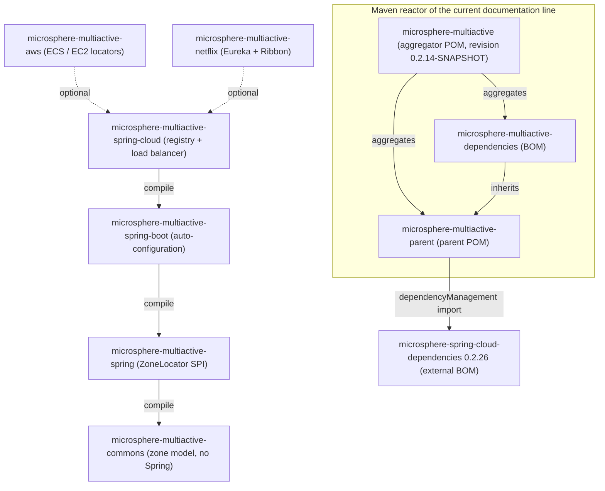

中文版本：[简体中文](zh/README.md)

# Microsphere Multiactive — User Guide (`current`)

This is the user guide for the **`current`** documentation line, which documents the **`release`** branch of
`microsphere-multiactive`. Microsphere Multiactive is a multi-active / zone-aware fault-tolerance library: it discovers
the availability zone a process is running in, publishes that zone into service-registration metadata, and filters
downstream server lists so that calls prefer same-zone instances while still falling back to other zones.

Every statement in these documents was read from the sources of this documentation line: POM files,
`src/main/java`, `src/main/resources/META-INF` and `src/test/java`. No API that does not exist in the snapshot is
documented.

## Version at a Glance

| Item | Value | Where it is defined |
|------|-------|---------------------|
| Git branch | `release` | documentation line `current` |
| Artifact version | `0.2.14-SNAPSHOT` | `<revision>` property of the root [`pom.xml`](../../../pom.xml) |
| Last published release of this line | `0.2.13` | [`release-notes.md`](../../../release-notes.md) |
| groupId of all modules | `io.github.microsphere-projects` | every module POM |
| JDK | 17 or later; CI compiles/tests on JDK 17, 21 and 25 | `.github/workflows/maven-build.yml`, `.github/workflows/maven-publish.yml` |
| Maven | Apache Maven 3.9.16 (wrapper distribution) | `.mvn/wrapper/maven-wrapper.properties` |
| Spring Cloud compatibility | `2022.0.x` – `2025.0.x` (CI profiles `spring-cloud-2022` … `spring-cloud-2025`) | root [`README.md`](../../../README.md), `.github/workflows/maven-build.yml` |
| Spring Boot version | Not declared in this repository; inherited from `microsphere-spring-cloud-dependencies:0.2.26` | `microsphere-multiactive-parent/pom.xml` |

## Contents

| Document | Module | One-line description |
|----------|--------|----------------------|
| [microsphere-multiactive-parent.md](microsphere-multiactive-parent.md) | `microsphere-multiactive-parent` | Parent POM inherited by every module: `${revision}` versioning and the managed `microsphere-spring-cloud-dependencies` import |
| [microsphere-multiactive-dependencies.md](microsphere-multiactive-dependencies.md) | `microsphere-multiactive-dependencies` | The BOM that pins the versions of all Multi-Active artifacts |
| [microsphere-multiactive-commons.md](microsphere-multiactive-commons.md) | `microsphere-multiactive-commons` | Framework-free zone model: `ZoneContext`, `ZoneConstants`, `ZoneResolver`, `ZonePreferenceFilter`, `ZoneAttachmentHandler`, `HttpUtils` |
| [microsphere-multiactive-spring.md](microsphere-multiactive-spring.md) | `microsphere-multiactive-spring` | The `ZoneLocator` SPI plus `DefaultZoneLocator`, `CompositeZoneLocator`, `ZoneUtils` and the zone Spring events |
| [microsphere-multiactive-spring-boot.md](microsphere-multiactive-spring-boot.md) | `microsphere-multiactive-spring-boot` | Spring Boot auto-configuration (`ZoneAutoConfiguration`) and the availability-zone condition annotations |
| [microsphere-multiactive-spring-cloud.md](microsphere-multiactive-spring-cloud.md) | `microsphere-multiactive-spring-cloud` | Zone attachment to service registration and the zone-aware Spring Cloud LoadBalancer support |
| [microsphere-multiactive-aws.md](microsphere-multiactive-aws.md) | `microsphere-multiactive-aws` | Zone locators for the ECS container metadata file, the ECS task metadata endpoint v4 and the EC2 availability-zone endpoint |
| [microsphere-multiactive-netflix.md](microsphere-multiactive-netflix.md) | `microsphere-multiactive-netflix` | Netflix OSS integration: Eureka metadata resolvers, Ribbon `ServerListFilter` and a DiscoveryClient-backed Ribbon `ServerList` |

## Module Relationships



Solid arrows are required (compile-scope) dependencies taken from each module's `pom.xml`; dashed arrows are
`<optional>true</optional>` dependencies. `aws` and `netflix` declare an optional dependency on
`microsphere-multiactive-spring-cloud`, which transitively supplies `spring-boot`, `spring` and `commons`.

## Getting Started

The shortest path is to import the BOM and then add the Spring Cloud module (the highest-level one you need):

```xml
<dependencyManagement>
    <dependencies>
        <dependency>
            <groupId>io.github.microsphere-projects</groupId>
            <artifactId>microsphere-multiactive-dependencies</artifactId>
            <version>0.2.14-SNAPSHOT</version>
            <type>pom</type>
            <scope>import</scope>
        </dependency>
    </dependencies>
</dependencyManagement>

<dependencies>
    <dependency>
        <groupId>io.github.microsphere-projects</groupId>
        <artifactId>microsphere-multiactive-spring-cloud</artifactId>
        <version>0.2.14-SNAPSHOT</version>
    </dependency>
</dependencies>
```

For a released version, replace `0.2.14-SNAPSHOT` with the published version of this line (for example `0.2.13`).
The explicit version on `microsphere-multiactive-spring-cloud` is required on this line: the BOM pins `commons`,
`spring`, `aws` and `netflix`, but not the Spring Boot / Spring Cloud jars built here — see
[microsphere-multiactive-dependencies.md](microsphere-multiactive-dependencies.md).

## Configuration Quick Reference

All property names are declared as constants in `ZoneConstants`
(`microsphere-multiactive-commons`) and asserted in `ZoneConstantsTest`:

| Property key | Default | Purpose |
|--------------|---------|---------|
| `microsphere.availability.zone` | `defaultZone` | The zone of the current application |
| `microsphere.current.availability.zone` | `defaultZone` | The zone published as a JVM system property by `CompositeZoneLocator` |
| `microsphere.availability.zone.enabled` | `true` | Master switch for the whole feature |
| `microsphere.availability.zone.preference.enabled` | `false` | Enables same-zone preference filtering |
| `microsphere.availability.zone.preference.filter.order` | `10` | Order reported by `ZonePreferenceFilter.getOrder()` |
| `microsphere.availability.zone.preference.upstream.zone-ready-percentage` | `100` | Minimum percentage of upstream nodes that must carry a zone |
| `microsphere.availability.zone.preference.upstream.same-zone-min-available` | `5` | Minimum same-zone nodes before preference kicks in |
| `microsphere.availability.zone.preference.upstream.disabled-zone` | *none* | Comma-delimited zones that are always excluded |
| `microsphere.availability.zone.locator.fast-fail` | `false` | Fail fast when a supporting locator cannot locate a zone |
| `microsphere.availability.zone.locator.timeout` | `3000` | Connect/read timeout (ms) for the AWS metadata locators |

## Related Documentation

- Root [README](../../../README.md) — project overview, badges, JavaDoc links.
- [Release notes](../../../release-notes.md) — per-version change history for this line.
- Developer Guide — module-internal design and conventions:
  [index](../developer-guide/README.md),
  [commons](../developer-guide/microsphere-multiactive-commons.md),
  [spring](../developer-guide/microsphere-multiactive-spring.md),
  [spring-boot](../developer-guide/microsphere-multiactive-spring-boot.md),
  [spring-cloud](../developer-guide/microsphere-multiactive-spring-cloud.md),
  [aws](../developer-guide/microsphere-multiactive-aws.md),
  [netflix](../developer-guide/microsphere-multiactive-netflix.md).

## 中文

中文版本：[简体中文](zh/README.md)
