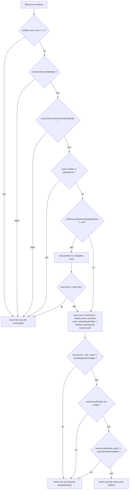

中文版本：[简体中文](zh/microsphere-multiactive-commons.md)

# microsphere-multiactive-commons

## Overview

`microsphere-multiactive-commons` is the framework-free core of the project. It contains the whole zone model and none
of the integration: no Spring, no Servlet API, no discovery client. Anything that can be decided about zones is decided
here, so the higher modules (`spring`, `spring-boot`, `spring-cloud`, `aws`, `netflix`) stay thin adapters.

It answers three questions:

1. **Which zone am I?** — `ZoneContext` holds the answer, `ZoneConstants` defines the keys the answer comes from.
2. **Should I talk to this downstream node?** — `ZonePreferenceFilter` reduces a list of candidate entities to the
   same-zone subset, with explicit safety valves so that a half-registered zone never becomes a total outage.
3. **How do I tell others my zone?** — `ZoneAttachmentHandler` writes the zone into registration metadata, and
   `ZoneResolver` reads it back out of any entity type.

Package: `io.microsphere.multiple.active.zone`. Classes carry `@since 1.0.0` in their Javadoc.

## Maven Coordinates

```xml
<dependency>
    <groupId>io.github.microsphere-projects</groupId>
    <artifactId>microsphere-multiactive-commons</artifactId>
    <version>0.2.14-SNAPSHOT</version>
</dependency>
```

- `groupId`: `io.github.microsphere-projects`
- `artifactId`: `microsphere-multiactive-commons`
- `version`: `${revision}` → `0.2.14-SNAPSHOT`
- `packaging`: `jar`, `<name>`: `Microsphere :: Multi-Active :: Commons`
- Version is managed by [microsphere-multiactive-dependencies](microsphere-multiactive-dependencies.md), so the
  `<version>` element can be omitted when the BOM is imported.

## Version Information

| Item | Value | Verified in |
|------|-------|-------------|
| Documentation line / branch | `current` / `release` | this doc set |
| Artifact version | `0.2.14-SNAPSHOT` | `<revision>` in the root `pom.xml` |
| JDK | 17 or later (CI matrix: 17, 21, 25) | `.github/workflows/maven-build.yml` |
| Other Multi-Active modules required | **none** — this is the leaf of the dependency graph | `microsphere-multiactive-commons/pom.xml` |
| Compile dependencies | `io.github.microsphere-projects:microsphere-annotation-processor` (optional), `io.github.microsphere-projects:microsphere-java-core` (optional) | `microsphere-multiactive-commons/pom.xml` |
| Test dependencies | `org.junit.jupiter:junit-jupiter`, `io.github.microsphere-projects:microsphere-java-test`, `ch.qos.logback:logback-classic` | `microsphere-multiactive-commons/pom.xml` |
| Spring / Spring Boot / Netflix / AWS | not referenced at all by this module | sources under `src/main/java` |

**Optional-dependency caveat.** `microsphere-java-core` is declared `<optional>true</optional>`, yet the code imports
`io.microsphere.logging.Logger`, `io.microsphere.logging.LoggerFactory`, `io.microsphere.util.StringUtils`,
`io.microsphere.constants.SymbolConstants`, `io.microsphere.constants.PropertyConstants` and `io.microsphere.io.IOUtils`
from it. Optional dependencies are **not** transitive, so a plain `commons`-only application must add
`microsphere-java-core` itself (any Multi-Active Spring module already pulls in what it needs, and the annotation
processor `microsphere-annotation-processor` supplies `io.microsphere.annotation.ConfigurationProperty`, which is a
compile-time artifact).

## API Reference

### `ZoneContext`

A process-wide, mutable, observable snapshot of the zone configuration. It is a hand-written singleton:

```java
public class ZoneContext {
    public static ZoneContext get()            // the one and only instance (non-null)
    public static String getCurrentZone()      // System.getProperty("microsphere.current.availability.zone", "defaultZone")

    public boolean isEnabled()
    public String getZone()
    public boolean isPreferenceEnabled()
    public int getPreferenceFilterOrder()
    public int getPreferenceUpstreamZoneReadyPercentage()
    public int getPreferenceUpstreamSameZoneMinAvailable()
    public String getPreferenceUpstreamDisabledZone()

    public void setEnabled(boolean enabled)
    public void setZone(String zone)                                     // trims all whitespace
    public void setPreferenceEnabled(boolean preferenceEnabled)
    public void setPreferenceFilterOrder(int preferenceFilterOrder)
    public void setPreferenceUpstreamZoneReadyPercentage(int percentage)
    public void setPreferenceUpstreamSameZoneMinAvailable(int minAvailable)
    public void setPreferenceUpstreamDisabledZone(String zones)          // normalises "a , b" into "a,b"

    public boolean enable()                                              // enables, returns the previous flag
    public void reset()                                                  // back to every DEFAULT_* constant

    public void addPropertyChangeListener(PropertyChangeListener listener)
    public void removePropertyChangeListener(PropertyChangeListener listener)
}
```

Behaviour worth knowing, all of it asserted by `ZoneContextTest`:

- All seven fields are `volatile`; the instance is shared by every module, so writing it from a config-refresh thread
  is the normal case.
- Every setter goes through `isPropertyChanged(...)`: equal values are **not** written and **not** announced.
  `ZoneContextTest.testSetEnabledNoChangeDoesNotFireEvent` asserts that re-setting the default `true` produces zero
  events, while `testPropertyChangeEventFiredForAllProperties` asserts six distinct changes produce six events.
- When a value really changes, a `java.beans.PropertyChangeEvent` is fired (property names `enabled`, `zone`,
  `preferenceEnabled`, `preferenceFilterOrder`, `preferenceUpstreamZoneReadyPercentage`,
  `preferenceUpstreamSameZoneMinAvailable`, `preferenceUpstreamDisabledZone`) **and** an `info` log line is written;
  unchanged writes log at `trace`.
- `setZone("  zone-b  ")` stores `"zone-b"` (whitespace is stripped); `setZone("")` stores `""`, which then makes
  `ZonePreferenceFilter` ignore the zone (blank).
- `setPreferenceUpstreamDisabledZone(" zone-a , zone-b ")` stores `"zone-a,zone-b"`. A `null` or blank argument is
  stored as-is, so `getPreferenceUpstreamDisabledZone()` may return `null` (the default) or `""`.
- Defaults come from `ZoneConstants`, so `reset()` is exactly "back to the documented defaults".
- `getCurrentZone()` reads a **system property**, not the `zone` field. `CompositeZoneLocator` publishes the located
  zone there; see [microsphere-multiactive-spring.md](microsphere-multiactive-spring.md).
- `toString()` renders every property, e.g.
  `ZoneContext{enabled=true, zone='zone-a', preferenceEnabled=true, preferenceFilterOrder=10, ...}`.

### `ZoneConstants`

An interface used as a constant holder. Every property key and every default value lives here, and each key is
annotated with `@ConfigurationProperty` (`microsphere-annotation-processor`) so configuration metadata can be
generated. `ZoneConstantsTest` asserts every one of the following values verbatim:

| Constant | Value | Kind |
|----------|-------|------|
| `ENABLED_PROPERTY_NAME_SUFFIX` | `.enabled` | suffix |
| `DEFAULT_ZONE` | `defaultZone` | zone value (compatible with Eureka's default zone) |
| `ORIGINAL_ZONE` | `originalZone` | zone value meaning "revert to whatever the locator discovers" |
| `ZONE_PROPERTY_NAME` | `microsphere.availability.zone` | property, default `defaultZone` |
| `CURRENT_ZONE_PROPERTY_NAME` | `microsphere.current.availability.zone` | property (system property) |
| `ZONE_ENABLED_PROPERTY_NAME` | `microsphere.availability.zone.enabled` | boolean, default `true` |
| `PREFERENCE_PROPERTY_NAME_PREFIX` | `microsphere.availability.zone.preference.` | prefix |
| `PREFERENCE_ENABLED_PROPERTY_NAME` | `microsphere.availability.zone.preference.enabled` | boolean, default `false` |
| `PREFERENCE_FILER_PROPERTY_NAME_PREFIX` | `microsphere.availability.zone.preference.filter.` | prefix (name kept as spelled in the source) |
| `PREFERENCE_FILTER_ORDER_PROPERTY_NAME` | `microsphere.availability.zone.preference.filter.order` | int, default `10` |
| `PREFERENCE_UPSTREAM_PROPERTY_NAME_PREFIX` | `microsphere.availability.zone.preference.upstream.` | prefix |
| `PREFERENCE_UPSTREAM_ZONE_READY_PERCENTAGE_PROPERTY_NAME` | `microsphere.availability.zone.preference.upstream.zone-ready-percentage` | int, default `100` |
| `PREFERENCE_UPSTREAM_SAME_ZONE_MIN_AVAILABLE_PROPERTY_NAME` | `microsphere.availability.zone.preference.upstream.same-zone-min-available` | int, default `5` |
| `PREFERENCE_UPSTREAM_DISABLED_ZONE_PROPERTY_NAME` | `microsphere.availability.zone.preference.upstream.disabled-zone` | String, default `null` |
| `LOCATOR_PROPERTY_NAME_PREFIX` | `microsphere.availability.zone.locator.` | prefix |
| `LOCATOR_FAST_FAIL_PROPERTY_NAME` | `microsphere.availability.zone.locator.fast-fail` | boolean, default `false` |
| `LOCATOR_TIMEOUT_PROPERTY_NAME` | `microsphere.availability.zone.locator.timeout` | int, default `3000` (ms) |

Typed defaults (`DEFAULT_ZONE_ENABLED = true`, `DEFAULT_ZONE_PREFERENCE_ENABLED = false`,
`DEFAULT_ZONE_PREFERENCE_FILTER_ORDER = 10`, `DEFAULT_PREFERENCE_UPSTREAM_ZONE_READY_PERCENTAGE = 100`,
`DEFAULT_PREFERENCE_UPSTREAM_SAME_ZONE_MIN_AVAILABLE = 5`, `DEFAULT_PREFERENCE_UPSTREAM_DISABLED_ZONE = null`,
`DEFAULT_LOCATOR_FAST_FAIL = false`, `DEFAULT_TIMEOUT = 3000`) are parsed from the matching
`..._PROPERTY_VALUE` string constants, which keeps the annotation value and the runtime value in sync.

The key takeaway for users: **the feature is on (`enabled = true`) but same-zone preference is off by default
(`preference.enabled = false`)**. Nothing is filtered until you turn preference on.

### `ZoneResolver<E>`

```java
public interface ZoneResolver<E> extends Function<E, String> {
    String resolve(E entity);      // null when the zone cannot be resolved
    default String apply(E entity) // delegates to resolve(entity)
}
```

A strategy for "what zone does this thing belong to?". Because it extends `Function<E, String>` it plugs straight into
streams and lambdas; `ZoneResolverTest` shows the minimal form:

```java
ZoneResolver<String> resolver = entity -> entity + "-zone";
resolver.apply("test");    // "test-zone"
resolver.resolve("test");  // "test-zone"
```

Implementations for real entity types live in other modules: `CloudServerZoneResolver` (Spring Cloud
`ServiceInstance`), `RibbonServerZoneResolver` (Ribbon `Server`), `EurekaInstanceInfoZoneResolver` (Eureka
`InstanceInfo`).

### `ZonePreferenceFilter<E>`

The decision engine. It is a plain class, **not** a Spring type, and it is generic over whatever you route to:

```java
public class ZonePreferenceFilter<E> {
    public ZonePreferenceFilter(ZoneContext zoneContext, ZoneResolver<E> zoneResolver)
    public List<E> filter(List<E> entities)
    public int getOrder()   // returns zoneContext.getPreferenceFilterOrder()
    protected boolean isIgnored(String zone)   // blank or equalsIgnoreCase("defaultZone")
}
```

`filter` never throws and never shrinks the list below "usable": every gate that could leave too few targets returns a
larger candidate set instead. The full order of evaluation, as implemented:



Gates, in order, with the property that controls each:

| # | Gate | Effect | Property |
|---|------|--------|----------|
| 1 | trivial list (`null`, empty, single element) | return input as-is; a `null` list returns `null` | — |
| 2 | zone feature disabled | return input as-is | `microsphere.availability.zone.enabled` |
| 3 | preference disabled | return input as-is | `microsphere.availability.zone.preference.enabled` |
| 4 | current zone blank or `defaultZone` (case-insensitive) | return input as-is | `microsphere.availability.zone` |
| 5 | disabled-zone exclusion removes all but ≤ 1 entity | return the **original** list, not the reduced one | `...upstream.disabled-zone` |
| 6 | percentage of entities carrying a zone below threshold | return the reduced list | `...upstream.zone-ready-percentage` |
| 7 | same-zone count below threshold | return the reduced list | `...upstream.same-zone-min-available` |
| 8 | same-zone entities available | return **only** the same-zone entities | `microsphere.availability.zone` |
| 9 | no same-zone entity at all | return the reduced list | — |

All decisions are logged at `trace`, including which gate fired, so enabling trace for
`io.microsphere.multiple.active.zone` is the supported way to see why a list was or was not narrowed.

### `ZoneAttachmentHandler`

```java
public class ZoneAttachmentHandler {
    public ZoneAttachmentHandler(ZoneContext zoneContext)
    public void attachZone(Map<String, String> metadata)
}
```

Writes `zoneContext.getZone()` into the supplied metadata map under the key `microsphere.availability.zone`
(`ZoneConstants.ZONE_PROPERTY_NAME`). It is the mechanism by which your instance advertises its zone to every other
consumer of the registry. Rules proven by `ZoneAttachmentHandlerTest`:

- a non-blank zone is written, including the literal `defaultZone`;
- a blank zone (`"  "` trims to `""`) writes nothing and logs a warning;
- an unmodifiable map does **not** propagate the `UnsupportedOperationException` — it is caught and logged as a
  warning, so registration never fails because of metadata.

### `HttpUtils`

```java
public abstract class HttpUtils {
    public static String doGet(String url, int timeout) throws IOException
}
```

A minimal `HttpURLConnection` GET used by the AWS locators. It sets both connect and read timeouts to `timeout`,
reads the body as UTF-8 into a `String`, logs the response, and always calls `disconnect()`. It returns `null` for a
blank URL and for any URL whose connection is not an `HttpURLConnection` (e.g. `file:` URLs) — asserted by
`HttpUtilsTest`. IOExceptions propagate to the caller, which logs and returns "no zone".

## Examples

The examples below are adapted from the test suite of this module
(`src/test/java/io/microsphere/multiple/active/zone/`), so they compile against the real API.

### Working with the context (`ZoneContextTest`)

```java
ZoneContext zoneContext = ZoneContext.get();
zoneContext.reset();                       // deterministic starting point

assertEquals(DEFAULT_ZONE, zoneContext.getZone());               // "defaultZone"
assertTrue(zoneContext.isEnabled());                             // default true
assertFalse(zoneContext.isPreferenceEnabled());                  // default false
assertNull(zoneContext.getPreferenceUpstreamDisabledZone());

zoneContext.setZone("  zone-b  ");
assertEquals("zone-b", zoneContext.getZone());                   // whitespace trimmed

zoneContext.setPreferenceUpstreamDisabledZone(" zone-a , zone-b ");
assertEquals("zone-a,zone-b", zoneContext.getPreferenceUpstreamDisabledZone());

boolean previous = zoneContext.enable();   // returns the previous flag, idempotent
assertTrue(previous);
```

Observing changes — this is exactly how `ZoneContextChangedListener` in the Spring module collects events:

```java
List<PropertyChangeEvent> events = new ArrayList<>();
PropertyChangeListener listener = events::add;
zoneContext.addPropertyChangeListener(listener);

zoneContext.setZone("new-zone");           // one change, one event

assertEquals(1, events.size());
assertEquals("zone", events.get(0).getPropertyName());
assertEquals(DEFAULT_ZONE, events.get(0).getOldValue());
assertEquals("new-zone", events.get(0).getNewValue());

zoneContext.removePropertyChangeListener(listener);
```

`ZoneContext.getCurrentZone()` reads the system property, which is what a zone locator publishes:

```java
System.setProperty(CURRENT_ZONE_PROPERTY_NAME, "sys-zone");
assertEquals("sys-zone", ZoneContext.getCurrentZone());
```

### Filtering candidate servers (`ZonePreferenceFilterTest`)

A tiny entity plus a lambda resolver is all you need to test the policy:

```java
static class ZoneEntity {
    final String zone;

    ZoneEntity(String zone) {
        this.zone = zone;
    }
}

ZoneResolver<ZoneEntity> resolver = entity -> entity == null ? null : entity.zone;

ZoneContext zoneContext = ZoneContext.get();
zoneContext.reset();
zoneContext.setEnabled(true);
zoneContext.setPreferenceEnabled(true);
zoneContext.setZone("zone-a");
zoneContext.setPreferenceUpstreamZoneReadyPercentage(100);
zoneContext.setPreferenceUpstreamSameZoneMinAvailable(1);

ZonePreferenceFilter<ZoneEntity> filter = new ZonePreferenceFilter<>(zoneContext, resolver);
```

Same-zone narrowing:

```java
List<ZoneEntity> entities = Arrays.asList(
        new ZoneEntity("zone-a"),
        new ZoneEntity("zone-b"),
        new ZoneEntity("zone-a"));

List<ZoneEntity> result = filter.filter(entities);
assertEquals(2, result.size());                       // only the two zone-a entities
result.forEach(e -> assertEquals("zone-a", e.zone));
```

Fallback when nothing is in your zone, and when the zone is not discoverable:

```java
// No same-zone entity at all -> the original list is returned untouched
List<ZoneEntity> others = Arrays.asList(new ZoneEntity("zone-b"), new ZoneEntity("zone-c"));
assertSame(others, filter.filter(others));

// Only half the upstream nodes report a zone, threshold is 100% -> no narrowing
List<ZoneEntity> halfReady = Arrays.asList(new ZoneEntity("zone-a"), new ZoneEntity(null));
assertEquals(2, filter.filter(halfReady).size());
```

Both thresholds behave as *minimums that must be met*, otherwise the wider list wins:

```java
zoneContext.setPreferenceUpstreamSameZoneMinAvailable(5);
List<ZoneEntity> sparse = Arrays.asList(
        new ZoneEntity("zone-a"), new ZoneEntity("zone-b"), new ZoneEntity("zone-b"));
assertSame(sparse, filter.filter(sparse));            // 1 same-zone node < 5 -> keep everything

zoneContext.setPreferenceUpstreamZoneReadyPercentage(50);
List<ZoneEntity> mixed = Arrays.asList(new ZoneEntity("zone-a"), null, new ZoneEntity("zone-b"));
List<ZoneEntity> narrowed = filter.filter(mixed);     // 2 of 3 report a zone = 66% >= 50%
assertEquals(1, narrowed.size());
assertEquals("zone-a", narrowed.get(0).zone);
```

Draining zones (manual failover away from a zone):

```java
zoneContext.setPreferenceUpstreamDisabledZone("zone-b,zone-c");
List<ZoneEntity> entities = Arrays.asList(
        new ZoneEntity("zone-a"), new ZoneEntity("zone-b"),
        new ZoneEntity("zone-c"), new ZoneEntity("zone-a"));
assertEquals(2, filter.filter(entities).size());      // zone-b and zone-c removed

// If draining would leave 0 or 1 candidate, the original list is restored
zoneContext.setPreferenceUpstreamDisabledZone("zone-b");
List<ZoneEntity> pair = Arrays.asList(new ZoneEntity("zone-a"), new ZoneEntity("zone-b"));
assertSame(pair, filter.filter(pair));
```

Preference is silently skipped for the placeholder zone, in any casing:

```java
zoneContext.setZone("DEFAULTZONE");
assertSame(entities, filter.filter(Arrays.asList(
        new ZoneEntity("zone-a"), new ZoneEntity("zone-b"))));
```

### Attaching the zone to registration metadata (`ZoneAttachmentHandlerTest`)

```java
ZoneContext zoneContext = ZoneContext.get();
zoneContext.reset();
ZoneAttachmentHandler handler = new ZoneAttachmentHandler(zoneContext);

Map<String, String> metadata = new HashMap<>();
zoneContext.setZone("zone-a");
handler.attachZone(metadata);
assertEquals("zone-a", metadata.get(ZONE_PROPERTY_NAME));  // microsphere.availability.zone

// Never throws, even for an immutable metadata map
handler.attachZone(Collections.unmodifiableMap(new HashMap<>()));
```

### Reading a zone from an HTTP metadata endpoint (`HttpUtilsTest`)

```java
String content = HttpUtils.doGet("http://localhost:9000/zone", 3000);
HttpServer server = HttpServer.create(new InetSocketAddress(0), 0);
```

The test starts a JDK `HttpServer` and asserts the body round-trips; blank and non-HTTP URLs return `null`.

## How to Integrate

Stand-alone use, no Spring at all:

```xml
<dependency>
    <groupId>io.github.microsphere-projects</groupId>
    <artifactId>microsphere-multiactive-commons</artifactId>
    <version>0.2.14-SNAPSHOT</version>
</dependency>

<!-- required at runtime: commons' own utilities are an optional dependency -->
<dependency>
    <groupId>io.github.microsphere-projects</groupId>
    <artifactId>microsphere-java-core</artifactId>
</dependency>
```

```java
// 1. tell the context where you are
ZoneContext zoneContext = ZoneContext.get();
zoneContext.setZone(System.getenv("MY_ZONE"));
zoneContext.setPreferenceEnabled(true);
zoneContext.setPreferenceUpstreamSameZoneMinAvailable(2);

// 2. narrow whatever list of targets you route with
ZonePreferenceFilter<MyNode> filter = new ZonePreferenceFilter<>(zoneContext, MyNode::zone);
List<MyNode> targets = filter.filter(discoveredNodes);

// 3. advertise your zone when you register yourself
new ZoneAttachmentHandler(zoneContext).attachZone(myRegistrationMetadata);
```

If you use Spring Boot, none of this wiring is manual — see
[microsphere-multiactive-spring-boot.md](microsphere-multiactive-spring-boot.md).

## Related Documentation

- [User guide index](README.md)
- [microsphere-multiactive-spring.md](microsphere-multiactive-spring.md) — how the context gets filled in a Spring app
- [microsphere-multiactive-spring-cloud.md](microsphere-multiactive-spring-cloud.md) ·
  [microsphere-multiactive-netflix.md](microsphere-multiactive-netflix.md) — the `ZoneResolver` / filter adapters
- Root [README](../../../README.md) and [release notes](../../../release-notes.md)
- Developer guide: [../developer-guide/microsphere-multiactive-commons.md](../developer-guide/microsphere-multiactive-commons.md)

## 中文

中文版本：[简体中文](zh/microsphere-multiactive-commons.md)
